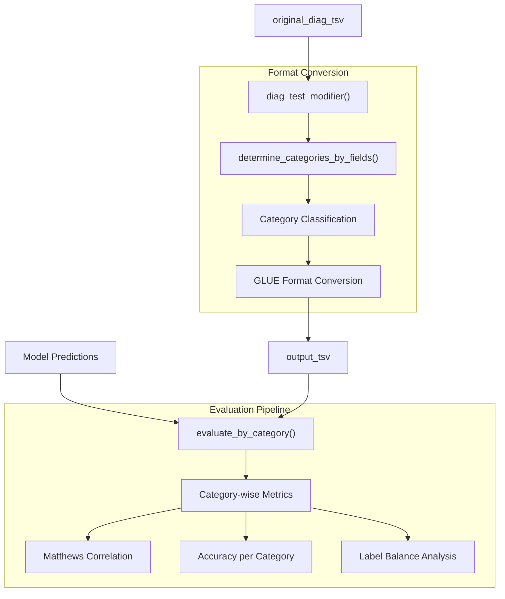
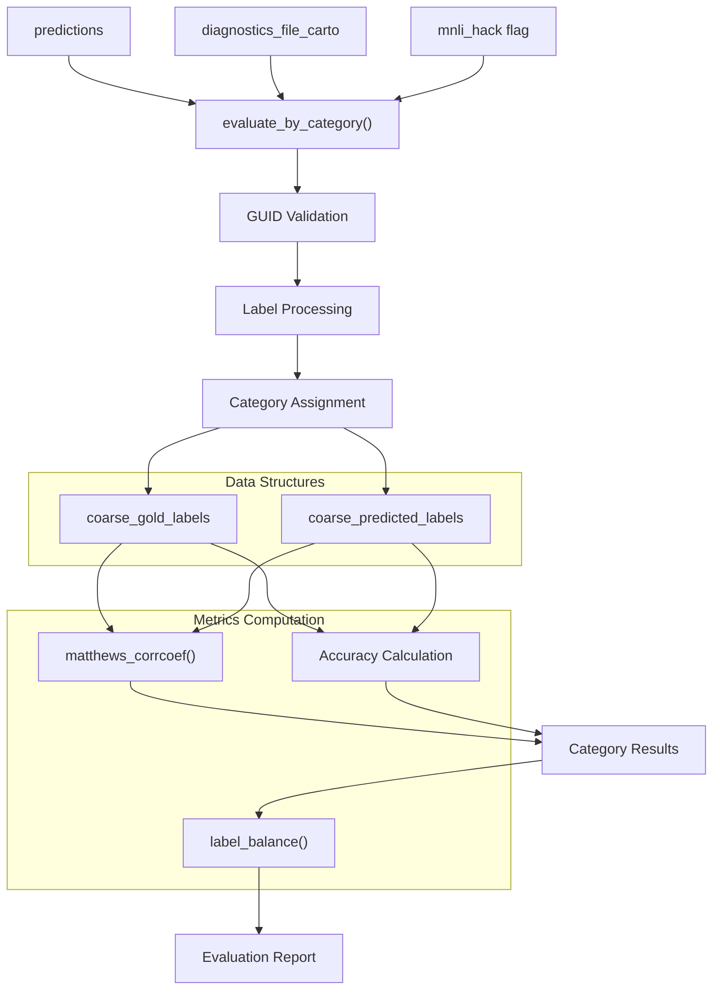

<!-- source: DeepWiki mcp.deepwiki.com · repo allenai/cartography · page 6.1 Diagnostic Evaluation · fetched 2026-10-26 -->

# Diagnostic Evaluation

<details>
<summary>Relevant source files</summary>

The following files were used as context for generating this wiki page:

- [cartography/classification/diagnostics_evaluation.py](cartography/classification/diagnostics_evaluation.py)

</details>


## Purpose and Scope

This document covers the diagnostic evaluation system for Natural Language Inference (NLI) models within Dataset Cartography. The diagnostic evaluation provides category-wise performance analysis across fine-grained linguistic phenomena, enabling researchers to understand model strengths and weaknesses in specific areas of natural language understanding.

The diagnostic evaluation system processes the Diagnostic NLI dataset and evaluates model predictions across four coarse categories: logic, predicate-argument structure, lexical semantics, and knowledge. For general model training and evaluation workflows, see [Core Systems](#3). For task-specific SNLI implementation details, see [SNLI (Natural Language Inference)](#5.1).

## Diagnostic Categories Overview

The diagnostic evaluation system organizes linguistic phenomena into a hierarchical category structure with four coarse categories containing 12 fine-grained subcategories each.

### Category Hierarchy

| Coarse Category | Fine-Grained Categories | Expected Count |
|----------------|------------------------|----------------|
| Logic | Negation, Double negation, Intervals/Numbers, Conjunction, Disjunction, Conditionals, Universal, Existential, Temporal, Upward monotone, Downward monotone, Non-monotone | 364 |
| Predicate Argument Structure | Core args, Prepositional phrases, Ellipsis/Implicits, Anaphora/Coreference, Active/Passive, Nominalization, Genitives/Partitives, Datives, Relative clauses, Coordination scope, Intersectivity, Restrictivity | 424 |
| Lexical Semantics | Lexical entailment, Morphological negation, Factivity, Symmetry/Collectivity, Redundancy, Named entities, Quantifiers | 368 |
| Knowledge | Common sense, World knowledge | 284 |

The category mappings are defined in [cartography/classification/diagnostics_evaluation.py:22-51]() with bidirectional lookup dictionaries `coarse_to_fine` and `fine_to_coarse`.

**Sources:** [cartography/classification/diagnostics_evaluation.py:22-51]()

## Data Format Processing Pipeline

The diagnostic evaluation system converts the original Diagnostic NLI format to GLUE-compatible TSV format for seamless integration with the existing evaluation infrastructure.

### Diagnostic Data Processing Flow



### Field Mapping and Structure

The conversion process maps diagnostic fields to GLUE SNLI format using the `FIELDS` specification:

```
["index", "captionID", "pairID", "sentence1_binary_parse", "sentence2_binary_parse", 
 "sentence1_parse", "sentence2_parse", "sentence1", "sentence2", "category", "gold_label"]
```

The `diag_test_modifier` function [cartography/classification/diagnostics_evaluation.py:76-130]() handles:
- Field extraction and validation
- Category determination from linguistic annotation fields  
- GUID generation for unique identification
- Missing field handling and logging
- Multi-category example processing

**Sources:** [cartography/classification/diagnostics_evaluation.py:17-20](), [cartography/classification/diagnostics_evaluation.py:76-130]()

## Evaluation Pipeline Architecture

The evaluation system processes model predictions against diagnostic ground truth to generate category-specific performance metrics.

### Core Evaluation Flow



### MNLI Label Handling

The evaluation system includes a workaround for HuggingFace Transformers MNLI label swapping via the `mnli_hack` parameter [cartography/classification/diagnostics_evaluation.py:151-156]():

```python
if mnli_hack:
    if p["label"] == "contradiction":
        p["label"] = "entailment"
    elif p["label"] == "entailment":
        p["label"] = "contradiction"
```

**Sources:** [cartography/classification/diagnostics_evaluation.py:132-203]()

## Key Functions and APIs

### `diag_test_modifier(original_diag_tsv, output_tsv)`

Converts original Diagnostic NLI format to GLUE-compatible TSV format.

**Parameters:**
- `original_diag_tsv`: Path to original diagnostic dataset
- `output_tsv`: Output path for converted GLUE format

**Key Operations:**
- Field parsing and validation [cartography/classification/diagnostics_evaluation.py:88-95]()
- Category determination [cartography/classification/diagnostics_evaluation.py:95-105]()
- Record construction and writing [cartography/classification/diagnostics_evaluation.py:106-120]()

### `evaluate_by_category(predictions, eval_filename, mnli_hack, diagnostics_file_carto)`

Performs category-wise evaluation of model predictions against diagnostic ground truth.

**Parameters:**
- `predictions`: List of prediction dictionaries with `guid` and `label` fields
- `eval_filename`: Output file for evaluation results
- `mnli_hack`: Boolean flag for MNLI label correction
- `diagnostics_file_carto`: Path to GLUE-formatted diagnostic file

**Returns:** Category-wise accuracy and Matthews correlation coefficients

### `determine_categories_by_fields(fields)`

Extracts linguistic categories from diagnostic annotation fields [cartography/classification/diagnostics_evaluation.py:63-73]().

**Processing Logic:**
- Handles semicolon-separated multiple categories
- Maps fine-grained to coarse categories via `fine_to_coarse` lookup
- Skips empty fields and processes remaining annotations

**Sources:** [cartography/classification/diagnostics_evaluation.py:63-73](), [cartography/classification/diagnostics_evaluation.py:132-203]()

## Evaluation Metrics and Analysis

### Performance Metrics

The diagnostic evaluation computes comprehensive metrics for each category:

| Metric | Description | Implementation |
|--------|-------------|----------------|
| Accuracy | Proportion of correct predictions | `(predictions == ground_truth).mean()` |
| Matthews Correlation | Balanced metric accounting for class imbalance | `matthews_corrcoef(y_true, y_pred)` |
| Class Variance | Label distribution balance measure | `label_balance()` function |
| Support | Number of examples per category | Category-specific counts |

### Label Balance Analysis

The `label_balance` function [cartography/classification/diagnostics_evaluation.py:54-60]() computes label distribution variance:

```python
def label_balance(label_list):
    distribution = defaultdict(int)
    for label in label_list:
        distribution[label] += 1
    for label in distribution:
        distribution[label] /= len(label_list)
    return np.std(list(distribution.values()))
```

This metric helps identify categories with imbalanced label distributions that may affect interpretation of accuracy scores.

### Output Format

Evaluation results are logged and written with the format:
```
{category:30}: {accuracy:.4f} r3: {matthews_corr:.4f} {correct}/{total:4} class-var: {label_balance:.3f}
```

**Sources:** [cartography/classification/diagnostics_evaluation.py:54-60](), [cartography/classification/diagnostics_evaluation.py:180-202]()

---

