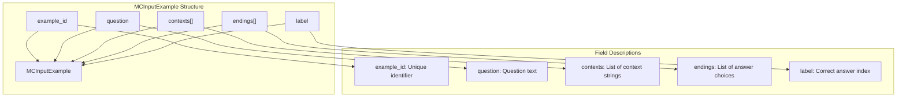
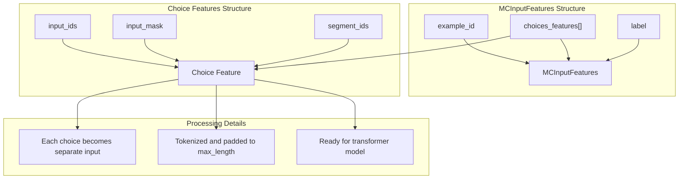
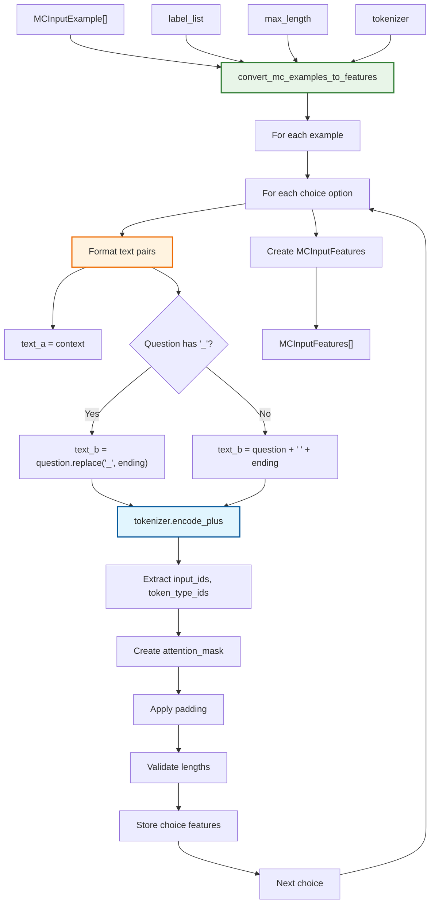
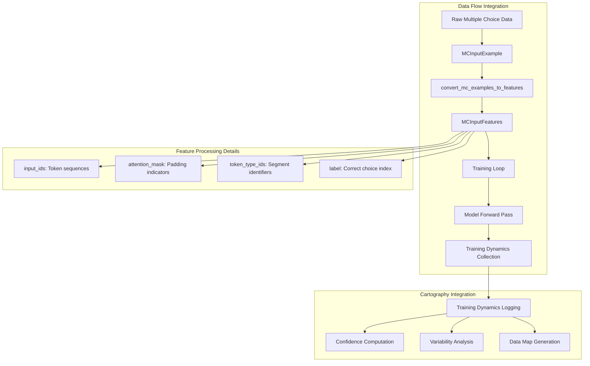

<!-- source: DeepWiki mcp.deepwiki.com · repo allenai/cartography · page 6.2 Multiple Choice Task Support · fetched 2026-10-26 -->

# Multiple Choice Task Support

Relevant source files

The following files were used as context for generating this wiki page:

- [cartography/classification/multiple_choice_utils.py](cartography/classification/multiple_choice_utils.py)

## Purpose and Scope

This document covers the specialized infrastructure for handling multiple-choice classification tasks within the Dataset Cartography system. The multiple choice support is primarily designed for tasks like WinoGrande where models must select the correct answer from a set of predefined options. This infrastructure handles the unique data structures and processing requirements that distinguish multiple-choice tasks from standard text classification.

For information about the specific WinoGrande task implementation, see [WINOGRANDE (Commonsense Reasoning)](#5.2). For general data processing utilities, see [Data Processing Utilities](#3.3).

## Core Components

The multiple choice task support is implemented through a dedicated utility module that provides specialized data structures and processing functions designed specifically for multiple-choice classification scenarios.

### Data Structures

#### MCInputExample Class

The `MCInputExample` class represents a single multiple-choice example before tokenization and processing. This class encapsulates all the components needed for a multiple-choice question:

Sources: [cartography/classification/multiple_choice_utils.py:17-36]()

#### MCInputFeatures Class

The `MCInputFeatures` class represents processed multiple-choice examples ready for model consumption. Each choice is converted into tokenized features with proper input formatting:

Sources: [cartography/classification/multiple_choice_utils.py:38-46]()

## Processing Pipeline

### Example to Features Conversion

The `convert_mc_examples_to_features` function handles the transformation from raw multiple-choice examples to model-ready features. This process involves several specialized steps for multiple-choice formatting:

Sources: [cartography/classification/multiple_choice_utils.py:48-126]()

### Text Formatting Logic

The system handles two types of multiple-choice question formats:

| Format Type | Detection | Text Processing |
|-------------|-----------|-----------------|
| Cloze Questions | Question contains "_" | Replace "_" with each ending option |
| Standard Questions | No "_" in question | Concatenate question + " " + ending |

This flexible formatting allows the system to handle various multiple-choice question styles while maintaining consistent input structure for the transformer models.

Sources: [cartography/classification/multiple_choice_utils.py:71-75]()

## Integration with Training System

### Model Input Preparation

The multiple choice utilities integrate with the broader Dataset Cartography training pipeline by providing properly formatted inputs that transformer models can process:

Sources: [cartography/classification/multiple_choice_utils.py:38-126]()

### Tokenization and Padding

The conversion process handles transformer-specific requirements including:

- **Special Token Addition**: Automatically adds `[CLS]` and `[SEP]` tokens using `add_special_tokens=True`
- **Length Management**: Ensures all sequences fit within `max_length` parameter with proper truncation warnings
- **Padding Strategy**: Supports both left and right padding with configurable padding tokens
- **Attention Masking**: Creates proper attention masks to distinguish real tokens from padding

The system logs warnings when truncation occurs, helping users identify when sequence lengths may be problematic for their specific tasks.

Sources: [cartography/classification/multiple_choice_utils.py:77-103]()

## Task-Specific Adaptations

### WinoGrande Integration

The multiple choice utilities are primarily designed for WinoGrande-style tasks, as evidenced by the logging output that specifically references "winogrande_id" and "winogrande_context". The system handles the commonsense reasoning format where:

- Context provides the scenario setup
- Question contains a blank (indicated by "_") or explicit question
- Multiple endings provide the possible completions
- Model must select the most plausible option

This design makes the utilities suitable for other similar commonsense reasoning and cloze-completion tasks beyond WinoGrande.

Sources: [cartography/classification/multiple_choice_utils.py:113-121]()

### Debugging and Validation

The conversion function includes comprehensive logging for the first few examples, displaying:
- Example ID and context
- Each choice option with its processed tokens
- Input IDs, attention masks, and token type IDs
- Label correctness for each choice

This detailed logging helps developers verify that the tokenization and formatting process is working correctly for their specific multiple-choice datasets.

Sources: [cartography/classification/multiple_choice_utils.py:111-121]()

---

