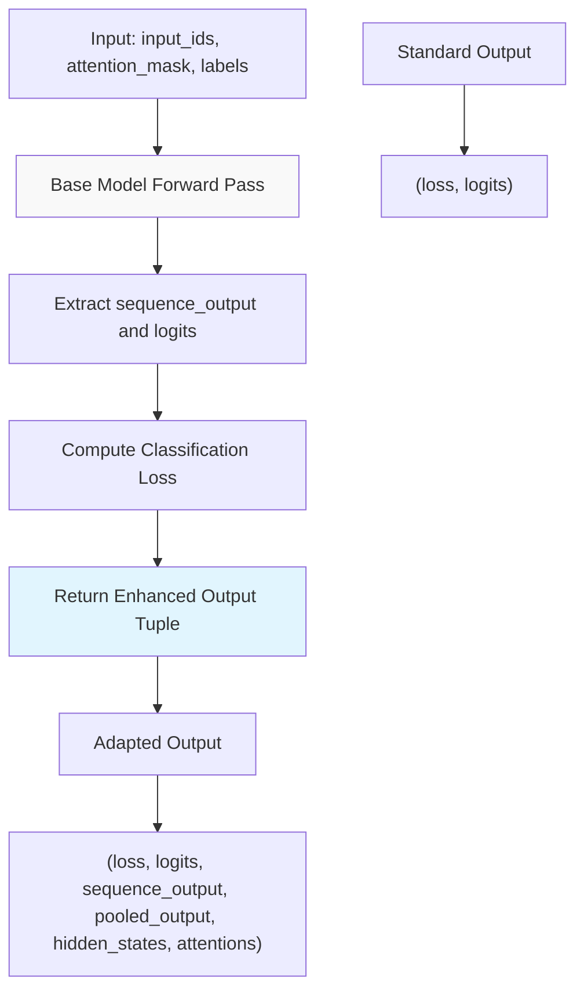
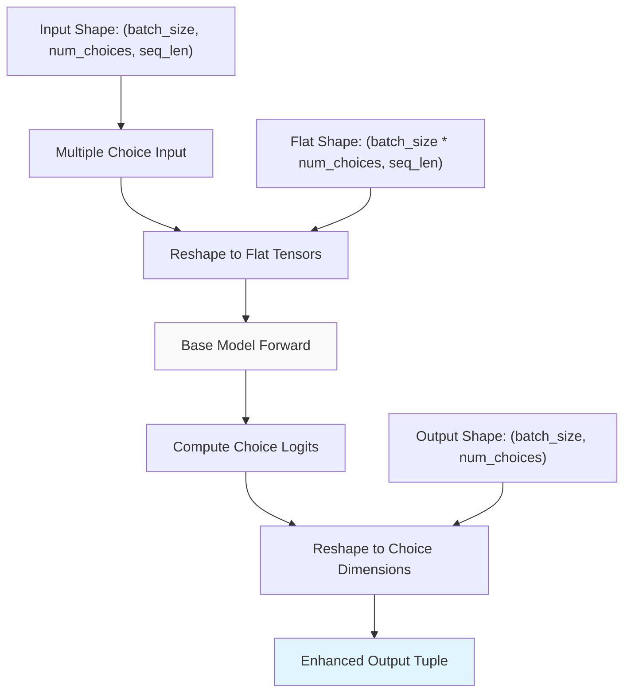
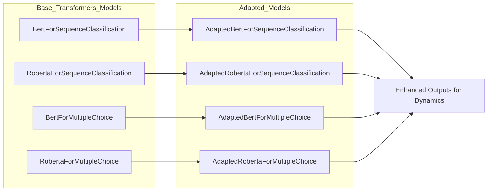
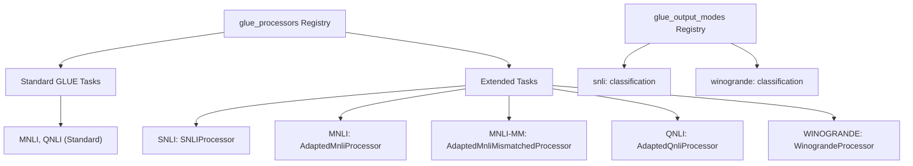
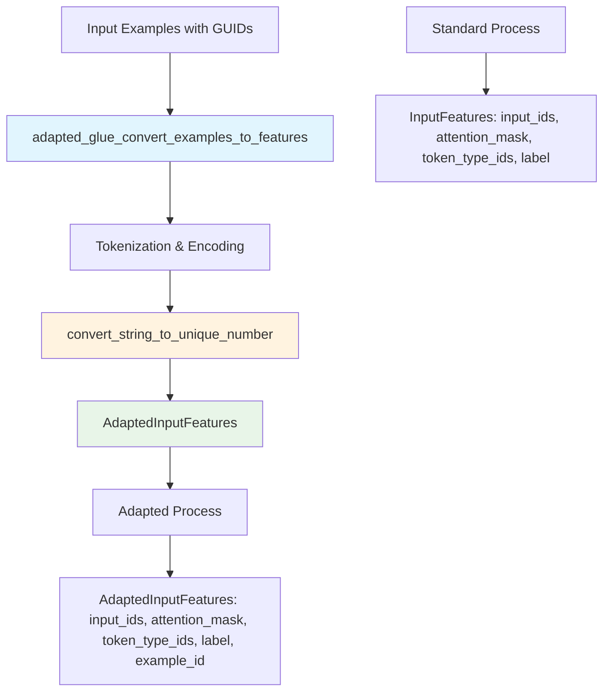
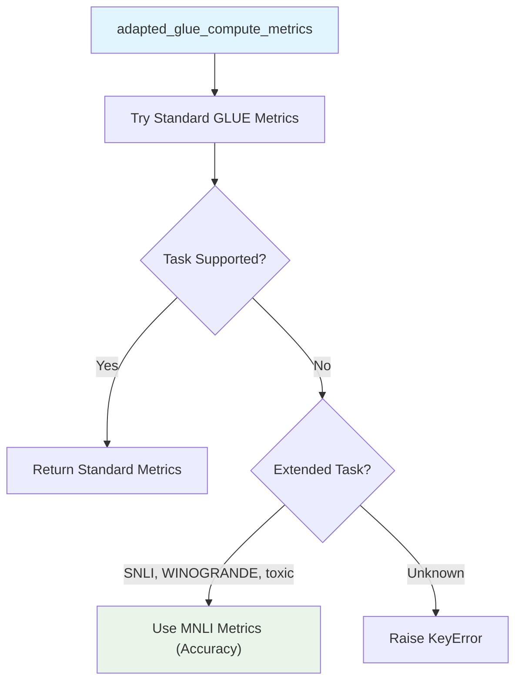
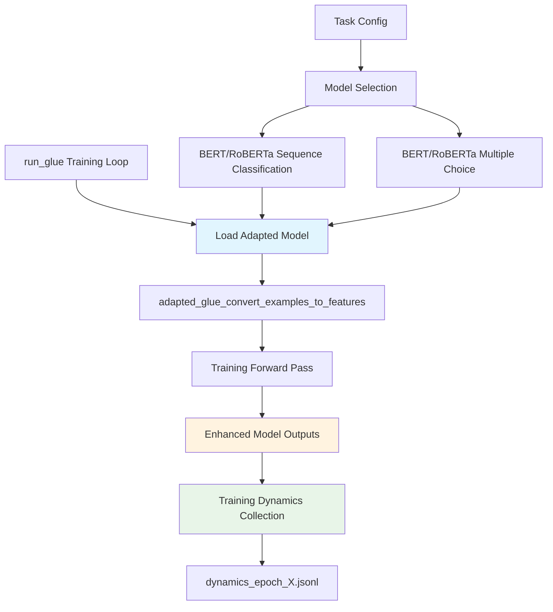

<!-- source: DeepWiki mcp.deepwiki.com · repo allenai/cartography · page 6.3 Model Adaptations · fetched 2026-10-26 -->

# Model Adaptations

Relevant source files

The following files were used as context for generating this wiki page:

- [cartography/classification/glue_utils.py](cartography/classification/glue_utils.py)
- [cartography/classification/models.py](cartography/classification/models.py)

This document covers the model adaptations implemented in Dataset Cartography to support training dynamics collection and extended GLUE task compatibility. The adaptations modify standard HuggingFace Transformers models and GLUE utilities to enable tracking of training dynamics while maintaining compatibility with the cartography analysis pipeline.

For information about how these models are used during training, see [Training with Dynamics Collection](#3.1). For details on task-specific configurations, see [Task Configuration Files](#4.2).

## Model Architecture Adaptations

Dataset Cartography provides adapted versions of BERT and RoBERTa models that extend the standard HuggingFace Transformers implementations. These adaptations modify the forward pass outputs to support training dynamics collection without changing the core model behavior.

### Sequence Classification Models

The system provides two adapted sequence classification models that extend their HuggingFace counterparts:

| Model Class | Base Class | Key Modification |
|-------------|------------|------------------|
| `AdaptedBertForSequenceClassification` | `BertForSequenceClassification` | Returns sequence outputs for dynamics tracking |
| `AdaptedRobertaForSequenceClassification` | `RobertaForSequenceClassification` | Returns sequence outputs for dynamics tracking |

Both models modify the forward method to return additional outputs beyond the standard loss and logits:

**Sources:** [cartography/classification/models.py:259-340](), [cartography/classification/models.py:9-84]()

### Multiple Choice Models

For tasks requiring multiple choice classification, the system provides adapted versions that maintain the same output enhancement pattern:

| Model Class | Base Class | Task Support |
|-------------|------------|--------------|
| `AdaptedBertForMultipleChoice` | `BertForMultipleChoice` | WINOGRANDE, other MC tasks |
| `AdaptedRobertaForMultipleChoice` | `RobertaForMultipleChoice` | WINOGRANDE, other MC tasks |

**Sources:** [cartography/classification/models.py:170-256](), [cartography/classification/models.py:87-167]()

### Key Modifications from Base Models

The adapted models implement these specific changes to support cartography functionality:

1. **Enhanced Output Tuples**: Include intermediate representations needed for dynamics analysis
2. **Preserved Backward Compatibility**: Maintain the same interface as base models
3. **Training Dynamics Support**: Enable access to internal model states during training

**Sources:** [cartography/classification/models.py:1-341]()

## GLUE Task Adaptations

The system extends HuggingFace's GLUE utilities to support additional tasks and enable unique example identification required for training dynamics tracking.

### Task Processor Registration

Dataset Cartography registers custom processors for tasks not included in the standard GLUE benchmark:

**Sources:** [cartography/classification/glue_utils.py:27-34]()

### Feature Conversion Adaptations

The `adapted_glue_convert_examples_to_features` function extends the standard HuggingFace feature conversion to include unique example identifiers:

| Component | Standard Behavior | Adapted Behavior |
|-----------|------------------|------------------|
| Input Features | Basic tokenization and encoding | Adds unique `example_id` field |
| Example Tracking | No unique identification | Converts GUID to integer ID |
| Output Format | Standard `InputFeatures` | `AdaptedInputFeatures` with ID |

**Sources:** [cartography/classification/glue_utils.py:37-185](), [cartography/classification/glue_utils.py:47-157]()

### Metrics Computation Adaptations

The `adapted_glue_compute_metrics` function handles tasks beyond standard GLUE by falling back to compatible metric computation:

**Sources:** [cartography/classification/glue_utils.py:188-196]()

## Integration with Cartography System

The model adaptations integrate seamlessly with the cartography training and analysis pipeline through several key mechanisms:

### Training Integration

### Model Selection Logic

The system automatically selects appropriate adapted models based on task configuration:

| Task Type | Model Architecture | Adapted Class |
|-----------|-------------------|---------------|
| Sequence Classification | BERT | `AdaptedBertForSequenceClassification` |
| Sequence Classification | RoBERTa | `AdaptedRobertaForSequenceClassification` |
| Multiple Choice | BERT | `AdaptedBertForMultipleChoice` |
| Multiple Choice | RoBERTa | `AdaptedRobertaForMultipleChoice` |

**Sources:** [cartography/classification/models.py:1-341](), [cartography/classification/glue_utils.py:1-198]()

---

