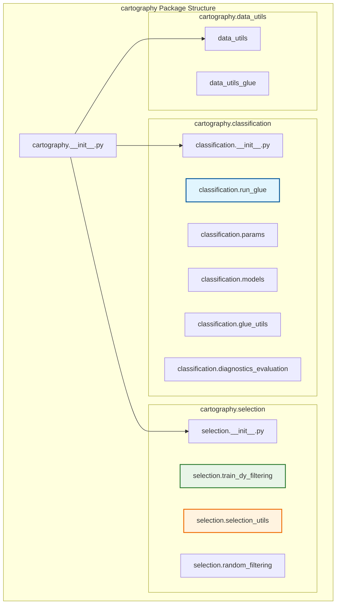
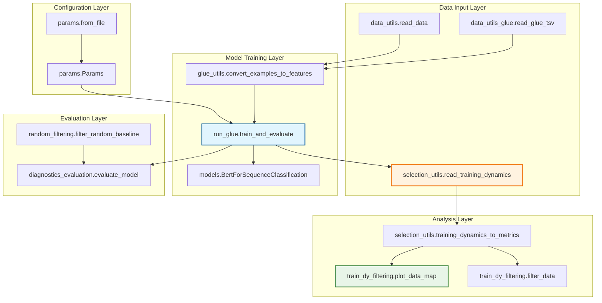
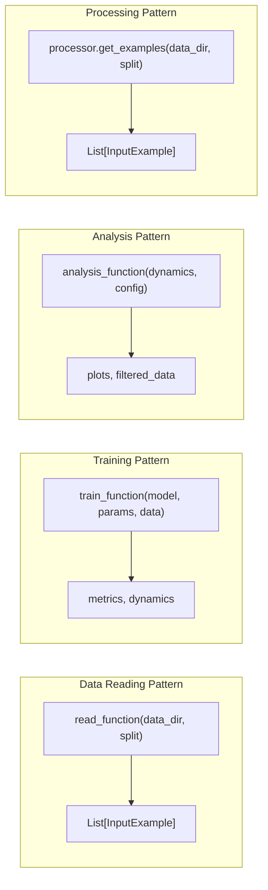

<!-- source: DeepWiki mcp.deepwiki.com · repo allenai/cartography · page 7 API Reference · fetched 2026-10-26 -->

# API Reference

Relevant source files

The following files were used as context for generating this wiki page:

- [cartography/__init__.py](cartography/__init__.py)
- [cartography/classification/__init__.py](cartography/classification/__init__.py)
- [cartography/selection/__init__.py](cartography/selection/__init__.py)

This document provides comprehensive API documentation for all modules, classes, and functions in the Dataset Cartography package. The API is organized into three main functional areas: data utilities for reading and processing datasets, selection utilities for training dynamics analysis, and training/evaluation utilities for model operations.

For practical usage examples and tutorials, see [Examples and Tutorials](#8). For configuration details, see [Configuration Management](#4).

## API Organization

The Dataset Cartography API is structured around three core functional modules that correspond to the main workflow phases:

Sources: [cartography/__init__.py:1](), [cartography/classification/__init__.py:1](), [cartography/selection/__init__.py:1]()

## Core API Modules

The API is divided into logical modules that handle different aspects of the Dataset Cartography workflow:

| Module | Primary Purpose | Key Components |
|--------|----------------|----------------|
| `cartography.classification` | Model training and evaluation | `run_glue`, `params`, `models`, `glue_utils` |
| `cartography.selection` | Training dynamics analysis | `train_dy_filtering`, `selection_utils` |
| `cartography.data_utils` | Data reading and processing | `read_data`, `read_jsonl`, GLUE processors |

## Module Interaction Flow

Sources: Referenced from system architecture diagrams and module organization

## Training and Classification API

The classification module provides the core training infrastructure:

### Main Training Functions

- **`cartography.classification.run_glue.main()`** - Primary entry point for training models with dynamics collection
- **`cartography.classification.run_glue.train_and_evaluate()`** - Core training loop with evaluation
- **`cartography.classification.run_glue.collect_training_dynamics()`** - Dynamics collection during training

### Parameter Management

- **`cartography.classification.params.Params`** - Central configuration class
- **`cartography.classification.params.from_file()`** - Load parameters from JSONNet configs

### Model Adaptations  

- **`cartography.classification.models.BertForSequenceClassification`** - Adapted BERT model
- **`cartography.classification.models.RobertaForSequenceClassification`** - Adapted RoBERTa model

Sources: [cartography/classification/run_glue.py](), [cartography/classification/params.py](), [cartography/classification/models.py]()

## Data Selection and Analysis API

The selection module handles training dynamics analysis and data filtering:

### Core Analysis Functions

- **`cartography.selection.train_dy_filtering.main()`** - Main entry point for dynamics analysis
- **`cartography.selection.train_dy_filtering.plot_data_map()`** - Generate confidence vs variability plots
- **`cartography.selection.train_dy_filtering.filter_data()`** - Filter datasets based on computed metrics

### Training Dynamics Utilities

- **`cartography.selection.selection_utils.read_training_dynamics()`** - Load dynamics from JSONL files
- **`cartography.selection.selection_utils.training_dynamics_to_metrics()`** - Compute confidence, variability, correctness
- **`cartography.selection.selection_utils.write_training_dynamics()`** - Save dynamics data

### Baseline Filtering

- **`cartography.selection.random_filtering.filter_random_baseline()`** - Create random data subsets for comparison

Sources: [cartography/selection/train_dy_filtering.py](), [cartography/selection/selection_utils.py](), [cartography/selection/random_filtering.py]()

## Data Processing API

The data utilities provide robust data reading and conversion capabilities:

### Core Data Functions

- **`cartography.data_utils.read_data()`** - Generic data reading from various formats
- **`cartography.data_utils.read_jsonl()`** - Read JSONL files with training dynamics
- **`cartography.data_utils.write_tsv()`** - Write filtered datasets to TSV format

### GLUE-Specific Utilities

- **`cartography.data_utils_glue.read_glue_tsv()`** - Read GLUE-formatted TSV files
- **`cartography.data_utils_glue.SNLIProcessor`** - Process SNLI dataset format
- **`cartography.data_utils_glue.WinograndeProcessor`** - Process WINOGRANDE dataset format

### Task Processors

Each supported task has dedicated processor classes that handle task-specific data formatting:

| Processor Class | Task | Input Format |
|----------------|------|--------------|
| `SNLIProcessor` | Natural Language Inference | SNLI TSV format |
| `WinograndeProcessor` | Commonsense Reasoning | WINOGRANDE JSONL format |
| `QNLIProcessor` | Question-answering NLI | QNLI TSV format |
| `MNLIProcessor` | Multi-genre NLI | MNLI TSV format |

Sources: [cartography/data_utils.py](), [cartography/data_utils_glue.py]()

## Function Signature Patterns

The API follows consistent patterns for different operation types:

Sources: Derived from API function organization patterns

## Error Handling and Validation

The API includes comprehensive error handling for common issues:

- **Data Format Validation** - Automatic validation of input data formats
- **Configuration Validation** - Parameter validation with clear error messages  
- **File Path Validation** - Robust handling of missing files and directories
- **GPU/CPU Compatibility** - Automatic device detection and fallback

## Extension Points

The API is designed for extensibility:

- **Custom Task Processors** - Implement new processor classes for additional tasks
- **Custom Metrics** - Add new training dynamics metrics in `selection_utils`
- **Custom Models** - Extend model classes for new architectures
- **Custom Filters** - Implement new data filtering strategies

For detailed examples of extending the API, see [Examples and Tutorials](#8).

Sources: [cartography/__init__.py:1](), [cartography/classification/__init__.py:1](), [cartography/selection/__init__.py:1]()

---

