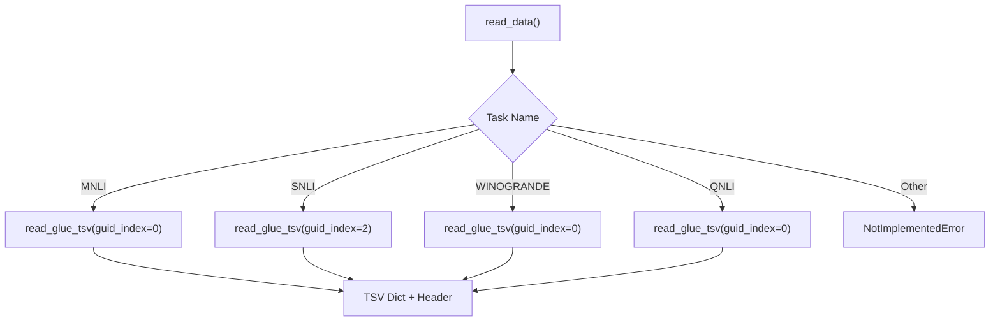
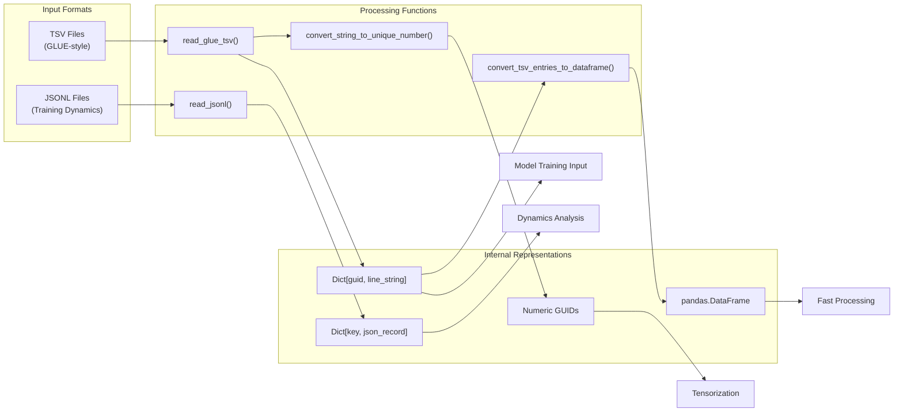
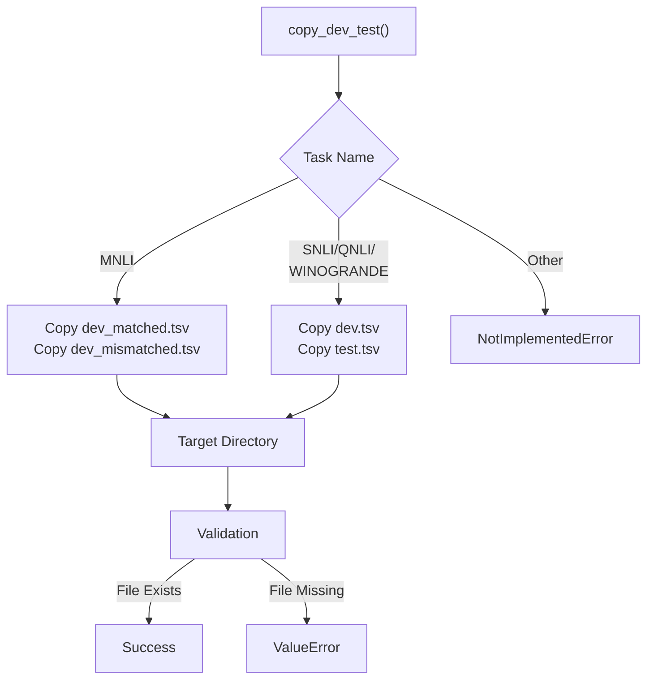
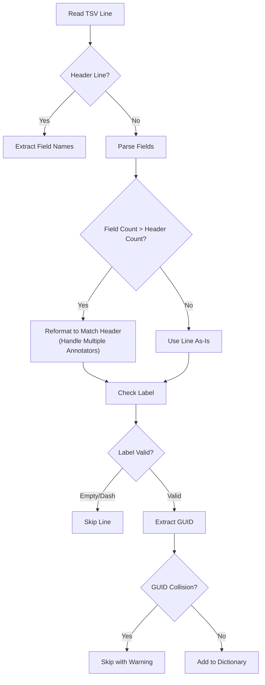

<!-- source: DeepWiki mcp.deepwiki.com · repo allenai/cartography · page 7.1 Data Utilities API · fetched 2026-10-26 -->

# Data Utilities API

<details>
<summary>Relevant source files</summary>

The following files were used as context for generating this wiki page:

- [cartography/data_utils.py](cartography/data_utils.py)
- [cartography/data_utils_glue.py](cartography/data_utils_glue.py)

</details>


This page documents the API for data reading, processing, and conversion utilities in the Dataset Cartography system. These utilities handle the ingestion and transformation of various data formats including GLUE-style TSV files, JSONL training dynamics files, and internal data structures.

For information about training dynamics data structures and selection utilities, see [Selection Utilities API](#7.2). For task-specific configuration and processing details, see [Supported Tasks](#5).

## Core Data Reading Functions

The primary entry point for data reading is the `read_data()` function in [cartography/data_utils.py:17-42](), which provides a unified interface for reading task-specific datasets from GLUE-style TSV files.

### Task-Specific Data Reading



**API Functions:**

| Function | Parameters | Returns | Purpose |
|----------|------------|---------|---------|
| `read_data` | `file_path`, `task_name`, `guid_as_int=False` | `(tsv_dict, header)` | Task-specific TSV reading with appropriate GUID indexing |
| `read_glue_tsv` | `file_path`, `guid_index`, `label_index=-1`, `guid_as_int=False` | `(tsv_dict, header)` | Generic GLUE TSV reader with configurable GUID and label columns |
| `read_jsonl` | `file_path`, `key="pairID"` | `dict` or `list` | JSONL file reader with optional key-based mapping |

Sources: [cartography/data_utils.py:17-42](), [cartography/data_utils_glue.py:31-80](), [cartography/data_utils.py:91-104]()

## Data Format Processing Pipeline

### File Format to Internal Representation



Sources: [cartography/data_utils_glue.py:31-80](), [cartography/data_utils.py:91-104](), [cartography/data_utils_glue.py:9-28](), [cartography/data_utils.py:45-59]()

## Data Conversion Utilities

### TSV to DataFrame Conversion

The `convert_tsv_entries_to_dataframe()` function [cartography/data_utils.py:45-59]() transforms TSV dictionary entries into pandas DataFrames for efficient processing:

```python
def convert_tsv_entries_to_dataframe(tsv_dict: Dict, header: str) -> pd.DataFrame
```

This function:
- Parses the header string to extract column names
- Iterates through TSV dictionary values
- Validates field count consistency
- Returns a structured DataFrame with proper column mapping

### GUID Processing

The `convert_string_to_unique_number()` function [cartography/data_utils_glue.py:9-28]() handles SNLI-specific ID conversion:

- Converts string GUIDs to unique integer representations
- Handles SNLI-specific prefixes (`vg_len`, `vg_verb`)
- Maps entailment labels (`e`, `c`, `n`) to numeric suffixes
- Provides fallback random number generation for unrecognized formats

Sources: [cartography/data_utils.py:45-59](), [cartography/data_utils_glue.py:9-28]()

## File Management Utilities

### Development and Test Set Management

The `copy_dev_test()` function [cartography/data_utils.py:62-88]() handles dataset splitting for data selection experiments:



**Parameters:**
- `task_name`: Determines file naming convention
- `from_dir`: Source directory path
- `to_dir`: Destination directory path  
- `extension`: File extension (default: ".tsv")

Sources: [cartography/data_utils.py:62-88]()

## GLUE-Style TSV Processing

### Core TSV Reading Logic

The `read_glue_tsv()` function [cartography/data_utils_glue.py:31-80]() implements the low-level TSV processing:

**Key Features:**
- **Header Processing**: Extracts field names from first line
- **Field Validation**: Handles variable annotator labels in SNLI/MNLI
- **Label Filtering**: Skips entries with empty or missing labels (`"-"` or `""`)
- **GUID Collision Detection**: Warns and skips duplicate GUIDs
- **Flexible Indexing**: Configurable GUID and label column positions

**Data Validation Flow:**



Sources: [cartography/data_utils_glue.py:31-80]()

## Task-Specific GUID Indexing

Different NLP tasks use different column layouts for their unique identifiers:

| Task | GUID Index | Label Index | Notes |
|------|------------|-------------|-------|
| MNLI | 0 | -1 (last) | First column contains pair ID |
| SNLI | 2 | -1 (last) | Third column contains pair ID |
| QNLI | 0 | -1 (last) | First column contains pair ID |
| WINOGRANDE | 0 | -1 (last) | First column contains pair ID |

This indexing configuration is handled automatically by the `read_data()` dispatcher function, which routes to `read_glue_tsv()` with the appropriate parameters.

Sources: [cartography/data_utils.py:27-41]()

## JSONL Data Processing

### Training Dynamics Reading

The `read_jsonl()` function [cartography/data_utils.py:91-104]() provides flexible JSONL processing:

**Modes of Operation:**
1. **Key-Based Mapping**: Returns `Dict[key_value, json_record]` when `key` parameter is provided
2. **List Format**: Returns `List[json_record]` when no key is specified

**Implementation Details:**
- Uses `pandas.read_json()` with `lines=True` for efficient parsing
- Validates key existence in DataFrame columns
- Converts DataFrame to dictionary records for easier manipulation
- Provides logging for record count verification

Sources: [cartography/data_utils.py:91-104]()

---

