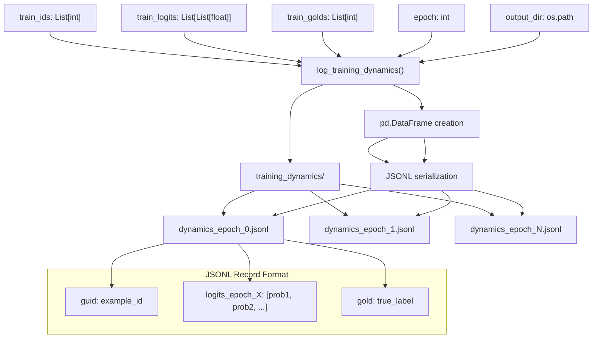
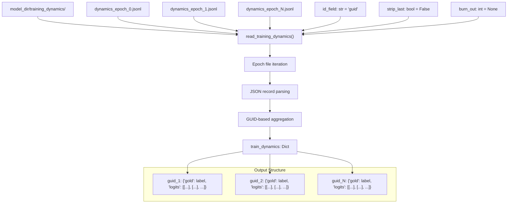
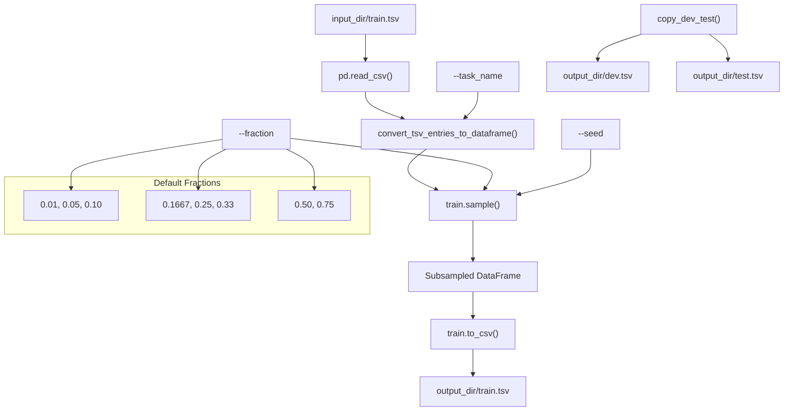
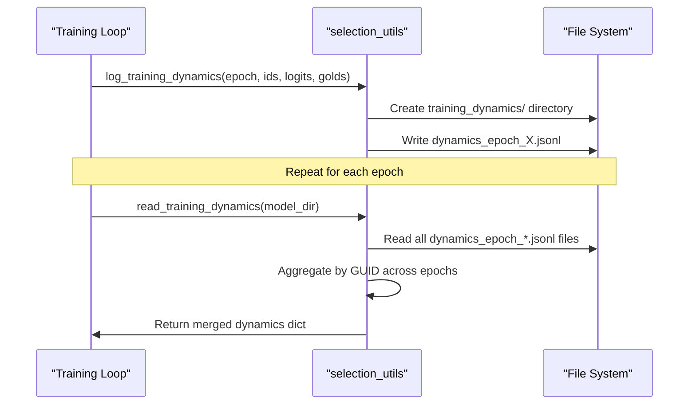

<!-- source: DeepWiki mcp.deepwiki.com · repo allenai/cartography · page 7.2 Selection Utilities API · fetched 2026-10-26 -->

# Selection Utilities API

<details>
<summary>Relevant source files</summary>

The following files were used as context for generating this wiki page:

- [cartography/selection/random_filtering.py](cartography/selection/random_filtering.py)
- [cartography/selection/selection_utils.py](cartography/selection/selection_utils.py)

</details>


This page documents the API for training dynamics logging, reading, and data selection utilities within the Dataset Cartography system. These utilities enable the collection of training dynamics during model training and subsequent analysis for data selection strategies.

For information about the higher-level data analysis and filtering workflows, see [Data Analysis and Selection](#3.2). For general data processing utilities, see [Data Utilities API](#7.1).

## Training Dynamics Collection and Storage

The selection utilities provide functions for capturing and persisting training dynamics during model training. The system logs logits, gold labels, and example identifiers for each training epoch, creating a historical record of how model predictions evolve over time.

### Training Dynamics Logging Flow



*Training dynamics logging workflow from training loop to persistent storage*

Sources: [cartography/selection/selection_utils.py:16-35]()

### Training Dynamics Reading and Aggregation



*Training dynamics reading and aggregation across multiple epoch files*

Sources: [cartography/selection/selection_utils.py:37-68]()

## Function Reference

### log_training_dynamics

Saves training dynamics from a given epoch as records in a JSONL file.

| Parameter | Type | Description |
|-----------|------|-------------|
| `output_dir` | `os.path` | Base directory where training dynamics will be logged |
| `epoch` | `int` | Current training epoch number |
| `train_ids` | `List[int]` | List of unique identifiers for training examples |
| `train_logits` | `List[List[float]]` | List of logit vectors for each training example |
| `train_golds` | `List[int]` | List of gold labels for each training example |

**Output**: Creates `training_dynamics/dynamics_epoch_{epoch}.jsonl` file containing one JSON record per training example.

**File Location**: [cartography/selection/selection_utils.py:16-35]()

### read_training_dynamics  

Reads logged training dynamics and merges statistics across epochs for analysis.

| Parameter | Type | Default | Description |
|-----------|------|---------|-------------|
| `model_dir` | `os.path` | Required | Directory containing `training_dynamics/` subdirectory |
| `strip_last` | `bool` | `False` | Whether to strip the last character from example IDs |
| `id_field` | `str` | `"guid"` | Field name containing example identifiers |
| `burn_out` | `int` | `None` | Limit number of epochs to read (if specified) |

**Returns**: Dictionary mapping example GUIDs to their gold labels and logits across all epochs.

**File Location**: [cartography/selection/selection_utils.py:37-68]()

## Random Baseline Generation

The system provides a command-line utility for generating random subsets of training data as baselines for data selection experiments.

### Random Filtering Architecture



*Random baseline generation workflow with configurable sampling fractions*

Sources: [cartography/selection/random_filtering.py:17-84]()

### Random Filtering Parameters

| Parameter | Type | Default | Description |
|-----------|------|---------|-------------|
| `--input_dir` | `str` | Required | Path containing TSV train file to subsample |
| `--output_dir` | `str` | Required | Path where subsampled data will be written |
| `--task_name` | `str` | `"SNLI"` | GLUE-style task name (SNLI, MNLI, WINOGRANDE, QNLI) |
| `--seed` | `int` | `725862` | Random seed for reproducible sampling |
| `--fraction` | `float` | Auto | Fraction of examples to sample (0-1) |

**Supported Tasks**: SNLI, MNLI, WINOGRANDE, QNLI

**File Location**: [cartography/selection/random_filtering.py:24-49]()

## Data Format Specifications

### Training Dynamics JSONL Format

Each epoch file contains one JSON record per line with the following structure:

```json
{
  "guid": "example_unique_id",
  "logits_epoch_X": [0.2, 0.8, 0.1],
  "gold": 1
}
```

**Field Descriptions**:
- `guid`: Unique identifier for the training example
- `logits_epoch_X`: Raw logit values from model output for epoch X
- `gold`: True label index for the example

Sources: [cartography/selection/selection_utils.py:24-26]()

### Aggregated Training Dynamics Structure

The `read_training_dynamics` function returns a nested dictionary:

```python
{
  "example_id_1": {
    "gold": 1,
    "logits": [
      [0.1, 0.9, 0.0],  # epoch 0
      [0.2, 0.8, 0.0],  # epoch 1
      [0.3, 0.7, 0.0]   # epoch 2
    ]
  },
  "example_id_2": {
    "gold": 0, 
    "logits": [...]
  }
}
```

Sources: [cartography/selection/selection_utils.py:62-65]()

## Integration with Training Loop

The selection utilities integrate with the main training pipeline through the following workflow:



*Integration sequence showing how selection utilities interact with training and file system*

Sources: [cartography/selection/selection_utils.py:16-68]()

---

