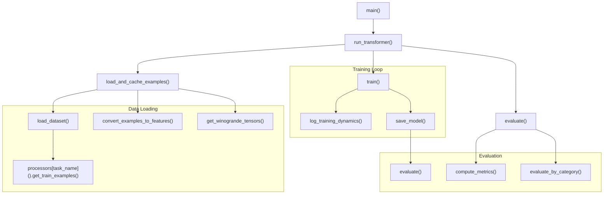
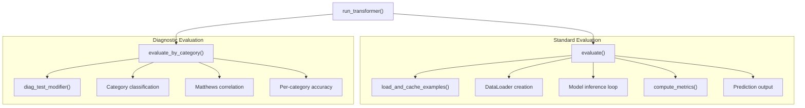
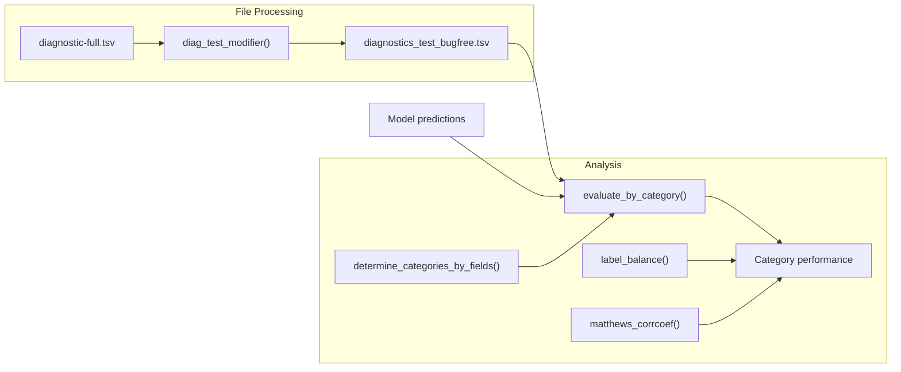

<!-- source: DeepWiki mcp.deepwiki.com · repo allenai/cartography · page 7.3 Training and Evaluation API · fetched 2026-10-26 -->

# Training and Evaluation API

<details>
<summary>Relevant source files</summary>

The following files were used as context for generating this wiki page:

- [cartography/classification/diagnostics_evaluation.py](cartography/classification/diagnostics_evaluation.py)
- [cartography/classification/run_glue.py](cartography/classification/run_glue.py)

</details>


This page provides comprehensive API reference documentation for model training, evaluation, and diagnostic analysis functions in the Dataset Cartography system. These APIs handle the core machine learning pipeline including model training with dynamics collection, evaluation on various splits, and specialized diagnostic analysis for Natural Language Inference tasks.

For data processing and conversion utilities, see [Data Utilities API](#7.1). For training dynamics logging and data selection functions, see [Selection Utilities API](#7.2).

## Core Training Functions

The primary training infrastructure is built around transformer-based models with integrated training dynamics collection. The main entry point is the `run_transformer()` function which orchestrates the entire training pipeline.

### Training Pipeline Architecture



Sources: [cartography/classification/run_glue.py:757-794](), [cartography/classification/run_glue.py:594-755]()

### `train(args, train_dataset, model, tokenizer)`

Main training function that implements the training loop with integrated dynamics collection.

**Parameters:**
- `args`: Training configuration parameters from `Params` class
- `train_dataset`: PyTorch `TensorDataset` containing training examples
- `model`: Transformer model instance (BERT/RoBERTa variants)
- `tokenizer`: Corresponding tokenizer for the model

**Returns:**
- `global_step`: Total number of training steps completed
- `tr_loss`: Average training loss across all steps

**Key Features:**
- Integrates `log_training_dynamics()` to collect training dynamics at each epoch
- Supports distributed training via `DistributedDataParallel`
- Implements early stopping based on development set performance
- Saves model checkpoints during training

Sources: [cartography/classification/run_glue.py:98-358](), [cartography/classification/run_glue.py:322-327]()

### `save_model(args, model, tokenizer, epoch, best_epoch, best_dev_performance)`

Evaluates model on development set and saves checkpoint if performance improves.

**Parameters:**
- `args`: Configuration parameters
- `model`: Model to evaluate and potentially save
- `tokenizer`: Model tokenizer
- `epoch`: Current training epoch
- `best_epoch`: Best performing epoch so far
- `best_dev_performance`: Best development performance achieved

**Returns:**
- `best_dev_performance`: Updated best performance
- `best_epoch`: Updated best epoch

Sources: [cartography/classification/run_glue.py:360-378]()

## Evaluation Functions

The evaluation system supports multiple data splits and specialized diagnostic evaluation for Natural Language Inference tasks.

### Evaluation Function Relationships



Sources: [cartography/classification/run_glue.py:381-477](), [cartography/classification/diagnostics_evaluation.py:132-203]()

### `evaluate(args, model, tokenizer, prefix="", eval_split="dev")`

Comprehensive evaluation function that runs inference and computes metrics.

**Parameters:**
- `args`: Configuration parameters
- `model`: Model to evaluate
- `tokenizer`: Model tokenizer  
- `prefix`: Optional prefix for output filenames
- `eval_split`: Data split to evaluate on ("dev", "test")

**Returns:**
- `results`: Dictionary of computed metrics
- `all_predictions`: Detailed predictions with confidence scores

**Output Files:**
- `eval_metrics_{task}_{split}_{prefix}.json`: Computed metrics
- `predictions_{task}_{split}_{prefix}.lst`: Detailed predictions with probabilities

Sources: [cartography/classification/run_glue.py:381-477]()

### `evaluate_by_category(predictions, eval_filename, mnli_hack=False, ...)`

Specialized evaluation for Natural Language Inference diagnostic datasets, providing category-wise performance analysis.

**Parameters:**
- `predictions`: List of prediction dictionaries from standard evaluation
- `eval_filename`: Output file for category results  
- `mnli_hack`: Whether to apply MNLI label swap workaround for RoBERTa
- `diagnostics_file_carto`: Path to diagnostic test file
- `diagnostics_file_original`: Original diagnostic file to process

**Categories Analyzed:**
- **Logic**: Negation, conjunction, conditionals, monotonicity
- **Lexical Semantics**: Entailment, factivity, named entities
- **Predicate-Argument Structure**: Core args, ellipsis, coordination
- **Knowledge**: Common sense, world knowledge

Sources: [cartography/classification/diagnostics_evaluation.py:132-203](), [cartography/classification/diagnostics_evaluation.py:37-45]()

## Data Loading Functions

The data loading system handles GLUE-style datasets with special support for multiple-choice tasks like WINOGRANDE.

### `load_and_cache_examples(args, task, tokenizer, evaluate=False, data_split="train")`

Loads and caches tokenized features for efficient training and evaluation.

**Parameters:**
- `args`: Configuration parameters
- `task`: Task name (e.g., "snli", "winogrande")
- `tokenizer`: Model tokenizer
- `evaluate`: Whether loading for evaluation (affects distributed training)
- `data_split`: Which split to load ("train", "dev", "test")

**Returns:**
- `TensorDataset`: PyTorch dataset ready for `DataLoader`

**Caching:**
- Features cached in `args.features_cache_dir`
- Cache key includes model, sequence length, and task
- Supports cache invalidation via `args.overwrite_cache`

Sources: [cartography/classification/run_glue.py:518-591]()

### `load_dataset(args, task, eval_split="train")`

Loads raw examples using task-specific processors.

**Parameters:**
- `args`: Configuration with data paths
- `task`: Task name
- `eval_split`: Split to load

**Returns:**
- List of examples from the appropriate processor

Sources: [cartography/classification/run_glue.py:480-500]()

### `get_winogrande_tensors(features)`

Converts WINOGRANDE multiple-choice features to tensor format.

**Parameters:**
- `features`: List of multiple-choice features

**Returns:**
- `TensorDataset`: Tensor dataset with choice-specific formatting

Sources: [cartography/classification/run_glue.py:503-515]()

## Diagnostic Evaluation Functions

Specialized functions for analyzing model performance on diagnostic Natural Language Inference datasets.

### Diagnostic Processing Pipeline



Sources: [cartography/classification/diagnostics_evaluation.py:76-130](), [cartography/classification/diagnostics_evaluation.py:132-203]()

### `diag_test_modifier(original_diag_tsv, output_tsv)`

Converts original diagnostic NLI format to GLUE-compatible TSV format.

**Parameters:**
- `original_diag_tsv`: Path to original diagnostic file
- `output_tsv`: Output path for converted file

**Processing:**
- Maps diagnostic categories to coarse categories
- Handles missing fields and multiple categories per example
- Validates category counts against expected totals

Sources: [cartography/classification/diagnostics_evaluation.py:76-130]()

### `determine_categories_by_fields(fields)`

Extracts diagnostic categories from TSV fields.

**Parameters:**
- `fields`: List of TSV field values

**Returns:**
- List of coarse category names for the example

Sources: [cartography/classification/diagnostics_evaluation.py:63-73]()

### `label_balance(label_list)`

Computes label distribution variance for analyzing dataset balance.

**Parameters:**
- `label_list`: List of labels

**Returns:**
- Standard deviation of label distribution

Sources: [cartography/classification/diagnostics_evaluation.py:54-60]()

## Utility Functions

### `set_seed(args)`

Sets random seeds for reproducible training.

**Parameters:**
- `args`: Configuration containing `seed` parameter

**Sets Seeds For:**
- Python `random` module
- NumPy random number generator  
- PyTorch CPU and CUDA random number generators

Sources: [cartography/classification/run_glue.py:90-95]()

### Model Classes and Configuration

The system supports multiple transformer architectures through the `MODEL_CLASSES` dictionary:

| Model Type | Config Class | Model Class | Tokenizer Class |
|------------|-------------|-------------|-----------------|
| `bert` | `BertConfig` | `AdaptedBertForSequenceClassification` | `BertTokenizer` |
| `bert_mc` | `BertConfig` | `AdaptedBertForMultipleChoice` | `BertTokenizer` |
| `roberta` | `RobertaConfig` | `AdaptedRobertaForSequenceClassification` | `RobertaTokenizer` |
| `roberta_mc` | `RobertaConfig` | `AdaptedRobertaForMultipleChoice` | `RobertaTokenizer` |

Sources: [cartography/classification/run_glue.py:82-87]()

### Command Line Interface

The main entry point supports JSONNet configuration files for reproducible experiments:

```python
# Main CLI function
def main():
    parser = argparse.ArgumentParser()
    parser.add_argument("--config", "-c", required=True)
    parser.add_argument("--output_dir", "-o", required=True) 
    parser.add_argument("--do_train", action="store_true")
    parser.add_argument("--do_eval", action="store_true")
    parser.add_argument("--do_test", action="store_true")
```

Sources: [cartography/classification/run_glue.py:757-794]()

---

