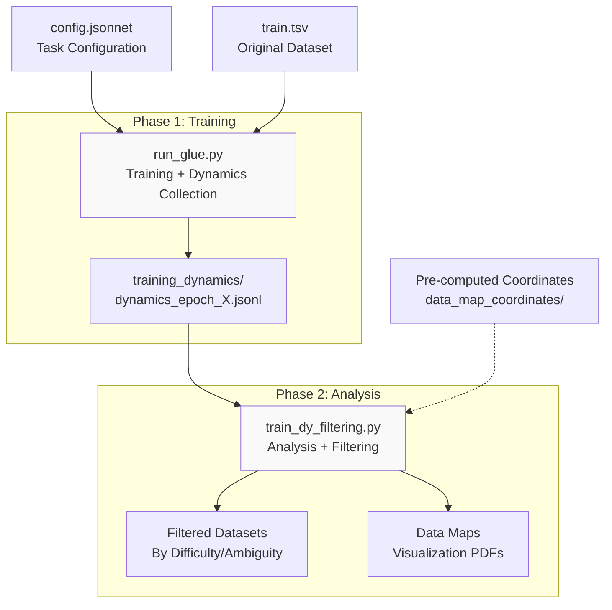
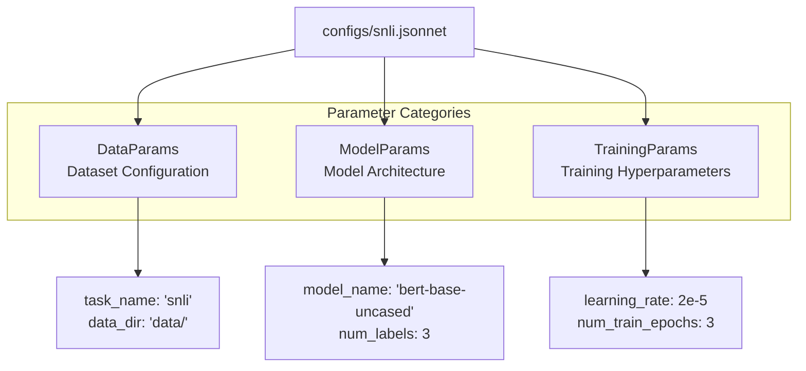
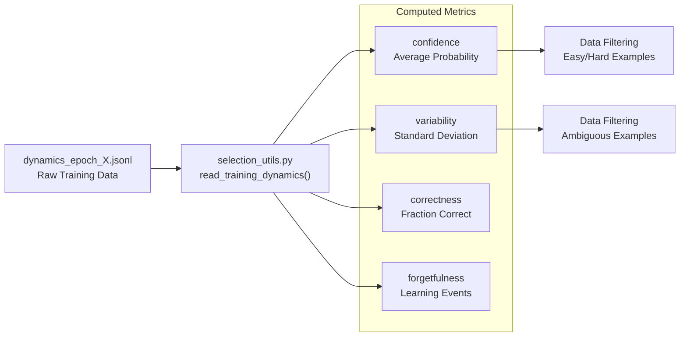
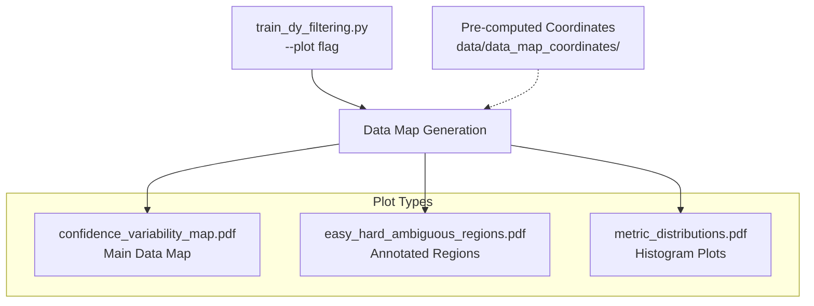

<!-- source: DeepWiki mcp.deepwiki.com · repo allenai/cartography · page 8 Examples and Tutorials · fetched 2026-10-26 -->

# Examples and Tutorials

<details>
<summary>Relevant source files</summary>

The following files were used as context for generating this wiki page:

- [notebooks/plot_data_maps.ipynb](notebooks/plot_data_maps.ipynb)
- [sample/training_dynamics/dynamics_epoch_0.jsonl](sample/training_dynamics/dynamics_epoch_0.jsonl)

</details>


This page provides practical examples and step-by-step tutorials for using Dataset Cartography to analyze training dynamics and perform data selection. The examples demonstrate the complete workflow from model training with dynamics collection to data analysis and visualization.

For detailed API documentation, see [API Reference](#7). For specific visualization examples, see [Data Visualization](#8.1). For understanding data formats and sample outputs, see [Sample Data and Outputs](#8.2).

## Basic Workflow Overview

The typical Dataset Cartography workflow consists of two main phases: training models while collecting dynamics data, then analyzing those dynamics to understand dataset characteristics and filter data subsets.

### End-to-End Pipeline



Sources: Architecture diagrams from system overview, [cartography/classification/run_glue.py](), [cartography/selection/train_dy_filtering.py]()

## Training with Dynamics Collection

### Basic Training Example

To train a model while collecting training dynamics, use the `run_glue.py` script with a task configuration:

```bash
python -m cartography.classification.run_glue \
    --config_file configs/snli.jsonnet \
    --include-package cartography
```

The training process collects dynamics data for each epoch, storing logits and predictions in JSONL format.

### Configuration Structure



Sources: [configs/snli.jsonnet](), [cartography/classification/params.py]()

### Training Dynamics Output Format

During training, the system generates dynamics files with the following structure:

| Field | Description | Example |
|-------|-------------|---------|
| `guid` | Unique example identifier | `4734364254410` |
| `logits_epoch_X` | Raw model logits for epoch X | `[-0.475, -0.226, 0.941]` |
| `gold` | True label index | `0` |

Each epoch produces a separate file (`dynamics_epoch_0.jsonl`, `dynamics_epoch_1.jsonl`, etc.).

Sources: [sample/training_dynamics/dynamics_epoch_0.jsonl:1-10]()

## Data Analysis and Filtering

### Computing Training Dynamics Metrics

After training, analyze the dynamics data to compute key metrics:

```bash
python -m cartography.selection.train_dy_filtering \
    --filter_name confidence \
    --filter_metric confidence \
    --data_dir data/snli \
    --dynamics_dir training_dynamics/ \
    --plots_dir plots/
```

### Key Metrics Computed

The analysis phase computes several important metrics from the training dynamics:



Sources: [cartography/selection/selection_utils.py](), [cartography/selection/train_dy_filtering.py]()

### Filtering Strategies

The system supports multiple filtering strategies based on computed metrics:

| Strategy | Description | Usage |
|----------|-------------|-------|
| `confidence` | Filter by model confidence | Easy vs. hard examples |
| `variability` | Filter by prediction consistency | Stable vs. ambiguous examples |
| `correctness` | Filter by learning success | Learnable vs. difficult examples |
| `forgetfulness` | Filter by forgetting events | Memorable vs. forgotten examples |

## Data Visualization and Plotting

### Creating Data Maps

Generate data map visualizations showing the relationship between confidence and variability:

```bash
python -m cartography.selection.train_dy_filtering \
    --plot \
    --data_dir data/snli \
    --dynamics_dir training_dynamics/ \
    --plots_dir plots/
```

### Visualization Output Structure



Sources: [cartography/selection/train_dy_filtering.py](), [data/data_map_coordinates/]()

## Common Use Cases

### Research Workflow Pattern

A typical research workflow follows this pattern:

1. **Initial Training**: Train baseline model with dynamics collection
2. **Data Analysis**: Compute metrics and create visualizations  
3. **Subset Creation**: Filter datasets based on identified patterns
4. **Comparative Training**: Train models on filtered subsets
5. **Performance Analysis**: Compare results across different data selections

### Multi-Task Analysis

For comparing dynamics across different tasks:

```bash
# Train on multiple tasks
python -m cartography.classification.run_glue --config_file configs/snli.jsonnet
python -m cartography.classification.run_glue --config_file configs/winogrande.jsonnet

# Analyze each task's dynamics
python -m cartography.selection.train_dy_filtering --data_dir data/snli
python -m cartography.selection.train_dy_filtering --data_dir data/winogrande
```

### Batch Processing Pattern

For processing multiple experiments or hyperparameter sweeps, the system supports batch analysis of training dynamics across different model configurations.

Sources: [cartography/classification/run_glue.py](), [cartography/selection/train_dy_filtering.py](), [configs/]()

## File Organization

The examples assume the following directory structure:

```
project_root/
├── data/
│   ├── snli/
│   │   ├── train.tsv
│   │   └── dev.tsv
│   └── data_map_coordinates/
├── training_dynamics/
│   ├── dynamics_epoch_0.jsonl
│   ├── dynamics_epoch_1.jsonl
│   └── dynamics_epoch_2.jsonl
├── plots/
└── configs/
    ├── snli.jsonnet
    └── winogrande.jsonnet
```

This structure supports the standard workflow and enables easy organization of results across multiple experiments and tasks.

Sources: [sample/training_dynamics/](), [data/data_map_coordinates/](), [configs/]()

---

