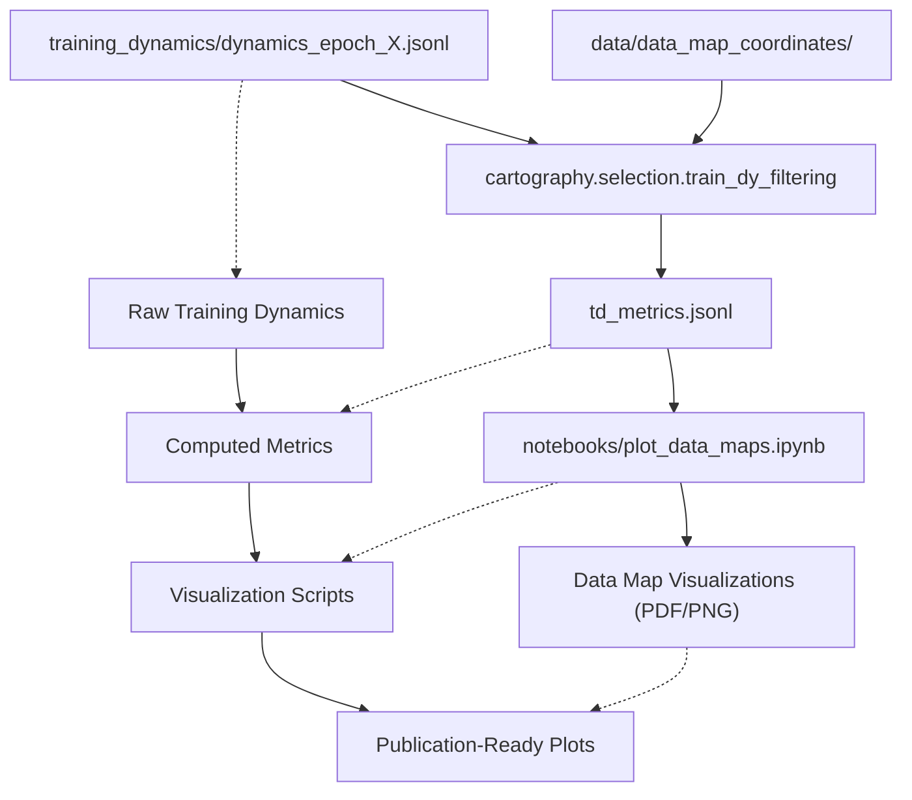
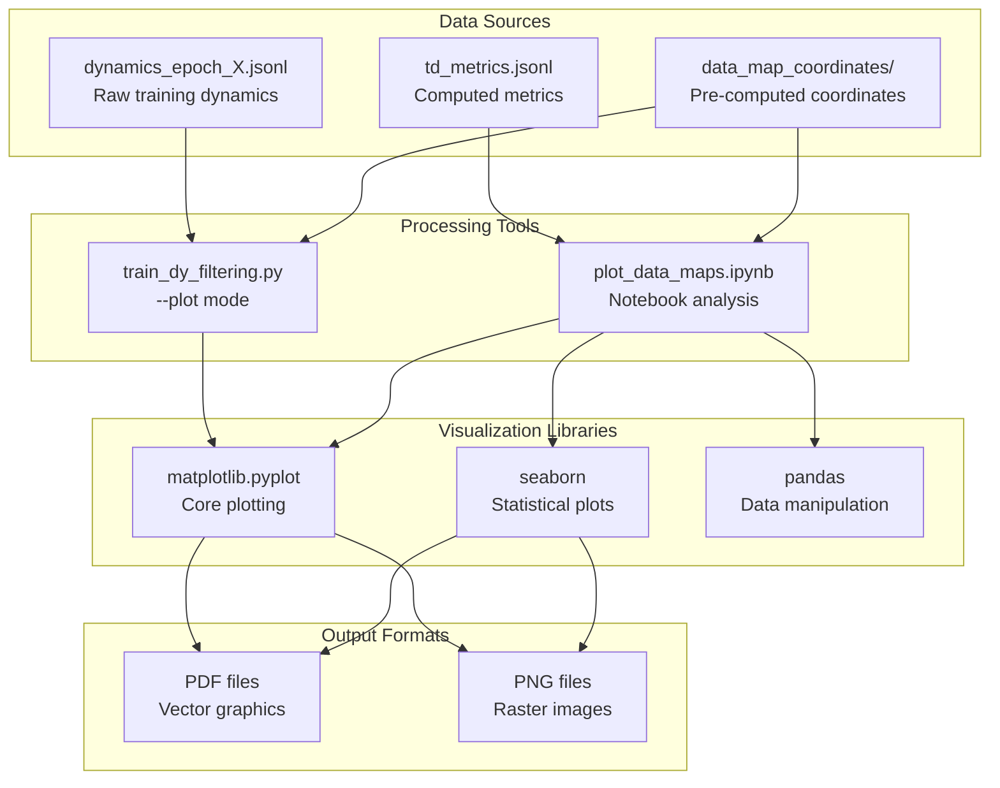
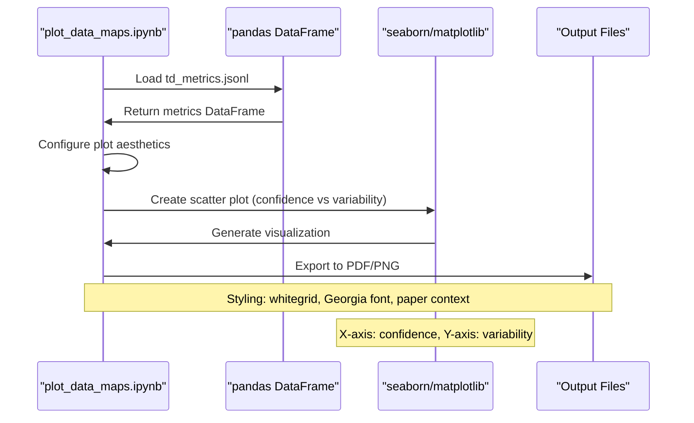

<!-- source: DeepWiki mcp.deepwiki.com · repo allenai/cartography · page 8.1 Data Visualization · fetched 2026-10-26 -->

# Data Visualization

<details>
<summary>Relevant source files</summary>

The following files were used as context for generating this wiki page:

- [notebooks/figures/SNLI_RoBERTa.pdf](notebooks/figures/SNLI_RoBERTa.pdf)
- [notebooks/figures/compact_SNLI_RoBERTa.pdf](notebooks/figures/compact_SNLI_RoBERTa.pdf)
- [notebooks/plot_data_maps.ipynb](notebooks/plot_data_maps.ipynb)

</details>


This page covers creating data maps and visualizations from training dynamics collected during model training. Data visualization in Dataset Cartography involves plotting training examples on a 2D map based on their confidence and variability metrics to identify easy, hard, and ambiguous examples. For information about the underlying data collection process, see [Training with Dynamics Collection](#3.1). For details about data selection and filtering based on these visualizations, see [Data Analysis and Selection](#3.2).

## Overview

Dataset Cartography's visualization system transforms training dynamics data into interpretable 2D scatter plots called "data maps." These visualizations plot each training example using two key metrics: confidence (average probability assigned to the correct label) on the x-axis and variability (standard deviation of predictions across epochs) on the y-axis. This creates distinct regions representing different types of examples:

- **Easy examples**: High confidence, low variability (bottom-right)
- **Hard examples**: Low confidence, low variability (bottom-left) 
- **Ambiguous examples**: High variability regardless of confidence (top region)

## Data Visualization Pipeline

The visualization workflow follows this sequence:



**Training Dynamics Processing Flow**

Sources: [notebooks/plot_data_maps.ipynb:1-70](), system architecture diagrams

## Core Visualization Components

The visualization system consists of several key components that transform raw training data into interpretable plots:



**Visualization System Architecture**

Sources: [notebooks/plot_data_maps.ipynb:8-19](), [cartography/selection/train_dy_filtering.py]()

## Training Dynamics Metrics

The visualization system works with several computed metrics derived from raw training dynamics:

| Metric | Description | Visualization Role |
|--------|-------------|-------------------|
| `confidence` | Average probability assigned to correct label | X-axis coordinate |
| `variability` | Standard deviation of predictions across epochs | Y-axis coordinate |
| `correctness` | Number of epochs example was predicted correctly | Color coding/filtering |
| `forgetfulness` | Count of learning/forgetting transitions | Additional analysis dimension |
| `threshold_closeness` | Distance from decision boundary | Baseline comparison metric |

These metrics are computed from the raw training dynamics files (`dynamics_epoch_X.jsonl`) and stored in processed format (`td_metrics.jsonl`).

Sources: [notebooks/plot_data_maps.ipynb:47-62](), training dynamics pipeline documentation

## Notebook-Based Analysis

The primary visualization interface is through Jupyter notebooks, specifically `plot_data_maps.ipynb`. This notebook demonstrates the complete workflow:

### Data Loading and Setup

```python
# Core visualization libraries
import matplotlib.pyplot as plt
import seaborn as sns
import pandas as pd

# Configuration for publication-quality plots
sns.set(style='whitegrid', font_scale=1.6, font='Georgia', context='paper')
```

### Metrics Processing

The notebook reads computed training dynamics metrics:

```python
td_file_path = os.path.join(models_home_dir, model_name, "td_metrics.jsonl")
td_metrics = pd.read_json(td_file_path, orient="records", lines=True)
```

Available columns include: `confidence`, `correctness`, `forgotfulness`, `guid`, `index`, `threshold_closeness`, `variability`.

Sources: [notebooks/plot_data_maps.ipynb:35-62]()

## Visualization Generation Process

The data map creation follows this technical workflow:



**Data Map Generation Sequence**

Sources: [notebooks/plot_data_maps.ipynb:17-70]()

## Command-Line Visualization

Beyond notebooks, the system provides command-line visualization through `train_dy_filtering.py`:

```bash
python -m cartography.selection.train_dy_filtering \
    --plot \
    --task_name TASK_NAME \
    --filtering_output_dir OUTPUT_DIR
```

This generates data maps directly from training dynamics without requiring notebook interaction.

Sources: [cartography/selection/train_dy_filtering.py](), system documentation

## Pre-computed Coordinates

For efficiency, the system can use pre-computed data map coordinates stored in `data/data_map_coordinates/`. This allows for rapid visualization without recomputing metrics from raw training dynamics.

Directory structure:
```
data/data_map_coordinates/
├── task1_coordinates.jsonl
├── task2_coordinates.jsonl
└── ...
```

Sources: System architecture diagrams, [data/data_map_coordinates/]()

## Output Interpretation

Data maps reveal three distinct regions corresponding to different example types:

- **Bottom-right quadrant**: Easy examples (high confidence, low variability)
- **Bottom-left quadrant**: Hard examples (low confidence, low variability) 
- **Top region**: Ambiguous examples (high variability)

These visualizations inform data selection strategies by identifying which examples contribute most to model learning and which may be mislabeled or inherently ambiguous.

Sources: Dataset Cartography methodology, visualization analysis patterns

---

