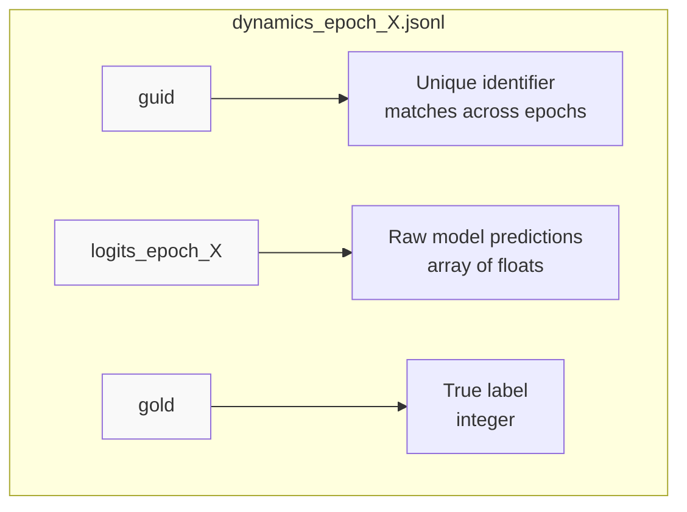
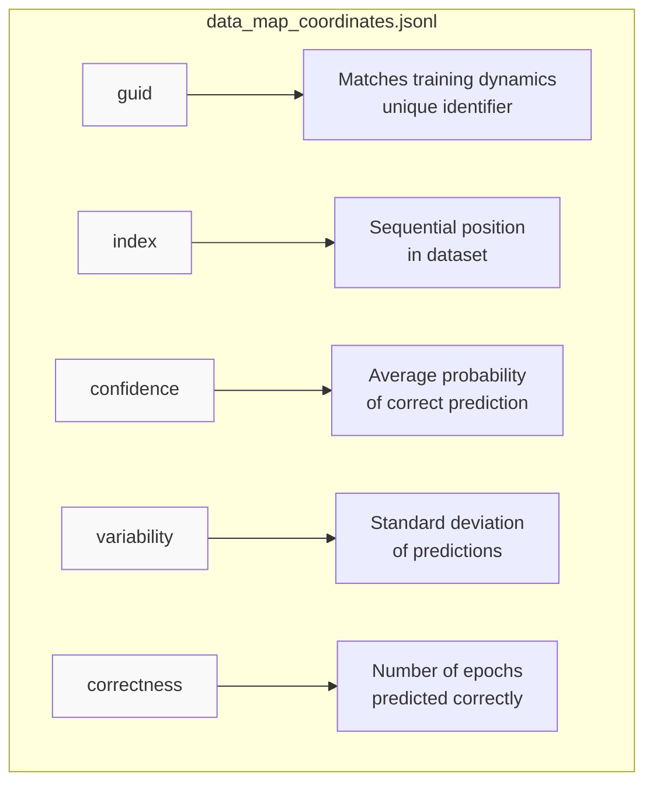
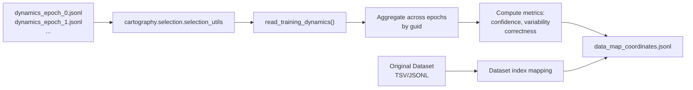
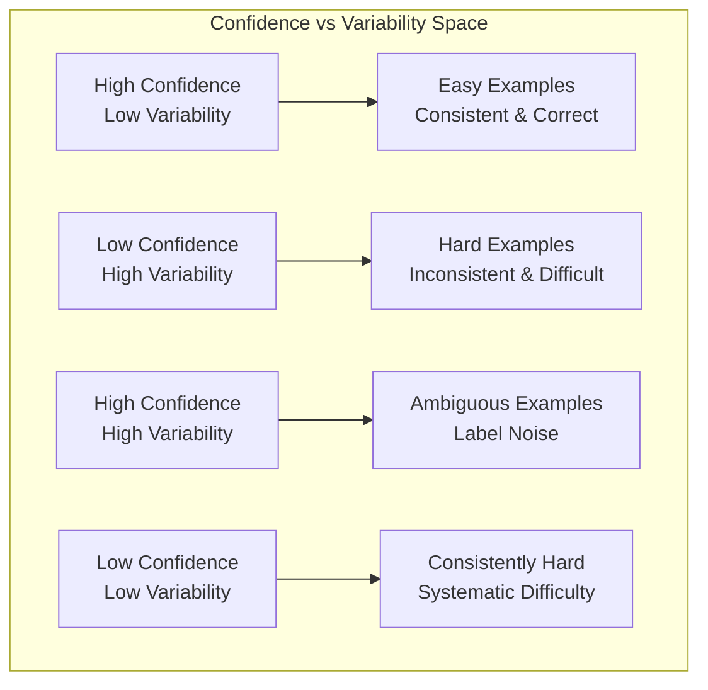
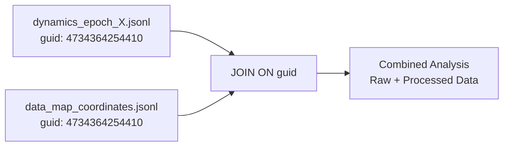
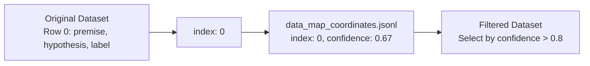

<!-- source: DeepWiki mcp.deepwiki.com · repo allenai/cartography · page 8.2 Sample Data and Outputs · fetched 2026-10-26 -->

# Sample Data and Outputs

<details>
<summary>Relevant source files</summary>

The following files were used as context for generating this wiki page:

- [data/data_map_coordinates/snli_roberta_0_6_data_map_coordinates.jsonl](data/data_map_coordinates/snli_roberta_0_6_data_map_coordinates.jsonl)
- [sample/training_dynamics/dynamics_epoch_0.jsonl](sample/training_dynamics/dynamics_epoch_0.jsonl)

</details>


This section covers the format and structure of training dynamics data and pre-computed coordinates generated by Dataset Cartography. Understanding these data formats is essential for working with the system's outputs and creating custom analyses.

For information about generating training dynamics, see [Training with Dynamics Collection](#3.1). For details on analyzing and filtering data using these outputs, see [Data Analysis and Selection](#3.2).

## Overview of Data Formats

Dataset Cartography produces two main types of output data:

1. **Raw Training Dynamics** - Captured during model training, containing logits and predictions for each epoch
2. **Computed Coordinates** - Processed metrics derived from training dynamics, used for data mapping and selection

## Training Dynamics Data Structure

Raw training dynamics are stored as JSONL files with one record per training example per epoch. Each file follows the naming pattern `dynamics_epoch_{X}.jsonl` where X is the epoch number.

### Training Dynamics Schema



**Field Descriptions:**
- `guid`: Unique identifier for each training example, consistent across all epochs
- `logits_epoch_X`: Array of raw logits (pre-softmax predictions) from the model for epoch X
- `gold`: Integer representing the true label for the example

**Example Record:**
```json
{
  "guid": 4734364254410,
  "logits_epoch_0": [-0.4754295349, -0.2257211208, 0.9408461452],
  "gold": 0
}
```

Sources: [sample/training_dynamics/dynamics_epoch_0.jsonl:1-11]()

## Data Map Coordinates Structure

Pre-computed coordinates contain derived metrics calculated from the complete training dynamics across all epochs. These files enable efficient data mapping and selection without recomputing metrics.

### Coordinates Schema



**Field Descriptions:**
- `guid`: Unique identifier matching the training dynamics records
- `index`: Sequential index of the example in the original dataset
- `confidence`: Average probability assigned to the correct class across all epochs (0.0-1.0)
- `variability`: Standard deviation of the model's predictions across epochs (0.0-1.0)  
- `correctness`: Count of epochs where the model predicted the correct label (0 to max_epochs)

**Example Record:**
```json
{
  "guid": 4446013212032,
  "index": 0,
  "confidence": 0.6756780396,
  "variability": 0.301201277,
  "correctness": 4
}
```

Sources: [data/data_map_coordinates/snli_roberta_0_6_data_map_coordinates.jsonl:1-5]()

## Data Processing Pipeline

The transformation from raw training dynamics to computed coordinates follows this pipeline:



**Processing Steps:**

1. **Collection**: Raw logits collected during training via `cartography.classification.run_glue`
2. **Aggregation**: Multiple epoch files combined by `guid`
3. **Metric Computation**: Statistical measures calculated across epochs
4. **Indexing**: Original dataset positions preserved via `index` field

Sources: [cartography/selection/selection_utils.py](), [cartography/classification/run_glue.py]()

## Metric Interpretations

Understanding what each computed metric represents is crucial for effective data selection:

| Metric | Low Values | High Values | Interpretation |
|--------|------------|-------------|----------------|
| **Confidence** | Hard examples, model uncertain | Easy examples, model confident | Learning difficulty |
| **Variability** | Consistent predictions | Inconsistent predictions | Prediction stability |
| **Correctness** | Frequently wrong | Frequently correct | Model accuracy |

### Data Map Regions



Sources: [cartography/selection/train_dy_filtering.py]()

## File Relationships and Usage

### GUID-based Linking

Both data types use the same `guid` field as the primary key, enabling joins across different output files:



### Index-based Dataset Mapping

The `index` field in coordinates files maps back to the original dataset position:



Sources: [cartography/selection/train_dy_filtering.py](), [cartography/data_utils.py]()

## Common Data Patterns

### Typical Value Ranges

Based on the sample data, typical ranges for computed metrics are:

- **Confidence**: 0.0 to 1.0 (most values between 0.2-0.95)
- **Variability**: 0.0 to 0.5 (most values between 0.1-0.4)  
- **Correctness**: 0 to max_epochs (for 6 epochs: 0-6)

### Example Filtering Queries

Common filtering patterns using these metrics:

```bash
# High confidence examples (easy)
jq 'select(.confidence > 0.9)' data_map_coordinates.jsonl

# High variability examples (ambiguous) 
jq 'select(.variability > 0.3)' data_map_coordinates.jsonl

# Low correctness examples (hard)
jq 'select(.correctness < 2)' data_map_coordinates.jsonl
```

Sources: [data/data_map_coordinates/snli_roberta_0_6_data_map_coordinates.jsonl:1-1000]()

## Integration with Analysis Tools

These data formats integrate directly with Dataset Cartography's analysis pipeline:

- **Data Map Plotting**: Coordinates files used directly by visualization tools
- **Data Selection**: Filtered subsets created using confidence/variability thresholds
- **Statistical Analysis**: Raw dynamics enable custom metric computation

For practical examples of using these data formats, see [Data Visualization](#8.1).

Sources: [cartography/selection/train_dy_filtering.py](), [notebooks/]()