# Page: Overview

# Overview

<details>
<summary>Relevant source files</summary>

The following files were used as context for generating this wiki page:

- [README.md](README.md)

</details>


## Purpose and Scope

This document provides a comprehensive overview of the Dataset Cartography system, which enables researchers to analyze training dynamics and perform data selection for natural language processing tasks. The system implements the methodology described in "Dataset Cartography: Mapping and Diagnosing Datasets with Training Dynamics" (EMNLP 2020) and provides tools for understanding dataset characteristics through model training behavior.

Dataset Cartography allows users to train transformer-based models while collecting detailed training dynamics, visualize these dynamics as data maps, and filter datasets based on computed metrics. For specific implementation details of individual components, see [Core Systems](#3). For configuration guidance, see [Configuration Management](#4). For task-specific usage, see [Supported Tasks](#5).

## What is Dataset Cartography

Dataset Cartography is a methodology for understanding and analyzing datasets by examining how models learn from individual training examples over multiple epochs. The system tracks key metrics during training to categorize examples as easy-to-learn, hard-to-learn, or ambiguous, enabling targeted data selection and dataset analysis.

### Core Concepts

The system operates on three fundamental metrics computed from training dynamics:

| Metric | Description | Use Case |
|--------|-------------|----------|
| **Confidence** | Average probability assigned to correct label across epochs | Identifying easy vs hard examples |
| **Variability** | Standard deviation of model predictions across epochs | Finding ambiguous examples |
| **Correctness** | Number of epochs where example was predicted correctly | Measuring learning consistency |

Additional metrics include **forgetfulness** (examples learned then forgotten) and **threshold_closeness** (baseline comparison metric).

Sources: [README.md:1-115]()

## High-Level System Architecture

### Core Training and Analysis Pipeline

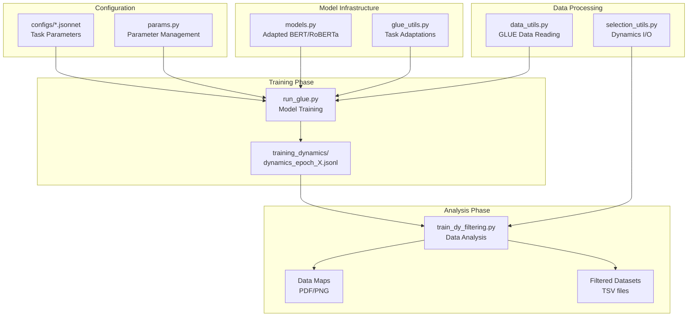

Sources: [README.md:26-41](), [README.md:48-68](), [README.md:70-87]()

### Code Entity Mapping

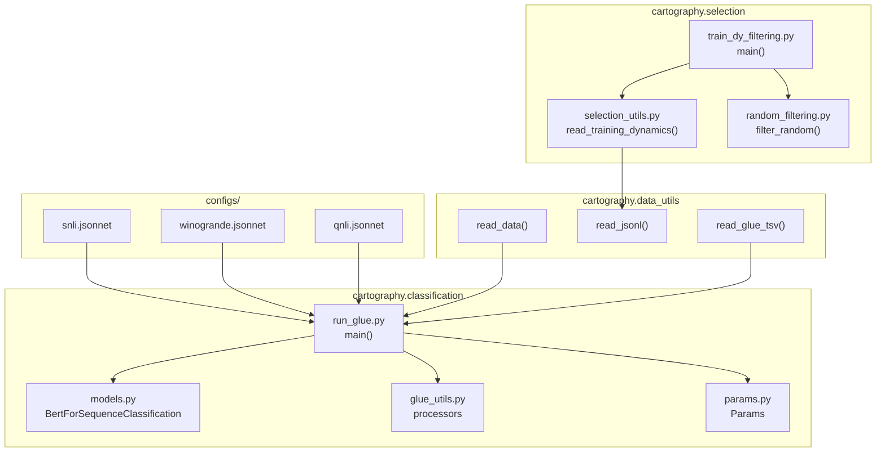

Sources: [README.md:30-36](), [README.md:52-58](), [README.md:74-81]()

## Training Dynamics Collection Workflow

The system collects training dynamics during model training by logging predictions and metrics for each training example at every epoch. This data is stored in JSONL format for subsequent analysis.

### Training Dynamics Data Format

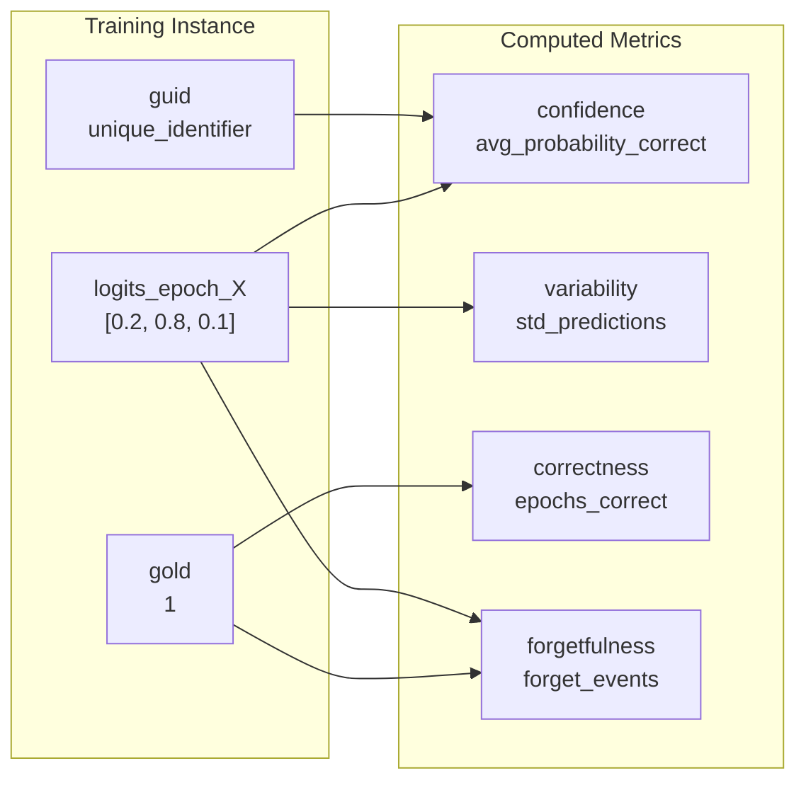

The training dynamics files (`dynamics_epoch_X.jsonl`) contain fields specified in [README.md:42-46](). Each line represents one training instance with its learning trajectory across epochs.

### Key Training Components

- **`cartography.classification.run_glue`**: Main training script that handles model training while collecting dynamics
- **`cartography.classification.models`**: Adapted transformer models for sequence classification
- **`cartography.classification.params`**: Centralized parameter management system
- **Configuration files**: JSONNet-based task-specific parameter definitions

Sources: [README.md:26-46]()

## Data Analysis and Selection Workflow

After training dynamics collection, the system provides analysis and filtering capabilities through the `train_dy_filtering` module.

### Analysis Operations

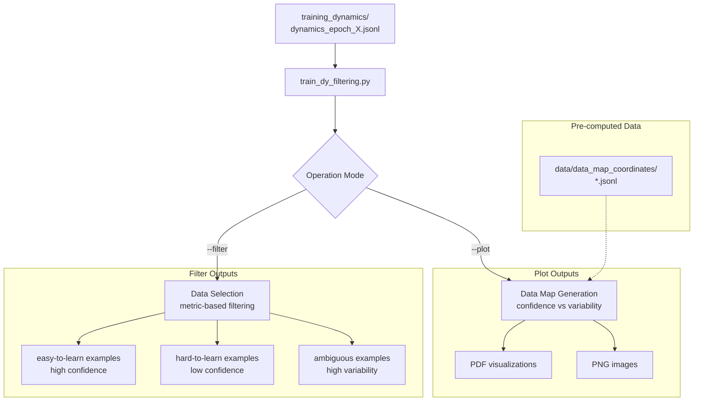

### Selection Metrics and Strategies

The system supports multiple selection strategies based on training dynamics metrics:

| Strategy | Metric | Command Flag | Use Case |
|----------|--------|--------------|----------|
| Easy Examples | `confidence` | `--metric confidence --worst` | High-confidence instances |
| Hard Examples | `confidence` | `--metric confidence` | Low-confidence instances |
| Ambiguous Examples | `variability` | `--metric variability` | High-variability instances |
| Forgotten Examples | `forgetfulness` | `--metric forgetfulness` | Learning instability |
| Baseline Comparison | `threshold_closeness` | `--metric threshold_closeness` | Control experiments |

Sources: [README.md:48-87]()

## Supported Tasks and Data Formats

Dataset Cartography supports GLUE-style classification tasks with specialized processors for different task types:

### Task Support Matrix

| Task | Task Type | Processor | Configuration |
|------|-----------|-----------|---------------|
| **SNLI** | Natural Language Inference | `SNLIProcessor` | `configs/snli.jsonnet` |
| **MNLI** | Multi-Genre NLI | `GLUEProcessor` | `configs/mnli.jsonnet` |  
| **QNLI** | Question-answering NLI | `GLUEProcessor` | `configs/qnli.jsonnet` |
| **WINOGRANDE** | Commonsense Reasoning | `WinograndeProcessor` | `configs/winogrande.jsonnet` |

### Data Processing Pipeline

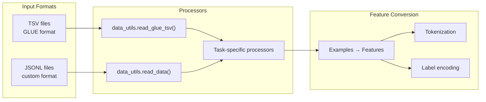

The system handles both standard GLUE TSV format and custom JSONL format, with automatic conversion to transformer-compatible features.

Sources: [README.md:37](), [README.md:50](), [README.md:77](), [README.md:83]()

## Key Components and Entry Points

### Primary Executables

- **Training**: `python -m cartography.classification.run_glue` - Train models with dynamics collection
- **Analysis**: `python -m cartography.selection.train_dy_filtering` - Generate data maps and filter datasets  
- **Configuration**: `configs/*.jsonnet` - Task-specific parameter definitions

### Core Modules

- **`cartography.classification`**: Model training, evaluation, and GLUE task handling
- **`cartography.selection`**: Data analysis, filtering, and visualization utilities
- **`cartography.data_utils`**: Data reading and processing utilities

### Output Artifacts

- **Training dynamics**: `training_dynamics/dynamics_epoch_X.jsonl` files
- **Data maps**: PDF/PNG visualizations showing confidence vs variability
- **Filtered datasets**: TSV files containing selected subsets based on metrics
- **Pre-computed coordinates**: `data/data_map_coordinates/*.jsonl` for reproduction

Sources: [README.md:30-36](), [README.md:52-58](), [README.md:74-81](), [README.md:60-68]()

---

# Page: Getting Started

# Getting Started

<details>
<summary>Relevant source files</summary>

The following files were used as context for generating this wiki page:

- [.gitignore](.gitignore)
- [LICENSE](LICENSE)
- [README.md](README.md)
- [requirements.txt](requirements.txt)

</details>


This document provides step-by-step instructions for installing, configuring, and running Dataset Cartography to train models while collecting training dynamics and create data maps for analysis. It covers the essential setup requirements, basic command usage, and expected outputs to get you productive quickly.

For detailed information about specific tasks and their configurations, see [Supported Tasks](#5). For advanced analysis features and model adaptations, see [Advanced Features](#6).

## Prerequisites and Installation

Dataset Cartography is built on the HuggingFace Transformers library and requires several Python dependencies for data processing, visualization, and model training.

### Required Dependencies

The system requires the following key dependencies as specified in [requirements.txt:1-11]():

| Package | Version | Purpose |
|---------|---------|---------|
| `transformers` | Custom commit | BERT/RoBERTa model implementations |
| `torch` | 1.4.0 | PyTorch deep learning framework |
| `pandas` | 1.0.3 | Data manipulation and analysis |
| `matplotlib` | 3.2.1 | Basic plotting capabilities |
| `seaborn` | 0.10.0 | Statistical data visualization |
| `jsonnet` | 0.15.0 | Configuration file processing |
| `tensorboardx` | 2.0 | Training monitoring |
| `scikit-learn` | 0.22.2.post1 | Machine learning utilities |

### Installation

```bash
# Clone the repository
git clone https://github.com/allenai/cartography
cd cartography

# Install dependencies
pip install -r requirements.txt
```

**Note**: The system uses a specific commit of HuggingFace Transformers (`189113d8910308b9f3509c6946b2147ce57a0bf7`) to ensure compatibility with the training dynamics collection functionality.

Sources: [requirements.txt:1-11](), [README.md:22-23]()

## Core Workflow Overview

Dataset Cartography operates in a two-phase workflow where models are first trained while collecting training dynamics, then those dynamics are analyzed to create data maps and filter datasets.

### High-Level System Flow

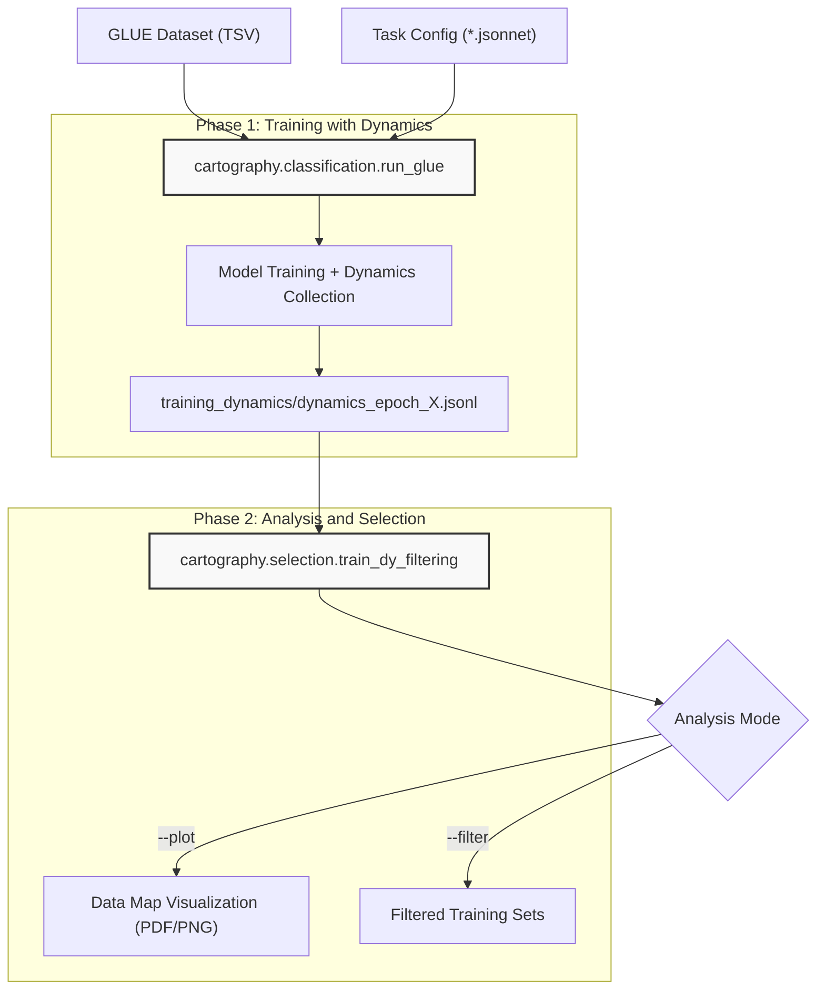

### File Structure and Key Components

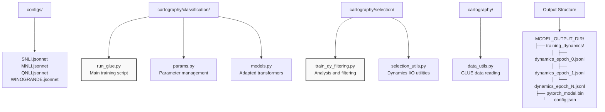

Sources: [README.md:26-46](), [README.md:48-68]()

## Basic Usage Examples

### Training a Model with Dynamics Collection

To train a model and collect training dynamics, use the `run_glue` module with a task-specific configuration:

```bash
python -m cartography.classification.run_glue \
    -c configs/SNLI.jsonnet \
    --do_train \
    --do_eval \
    -o ./output/snli_roberta
```

This command:
- Uses the SNLI configuration from [configs/SNLI.jsonnet]()
- Trains and evaluates the model (`--do_train --do_eval`)
- Outputs results to `./output/snli_roberta/`
- Creates training dynamics files in `./output/snli_roberta/training_dynamics/`

**Available Task Configurations:**
- `SNLI.jsonnet` - Stanford Natural Language Inference
- `MNLI.jsonnet` - Multi-Genre Natural Language Inference  
- `QNLI.jsonnet` - Question-answering Natural Language Inference
- `WINOGRANDE.jsonnet` - Commonsense reasoning

### Creating Data Maps

After training, visualize the training dynamics as data maps:

```bash
python -m cartography.selection.train_dy_filtering \
    --plot \
    --task_name SNLI \
    --model_dir ./output/snli_roberta \
    --model RoBERTa-Large
```

This generates visualization files showing the relationship between confidence and variability for each training example.

### Filtering Data by Training Dynamics

Select subsets of training data based on computed metrics:

```bash
python -m cartography.selection.train_dy_filtering \
    --filter \
    --task_name SNLI \
    --model_dir ./output/snli_roberta \
    --metric confidence \
    --data_dir /path/to/glue/data
```

**Available Metrics:**
- `confidence` - Average prediction probability
- `variability` - Standard deviation of predictions across epochs
- `correctness` - Number of epochs predicted correctly
- `forgetfulness` - Instances learned then forgotten
- `threshold_closeness` - Baseline comparison metric

Sources: [README.md:26-46](), [README.md:48-83]()

## Training Dynamics Data Format

The system produces training dynamics files with a specific JSON Lines format that enables analysis and filtering. Understanding this format is crucial for working with the outputs.

### Dynamics File Structure

Each `dynamics_epoch_X.jsonl` file contains one JSON object per training instance:

```json
{
  "guid": "example_12345",
  "logits_epoch_0": [0.8, 0.1, 0.1],
  "gold": 0
}
```

**Required Fields:**
- `guid` - Unique instance identifier matching the original dataset
- `logits_epoch_X` - Raw model predictions for epoch X
- `gold` - Index of the correct label (must align with logits array)

### Pre-computed Coordinates

The repository includes pre-computed data map coordinates for major tasks in [data/data_map_coordinates/](). These files contain computed metrics:

- `guid` - Instance identifier
- `index` - Position in dataset
- `confidence` - Average prediction confidence across epochs
- `variability` - Standard deviation of predictions
- `correctness` - Fraction of epochs predicted correctly

Sources: [README.md:41-46](), [README.md:60-68]()

## Expected Outputs and Next Steps

After running the basic workflow, you should have:

1. **Trained Model**: Standard transformer model files (`pytorch_model.bin`, `config.json`)
2. **Training Dynamics**: JSONL files tracking prediction changes across epochs
3. **Data Maps**: PDF/PNG visualizations showing confidence vs. variability
4. **Filtered Datasets**: TSV files with selected subsets based on metrics

### Typical Output Directory Structure

```
model_output_dir/
├── training_dynamics/
│   ├── dynamics_epoch_0.jsonl
│   ├── dynamics_epoch_1.jsonl
│   └── dynamics_epoch_N.jsonl
├── pytorch_model.bin
├── config.json
├── data_map_TASK_MODEL.pdf
└── filtered_data_METRIC/
    ├── easy_train.tsv
    ├── hard_train.tsv
    └── ambiguous_train.tsv
```

### Next Steps

- **Task-Specific Configuration**: Learn about configuring experiments for different NLP tasks in [Task Configuration Files](#4.2)
- **Advanced Analysis**: Explore diagnostic evaluation and specialized analysis tools in [Advanced Features](#6)
- **Custom Tasks**: Understand the data processing pipeline for adding new tasks in [Data Processing Utilities](#3.3)
- **API Usage**: Reference detailed function documentation in [API Reference](#7)

Sources: [README.md:39](), [README.md:17-18]()

---

# Page: Core Systems

# Core Systems

<details>
<summary>Relevant source files</summary>

The following files were used as context for generating this wiki page:

- [README.md](README.md)
- [cartography/__init__.py](cartography/__init__.py)
- [cartography/classification/__init__.py](cartography/classification/__init__.py)
- [cartography/selection/__init__.py](cartography/selection/__init__.py)

</details>


## Purpose and Scope

This document provides a comprehensive overview of the core architectural components that make up the Dataset Cartography system and how they interact to enable training dynamics analysis and data selection. The system consists of two primary workflows: training models while collecting dynamics data, and analyzing those dynamics to create data maps and filtered datasets.

For specific implementation details of individual components, see [Training with Dynamics Collection](#3.1), [Data Analysis and Selection](#3.2), and [Data Processing Utilities](#3.3). For configuration management, see [Configuration Management](#4).

## System Overview

The Dataset Cartography system is built around a two-phase architecture that separates model training from data analysis. The core systems work together to collect training dynamics during model training, then analyze those dynamics to understand dataset characteristics.

### Primary System Components

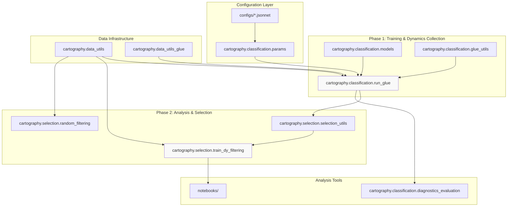

**Sources:** [README.md:26-46](), [README.md:48-68](), [README.md:70-87]()

## Core Pipeline Architecture

The system implements a clear separation between training and analysis phases, with standardized data formats enabling interoperability between components.

### Training Dynamics Pipeline

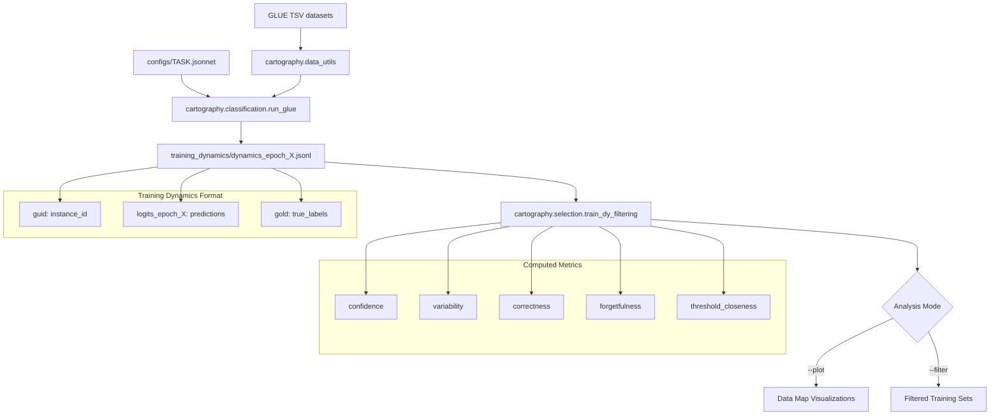

**Sources:** [README.md:26-46](), [README.md:42-46](), [README.md:70-87]()

## Component Interactions

The core systems interact through well-defined interfaces and standardized data formats, enabling modular development and experimentation.

### Data Flow and System Integration

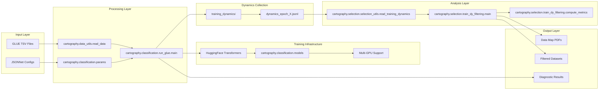

**Sources:** [README.md:26-36](), [README.md:48-58](), [README.md:70-81]()

## Key Architectural Patterns

### Configuration-Driven Design

The system uses a centralized configuration approach where `cartography.classification.params` manages all training parameters, while task-specific configurations are defined in JSONNet files under `configs/`. This pattern enables:

- **Reproducible Experiments**: All parameters are versioned and declarative
- **Task Extensibility**: New tasks can be added by creating new configuration files
- **Parameter Sharing**: Common settings are centralized while task-specific overrides are isolated

### Training Dynamics as First-Class Data

Training dynamics are collected and stored in a standardized JSONL format with required fields `guid`, `logits_epoch_X`, and `gold`. This design enables:

- **Cross-Model Compatibility**: Any training setup can produce compatible dynamics files
- **Offline Analysis**: Training and analysis phases are completely decoupled
- **Metric Computation**: Multiple analysis metrics can be computed from the same dynamics data

### Modular Analysis Pipeline

The `cartography.selection.train_dy_filtering` module serves as the central analysis engine, supporting both visualization (`--plot`) and data selection (`--filter`) modes. This modularity allows:

- **Flexible Workflows**: Users can run analysis without retraining models
- **Multiple Metrics**: Support for `confidence`, `variability`, `correctness`, `forgetfulness`, and `threshold_closeness`
- **Baseline Comparisons**: Integration with `cartography.selection.random_filtering` for control experiments

**Sources:** [README.md:37](), [README.md:42-46](), [README.md:75-87]()

## System Dependencies

| Component | Primary Dependencies | Purpose |
|-----------|---------------------|---------|
| `cartography.classification.run_glue` | HuggingFace Transformers, `cartography.classification.models` | Model training with dynamics collection |
| `cartography.selection.train_dy_filtering` | `cartography.selection.selection_utils`, `cartography.data_utils` | Dynamics analysis and data selection |
| `cartography.classification.params` | `configs/*.jsonnet` | Centralized parameter management |
| `cartography.data_utils` | - | GLUE-style data reading and processing |

The system's modular architecture allows components to be used independently or in combination, supporting both end-to-end workflows and specialized analysis tasks.

**Sources:** [README.md:22](), [cartography/classification/__init__.py:1](), [cartography/selection/__init__.py:1]()

---

# Page: Training with Dynamics Collection

# Training with Dynamics Collection

<details>
<summary>Relevant source files</summary>

The following files were used as context for generating this wiki page:

- [README.md](README.md)
- [cartography/classification/run_glue.py](cartography/classification/run_glue.py)
- [cartography/selection/selection_utils.py](cartography/selection/selection_utils.py)

</details>


This document covers the core training system that simultaneously trains GLUE-style models while collecting training dynamics data. The system is implemented primarily in `cartography.classification.run_glue` and produces the essential training dynamics files used for data analysis and selection.

For information about analyzing the collected training dynamics and filtering datasets, see [Data Analysis and Selection](#3.2). For details on configuring training parameters, see [Parameter System](#4.1).

## Purpose and Scope

The training with dynamics collection system serves two primary functions:

1. **Model Training**: Fine-tunes transformer models (BERT, RoBERTa) on GLUE-style classification tasks
2. **Dynamics Collection**: Captures training dynamics (logits, predictions, losses) at each epoch for subsequent analysis

This system forms the foundation of the Dataset Cartography workflow, as the collected dynamics enable the computation of key metrics like confidence, variability, and correctness that characterize training examples.

## System Architecture

The training system integrates model training with dynamics logging through a unified pipeline:

### Core Training Pipeline

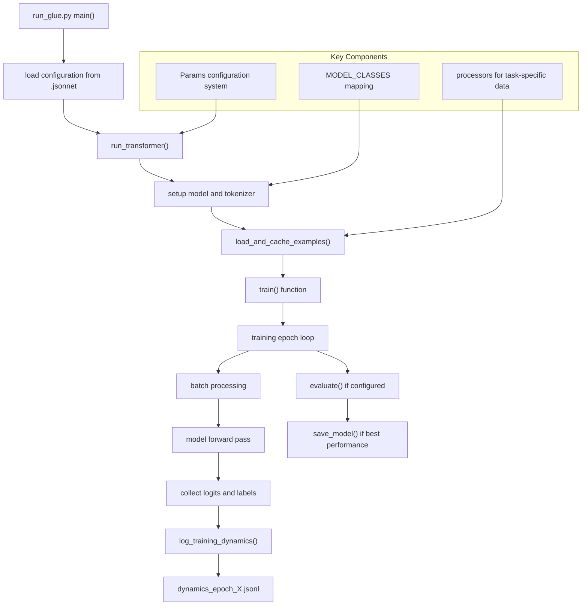

**Sources:** [cartography/classification/run_glue.py:757-794](), [cartography/classification/run_glue.py:594-755]()

### Training Dynamics Collection Flow

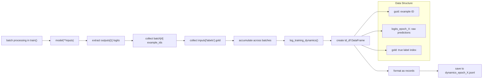

**Sources:** [cartography/classification/run_glue.py:232-242](), [cartography/classification/run_glue.py:322-327](), [cartography/selection/selection_utils.py:16-34]()

## Key Components

### Main Training Function

The `train()` function in `run_glue.py` orchestrates both model training and dynamics collection:

| Component | Purpose | Key Code Location |
|-----------|---------|-------------------|
| **Batch Processing Loop** | Iterates through training batches | [cartography/classification/run_glue.py:216-242]() |
| **Dynamics Accumulation** | Collects logits, IDs, and labels | [cartography/classification/run_glue.py:232-242]() |
| **Epoch Logging** | Saves dynamics after each epoch | [cartography/classification/run_glue.py:322-327]() |
| **Model Evaluation** | Optionally evaluates during training | [cartography/classification/run_glue.py:318-320]() |

### Training Dynamics Logging

The `log_training_dynamics()` function creates structured output files:

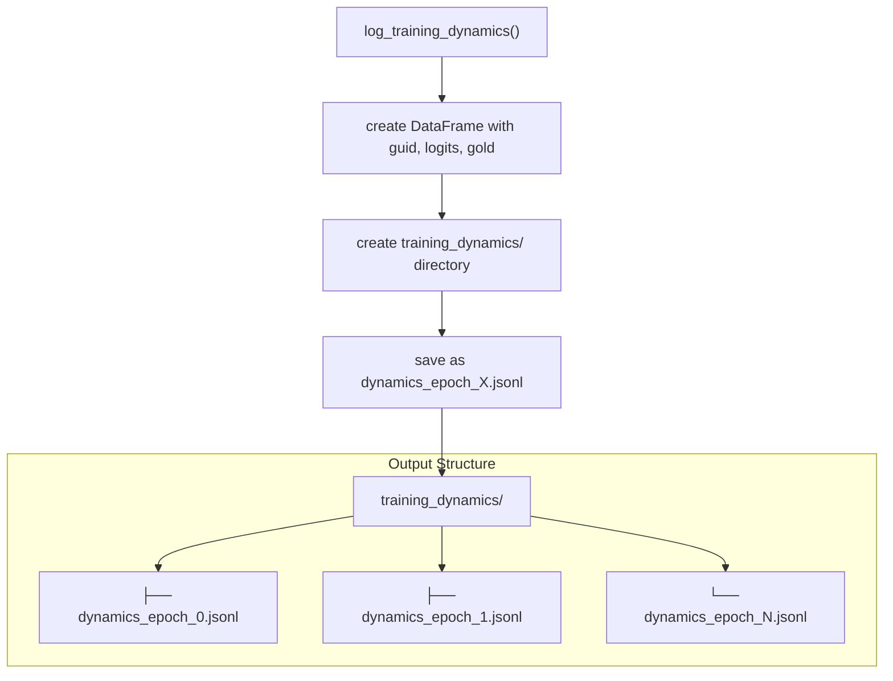

**Sources:** [cartography/selection/selection_utils.py:16-34]()

### Model and Task Configuration

The system supports multiple model types and tasks through a flexible configuration system:

| Configuration Element | Purpose | Implementation |
|----------------------|---------|----------------|
| **MODEL_CLASSES** | Maps model types to classes | [cartography/classification/run_glue.py:82-87]() |
| **processors** | Task-specific data processing | [cartography/classification/run_glue.py:49]() |
| **Params system** | Centralized parameter management | [cartography/classification/run_glue.py:58]() |

## Execution and Configuration

### Command Line Interface

The training system is executed through the main module:

```bash
python -m cartography.classification.run_glue \
    -c configs/$TASK.jsonnet \
    --do_train \
    --do_eval \
    -o $MODEL_OUTPUT_DIR
```

### Configuration Flow

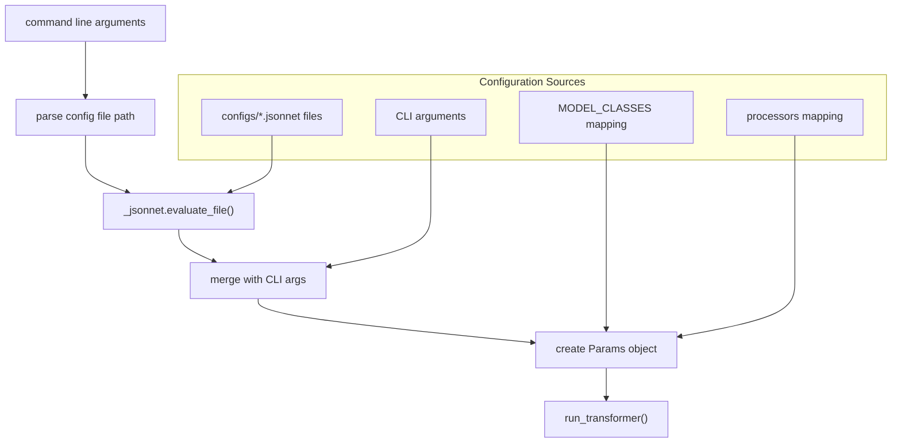

**Sources:** [cartography/classification/run_glue.py:785-790](), [cartography/classification/params.py]()

## Output Data Structure

### Training Dynamics Format

Each `dynamics_epoch_X.jsonl` file contains one JSON record per training example:

| Field | Type | Description | Example |
|-------|------|-------------|---------|
| `guid` | String/Integer | Unique example identifier | `"train_1234"` |
| `logits_epoch_X` | Array[Float] | Raw model predictions for epoch X | `[0.2, -0.8, 1.1]` |
| `gold` | Integer | True label index | `2` |

### Directory Structure

The training process creates the following output structure:

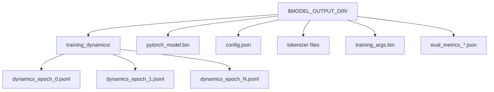

**Sources:** [cartography/selection/selection_utils.py:28-33](), [cartography/classification/run_glue.py:369-374]()

## Integration Points

### Data Loading Integration

The system integrates with data processing utilities:

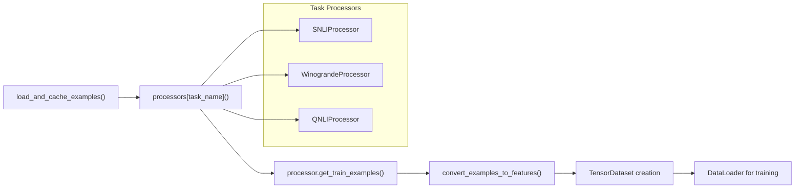

**Sources:** [cartography/classification/run_glue.py:518-591](), [cartography/classification/run_glue.py:480-500]()

### Model Architecture Integration

The training system works with adapted transformer models:

| Model Type | Configuration Key | Model Class |
|------------|------------------|-------------|
| **BERT Classification** | `"bert"` | `AdaptedBertForSequenceClassification` |
| **BERT Multiple Choice** | `"bert_mc"` | `AdaptedBertForMultipleChoice` |
| **RoBERTa Classification** | `"roberta"` | `AdaptedRobertaForSequenceClassification` |
| **RoBERTa Multiple Choice** | `"roberta_mc"` | `AdaptedRobertaForMultipleChoice` |

**Sources:** [cartography/classification/run_glue.py:82-87](), [cartography/classification/models.py]()

The training with dynamics collection system provides the essential foundation for Dataset Cartography by simultaneously optimizing model performance and capturing the training dynamics needed for subsequent data analysis and selection tasks.

---

# Page: Data Analysis and Selection

# Data Analysis and Selection

<details>
<summary>Relevant source files</summary>

The following files were used as context for generating this wiki page:

- [README.md](README.md)
- [cartography/selection/train_dy_filtering.py](cartography/selection/train_dy_filtering.py)

</details>


This document covers the analysis of training dynamics and selection of data subsets based on computed metrics in Dataset Cartography. This system enables researchers to understand dataset characteristics through data maps and create filtered training sets for targeted experiments.

For information about training models and collecting training dynamics, see [Training with Dynamics Collection](#3.1). For data processing utilities, see [Data Processing Utilities](#3.3).

## Overview

The data analysis and selection system operates on training dynamics collected during model training to compute instance-level metrics and enable data filtering. The core functionality is implemented in the `train_dy_filtering` module, which provides both visualization capabilities through data maps and data selection capabilities through metric-based filtering.

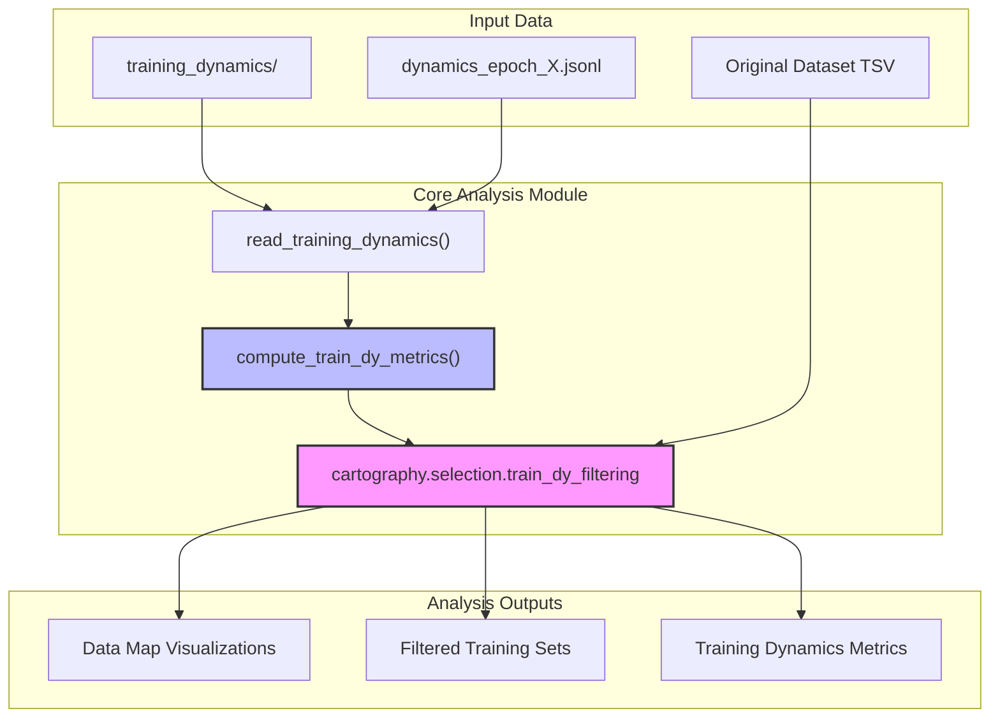

**Data Analysis and Selection System Architecture**

Sources: [cartography/selection/train_dy_filtering.py:1-26](), [README.md:48-88]()

## Training Dynamics Metrics

The system computes five key metrics from training dynamics to characterize each training instance:

### Core Metrics

| Metric | Description | Function | Use Case |
|--------|-------------|----------|----------|
| **Confidence** | Average probability assigned to true class | `np.mean(true_probs_trend)` | Identify easy vs hard examples |
| **Variability** | Standard deviation of true class probabilities | `np.std(conf)` | Identify ambiguous examples |
| **Correctness** | Number of epochs predicted correctly | `sum(trend)` | Measure learning consistency |
| **Forgetfulness** | Times forgotten after being learned | `compute_forgetfulness()` | Detect unstable learning |
| **Threshold Closeness** | Distance from decision boundary | `conf * (1 - conf)` | Baseline metric from prior work |

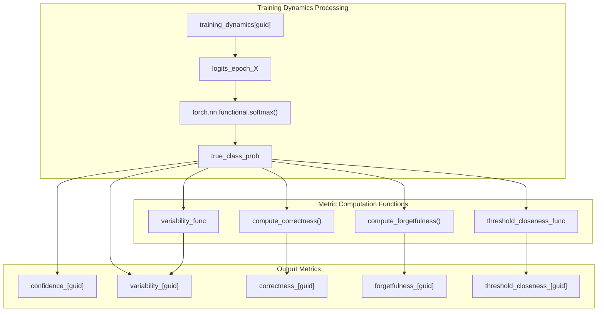

**Training Dynamics Metric Computation Pipeline**

Sources: [cartography/selection/train_dy_filtering.py:66-156](), [cartography/selection/train_dy_filtering.py:35-63]()

### Metric Implementation Details

The `compute_train_dy_metrics` function processes training dynamics across all epochs to compute these metrics:

- **Confidence calculation**: Averages the softmax probability of the true class across all training epochs [cartography/selection/train_dy_filtering.py:126]()
- **Variability calculation**: Uses standard deviation by default, with optional confidence interval computation when `--include_ci` flag is set [cartography/selection/train_dy_filtering.py:85-87]()
- **Forgetfulness calculation**: Implements the algorithm from "Example Forgetting" paper, tracking learning and forgetting patterns [cartography/selection/train_dy_filtering.py:35-56]()

Sources: [cartography/selection/train_dy_filtering.py:66-156]()

## Data Map Visualization

Data maps provide visual representation of dataset characteristics by plotting confidence against variability, with correctness encoded as color/style.

### Data Map Components

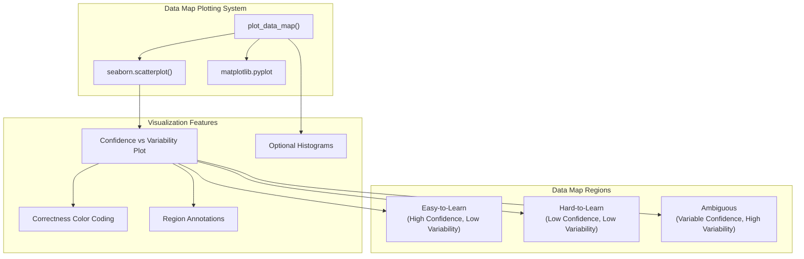

**Data Map Visualization Architecture**

The `plot_data_map` function creates scatter plots with the following features:
- **X-axis**: Variability (standard deviation of predictions)
- **Y-axis**: Confidence (average true class probability)  
- **Color/Style**: Correctness fraction (normalized to 0-1 range)
- **Annotations**: Three distinct regions labeled as "easy-to-learn", "hard-to-learn", and "ambiguous"

Optional histogram panels show distributions of confidence, variability, and correctness when `show_hist=True`.

Sources: [cartography/selection/train_dy_filtering.py:238-335]()

### Region Interpretation

The data map divides the training data into three conceptual regions:

1. **Easy-to-learn** (high confidence, low variability): Examples consistently predicted correctly with high confidence
2. **Hard-to-learn** (low confidence, low variability): Examples consistently predicted incorrectly or with low confidence  
3. **Ambiguous** (high variability): Examples with inconsistent predictions across training epochs

Sources: [cartography/selection/train_dy_filtering.py:284-296]()

## Data Filtering and Selection

The system enables filtering training data based on computed metrics to create targeted training subsets.

### Filtering Process

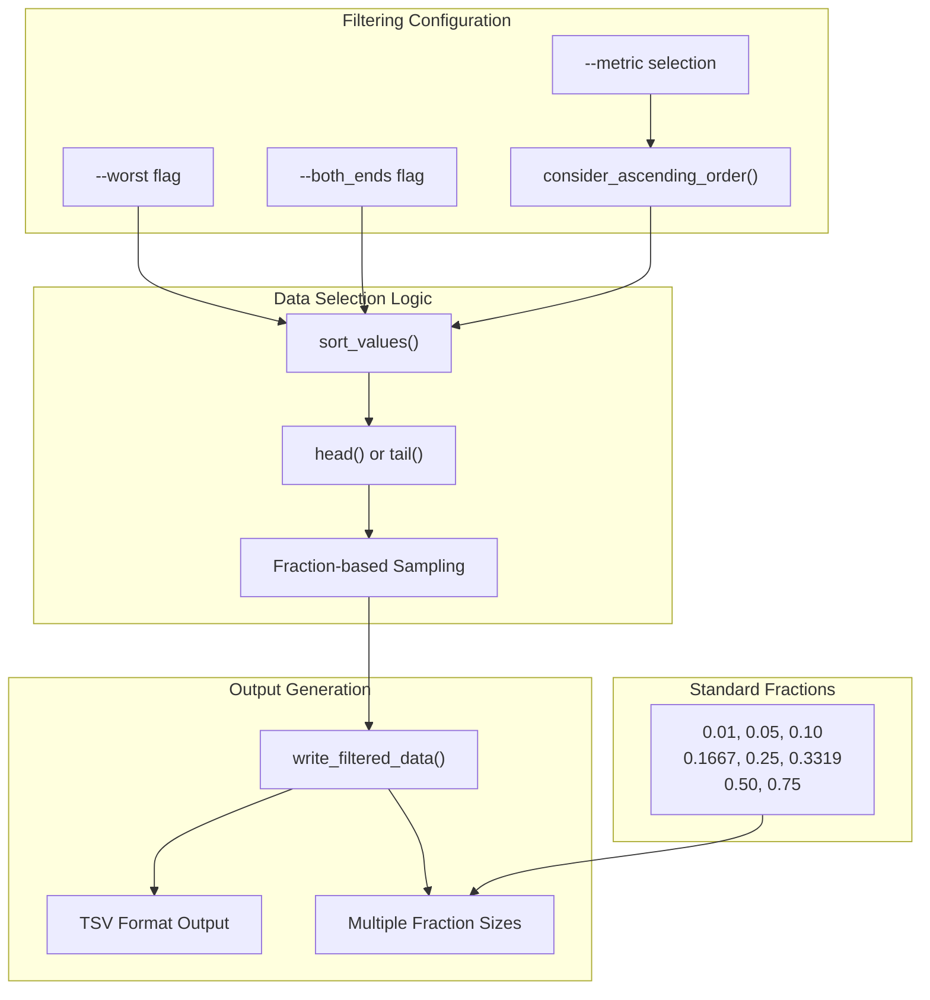

**Data Filtering Pipeline**

### Supported Filtering Metrics

The `consider_ascending_order` function determines sort order for each metric:

| Metric | Ascending Order | Selects |
|--------|----------------|---------|
| `confidence` | `True` | High confidence (easy) first |
| `variability` | `False` | High variability (ambiguous) first |
| `correctness` | `True` | High correctness (learnable) first |  
| `forgetfulness` | `False` | High forgetfulness (unstable) first |
| `threshold_closeness` | `False` | High boundary proximity first |

The `--worst` flag inverts the selection order, while `--both_ends` selects from both extremes (70% from one end, 30% from the other).

Sources: [cartography/selection/train_dy_filtering.py:159-175](), [cartography/selection/train_dy_filtering.py:177-236]()

### Output Structure

Filtered datasets are generated at multiple fraction sizes and written in GLUE-compatible TSV format:

```
filtered/
└── cartography_{metric}_{fraction}/
    └── {task_name}/
        ├── train.tsv
        ├── dev.tsv  (copied unchanged)
        └── test.tsv (copied unchanged)
```

The system preserves development and test sets while creating filtered training sets using `copy_dev_test` utility.

Sources: [cartography/selection/train_dy_filtering.py:198-236]()

## Command-Line Interface

The `train_dy_filtering` module provides a comprehensive command-line interface for both plotting and filtering operations.

### Key Arguments

| Argument | Purpose | Example |
|----------|---------|---------|
| `--plot` | Generate data map visualizations | `--plot` |
| `--filter` | Create filtered datasets | `--filter --metric confidence` |
| `--model_dir` | Directory with training dynamics | `--model_dir ./model_output/` |
| `--data_dir` | Original GLUE data directory | `--data_dir ./glue_data/` |
| `--task_name` | Task identifier | `--task_name SNLI` |
| `--metric` | Filtering metric | `--metric variability` |
| `--burn_out` | Limit epochs for analysis | `--burn_out 10` |

### Usage Examples

**Generate data maps**:
```bash
python -m cartography.selection.train_dy_filtering \
    --plot \
    --task_name SNLI \
    --model_dir ./model_output/ \
    --model RoBERTa-Large
```

**Filter data by confidence**:
```bash
python -m cartography.selection.train_dy_filtering \
    --filter \
    --task_name SNLI \
    --model_dir ./model_output/ \
    --metric confidence \
    --data_dir ./glue_data/
```

Sources: [cartography/selection/train_dy_filtering.py:337-424](), [README.md:50-88]()

### Integration with Selection Utilities

The module integrates with `selection_utils.read_training_dynamics` to read training dynamics and `data_utils` for original dataset handling:

```mermaid
graph LR
    subgraph "External Dependencies"
        A["selection_utils.read_training_dynamics()"]
        B["data_utils.read_data()"]
        C["data_utils.copy_dev_test()"]
    end
    
    subgraph "train_dy_filtering Module"
        D["compute_train_dy_metrics()"]
        E["plot_data_map()"]
        F["write_filtered_data()"]
    end
    
    A --> D
    B --> F
    C --> F
    D --> E
    D --> F
```

**Module Integration Architecture**

Sources: [cartography/selection/train_dy_filtering.py:24-25](), [cartography/selection/train_dy_filtering.py:396-403]()

---

# Page: Data Processing Utilities

# Data Processing Utilities

<details>
<summary>Relevant source files</summary>

The following files were used as context for generating this wiki page:

- [cartography/data_utils.py](cartography/data_utils.py)
- [cartography/data_utils_glue.py](cartography/data_utils_glue.py)
- [cartography/selection/random_filtering.py](cartography/selection/random_filtering.py)

</details>


## Purpose and Scope

This document covers the data processing utilities in Dataset Cartography that handle reading, converting, and manipulating datasets in GLUE-style formats. These utilities serve as the foundation layer for data ingestion, providing standardized interfaces for reading TSV files, converting between data formats, and preparing datasets for training and analysis.

For information about training dynamics data specifically, see [Data Analysis and Selection](#3.2). For task-specific dataset configurations, see [Supported Tasks](#5).

## Data Processing Pipeline Overview

The data processing utilities form a three-layer architecture that transforms raw data files into structured formats suitable for model training and analysis.

### Data Processing Architecture

```mermaid
graph TD
    subgraph "Raw Data Sources"
        A["TSV Files (SNLI, MNLI, etc.)"]
        B["JSONL Files (Training Dynamics)"]
        C["Task-specific Datasets"]
    end
    
    subgraph "Core Reading Layer"
        D["read_data()"]
        E["read_glue_tsv()"]
        F["read_jsonl()"]
    end
    
    subgraph "Processing Layer"
        G["convert_tsv_entries_to_dataframe()"]
        H["convert_string_to_unique_number()"]
        I["copy_dev_test()"]
    end
    
    subgraph "Output Layer"
        J["Pandas DataFrames"]
        K["Dictionary Mappings"]
        L["Filtered Datasets"]
    end
    
    A --> D
    A --> E
    B --> F
    C --> D
    
    D --> G
    E --> H
    F --> K
    
    G --> J
    H --> J
    I --> L
    
    D --> K
    E --> K
```

Sources: [cartography/data_utils.py:17-43](), [cartography/data_utils_glue.py:31-80](), [cartography/data_utils.py:91-105]()

## Core Data Reading Functions

### Task-Specific Data Reading

The `read_data()` function provides a unified interface for reading different GLUE-style tasks, routing to appropriate parsers based on task characteristics.

| Task | GUID Index | Special Handling |
|------|------------|------------------|
| SNLI | 2 | Multiple annotator labels |
| MNLI | 0 | Matched/mismatched splits |
| WINOGRANDE | 0 | Multiple choice format |
| QNLI | 0 | Question-answer pairs |

```mermaid
flowchart TD
    A["read_data(file_path, task_name)"] --> B{Task Type}
    
    B -->|"MNLI"| C["read_glue_tsv(guid_index=0)"]
    B -->|"SNLI"| D["read_glue_tsv(guid_index=2)"]
    B -->|"WINOGRANDE"| E["read_glue_tsv(guid_index=0)"]
    B -->|"QNLI"| F["read_glue_tsv(guid_index=0)"]
    B -->|"Other"| G["NotImplementedError"]
    
    C --> H["TSV Dictionary + Header"]
    D --> H
    E --> H  
    F --> H
```

Sources: [cartography/data_utils.py:17-43]()

### GLUE TSV Processing

The `read_glue_tsv()` function handles the low-level parsing of TSV files with GLUE-specific formatting requirements.

**Key Features:**
- Handles variable GUID positions across tasks
- Filters out invalid labels (`"-"` or empty strings)
- Manages multiple annotator labels in SNLI/MNLI
- Converts string GUIDs to integers when needed

Sources: [cartography/data_utils_glue.py:31-80]()

## Data Format Conversion

### TSV to DataFrame Conversion

The system provides utilities to convert between TSV dictionaries and pandas DataFrames for efficient data manipulation.

```mermaid
graph LR
    A["TSV Dictionary"] --> B["convert_tsv_entries_to_dataframe()"]
    B --> C["Pandas DataFrame"]
    
    D["Header String"] --> B
    E["Field Validation"] --> B
    
    subgraph "Conversion Process"
        F["Parse Header Fields"]
        G["Map Dictionary Values"]
        H["Create DataFrame"]
    end
    
    B --> F
    F --> G
    G --> H
    H --> C
```

Sources: [cartography/data_utils.py:45-59]()

### String ID to Integer Conversion

For tasks like SNLI with complex string identifiers, the system converts them to unique integers for tensor processing.

**SNLI ID Conversion Rules:**
- `vg_len` prefix → code `555`
- `vg_verb` prefix → code `444`  
- Other formats → code `000`
- Last character mapping: `{'e': '0', 'c': '1', 'n': '2'}`

Sources: [cartography/data_utils_glue.py:9-28]()

## Random Sampling and Filtering

### Baseline Dataset Creation

The `random_filtering.py` script creates randomly sampled subsets for baseline comparisons in data selection experiments.

```mermaid
flowchart TD
    A["Input TSV File"] --> B["Pandas DataFrame"]
    B --> C["Random Sampling"]
    
    subgraph "Sampling Configuration"
        D["Fraction: 0.01-0.75"]
        E["Random Seed: 725862"]
        F["Multiple Subsets"]
    end
    
    C --> G["Sampled Training Sets"]
    H["Dev/Test Files"] --> I["copy_dev_test()"]
    I --> J["Complete Dataset Structure"]
    
    G --> J
    
    D --> C
    E --> C
    F --> C
```

**Default Sampling Fractions:**
`[0.01, 0.05, 0.10, 0.1667, 0.25, 0.33, 0.50, 0.75]`

Sources: [cartography/selection/random_filtering.py:52-83]()

## File I/O Operations

### Development and Test Set Management

The `copy_dev_test()` function handles task-specific file copying for data selection experiments, ensuring consistent evaluation sets across different training subsets.

| Task | Dev File | Test File |
|------|----------|-----------|
| MNLI | `dev_matched.tsv` | `dev_mismatched.tsv` |
| SNLI | `dev.tsv` | `test.tsv` |
| QNLI | `dev.tsv` | `test.tsv` |
| WINOGRANDE | `dev.tsv` | `test.tsv` |

Sources: [cartography/data_utils.py:62-88]()

### JSONL Reading for Training Dynamics

The `read_jsonl()` function processes training dynamics files, creating mappings between example identifiers and their dynamic properties.

```mermaid
graph TD
    A["JSONL File"] --> B["pd.read_json(lines=True)"]
    B --> C["DataFrame to Records"]
    C --> D{Key Specified?}
    
    D -->|"Yes"| E["Dictionary Mapping"]
    D -->|"No"| F["List of Records"]
    
    E --> G["key_field: record"]
    F --> H["[record1, record2, ...]"]
```

**Common Usage:**
- Default key: `"pairID"` for SNLI/MNLI
- Returns mapping for quick example lookup
- Used in training dynamics analysis pipeline

Sources: [cartography/data_utils.py:91-105]()

## Integration with Core Systems

These data processing utilities serve as the foundation for the broader Dataset Cartography system, providing standardized data access patterns used throughout the codebase.

**Primary Integration Points:**
- Training pipeline (`run_glue`) uses `read_data()` for dataset loading
- Analysis tools (`train_dy_filtering`) use `read_jsonl()` for dynamics data
- Random baseline creation uses the complete utility stack
- Task processors leverage format conversion functions

The utilities maintain consistent interfaces while handling the complexity of different data formats and task-specific requirements, enabling the higher-level systems to focus on their core functionality.

Sources: [cartography/data_utils.py:1-105](), [cartography/data_utils_glue.py:1-80](), [cartography/selection/random_filtering.py:1-84]()

---

# Page: Configuration Management

# Configuration Management

<details>
<summary>Relevant source files</summary>

The following files were used as context for generating this wiki page:

- [cartography/classification/params.py](cartography/classification/params.py)

</details>


This document explains how Dataset Cartography manages configuration parameters for model training, evaluation, and data processing. The configuration system provides a centralized way to specify all parameters needed for experiments using JSONNet configuration files and a unified parameter class.

For information about specific task configurations, see [Task Configuration Files](#4.2). For details about the parameter validation system, see [Parameter System](#4.1).

## Configuration Architecture

The configuration system in Dataset Cartography follows a two-tier architecture where JSONNet configuration files define experiment parameters, which are then loaded and validated through a centralized `Params` class.

### Configuration Flow Diagram

```mermaid
flowchart TD
    A["configs/*.jsonnet"] --> B["JSON Dictionary"]
    B --> C["Params.__init__()"]
    C --> D["Parameter Validation"]
    D --> E["Params Instance"]
    E --> F["cartography.classification.run_glue"]
    E --> G["save_args_to_file()"]
    G --> H["cartography_config_*.json"]
    
    subgraph "Validation Inputs"
        I["MODEL_CLASSES"]
        J["ALL_MODELS"] 
        K["processors"]
    end
    
    I --> D
    J --> D
    K --> D
    
    subgraph "Parameter Categories"
        L["Required Parameters"]
        M["Model Configuration"]
        N["Training Hyperparameters"]
        O["System Configuration"]
    end
    
    C --> L
    C --> M
    C --> N
    C --> O
```

Sources: [cartography/classification/params.py:1-159]()

## The Params Class

The `Params` class serves as the central configuration management system, consolidating all parameters required for transformer-based classification tasks. It performs validation and type checking during initialization.

### Core Configuration Structure

```mermaid
classDiagram
    class Params {
        +str data_dir
        +str train
        +str dev
        +str test
        +str model_type
        +str model_name_or_path
        +str task_name
        +int seed
        +str output_dir
        +bool do_train
        +bool do_eval
        +bool do_test
        +__init__(MODEL_CLASSES, ALL_MODELS, processors, configs)
    }
    
    class Configuration {
        +dict configs
        +validate_model_type()
        +validate_model_path()
        +validate_task_name()
    }
    
    Params --> Configuration
```

The `Params` class constructor takes four key inputs and performs validation against them:

| Input Parameter | Purpose | Validation |
|----------------|---------|------------|
| `MODEL_CLASSES` | Available model architectures | Validates `model_type` exists |
| `ALL_MODELS` | Supported pre-trained models | Validates `model_name_or_path` exists |
| `processors` | Task processors | Validates `task_name` is supported |
| `configs` | Configuration dictionary | Source of all parameter values |

Sources: [cartography/classification/params.py:5-31]()

## Parameter Categories

The configuration system organizes parameters into distinct categories based on their functional role in the training pipeline.

### Required Parameters

These parameters must be specified in every configuration:

```mermaid
graph LR
    A["data_dir"] --> B["Data Location"]
    C["model_type"] --> D["Architecture Type"]
    E["model_name_or_path"] --> F["Pre-trained Model"]
    G["task_name"] --> H["Task Processor"]
    I["seed"] --> J["Reproducibility"]
    K["output_dir"] --> L["Results Storage"]
```

- `data_dir`: Directory containing task data files
- `model_type`: Model architecture (bert, roberta, etc.)
- `model_name_or_path`: Pre-trained model identifier
- `task_name`: Task name for processor selection
- `seed`: Random seed for reproducibility
- `output_dir`: Directory for model outputs and checkpoints

Sources: [cartography/classification/params.py:14-37]()

### Training Hyperparameters

Training behavior is controlled through these parameters:

| Parameter | Default | Range/Type | Description |
|-----------|---------|------------|-------------|
| `per_gpu_train_batch_size` | 96 | int | Training batch size per GPU |
| `per_gpu_eval_batch_size` | 96 | int | Evaluation batch size per GPU |
| `learning_rate` | 1e-5 | float | Initial learning rate for Adam |
| `num_train_epochs` | 3.0 | float | Total training epochs |
| `max_steps` | -1 | int | Max training steps (overrides epochs) |
| `warmup_steps` | 0 | int | Linear warmup steps |
| `weight_decay` | 0.0 | float | L2 regularization weight |
| `max_grad_norm` | 1.0 | float | Gradient clipping threshold |

Sources: [cartography/classification/params.py:78-108]()

### Model and Data Configuration

Model-specific and data processing parameters:

| Parameter | Default | Description |
|-----------|---------|-------------|
| `max_seq_length` | 128 | Maximum input sequence length |
| `do_lower_case` | True | Whether to lowercase input text |
| `config_name` | "" | Custom config name if different from model |
| `tokenizer_name` | "" | Custom tokenizer if different from model |
| `cache_dir` | "" | Directory for downloaded model cache |
| `features_cache_dir` | `{data_dir}/cache_{seed}` | Feature preprocessing cache |

Sources: [cartography/classification/params.py:50-66]()

## Configuration Validation and Type Enforcement

The `Params` class performs strict validation during initialization to catch configuration errors early:

### Validation Process

```mermaid
flowchart TD
    A["Configuration Dictionary"] --> B["Type Validation"]
    B --> C["Model Type Check"]
    C --> D["model_type in MODEL_CLASSES"]
    D --> E["Model Path Check"]
    E --> F["model_name_or_path in ALL_MODELS"]
    F --> G["Task Name Check"]
    G --> H["task_name.lower() in processors"]
    H --> I["Params Instance"]
    
    D -->|Fail| J["AssertionError"]
    F -->|Fail| J
    H -->|Fail| J
    J --> K["Configuration Rejected"]
```

The validation ensures:
- `model_type` corresponds to a supported architecture
- `model_name_or_path` refers to an available pre-trained model
- `task_name` has a corresponding processor implementation

Sources: [cartography/classification/params.py:23-31]()

## Configuration Persistence

The system provides configuration serialization through the `save_args_to_file` function, which creates a complete record of all parameters used in an experiment.

### Configuration Serialization

```mermaid
sequenceDiagram
    participant T as "Training Process"
    participant P as "Params Instance"
    participant S as "save_args_to_file()"
    participant F as "JSON File"
    
    T->>P: Access configuration
    T->>S: save_args_to_file(params, mode)
    S->>P: vars(params)
    S->>S: Convert device to string
    S->>F: Write cartography_config_{mode}.json
    F-->>T: Configuration preserved
```

The serialization process:
1. Extracts all parameters using `vars(params)`
2. Converts non-serializable objects (like `torch.device`) to strings
3. Writes formatted JSON with sorted keys and indentation
4. Creates mode-specific files (e.g., `cartography_config_train.json`)

Sources: [cartography/classification/params.py:149-159]()

## Integration with Training Pipeline

The configuration system integrates seamlessly with the main training pipeline through dependency injection:

```mermaid
graph TB
    A["JSONNet Config"] --> B["Config Dictionary"]
    B --> C["Params(MODEL_CLASSES, ALL_MODELS, processors, configs)"]
    C --> D["Validated Params Instance"]
    D --> E["run_glue.py"]
    
    subgraph "Training Components"
        F["Model Initialization"]
        G["Data Loading"]
        H["Optimizer Setup"]
        I["Training Loop"]
    end
    
    E --> F
    E --> G
    E --> H
    E --> I
    
    subgraph "Configuration Access"
        J["params.model_type"]
        K["params.learning_rate"]
        L["params.batch_size"]
        M["params.output_dir"]
    end
    
    F --> J
    H --> K
    G --> L
    I --> M
```

The configuration flows through the system by:
- Providing model architecture selection
- Setting training hyperparameters
- Defining data processing parameters
- Specifying output locations and behavior

Sources: [cartography/classification/params.py:10-147]()

---

# Page: Parameter System

# Parameter System

<details>
<summary>Relevant source files</summary>

The following files were used as context for generating this wiki page:

- [cartography/classification/params.py](cartography/classification/params.py)

</details>


This document covers the centralized parameter management system in Dataset Cartography, specifically the `Params` class and its role in configuring transformer-based classification experiments. This system provides a unified interface for managing all configuration parameters required for training and evaluation.

For information about task-specific configuration files that feed into this parameter system, see [Task Configuration Files](#4.2). For details about the training process that uses these parameters, see [Training with Dynamics Collection](#3.1).

## Overview

The parameter system is implemented through the `Params` class in [cartography/classification/params.py](), which serves as the central configuration hub for all training and evaluation operations. It validates and stores parameters from JSONNet configuration files, providing type safety and default values for the entire system.

## Parameter System Architecture

```mermaid
graph TB
    subgraph "Configuration Input"
        A["JSONNet Config Files<br/>(configs/*.jsonnet)"]
        B["MODEL_CLASSES<br/>(Supported Models)"]
        C["ALL_MODELS<br/>(Model Registry)"]
        D["processors<br/>(Task Processors)"]
    end
    
    subgraph "Parameter System Core"
        E["Params.__init__()<br/>(Configuration Validation)"]
        F["Params Instance<br/>(Centralized Config Store)"]
    end
    
    subgraph "Parameter Categories"
        G["Required Parameters<br/>(data_dir, model_type, etc.)"]
        H["Training Parameters<br/>(learning_rate, batch_size, etc.)"]
        I["Model Parameters<br/>(max_seq_length, tokenizer, etc.)"]
        J["System Parameters<br/>(cuda, fp16, distributed, etc.)"]
    end
    
    subgraph "Output and Usage"
        K["save_args_to_file()<br/>(Config Persistence)"]
        L["cartography_config_train.json<br/>(Saved Configuration)"]
        M["run_glue.main()<br/>(Training Process)"]
    end
    
    A --> E
    B --> E
    C --> E
    D --> E
    
    E --> F
    F --> G
    F --> H
    F --> I
    F --> J
    
    F --> K
    K --> L
    F --> M
```

Sources: [cartography/classification/params.py:1-159]()

## Parameter Categories

The `Params` class organizes configuration into several logical categories:

### Required Parameters

These parameters must be provided and are validated during initialization:

| Parameter | Type | Purpose | Validation |
|-----------|------|---------|------------|
| `data_dir` | str | Directory containing task data | None |
| `model_type` | str | Model architecture type | Must exist in `MODEL_CLASSES` |
| `model_name_or_path` | str | Pre-trained model identifier | Must exist in `ALL_MODELS` |
| `task_name` | str | Task identifier | Must exist in `processors` |
| `seed` | int | Random seed for reproducibility | None |
| `output_dir` | str | Output directory for results | None |

### Training Control Parameters

These parameters control the training process behavior:

| Parameter | Type | Default | Purpose |
|-----------|------|---------|---------|
| `do_train` | bool | False | Enable training mode |
| `do_eval` | bool | False | Enable evaluation on dev set |
| `do_test` | bool | False | Enable evaluation on test set |
| `evaluate_during_training` | bool | True | Run eval after each epoch |
| `evaluate_during_training_epoch` | bool | False | Run eval at each logging step |

### Model and Data Parameters

These parameters configure model behavior and data processing:

| Parameter | Type | Default | Purpose |
|-----------|------|---------|---------|
| `max_seq_length` | int | 128 | Maximum input sequence length |
| `do_lower_case` | bool | True | Use uncased tokenization |
| `config_name` | str | "" | Custom config path |
| `tokenizer_name` | str | "" | Custom tokenizer path |
| `cache_dir` | str | "" | Model cache directory |
| `features_cache_dir` | str | `{data_dir}/cache_{seed}` | Feature cache directory |

Sources: [cartography/classification/params.py:12-147]()

## Parameter Validation and Type Safety

```mermaid
flowchart TD
    A["Config Dictionary Input"] --> B["Params.__init__()"]
    
    B --> C{"Validate model_type"}
    C -->|Valid| D{"Validate model_name_or_path"}
    C -->|Invalid| E["Assertion Error"]
    
    D -->|Valid| F{"Validate task_name"}
    D -->|Invalid| E
    
    F -->|Valid| G["Set Required Parameters"]
    F -->|Invalid| E
    
    G --> H["Set Optional Parameters<br/>(with defaults)"]
    H --> I["Params Instance Ready"]
    
    I --> J["Type-safe Access<br/>(params.learning_rate)"]
    I --> K["save_args_to_file()<br/>(Persistence)"]
```

Sources: [cartography/classification/params.py:23-31]()

## Training and Optimization Parameters

The system provides comprehensive control over the training process:

### Learning Parameters

| Parameter | Type | Default | Purpose |
|-----------|------|---------|---------|
| `learning_rate` | float | 1e-5 | Initial learning rate for Adam |
| `weight_decay` | float | 0.0 | L2 regularization strength |
| `adam_epsilon` | float | 1e-8 | Adam optimizer epsilon |
| `max_grad_norm` | float | 1.0 | Gradient clipping threshold |
| `warmup_steps` | int | 0 | Linear warmup steps |

### Training Schedule Parameters

| Parameter | Type | Default | Purpose |
|-----------|------|---------|---------|
| `num_train_epochs` | float | 3.0 | Total training epochs |
| `max_steps` | int | -1 | Override epoch limit with step limit |
| `per_gpu_train_batch_size` | int | 96 | Training batch size per GPU |
| `per_gpu_eval_batch_size` | int | 96 | Evaluation batch size per GPU |
| `gradient_accumulation_steps` | int | 1 | Steps before backward pass |

### Training Control Parameters

| Parameter | Type | Default | Purpose |
|-----------|------|---------|---------|
| `logging_steps` | int | 1000 | Logging frequency |
| `save_steps` | int | 0 | Checkpoint save frequency |
| `patience` | int | 3 | Early stopping patience |
| `eval_all_checkpoints` | bool | False | Evaluate all saved checkpoints |

Sources: [cartography/classification/params.py:88-121]()

## System and Hardware Parameters

The parameter system supports various deployment configurations:

### Hardware Configuration

| Parameter | Type | Default | Purpose |
|-----------|------|---------|---------|
| `no_cuda` | bool | False | Disable CUDA acceleration |
| `fp16` | bool | False | Enable mixed precision training |
| `fp16_opt_level` | str | "01" | Apex optimization level |
| `local_rank` | int | -1 | Distributed training rank |

### File System Configuration

| Parameter | Type | Default | Purpose |
|-----------|------|---------|---------|
| `overwrite_output_dir` | bool | False | Overwrite existing output |
| `overwrite_cache` | bool | False | Overwrite cached features |

Sources: [cartography/classification/params.py:123-147]()

## Configuration Persistence

The system provides configuration persistence through the `save_args_to_file` function:

```mermaid
graph LR
    A["Params Instance"] --> B["save_args_to_file()"]
    B --> C["vars(params)<br/>(Extract Attributes)"]
    C --> D["Convert Device to String"]
    D --> E["JSON Serialization"]
    E --> F["cartography_config_{mode}.json"]
    
    subgraph "Output Format"
        G["Indented JSON<br/>(indent=4)"]
        H["Sorted Keys<br/>(sort_keys=True)"]
    end
    
    E --> G
    E --> H
```

The function handles special cases like converting `torch.device` objects to strings for JSON compatibility and provides structured output with indentation and sorted keys for readability.

Sources: [cartography/classification/params.py:149-159]()

## Integration with Training System

The parameter system integrates seamlessly with the training pipeline by providing validated configuration to the main training function. The `Params` instance serves as a single source of truth for all configuration throughout the training process, ensuring consistency and enabling configuration auditability through the saved JSON files.

Sources: [cartography/classification/params.py:5-8]()

---

# Page: Task Configuration Files

# Task Configuration Files

<details>
<summary>Relevant source files</summary>

The following files were used as context for generating this wiki page:

- [cartography/classification/snli_utils.py](cartography/classification/snli_utils.py)
- [configs/mnli.jsonnet](configs/mnli.jsonnet)
- [configs/qnli.jsonnet](configs/qnli.jsonnet)
- [configs/snli.jsonnet](configs/snli.jsonnet)
- [configs/winogrande.jsonnet](configs/winogrande.jsonnet)

</details>


Task configuration files define the parameters and settings needed to train models on specific NLP tasks within the Dataset Cartography system. These JSONNet configuration files specify hyperparameters, data paths, model settings, and task-specific options that are used by the training pipeline.

For information about the underlying parameter management system that processes these configurations, see [Parameter System](#4.1). For details about specific task implementations, see [Supported Tasks](#5).

## Configuration File Structure

Dataset Cartography uses JSONNet configuration files located in the [configs/]() directory. Each task has its own configuration file that defines both global training parameters and task-specific settings.

### Configuration Flow Architecture

```mermaid
flowchart TD
    A["configs/*.jsonnet<br/>Task Configuration Files"] --> B["cartography.classification.params<br/>Parameter Processing"]
    B --> C["cartography.classification.run_glue<br/>Training Pipeline"]
    D["Environment Variables<br/>CUDA_VISIBLE_DEVICES"] --> A
    E["Task-Specific Processors<br/>SNLIProcessor, etc."] --> C
    F["Data Directories<br/>GLUE Format"] --> C
    
    A --> G["SNLI Config<br/>configs/snli.jsonnet"]
    A --> H["WINOGRANDE Config<br/>configs/winogrande.jsonnet"] 
    A --> I["QNLI Config<br/>configs/qnli.jsonnet"]
    A --> J["MNLI Config<br/>configs/mnli.jsonnet"]
    
    G --> K["Diagnostic Test Support<br/>test field"]
    H --> L["Multiple Choice Model<br/>roberta_mc"]
    I --> M["Standard NLI Setup<br/>roberta"]
    J --> N["Multi-Genre NLI<br/>roberta"]
```

Sources: [configs/snli.jsonnet](), [configs/winogrande.jsonnet](), [configs/qnli.jsonnet](), [configs/mnli.jsonnet]()

## Common Configuration Parameters

All task configuration files follow a similar structure with local variable definitions followed by a configuration object:

| Parameter | Type | Purpose | Example |
|-----------|------|---------|---------|
| `LEARNING_RATE` | float | Optimizer learning rate | `1.0708609960508476e-05` |
| `BATCH_SIZE` | int | Training batch size per GPU | `96` |
| `NUM_EPOCHS` | int | Maximum training epochs | `23` |
| `SEED` | int | Random seed for reproducibility | `93078` |
| `TASK` | string | Task name identifier | `"SNLI"` |
| `DATA_DIR` | string | Path to task data directory | `"/home/swabhas/data/glue/SNLI"` |
| `FEATURES_CACHE_DIR` | string | Cache directory for processed features | `DATA_DIR + "/cache_" + SEED` |

### Environment Integration

Configuration files access environment variables through JSONNet's `std.extVar()` function:

```jsonnet
local CUDA_DEVICE = std.parseInt(std.extVar("CUDA_VISIBLE_DEVICES"));
```

This allows runtime configuration without modifying the files directly.

Sources: [configs/snli.jsonnet:1](), [configs/winogrande.jsonnet:1](), [configs/qnli.jsonnet:1](), [configs/mnli.jsonnet:1]()

## Standard Configuration Object

Each configuration file produces a JSON object with standardized fields:

```jsonnet
{
   "data_dir": DATA_DIR,
   "model_type": "roberta",
   "model_name_or_path": "roberta-large", 
   "task_name": TASK,
   "seed": SEED,
   "num_train_epochs": NUM_EPOCHS,
   "learning_rate": LEARNING_RATE,
   "features_cache_dir": FEATURES_CACHE_DIR,
   "per_gpu_train_batch_size": BATCH_SIZE,
   "do_train": true,
   "do_eval": true
}
```

These fields map directly to parameters expected by [cartography.classification.run_glue]().

Sources: [configs/snli.jsonnet:14-29](), [configs/qnli.jsonnet:12-22](), [configs/mnli.jsonnet:12-22]()

## Task-Specific Configurations

### SNLI Configuration

The SNLI configuration includes diagnostic test capabilities:

```jsonnet
local TEST = "/home/swabhas/data/glue/SNLI/diagnostic_test.tsv";

{
   // ... standard fields
   "do_test": true,
   "test": TEST,
   "patience": 3
}
```

The `test` field specifies a diagnostic test file for detailed evaluation capabilities.

Sources: [configs/snli.jsonnet:12](), [configs/snli.jsonnet:26-28]()

### WINOGRANDE Configuration  

WINOGRANDE uses a multiple-choice model variant and different data directory structure:

```jsonnet
local DATA_DIR = "/home/swabhas/data/glue/" + TASK + "/xl/" + TASK;

{
   // ... standard fields
   "model_type": "roberta_mc",
   "per_gpu_eval_batch_size": BATCH_SIZE,
   "patience": 5
}
```

The `roberta_mc` model type indicates multiple-choice task handling through [cartography.classification.models]().

Sources: [configs/winogrande.jsonnet:9](), [configs/winogrande.jsonnet:16](), [configs/winogrande.jsonnet:24](), [configs/winogrande.jsonnet:29]()

### Configuration Parameter Mapping

```mermaid
graph LR
    subgraph "JSONNet Config"
        A["LEARNING_RATE<br/>local variable"]
        B["BATCH_SIZE<br/>local variable"] 
        C["NUM_EPOCHS<br/>local variable"]
        D["SEED<br/>local variable"]
    end
    
    subgraph "Output JSON Object"
        E["learning_rate<br/>training parameter"]
        F["per_gpu_train_batch_size<br/>batch parameter"]
        G["num_train_epochs<br/>epoch parameter"] 
        H["seed<br/>reproducibility parameter"]
    end
    
    subgraph "Training Pipeline"
        I["cartography.classification.params<br/>parameter processing"]
        J["cartography.classification.run_glue<br/>training execution"]
    end
    
    A --> E
    B --> F
    C --> G
    D --> H
    
    E --> I
    F --> I
    G --> I
    H --> I
    
    I --> J
```

Sources: [configs/snli.jsonnet:3-6](), [configs/snli.jsonnet:20-23]()

## Creating New Task Configurations

To add support for a new task, create a new JSONNet file in [configs/]() following this template:

### Required Local Variables

```jsonnet
local CUDA_DEVICE = std.parseInt(std.extVar("CUDA_VISIBLE_DEVICES"));
local LEARNING_RATE = <tuned_learning_rate>;
local BATCH_SIZE = <optimal_batch_size>;
local NUM_EPOCHS = <max_epochs>;
local SEED = <random_seed>;
local TASK = "<TASK_NAME>";
local DATA_DIR = "/path/to/task/data";
local FEATURES_CACHE_DIR = DATA_DIR + "/cache_" + SEED;
```

### Required Output Object

```jsonnet
{
   "data_dir": DATA_DIR,
   "model_type": "<model_variant>",
   "model_name_or_path": "<pretrained_model>",
   "task_name": TASK,
   "seed": SEED,
   "num_train_epochs": NUM_EPOCHS,
   "learning_rate": LEARNING_RATE,
   "features_cache_dir": FEATURES_CACHE_DIR,
   "per_gpu_train_batch_size": BATCH_SIZE,
   "do_train": true,
   "do_eval": true
}
```

### Model Type Selection

| Task Type | Model Type | Purpose |
|-----------|------------|---------|
| Binary/Multi-class Classification | `"roberta"` | Standard classification |
| Multiple Choice | `"roberta_mc"` | Multiple choice tasks |
| Custom Architecture | `"custom"` | Task-specific models |

The `model_type` field determines which model class is instantiated in [cartography.classification.models]().

Sources: [configs/snli.jsonnet:16](), [configs/winogrande.jsonnet:16]()

## Hyperparameter Tuning Guidelines

Each task configuration contains pre-tuned hyperparameters optimized for the specific dataset:

| Task | Learning Rate | Batch Size | Epochs | Notes |
|------|---------------|------------|--------|-------|
| SNLI | `1.07e-05` | 96 | 23 | Includes diagnostic testing |
| WINOGRANDE | `1.12e-05` | 64 | 20 | Multiple choice format |
| QNLI | `2.47e-05` | 96 | 20 | Question-answer NLI |
| MNLI | `1.10e-05` | 96 | 24 | Multi-genre NLI |

These values represent empirically determined optimal settings for each task's dataset characteristics and complexity.

Sources: [configs/snli.jsonnet:3-6](), [configs/winogrande.jsonnet:3-6](), [configs/qnli.jsonnet:3-6](), [configs/mnli.jsonnet:3-6]()

---

# Page: Supported Tasks

# Supported Tasks

<details>
<summary>Relevant source files</summary>

The following files were used as context for generating this wiki page:

- [cartography/classification/snli_utils.py](cartography/classification/snli_utils.py)
- [configs/mnli.jsonnet](configs/mnli.jsonnet)
- [configs/qnli.jsonnet](configs/qnli.jsonnet)
- [configs/snli.jsonnet](configs/snli.jsonnet)
- [configs/winogrande.jsonnet](configs/winogrande.jsonnet)

</details>


This document provides an overview of the NLP tasks currently supported by Dataset Cartography and their specific implementations. It covers the task configurations, data processors, and model adaptations available for training with dynamics collection and data selection.

For detailed implementation guides for specific tasks, see [SNLI](#5.1), [WINOGRANDE](#5.2), and [QNLI and MNLI Tasks](#5.3). For information about configuring these tasks, see [Task Configuration Files](#4.2).

## Overview of Supported Tasks

Dataset Cartography supports four main NLP tasks from the GLUE benchmark and related datasets. Each task has specialized data processors, configuration files, and model adaptations designed for training dynamics collection and analysis.

| Task | Type | Labels | Model Type | Configuration File |
|------|------|--------|------------|-------------------|
| SNLI | Natural Language Inference | entailment, neutral, contradiction | `roberta` | [configs/snli.jsonnet]() |
| MNLI | Multi-Genre NLI | entailment, neutral, contradiction | `roberta` | [configs/mnli.jsonnet]() |
| QNLI | Question-answering NLI | entailment, not_entailment | `roberta` | [configs/qnli.jsonnet]() |
| WINOGRANDE | Commonsense Reasoning | 0, 1 (multiple choice) | `roberta_mc` | [configs/winogrande.jsonnet]() |

## Task Implementation Architecture

The following diagram shows how tasks are implemented in the codebase, mapping from task names to their corresponding processors and configurations:

```mermaid
graph TB
    subgraph "Task Configurations"
        A["configs/snli.jsonnet"]
        B["configs/mnli.jsonnet"] 
        C["configs/qnli.jsonnet"]
        D["configs/winogrande.jsonnet"]
    end
    
    subgraph "Data Processors"
        E["SNLIProcessor"]
        F["transformers.GlueDataTrainingArguments"]
        G["cartography.classification.multiple_choice_utils"]
    end
    
    subgraph "Model Types"
        H["roberta"]
        I["roberta_mc"]
    end
    
    subgraph "Task Names"
        J["SNLI"]
        K["MNLI"] 
        L["QNLI"]
        M["WINOGRANDE"]
    end
    
    A --> J
    B --> K
    C --> L
    D --> M
    
    J --> E
    K --> F
    L --> F
    M --> G
    
    J --> H
    K --> H
    L --> H
    M --> I
    
    E --> H
    F --> H
    G --> I
```

Sources: [configs/snli.jsonnet](), [configs/mnli.jsonnet](), [configs/qnli.jsonnet](), [configs/winogrande.jsonnet](), [cartography/classification/snli_utils.py]()

## Task Types and Processing

Dataset Cartography handles two primary task types with different processing approaches:

### Natural Language Inference Tasks

SNLI, MNLI, and QNLI are processed as natural language inference tasks with paired text inputs. These tasks use:

- **Model Type**: `roberta` ([configs/snli.jsonnet:16](), [configs/mnli.jsonnet:14](), [configs/qnli.jsonnet:14]())
- **Base Model**: `roberta-large` for all NLI tasks
- **Label Format**: String labels (e.g., "entailment", "neutral", "contradiction")
- **Input Format**: Two text fields (`text_a` and `text_b`) from TSV files

The `SNLIProcessor` class demonstrates the standard processing pattern:

```mermaid
graph LR
    subgraph "SNLIProcessor Processing"
        A["TSV Input"] --> B["_read_tsv"]
        B --> C["_create_examples"]
        C --> D["InputExample"]
        D --> E["guid, text_a, text_b, label"]
    end
    
    subgraph "Label Mapping"
        F["get_labels()"] --> G["entailment, neutral, contradiction"]
    end
    
    subgraph "Data Access"
        H["get_train_examples"] --> I["train.tsv"]
        J["get_dev_examples"] --> K["dev.tsv"] 
        L["get_test_examples"] --> M["test.tsv"]
    end
```

Sources: [cartography/classification/snli_utils.py:6-41]()

### Multiple Choice Tasks

WINOGRANDE is processed as a multiple choice task with different requirements:

- **Model Type**: `roberta_mc` ([configs/winogrande.jsonnet:16]())
- **Base Model**: `roberta-large` with multiple choice adaptation
- **Label Format**: Numeric labels (0, 1) for binary choices
- **Processing**: Specialized multiple choice utilities handle option selection

## Configuration Patterns

All tasks follow consistent configuration patterns in their JSONNet files:

### Standard Configuration Structure

```mermaid
graph TD
    subgraph "Common Configuration Elements"
        A["CUDA_DEVICE"] --> B["Runtime Environment"]
        C["LEARNING_RATE"] --> D["Training Hyperparameters"]
        E["BATCH_SIZE"] --> D
        F["NUM_EPOCHS"] --> D
        G["SEED"] --> D
        H["TASK"] --> I["Task Identification"]
        J["DATA_DIR"] --> K["Data Paths"]
        L["FEATURES_CACHE_DIR"] --> K
    end
    
    subgraph "Model Configuration"
        M["model_type"] --> N["Model Architecture"]
        O["model_name_or_path"] --> N
        P["task_name"] --> N
    end
    
    subgraph "Training Configuration"
        Q["do_train"] --> R["Training Modes"]
        S["do_eval"] --> R
        T["do_test"] --> R
        U["patience"] --> R
    end
```

Sources: [configs/snli.jsonnet:1-29](), [configs/winogrande.jsonnet:1-30](), [configs/qnli.jsonnet:1-22](), [configs/mnli.jsonnet:1-22]()

### Task-Specific Variations

| Configuration Element | SNLI | MNLI | QNLI | WINOGRANDE |
|----------------------|------|------|------|------------|
| **Learning Rate** | 1.07e-05 | 1.10e-05 | 2.47e-05 | 1.12e-05 |
| **Batch Size** | 96 | 96 | 96 | 64 |
| **Epochs** | 23 | 24 | 20 | 20 |
| **Model Type** | roberta | roberta | roberta | roberta_mc |
| **Patience** | 3 | - | - | 5 |
| **Test File** | diagnostic_test.tsv | - | - | wsc_superglue_trval_test.tsv |

## Data Format Requirements

Each task expects specific data formats for training dynamics collection:

### NLI Task Format (SNLI, MNLI, QNLI)

TSV files with columns accessed by the `SNLIProcessor`:
- Column indices: `guid = line[2]`, `text_a = line[7]`, `text_b = line[8]`, `label = line[-1]` ([cartography/classification/snli_utils.py:18-21]())
- Label validation: Skips empty or "-" labels ([cartography/classification/snli_utils.py:22-23]())

### Multiple Choice Format (WINOGRANDE)

Specialized format handling through `roberta_mc` model type requiring:
- Multiple choice option processing
- Binary label encoding (0/1)
- Integration with `multiple_choice_utils` for answer selection

## Integration with Training Pipeline

All supported tasks integrate with the main training pipeline through consistent interfaces:

```mermaid
graph TB
    subgraph "Task Configuration Loading"
        A["configs/*.jsonnet"] --> B["cartography.classification.params"]
        B --> C["Params object"]
    end
    
    subgraph "Data Processing"
        D["Task Processor"] --> E["get_train_examples"]
        E --> F["InputExample objects"]
        F --> G["Feature conversion"]
    end
    
    subgraph "Model Training"
        H["model_type selection"] --> I["roberta / roberta_mc"]
        I --> J["cartography.classification.run_glue"]
        J --> K["Training with dynamics collection"]
    end
    
    C --> D
    C --> H
    G --> J
```

Sources: [configs/snli.jsonnet](), [configs/winogrande.jsonnet](), [cartography/classification/snli_utils.py]()

The modular design allows easy extension to additional GLUE-style tasks by following the established patterns for processors, configurations, and model adaptations.

---

# Page: SNLI (Natural Language Inference)

# SNLI (Natural Language Inference)

<details>
<summary>Relevant source files</summary>

The following files were used as context for generating this wiki page:

- [cartography/classification/snli_utils.py](cartography/classification/snli_utils.py)
- [configs/snli.jsonnet](configs/snli.jsonnet)

</details>


This document covers the SNLI (Stanford Natural Language Inference) task implementation in Dataset Cartography, including the specialized data processor, configuration management, and integration with the training dynamics collection system. For information about other supported tasks, see [Supported Tasks](#5). For general training dynamics collection, see [Training with Dynamics Collection](#3.1).

## Task Overview

SNLI is a natural language inference task where models must determine the relationship between two sentences: a premise and a hypothesis. The task requires classifying the relationship as one of three categories: entailment, neutral, or contradiction.

The Dataset Cartography implementation provides specialized support for SNLI through a custom processor and task-specific configuration, enabling researchers to analyze training dynamics and data characteristics for this important NLP benchmark.

## Data Processing Architecture

The SNLI implementation follows the standard Dataset Cartography data processing pipeline with task-specific adaptations:

```mermaid
graph TD
    A["SNLI TSV Files"] --> B["SNLIProcessor"]
    B --> C["InputExample Objects"]
    C --> D["Feature Conversion"]
    D --> E["Model Training"]
    E --> F["Training Dynamics Collection"]
    
    subgraph "SNLIProcessor Methods"
        G["get_labels()"]
        H["_create_examples()"]
        I["get_train_examples()"]
        J["get_dev_examples()"]
        K["get_test_examples()"]
    end
    
    B --> G
    B --> H
    B --> I
    B --> J
    B --> K
    
    subgraph "Data Structure"
        L["guid: line[2]"]
        M["text_a: line[7]"]
        N["text_b: line[8]"]
        O["label: line[-1]"]
    end
    
    H --> L
    H --> M
    H --> N
    H --> O
```

Sources: [cartography/classification/snli_utils.py:1-42]()

## SNLIProcessor Implementation

The `SNLIProcessor` class provides specialized handling for SNLI dataset format and structure:

| Component | Implementation | Purpose |
|-----------|----------------|---------|
| **Labels** | `["entailment", "neutral", "contradiction"]` | Three-way classification for NLI |
| **Text Fields** | `text_a` (premise), `text_b` (hypothesis) | Sentence pair processing |
| **GUID Extraction** | `line[2]` | Unique identifier from TSV |
| **Data Validation** | Skip entries with `"-"` or empty labels | Clean dataset processing |

### Key Methods

The processor implements the standard DataProcessor interface with SNLI-specific adaptations:

```mermaid
graph LR
    A["get_labels()"] --> B["Returns 3 NLI labels"]
    C["_create_examples()"] --> D["Parses TSV lines"]
    D --> E["Creates InputExample objects"]
    F["get_train_examples()"] --> G["Loads train.tsv"]
    H["get_dev_examples()"] --> I["Loads dev.tsv"]
    J["get_test_examples()"] --> K["Loads test.tsv"]
    
    subgraph "Data Extraction Logic"
        L["guid = line[2]"]
        M["text_a = line[7]"]
        N["text_b = line[8]"]
        O["label = line[-1]"]
    end
    
    D --> L
    D --> M
    D --> N
    D --> O
```

Sources: [cartography/classification/snli_utils.py:6-42]()

## Configuration Management

The SNLI task uses a dedicated JSONNet configuration file that integrates with the parameter management system:

### Core Configuration Parameters

| Parameter | Value | Purpose |
|-----------|-------|---------|
| `task_name` | `"SNLI"` | Task identifier |
| `model_type` | `"roberta"` | Base model architecture |
| `model_name_or_path` | `"roberta-large"` | Pre-trained model |
| `num_train_epochs` | `23` | Training duration |
| `learning_rate` | `1.0708609960508476e-05` | Optimization rate |
| `per_gpu_train_batch_size` | `96` | Batch configuration |

### Environment and Data Configuration

The configuration system supports flexible path management and experiment reproducibility:

```mermaid
graph TD
    A["Environment Variables"] --> B["CUDA_VISIBLE_DEVICES"]
    C["Configuration Constants"] --> D["LEARNING_RATE"]
    C --> E["BATCH_SIZE"] 
    C --> F["NUM_EPOCHS"]
    C --> G["SEED"]
    
    H["Data Paths"] --> I["DATA_DIR"]
    H --> J["FEATURES_CACHE_DIR"]
    H --> K["TEST (diagnostic)"]
    
    subgraph "Path Construction"
        L["/home/swabhas/data/glue/SNLI"]
        M["cache_93078"]
        N["diagnostic_test.tsv"]
    end
    
    I --> L
    J --> M
    K --> N
```

Sources: [configs/snli.jsonnet:1-29]()

## Integration with Dataset Cartography

SNLI integrates seamlessly with the broader Dataset Cartography system for training dynamics analysis:

### Training Pipeline Integration

```mermaid
graph TD
    A["snli.jsonnet"] --> B["cartography.classification.run_glue"]
    C["SNLIProcessor"] --> B
    B --> D["Model Training"]
    D --> E["Training Dynamics Collection"]
    E --> F["dynamics_epoch_X.jsonl"]
    
    subgraph "Dynamics Metrics"
        G["confidence"]
        H["variability"] 
        I["correctness"]
        J["forgetfulness"]
    end
    
    F --> G
    F --> H
    F --> I
    F --> J
    
    subgraph "Analysis Pipeline"
        K["train_dy_filtering"]
        L["Data Map Plotting"]
        M["Dataset Filtering"]
    end
    
    F --> K
    K --> L
    K --> M
```

### Task-Specific Features

The SNLI implementation provides several specialized features:

| Feature | Implementation | Benefit |
|---------|----------------|---------|
| **Diagnostic Evaluation** | `diagnostic_test.tsv` support | Category-wise analysis |
| **Sentence Pair Processing** | Premise-hypothesis structure | NLI-specific data handling |
| **Label Validation** | Skip malformed entries | Clean training data |
| **GUID Preservation** | Use original identifiers | Traceability across experiments |

## Data Format and Structure

SNLI data processing expects TSV files with specific column mappings:

| Column Index | Field | Content | Example |
|--------------|-------|---------|---------|
| 2 | `guid` | Unique identifier | `"snli_1.0_train_1234"` |
| 7 | `text_a` | Premise sentence | `"A man is walking a dog"` |
| 8 | `text_b` | Hypothesis sentence | `"A person is outside"` |
| -1 | `label` | Relationship | `"entailment"` |

### Data Validation Logic

The processor implements robust validation to handle dataset inconsistencies:

- Skips header row (`i == 0`)
- Filters out entries with missing labels (`"-"` or `""`)
- Preserves original GUID format for experiment tracking

Sources: [cartography/classification/snli_utils.py:12-26]()

## Usage in Experiments

SNLI can be used with all Dataset Cartography analysis capabilities:

1. **Training Dynamics Collection**: Standard pipeline through `run_glue`
2. **Data Map Analysis**: Visualize confidence vs. variability patterns
3. **Dataset Filtering**: Create subsets based on training dynamics
4. **Diagnostic Evaluation**: Category-wise performance analysis

The task integrates with the parameter system and supports all standard training configurations including multi-GPU setups, early stopping, and comprehensive evaluation modes.

Sources: [configs/snli.jsonnet:24-28](), [cartography/classification/snli_utils.py:6-42]()

---

# Page: WINOGRANDE (Commonsense Reasoning)

# WINOGRANDE (Commonsense Reasoning)

<details>
<summary>Relevant source files</summary>

The following files were used as context for generating this wiki page:

- [cartography/classification/winogrande_utils.py](cartography/classification/winogrande_utils.py)
- [configs/winogrande.jsonnet](configs/winogrande.jsonnet)

</details>


This document covers the implementation of WINOGRANDE commonsense reasoning task support within the Dataset Cartography system. WINOGRANDE is a multiple-choice commonsense reasoning benchmark that requires models to resolve pronoun references based on commonsense knowledge.

For general multiple-choice task infrastructure, see [Multiple Choice Task Support](#6.2). For other NLP tasks like SNLI, see [SNLI (Natural Language Inference)](#5.1).

## Task Overview

WINOGRANDE is implemented as a binary multiple-choice task where models must choose between two possible pronoun referents in a sentence. The task tests commonsense reasoning capabilities by requiring understanding of implicit world knowledge to resolve ambiguous pronoun references.

The implementation leverages the multiple-choice framework with specialized data processing to handle the WINOGRANDE format, which consists of sentences with blanks that can be filled with one of two candidate options.

**WINOGRANDE System Architecture**
```mermaid
graph TB
    subgraph "Input_Data"
        A["WINOGRANDE TSV Files<br/>train.tsv, dev.tsv, test.tsv"]
        B["Sentence with Blank<br/>+ Two Name Options"]
    end
    
    subgraph "Configuration"
        C["configs/winogrande.jsonnet<br/>Task Parameters"]
        D["roberta_mc Model Type<br/>RoBERTa-Large"]
    end
    
    subgraph "Processing_Pipeline"
        E["WinograndeProcessor<br/>Data Conversion"]
        F["MCInputExample<br/>Multiple Choice Format"]
        G["Context + Options<br/>Creation"]
    end
    
    subgraph "Training_System"
        H["run_glue<br/>Training Loop"]
        I["Training Dynamics<br/>Collection"]
    end
    
    A --> E
    B --> E
    C --> H
    D --> H
    E --> F
    F --> G
    G --> H
    H --> I
    
    style E fill:#f9f9f9
    style F fill:#f9f9f9
    style H fill:#f9f9f9
```

Sources: [configs/winogrande.jsonnet:1-31](), [cartography/classification/winogrande_utils.py:1-91]()

## Configuration

WINOGRANDE tasks are configured through JSONNet files that specify model parameters, data paths, and training settings. The configuration uses the `roberta_mc` model type specifically designed for multiple-choice tasks.

| Parameter | Value | Description |
|-----------|-------|-------------|
| `model_type` | `"roberta_mc"` | RoBERTa model adapted for multiple choice |
| `model_name_or_path` | `"roberta-large"` | Pre-trained model checkpoint |
| `task_name` | `"WINOGRANDE"` | Task identifier |
| `learning_rate` | `1.1235e-05` | Fine-tuning learning rate |
| `per_gpu_train_batch_size` | `64` | Training batch size per GPU |
| `num_train_epochs` | `20` | Maximum training epochs |

**Key Configuration Structure**
```mermaid
graph LR
    subgraph "Config_Variables"
        A["CUDA_DEVICE<br/>Environment Variable"]
        B["LEARNING_RATE<br/>1.1235e-05"]
        C["BATCH_SIZE<br/>64"]
        D["NUM_EPOCHS<br/>20"]
        E["SEED<br/>71789"]
    end
    
    subgraph "Data_Paths"
        F["DATA_DIR<br/>GLUE/WINOGRANDE/xl/"]
        G["FEATURES_CACHE_DIR<br/>Cache + Seed"]
        H["TEST<br/>wsc_superglue_trval_test.tsv"]
    end
    
    subgraph "Training_Config"
        I["do_train: true"]
        J["do_eval: true"]
        K["do_test: true"]
        L["patience: 5"]
    end
    
    A --> I
    B --> I
    C --> I
    D --> I
    E --> G
    F --> G
    G --> I
    H --> K
```

Sources: [configs/winogrande.jsonnet:1-31]()

## Data Processing Pipeline

The `WinograndeProcessor` class handles conversion from WINOGRANDE's TSV format to the internal multiple-choice representation. The processor extracts sentence contexts, option pairs, and labels to create `MCInputExample` objects.

**Data Processing Flow**
```mermaid
flowchart TD
    subgraph "Input_Format"
        A["TSV Row:<br/>guid | sentence | name1 | name2 | label"]
        B["Sentence with Blank:<br/>'The trophy didn't fit in the brown suitcase because _ was too big.'"]
        C["name1: 'it'<br/>name2: 'the trophy'"]
    end
    
    subgraph "Processing_Steps"
        D["_build_example_from_named_fields<br/>Parse Components"]
        E["Extract Context<br/>Before Blank"]
        F["Create Options<br/>Replace Blank with Names"]
        G["Build MCInputExample<br/>Multiple Choice Format"]
    end
    
    subgraph "Output_Format"
        H["context: 'The trophy didn't fit...'"]
        I["option1: '_ was too big.'<br/>→ 'it was too big.'"]
        J["option2: '_ was too big.'<br/>→ 'the trophy was too big.'"]
        K["label: '1' or '2'"]
    end
    
    A --> D
    B --> D
    C --> D
    D --> E
    D --> F
    E --> G
    F --> G
    G --> H
    G --> I
    G --> J
    G --> K
    
    style D fill:#f9f9f9
    style G fill:#f9f9f9
```

Sources: [cartography/classification/winogrande_utils.py:36-52](), [cartography/classification/winogrande_utils.py:54-71]()

## Multiple Choice Implementation

WINOGRANDE leverages the multiple-choice infrastructure through the `MCInputExample` class. The processor converts each WINOGRANDE instance into a standardized multiple-choice format with context, question placeholder, and two ending options.

### Data Format Transformation

The `WinograndeProcessor` performs the following transformation:

1. **Context Extraction**: Extracts text before the blank (`_`) as context
2. **Option Creation**: Replaces blank with each candidate name to form complete sentences
3. **Label Mapping**: Maps string labels to integer indices for training

```python
# Core transformation in _build_example_from_named_fields
conj = "_"
idx = sentence.index(conj)
context = sentence[:idx]
option_str = "_ " + sentence[idx + len(conj):].strip()

option1 = option_str.replace("_", name1)
option2 = option_str.replace("_", name2)
```

**MCInputExample Structure**
```mermaid
graph TB
    subgraph "MCInputExample_Fields"
        A["example_id<br/>Integer GUID"]
        B["contexts<br/>[context, context]"]
        C["question<br/>'_' (blank marker)"]
        D["endings<br/>[option1, option2]"]
        E["label<br/>String ('1' or '2')"]
    end
    
    subgraph "WINOGRANDE_Mapping"
        F["GUID → example_id"]
        G["Sentence Context → contexts"]
        H["Blank Position → question"]
        I["name1/name2 → endings"]
        J["Label → label"]
    end
    
    F --> A
    G --> B
    H --> C
    I --> D
    J --> E
    
    style A fill:#f9f9f9
    style B fill:#f9f9f9
    style C fill:#f9f9f9
    style D fill:#f9f9f9
    style E fill:#f9f9f9
```

Sources: [cartography/classification/winogrande_utils.py:45-51](), [cartography/classification/multiple_choice_utils.py:1-1]()

## Integration with Dataset Cartography

WINOGRANDE integrates with the Dataset Cartography training dynamics collection system through the standard GLUE pipeline. The task supports:

- **Training Dynamics Collection**: Captures model predictions and confidence scores during training
- **Data Map Generation**: Enables visualization of example difficulty and ambiguity
- **Subset Selection**: Allows filtering based on confidence, variability, and correctness metrics

### Training Pipeline Integration

The WINOGRANDE task follows the standard Dataset Cartography workflow:

1. **Configuration Loading**: JSONNet config parsed by parameter system
2. **Data Processing**: `WinograndeProcessor` converts TSV to `MCInputExample` format
3. **Model Training**: RoBERTa-MC model trains with dynamics collection enabled
4. **Dynamics Output**: Training dynamics saved for subsequent analysis

**Integration Points**
```mermaid
graph TB
    subgraph "Dataset_Cartography_Integration"
        A["WinograndeProcessor<br/>Task-Specific Processing"]
        B["MCInputExample<br/>Standardized Format"]
        C["run_glue<br/>Training Pipeline"]
        D["Training Dynamics<br/>Collection"]
    end
    
    subgraph "Analysis_Pipeline"
        E["train_dy_filtering<br/>Dynamics Analysis"]
        F["Data Map Plotting<br/>Visualization"]
        G["Subset Selection<br/>Filtering"]
    end
    
    A --> B
    B --> C
    C --> D
    D --> E
    E --> F
    E --> G
    
    style A fill:#f9f9f9
    style C fill:#f9f9f9
    style E fill:#f9f9f9
```

Sources: [cartography/classification/winogrande_utils.py:15-34](), [configs/winogrande.jsonnet:14-30]()

### Label Space

WINOGRANDE uses a binary label space with string labels `"1"` and `"2"` corresponding to the first and second name options respectively. The `get_labels()` method returns this fixed label set for consistent processing across the pipeline.

Sources: [cartography/classification/winogrande_utils.py:32-34]()

---

# Page: QNLI and MNLI Tasks

# QNLI and MNLI Tasks

<details>
<summary>Relevant source files</summary>

The following files were used as context for generating this wiki page:

- [configs/mnli.jsonnet](configs/mnli.jsonnet)
- [configs/qnli.jsonnet](configs/qnli.jsonnet)

</details>


This document covers the implementation and configuration of the Question-answering Natural Language Inference (QNLI) and Multi-Genre Natural Language Inference (MNLI) tasks within the Dataset Cartography system. These are two GLUE benchmark tasks that use standard Natural Language Inference patterns for classification.

For implementation details of other NLI tasks, see [SNLI (Natural Language Inference)](#5.1). For multiple-choice task implementations, see [WINOGRANDE (Commonsense Reasoning)](#5.2).

## Task Overview

Both QNLI and MNLI are binary/multi-class classification tasks that follow the standard GLUE benchmark format:

| Task | Type | Classes | Description |
|------|------|---------|-------------|
| **QNLI** | Binary Classification | entailment, not_entailment | Question-answering reformulated as textual entailment |
| **MNLI** | 3-class Classification | entailment, contradiction, neutral | Multi-genre natural language inference |

These tasks integrate with the Dataset Cartography pipeline using the same infrastructure as other GLUE tasks, leveraging `cartography.classification.run_glue` for training with dynamics collection and `cartography.selection.train_dy_filtering` for analysis.

## Configuration Structure

Both tasks use JSONNet configuration files that define training hyperparameters and model specifications:

### QNLI Configuration Pipeline

```mermaid
flowchart TD
    A["configs/qnli.jsonnet"] --> B["CUDA_DEVICE environment variable"]
    A --> C["Task-specific hyperparameters"]
    A --> D["Model configuration"]
    A --> E["Data paths"]
    
    C --> F["learning_rate: 2.47e-05"]
    C --> G["batch_size: 96"]
    C --> H["num_epochs: 20"]
    C --> I["seed: 80965"]
    
    D --> J["model_type: roberta"]
    D --> K["model_name_or_path: roberta-large"]
    
    E --> L["data_dir: /home/swabhas/data/glue/QNLI"]
    E --> M["features_cache_dir with seed"]
    
    style A fill:#f9f9f9
    style C fill:#e8f4f8
    style D fill:#f0f8e8
```

### MNLI Configuration Pipeline

```mermaid
flowchart TD
    A["configs/mnli.jsonnet"] --> B["CUDA_DEVICE environment variable"]
    A --> C["Task-specific hyperparameters"]
    A --> D["Model configuration"]
    A --> E["Data paths"]
    
    C --> F["learning_rate: 1.10e-05"]
    C --> G["batch_size: 96"]
    C --> H["num_epochs: 24"]
    C --> I["seed: 36891"]
    
    D --> J["model_type: roberta"]
    D --> K["model_name_or_path: roberta-large"]
    
    E --> L["data_dir: /home/swabhas/data/glue/MNLI"]
    E --> M["features_cache_dir with seed"]
    
    style A fill:#f9f9f9
    style C fill:#e8f4f8
    style D fill:#f0f8e8
```

Sources: [configs/qnli.jsonnet:1-23](), [configs/mnli.jsonnet:1-23]()

## Configuration Parameters

The configuration files specify identical structure with task-specific hyperparameters:

| Parameter | QNLI | MNLI | Purpose |
|-----------|------|------|---------|
| `learning_rate` | 2.47e-05 | 1.10e-05 | Adam optimizer learning rate |
| `per_gpu_train_batch_size` | 96 | 96 | Training batch size per GPU |
| `num_train_epochs` | 20 | 24 | Total training epochs |
| `seed` | 80965 | 36891 | Random seed for reproducibility |
| `model_type` | roberta | roberta | Transformer architecture |
| `model_name_or_path` | roberta-large | roberta-large | Pre-trained model checkpoint |

Both configurations use the `std.parseInt(std.extVar("CUDA_VISIBLE_DEVICES"))` pattern to read GPU device information from environment variables, though this value is not directly used in the configuration output.

Sources: [configs/qnli.jsonnet:3-6,14-21](), [configs/mnli.jsonnet:3-6,14-21]()

## Data Processing Integration

### GLUE Data Pipeline Integration

```mermaid
flowchart LR
    A["GLUE TSV Files"] --> B["cartography.data_utils_glue.read_glue_tsv"]
    B --> C["cartography.classification.glue_utils"]
    C --> D["Task-specific processors"]
    
    D --> E["QnliProcessor"]
    D --> F["MnliProcessor"]
    
    E --> G["QNLI Features"]
    F --> H["MNLI Features"]
    
    G --> I["cartography.classification.run_glue"]
    H --> I
    
    I --> J["Training with dynamics collection"]
    J --> K["training_dynamics/*.jsonl"]
    
    style B fill:#e8f4f8
    style C fill:#f0f8e8
    style I fill:#f9f9f9
    style K fill:#ffe8e8
```

Both tasks follow the standard GLUE data processing pipeline where:
- Raw TSV data is read using `cartography.data_utils_glue.read_glue_tsv`
- Task-specific processors (`QnliProcessor`, `MnliProcessor`) handle format conversion
- Features are generated for model input
- Training proceeds with dynamics collection enabled

Sources: System architecture from overview diagrams

## Training and Dynamics Collection

### Task Execution Flow

```mermaid
sequenceDiagram
    participant Config as "*.jsonnet config"
    participant RunGlue as "run_glue.py"
    participant DataUtils as "data_utils_glue"
    participant GlueUtils as "glue_utils"
    participant Model as "RoBERTa-large"
    participant Dynamics as "training_dynamics/"
    
    Config->>RunGlue: "Load task configuration"
    RunGlue->>DataUtils: "Read QNLI/MNLI TSV data"
    DataUtils->>GlueUtils: "Process with task processor"
    GlueUtils->>RunGlue: "Return processed features"
    RunGlue->>Model: "Initialize with roberta-large"
    
    loop "Training epochs"
        RunGlue->>Model: "Forward pass + loss computation"
        Model->>RunGlue: "Logits and predictions"
        RunGlue->>Dynamics: "Log epoch dynamics (confidence, variability)"
    end
    
    RunGlue->>Dynamics: "Save dynamics_epoch_X.jsonl"
```

Both QNLI and MNLI use the same training infrastructure provided by `cartography.classification.run_glue`, which:
- Loads the JSONNet configuration
- Initializes RoBERTa-large models
- Processes data using GLUE utilities
- Collects training dynamics during each epoch
- Outputs dynamics files for subsequent analysis

Sources: System architecture from overview diagrams, [configs/qnli.jsonnet:14-16](), [configs/mnli.jsonnet:14-16]()

## Analysis and Selection Integration

After training, both tasks generate training dynamics that can be analyzed using the standard Dataset Cartography selection pipeline:

### Metrics Computation for NLI Tasks

| Metric | Description | Application to QNLI/MNLI |
|--------|-------------|--------------------------|
| **Confidence** | Average predicted probability for true label | Identifies easy vs hard examples |
| **Variability** | Standard deviation of predictions across epochs | Detects ambiguous examples |
| **Correctness** | Fraction of epochs predicted correctly | Measures example learnability |
| **Forgetfulness** | Number of times model forgets after learning | Identifies noisy labels |

Both QNLI and MNLI dynamics can be processed using `cartography.selection.train_dy_filtering` to create data maps and filtered datasets based on these metrics.

Sources: System architecture from overview diagrams

## Usage with Dataset Cartography Pipeline

To train and analyze QNLI or MNLI:

1. **Training**: Use `cartography.classification.run_glue` with the respective JSONNet config
2. **Analysis**: Process resulting dynamics with `cartography.selection.train_dy_filtering`  
3. **Visualization**: Generate data maps showing confidence vs variability distributions
4. **Selection**: Create filtered datasets based on computed metrics

The tasks integrate seamlessly with the broader Dataset Cartography ecosystem for understanding training dynamics and data characteristics in Natural Language Inference tasks.

Sources: [configs/qnli.jsonnet:1-23](), [configs/mnli.jsonnet:1-23](), System architecture from overview diagrams

---

# Page: Advanced Features

# Advanced Features

<details>
<summary>Relevant source files</summary>

The following files were used as context for generating this wiki page:

- [cartography/classification/diagnostics_evaluation.py](cartography/classification/diagnostics_evaluation.py)
- [cartography/classification/models.py](cartography/classification/models.py)

</details>


This page documents specialized analysis tools, model adaptations, and advanced evaluation capabilities that extend the core Dataset Cartography functionality. These features provide deeper insights into model behavior, support for specialized task formats, and enhanced evaluation methodologies.

For basic training and data selection functionality, see [Core Systems](#3). For specific task implementations, see [Supported Tasks](#5).

## Overview of Advanced Features

Dataset Cartography provides several advanced features that go beyond basic training dynamics collection and data selection:

| Feature Category | Components | Purpose |
|------------------|------------|---------|
| **Diagnostic Evaluation** | `diagnostics_evaluation.py` | Category-wise analysis of NLI model performance |
| **Model Adaptations** | `models.py` | Modified BERT/RoBERTa models with enhanced outputs |
| **Multiple Choice Support** | Multiple choice model variants | Support for tasks like WINOGRANDE |

These advanced features integrate seamlessly with the core cartography pipeline while providing specialized capabilities for research and analysis.

### Advanced Features Architecture

```mermaid
graph TB
    subgraph "Core Cartography System"
        A[run_glue] --> B["Training Dynamics Collection"]
        B --> C[train_dy_filtering]
    end
    
    subgraph "Model Adaptations"
        D["AdaptedBertForSequenceClassification"] 
        E["AdaptedRobertaForSequenceClassification"]
        F["AdaptedBertForMultipleChoice"]
        G["AdaptedRobertaForMultipleChoice"]
    end
    
    subgraph "Diagnostic Evaluation"
        H["evaluate_by_category"]
        I["diag_test_modifier"] 
        J["Category-wise Analysis"]
    end
    
    subgraph "Multiple Choice Processing"
        K["Multiple Choice Utils"]
        L["Choice-specific Logic"]
    end
    
    A --> D
    A --> E
    A --> F
    A --> G
    
    A --> H
    H --> I
    H --> J
    
    F --> K
    G --> K
    K --> L
    
    style D fill:#e1f5fe,stroke:#01579b,stroke-width:2px
    style H fill:#e8f5e8,stroke:#2e7d32,stroke-width:2px
    style K fill:#fff3e0,stroke:#ef6c00,stroke-width:2px
```

**Sources:** [cartography/classification/models.py:1-341](), [cartography/classification/diagnostics_evaluation.py:1-220]()

## Diagnostic Evaluation System

The diagnostic evaluation system provides category-wise analysis of Natural Language Inference models, enabling detailed understanding of model strengths and weaknesses across different linguistic phenomena.

### Diagnostic Categories

The system evaluates models across four main categories with fine-grained subcategories:

| Coarse Category | Fine-grained Categories | Description |
|-----------------|------------------------|-------------|
| **Logic** | Negation, Conditionals, Quantifiers, etc. | Logical reasoning capabilities |
| **Lexical Semantics** | Lexical entailment, Factivity, Symmetry, etc. | Word-level semantic understanding |
| **Predicate Argument Structure** | Core args, Ellipsis, Anaphora, etc. | Syntactic structure comprehension |
| **Knowledge** | Common sense, World knowledge | External knowledge requirements |

The evaluation uses the `evaluate_by_category` function which computes accuracy and Matthews correlation coefficient for each category.

**Sources:** [cartography/classification/diagnostics_evaluation.py:22-46](), [cartography/classification/diagnostics_evaluation.py:132-203]()

## Model Adaptations

Dataset Cartography includes adapted versions of standard transformer models that provide enhanced output for training dynamics collection and analysis.

### Adapted Model Classes

```mermaid
graph TB
    subgraph "Base Transformers Models"
        A["BertForSequenceClassification"]
        B["RobertaForSequenceClassification"] 
        C["BertForMultipleChoice"]
        D["RobertaForMultipleChoice"]
    end
    
    subgraph "Adapted Models"
        E["AdaptedBertForSequenceClassification"]
        F["AdaptedRobertaForSequenceClassification"]
        G["AdaptedBertForMultipleChoice"] 
        H["AdaptedRobertaForMultipleChoice"]
    end
    
    A --> E
    B --> F
    C --> G
    D --> H
    
    subgraph "Key Modifications"
        I["Enhanced Output Tuples"]
        J["Sequence Output Access"]
        K["Training Dynamics Support"]
    end
    
    E --> I
    F --> I
    G --> I
    H --> I
    
    I --> J
    J --> K
```

**Sources:** [cartography/classification/models.py:9-341]()

### Key Adaptations

The adapted models modify the forward pass to include additional outputs needed for training dynamics collection:

- **Sequence Classification Models**: Include sequence output in addition to logits for analysis
- **Multiple Choice Models**: Preserve choice-specific logits while maintaining compatibility
- **Enhanced Output Tuples**: Modified return values to support cartography analysis

For example, `AdaptedRobertaForSequenceClassification.forward()` returns `(loss), logits, sequence_output, pooled_sequence_output, (hidden_states), (attentions)` instead of the standard transformer output format.

**Sources:** [cartography/classification/models.py:73-84](), [cartography/classification/models.py:160-167]()

## Multiple Choice Task Support

The system provides specialized support for multiple choice tasks through adapted model architectures and processing utilities.

### Multiple Choice Processing Pipeline

```mermaid
flowchart TD
    A["Multiple Choice Input"] --> B["Choice Reshaping"]
    B --> C["AdaptedBertForMultipleChoice"]
    B --> D["AdaptedRobertaForMultipleChoice"]
    
    C --> E["Choice-specific Logits"]
    D --> E
    
    E --> F["Reshaped Output"]
    F --> G["Training Dynamics Collection"]
    
    subgraph "Key Functions"
        H["num_choices calculation"]
        I["Tensor flattening/reshaping"]
        J["Loss computation"]
    end
    
    B --> H
    H --> I
    I --> J
    
    style C fill:#e1f5fe,stroke:#01579b,stroke-width:2px
    style D fill:#e8f5e8,stroke:#2e7d32,stroke-width:2px
```

**Sources:** [cartography/classification/models.py:87-167](), [cartography/classification/models.py:170-256]()

The multiple choice models handle the reshaping of inputs and outputs to accommodate choice-based task formats while maintaining compatibility with the cartography training dynamics collection system.

## Integration with Core System

These advanced features integrate with the core cartography system through the standard training and analysis pipeline:

1. **Model Selection**: Choose appropriate adapted model in `run_glue` configuration
2. **Training**: Use adapted models for enhanced output during training dynamics collection  
3. **Analysis**: Apply diagnostic evaluation or choice-specific analysis as needed
4. **Evaluation**: Leverage category-wise metrics for detailed model assessment

The advanced features are designed to work transparently with existing cartography workflows while providing additional analytical capabilities.

**Sources:** [cartography/classification/diagnostics_evaluation.py:132-203](), [cartography/classification/models.py:1-341]()

---

# Page: Diagnostic Evaluation

# Diagnostic Evaluation

<details>
<summary>Relevant source files</summary>

The following files were used as context for generating this wiki page:

- [cartography/classification/diagnostics_evaluation.py](cartography/classification/diagnostics_evaluation.py)

</details>


## Purpose and Scope

This document covers the diagnostic evaluation system for Natural Language Inference (NLI) models within Dataset Cartography. The diagnostic evaluation provides category-wise performance analysis across fine-grained linguistic phenomena, enabling researchers to understand model strengths and weaknesses in specific areas of natural language understanding.

The diagnostic evaluation system processes the Diagnostic NLI dataset and evaluates model predictions across four coarse categories: logic, predicate-argument structure, lexical semantics, and knowledge. For general model training and evaluation workflows, see [Core Systems](#3). For task-specific SNLI implementation details, see [SNLI (Natural Language Inference)](#5.1).

## Diagnostic Categories Overview

The diagnostic evaluation system organizes linguistic phenomena into a hierarchical category structure with four coarse categories containing 12 fine-grained subcategories each.

### Category Hierarchy

| Coarse Category | Fine-Grained Categories | Expected Count |
|----------------|------------------------|----------------|
| Logic | Negation, Double negation, Intervals/Numbers, Conjunction, Disjunction, Conditionals, Universal, Existential, Temporal, Upward monotone, Downward monotone, Non-monotone | 364 |
| Predicate Argument Structure | Core args, Prepositional phrases, Ellipsis/Implicits, Anaphora/Coreference, Active/Passive, Nominalization, Genitives/Partitives, Datives, Relative clauses, Coordination scope, Intersectivity, Restrictivity | 424 |
| Lexical Semantics | Lexical entailment, Morphological negation, Factivity, Symmetry/Collectivity, Redundancy, Named entities, Quantifiers | 368 |
| Knowledge | Common sense, World knowledge | 284 |

The category mappings are defined in [cartography/classification/diagnostics_evaluation.py:22-51]() with bidirectional lookup dictionaries `coarse_to_fine` and `fine_to_coarse`.

**Sources:** [cartography/classification/diagnostics_evaluation.py:22-51]()

## Data Format Processing Pipeline

The diagnostic evaluation system converts the original Diagnostic NLI format to GLUE-compatible TSV format for seamless integration with the existing evaluation infrastructure.

### Diagnostic Data Processing Flow

```mermaid
flowchart TD
    A["original_diag_tsv"] --> B["diag_test_modifier()"]
    B --> C["determine_categories_by_fields()"]
    C --> D["Category Classification"]
    D --> E["GLUE Format Conversion"]
    E --> F["output_tsv"]
    
    G["Model Predictions"] --> H["evaluate_by_category()"]
    F --> H
    H --> I["Category-wise Metrics"]
    I --> J["Matthews Correlation"]
    I --> K["Accuracy per Category"]
    I --> L["Label Balance Analysis"]
    
    subgraph "Format Conversion"
        B
        C
        D
        E
    end
    
    subgraph "Evaluation Pipeline"
        H
        I
        J
        K
        L
    end
```

### Field Mapping and Structure

The conversion process maps diagnostic fields to GLUE SNLI format using the `FIELDS` specification:

```
["index", "captionID", "pairID", "sentence1_binary_parse", "sentence2_binary_parse", 
 "sentence1_parse", "sentence2_parse", "sentence1", "sentence2", "category", "gold_label"]
```

The `diag_test_modifier` function [cartography/classification/diagnostics_evaluation.py:76-130]() handles:
- Field extraction and validation
- Category determination from linguistic annotation fields  
- GUID generation for unique identification
- Missing field handling and logging
- Multi-category example processing

**Sources:** [cartography/classification/diagnostics_evaluation.py:17-20](), [cartography/classification/diagnostics_evaluation.py:76-130]()

## Evaluation Pipeline Architecture

The evaluation system processes model predictions against diagnostic ground truth to generate category-specific performance metrics.

### Core Evaluation Flow

```mermaid
flowchart TD
    A["predictions"] --> B["evaluate_by_category()"]
    C["diagnostics_file_carto"] --> B
    D["mnli_hack flag"] --> B
    
    B --> E["GUID Validation"]
    E --> F["Label Processing"]
    F --> G["Category Assignment"]
    
    G --> H["coarse_gold_labels"]
    G --> I["coarse_predicted_labels"]
    
    H --> J["matthews_corrcoef()"]
    I --> J
    H --> K["Accuracy Calculation"]
    I --> K
    
    J --> L["Category Results"]
    K --> L
    L --> M["label_balance()"]
    M --> N["Evaluation Report"]
    
    subgraph "Metrics Computation"
        J
        K
        M
    end
    
    subgraph "Data Structures"
        H
        I
    end
```

### MNLI Label Handling

The evaluation system includes a workaround for HuggingFace Transformers MNLI label swapping via the `mnli_hack` parameter [cartography/classification/diagnostics_evaluation.py:151-156]():

```python
if mnli_hack:
    if p["label"] == "contradiction":
        p["label"] = "entailment"
    elif p["label"] == "entailment":
        p["label"] = "contradiction"
```

**Sources:** [cartography/classification/diagnostics_evaluation.py:132-203]()

## Key Functions and APIs

### `diag_test_modifier(original_diag_tsv, output_tsv)`

Converts original Diagnostic NLI format to GLUE-compatible TSV format.

**Parameters:**
- `original_diag_tsv`: Path to original diagnostic dataset
- `output_tsv`: Output path for converted GLUE format

**Key Operations:**
- Field parsing and validation [cartography/classification/diagnostics_evaluation.py:88-95]()
- Category determination [cartography/classification/diagnostics_evaluation.py:95-105]()
- Record construction and writing [cartography/classification/diagnostics_evaluation.py:106-120]()

### `evaluate_by_category(predictions, eval_filename, mnli_hack, diagnostics_file_carto)`

Performs category-wise evaluation of model predictions against diagnostic ground truth.

**Parameters:**
- `predictions`: List of prediction dictionaries with `guid` and `label` fields
- `eval_filename`: Output file for evaluation results
- `mnli_hack`: Boolean flag for MNLI label correction
- `diagnostics_file_carto`: Path to GLUE-formatted diagnostic file

**Returns:** Category-wise accuracy and Matthews correlation coefficients

### `determine_categories_by_fields(fields)`

Extracts linguistic categories from diagnostic annotation fields [cartography/classification/diagnostics_evaluation.py:63-73]().

**Processing Logic:**
- Handles semicolon-separated multiple categories
- Maps fine-grained to coarse categories via `fine_to_coarse` lookup
- Skips empty fields and processes remaining annotations

**Sources:** [cartography/classification/diagnostics_evaluation.py:63-73](), [cartography/classification/diagnostics_evaluation.py:132-203]()

## Evaluation Metrics and Analysis

### Performance Metrics

The diagnostic evaluation computes comprehensive metrics for each category:

| Metric | Description | Implementation |
|--------|-------------|----------------|
| Accuracy | Proportion of correct predictions | `(predictions == ground_truth).mean()` |
| Matthews Correlation | Balanced metric accounting for class imbalance | `matthews_corrcoef(y_true, y_pred)` |
| Class Variance | Label distribution balance measure | `label_balance()` function |
| Support | Number of examples per category | Category-specific counts |

### Label Balance Analysis

The `label_balance` function [cartography/classification/diagnostics_evaluation.py:54-60]() computes label distribution variance:

```python
def label_balance(label_list):
    distribution = defaultdict(int)
    for label in label_list:
        distribution[label] += 1
    for label in distribution:
        distribution[label] /= len(label_list)
    return np.std(list(distribution.values()))
```

This metric helps identify categories with imbalanced label distributions that may affect interpretation of accuracy scores.

### Output Format

Evaluation results are logged and written with the format:
```
{category:30}: {accuracy:.4f} r3: {matthews_corr:.4f} {correct}/{total:4} class-var: {label_balance:.3f}
```

**Sources:** [cartography/classification/diagnostics_evaluation.py:54-60](), [cartography/classification/diagnostics_evaluation.py:180-202]()

---

# Page: Multiple Choice Task Support

# Multiple Choice Task Support

<details>
<summary>Relevant source files</summary>

The following files were used as context for generating this wiki page:

- [cartography/classification/multiple_choice_utils.py](cartography/classification/multiple_choice_utils.py)

</details>


## Purpose and Scope

This document covers the specialized infrastructure for handling multiple-choice classification tasks within the Dataset Cartography system. The multiple choice support is primarily designed for tasks like WinoGrande where models must select the correct answer from a set of predefined options. This infrastructure handles the unique data structures and processing requirements that distinguish multiple-choice tasks from standard text classification.

For information about the specific WinoGrande task implementation, see [WINOGRANDE (Commonsense Reasoning)](#5.2). For general data processing utilities, see [Data Processing Utilities](#3.3).

## Core Components

The multiple choice task support is implemented through a dedicated utility module that provides specialized data structures and processing functions designed specifically for multiple-choice classification scenarios.

### Data Structures

#### MCInputExample Class

The `MCInputExample` class represents a single multiple-choice example before tokenization and processing. This class encapsulates all the components needed for a multiple-choice question:

```mermaid
graph TB
    subgraph "MCInputExample Structure"
        A["example_id"] --> B["MCInputExample"]
        C["question"] --> B
        D["contexts[]"] --> B
        E["endings[]"] --> B
        F["label"] --> B
    end
    
    subgraph "Field Descriptions"
        G["example_id: Unique identifier"]
        H["question: Question text"]
        I["contexts: List of context strings"]
        J["endings: List of answer choices"]
        K["label: Correct answer index"]
    end
    
    A --> G
    C --> H
    D --> I
    E --> J
    F --> K
```

Sources: [cartography/classification/multiple_choice_utils.py:17-36]()

#### MCInputFeatures Class

The `MCInputFeatures` class represents processed multiple-choice examples ready for model consumption. Each choice is converted into tokenized features with proper input formatting:

```mermaid
graph TB
    subgraph "MCInputFeatures Structure"
        A["example_id"] --> B["MCInputFeatures"]
        C["choices_features[]"] --> B
        D["label"] --> B
    end
    
    subgraph "Choice Features Structure"
        E["input_ids"] --> F["Choice Feature"]
        G["input_mask"] --> F
        H["segment_ids"] --> F
    end
    
    C --> F
    
    subgraph "Processing Details"
        I["Each choice becomes separate input"]
        J["Tokenized and padded to max_length"]
        K["Ready for transformer model"]
    end
    
    F --> I
    F --> J
    F --> K
```

Sources: [cartography/classification/multiple_choice_utils.py:38-46]()

## Processing Pipeline

### Example to Features Conversion

The `convert_mc_examples_to_features` function handles the transformation from raw multiple-choice examples to model-ready features. This process involves several specialized steps for multiple-choice formatting:

```mermaid
flowchart TD
    A["MCInputExample[]"] --> B["convert_mc_examples_to_features"]
    C["label_list"] --> B
    D["max_length"] --> B
    E["tokenizer"] --> B
    
    B --> F["For each example"]
    F --> G["For each choice option"]
    
    G --> H["Format text pairs"]
    H --> I["text_a = context"]
    H --> J{"Question has '_'?"}
    
    J -->|Yes| K["text_b = question.replace('_', ending)"]
    J -->|No| L["text_b = question + ' ' + ending"]
    
    K --> M["tokenizer.encode_plus"]
    L --> M
    
    M --> N["Extract input_ids, token_type_ids"]
    N --> O["Create attention_mask"]
    O --> P["Apply padding"]
    P --> Q["Validate lengths"]
    
    Q --> R["Store choice features"]
    R --> S["Next choice"]
    S --> G
    
    G --> T["Create MCInputFeatures"]
    T --> U["MCInputFeatures[]"]
    
    style B fill:#e8f5e8,stroke:#2e7d32,stroke-width:2px
    style H fill:#fff3e0,stroke:#ef6c00,stroke-width:2px
    style M fill:#e1f5fe,stroke:#01579b,stroke-width:2px
```

Sources: [cartography/classification/multiple_choice_utils.py:48-126]()

### Text Formatting Logic

The system handles two types of multiple-choice question formats:

| Format Type | Detection | Text Processing |
|-------------|-----------|-----------------|
| Cloze Questions | Question contains "_" | Replace "_" with each ending option |
| Standard Questions | No "_" in question | Concatenate question + " " + ending |

This flexible formatting allows the system to handle various multiple-choice question styles while maintaining consistent input structure for the transformer models.

Sources: [cartography/classification/multiple_choice_utils.py:71-75]()

## Integration with Training System

### Model Input Preparation

The multiple choice utilities integrate with the broader Dataset Cartography training pipeline by providing properly formatted inputs that transformer models can process:

```mermaid
graph TB
    subgraph "Data Flow Integration"
        A["Raw Multiple Choice Data"] --> B["MCInputExample"]
        B --> C["convert_mc_examples_to_features"]
        C --> D["MCInputFeatures"]
        D --> E["Training Loop"]
        E --> F["Model Forward Pass"]
        F --> G["Training Dynamics Collection"]
    end
    
    subgraph "Feature Processing Details"
        H["input_ids: Token sequences"]
        I["attention_mask: Padding indicators"]
        J["token_type_ids: Segment identifiers"]
        K["label: Correct choice index"]
    end
    
    D --> H
    D --> I
    D --> J
    D --> K
    
    subgraph "Cartography Integration"
        L["Training Dynamics Logging"]
        M["Confidence Computation"]
        N["Variability Analysis"]
        O["Data Map Generation"]
    end
    
    G --> L
    L --> M
    L --> N
    L --> O
```

Sources: [cartography/classification/multiple_choice_utils.py:38-126]()

### Tokenization and Padding

The conversion process handles transformer-specific requirements including:

- **Special Token Addition**: Automatically adds `[CLS]` and `[SEP]` tokens using `add_special_tokens=True`
- **Length Management**: Ensures all sequences fit within `max_length` parameter with proper truncation warnings
- **Padding Strategy**: Supports both left and right padding with configurable padding tokens
- **Attention Masking**: Creates proper attention masks to distinguish real tokens from padding

The system logs warnings when truncation occurs, helping users identify when sequence lengths may be problematic for their specific tasks.

Sources: [cartography/classification/multiple_choice_utils.py:77-103]()

## Task-Specific Adaptations

### WinoGrande Integration

The multiple choice utilities are primarily designed for WinoGrande-style tasks, as evidenced by the logging output that specifically references "winogrande_id" and "winogrande_context". The system handles the commonsense reasoning format where:

- Context provides the scenario setup
- Question contains a blank (indicated by "_") or explicit question
- Multiple endings provide the possible completions
- Model must select the most plausible option

This design makes the utilities suitable for other similar commonsense reasoning and cloze-completion tasks beyond WinoGrande.

Sources: [cartography/classification/multiple_choice_utils.py:113-121]()

### Debugging and Validation

The conversion function includes comprehensive logging for the first few examples, displaying:
- Example ID and context
- Each choice option with its processed tokens
- Input IDs, attention masks, and token type IDs
- Label correctness for each choice

This detailed logging helps developers verify that the tokenization and formatting process is working correctly for their specific multiple-choice datasets.

Sources: [cartography/classification/multiple_choice_utils.py:111-121]()

---

# Page: Model Adaptations

# Model Adaptations

<details>
<summary>Relevant source files</summary>

The following files were used as context for generating this wiki page:

- [cartography/classification/glue_utils.py](cartography/classification/glue_utils.py)
- [cartography/classification/models.py](cartography/classification/models.py)

</details>


This document covers the model adaptations implemented in Dataset Cartography to support training dynamics collection and extended GLUE task compatibility. The adaptations modify standard HuggingFace Transformers models and GLUE utilities to enable tracking of training dynamics while maintaining compatibility with the cartography analysis pipeline.

For information about how these models are used during training, see [Training with Dynamics Collection](#3.1). For details on task-specific configurations, see [Task Configuration Files](#4.2).

## Model Architecture Adaptations

Dataset Cartography provides adapted versions of BERT and RoBERTa models that extend the standard HuggingFace Transformers implementations. These adaptations modify the forward pass outputs to support training dynamics collection without changing the core model behavior.

### Sequence Classification Models

The system provides two adapted sequence classification models that extend their HuggingFace counterparts:

| Model Class | Base Class | Key Modification |
|-------------|------------|------------------|
| `AdaptedBertForSequenceClassification` | `BertForSequenceClassification` | Returns sequence outputs for dynamics tracking |
| `AdaptedRobertaForSequenceClassification` | `RobertaForSequenceClassification` | Returns sequence outputs for dynamics tracking |

Both models modify the forward method to return additional outputs beyond the standard loss and logits:

```mermaid
graph TD
    A["Input: input_ids, attention_mask, labels"] --> B["Base Model Forward Pass"]
    B --> C["Extract sequence_output and logits"]
    C --> D["Compute Classification Loss"]
    D --> E["Return Enhanced Output Tuple"]
    
    F["Standard Output"] --> G["(loss, logits)"]
    H["Adapted Output"] --> I["(loss, logits, sequence_output, pooled_output, hidden_states, attentions)"]
    
    E --> H
    
    style B fill:#f9f9f9
    style E fill:#e1f5fe
```

**Sources:** [cartography/classification/models.py:259-340](), [cartography/classification/models.py:9-84]()

### Multiple Choice Models

For tasks requiring multiple choice classification, the system provides adapted versions that maintain the same output enhancement pattern:

| Model Class | Base Class | Task Support |
|-------------|------------|--------------|
| `AdaptedBertForMultipleChoice` | `BertForMultipleChoice` | WINOGRANDE, other MC tasks |
| `AdaptedRobertaForMultipleChoice` | `RobertaForMultipleChoice` | WINOGRANDE, other MC tasks |

```mermaid
graph TD
    A["Multiple Choice Input"] --> B["Reshape to Flat Tensors"]
    B --> C["Base Model Forward"]
    C --> D["Compute Choice Logits"]
    D --> E["Reshape to Choice Dimensions"]
    E --> F["Enhanced Output Tuple"]
    
    G["Input Shape: (batch_size, num_choices, seq_len)"] --> A
    H["Flat Shape: (batch_size * num_choices, seq_len)"] --> B
    I["Output Shape: (batch_size, num_choices)"] --> E
    
    style C fill:#f9f9f9
    style F fill:#e1f5fe
```

**Sources:** [cartography/classification/models.py:170-256](), [cartography/classification/models.py:87-167]()

### Key Modifications from Base Models

The adapted models implement these specific changes to support cartography functionality:

1. **Enhanced Output Tuples**: Include intermediate representations needed for dynamics analysis
2. **Preserved Backward Compatibility**: Maintain the same interface as base models
3. **Training Dynamics Support**: Enable access to internal model states during training

```mermaid
graph LR
    subgraph "Base_Transformers_Models"
        A["BertForSequenceClassification"] 
        B["RobertaForSequenceClassification"]
        C["BertForMultipleChoice"]
        D["RobertaForMultipleChoice"]
    end
    
    subgraph "Adapted_Models"
        E["AdaptedBertForSequenceClassification"]
        F["AdaptedRobertaForSequenceClassification"] 
        G["AdaptedBertForMultipleChoice"]
        H["AdaptedRobertaForMultipleChoice"]
    end
    
    A --> E
    B --> F
    C --> G
    D --> H
    
    E --> I["Enhanced Outputs for Dynamics"]
    F --> I
    G --> I
    H --> I
```

**Sources:** [cartography/classification/models.py:1-341]()

## GLUE Task Adaptations

The system extends HuggingFace's GLUE utilities to support additional tasks and enable unique example identification required for training dynamics tracking.

### Task Processor Registration

Dataset Cartography registers custom processors for tasks not included in the standard GLUE benchmark:

```mermaid
graph TD
    A["glue_processors Registry"] --> B["Standard GLUE Tasks"]
    A --> C["Extended Tasks"]
    
    B --> D["MNLI, QNLI (Standard)"]
    C --> E["SNLI: SNLIProcessor"]
    C --> F["MNLI: AdaptedMnliProcessor"]  
    C --> G["MNLI-MM: AdaptedMnliMismatchedProcessor"]
    C --> H["QNLI: AdaptedQnliProcessor"]
    C --> I["WINOGRANDE: WinograndeProcessor"]
    
    J["glue_output_modes Registry"] --> K["snli: classification"]
    J --> L["winogrande: classification"]
```

**Sources:** [cartography/classification/glue_utils.py:27-34]()

### Feature Conversion Adaptations

The `adapted_glue_convert_examples_to_features` function extends the standard HuggingFace feature conversion to include unique example identifiers:

| Component | Standard Behavior | Adapted Behavior |
|-----------|------------------|------------------|
| Input Features | Basic tokenization and encoding | Adds unique `example_id` field |
| Example Tracking | No unique identification | Converts GUID to integer ID |
| Output Format | Standard `InputFeatures` | `AdaptedInputFeatures` with ID |

```mermaid
flowchart TD
    A["Input Examples with GUIDs"] --> B["adapted_glue_convert_examples_to_features"]
    B --> C["Tokenization & Encoding"]
    C --> D["convert_string_to_unique_number"]
    D --> E["AdaptedInputFeatures"]
    
    F["Standard Process"] --> G["InputFeatures: input_ids, attention_mask, token_type_ids, label"]
    H["Adapted Process"] --> I["AdaptedInputFeatures: input_ids, attention_mask, token_type_ids, label, example_id"]
    
    E --> H
    
    style B fill:#e1f5fe
    style D fill:#fff3e0
    style E fill:#e8f5e8
```

**Sources:** [cartography/classification/glue_utils.py:37-185](), [cartography/classification/glue_utils.py:47-157]()

### Metrics Computation Adaptations

The `adapted_glue_compute_metrics` function handles tasks beyond standard GLUE by falling back to compatible metric computation:

```mermaid
graph TD
    A["adapted_glue_compute_metrics"] --> B["Try Standard GLUE Metrics"]
    B --> C{Task Supported?}
    C -->|Yes| D["Return Standard Metrics"]
    C -->|No| E{Extended Task?}
    E -->|SNLI, WINOGRANDE, toxic| F["Use MNLI Metrics (Accuracy)"]
    E -->|Unknown| G["Raise KeyError"]
    
    style A fill:#e1f5fe
    style F fill:#e8f5e8
```

**Sources:** [cartography/classification/glue_utils.py:188-196]()

## Integration with Cartography System

The model adaptations integrate seamlessly with the cartography training and analysis pipeline through several key mechanisms:

### Training Integration

```mermaid
graph TD
    A["run_glue Training Loop"] --> B["Load Adapted Model"]
    B --> C["adapted_glue_convert_examples_to_features"]
    C --> D["Training Forward Pass"]
    D --> E["Enhanced Model Outputs"]
    E --> F["Training Dynamics Collection"]
    F --> G["dynamics_epoch_X.jsonl"]
    
    H["Task Config"] --> I["Model Selection"]
    I --> J["BERT/RoBERTa Sequence Classification"]
    I --> K["BERT/RoBERTa Multiple Choice"]
    
    J --> B
    K --> B
    
    style B fill:#e1f5fe
    style E fill:#fff3e0
    style F fill:#e8f5e8
```

### Model Selection Logic

The system automatically selects appropriate adapted models based on task configuration:

| Task Type | Model Architecture | Adapted Class |
|-----------|-------------------|---------------|
| Sequence Classification | BERT | `AdaptedBertForSequenceClassification` |
| Sequence Classification | RoBERTa | `AdaptedRobertaForSequenceClassification` |
| Multiple Choice | BERT | `AdaptedBertForMultipleChoice` |
| Multiple Choice | RoBERTa | `AdaptedRobertaForMultipleChoice` |

**Sources:** [cartography/classification/models.py:1-341](), [cartography/classification/glue_utils.py:1-198]()

---

# Page: API Reference

# API Reference

<details>
<summary>Relevant source files</summary>

The following files were used as context for generating this wiki page:

- [cartography/__init__.py](cartography/__init__.py)
- [cartography/classification/__init__.py](cartography/classification/__init__.py)
- [cartography/selection/__init__.py](cartography/selection/__init__.py)

</details>


This document provides comprehensive API documentation for all modules, classes, and functions in the Dataset Cartography package. The API is organized into three main functional areas: data utilities for reading and processing datasets, selection utilities for training dynamics analysis, and training/evaluation utilities for model operations.

For practical usage examples and tutorials, see [Examples and Tutorials](#8). For configuration details, see [Configuration Management](#4).

## API Organization

The Dataset Cartography API is structured around three core functional modules that correspond to the main workflow phases:

```mermaid
graph TB
    subgraph "cartography Package Structure"
        A["cartography.__init__.py"]
        
        subgraph "cartography.classification"
            B["classification.__init__.py"]
            C["classification.run_glue"]
            D["classification.params"] 
            E["classification.models"]
            F["classification.glue_utils"]
            G["classification.diagnostics_evaluation"]
        end
        
        subgraph "cartography.selection"
            H["selection.__init__.py"]
            I["selection.train_dy_filtering"]
            J["selection.selection_utils"]
            K["selection.random_filtering"]
        end
        
        subgraph "cartography.data_utils"
            L["data_utils"]
            M["data_utils_glue"]
        end
    end
    
    A --> B
    A --> H
    A --> L
    
    style C fill:#e1f5fe,stroke:#01579b,stroke-width:2px
    style I fill:#e8f5e8,stroke:#2e7d32,stroke-width:2px
    style J fill:#fff3e0,stroke:#ef6c00,stroke-width:2px
```

Sources: [cartography/__init__.py:1](), [cartography/classification/__init__.py:1](), [cartography/selection/__init__.py:1]()

## Core API Modules

The API is divided into logical modules that handle different aspects of the Dataset Cartography workflow:

| Module | Primary Purpose | Key Components |
|--------|----------------|----------------|
| `cartography.classification` | Model training and evaluation | `run_glue`, `params`, `models`, `glue_utils` |
| `cartography.selection` | Training dynamics analysis | `train_dy_filtering`, `selection_utils` |
| `cartography.data_utils` | Data reading and processing | `read_data`, `read_jsonl`, GLUE processors |

## Module Interaction Flow

```mermaid
flowchart TD
    subgraph "Data Input Layer"
        A["data_utils.read_data"]
        B["data_utils_glue.read_glue_tsv"]
        C["selection_utils.read_training_dynamics"]
    end
    
    subgraph "Configuration Layer" 
        D["params.Params"]
        E["params.from_file"]
    end
    
    subgraph "Model Training Layer"
        F["run_glue.train_and_evaluate"]
        G["models.BertForSequenceClassification"]
        H["glue_utils.convert_examples_to_features"]
    end
    
    subgraph "Analysis Layer"
        I["train_dy_filtering.plot_data_map"]
        J["train_dy_filtering.filter_data"]
        K["selection_utils.training_dynamics_to_metrics"]
    end
    
    subgraph "Evaluation Layer"
        L["diagnostics_evaluation.evaluate_model"]
        M["random_filtering.filter_random_baseline"]
    end
    
    A --> H
    B --> H
    D --> F
    E --> D
    H --> F
    F --> G
    F --> C
    C --> K
    K --> I
    K --> J
    F --> L
    M --> L
    
    style F fill:#e1f5fe,stroke:#01579b,stroke-width:2px
    style I fill:#e8f5e8,stroke:#2e7d32,stroke-width:2px
    style C fill:#fff3e0,stroke:#ef6c00,stroke-width:2px
```

Sources: Referenced from system architecture diagrams and module organization

## Training and Classification API

The classification module provides the core training infrastructure:

### Main Training Functions

- **`cartography.classification.run_glue.main()`** - Primary entry point for training models with dynamics collection
- **`cartography.classification.run_glue.train_and_evaluate()`** - Core training loop with evaluation
- **`cartography.classification.run_glue.collect_training_dynamics()`** - Dynamics collection during training

### Parameter Management

- **`cartography.classification.params.Params`** - Central configuration class
- **`cartography.classification.params.from_file()`** - Load parameters from JSONNet configs

### Model Adaptations  

- **`cartography.classification.models.BertForSequenceClassification`** - Adapted BERT model
- **`cartography.classification.models.RobertaForSequenceClassification`** - Adapted RoBERTa model

Sources: [cartography/classification/run_glue.py](), [cartography/classification/params.py](), [cartography/classification/models.py]()

## Data Selection and Analysis API

The selection module handles training dynamics analysis and data filtering:

### Core Analysis Functions

- **`cartography.selection.train_dy_filtering.main()`** - Main entry point for dynamics analysis
- **`cartography.selection.train_dy_filtering.plot_data_map()`** - Generate confidence vs variability plots
- **`cartography.selection.train_dy_filtering.filter_data()`** - Filter datasets based on computed metrics

### Training Dynamics Utilities

- **`cartography.selection.selection_utils.read_training_dynamics()`** - Load dynamics from JSONL files
- **`cartography.selection.selection_utils.training_dynamics_to_metrics()`** - Compute confidence, variability, correctness
- **`cartography.selection.selection_utils.write_training_dynamics()`** - Save dynamics data

### Baseline Filtering

- **`cartography.selection.random_filtering.filter_random_baseline()`** - Create random data subsets for comparison

Sources: [cartography/selection/train_dy_filtering.py](), [cartography/selection/selection_utils.py](), [cartography/selection/random_filtering.py]()

## Data Processing API

The data utilities provide robust data reading and conversion capabilities:

### Core Data Functions

- **`cartography.data_utils.read_data()`** - Generic data reading from various formats
- **`cartography.data_utils.read_jsonl()`** - Read JSONL files with training dynamics
- **`cartography.data_utils.write_tsv()`** - Write filtered datasets to TSV format

### GLUE-Specific Utilities

- **`cartography.data_utils_glue.read_glue_tsv()`** - Read GLUE-formatted TSV files
- **`cartography.data_utils_glue.SNLIProcessor`** - Process SNLI dataset format
- **`cartography.data_utils_glue.WinograndeProcessor`** - Process WINOGRANDE dataset format

### Task Processors

Each supported task has dedicated processor classes that handle task-specific data formatting:

| Processor Class | Task | Input Format |
|----------------|------|--------------|
| `SNLIProcessor` | Natural Language Inference | SNLI TSV format |
| `WinograndeProcessor` | Commonsense Reasoning | WINOGRANDE JSONL format |
| `QNLIProcessor` | Question-answering NLI | QNLI TSV format |
| `MNLIProcessor` | Multi-genre NLI | MNLI TSV format |

Sources: [cartography/data_utils.py](), [cartography/data_utils_glue.py]()

## Function Signature Patterns

The API follows consistent patterns for different operation types:

```mermaid
graph LR
    subgraph "Data Reading Pattern"
        A["read_function(data_dir, split)"] --> B["List[InputExample]"]
    end
    
    subgraph "Training Pattern"  
        C["train_function(model, params, data)"] --> D["metrics, dynamics"]
    end
    
    subgraph "Analysis Pattern"
        E["analysis_function(dynamics, config)"] --> F["plots, filtered_data"]
    end
    
    subgraph "Processing Pattern"
        G["processor.get_examples(data_dir, split)"] --> H["List[InputExample]"]
    end
```

Sources: Derived from API function organization patterns

## Error Handling and Validation

The API includes comprehensive error handling for common issues:

- **Data Format Validation** - Automatic validation of input data formats
- **Configuration Validation** - Parameter validation with clear error messages  
- **File Path Validation** - Robust handling of missing files and directories
- **GPU/CPU Compatibility** - Automatic device detection and fallback

## Extension Points

The API is designed for extensibility:

- **Custom Task Processors** - Implement new processor classes for additional tasks
- **Custom Metrics** - Add new training dynamics metrics in `selection_utils`
- **Custom Models** - Extend model classes for new architectures
- **Custom Filters** - Implement new data filtering strategies

For detailed examples of extending the API, see [Examples and Tutorials](#8).

Sources: [cartography/__init__.py:1](), [cartography/classification/__init__.py:1](), [cartography/selection/__init__.py:1]()

---

# Page: Data Utilities API

# Data Utilities API

<details>
<summary>Relevant source files</summary>

The following files were used as context for generating this wiki page:

- [cartography/data_utils.py](cartography/data_utils.py)
- [cartography/data_utils_glue.py](cartography/data_utils_glue.py)

</details>


This page documents the API for data reading, processing, and conversion utilities in the Dataset Cartography system. These utilities handle the ingestion and transformation of various data formats including GLUE-style TSV files, JSONL training dynamics files, and internal data structures.

For information about training dynamics data structures and selection utilities, see [Selection Utilities API](#7.2). For task-specific configuration and processing details, see [Supported Tasks](#5).

## Core Data Reading Functions

The primary entry point for data reading is the `read_data()` function in [cartography/data_utils.py:17-42](), which provides a unified interface for reading task-specific datasets from GLUE-style TSV files.

### Task-Specific Data Reading

```mermaid
graph TD
    A["read_data()"] --> B{"Task Name"}
    B -->|"MNLI"| C["read_glue_tsv(guid_index=0)"]
    B -->|"SNLI"| D["read_glue_tsv(guid_index=2)"]
    B -->|"WINOGRANDE"| E["read_glue_tsv(guid_index=0)"]
    B -->|"QNLI"| F["read_glue_tsv(guid_index=0)"]
    B -->|"Other"| G["NotImplementedError"]
    
    C --> H["TSV Dict + Header"]
    D --> H
    E --> H
    F --> H
```

**API Functions:**

| Function | Parameters | Returns | Purpose |
|----------|------------|---------|---------|
| `read_data` | `file_path`, `task_name`, `guid_as_int=False` | `(tsv_dict, header)` | Task-specific TSV reading with appropriate GUID indexing |
| `read_glue_tsv` | `file_path`, `guid_index`, `label_index=-1`, `guid_as_int=False` | `(tsv_dict, header)` | Generic GLUE TSV reader with configurable GUID and label columns |
| `read_jsonl` | `file_path`, `key="pairID"` | `dict` or `list` | JSONL file reader with optional key-based mapping |

Sources: [cartography/data_utils.py:17-42](), [cartography/data_utils_glue.py:31-80](), [cartography/data_utils.py:91-104]()

## Data Format Processing Pipeline

### File Format to Internal Representation

```mermaid
flowchart LR
    subgraph "Input Formats"
        A["TSV Files<br/>(GLUE-style)"]
        B["JSONL Files<br/>(Training Dynamics)"]
    end
    
    subgraph "Processing Functions"
        C["read_glue_tsv()"]
        D["read_jsonl()"]
        E["convert_string_to_unique_number()"]
        F["convert_tsv_entries_to_dataframe()"]
    end
    
    subgraph "Internal Representations"
        G["Dict[guid, line_string]"]
        H["Dict[key, json_record]"]
        I["pandas.DataFrame"]
        J["Numeric GUIDs"]
    end
    
    A --> C
    B --> D
    C --> G
    D --> H
    G --> F
    F --> I
    C --> E
    E --> J
    
    G --> K["Model Training Input"]
    H --> L["Dynamics Analysis"]
    I --> M["Fast Processing"]
    J --> N["Tensorization"]
```

Sources: [cartography/data_utils_glue.py:31-80](), [cartography/data_utils.py:91-104](), [cartography/data_utils_glue.py:9-28](), [cartography/data_utils.py:45-59]()

## Data Conversion Utilities

### TSV to DataFrame Conversion

The `convert_tsv_entries_to_dataframe()` function [cartography/data_utils.py:45-59]() transforms TSV dictionary entries into pandas DataFrames for efficient processing:

```python
def convert_tsv_entries_to_dataframe(tsv_dict: Dict, header: str) -> pd.DataFrame
```

This function:
- Parses the header string to extract column names
- Iterates through TSV dictionary values
- Validates field count consistency
- Returns a structured DataFrame with proper column mapping

### GUID Processing

The `convert_string_to_unique_number()` function [cartography/data_utils_glue.py:9-28]() handles SNLI-specific ID conversion:

- Converts string GUIDs to unique integer representations
- Handles SNLI-specific prefixes (`vg_len`, `vg_verb`)
- Maps entailment labels (`e`, `c`, `n`) to numeric suffixes
- Provides fallback random number generation for unrecognized formats

Sources: [cartography/data_utils.py:45-59](), [cartography/data_utils_glue.py:9-28]()

## File Management Utilities

### Development and Test Set Management

The `copy_dev_test()` function [cartography/data_utils.py:62-88]() handles dataset splitting for data selection experiments:

```mermaid
graph TD
    A["copy_dev_test()"] --> B{"Task Name"}
    B -->|"MNLI"| C["Copy dev_matched.tsv<br/>Copy dev_mismatched.tsv"]
    B -->|"SNLI/QNLI/<br/>WINOGRANDE"| D["Copy dev.tsv<br/>Copy test.tsv"]
    B -->|"Other"| E["NotImplementedError"]
    
    C --> F["Target Directory"]
    D --> F
    
    F --> G["Validation"]
    G -->|"File Exists"| H["Success"]
    G -->|"File Missing"| I["ValueError"]
```

**Parameters:**
- `task_name`: Determines file naming convention
- `from_dir`: Source directory path
- `to_dir`: Destination directory path  
- `extension`: File extension (default: ".tsv")

Sources: [cartography/data_utils.py:62-88]()

## GLUE-Style TSV Processing

### Core TSV Reading Logic

The `read_glue_tsv()` function [cartography/data_utils_glue.py:31-80]() implements the low-level TSV processing:

**Key Features:**
- **Header Processing**: Extracts field names from first line
- **Field Validation**: Handles variable annotator labels in SNLI/MNLI
- **Label Filtering**: Skips entries with empty or missing labels (`"-"` or `""`)
- **GUID Collision Detection**: Warns and skips duplicate GUIDs
- **Flexible Indexing**: Configurable GUID and label column positions

**Data Validation Flow:**

```mermaid
flowchart TD
    A["Read TSV Line"] --> B{"Header Line?"}
    B -->|"Yes"| C["Extract Field Names"]
    B -->|"No"| D["Parse Fields"]
    
    D --> E{"Field Count > Header Count?"}
    E -->|"Yes"| F["Reformat to Match Header<br/>(Handle Multiple Annotators)"]
    E -->|"No"| G["Use Line As-Is"]
    
    F --> H["Check Label"]
    G --> H
    
    H --> I{"Label Valid?"}
    I -->|"Empty/Dash"| J["Skip Line"]
    I -->|"Valid"| K["Extract GUID"]
    
    K --> L{"GUID Collision?"}
    L -->|"Yes"| M["Skip with Warning"]
    L -->|"No"| N["Add to Dictionary"]
```

Sources: [cartography/data_utils_glue.py:31-80]()

## Task-Specific GUID Indexing

Different NLP tasks use different column layouts for their unique identifiers:

| Task | GUID Index | Label Index | Notes |
|------|------------|-------------|-------|
| MNLI | 0 | -1 (last) | First column contains pair ID |
| SNLI | 2 | -1 (last) | Third column contains pair ID |
| QNLI | 0 | -1 (last) | First column contains pair ID |
| WINOGRANDE | 0 | -1 (last) | First column contains pair ID |

This indexing configuration is handled automatically by the `read_data()` dispatcher function, which routes to `read_glue_tsv()` with the appropriate parameters.

Sources: [cartography/data_utils.py:27-41]()

## JSONL Data Processing

### Training Dynamics Reading

The `read_jsonl()` function [cartography/data_utils.py:91-104]() provides flexible JSONL processing:

**Modes of Operation:**
1. **Key-Based Mapping**: Returns `Dict[key_value, json_record]` when `key` parameter is provided
2. **List Format**: Returns `List[json_record]` when no key is specified

**Implementation Details:**
- Uses `pandas.read_json()` with `lines=True` for efficient parsing
- Validates key existence in DataFrame columns
- Converts DataFrame to dictionary records for easier manipulation
- Provides logging for record count verification

Sources: [cartography/data_utils.py:91-104]()

---

# Page: Selection Utilities API

# Selection Utilities API

<details>
<summary>Relevant source files</summary>

The following files were used as context for generating this wiki page:

- [cartography/selection/random_filtering.py](cartography/selection/random_filtering.py)
- [cartography/selection/selection_utils.py](cartography/selection/selection_utils.py)

</details>


This page documents the API for training dynamics logging, reading, and data selection utilities within the Dataset Cartography system. These utilities enable the collection of training dynamics during model training and subsequent analysis for data selection strategies.

For information about the higher-level data analysis and filtering workflows, see [Data Analysis and Selection](#3.2). For general data processing utilities, see [Data Utilities API](#7.1).

## Training Dynamics Collection and Storage

The selection utilities provide functions for capturing and persisting training dynamics during model training. The system logs logits, gold labels, and example identifiers for each training epoch, creating a historical record of how model predictions evolve over time.

### Training Dynamics Logging Flow

```mermaid
flowchart TD
    A["train_ids: List[int]"] --> D["log_training_dynamics()"]
    B["train_logits: List[List[float]]"] --> D
    C["train_golds: List[int]"] --> D
    E["epoch: int"] --> D
    F["output_dir: os.path"] --> D
    
    D --> G["training_dynamics/"]
    G --> H["dynamics_epoch_0.jsonl"]
    G --> I["dynamics_epoch_1.jsonl"] 
    G --> J["dynamics_epoch_N.jsonl"]
    
    K["pd.DataFrame creation"] --> L["JSONL serialization"]
    D --> K
    K --> L
    L --> H
    L --> I
    L --> J
    
    subgraph "JSONL Record Format"
        M["guid: example_id"]
        N["logits_epoch_X: [prob1, prob2, ...]"]
        O["gold: true_label"]
    end
    
    H --> M
    H --> N  
    H --> O
```

*Training dynamics logging workflow from training loop to persistent storage*

Sources: [cartography/selection/selection_utils.py:16-35]()

### Training Dynamics Reading and Aggregation

```mermaid
flowchart TD
    A["model_dir/training_dynamics/"] --> B["read_training_dynamics()"]
    C["dynamics_epoch_0.jsonl"] --> B
    D["dynamics_epoch_1.jsonl"] --> B
    E["dynamics_epoch_N.jsonl"] --> B
    
    F["id_field: str = 'guid'"] --> B
    G["strip_last: bool = False"] --> B
    H["burn_out: int = None"] --> B
    
    B --> I["Epoch file iteration"]
    I --> J["JSON record parsing"]
    J --> K["GUID-based aggregation"]
    
    K --> L["train_dynamics: Dict"]
    
    subgraph "Output Structure"
        M["guid_1: {'gold': label, 'logits': [[...], [...], ...]}"]
        N["guid_2: {'gold': label, 'logits': [[...], [...], ...]}"] 
        O["guid_N: {'gold': label, 'logits': [[...], [...], ...]}"]
    end
    
    L --> M
    L --> N
    L --> O
```

*Training dynamics reading and aggregation across multiple epoch files*

Sources: [cartography/selection/selection_utils.py:37-68]()

## Function Reference

### log_training_dynamics

Saves training dynamics from a given epoch as records in a JSONL file.

| Parameter | Type | Description |
|-----------|------|-------------|
| `output_dir` | `os.path` | Base directory where training dynamics will be logged |
| `epoch` | `int` | Current training epoch number |
| `train_ids` | `List[int]` | List of unique identifiers for training examples |
| `train_logits` | `List[List[float]]` | List of logit vectors for each training example |
| `train_golds` | `List[int]` | List of gold labels for each training example |

**Output**: Creates `training_dynamics/dynamics_epoch_{epoch}.jsonl` file containing one JSON record per training example.

**File Location**: [cartography/selection/selection_utils.py:16-35]()

### read_training_dynamics  

Reads logged training dynamics and merges statistics across epochs for analysis.

| Parameter | Type | Default | Description |
|-----------|------|---------|-------------|
| `model_dir` | `os.path` | Required | Directory containing `training_dynamics/` subdirectory |
| `strip_last` | `bool` | `False` | Whether to strip the last character from example IDs |
| `id_field` | `str` | `"guid"` | Field name containing example identifiers |
| `burn_out` | `int` | `None` | Limit number of epochs to read (if specified) |

**Returns**: Dictionary mapping example GUIDs to their gold labels and logits across all epochs.

**File Location**: [cartography/selection/selection_utils.py:37-68]()

## Random Baseline Generation

The system provides a command-line utility for generating random subsets of training data as baselines for data selection experiments.

### Random Filtering Architecture

```mermaid
flowchart TD
    A["input_dir/train.tsv"] --> B["pd.read_csv()"]
    B --> C["convert_tsv_entries_to_dataframe()"]
    C --> D["train.sample()"]
    
    E["--fraction"] --> D
    F["--seed"] --> D
    G["--task_name"] --> C
    
    D --> H["Subsampled DataFrame"]
    H --> I["train.to_csv()"]
    
    J["copy_dev_test()"] --> K["output_dir/dev.tsv"]
    J --> L["output_dir/test.tsv"]
    I --> M["output_dir/train.tsv"]
    
    subgraph "Default Fractions"
        N["0.01, 0.05, 0.10"]
        O["0.1667, 0.25, 0.33"] 
        P["0.50, 0.75"]
    end
    
    E --> N
    E --> O
    E --> P
```

*Random baseline generation workflow with configurable sampling fractions*

Sources: [cartography/selection/random_filtering.py:17-84]()

### Random Filtering Parameters

| Parameter | Type | Default | Description |
|-----------|------|---------|-------------|
| `--input_dir` | `str` | Required | Path containing TSV train file to subsample |
| `--output_dir` | `str` | Required | Path where subsampled data will be written |
| `--task_name` | `str` | `"SNLI"` | GLUE-style task name (SNLI, MNLI, WINOGRANDE, QNLI) |
| `--seed` | `int` | `725862` | Random seed for reproducible sampling |
| `--fraction` | `float` | Auto | Fraction of examples to sample (0-1) |

**Supported Tasks**: SNLI, MNLI, WINOGRANDE, QNLI

**File Location**: [cartography/selection/random_filtering.py:24-49]()

## Data Format Specifications

### Training Dynamics JSONL Format

Each epoch file contains one JSON record per line with the following structure:

```json
{
  "guid": "example_unique_id",
  "logits_epoch_X": [0.2, 0.8, 0.1],
  "gold": 1
}
```

**Field Descriptions**:
- `guid`: Unique identifier for the training example
- `logits_epoch_X`: Raw logit values from model output for epoch X
- `gold`: True label index for the example

Sources: [cartography/selection/selection_utils.py:24-26]()

### Aggregated Training Dynamics Structure

The `read_training_dynamics` function returns a nested dictionary:

```python
{
  "example_id_1": {
    "gold": 1,
    "logits": [
      [0.1, 0.9, 0.0],  # epoch 0
      [0.2, 0.8, 0.0],  # epoch 1
      [0.3, 0.7, 0.0]   # epoch 2
    ]
  },
  "example_id_2": {
    "gold": 0, 
    "logits": [...]
  }
}
```

Sources: [cartography/selection/selection_utils.py:62-65]()

## Integration with Training Loop

The selection utilities integrate with the main training pipeline through the following workflow:

```mermaid
sequenceDiagram
    participant TL as "Training Loop"
    participant SU as "selection_utils"
    participant FS as "File System"
    
    TL->>SU: log_training_dynamics(epoch, ids, logits, golds)
    SU->>FS: Create training_dynamics/ directory
    SU->>FS: Write dynamics_epoch_X.jsonl
    
    Note over TL,FS: Repeat for each epoch
    
    TL->>SU: read_training_dynamics(model_dir)
    SU->>FS: Read all dynamics_epoch_*.jsonl files
    SU->>SU: Aggregate by GUID across epochs
    SU->>TL: Return merged dynamics dict
```

*Integration sequence showing how selection utilities interact with training and file system*

Sources: [cartography/selection/selection_utils.py:16-68]()

---

# Page: Training and Evaluation API

# Training and Evaluation API

<details>
<summary>Relevant source files</summary>

The following files were used as context for generating this wiki page:

- [cartography/classification/diagnostics_evaluation.py](cartography/classification/diagnostics_evaluation.py)
- [cartography/classification/run_glue.py](cartography/classification/run_glue.py)

</details>


This page provides comprehensive API reference documentation for model training, evaluation, and diagnostic analysis functions in the Dataset Cartography system. These APIs handle the core machine learning pipeline including model training with dynamics collection, evaluation on various splits, and specialized diagnostic analysis for Natural Language Inference tasks.

For data processing and conversion utilities, see [Data Utilities API](#7.1). For training dynamics logging and data selection functions, see [Selection Utilities API](#7.2).

## Core Training Functions

The primary training infrastructure is built around transformer-based models with integrated training dynamics collection. The main entry point is the `run_transformer()` function which orchestrates the entire training pipeline.

### Training Pipeline Architecture

```mermaid
flowchart TD
    A["main()"] --> B["run_transformer()"]
    B --> C["load_and_cache_examples()"]
    B --> D["train()"]
    B --> E["evaluate()"]
    
    C --> F["load_dataset()"]
    F --> G["processors[task_name]().get_train_examples()"]
    C --> H["convert_examples_to_features()"]
    C --> I["get_winogrande_tensors()"]
    
    D --> J["log_training_dynamics()"]
    D --> K["save_model()"]
    K --> L["evaluate()"]
    
    E --> M["compute_metrics()"]
    E --> N["evaluate_by_category()"]
    
    subgraph "Data Loading"
        F
        G  
        H
        I
    end
    
    subgraph "Training Loop"
        D
        J
        K
    end
    
    subgraph "Evaluation"
        L
        M
        N
    end
```

Sources: [cartography/classification/run_glue.py:757-794](), [cartography/classification/run_glue.py:594-755]()

### `train(args, train_dataset, model, tokenizer)`

Main training function that implements the training loop with integrated dynamics collection.

**Parameters:**
- `args`: Training configuration parameters from `Params` class
- `train_dataset`: PyTorch `TensorDataset` containing training examples
- `model`: Transformer model instance (BERT/RoBERTa variants)
- `tokenizer`: Corresponding tokenizer for the model

**Returns:**
- `global_step`: Total number of training steps completed
- `tr_loss`: Average training loss across all steps

**Key Features:**
- Integrates `log_training_dynamics()` to collect training dynamics at each epoch
- Supports distributed training via `DistributedDataParallel`
- Implements early stopping based on development set performance
- Saves model checkpoints during training

Sources: [cartography/classification/run_glue.py:98-358](), [cartography/classification/run_glue.py:322-327]()

### `save_model(args, model, tokenizer, epoch, best_epoch, best_dev_performance)`

Evaluates model on development set and saves checkpoint if performance improves.

**Parameters:**
- `args`: Configuration parameters
- `model`: Model to evaluate and potentially save
- `tokenizer`: Model tokenizer
- `epoch`: Current training epoch
- `best_epoch`: Best performing epoch so far
- `best_dev_performance`: Best development performance achieved

**Returns:**
- `best_dev_performance`: Updated best performance
- `best_epoch`: Updated best epoch

Sources: [cartography/classification/run_glue.py:360-378]()

## Evaluation Functions

The evaluation system supports multiple data splits and specialized diagnostic evaluation for Natural Language Inference tasks.

### Evaluation Function Relationships

```mermaid
graph TD
    A["evaluate()"] --> B["load_and_cache_examples()"]
    A --> C["DataLoader creation"]
    A --> D["Model inference loop"]
    A --> E["compute_metrics()"]
    A --> F["Prediction output"]
    
    G["evaluate_by_category()"] --> H["diag_test_modifier()"]
    G --> I["Category classification"]
    G --> J["Matthews correlation"]
    G --> K["Per-category accuracy"]
    
    subgraph "Standard Evaluation"
        A
        B
        C
        D
        E
        F
    end
    
    subgraph "Diagnostic Evaluation"
        G
        H
        I
        J
        K
    end
    
    L["run_transformer()"] --> A
    L --> G
```

Sources: [cartography/classification/run_glue.py:381-477](), [cartography/classification/diagnostics_evaluation.py:132-203]()

### `evaluate(args, model, tokenizer, prefix="", eval_split="dev")`

Comprehensive evaluation function that runs inference and computes metrics.

**Parameters:**
- `args`: Configuration parameters
- `model`: Model to evaluate
- `tokenizer`: Model tokenizer  
- `prefix`: Optional prefix for output filenames
- `eval_split`: Data split to evaluate on ("dev", "test")

**Returns:**
- `results`: Dictionary of computed metrics
- `all_predictions`: Detailed predictions with confidence scores

**Output Files:**
- `eval_metrics_{task}_{split}_{prefix}.json`: Computed metrics
- `predictions_{task}_{split}_{prefix}.lst`: Detailed predictions with probabilities

Sources: [cartography/classification/run_glue.py:381-477]()

### `evaluate_by_category(predictions, eval_filename, mnli_hack=False, ...)`

Specialized evaluation for Natural Language Inference diagnostic datasets, providing category-wise performance analysis.

**Parameters:**
- `predictions`: List of prediction dictionaries from standard evaluation
- `eval_filename`: Output file for category results  
- `mnli_hack`: Whether to apply MNLI label swap workaround for RoBERTa
- `diagnostics_file_carto`: Path to diagnostic test file
- `diagnostics_file_original`: Original diagnostic file to process

**Categories Analyzed:**
- **Logic**: Negation, conjunction, conditionals, monotonicity
- **Lexical Semantics**: Entailment, factivity, named entities
- **Predicate-Argument Structure**: Core args, ellipsis, coordination
- **Knowledge**: Common sense, world knowledge

Sources: [cartography/classification/diagnostics_evaluation.py:132-203](), [cartography/classification/diagnostics_evaluation.py:37-45]()

## Data Loading Functions

The data loading system handles GLUE-style datasets with special support for multiple-choice tasks like WINOGRANDE.

### `load_and_cache_examples(args, task, tokenizer, evaluate=False, data_split="train")`

Loads and caches tokenized features for efficient training and evaluation.

**Parameters:**
- `args`: Configuration parameters
- `task`: Task name (e.g., "snli", "winogrande")
- `tokenizer`: Model tokenizer
- `evaluate`: Whether loading for evaluation (affects distributed training)
- `data_split`: Which split to load ("train", "dev", "test")

**Returns:**
- `TensorDataset`: PyTorch dataset ready for `DataLoader`

**Caching:**
- Features cached in `args.features_cache_dir`
- Cache key includes model, sequence length, and task
- Supports cache invalidation via `args.overwrite_cache`

Sources: [cartography/classification/run_glue.py:518-591]()

### `load_dataset(args, task, eval_split="train")`

Loads raw examples using task-specific processors.

**Parameters:**
- `args`: Configuration with data paths
- `task`: Task name
- `eval_split`: Split to load

**Returns:**
- List of examples from the appropriate processor

Sources: [cartography/classification/run_glue.py:480-500]()

### `get_winogrande_tensors(features)`

Converts WINOGRANDE multiple-choice features to tensor format.

**Parameters:**
- `features`: List of multiple-choice features

**Returns:**
- `TensorDataset`: Tensor dataset with choice-specific formatting

Sources: [cartography/classification/run_glue.py:503-515]()

## Diagnostic Evaluation Functions

Specialized functions for analyzing model performance on diagnostic Natural Language Inference datasets.

### Diagnostic Processing Pipeline

```mermaid
flowchart LR
    A["diagnostic-full.tsv"] --> B["diag_test_modifier()"]
    B --> C["diagnostics_test_bugfree.tsv"]
    C --> D["evaluate_by_category()"]
    D --> E["Category performance"]
    
    F["Model predictions"] --> D
    
    G["determine_categories_by_fields()"] --> D
    H["label_balance()"] --> E
    I["matthews_corrcoef()"] --> E
    
    subgraph "File Processing"
        A
        B
        C
    end
    
    subgraph "Analysis"
        D
        E
        G
        H
        I
    end
```

Sources: [cartography/classification/diagnostics_evaluation.py:76-130](), [cartography/classification/diagnostics_evaluation.py:132-203]()

### `diag_test_modifier(original_diag_tsv, output_tsv)`

Converts original diagnostic NLI format to GLUE-compatible TSV format.

**Parameters:**
- `original_diag_tsv`: Path to original diagnostic file
- `output_tsv`: Output path for converted file

**Processing:**
- Maps diagnostic categories to coarse categories
- Handles missing fields and multiple categories per example
- Validates category counts against expected totals

Sources: [cartography/classification/diagnostics_evaluation.py:76-130]()

### `determine_categories_by_fields(fields)`

Extracts diagnostic categories from TSV fields.

**Parameters:**
- `fields`: List of TSV field values

**Returns:**
- List of coarse category names for the example

Sources: [cartography/classification/diagnostics_evaluation.py:63-73]()

### `label_balance(label_list)`

Computes label distribution variance for analyzing dataset balance.

**Parameters:**
- `label_list`: List of labels

**Returns:**
- Standard deviation of label distribution

Sources: [cartography/classification/diagnostics_evaluation.py:54-60]()

## Utility Functions

### `set_seed(args)`

Sets random seeds for reproducible training.

**Parameters:**
- `args`: Configuration containing `seed` parameter

**Sets Seeds For:**
- Python `random` module
- NumPy random number generator  
- PyTorch CPU and CUDA random number generators

Sources: [cartography/classification/run_glue.py:90-95]()

### Model Classes and Configuration

The system supports multiple transformer architectures through the `MODEL_CLASSES` dictionary:

| Model Type | Config Class | Model Class | Tokenizer Class |
|------------|-------------|-------------|-----------------|
| `bert` | `BertConfig` | `AdaptedBertForSequenceClassification` | `BertTokenizer` |
| `bert_mc` | `BertConfig` | `AdaptedBertForMultipleChoice` | `BertTokenizer` |
| `roberta` | `RobertaConfig` | `AdaptedRobertaForSequenceClassification` | `RobertaTokenizer` |
| `roberta_mc` | `RobertaConfig` | `AdaptedRobertaForMultipleChoice` | `RobertaTokenizer` |

Sources: [cartography/classification/run_glue.py:82-87]()

### Command Line Interface

The main entry point supports JSONNet configuration files for reproducible experiments:

```python
# Main CLI function
def main():
    parser = argparse.ArgumentParser()
    parser.add_argument("--config", "-c", required=True)
    parser.add_argument("--output_dir", "-o", required=True) 
    parser.add_argument("--do_train", action="store_true")
    parser.add_argument("--do_eval", action="store_true")
    parser.add_argument("--do_test", action="store_true")
```

Sources: [cartography/classification/run_glue.py:757-794]()

---

# Page: Examples and Tutorials

# Examples and Tutorials

<details>
<summary>Relevant source files</summary>

The following files were used as context for generating this wiki page:

- [notebooks/plot_data_maps.ipynb](notebooks/plot_data_maps.ipynb)
- [sample/training_dynamics/dynamics_epoch_0.jsonl](sample/training_dynamics/dynamics_epoch_0.jsonl)

</details>


This page provides practical examples and step-by-step tutorials for using Dataset Cartography to analyze training dynamics and perform data selection. The examples demonstrate the complete workflow from model training with dynamics collection to data analysis and visualization.

For detailed API documentation, see [API Reference](#7). For specific visualization examples, see [Data Visualization](#8.1). For understanding data formats and sample outputs, see [Sample Data and Outputs](#8.2).

## Basic Workflow Overview

The typical Dataset Cartography workflow consists of two main phases: training models while collecting dynamics data, then analyzing those dynamics to understand dataset characteristics and filter data subsets.

### End-to-End Pipeline

```mermaid
flowchart TD
    A["config.jsonnet<br/>Task Configuration"] --> B["run_glue.py<br/>Training + Dynamics Collection"]
    C["train.tsv<br/>Original Dataset"] --> B
    
    B --> D["training_dynamics/<br/>dynamics_epoch_X.jsonl"]
    
    D --> E["train_dy_filtering.py<br/>Analysis + Filtering"]
    E --> F["Filtered Datasets<br/>By Difficulty/Ambiguity"]
    E --> G["Data Maps<br/>Visualization PDFs"]
    
    H["Pre-computed Coordinates<br/>data_map_coordinates/"] -.-> E
    
    subgraph "Phase 1: Training"
        B
        D
    end
    
    subgraph "Phase 2: Analysis"
        E
        F
        G
    end
    
    style B fill:#f9f9f9
    style E fill:#f9f9f9
```

Sources: Architecture diagrams from system overview, [cartography/classification/run_glue.py](), [cartography/selection/train_dy_filtering.py]()

## Training with Dynamics Collection

### Basic Training Example

To train a model while collecting training dynamics, use the `run_glue.py` script with a task configuration:

```bash
python -m cartography.classification.run_glue \
    --config_file configs/snli.jsonnet \
    --include-package cartography
```

The training process collects dynamics data for each epoch, storing logits and predictions in JSONL format.

### Configuration Structure

```mermaid
graph TD
    A["configs/snli.jsonnet"] --> B["DataParams<br/>Dataset Configuration"]
    A --> C["ModelParams<br/>Model Architecture"]
    A --> D["TrainingParams<br/>Training Hyperparameters"]
    
    B --> E["task_name: 'snli'<br/>data_dir: 'data/'"]
    C --> F["model_name: 'bert-base-uncased'<br/>num_labels: 3"]
    D --> G["learning_rate: 2e-5<br/>num_train_epochs: 3"]
    
    subgraph "Parameter Categories"
        B
        C
        D
    end
```

Sources: [configs/snli.jsonnet](), [cartography/classification/params.py]()

### Training Dynamics Output Format

During training, the system generates dynamics files with the following structure:

| Field | Description | Example |
|-------|-------------|---------|
| `guid` | Unique example identifier | `4734364254410` |
| `logits_epoch_X` | Raw model logits for epoch X | `[-0.475, -0.226, 0.941]` |
| `gold` | True label index | `0` |

Each epoch produces a separate file (`dynamics_epoch_0.jsonl`, `dynamics_epoch_1.jsonl`, etc.).

Sources: [sample/training_dynamics/dynamics_epoch_0.jsonl:1-10]()

## Data Analysis and Filtering

### Computing Training Dynamics Metrics

After training, analyze the dynamics data to compute key metrics:

```bash
python -m cartography.selection.train_dy_filtering \
    --filter_name confidence \
    --filter_metric confidence \
    --data_dir data/snli \
    --dynamics_dir training_dynamics/ \
    --plots_dir plots/
```

### Key Metrics Computed

The analysis phase computes several important metrics from the training dynamics:

```mermaid
graph LR
    A["dynamics_epoch_X.jsonl<br/>Raw Training Data"] --> B["selection_utils.py<br/>read_training_dynamics()"]
    
    B --> C["confidence<br/>Average Probability"]
    B --> D["variability<br/>Standard Deviation"]
    B --> E["correctness<br/>Fraction Correct"]
    B --> F["forgetfulness<br/>Learning Events"]
    
    subgraph "Computed Metrics"
        C
        D
        E
        F
    end
    
    C --> G["Data Filtering<br/>Easy/Hard Examples"]
    D --> H["Data Filtering<br/>Ambiguous Examples"]
```

Sources: [cartography/selection/selection_utils.py](), [cartography/selection/train_dy_filtering.py]()

### Filtering Strategies

The system supports multiple filtering strategies based on computed metrics:

| Strategy | Description | Usage |
|----------|-------------|-------|
| `confidence` | Filter by model confidence | Easy vs. hard examples |
| `variability` | Filter by prediction consistency | Stable vs. ambiguous examples |
| `correctness` | Filter by learning success | Learnable vs. difficult examples |
| `forgetfulness` | Filter by forgetting events | Memorable vs. forgotten examples |

## Data Visualization and Plotting

### Creating Data Maps

Generate data map visualizations showing the relationship between confidence and variability:

```bash
python -m cartography.selection.train_dy_filtering \
    --plot \
    --data_dir data/snli \
    --dynamics_dir training_dynamics/ \
    --plots_dir plots/
```

### Visualization Output Structure

```mermaid
graph TD
    A["train_dy_filtering.py<br/>--plot flag"] --> B["Data Map Generation"]
    
    B --> C["confidence_variability_map.pdf<br/>Main Data Map"]
    B --> D["easy_hard_ambiguous_regions.pdf<br/>Annotated Regions"]
    B --> E["metric_distributions.pdf<br/>Histogram Plots"]
    
    subgraph "Plot Types"
        C
        D
        E
    end
    
    F["Pre-computed Coordinates<br/>data/data_map_coordinates/"] -.-> B
```

Sources: [cartography/selection/train_dy_filtering.py](), [data/data_map_coordinates/]()

## Common Use Cases

### Research Workflow Pattern

A typical research workflow follows this pattern:

1. **Initial Training**: Train baseline model with dynamics collection
2. **Data Analysis**: Compute metrics and create visualizations  
3. **Subset Creation**: Filter datasets based on identified patterns
4. **Comparative Training**: Train models on filtered subsets
5. **Performance Analysis**: Compare results across different data selections

### Multi-Task Analysis

For comparing dynamics across different tasks:

```bash
# Train on multiple tasks
python -m cartography.classification.run_glue --config_file configs/snli.jsonnet
python -m cartography.classification.run_glue --config_file configs/winogrande.jsonnet

# Analyze each task's dynamics
python -m cartography.selection.train_dy_filtering --data_dir data/snli
python -m cartography.selection.train_dy_filtering --data_dir data/winogrande
```

### Batch Processing Pattern

For processing multiple experiments or hyperparameter sweeps, the system supports batch analysis of training dynamics across different model configurations.

Sources: [cartography/classification/run_glue.py](), [cartography/selection/train_dy_filtering.py](), [configs/]()

## File Organization

The examples assume the following directory structure:

```
project_root/
├── data/
│   ├── snli/
│   │   ├── train.tsv
│   │   └── dev.tsv
│   └── data_map_coordinates/
├── training_dynamics/
│   ├── dynamics_epoch_0.jsonl
│   ├── dynamics_epoch_1.jsonl
│   └── dynamics_epoch_2.jsonl
├── plots/
└── configs/
    ├── snli.jsonnet
    └── winogrande.jsonnet
```

This structure supports the standard workflow and enables easy organization of results across multiple experiments and tasks.

Sources: [sample/training_dynamics/](), [data/data_map_coordinates/](), [configs/]()

---

# Page: Data Visualization

# Data Visualization

<details>
<summary>Relevant source files</summary>

The following files were used as context for generating this wiki page:

- [notebooks/figures/SNLI_RoBERTa.pdf](notebooks/figures/SNLI_RoBERTa.pdf)
- [notebooks/figures/compact_SNLI_RoBERTa.pdf](notebooks/figures/compact_SNLI_RoBERTa.pdf)
- [notebooks/plot_data_maps.ipynb](notebooks/plot_data_maps.ipynb)

</details>


This page covers creating data maps and visualizations from training dynamics collected during model training. Data visualization in Dataset Cartography involves plotting training examples on a 2D map based on their confidence and variability metrics to identify easy, hard, and ambiguous examples. For information about the underlying data collection process, see [Training with Dynamics Collection](#3.1). For details about data selection and filtering based on these visualizations, see [Data Analysis and Selection](#3.2).

## Overview

Dataset Cartography's visualization system transforms training dynamics data into interpretable 2D scatter plots called "data maps." These visualizations plot each training example using two key metrics: confidence (average probability assigned to the correct label) on the x-axis and variability (standard deviation of predictions across epochs) on the y-axis. This creates distinct regions representing different types of examples:

- **Easy examples**: High confidence, low variability (bottom-right)
- **Hard examples**: Low confidence, low variability (bottom-left) 
- **Ambiguous examples**: High variability regardless of confidence (top region)

## Data Visualization Pipeline

The visualization workflow follows this sequence:

```mermaid
flowchart TD
    A["training_dynamics/dynamics_epoch_X.jsonl"] --> B["cartography.selection.train_dy_filtering"]
    C["data/data_map_coordinates/"] --> B
    B --> D["td_metrics.jsonl"]
    D --> E["notebooks/plot_data_maps.ipynb"]
    E --> F["Data Map Visualizations (PDF/PNG)"]
    
    G["Raw Training Dynamics"] --> H["Computed Metrics"]
    H --> I["Visualization Scripts"]
    I --> J["Publication-Ready Plots"]
    
    A -.-> G
    D -.-> H
    E -.-> I
    F -.-> J
```

**Training Dynamics Processing Flow**

Sources: [notebooks/plot_data_maps.ipynb:1-70](), system architecture diagrams

## Core Visualization Components

The visualization system consists of several key components that transform raw training data into interpretable plots:

```mermaid
graph TB
    subgraph "Data Sources"
        A["dynamics_epoch_X.jsonl<br/>Raw training dynamics"]
        B["td_metrics.jsonl<br/>Computed metrics"]
        C["data_map_coordinates/<br/>Pre-computed coordinates"]
    end
    
    subgraph "Processing Tools"
        D["train_dy_filtering.py<br/>--plot mode"]
        E["plot_data_maps.ipynb<br/>Notebook analysis"]
    end
    
    subgraph "Visualization Libraries"
        F["matplotlib.pyplot<br/>Core plotting"]
        G["seaborn<br/>Statistical plots"]
        H["pandas<br/>Data manipulation"]
    end
    
    subgraph "Output Formats"
        I["PDF files<br/>Vector graphics"]
        J["PNG files<br/>Raster images"]
    end
    
    A --> D
    B --> E
    C --> D
    C --> E
    
    D --> F
    E --> F
    E --> G
    E --> H
    
    F --> I
    F --> J
    G --> I
    G --> J
```

**Visualization System Architecture**

Sources: [notebooks/plot_data_maps.ipynb:8-19](), [cartography/selection/train_dy_filtering.py]()

## Training Dynamics Metrics

The visualization system works with several computed metrics derived from raw training dynamics:

| Metric | Description | Visualization Role |
|--------|-------------|-------------------|
| `confidence` | Average probability assigned to correct label | X-axis coordinate |
| `variability` | Standard deviation of predictions across epochs | Y-axis coordinate |
| `correctness` | Number of epochs example was predicted correctly | Color coding/filtering |
| `forgetfulness` | Count of learning/forgetting transitions | Additional analysis dimension |
| `threshold_closeness` | Distance from decision boundary | Baseline comparison metric |

These metrics are computed from the raw training dynamics files (`dynamics_epoch_X.jsonl`) and stored in processed format (`td_metrics.jsonl`).

Sources: [notebooks/plot_data_maps.ipynb:47-62](), training dynamics pipeline documentation

## Notebook-Based Analysis

The primary visualization interface is through Jupyter notebooks, specifically `plot_data_maps.ipynb`. This notebook demonstrates the complete workflow:

### Data Loading and Setup

```python
# Core visualization libraries
import matplotlib.pyplot as plt
import seaborn as sns
import pandas as pd

# Configuration for publication-quality plots
sns.set(style='whitegrid', font_scale=1.6, font='Georgia', context='paper')
```

### Metrics Processing

The notebook reads computed training dynamics metrics:

```python
td_file_path = os.path.join(models_home_dir, model_name, "td_metrics.jsonl")
td_metrics = pd.read_json(td_file_path, orient="records", lines=True)
```

Available columns include: `confidence`, `correctness`, `forgotfulness`, `guid`, `index`, `threshold_closeness`, `variability`.

Sources: [notebooks/plot_data_maps.ipynb:35-62]()

## Visualization Generation Process

The data map creation follows this technical workflow:

```mermaid
sequenceDiagram
    participant N as "plot_data_maps.ipynb"
    participant P as "pandas DataFrame"
    participant S as "seaborn/matplotlib"
    participant F as "Output Files"
    
    N->>P: Load td_metrics.jsonl
    P->>N: Return metrics DataFrame
    N->>N: Configure plot aesthetics
    N->>S: Create scatter plot (confidence vs variability)
    S->>N: Generate visualization
    N->>F: Export to PDF/PNG
    
    Note over N,F: Styling: whitegrid, Georgia font, paper context
    Note over S: X-axis: confidence, Y-axis: variability
```

**Data Map Generation Sequence**

Sources: [notebooks/plot_data_maps.ipynb:17-70]()

## Command-Line Visualization

Beyond notebooks, the system provides command-line visualization through `train_dy_filtering.py`:

```bash
python -m cartography.selection.train_dy_filtering \
    --plot \
    --task_name TASK_NAME \
    --filtering_output_dir OUTPUT_DIR
```

This generates data maps directly from training dynamics without requiring notebook interaction.

Sources: [cartography/selection/train_dy_filtering.py](), system documentation

## Pre-computed Coordinates

For efficiency, the system can use pre-computed data map coordinates stored in `data/data_map_coordinates/`. This allows for rapid visualization without recomputing metrics from raw training dynamics.

Directory structure:
```
data/data_map_coordinates/
├── task1_coordinates.jsonl
├── task2_coordinates.jsonl
└── ...
```

Sources: System architecture diagrams, [data/data_map_coordinates/]()

## Output Interpretation

Data maps reveal three distinct regions corresponding to different example types:

- **Bottom-right quadrant**: Easy examples (high confidence, low variability)
- **Bottom-left quadrant**: Hard examples (low confidence, low variability) 
- **Top region**: Ambiguous examples (high variability)

These visualizations inform data selection strategies by identifying which examples contribute most to model learning and which may be mislabeled or inherently ambiguous.

Sources: Dataset Cartography methodology, visualization analysis patterns

---

# Page: Sample Data and Outputs

# Sample Data and Outputs

<details>
<summary>Relevant source files</summary>

The following files were used as context for generating this wiki page:

- [data/data_map_coordinates/snli_roberta_0_6_data_map_coordinates.jsonl](data/data_map_coordinates/snli_roberta_0_6_data_map_coordinates.jsonl)
- [sample/training_dynamics/dynamics_epoch_0.jsonl](sample/training_dynamics/dynamics_epoch_0.jsonl)

</details>


This section covers the format and structure of training dynamics data and pre-computed coordinates generated by Dataset Cartography. Understanding these data formats is essential for working with the system's outputs and creating custom analyses.

For information about generating training dynamics, see [Training with Dynamics Collection](#3.1). For details on analyzing and filtering data using these outputs, see [Data Analysis and Selection](#3.2).

## Overview of Data Formats

Dataset Cartography produces two main types of output data:

1. **Raw Training Dynamics** - Captured during model training, containing logits and predictions for each epoch
2. **Computed Coordinates** - Processed metrics derived from training dynamics, used for data mapping and selection

## Training Dynamics Data Structure

Raw training dynamics are stored as JSONL files with one record per training example per epoch. Each file follows the naming pattern `dynamics_epoch_{X}.jsonl` where X is the epoch number.

### Training Dynamics Schema

```mermaid
graph TB
    subgraph "dynamics_epoch_X.jsonl"
        A[guid] --> B["Unique identifier<br/>matches across epochs"]
        C[logits_epoch_X] --> D["Raw model predictions<br/>array of floats"]
        E[gold] --> F["True label<br/>integer"]
    end
    
    style A fill:#f9f9f9
    style C fill:#f9f9f9  
    style E fill:#f9f9f9
```

**Field Descriptions:**
- `guid`: Unique identifier for each training example, consistent across all epochs
- `logits_epoch_X`: Array of raw logits (pre-softmax predictions) from the model for epoch X
- `gold`: Integer representing the true label for the example

**Example Record:**
```json
{
  "guid": 4734364254410,
  "logits_epoch_0": [-0.4754295349, -0.2257211208, 0.9408461452],
  "gold": 0
}
```

Sources: [sample/training_dynamics/dynamics_epoch_0.jsonl:1-11]()

## Data Map Coordinates Structure

Pre-computed coordinates contain derived metrics calculated from the complete training dynamics across all epochs. These files enable efficient data mapping and selection without recomputing metrics.

### Coordinates Schema

```mermaid
graph TB
    subgraph "data_map_coordinates.jsonl"
        A[guid] --> B["Matches training dynamics<br/>unique identifier"]
        C[index] --> D["Sequential position<br/>in dataset"]
        E[confidence] --> F["Average probability<br/>of correct prediction"]
        G[variability] --> H["Standard deviation<br/>of predictions"]
        I[correctness] --> J["Number of epochs<br/>predicted correctly"]
    end
    
    style A fill:#f9f9f9
    style C fill:#f9f9f9
    style E fill:#f9f9f9
    style G fill:#f9f9f9
    style I fill:#f9f9f9
```

**Field Descriptions:**
- `guid`: Unique identifier matching the training dynamics records
- `index`: Sequential index of the example in the original dataset
- `confidence`: Average probability assigned to the correct class across all epochs (0.0-1.0)
- `variability`: Standard deviation of the model's predictions across epochs (0.0-1.0)  
- `correctness`: Count of epochs where the model predicted the correct label (0 to max_epochs)

**Example Record:**
```json
{
  "guid": 4446013212032,
  "index": 0,
  "confidence": 0.6756780396,
  "variability": 0.301201277,
  "correctness": 4
}
```

Sources: [data/data_map_coordinates/snli_roberta_0_6_data_map_coordinates.jsonl:1-5]()

## Data Processing Pipeline

The transformation from raw training dynamics to computed coordinates follows this pipeline:

```mermaid
flowchart LR
    A["dynamics_epoch_0.jsonl<br/>dynamics_epoch_1.jsonl<br/>..."] --> B[cartography.selection.selection_utils]
    B --> C["read_training_dynamics()"]
    C --> D["Aggregate across epochs<br/>by guid"]
    D --> E["Compute metrics:<br/>confidence, variability<br/>correctness"]
    E --> F["data_map_coordinates.jsonl"]
    
    G["Original Dataset<br/>TSV/JSONL"] --> H["Dataset index mapping"]
    H --> F
```

**Processing Steps:**

1. **Collection**: Raw logits collected during training via `cartography.classification.run_glue`
2. **Aggregation**: Multiple epoch files combined by `guid`
3. **Metric Computation**: Statistical measures calculated across epochs
4. **Indexing**: Original dataset positions preserved via `index` field

Sources: [cartography/selection/selection_utils.py](), [cartography/classification/run_glue.py]()

## Metric Interpretations

Understanding what each computed metric represents is crucial for effective data selection:

| Metric | Low Values | High Values | Interpretation |
|--------|------------|-------------|----------------|
| **Confidence** | Hard examples, model uncertain | Easy examples, model confident | Learning difficulty |
| **Variability** | Consistent predictions | Inconsistent predictions | Prediction stability |
| **Correctness** | Frequently wrong | Frequently correct | Model accuracy |

### Data Map Regions

```mermaid
graph TB
    subgraph "Confidence vs Variability Space"
        A["High Confidence<br/>Low Variability"] --> B["Easy Examples<br/>Consistent & Correct"]
        C["Low Confidence<br/>High Variability"] --> D["Hard Examples<br/>Inconsistent & Difficult"]  
        E["High Confidence<br/>High Variability"] --> F["Ambiguous Examples<br/>Label Noise"]
        G["Low Confidence<br/>Low Variability"] --> H["Consistently Hard<br/>Systematic Difficulty"]
    end
```

Sources: [cartography/selection/train_dy_filtering.py]()

## File Relationships and Usage

### GUID-based Linking

Both data types use the same `guid` field as the primary key, enabling joins across different output files:

```mermaid
graph LR
    A["dynamics_epoch_X.jsonl<br/>guid: 4734364254410"] --> C["JOIN ON guid"]
    B["data_map_coordinates.jsonl<br/>guid: 4734364254410"] --> C
    C --> D["Combined Analysis<br/>Raw + Processed Data"]
```

### Index-based Dataset Mapping

The `index` field in coordinates files maps back to the original dataset position:

```mermaid
graph LR
    A["Original Dataset<br/>Row 0: premise, hypothesis, label"] --> B["index: 0"]
    B --> C["data_map_coordinates.jsonl<br/>index: 0, confidence: 0.67"]
    C --> D["Filtered Dataset<br/>Select by confidence > 0.8"]
```

Sources: [cartography/selection/train_dy_filtering.py](), [cartography/data_utils.py]()

## Common Data Patterns

### Typical Value Ranges

Based on the sample data, typical ranges for computed metrics are:

- **Confidence**: 0.0 to 1.0 (most values between 0.2-0.95)
- **Variability**: 0.0 to 0.5 (most values between 0.1-0.4)  
- **Correctness**: 0 to max_epochs (for 6 epochs: 0-6)

### Example Filtering Queries

Common filtering patterns using these metrics:

```bash
# High confidence examples (easy)
jq 'select(.confidence > 0.9)' data_map_coordinates.jsonl

# High variability examples (ambiguous) 
jq 'select(.variability > 0.3)' data_map_coordinates.jsonl

# Low correctness examples (hard)
jq 'select(.correctness < 2)' data_map_coordinates.jsonl
```

Sources: [data/data_map_coordinates/snli_roberta_0_6_data_map_coordinates.jsonl:1-1000]()

## Integration with Analysis Tools

These data formats integrate directly with Dataset Cartography's analysis pipeline:

- **Data Map Plotting**: Coordinates files used directly by visualization tools
- **Data Selection**: Filtered subsets created using confidence/variability thresholds
- **Statistical Analysis**: Raw dynamics enable custom metric computation

For practical examples of using these data formats, see [Data Visualization](#8.1).

Sources: [cartography/selection/train_dy_filtering.py](), [notebooks/]()