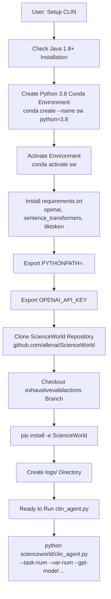
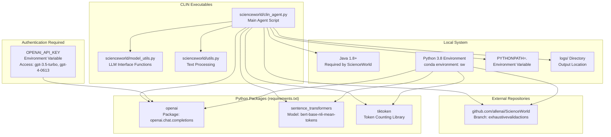
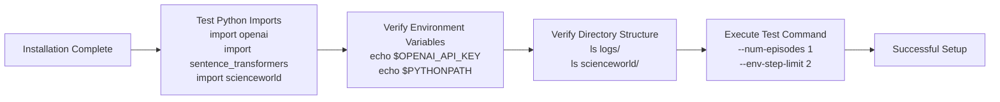

<!-- source: DeepWiki mcp.deepwiki.com · repo allenai/clin · page 2 Getting Started · fetched 2026-10-26 -->

# Getting Started

<details>
<summary>Relevant source files</summary>

The following files were used as context for generating this wiki page:

- [README.md](README.md)
- [requirements.txt](requirements.txt)

</details>


This document provides an overview of the setup process for running CLIN (Continually Learning Language Agent) experiments. It covers the high-level workflow for installing dependencies, configuring the environment, and executing your first CLIN agent run.

For detailed prerequisite requirements, see [Prerequisites](#2.1). For step-by-step installation instructions, see [Installation](#2.2). For a walkthrough of your first experiment, see [Quick Start Example](#2.3).

---

## Overview

Getting CLIN operational requires four primary setup stages:

1. **System Prerequisites**: Install Java runtime and configure Python environment
2. **Dependency Installation**: Install Python packages and clone ScienceWorld environment
3. **API Configuration**: Set up OpenAI API authentication
4. **Execution Setup**: Create output directories and verify installation

The setup process integrates three external systems: the OpenAI API (for GPT models), HuggingFace (for SentenceTransformer models), and the ScienceWorld environment (for task simulation).

---

## Setup Process Flow



**Figure 1: Complete Setup Workflow**

Sources: [README.md:13-48]()

---

## Dependency Architecture

The following diagram maps the concrete dependencies required by CLIN to their sources and purposes:



**Figure 2: Dependency Architecture and Code Entity Mapping**

Sources: [README.md:13-48](), [requirements.txt:1-4]()

---

## Installation Components Summary

| Component | Source | Purpose | Verification |
|-----------|--------|---------|--------------|
| **Java 1.8+** | System package manager | ScienceWorld runtime | `java -version` |
| **Python 3.8** | Conda environment | CLIN runtime | `python --version` |
| **openai** | PyPI (requirements.txt) | GPT model API client | Import test |
| **sentence_transformers** | PyPI (requirements.txt) | Semantic action matching | Downloads models on first run |
| **tiktoken** | PyPI (requirements.txt) | Token counting for GPT | Import test |
| **ScienceWorld** | GitHub (exhaustivevalidactions) | Task environment | `import scienceworld` |
| **OPENAI_API_KEY** | User-provided | API authentication | Required for execution |
| **logs/** | Created manually | Output directory | Must exist before running |

Sources: [README.md:13-48](), [requirements.txt:1-4]()

---

## Execution Entry Point

After completing setup, the primary entry point is `scienceworld/clin_agent.py`, invoked with command-line arguments:

```bash
python scienceworld/clin_agent.py \
    --task-num "4" \
    --var-num 1 \
    --env-step-limit 2 \
    --num-episodes 1 \
    --gpt-model "gpt-4-0613" \
    --summarize_end_of_episode 1 \
    --device "cpu" \
    --temperature 0.0 \
    --use-gold-memory-in-ep0 0 \
    --gold-traces "" \
    --use-last-k-memories 3 \
    --quadrant 1 \
    --simplifications-preset "easy" \
    --output-path-prefix logs/testrun/
```

This command structure demonstrates the key configuration dimensions:
- **Task specification**: `--task-num`, `--var-num`
- **Episode control**: `--num-episodes`, `--env-step-limit`
- **Model configuration**: `--gpt-model`, `--temperature`, `--device`
- **Memory settings**: `--use-gold-memory-in-ep0`, `--use-last-k-memories`, `--quadrant`
- **Environment setup**: `--simplifications-preset`
- **Output location**: `--output-path-prefix`

Sources: [README.md:45-48]()

---

## Setup Verification Workflow



**Figure 3: Post-Installation Verification Flow**

Sources: [README.md:13-48]()

---

## Environment Variables Reference

Two environment variables must be configured in your shell session:

| Variable | Value | Purpose | Scope |
|----------|-------|---------|-------|
| **PYTHONPATH** | `.` (current directory) | Prevents module import errors for `scienceworld/` modules | Session-level |
| **OPENAI_API_KEY** | Your OpenAI API key | Authenticates requests to GPT-3.5-Turbo and GPT-4 models | Session-level |

Both must be set before running `clin_agent.py`. Example:

```bash
export PYTHONPATH=.
export OPENAI_API_KEY=sk-...
```

Sources: [README.md:22-23]()

---

## Next Steps

- **[Prerequisites](#2.1)**: Review detailed system requirements and API access
- **[Installation](#2.2)**: Follow step-by-step installation instructions
- **[Quick Start Example](#2.3)**: Run your first CLIN experiment with guided explanation
- **[Command-Line Arguments Reference](#5.1)**: Understand all available configuration options
- **[Running Experiments](#5.2)**: Learn how to configure experiments for different scenarios

Sources: [README.md:1-59]()

---

