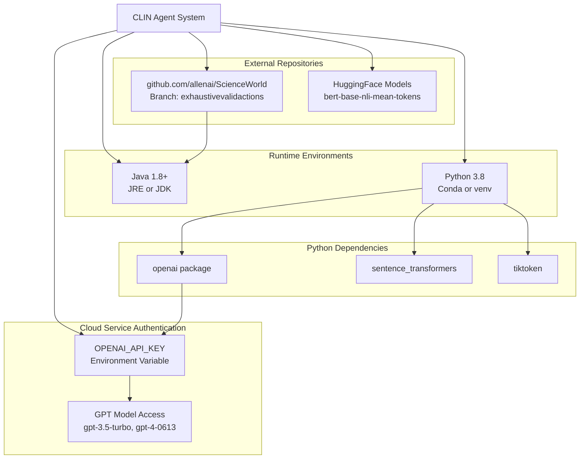
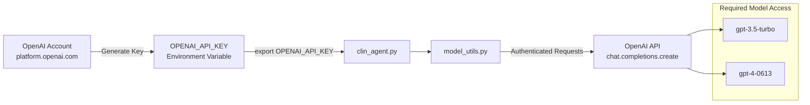
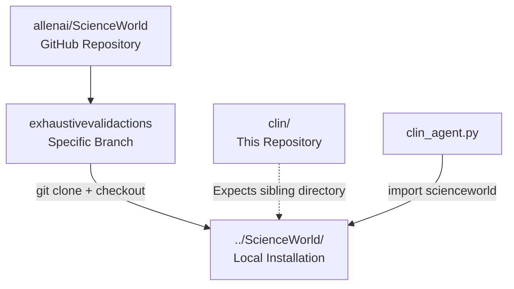
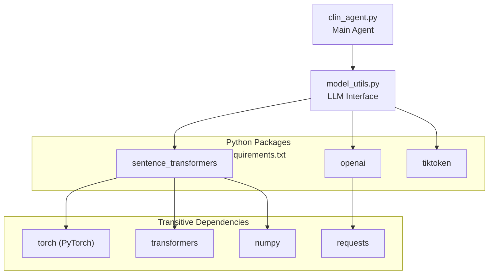
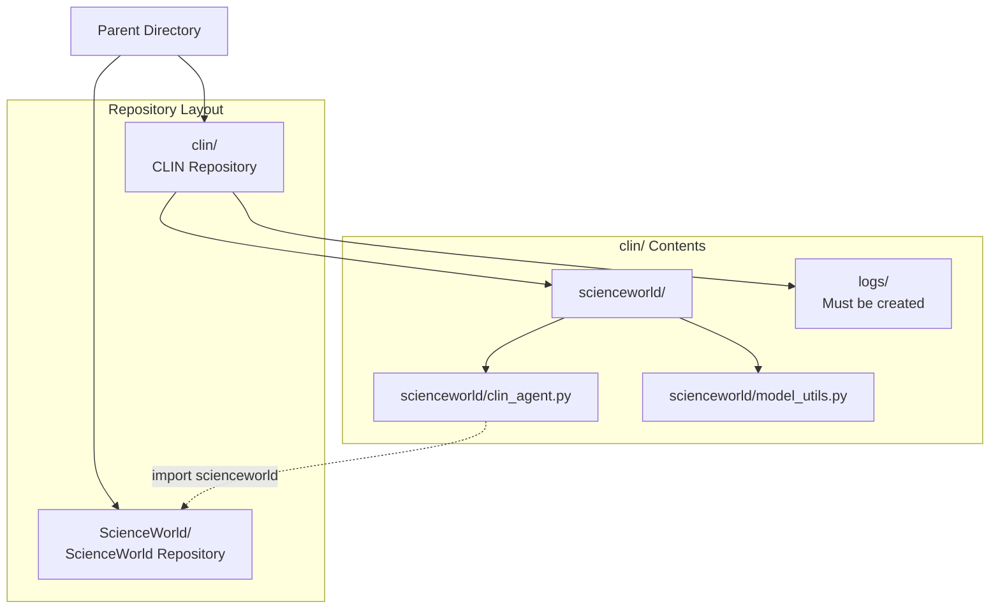

<!-- source: DeepWiki mcp.deepwiki.com · repo allenai/clin · page 2.1 Prerequisites · fetched 2026-10-26 -->

# Prerequisites

<details>
<summary>Relevant source files</summary>

The following files were used as context for generating this wiki page:

- [README.md](README.md)
- [requirements.txt](requirements.txt)

</details>


This page details all software, system requirements, API credentials, and access permissions that must be in place before installing and running CLIN. This covers operating system requirements, runtime environments, third-party service accounts, and external repository dependencies.

For installation instructions once prerequisites are met, see [Installation](#2.2). For understanding the external systems CLIN integrates with, see [ScienceWorld Integration](#4.6).

---

## Purpose and Scope

This document specifies:
- Required runtime environments (Java, Python)
- Third-party API access requirements (OpenAI)
- External repository dependencies (ScienceWorld, HuggingFace models)
- System compatibility requirements
- Authentication credentials needed

This page does **not** cover installation steps (see [Installation](#2.2)) or command-line usage (see [Command-Line Arguments Reference](#5.1)).

---

## System Requirements Overview



**Diagram: CLIN Prerequisites Dependency Map**

Sources: [README.md:13-36](), [requirements.txt:1-4]()

---

## Java Runtime Environment

CLIN requires Java because the ScienceWorld environment is implemented in Java and runs as a Java process that the Python agent communicates with.

### Requirements

| Component | Specification | Notes |
|-----------|--------------|-------|
| Java Version | 1.8 or higher | JRE or JDK acceptable |
| Typical Source | System package manager | Often pre-installed on Linux |
| Purpose | ScienceWorld execution | Java environment simulator |

### Verification

To verify Java installation:

```bash
java -version
```

Expected output should show version 1.8 or higher (e.g., `java version "1.8.0"` or `java version "11.0.0"`).

### Platform Notes

- **Linux**: Usually ships with OpenJDK pre-installed
- **macOS**: Install via Homebrew (`brew install openjdk`) or download from Oracle
- **Windows**: Download from Oracle or use OpenJDK builds

Sources: [README.md:13-14]()

---

## Python Environment

### Version Requirement

CLIN requires **Python 3.8** specifically. This version is specified for compatibility with the dependency stack, particularly the ScienceWorld Python bindings.

### Environment Management

The system expects a dedicated Python environment (virtual environment or Conda environment). Using a dedicated environment prevents dependency conflicts with other Python projects.

**Recommended approach** (using Conda):
```bash
conda create --name sw python=3.8
```

Sources: [README.md:16-19]()

---

## OpenAI API Access

CLIN's core reasoning capabilities depend on OpenAI's GPT models via their API. This is the most critical prerequisite for running CLIN.

### Required API Key



**Diagram: OpenAI Authentication Flow**

### API Key Setup

| Requirement | Details |
|-------------|---------|
| Account | Active OpenAI Platform account |
| Billing | Payment method on file (API is usage-based) |
| Environment Variable | `OPENAI_API_KEY` must be exported |
| Export Command | `export OPENAI_API_KEY=<your key>` |

### Required Model Access

The API key must have access to at least one of these models:

| Model Identifier | Purpose | Usage in CLIN |
|------------------|---------|---------------|
| `gpt-3.5-turbo` | Fast, cost-effective reasoning | Default model for experiments |
| `gpt-4-0613` | High-capability reasoning | Specified via `--gpt-model` argument |

**Note**: The exact model identifier `gpt-4-0613` indicates a specific GPT-4 checkpoint. Ensure your API key has access to this version or the model you plan to use.

Sources: [README.md:23]()

---

## External Repository Dependencies

### ScienceWorld Environment

CLIN operates within the ScienceWorld interactive environment, which must be cloned and installed separately from a specific branch.



**Diagram: ScienceWorld Repository Dependency**

| Property | Value |
|----------|-------|
| Repository URL | `https://github.com/allenai/ScienceWorld.git` |
| Required Branch | `exhaustivevalidactions` |
| Installation Location | `../ScienceWorld/` (sibling to clin directory) |
| Installation Method | `pip install -e .` (editable mode) |

**Critical**: The `exhaustivevalidactions` branch contains modifications required by CLIN. The main branch will not work.

Sources: [README.md:27-36]()

### HuggingFace Model Hub

CLIN downloads pre-trained models from HuggingFace for semantic action matching.

| Component | Model Identifier | Purpose |
|-----------|-----------------|---------|
| SentenceTransformer | `bert-base-nli-mean-tokens` | Semantic similarity matching between LLM-generated actions and valid environment actions |

**Network Requirements**: First run requires internet access to download model weights (~400MB). Models are cached locally after first download.

Sources: [requirements.txt:2]()

---

## Python Package Dependencies

The following Python packages must be available (installed during [Installation](#2.2) phase):

### Core Dependencies Table

| Package | Version Constraints | Purpose |
|---------|-------------------|---------|
| `openai` | Latest compatible | OpenAI API client for GPT model access |
| `sentence_transformers` | Latest compatible | Semantic similarity computation using BERT models |
| `tiktoken` | Latest compatible | Token counting for OpenAI models (prompt length management) |

### Dependency Resolution Map



**Diagram: Python Package Dependency Tree**

**Note**: Transitive dependencies (PyTorch, Transformers, etc.) are automatically installed by pip when installing `sentence_transformers`.

Sources: [requirements.txt:1-4]()

---

## Environment Variables

CLIN requires specific environment variables to be set before execution.

### Required Environment Variables

| Variable Name | Purpose | Set During | Example |
|---------------|---------|------------|---------|
| `OPENAI_API_KEY` | OpenAI API authentication | Before running agent | `export OPENAI_API_KEY=sk-...` |
| `PYTHONPATH` | Python module resolution | Before running agent | `export PYTHONPATH=.` |

### PYTHONPATH Configuration

Setting `PYTHONPATH=.` ensures Python can resolve module imports correctly when running scripts from the repository root. This prevents `ModuleNotFoundError` exceptions.

```bash
export PYTHONPATH=.
```

This must be set in each terminal session, or added to shell configuration files (`~/.bashrc`, `~/.zshrc`) for persistence.

Sources: [README.md:22-23]()

---

## File System Requirements

### Directory Structure Expectations

CLIN expects specific relative paths for external dependencies and output directories.



**Diagram: Expected Directory Structure**

### Required Directories

| Directory | Location | Must Exist Before | Created By |
|-----------|----------|-------------------|------------|
| `logs/` | `clin/logs/` | First run | User (`mkdir logs`) |
| `ScienceWorld/` | `../ScienceWorld/` (sibling to clin) | First run | Git clone |

The `logs/` directory must be manually created before running CLIN. This directory stores all run histories, summaries, and debug outputs.

Sources: [README.md:40-43]()

---

## Network and Connectivity

### Required Network Access

| Service | Endpoint | Required For | Fallback |
|---------|----------|--------------|----------|
| OpenAI API | `api.openai.com` | All LLM inference | None - critical |
| HuggingFace Hub | `huggingface.co` | Initial model download | Models cached after first download |
| GitHub | `github.com` | ScienceWorld clone | Can use pre-cloned repository |

### Offline Operation

After initial setup:
- **HuggingFace models**: Cached in `~/.cache/huggingface/`, enabling offline operation for action matching
- **OpenAI API**: Requires continuous internet access; no offline mode available
- **ScienceWorld**: Runs locally after installation

---

## Hardware Requirements

### Minimum Specifications

| Component | Requirement | Notes |
|-----------|-------------|-------|
| RAM | 4 GB minimum | 8 GB recommended for GPT-4 experiments with large contexts |
| Storage | 2 GB free | Includes Python environment, models, and output logs |
| CPU | Modern x86_64 | GPU not required (SentenceTransformer runs on CPU) |
| GPU | Optional | Can accelerate SentenceTransformer with `--device cuda` |

### Device Selection

CLIN supports CPU and GPU execution for the SentenceTransformer model via the `--device` flag:
- `--device cpu`: Default, works on all systems
- `--device cuda`: Requires NVIDIA GPU with CUDA toolkit

Sources: [README.md:47]()

---

## Operating System Compatibility

CLIN is developed and tested on **Linux** systems. The codebase is Python-based and should work on other UNIX-like systems with minor adjustments.

| OS | Support Level | Notes |
|----|---------------|-------|
| Linux | Fully supported | Primary development platform |
| macOS | Compatible | Requires Java and Python installation |
| Windows | Requires WSL | Native Windows not tested; use Windows Subsystem for Linux |

---

## Pre-Installation Checklist

Before proceeding to [Installation](#2.2), verify:

- [ ] Java 1.8+ installed and accessible (`java -version` succeeds)
- [ ] Python 3.8 available (Conda or virtualenv)
- [ ] OpenAI API key obtained and ready to export
- [ ] API key has access to `gpt-3.5-turbo` or `gpt-4-0613`
- [ ] Internet connectivity available for initial downloads
- [ ] Sufficient disk space (2+ GB) available
- [ ] Git installed for cloning repositories
- [ ] Shell environment ready for `export` commands

Sources: [README.md:13-43]()

---

