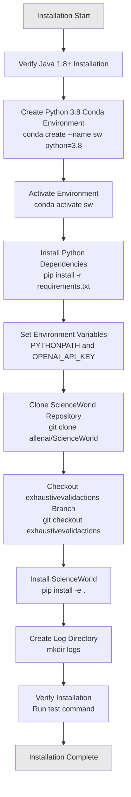
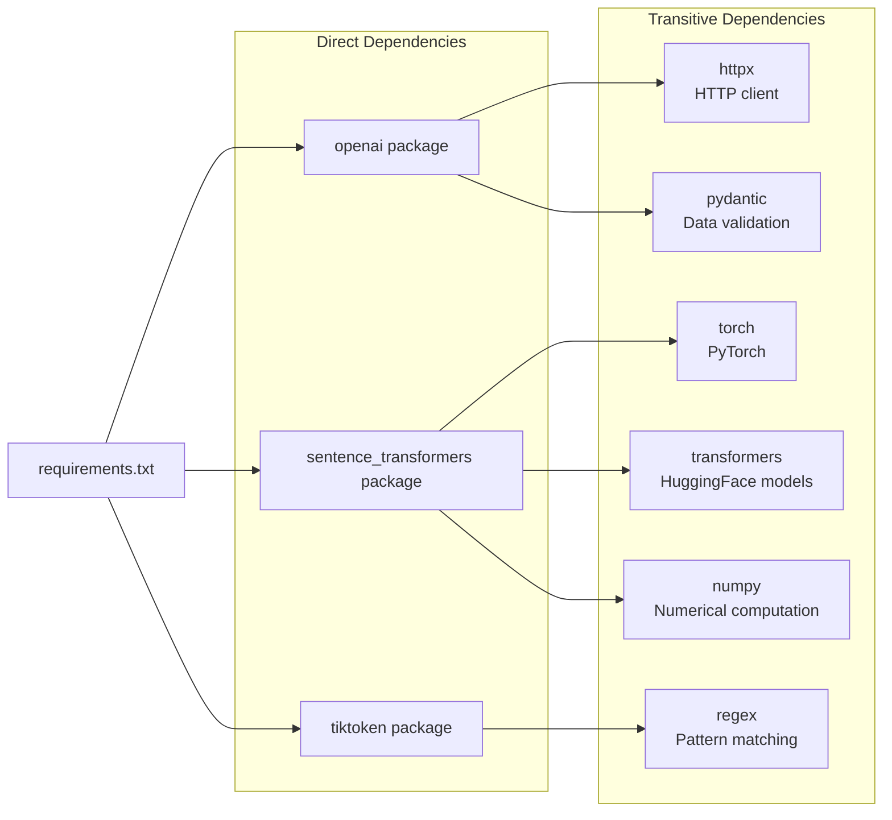
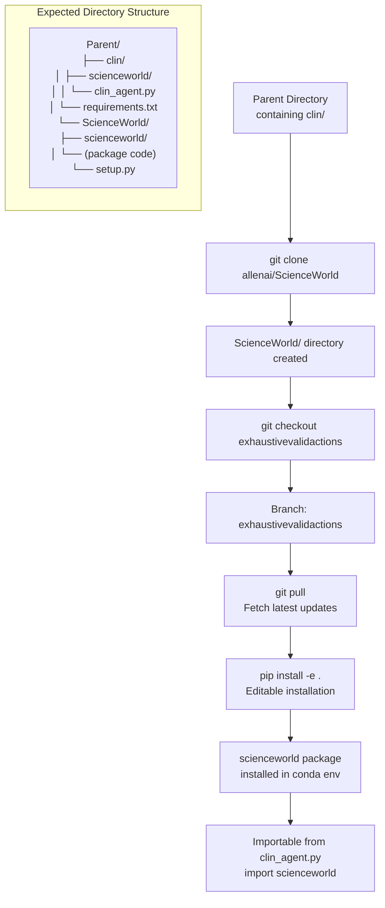
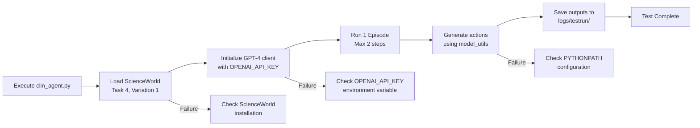
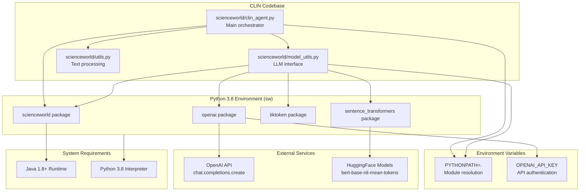

<!-- source: DeepWiki mcp.deepwiki.com · repo allenai/clin · page 2.2 Installation · fetched 2026-10-26 -->

# Installation

<details>
<summary>Relevant source files</summary>

The following files were used as context for generating this wiki page:

- [README.md](README.md)
- [requirements.txt](requirements.txt)

</details>


## Purpose and Scope

This document provides step-by-step instructions for installing CLIN and its dependencies. The installation process includes setting up a Python environment, installing Python packages, configuring the ScienceWorld environment, and setting required environment variables.

For system requirements and prerequisites, see [Prerequisites](#2.1). For running your first experiment after installation, see [Quick Start Example](#2.3).

**Sources:** [README.md:1-59]()

---

## Installation Overview

The CLIN installation consists of five major components that must be installed in sequence. The process takes approximately 10-15 minutes on a standard system.



**Installation Flow Diagram**

The installation creates the following directory structure:

```
clin/                          # CLIN repository root
├── requirements.txt           # Python dependencies specification
├── scienceworld/
│   └── clin_agent.py         # Main agent script
├── logs/                      # Created during installation
│   └── testrun/              # Example output directory
└── ../ScienceWorld/           # Cloned separately, sibling directory
    └── scienceworld/          # Installed Python package
```

**Sources:** [README.md:13-48]()

---

## Step 1: Java Installation

ScienceWorld requires Java 1.8 or higher to execute its simulation environment. Most Linux distributions ship with Java pre-installed.

### Verification

Check your Java installation:

```bash
java -version
```

Expected output should show version 1.8.0 or higher. If Java is not installed, install it using your system's package manager:

| Platform | Command |
|----------|---------|
| Ubuntu/Debian | `sudo apt-get install openjdk-8-jdk` |
| macOS | `brew install openjdk@8` |
| Windows | Download from Oracle or AdoptOpenJDK |

**Sources:** [README.md:13-14]()

---

## Step 2: Python Environment Setup

CLIN requires Python 3.8 in an isolated conda environment to avoid dependency conflicts.

### Create and Activate Environment

```bash
conda create --name sw python=3.8
conda activate sw
```

The environment name `sw` (short for ScienceWorld) is used throughout the documentation but can be customized.

### Why Python 3.8?

Python 3.8 is specified for compatibility with:
- OpenAI API client library
- SentenceTransformer models
- ScienceWorld Python bindings

**Sources:** [README.md:16-19]()

---

## Step 3: Installing Python Dependencies

The [requirements.txt:1-3]() file specifies three core dependencies:

| Package | Purpose | Used By |
|---------|---------|---------|
| `openai` | GPT-3.5/GPT-4 API client | [scienceworld/model_utils.py]() for action generation |
| `sentence_transformers` | Semantic similarity matching | [scienceworld/model_utils.py]() for action validation |
| `tiktoken` | Token counting for prompts | [scienceworld/model_utils.py]() for context management |

### Installation Command

```bash
pip install -r requirements.txt
```

This command installs all three packages and their transitive dependencies. The installation downloads:
- OpenAI Python client (latest version)
- Pre-trained SentenceTransformer models from HuggingFace
- Tiktoken encoding libraries

### Dependency Resolution



**Dependency Graph**

**Sources:** [requirements.txt:1-3](), [README.md:20]()

---

## Step 4: Environment Variable Configuration

CLIN requires two environment variables to function correctly.

### Setting Environment Variables

```bash
export PYTHONPATH=.
export OPENAI_API_KEY=<your key>
```

| Variable | Purpose | Required Models |
|----------|---------|-----------------|
| `PYTHONPATH` | Enables module imports from repo root | N/A |
| `OPENAI_API_KEY` | Authenticates with OpenAI API | `gpt-3.5-turbo`, `gpt-4-0613` |

### Variable Details

**`PYTHONPATH=.`**
- Prevents `ModuleNotFoundError` when running scripts
- Allows imports like `from scienceworld.model_utils import ...`
- Must be set from the CLIN repository root directory

**`OPENAI_API_KEY`**
- Required for calling GPT models in [scienceworld/model_utils.py]()
- Obtain from https://platform.openai.com/api-keys
- Must have access to `gpt-3.5-turbo` or `gpt-4-0613`
- Billed per token usage

### Persistent Configuration

For permanent configuration, add to your shell profile:

```bash
# ~/.bashrc or ~/.zshrc
export PYTHONPATH=/path/to/clin:$PYTHONPATH
export OPENAI_API_KEY=sk-...
```

**Sources:** [README.md:22-23]()

---

## Step 5: ScienceWorld Installation

ScienceWorld is an external dependency that must be cloned and installed separately. CLIN requires a specific branch with exhaustive valid actions.

### Installation Steps

```bash
cd ..                          # Move to parent directory
git clone https://github.com/allenai/ScienceWorld.git
cd ScienceWorld
git checkout exhaustivevalidactions
git pull
pip install -e .
```

### Installation Details



**ScienceWorld Installation Flow**

### Branch: `exhaustivevalidactions`

This branch is critical because it provides:
- Exhaustive lists of valid actions for each game state
- Action templates used by [scienceworld/model_utils.py:get_best_matched_action_using_sent_transformer]()
- Required for semantic action matching

The main branch does **not** contain these features, so the specific checkout is mandatory.

### Editable Installation (`-e` flag)

The `-e` flag installs ScienceWorld in development mode:
- Changes to ScienceWorld code take effect immediately
- No need to reinstall after modifications
- Package installed as symlink to cloned directory

**Sources:** [README.md:27-36]()

---

## Step 6: Directory Structure Setup

Before running CLIN, create the logs directory for storing run outputs.

### Creating Log Directory

```bash
cd ../clin                     # Return to CLIN repo
mkdir logs
```

### Expected Directory Structure After Installation

```
workspace/
├── clin/                                    # CLIN repository
│   ├── scienceworld/
│   │   ├── clin_agent.py                   # Main agent orchestrator
│   │   ├── model_utils.py                  # LLM integration
│   │   └── utils.py                        # Text processing
│   ├── requirements.txt                     # Python dependencies
│   ├── README.md                           # Installation guide
│   ├── logs/                               # Created by mkdir
│   │   └── testrun/                        # Example experiment dir
│   │       ├── run_history_*.json          # Generated during runs
│   │       └── summaries_*.txt             # Generated summaries
│   └── .gitignore
│
└── ScienceWorld/                            # Sibling directory
    ├── scienceworld/                        # Python package
    │   ├── __init__.py
    │   └── (environment code)
    ├── setup.py
    └── (other ScienceWorld files)
```

### Log Directory Organization

The `logs/` directory stores all experimental outputs:
- Run history JSON files with action traces
- Episode summary text files with learnings
- Subdirectories organized by experiment name

For details on output file structure, see [Understanding Output Files](#5.4).

**Sources:** [README.md:40-43]()

---

## Step 7: Installation Verification

Verify the installation by running a minimal test command.

### Test Command

```bash
python scienceworld/clin_agent.py \
    --task-num "4" \
    --var-num 1 \
    --env-step-limit 2 \
    --num-episodes 1 \
    --gpt-model "gpt-4-0613" \
    --summarize_end_of_episode 1 \
    --device "cpu" \
    --temperature 0.0 \
    --use-gold-memory-in-ep0 0 \
    --gold-traces "" \
    --use-last-k-memories 3 \
    --quadrant 1 \
    --simplifications-preset "easy" \
    --output-path-prefix logs/testrun/
```

### Expected Behavior



**Installation Verification Flow**

### Success Indicators

A successful test run produces:
1. Console output showing action-observation pairs
2. JSON file at `logs/testrun/run_history_*.json`
3. Summary file at `logs/testrun/summaries_*.txt`
4. No Python import errors or API authentication failures

### Common Verification Issues

| Error | Cause | Solution |
|-------|-------|----------|
| `ModuleNotFoundError: No module named 'scienceworld'` | ScienceWorld not installed | Repeat Step 5 |
| `openai.error.AuthenticationError` | Invalid API key | Check `OPENAI_API_KEY` variable |
| `ModuleNotFoundError: No module named 'scienceworld.model_utils'` | `PYTHONPATH` not set | Run `export PYTHONPATH=.` from repo root |
| `java.lang.NoClassDefFoundError` | Java not installed/configured | Install Java 1.8+ (Step 1) |

For additional troubleshooting, see [FAQ and Troubleshooting](#9).

**Sources:** [README.md:45-48]()

---

## Installation Component Dependencies

The following diagram shows how installed components interact with each other and which files utilize them.



**Component Dependency Map**

This diagram maps installed components to the code entities that depend on them:

- **[scienceworld/clin_agent.py]()**: Main entry point, requires all components
- **[scienceworld/model_utils.py]()**: Directly uses `openai`, `sentence_transformers`, `tiktoken`
- **[scienceworld/utils.py]()**: Text processing utilities, no external dependencies
- **`scienceworld` package**: Python wrapper around Java-based ScienceWorld environment

**Sources:** [README.md:1-59](), [requirements.txt:1-3]()

---

## Post-Installation Checklist

Before proceeding to run experiments, verify:

- [ ] Java 1.8+ installed and accessible via `java -version`
- [ ] Conda environment `sw` created with Python 3.8
- [ ] Environment activated: `conda activate sw`
- [ ] All packages from `requirements.txt` installed
- [ ] `PYTHONPATH` set to CLIN repository root
- [ ] `OPENAI_API_KEY` set and valid
- [ ] ScienceWorld cloned in parent directory
- [ ] ScienceWorld checked out to `exhaustivevalidactions` branch
- [ ] ScienceWorld installed with `pip install -e .`
- [ ] `logs/` directory created in CLIN repository
- [ ] Test command executes without errors

After completing these steps, proceed to [Quick Start Example](#2.3) to run your first CLIN experiment.

**Sources:** [README.md:13-48]()

---

