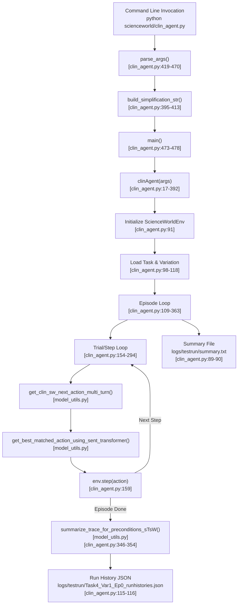
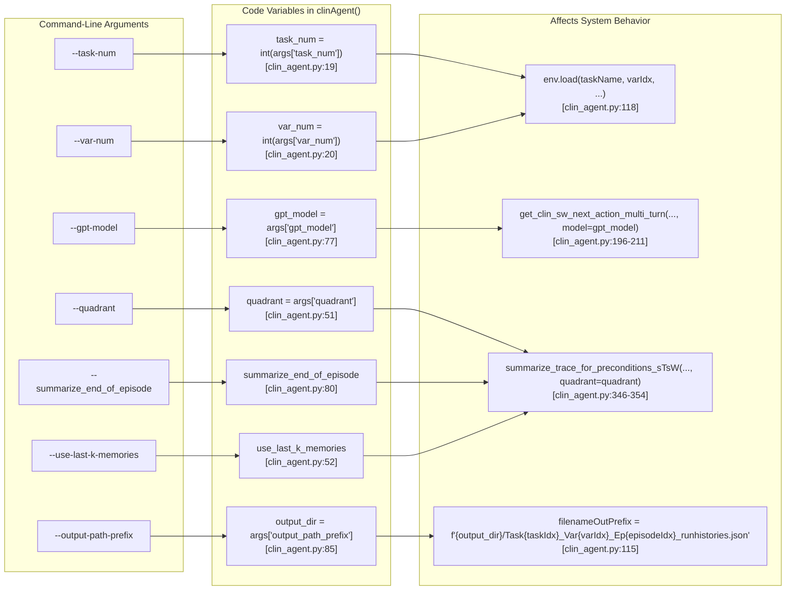
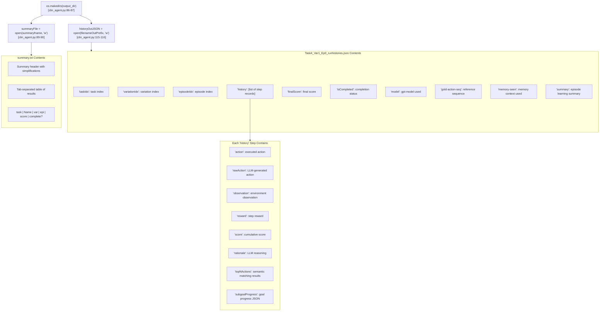

<!-- source: DeepWiki mcp.deepwiki.com · repo allenai/clin · page 2.3 Quick Start Example · fetched 2026-10-26 -->

# Quick Start Example

<details>
<summary>Relevant source files</summary>

The following files were used as context for generating this wiki page:

- [README.md](README.md)
- [requirements.txt](requirements.txt)
- [scienceworld/clin_agent.py](scienceworld/clin_agent.py)

</details>


This page walks through running your first CLIN experiment, explaining the command-line arguments and expected outputs. This assumes you have completed the installation steps in [Installation](#2.2).

For comprehensive documentation of all command-line arguments, see [Command-Line Arguments Reference](#5.1). For guidance on running more complex experiments across multiple tasks and variations, see [Running Experiments](#5.2). For understanding the output file formats in detail, see [Understanding Output Files](#5.4).

---

## The Basic Example Command

After completing installation, you can run a minimal CLIN experiment with the following command from the repository root:

```bash
python scienceworld/clin_agent.py \
  --task-num "4" \
  --var-num 1 \
  --env-step-limit 2 \
  --num-episodes 1 \
  --gpt-model "gpt-4-0613" \
  --summarize_end_of_episode 1 \
  --device "cpu" \
  --temperature 0.0 \
  --use-gold-memory-in-ep0 0 \
  --gold-traces "" \
  --use-last-k-memories 3 \
  --quadrant 1 \
  --simplifications-preset "easy" \
  --output-path-prefix logs/testrun/
```

This command runs CLIN on **task 4** (a ScienceWorld task) with **variation 1**, executing **1 episode** with a maximum of **2 environment steps** per episode. The agent uses **GPT-4** for decision-making and operates in **Quadrant 1** (adaptation mode: same task, same environment across episodes).

**Sources:** [README.md:46-48]()

---

## Execution Flow: From Command to Output

The following diagram illustrates how the command-line invocation flows through the system to produce outputs:

**Diagram: Quick Start Execution Pipeline**



**Sources:** [scienceworld/clin_agent.py:17-392](), [scienceworld/clin_agent.py:419-478](), [README.md:46-48]()

---

## Command-Line Arguments Breakdown

The following table explains each argument in the example command and how it affects execution:

| Argument | Value | Purpose | Code Reference |
|----------|-------|---------|----------------|
| `--task-num` | `"4"` | Specifies which ScienceWorld task to run (task index) | [clin_agent.py:424-425]() |
| `--var-num` | `1` | Specifies the task variation number (environment configuration) | [clin_agent.py:426-427]() |
| `--env-step-limit` | `2` | Maximum steps per episode before forced termination | [clin_agent.py:428-429]() |
| `--num-episodes` | `1` | Number of episodes to run sequentially (for continual learning) | [clin_agent.py:430-431]() |
| `--gpt-model` | `"gpt-4-0613"` | OpenAI model to use for action generation | [clin_agent.py:432-433]() |
| `--summarize_end_of_episode` | `1` | Whether to generate episode summary for memory (1=yes, 0=no) | [clin_agent.py:434-435]() |
| `--device` | `"cpu"` | Device for SentenceTransformer model (`"cpu"`, `"cuda"`, `"cuda:0"`) | [clin_agent.py:436-437]() |
| `--temperature` | `0.0` | OpenAI API temperature parameter (0.0 = deterministic) | [clin_agent.py:438-439]() |
| `--use-gold-memory-in-ep0` | `0` | Bootstrap episode 0 with gold trace memory (1=yes, 0=no) | [clin_agent.py:440-441]() |
| `--gold-traces` | `""` | Path to gold trace files for memory bootstrapping | [clin_agent.py:442-443]() |
| `--use-last-k-memories` | `3` | Number of previous episode memories to use for summarization | [clin_agent.py:444-445]() |
| `--quadrant` | `1` | Evaluation quadrant: 1=adapt, 2=cross-env, 3=cross-task | [clin_agent.py:446-450]() |
| `--simplifications-preset` | `"easy"` | Apply all environment simplifications for easier task | [clin_agent.py:455-456]() |
| `--output-path-prefix` | `logs/testrun/` | Directory path prefix for output files | [clin_agent.py:451-452]() |

**Sources:** [scienceworld/clin_agent.py:419-470]()

---

## Argument-to-Code Mapping

The following diagram shows how command-line arguments map to code variables and system behavior:

**Diagram: Command-Line Arguments to Code Entities**



**Sources:** [scienceworld/clin_agent.py:17-90](), [scienceworld/clin_agent.py:196-211](), [scienceworld/clin_agent.py:346-354]()

---

## Expected Execution Behavior

When you run the quick start command, you will observe the following console output pattern:

### Initialization Phase

```
ScienceWorld 1.0 API Examples - CLIN Agent
Running CLIN agent for taskIdx:4, varIdx:1
Task Names: [list of task names]
Task Name: [Name of task 4]
Task Description: [Description of the task]
Task Variation: 1
```

**Sources:** [scienceworld/clin_agent.py:21](), [scienceworld/clin_agent.py:93-127]()

### Trial Execution Phase

For each step within the episode, you will see:

```
----------------------------------------------------------------
Step: 0
GPT4 generated action: [action string from LLM]
Sentence transformer runtimes: [timing list]
Reasoning rationale: [LLM's reasoning]
Next ChatGPT action: [matched valid action]
Next ChatGPT action (mapped): [same as above]

>>> [observation from environment]
Reward: [numeric reward]
Score: [current score]
isCompleted: [True/False]
```

This pattern repeats for each step until:
- Task is completed (`isCompleted: True`)
- Step limit is reached (`--env-step-limit`)
- Early stopping conditions are triggered [clin_agent.py:282-294]()

**Sources:** [scienceworld/clin_agent.py:154-280]()

### Episode Completion Phase

```
Goal Progress:
[Goal progress string]
Final score: [final numeric score]
isCompleted: [True/False]
Gold Path: [gold action sequence]
Writing history file: logs/testrun/Task4_Var1_Ep0_runhistories.json
```

### Summary Output

```
---------------------------------------------------------------------
 Summary (ChatGPT Agent)
 Simplifications: easy
---------------------------------------------------------------------
task    Name    var    epi    score    complete?
4    [TaskName]    1    0    [score]    [True/False]
---------------------------------------------------------------------
Completed.
```

**Sources:** [scienceworld/clin_agent.py:296-392]()

---

## Generated Output Files

The quick start command creates the following files in the `logs/testrun/` directory:

### Output Directory Structure

```
logs/testrun/
├── Task4_Var1_Ep0_runhistories.json
└── summary.txt
```

**Diagram: Output File Generation and Structure**



**Sources:** [scienceworld/clin_agent.py:85-90](), [scienceworld/clin_agent.py:115-116](), [scienceworld/clin_agent.py:320-363](), [scienceworld/clin_agent.py:381-392]()

### JSON Run History Structure

The `Task4_Var1_Ep0_runhistories.json` file contains a complete record of the episode, structured as follows:

| Field | Type | Description | Code Reference |
|-------|------|-------------|----------------|
| `taskIdx` | integer | Task index (4 in this example) | [clin_agent.py:320]() |
| `variationIdx` | integer | Variation index (1 in this example) | [clin_agent.py:320]() |
| `episodeIdx` | integer | Episode number (0 for first episode) | [clin_agent.py:332]() |
| `history` | array | List of step-by-step records | [clin_agent.py:323-329]() |
| `finalScore` | float | Final score achieved | [clin_agent.py:333]() |
| `finalScorePositive` | float | Highest positive score during episode | [clin_agent.py:334]() |
| `isCompleted` | boolean | Whether task was completed successfully | [clin_agent.py:335]() |
| `earlyStop` | boolean | Whether episode ended via early stopping | [clin_agent.py:336]() |
| `model` | string | GPT model used (`"gpt-4-0613"`) | [clin_agent.py:337]() |
| `gold-action-seq` | string | Gold reference action sequence | [clin_agent.py:338]() |
| `memory-seen` | string | Memory context provided to agent | [clin_agent.py:339]() |
| `summary` | string | Episode learning summary (if enabled) | [clin_agent.py:355]() |

Each entry in the `history` array contains:
- `action`: The action executed in the environment
- `rawAction`: The original action string from the LLM [clin_agent.py:327]()
- `observation`: The observation received after the action
- `reward`: The reward received
- `score`: The cumulative score
- `rationale`: The LLM's reasoning for the action [clin_agent.py:326]()
- `topNActions`: Semantic similarity scores for action matching [clin_agent.py:328]()
- `subgoalProgress`: Goal progress tracking [clin_agent.py:329]()

**Sources:** [scienceworld/clin_agent.py:320-363]()

### Summary Text File

The `summary.txt` file contains a human-readable tabular summary:

```
---------------------------------------------------------------------
 Summary (ChatGPT Agent)
 Simplifications: easy
---------------------------------------------------------------------
task    Name    var    epi    score    complete?
4    [TaskName]    1    0    [0.0-1.0]    [True/False]
---------------------------------------------------------------------
Completed.
```

**Sources:** [scienceworld/clin_agent.py:381-392]()

---

## Understanding the Quick Start Quadrant Setting

The `--quadrant 1` argument places this experiment in **Quadrant 1 (Adaptation)**, which means:

- **Same task** across episodes
- **Same environment variation** across episodes
- Agent learns to **adapt** and improve performance on repeated trials

This is the simplest learning scenario. For cross-environment generalization (Quadrant 2) and cross-task generalization (Quadrant 3), see [Evaluation Quadrants](#3.4).

The quadrant setting affects:
- Which memory summaries are loaded and used [clin_agent.py:58-73]()
- How episode summaries are generated [clin_agent.py:352]()
- Memory retrieval strategy during action generation

**Sources:** [scienceworld/clin_agent.py:51-73](), [scienceworld/clin_agent.py:346-354]()

---

## Modifying the Quick Start Command

### Running Multiple Episodes

To observe continual learning, increase `--num-episodes`:

```bash
--num-episodes 3
```

This will generate:
- `Task4_Var1_Ep0_runhistories.json`
- `Task4_Var1_Ep1_runhistories.json`
- `Task4_Var1_Ep2_runhistories.json`

Episodes 1 and 2 will use memories learned from previous episodes [clin_agent.py:183-211]().

### Using GPT-3.5 Instead of GPT-4

```bash
--gpt-model "gpt-3.5-turbo"
```

This uses a faster, cheaper model but may have reduced performance.

### Increasing Step Limit

```bash
--env-step-limit 50
```

Allows the agent more steps to complete the task. The default limit in the quick start (2) is very restrictive for demonstration purposes.

**Sources:** [scienceworld/clin_agent.py:419-470](), [README.md:46-48]()

---

## Next Steps

After running the quick start example successfully:

- **Understand the architecture**: See [Architecture Overview](#4.1) for how CLIN components interact
- **Learn about memory**: See [Memory Architecture](#3.2) to understand how episode summaries enable continual learning
- **Run full experiments**: See [Running Experiments](#5.2) for guidance on evaluating across multiple tasks and variations
- **Analyze outputs**: See [Understanding Output Files](#5.4) for detailed explanation of JSON structure and memory summaries
- **Use gold traces**: See [Gold Traces and Memory Initialization](#5.3) to bootstrap episode 0 with expert demonstrations
- **Explore different quadrants**: See [Evaluation Quadrants](#3.4) for cross-environment and cross-task evaluation

**Sources:** [README.md:1-59](), [scienceworld/clin_agent.py:1-483]()

---

