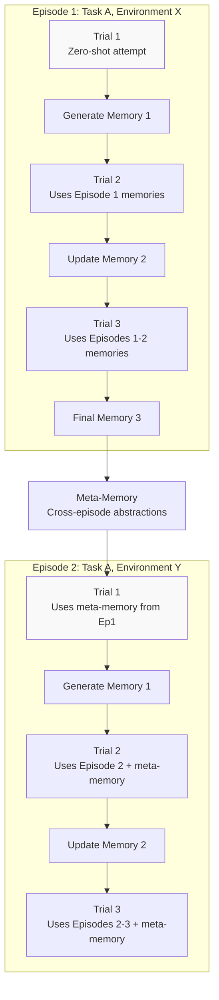
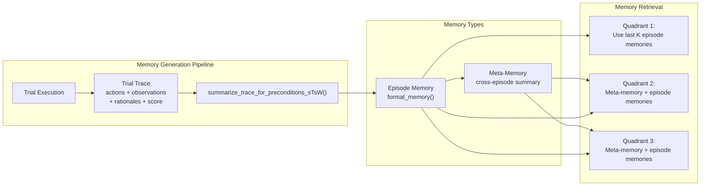
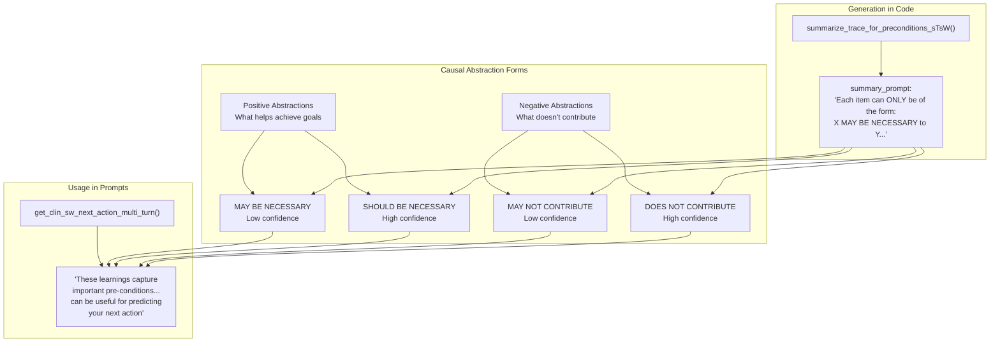
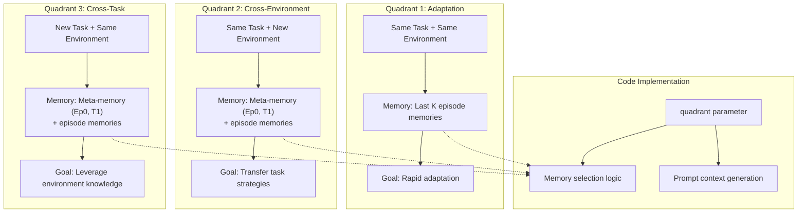
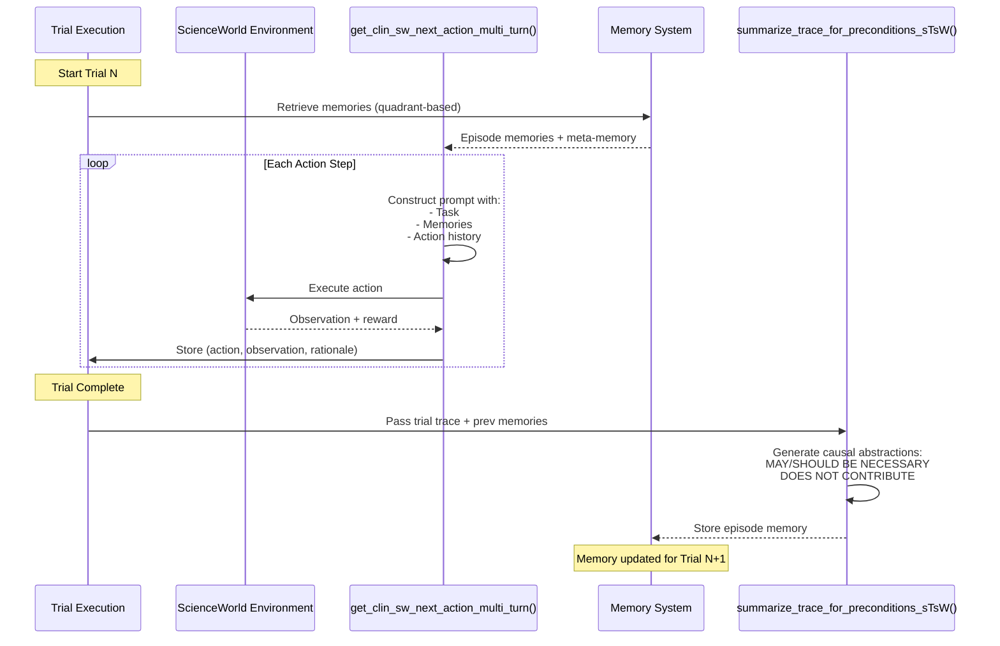
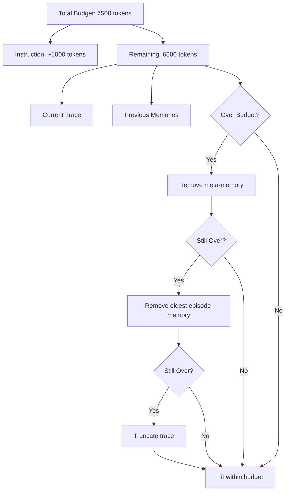

<!-- source: DeepWiki mcp.deepwiki.com · repo allenai/clin · page 3 Core Concepts · fetched 2026-10-26 -->

# Core Concepts

<details>
<summary>Relevant source files</summary>

The following files were used as context for generating this wiki page:

- [index.html](index.html)
- [model_utils.py](model_utils.py)

</details>


## Purpose and Scope

This page explains the fundamental concepts underlying CLIN's approach to continual learning. It covers the high-level architecture of how CLIN learns without parameter updates, the structure of its memory system, and the different evaluation scenarios.

For implementation details of these concepts, see [System Architecture](#4). For practical usage instructions, see [Usage Guide](#5). For research results demonstrating these concepts, see [Research and Results](#6).

---

## Overview

CLIN (Continually Learning Language Agent) implements a continual learning system that improves performance over time without updating the underlying language model's parameters. Instead of fine-tuning, CLIN maintains a **persistent textual memory** that accumulates structured knowledge across multiple trials and episodes.

The system operates in a **trial-episode framework** where:
- A **trial** is a single attempt at completing a task
- An **episode** is a sequence of trials on the same task-environment combination
- Learning occurs through memory updates after each trial
- Knowledge transfers across episodes through memory retrieval

**Key Innovation**: CLIN encodes learnings as **causal abstractions** rather than general advice, capturing relationships between actions and outcomes using structured semantic forms.

Sources: [index.html:151-156](), [model_utils.py:406-501]()

---

## Trials and Episodes

### Trial-Episode Structure



**Trial-Episode Framework**

Each trial consists of:
1. Receiving task description and initial observation
2. Generating actions based on current memory and history
3. Executing actions in the environment
4. Recording the trajectory (actions, observations, rationales)
5. Computing final score/reward

After each trial, the system generates a **summary** that captures learnings in structured form. This summary becomes part of the memory for future trials.

Sources: [model_utils.py:104-316](), [model_utils.py:406-501]()

---

## Memory Architecture

CLIN maintains two types of memory:

### Episode Memories

Episode memories capture learnings from trials within the same task-environment combination. The system maintains the last K episode memories (configurable via `use_last_k_memories` parameter, default 3).

**Memory Generation**: After each trial, `summarize_trace_for_preconditions_sTsW()` converts the trial trajectory into structured learnings.

**Memory Structure**: Each memory includes:
- Task description
- Episode index
- Structured learnings (causal abstractions)
- Performance evaluation (final score)

### Meta-Memories

Meta-memories are cross-episode generalizations that enable transfer learning. They abstract learnings from multiple episodes to apply in new contexts.

**Generation**: Created by summarizing the best-performing memories from previous episodes
**Usage**: Provided to Trial 1 of new episodes in Quadrants 2 and 3 (see below)



**Memory Retrieval in Action Generation**

Sources: [model_utils.py:359-373](), [model_utils.py:406-501]()

---

## Causal Abstractions

Causal abstractions are the structured semantic forms that encode CLIN's learnings. Unlike general advice or hints, causal abstractions explicitly represent relationships between preconditions and outcomes.

### Semantic Forms

CLIN uses four primary forms with two confidence levels:

| Form | Meaning | Example |
|------|---------|---------|
| **X MAY BE NECESSARY to Y** | Low confidence positive | "Moving to kitchen MAY BE NECESSARY to find seeds" |
| **X SHOULD BE NECESSARY to Y** | High confidence positive | "Opening cabinet SHOULD BE NECESSARY to access items inside" |
| **X MAY NOT CONTRIBUTE to Y** | Low confidence negative | "Examining table MAY NOT CONTRIBUTE to growing plant" |
| **X DOES NOT CONTRIBUTE to Y** | High confidence negative | "Looking around repeatedly DOES NOT CONTRIBUTE to task completion" |

### Confidence Levels

- **MAY**: Lower confidence, based on limited evidence or uncertain causality
- **SHOULD**: Higher confidence, based on consistent evidence or clear causality
- **DOES NOT**: Definitive negative, learned from mistakes or failed actions



**Causal Abstraction Structure and Code Mapping**

### Prompt Structure

The system enforces this structure through prompts. In `summarize_trace_for_preconditions_sTsW()`, the task prompt specifies:

```
"Each numbered item in the summary can ONLY be of the form:
X MAY BE NECCESSARY to Y.
X SHOULD BE NECCESSARY to Y.
X MAY BE CONTRIBUTE to Y.
X DOES NOT CONTRIBUTE to Y."
```

This constraint ensures all learnings follow the causal abstraction format rather than free-form text.

Sources: [model_utils.py:433-449](), [index.html:173-177](), [index.html:184-188]()

---

## Evaluation Quadrants

CLIN is evaluated across three quadrants that test different aspects of continual learning:

### Quadrant 1: Adaptation (Same Task, Same Environment)

**Scenario**: Repeated trials on identical task-environment combinations

**Memory Strategy**: 
- Trial 1: Optional gold memory for bootstrapping
- Trial 2+: Last K episode memories from previous trials
- No meta-memory used

**Prompt Context** (in `get_clin_sw_next_action_multi_turn()`):
```
"Here is a summary of learnings based on your previous attempts on this task.
These learnings capture important pre-conditions... can be useful for predicting your next action"
```

**Goal**: Rapid adaptation through experience accumulation

### Quadrant 2: Cross-Environment Generalization

**Scenario**: New environment with same task type

**Memory Strategy**:
- Episode 0, Trial 1: Meta-memory from previous environments
- Episode 0, Trial 2+: Meta-memory + episode memories
- Subsequent episodes: Episode memories (task-specific learning takes over)

**Prompt Context**:
```
"Here is a summary of learnings based on your previous attempts to solve related tasks 
in some environments. However, your current environment can differ from previous environments 
in terms of presence of objects, starting location etc."
```

**Goal**: Transfer task-solving strategies to new environment configurations

### Quadrant 3: Cross-Task Generalization

**Scenario**: New task in same environment

**Memory Strategy**:
- Episode 0, Trial 1: Meta-memory from other tasks in this environment
- Episode 0, Trial 2+: Meta-memory + episode memories
- Subsequent episodes: Episode memories

**Prompt Context**:
```
"Here is a summary of learnings based on your previous attempts to some tasks 
in your current environment. These learnings will contain related information 
about the environment such as presence of objects, starting location, navigational information, etc."
```

**Goal**: Leverage environment knowledge for new tasks



**Evaluation Quadrants and Memory Strategies**

### Implementation Mapping

The quadrant parameter controls:
1. **Memory retrieval**: Which memories to include in context [model_utils.py:131-154]()
2. **Prompt phrasing**: How to contextualize memories for the LLM [model_utils.py:131-154]()
3. **Meta-memory usage**: When to include cross-episode abstractions [model_utils.py:424-431]()

Sources: [model_utils.py:116-154](), [model_utils.py:423-431](), [index.html:190-203]()

---

## The Learning Cycle

CLIN's learning cycle integrates all core concepts:



**Complete Learning Cycle Flow**

### Cycle Stages

1. **Memory Retrieval**: Based on quadrant and episode index, retrieve relevant memories
2. **Action Generation**: Use memories to inform decision-making in multi-turn dialogue
3. **Execution**: Perform actions, record observations and rationales
4. **Summarization**: Convert trajectory into causal abstractions
5. **Memory Storage**: Add new learnings to memory pool
6. **Transfer**: Meta-memories enable cross-episode generalization

### Key Functions

| Stage | Function | File |
|-------|----------|------|
| Memory Retrieval | `format_memory()` | [model_utils.py:359-373]() |
| Action Generation | `get_clin_sw_next_action_multi_turn()` | [model_utils.py:104-316]() |
| Trace Extraction | `get_trace()` | [model_utils.py:338-357]() |
| Summarization | `summarize_trace_for_preconditions_sTsW()` | [model_utils.py:406-501]() |
| LLM Call | `summarize()` | [model_utils.py:375-404]() |

Sources: [model_utils.py:104-316](), [model_utils.py:338-501]()

---

## Token Management

CLIN carefully manages token budgets to fit within LLM context limits:

### Action Generation Budget

- Maximum history tokens: `MAXTOKENSINHISTORY = 2500` [model_utils.py:18]()
- Recent action-observation pairs included until budget exhausted
- Typically includes last 3-6 action-observation pairs [model_utils.py:182]()

### Summarization Budget

- Total budget: 7500 tokens (instruction + memories + trace)
- Instruction tokens: ~1000 tokens reserved
- Remaining 6500 tokens shared between trace and previous memories

**Budget Allocation Strategy** [model_utils.py:456-486]():
1. Calculate token counts for instruction, trace, and memories
2. If over budget, first remove meta-memory
3. Then remove oldest episode memories one by one
4. Finally truncate trace if still over budget



**Token Budget Management Algorithm**

Sources: [model_utils.py:18](), [model_utils.py:173-213](), [model_utils.py:456-486]()

---

## Summary

CLIN's core concepts form a cohesive system for continual learning:

- **Trial-Episode Framework**: Structured learning over time
- **Causal Abstractions**: Explicit encoding of action-outcome relationships
- **Dual Memory System**: Episode memories for adaptation, meta-memories for generalization
- **Quadrant-Based Evaluation**: Three scenarios testing different learning capabilities
- **Token-Aware Design**: Careful management of context windows

These concepts enable CLIN to improve continuously without parameter updates, achieving state-of-the-art performance on adaptation (23 points over Reflexion) and demonstrating positive transfer across environments and tasks.

For implementation details, see [System Architecture](#4). For usage instructions, see [Usage Guide](#5).

---

