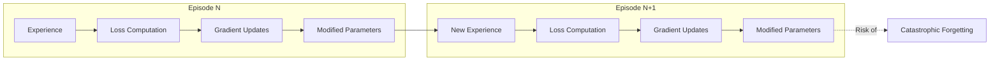
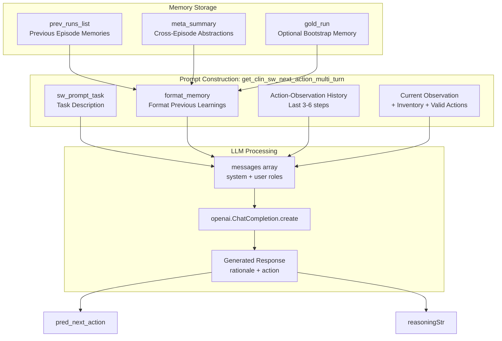
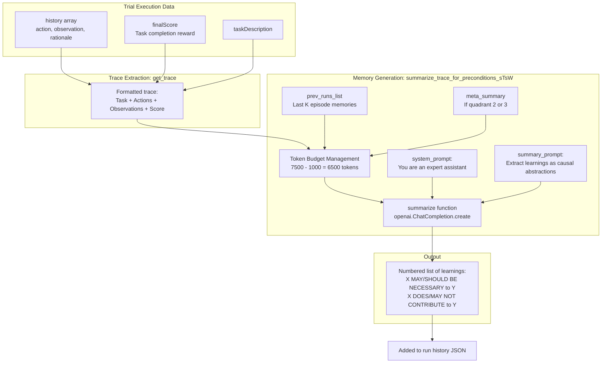
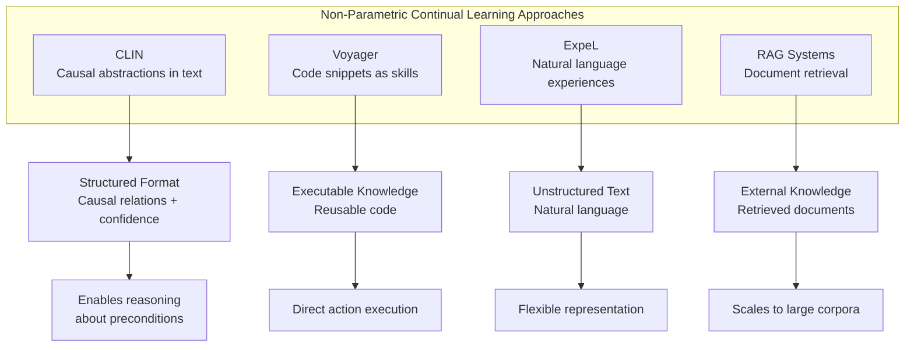

<!-- source: DeepWiki mcp.deepwiki.com · repo allenai/clin · page 3.1 Continual Learning Without Parameter Updates · fetched 2026-10-26 -->

# Continual Learning Without Parameter Updates

<details>
<summary>Relevant source files</summary>

The following files were used as context for generating this wiki page:

- [index.html](index.html)
- [model_utils.py](model_utils.py)

</details>


## Purpose and Scope

This document explains CLIN's core innovation: achieving continual learning through persistent textual memory rather than model parameter updates. It covers the fundamental approach of maintaining and utilizing memory across episodes without fine-tuning the underlying language model.

For details on the specific memory structure and causal abstractions, see [Memory Architecture](#3.2) and [Causal Abstractions](#3.3). For information on how memories are selected based on evaluation scenario, see [Evaluation Quadrants](#3.4). For implementation details of the agent orchestration, see [Agent Orchestration](#4.2).

---

## Overview of the Approach

CLIN achieves continual learning by maintaining a **persistent textual memory** that is injected into the language model's context window at inference time. This approach fundamentally differs from traditional continual learning methods that update model parameters through fine-tuning or gradient descent.

The key principle: **learning occurs through memory accumulation, not weight updates**. The underlying language model (GPT-3.5 or GPT-4) remains frozen throughout all episodes and trials.

Sources: [index.html:151-156]()

---

## Contrast with Traditional Continual Learning

### Traditional Continual Learning (Parameter-Based)



**Diagram: Traditional continual learning modifies model parameters across episodes**

### CLIN's Approach (Memory-Based)

```mermaid
graph LR
    subgraph "Episode N"
        E1[Experience/Trial] --> S1[summarize_trace_for_preconditions_sTsW]
        S1 --> Mem1[Episode Memory Text]
    end
    
    subgraph "Memory Store"
        Mem1 --> Pool[Memory Pool]
        Pool --> Retrieve[format_memory]
    end
    
    subgraph "Episode N+1"
        Retrieve --> Prompt[get_clin_sw_next_action_multi_turn]
        Prompt --> Frozen[Frozen LLM Parameters]
        Frozen --> Action[Generated Action]
        Action --> E2[New Experience/Trial]
        E2 --> S2[summarize_trace_for_preconditions_sTsW]
    end
```



**Diagram: CLIN maintains frozen parameters and learns through textual memory**

| Aspect | Parameter-Based Learning | CLIN (Memory-Based) |
|--------|-------------------------|---------------------|
| **Model Parameters** | Updated after each episode | Remain frozen |
| **Knowledge Storage** | Neural network weights | Textual memory |
| **Catastrophic Forgetting** | High risk | No risk - all memories retained |
| **Computational Cost** | Requires gradient computation | Only inference |
| **Interpretability** | Black box | Readable text |
| **Deployment** | Requires model retraining/fine-tuning | Model remains unchanged |

Sources: [index.html:151-156](), [model_utils.py:104-316]()

---

## Memory as Context: The Core Mechanism

CLIN's continual learning occurs through **context manipulation** rather than parameter updates. Each action decision involves:

1. Retrieving relevant memories from previous episodes
2. Injecting memories into the LLM prompt
3. Generating actions based on task + memory + current history
4. Storing new learnings for future use

### Memory Injection Pipeline



**Diagram: Memory-to-Action pipeline showing how frozen LLM uses textual memory**

The critical function is `get_clin_sw_next_action_multi_turn`, which constructs prompts containing:

- **System prompt**: Defines agent role [model_utils.py:160-164]()
- **Task description**: Current task specification [model_utils.py:124-130]()
- **Memory summary**: Formatted previous learnings [model_utils.py:131-154]()
- **Action history**: Recent action-observation pairs [model_utils.py:170-216]()
- **Current state**: Observation, inventory, valid actions [model_utils.py:225-246]()

Sources: [model_utils.py:104-316](), [model_utils.py:359-373]()

---

## Episode-to-Memory Pipeline

After each trial, CLIN converts the execution trace into structured learnings through the `summarize_trace_for_preconditions_sTsW` function:



**Diagram: Converting trial execution into structured memory learnings**

### Token Budget Management

The function implements sophisticated token budget management to fit within LLM context limits [model_utils.py:456-486]():

1. Calculate budget: `7500 - 1000 = 6500` tokens for content
2. Measure instruction tokens: `getTokenLength(final_prompt)`
3. Measure trace tokens: `getTokenLength(trace)`
4. Measure previous memory tokens: `getTokenLength(prev_memories)`
5. If over budget, progressively truncate:
   - First remove meta-memory
   - Then remove oldest episode memories
   - Finally truncate trace observations

This ensures memory generation always succeeds within model constraints.

Sources: [model_utils.py:406-501](), [model_utils.py:338-357]()

---

## Memory Injection into Prompts

The `get_clin_sw_next_action_multi_turn` function injects memory differently based on the evaluation quadrant:

### Quadrant 1: Same Task, Same Environment

```python
# Lines 131-135 in model_utils.py
sw_prompt_task += \
    f"Here is a summary of learnings based on your previous attempts on this task." \
    f"These learnings capture important pre-conditions: X MAY BE NECESSARY to Y, X SHOULD BE NECESSARY to Y, and mistakes: X MAY NOT CONTRIBUTE to Y, X DOES NOT CONTRIBUTE to Y. These can be useful for predicting your next action:\n{summary}"
```

Memory is presented as **direct learnings from previous attempts** on the same task.

### Quadrant 2: Cross-Environment Generalization

```python
# Lines 136-144 in model_utils.py
if episodeIdx == 0:
    sw_prompt_task += \
        f"Here is a summary of learnings based on your previous attempts to solve related tasks in some environments. However, your current envionment can differ from previous environments in terms of presence of objects, starting location etc." \
        f"These learnings capture important pre-conditions... Some of these learnings can be useful for predicting your next action:\n{summary}"
else:
    # Same as Quadrant 1 after episode 0
```

For episode 0, memory is presented as **potentially useful meta-learnings** with caveats about environmental differences.

### Quadrant 3: Cross-Task Generalization

```python
# Lines 146-154 in model_utils.py
if episodeIdx == 0:
    sw_prompt_task += \
        f"Here is a summary of learnings based on your previous attempts to some tasks in your current environment." \
        f"These learnings capture important pre-conditions... Some of these learnings can be useful for predicting your next action:\n{summary}"
else:
    # Same as Quadrant 1 after episode 0
```

For episode 0, memory emphasizes **environmental familiarity** (same environment, different tasks).

Sources: [model_utils.py:131-154]()

---

## Learning Types Encoded in Memory

CLIN's memory system encodes four types of causal abstractions:

| Learning Type | Certainty | Meaning | Example |
|---------------|-----------|---------|---------|
| **SHOULD BE NECESSARY** | High | Action X is very likely required for goal Y | "Moving to kitchen SHOULD BE NECESSARY to finding seeds" |
| **MAY BE NECESSARY** | Medium | Action X might be required for goal Y | "Opening drawer MAY BE NECESSARY to finding items" |
| **DOES NOT CONTRIBUTE** | High | Action X definitely doesn't help with goal Y | "Examining painting DOES NOT CONTRIBUTE to growing plants" |
| **MAY NOT CONTRIBUTE** | Medium | Action X probably doesn't help with goal Y | "Going to bedroom MAY NOT CONTRIBUTE to finding kitchen items" |

These abstractions are generated by the LLM summarization process and constrained through the prompt template [model_utils.py:443-449]():

```python
"Each numbered item in the summary can ONLY be of the form:\n" \
    "X MAY BE NECCESSARY to Y.\n" \
    "X SHOULD BE NECCESSARY to Y.\n" \
    "X MAY BE CONTRIBUTE to Y.\n" \
    "X DOES NOT CONTRIBUTE to Y.\n\n"
```

Sources: [model_utils.py:443-449](), [index.html:186-187]()

---

## Benefits and Trade-offs

### Benefits of Memory-Based Learning

1. **No Catastrophic Forgetting**: All memories are retained in textual form
2. **Interpretability**: Learnings are human-readable causal statements
3. **Computational Efficiency**: Only inference required, no gradient computation
4. **Deployment Simplicity**: Same frozen model used throughout
5. **Flexible Retrieval**: Memories can be selectively included based on context
6. **Rapid Adaptation**: New learnings immediately available in next trial

### Trade-offs and Limitations

1. **Context Window Limits**: Bounded by LLM maximum context length
2. **Memory Management**: Requires token budget management and truncation strategies
3. **Retrieval Quality**: Depends on ability to identify relevant memories
4. **No Weight Consolidation**: Cannot compress knowledge into more efficient representations
5. **LLM Quality Dependency**: Memory generation quality depends on base model capabilities
6. **Inference Cost**: Longer prompts increase per-query cost and latency

### Comparison with Other Non-Parametric Approaches



**Diagram: CLIN's position among non-parametric learning approaches**

Sources: [index.html:206-208](), [model_utils.py:104-316]()

---

## Implementation Summary

The complete memory-based learning cycle involves these key functions:

| Function | File | Purpose |
|----------|------|---------|
| `get_clin_sw_next_action_multi_turn` | [model_utils.py:104-316]() | Constructs prompts with memory, queries LLM for actions |
| `summarize_trace_for_preconditions_sTsW` | [model_utils.py:406-501]() | Converts episode traces to structured learnings |
| `summarize` | [model_utils.py:375-404]() | Makes LLM API call to generate summaries |
| `get_trace` | [model_utils.py:338-357]() | Extracts formatted trace from run history |
| `format_memory` | [model_utils.py:359-373]() | Formats previous episode memories for prompt injection |
| `run_chatgpt_query_multi_turn` | [model_utils.py:83-101]() | Handles LLM API calls with retry logic |

These functions work together to implement continual learning without any parameter updates to the underlying language model.

Sources: [model_utils.py:1-502]()

---

