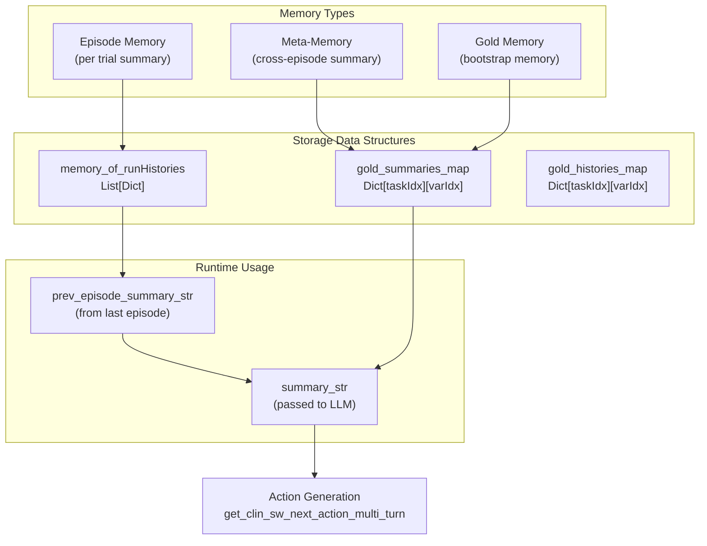
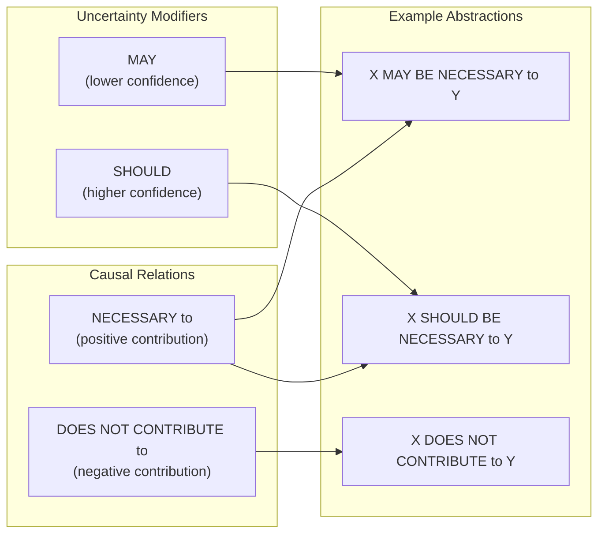
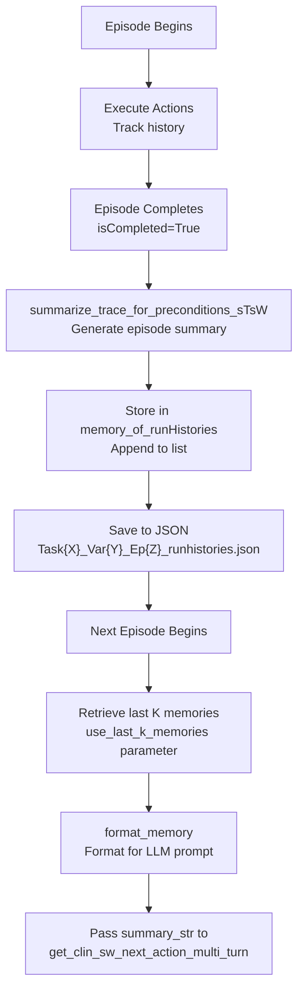
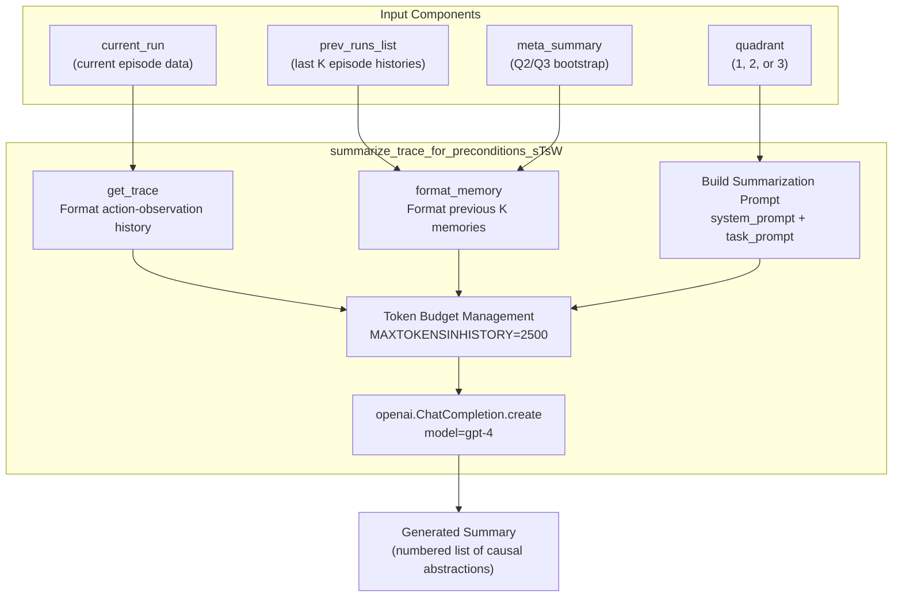
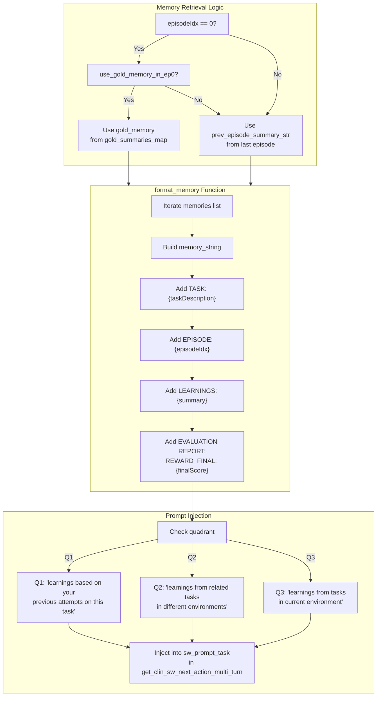
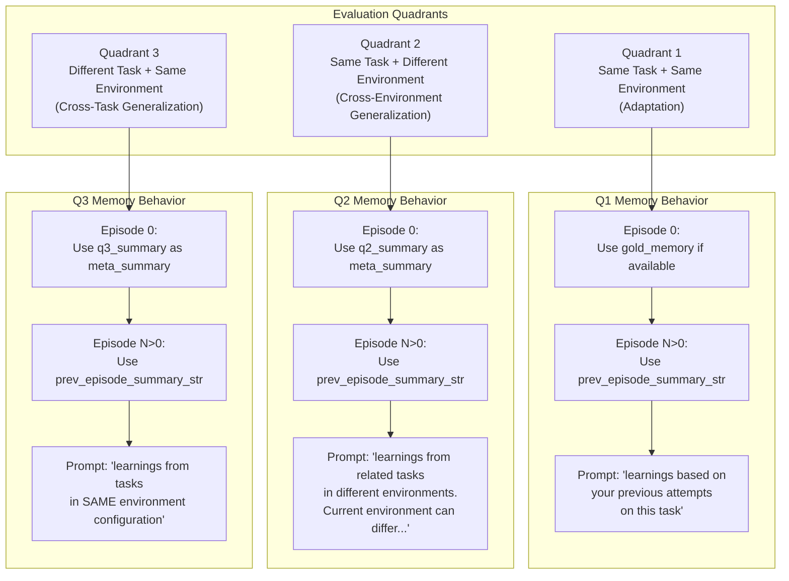
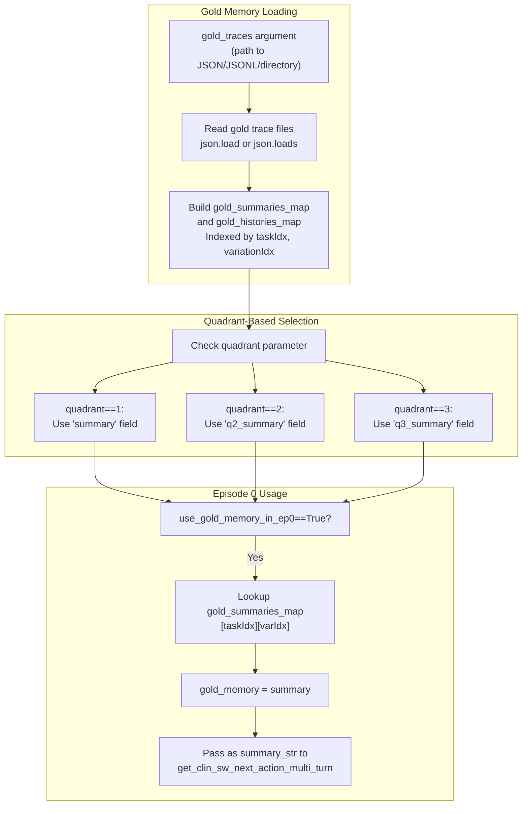
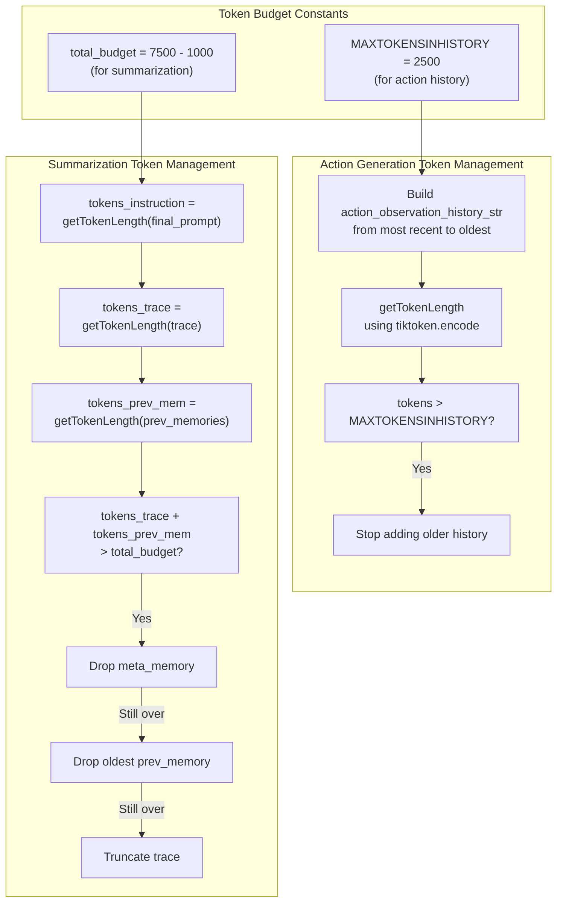
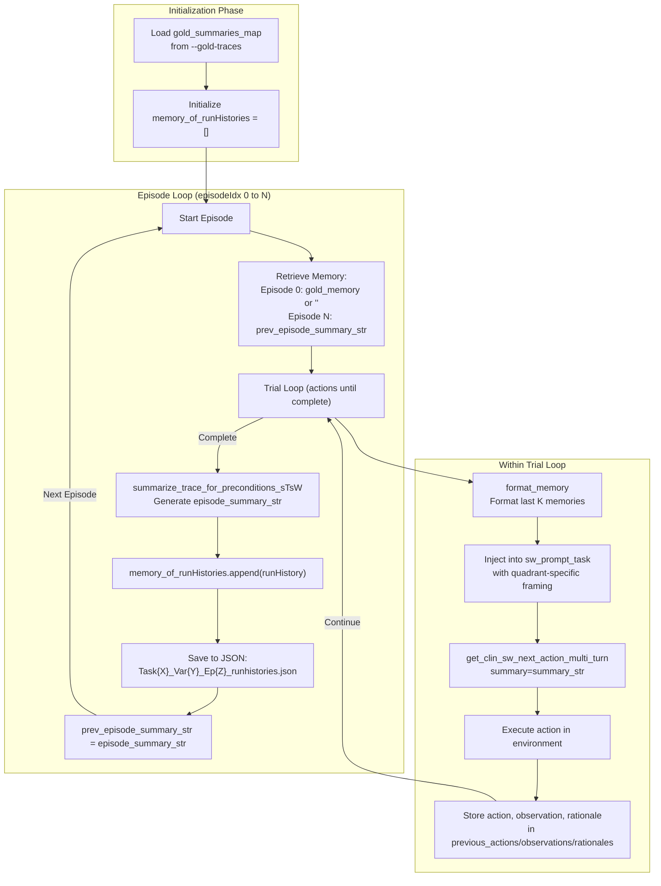

<!-- source: DeepWiki mcp.deepwiki.com · repo allenai/clin · page 3.2 Memory Architecture · fetched 2026-10-26 -->

# Memory Architecture

<details>
<summary>Relevant source files</summary>

The following files were used as context for generating this wiki page:

- [index.html](index.html)
- [model_utils.py](model_utils.py)
- [scienceworld/clin_agent.py](scienceworld/clin_agent.py)

</details>


## Purpose and Scope

This document describes CLIN's memory architecture, which enables continual learning without parameter updates through persistent textual memory. The memory system stores causal abstractions learned from past episodes and retrieves them to inform future decision-making.

For information about how memories are used during action generation, see [LLM Integration Layer](#4.3). For details on learning and summarization algorithms, see [Learning and Summarization System](#4.5). For evaluation scenario details, see [Evaluation Quadrants](#3.4).

---

## Memory Components Overview

CLIN's memory system consists of three primary components: episode memories, meta-memories, and gold memories. These are stored as structured textual summaries containing causal abstractions.



**Sources:** [scienceworld/clin_agent.py:84-89](), [scienceworld/clin_agent.py:49-73](), [model_utils.py:359-373]()

### Episode Memory

Episode memories are generated after each trial and stored in `memory_of_runHistories`. Each entry contains:

| Field | Type | Description |
|-------|------|-------------|
| `episodeIdx` | int | Episode number (0-indexed) |
| `taskDescription` | str | Task being attempted |
| `finalScore` | float | Final reward received |
| `history` | List[Dict] | Action-observation pairs with rationales |
| `summary` | str | Causal abstractions learned |
| `memory-seen` | str | Memory provided during episode |

**Sources:** [scienceworld/clin_agent.py:320-363]()

### Meta-Memory

Meta-memories are pre-generated summaries used for generalization to new environments (Q2) or new tasks (Q3). They abstract learnings across multiple episodes:

- **Q2 Meta-Memory:** Contains learnings from same task in different environments, stored in `q2_summary` field
- **Q3 Meta-Memory:** Contains learnings from different tasks in same environment, stored in `q3_summary` field

**Sources:** [scienceworld/clin_agent.py:54-73](), [model_utils.py:424-431]()

### Gold Memory

Gold memories bootstrap episode 0 with expert knowledge from pre-recorded gold traces. They are loaded from JSON files and indexed by task and variation.

**Sources:** [scienceworld/clin_agent.py:26-47](), [scienceworld/clin_agent.py:129-134]()

---

## Causal Abstraction Structure

CLIN memories consist of numbered lists of causal abstractions using specific semantic relations and uncertainty modifiers.



### Semantic Template Format

Memories follow strict templates defined in the summarization prompt:

```
X MAY BE NECESSARY to Y
X SHOULD BE NECESSARY to Y
X MAY BE CONTRIBUTE to Y
X DOES NOT CONTRIBUTE to Y
```

Where:
- **X**: An action or precondition (e.g., "moving to the kitchen", "picking up the seed")
- **Y**: A goal or outcome (e.g., "finding seeds", "planting seeds")

**Sources:** [model_utils.py:443-449](), [index.html:186-187]()

### Example Memory Entry

```
1. Moving to the kitchen MAY BE NECESSARY to finding seeds.
2. Picking up the seed SHOULD BE NECESSARY to planting seeds.
3. Using the thermometer DOES NOT CONTRIBUTE to growing plants.
```

**Sources:** [index.html:173-175]()

---

## Memory Storage and Lifecycle

The memory system follows a clear lifecycle from generation through storage to retrieval.



**Sources:** [scienceworld/clin_agent.py:344-363](), [model_utils.py:406-501]()

### Memory Persistence

Memories are persisted in two ways:

1. **In-Memory List:** `memory_of_runHistories` accumulates run histories across episodes within a single execution
2. **JSON Files:** Each episode's run history is saved to disk at `{output_path_prefix}/Task{taskIdx}_Var{varIdx}_Ep{episodeIdx}_runhistories.json`

**Sources:** [scienceworld/clin_agent.py:84](), [scienceworld/clin_agent.py:115-116](), [scienceworld/clin_agent.py:359-363]()

---

## Memory Generation Process

Episode summaries are generated through a multi-step LLM-based process that synthesizes action traces into causal abstractions.



**Sources:** [model_utils.py:406-501]()

### Trace Formatting

The `get_trace()` function formats episode history into a structured trace:

```
CURRENT TRACE

Task: [task description]

Action: [action taken]
Observation: [observation received]

Action: [next action]
Observation: [next observation]

...

EVALUATION REPORT:
REWARD_FINAL: [score]. This means: [success_map feedback]
```

**Sources:** [model_utils.py:338-357]()

### Prompt Construction

The summarization prompt instructs the LLM to extract causal abstractions:

```python
summary_prompt = "You are given CURRENT TRACE, a sequence of actions that an agent made in a world to accomplish a task..."

task_prompt = "Generate a summary of learning, as a numbered list, that will help the agent to successfully accomplish the SAME task AGAIN, in the SAME world.\n" \
              "Each numbered item in the summary can ONLY be of the form:\n" \
              "X MAY BE NECCESSARY to Y.\n" \
              "X SHOULD BE NECCESSARY to Y.\n" \
              "X MAY BE CONTRIBUTE to Y.\n" \
              "X DOES NOT CONTRIBUTE to Y.\n\n"
```

**Sources:** [model_utils.py:433-453]()

---

## Memory Retrieval and Usage

Memories are retrieved and formatted before being injected into the action generation prompt.



**Sources:** [scienceworld/clin_agent.py:183-188](), [model_utils.py:359-373](), [model_utils.py:131-154]()

### `use_last_k_memories` Parameter

The system retrieves only the K most recent memories to avoid overwhelming the prompt:

```python
prev_runs_list = memory_of_runHistories[-1 * use_last_k_memories:]
```

Default value: `use_last_k_memories = 3`

**Sources:** [scienceworld/clin_agent.py:345](), [scienceworld/clin_agent.py:444-445]()

### Memory Formatting Output

The `format_memory()` function produces:

```
PREVIOUS LEARNINGS

TASK: [task description]
EPISODE: [episode number]
LEARNINGS: [causal abstractions]

EVALUATION REPORT (for the attempt associated with the learning):
REWARD_FINAL: [score]. This means: [feedback]

[Repeat for each memory in last K episodes]
```

**Sources:** [model_utils.py:359-373]()

---

## Quadrant-Specific Memory Handling

CLIN adapts its memory usage based on the evaluation quadrant, which determines the learning scenario.



**Sources:** [model_utils.py:131-154](), [scienceworld/clin_agent.py:51-73]()

### Quadrant-Specific Prompt Injection

| Quadrant | Episode 0 Memory | Episode N>0 Memory | Prompt Framing |
|----------|------------------|-------------------|----------------|
| **Q1** | `gold_memory` (optional) | `prev_episode_summary_str` | "previous attempts on this task" |
| **Q2** | `q2_summary` as meta-memory | `prev_episode_summary_str` | "related tasks in different environments" |
| **Q3** | `q3_summary` as meta-memory | `prev_episode_summary_str` | "tasks in SAME environment configuration" |

**Sources:** [model_utils.py:131-154]()

### Meta-Memory in Summarization

For Q2 and Q3, meta-memories are passed to the summarization function when episode count is below `use_last_k_memories`:

```python
if len(prev_runs_list) < use_last_k_memories:
    if quadrant == 2:
        if meta_summary:
            meta_summary_prompt = "You are also provided with a set of META LEARNINGS..."
            prev_memories = "META LEARNINGS:\n" + meta_summary + prev_memories
```

**Sources:** [model_utils.py:423-431]()

---

## Gold Memory Bootstrapping

Gold memories provide expert knowledge to bootstrap learning in episode 0.



**Sources:** [scienceworld/clin_agent.py:26-73](), [scienceworld/clin_agent.py:129-134]()

### Gold Trace File Structure

Gold traces are JSON objects containing:

```json
{
  "taskIdx": "4",
  "variationIdx": "1",
  "summary": "1. Moving to location X MAY BE NECESSARY to finding object Y...",
  "q2_summary": "Meta-learning for Q2...",
  "q3_summary": "Meta-learning for Q3...",
  "history": [
    {"action": "...", "observation": "...", "rationale": "..."}
  ]
}
```

**Sources:** [scienceworld/clin_agent.py:29-46](), [scienceworld/clin_agent.py:54-73]()

### Bypassing Summarization with Gold Memory

When gold memory is used in episode 0, the summarization step is bypassed:

```python
if gold_run:
    return gold_run['summary']  # returns gold memory
```

**Sources:** [model_utils.py:416-417]()

---

## Token Budget Management

The memory system carefully manages token counts to fit within LLM context windows.



**Sources:** [model_utils.py:18](), [model_utils.py:173-213](), [model_utils.py:456-486]()

### Action History Token Management

In `get_clin_sw_next_action_multi_turn()`, action history is built from most recent to oldest and stops when exceeding `MAXTOKENSINHISTORY`:

```python
maxTokensInHistory = MAXTOKENSINHISTORY  # 2500

for i in range(len(previous_actions) - 1, max(len(previous_actions) - 6, -1), -1):
    # Build candidate history string
    action_observation_history_str_candidate = f"assistant: {rationale} step: {i}\n action: {action}\n observation: {observation}\n\n" + action_observation_history_str
    
    if getTokenLength(action_observation_history_str_candidate) > maxTokensInHistory:
        break  # Stop adding older history
    else:
        action_observation_history_str = action_observation_history_str_candidate
```

**Sources:** [model_utils.py:173-213]()

### Summarization Token Management

The `summarize_trace_for_preconditions_sTsW()` function implements a cascading strategy to fit within budget:

```python
total_budget = 7500 - 1000  # Reserve 1000 tokens for output
tokens_instruction = getTokenLength(final_prompt)
total_budget -= tokens_instruction

# Calculate token usage
tokens_trace = getTokenLength(trace)
tokens_prev_mem = getTokenLength(prev_memories)

# Trim if over budget
while tokens_trace + tokens_prev_mem > total_budget:
    if len(memories['meta_memory']) > 0:
        # Drop meta-memory first
        memories['meta_memory'] = ""
    elif len(memories['prev_memory']) > 0:
        # Drop oldest previous memory
        memories['prev_memory'] = memories['prev_memory'][1:]
    else:
        # Truncate trace as last resort
        trace = get_trace(current_run, truncate=True)
```

**Sources:** [model_utils.py:456-486]()

### Token Counting with tiktoken

All token counting uses the `tiktoken` library with the `cl100k_base` encoding:

```python
import tiktoken
tokenizer = tiktoken.get_encoding("cl100k_base")

def getTokenLength(strIn):
    tokens = tokenizer.encode(strIn)
    numTokens = len(tokens)
    return numTokens
```

**Sources:** [model_utils.py:10](), [model_utils.py:17](), [model_utils.py:21-24]()

---

## Memory Data Flow Summary

The complete memory data flow through CLIN's execution cycle:



**Sources:** [scienceworld/clin_agent.py:17-393](), [model_utils.py:104-316](), [model_utils.py:406-501]()

---

