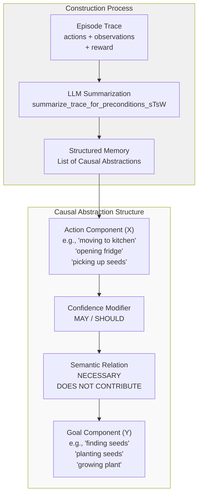
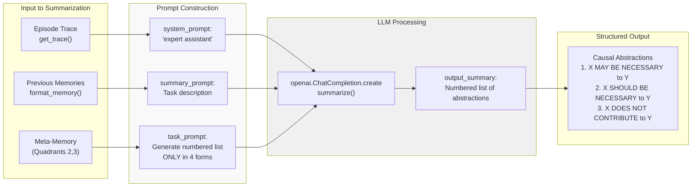
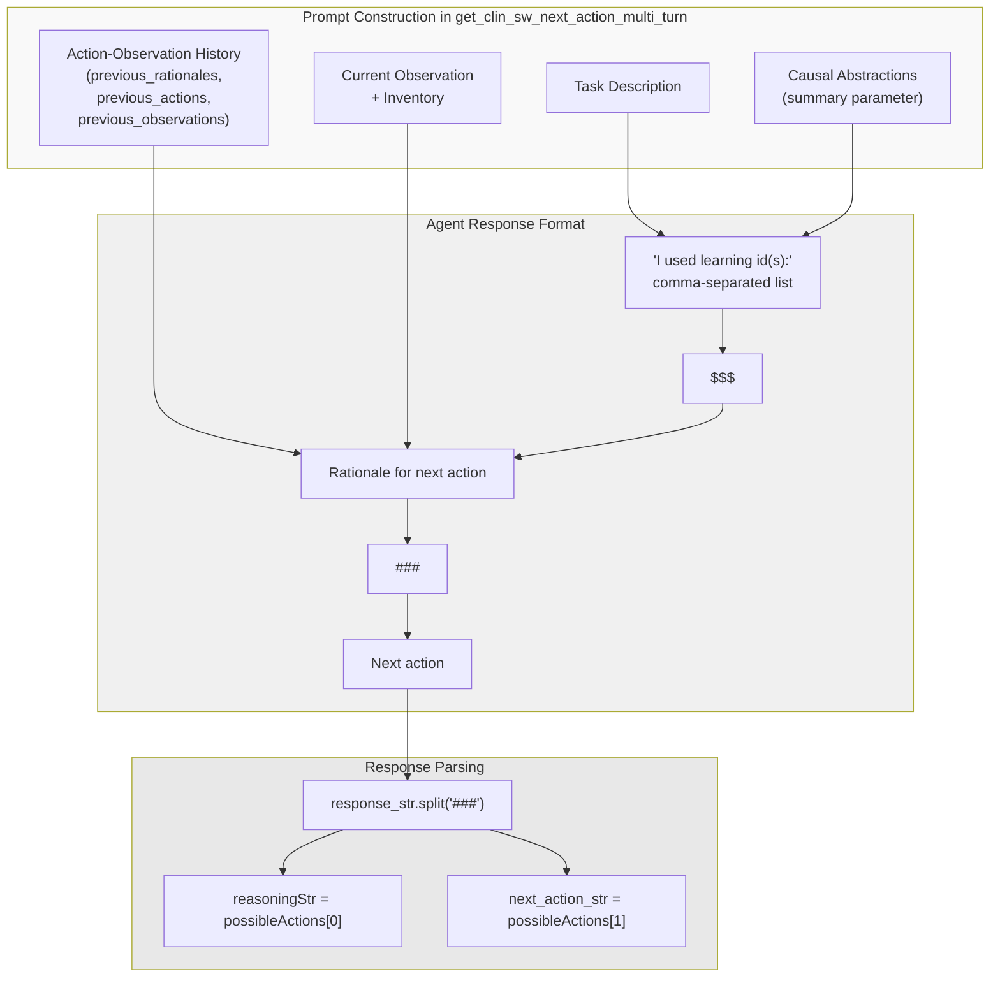

<!-- source: DeepWiki mcp.deepwiki.com · repo allenai/clin · page 3.3 Causal Abstractions · fetched 2026-10-26 -->

# Causal Abstractions

<details>
<summary>Relevant source files</summary>

The following files were used as context for generating this wiki page:

- [index.html](index.html)
- [model_utils.py](model_utils.py)

</details>


## Purpose and Scope

This document explains the semantic structure of causal abstractions, which are the fundamental building blocks of CLIN's memory system. Causal abstractions encode learnings about relationships between actions and goals using a structured linguistic format that captures both causality and uncertainty.

For information about how these abstractions are stored and retrieved in the memory system, see [Memory Architecture](#3.2). For details on how memories are generated from episode traces, see [Learning and Summarization System](#4.5).

---

## What Are Causal Abstractions?

Causal abstractions are structured textual statements that capture learned relationships between actions (X) and goals (Y). They form the semantic vocabulary through which CLIN expresses and accumulates knowledge across trials and episodes without modifying model parameters.

Each causal abstraction takes one of four canonical forms, combining a **semantic relation** (positive or negative causality) with a **confidence modifier** (tentative or strong):

| Form | Semantic Relation | Confidence | Meaning |
|------|------------------|------------|---------|
| `X MAY BE NECESSARY to Y` | Positive (necessary) | Tentative (may) | X might be required for Y |
| `X SHOULD BE NECESSARY to Y` | Positive (necessary) | Strong (should) | X is likely required for Y |
| `X MAY NOT CONTRIBUTE to Y` | Negative (does not contribute) | Tentative (may not) | X might be irrelevant to Y |
| `X DOES NOT CONTRIBUTE to Y` | Negative (does not contribute) | Strong (does not) | X is irrelevant or harmful to Y |

**Sources:** [model_utils.py:444-448](), [index.html:186-187]()

---

## Causal Abstraction Structure



**Diagram: Structure and Generation of Causal Abstractions**

**Sources:** [model_utils.py:434-449](), [model_utils.py:406-501]()

---

## Semantic Relations

### Positive Relation: NECESSARY

The `NECESSARY` relation indicates that action X is a precondition for achieving goal Y. This captures successful action patterns that should be repeated.

**Examples from the codebase prompts:**
- "moving to kitchen MAY BE NECESSARY to finding seeds"
- "placing seeds in pot SHOULD BE NECESSARY to planting seeds"

**Usage in prompts:** These appear in the summary field that is inserted into the task prompt.

**Sources:** [model_utils.py:445-446](), [model_utils.py:134-135]()

### Negative Relation: DOES NOT CONTRIBUTE

The `DOES NOT CONTRIBUTE` relation indicates that action X is irrelevant or counterproductive to achieving goal Y. This captures mistakes that should be avoided.

**Examples:**
- "examining thermometer MAY NOT CONTRIBUTE to growing plant"
- "opening drawer DOES NOT CONTRIBUTE to finding seeds (when seeds are in kitchen)"

**Usage in prompts:** These warn against repeating ineffective actions.

**Sources:** [model_utils.py:447-448](), [model_utils.py:135]()

---

## Confidence Modifiers

### Tentative Confidence: MAY

The `MAY` modifier expresses tentative confidence in a causal relationship. It is used when:
- Evidence is limited (early episodes)
- The relationship might be context-dependent
- Multiple strategies could work

**Code representation:** In generated summaries, `MAY` indicates lower certainty learnings.

**Sources:** [model_utils.py:445-447]()

### Strong Confidence: SHOULD

The `SHOULD` modifier expresses strong confidence in a causal relationship. It is used when:
- Evidence is consistent across multiple trials
- The relationship appears reliable
- The action-goal connection is direct

**Code representation:** In generated summaries, `SHOULD` indicates higher certainty learnings.

**Sources:** [model_utils.py:445-446]()

---

## Generation Process



**Diagram: Generation Pipeline for Causal Abstractions**

Causal abstractions are generated by the `summarize_trace_for_preconditions_sTsW` function, which:

1. **Constructs a trace** from the episode using `get_trace()` [model_utils.py:338-357]()
2. **Formats previous memories** using `format_memory()` [model_utils.py:359-373]()
3. **Builds a strict prompt** that constrains output to the four canonical forms [model_utils.py:443-449]()
4. **Calls the LLM** via `summarize()` [model_utils.py:375-404]()
5. **Returns structured abstractions** as a numbered list

**Sources:** [model_utils.py:406-501](), [model_utils.py:375-404](), [model_utils.py:338-373]()

---

## Prompt Engineering for Strict Format

The generation prompt explicitly constrains the LLM to produce only valid causal abstractions:

```
"Generate a summary of learning, as a numbered list, that will help the agent 
to successfully accomplish the SAME task AGAIN, in the SAME world.
Each numbered item in the summary can ONLY be of the form:
    X MAY BE NECCESSARY to Y.
    X SHOULD BE NECCESSARY to Y.
    X MAY BE CONTRIBUTE to Y.
    X DOES NOT CONTRIBUTE to Y.

Summary of learning as a numbered list:"
```

**Key implementation details:**
- The word "ONLY" emphasizes format strictness [model_utils.py:444]()
- The four forms are explicitly enumerated [model_utils.py:445-448]()
- The prompt requests a numbered list for structured parsing
- Different prompts exist for quadrant 0 (general advice) vs. quadrants 1-3 (causal abstractions) [model_utils.py:442-451]()

**Sources:** [model_utils.py:443-451]()

---

## Usage in Action Generation

Causal abstractions are injected into the action generation prompt to inform decision-making. The injection varies by evaluation quadrant:

### Quadrant 1 (Same Task, Same Environment)

```python
"Here is a summary of learnings based on your previous attempts on this task.
These learnings capture important pre-conditions: X MAY BE NECESSARY to Y, 
X SHOULD BE NECESSARY to Y, and mistakes: X MAY NOT CONTRIBUTE to Y, 
X DOES NOT CONTRIBUTE to Y. These can be useful for predicting your next action:
{summary}"
```

**Sources:** [model_utils.py:132-135]()

### Quadrant 2 (Cross-Environment Generalization)

For episode 0, the prompt emphasizes that meta-learnings may not directly apply:

```python
"Here is a summary of learnings based on your previous attempts to solve 
related tasks in some environments. However, your current envionment can 
differ from previous environments in terms of presence of objects, 
starting location etc."
```

For episode 1+, treats them as same-task learnings.

**Sources:** [model_utils.py:137-144]()

### Quadrant 3 (Cross-Task Generalization)

For episode 0, emphasizes environment-specific learnings:

```python
"Here is a summary of learnings based on your previous attempts to some 
tasks in your current environment. These learnings capture important 
pre-conditions... Some of these learnings can be useful for predicting 
your next action"
```

**Sources:** [model_utils.py:146-154]()

---

## Interaction with Agent Reasoning



**Diagram: How Causal Abstractions Inform Action Selection**

The agent is explicitly prompted to:
1. **Scan the list of causal abstractions** (learnings)
2. **Decide which are applicable** given the current observation
3. **Reference selected learning IDs** in the response
4. **Construct a rationale** using those learnings
5. **Propose the next action** based on the rationale

This creates an explicit reasoning chain from causal abstractions → rationale → action.

**Sources:** [model_utils.py:242-247](), [model_utils.py:286-312]()

---

## Memory Token Budget Management

The summarization function implements careful token budget management to fit causal abstractions within LLM context limits:

| Component | Token Budget Management |
|-----------|------------------------|
| **Total Budget** | 7500 - 1000 = 6500 tokens |
| **Instruction Tokens** | Measured via `getTokenLength()` |
| **Trace Tokens** | Full episode trace with actions/observations |
| **Previous Memory Tokens** | Last K episode summaries |
| **Meta-Memory Tokens** | Cross-episode abstractions (Q2/Q3) |

**Truncation priority (when budget exceeded):**
1. Remove meta-memory first [model_utils.py:474-476]()
2. Remove oldest previous memories [model_utils.py:477-479]()
3. Truncate trace observations [model_utils.py:481-485]()

**Sources:** [model_utils.py:456-486](), [model_utils.py:21-24]()

---

## Example Causal Abstractions from Website

The project website illustrates concrete examples:

**Trial 1 learnings:**
- "going to kitchen MAY BE NECESSARY to finding seeds"
- "moving seeds to pot MAY BE NECESSARY to planting seeds"

**Trial 2+ learnings:**
- "moving to different rooms MAY BE NECESSARY to finding objects" (generalized)

These examples demonstrate:
- **Specificity:** Kitchen → seeds (concrete)
- **Generalization:** Different rooms → objects (abstract)
- **Causal chains:** Going → finding → moving → planting

**Sources:** [index.html:173-176]()

---

## Comparison with Quadrant 0 (Reflexion-style)

When `quadrant=0`, CLIN generates general advice instead of causal abstractions:

```python
if quadrant != 0:
    task_prompt = "Generate a summary of learning, as a numbered list, 
                   that will help the agent to successfully accomplish 
                   the SAME task AGAIN, in the SAME world.
                   Each numbered item in the summary can ONLY be of the form:
                   X MAY BE NECCESSARY to Y. ..."
else:
    task_prompt = "Generate a numbered list of general advice based on 
                   your previous attempt, that will help the robot to 
                   successfully accomplish the SAME task in the SAME 
                   environment in future."
```

This distinction highlights that causal abstractions are a specific innovation of CLIN (quadrants 1-3), distinct from general reflective advice (baseline comparison).

**Sources:** [model_utils.py:442-451]()

---

## Key Design Decisions

### Why Four Canonical Forms?

The four-form structure provides:
- **Positive/Negative symmetry:** Captures both what to do and what to avoid
- **Confidence gradation:** Distinguishes tentative from reliable learnings
- **Parseable structure:** Enables potential automated reasoning (though current implementation treats as text)
- **Linguistic clarity:** Easily understood by both LLMs and humans

### Why "NECESSARY" Instead of Other Relations?

The choice of "necessary" (rather than "sufficient" or "helps") emphasizes:
- **Precondition semantics:** X must happen before Y
- **Strong causality:** Clear action-goal dependencies
- **Planning utility:** Useful for forward chaining in task planning

**Sources:** [model_utils.py:444-448]()

---

## Summary Table

| Aspect | Implementation |
|--------|----------------|
| **Structure** | `X <CONFIDENCE> <RELATION> to Y` |
| **Relations** | NECESSARY, DOES NOT CONTRIBUTE |
| **Confidence** | MAY, SHOULD |
| **Generation** | `summarize_trace_for_preconditions_sTsW()` |
| **Storage** | String field in episode JSON: `run['summary']` |
| **Retrieval** | Formatted via `format_memory()` |
| **Usage** | Injected into task prompt in `get_clin_sw_next_action_multi_turn()` |
| **Token Limit** | Adaptive truncation to fit 6500 token budget |

**Sources:** [model_utils.py:406-501](), [model_utils.py:359-373](), [model_utils.py:104-316]()

---

