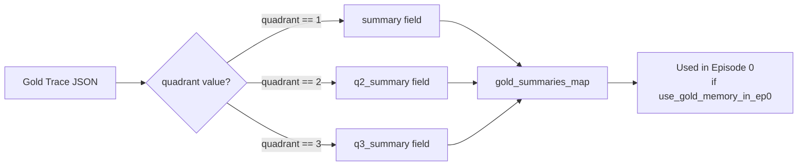
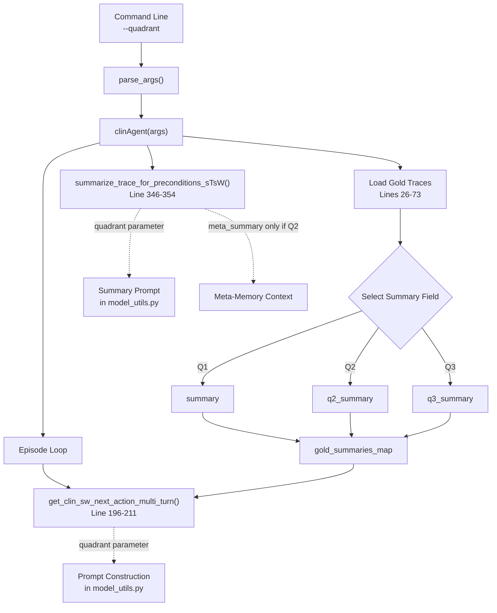

<!-- source: DeepWiki mcp.deepwiki.com · repo allenai/clin · page 3.4 Evaluation Quadrants · fetched 2026-10-26 -->

# Evaluation Quadrants

<details>
<summary>Relevant source files</summary>

The following files were used as context for generating this wiki page:

- [README.md](README.md)
- [index.html](index.html)
- [requirements.txt](requirements.txt)
- [scienceworld/clin_agent.py](scienceworld/clin_agent.py)

</details>


## Purpose and Scope

This document explains the three evaluation quadrants used to measure CLIN's continual learning capabilities. Each quadrant represents a different continual learning scenario that tests whether the agent can adapt within the same context (Quadrant 1), generalize to new environments (Quadrant 2), or generalize to new tasks (Quadrant 3). These quadrants determine how memory is constructed, retrieved, and applied during agent execution.

For details on how memories are structured, see [Memory Architecture](#3.2). For information on running experiments with specific quadrants, see [Running Experiments](#5.2).

---

## Overview of Quadrants

CLIN evaluates continual learning across three distinct scenarios that differ in what remains constant and what changes between learning episodes:

| Quadrant | Name | Task | Environment | Memory Strategy | Learning Type |
|----------|------|------|-------------|-----------------|---------------|
| **Q1** | Adaptation | Same | Same | Recent episode memories | Within-context adaptation |
| **Q2** | Cross-Environment Generalization | Same | Different | Meta-memory + recent episodes | Transfer to new environments |
| **Q3** | Cross-Task Generalization | Different | Same | Meta-memory + recent episodes | Transfer to new tasks |

**Sources:** [scienceworld/clin_agent.py:446-450](), [index.html:200-203]()

---

## Quadrant 1: Adaptation (Same Task, Same Environment)

### Description

Quadrant 1 evaluates **rapid adaptation** within a fixed context. The agent repeatedly attempts the same task in the same environment variation, learning from each trial to improve performance in subsequent trials. This tests the agent's ability to quickly identify what actions contribute to task success and optimize its behavior.

### Memory Usage

In Q1, the agent uses episode-specific memories without abstraction:
- Memories are summaries of previous trials on the **exact same task and environment**
- The last K episode summaries are retrieved and provided as context (controlled by `--use-last-k-memories`)
- No meta-memory abstraction is performed
- Gold traces (if provided via `--use-gold-memory-in-ep0`) are loaded as `summary` field

### Example Scenario

```
Task: "Grow a plant"
Environment: Kitchen with specific seed locations
Episodes: 5 trials on the same task/environment
Goal: Reduce steps needed and increase success rate across trials
```

**Sources:** [scienceworld/clin_agent.py:51-73](), [scienceworld/clin_agent.py:446-450]()

---

## Quadrant 2: Cross-Environment Generalization

### Description

Quadrant 2 evaluates **cross-environment generalization**. The agent learns from one or more environment variations, then applies that knowledge to a new, unseen environment variation of the **same task**. This tests whether the agent can extract environment-invariant strategies.

### Memory Usage

In Q2, the agent uses abstracted meta-memories:
- Gold traces are loaded as `q2_summary` field, which contains cross-environment abstractions
- During episode summarization, the `meta_summary` parameter is populated with the Q2 gold summary
- The summarization process generates generalizations that abstract away environment-specific details
- Recent episode memories from the new environment are combined with the meta-memory

### Example Scenario

```
Training: Grow a plant in Kitchen (variation 0)
Testing: Grow a plant in Greenhouse (variation 1)
Meta-memory: "Moving to different rooms helps finding objects"
Goal: Positive transfer from learned environment to new environment
```

**Sources:** [scienceworld/clin_agent.py:57-73](), [scienceworld/clin_agent.py:352-354]()

---

## Quadrant 3: Cross-Task Generalization

### Description

Quadrant 3 evaluates **cross-task generalization**. The agent learns from one or more tasks, then applies that knowledge to a new, unseen task in the **same environment**. This tests whether the agent can extract task-invariant strategies and identify reusable action patterns.

### Memory Usage

In Q3, the agent uses abstracted meta-memories similar to Q2:
- Gold traces are loaded as `q3_summary` field, which contains cross-task abstractions
- The summarization process identifies reusable patterns across different task objectives
- Recent episode memories from the new task are combined with task-agnostic knowledge

### Example Scenario

```
Training: Grow a plant, Find object X
Testing: Boil water (new task)
Meta-memory: Task-agnostic strategies about navigation, object manipulation
Goal: Positive transfer from learned tasks to new task
```

**Sources:** [scienceworld/clin_agent.py:57-73](), [scienceworld/clin_agent.py:446-450]()

---

## Memory Flow by Quadrant

The following diagram illustrates how memory is constructed and retrieved differently for each quadrant:

**Memory Retrieval Strategy by Quadrant**

```mermaid
graph TD
    subgraph Q1["Quadrant 1: Adaptation"]
        Q1Ep0["Episode 0"] --> Q1Mem0["Episode 0 Memory"]
        Q1Ep1["Episode 1"] --> Q1Mem1["Episode 1 Memory"]
        Q1Ep2["Episode 2"] --> Q1Mem2["Episode 2 Memory"]
        Q1Mem0 --> Q1Retrieve["Retrieve Last K<br/>Episode Memories"]
        Q1Mem1 --> Q1Retrieve
        Q1Mem2 --> Q1Retrieve
        Q1Retrieve --> Q1Next["Episode 3<br/>Same Task/Env"]
    end
    
    subgraph Q2["Quadrant 2: Cross-Environment"]
        Q2Train["Training Episodes<br/>Environment A"] --> Q2Meta["Generate Meta-Memory<br/>q2_summary"]
        Q2Meta --> Q2New["New Environment B<br/>Episode 0"]
        Q2New --> Q2NewMem["Episode 0 Memory<br/>Env B"]
        Q2Meta --> Q2Combine["Combine Meta-Memory<br/>+ Recent Episodes"]
        Q2NewMem --> Q2Combine
        Q2Combine --> Q2Next["Episode 1<br/>Environment B"]
    end
    
    subgraph Q3["Quadrant 3: Cross-Task"]
        Q3Train["Training Episodes<br/>Task A"] --> Q3Meta["Generate Meta-Memory<br/>q3_summary"]
        Q3Meta --> Q3New["New Task B<br/>Episode 0"]
        Q3New --> Q3NewMem["Episode 0 Memory<br/>Task B"]
        Q3Meta --> Q3Combine["Combine Meta-Memory<br/>+ Recent Episodes"]
        Q3NewMem --> Q3Combine
        Q3Combine --> Q3Next["Episode 1<br/>Task B"]
    end
```



**Sources:** [scienceworld/clin_agent.py:51-73](), [scienceworld/clin_agent.py:344-356]()

---

## Memory Field Selection

The quadrant parameter determines which summary field is extracted from gold traces during initialization:

**Gold Trace Summary Field Selection**



**Sources:** [scienceworld/clin_agent.py:54-73]()

---

## Implementation Flow

The quadrant parameter flows through multiple system components:

**Quadrant Parameter Flow Through Code**



**Sources:** [scienceworld/clin_agent.py:446-450](), [scienceworld/clin_agent.py:51-73](), [scienceworld/clin_agent.py:196-211](), [scienceworld/clin_agent.py:346-354]()

---

## Command-Line Usage

The quadrant is specified via the `--quadrant` argument when running the agent:

```bash
# Quadrant 1: Adaptation
python scienceworld/clin_agent.py --quadrant 1 --task-num 4 --var-num 1 --num-episodes 5

# Quadrant 2: Cross-environment generalization
python scienceworld/clin_agent.py --quadrant 2 --task-num 4 --var-num 2 --use-gold-memory-in-ep0 1 --gold-traces path/to/q2_gold.json

# Quadrant 3: Cross-task generalization
python scienceworld/clin_agent.py --quadrant 3 --task-num 5 --var-num 1 --use-gold-memory-in-ep0 1 --gold-traces path/to/q3_gold.json
```

**Key Observations:**
- Q1 typically runs multiple episodes (`--num-episodes > 1`) on the same task/variation
- Q2 and Q3 often use `--use-gold-memory-in-ep0 1` with gold traces containing meta-memories
- Q2 changes `--var-num` to test new environments
- Q3 changes `--task-num` to test new tasks

**Sources:** [README.md:47](), [scienceworld/clin_agent.py:446-450]()

---

## Experimental Design Implications

The quadrant choice affects experimental setup:

| Aspect | Q1 | Q2 | Q3 |
|--------|----|----|-------|
| **Training Phase** | First N-1 episodes | Previous environment variations | Previous tasks |
| **Test Phase** | Episode N | New environment variation | New task |
| **Memory Initialization** | Empty or gold summary | Q2 meta-memory from gold | Q3 meta-memory from gold |
| **Success Metric** | Improvement from Ep 0 to Ep N | Transfer from trained env to new env | Transfer from trained task to new task |
| **Baseline Comparison** | Episode 0 performance | Zero-shot on new environment | Zero-shot on new task |

**Sources:** [index.html:190-203](), [scienceworld/clin_agent.py:446-450]()

---

## Meta-Memory Generation

For Q2 and Q3, the meta-memory is passed to the summarization function to guide abstraction:

```
summarize_trace_for_preconditions_sTsW(
    runHistory,
    prev_runs_list,
    gold_run=None,
    demo_examples=None,
    model="gpt-4",
    temp=temperature,
    quadrant=quadrant,
    meta_summary=gold_memory if quadrant == 2 else '',
    use_last_k_memories=use_last_k_memories
)
```

The `meta_summary` parameter is only populated for Q2, passing the cross-environment abstractions from gold traces. This context guides the LLM to generate summaries that align with the meta-level abstractions learned from training environments.

**Sources:** [scienceworld/clin_agent.py:346-354]()

---

## Summary

The evaluation quadrants provide a structured framework for measuring continual learning:

- **Q1** tests rapid adaptation through trial-and-error within a fixed context
- **Q2** tests generalization of task strategies across different environment layouts
- **Q3** tests transfer of action patterns and strategies across different task objectives

The quadrant parameter controls memory retrieval, summarization context, and experimental interpretation, enabling rigorous evaluation of CLIN's continual learning capabilities across diverse scenarios.

---

