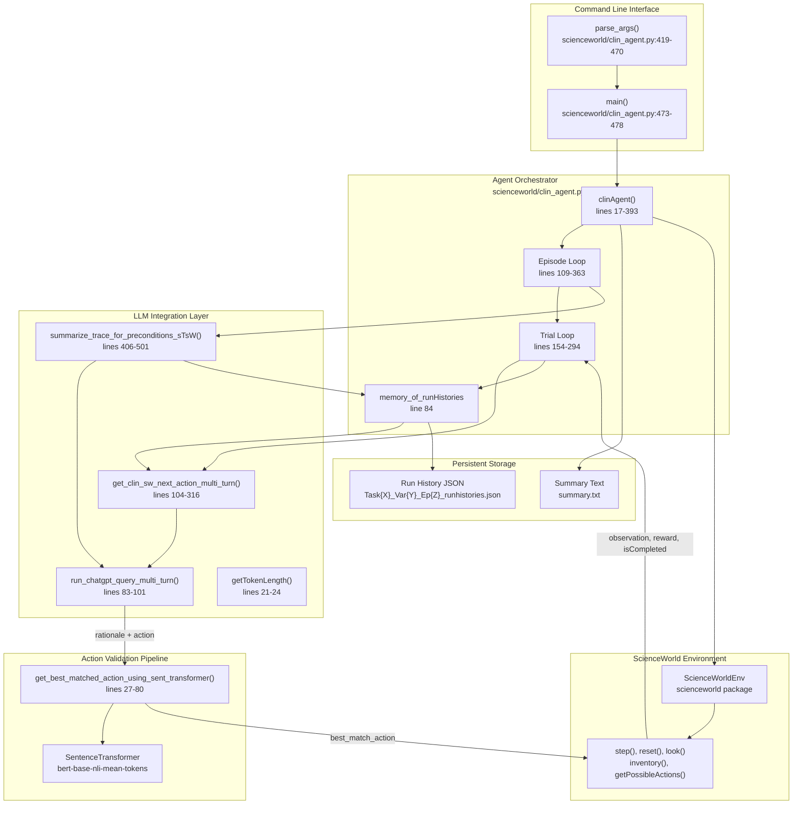
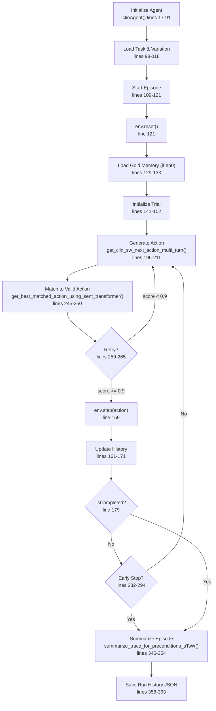
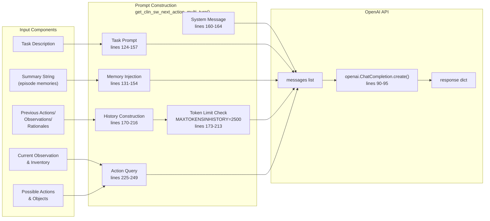
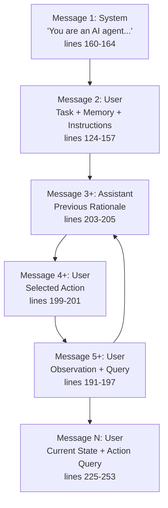
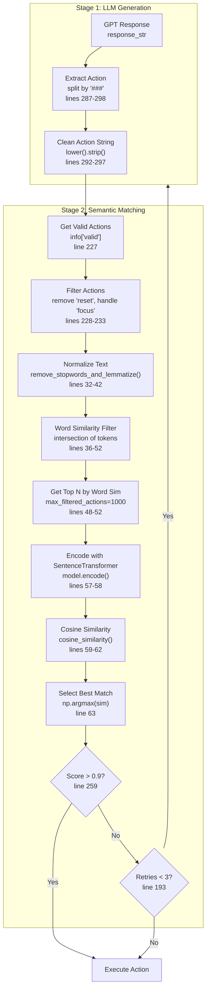
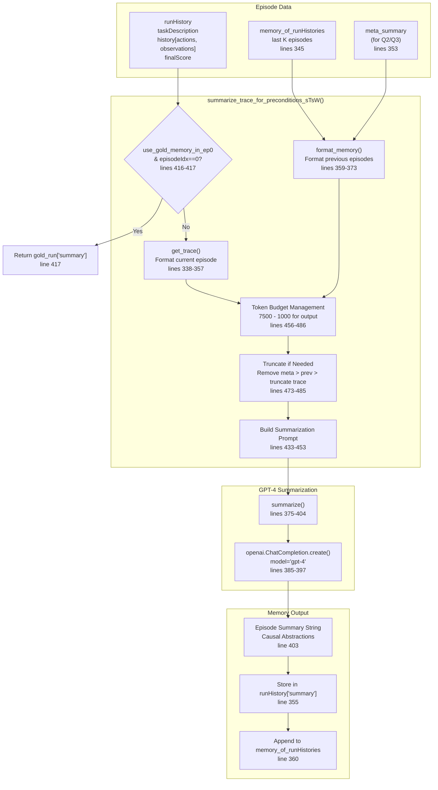
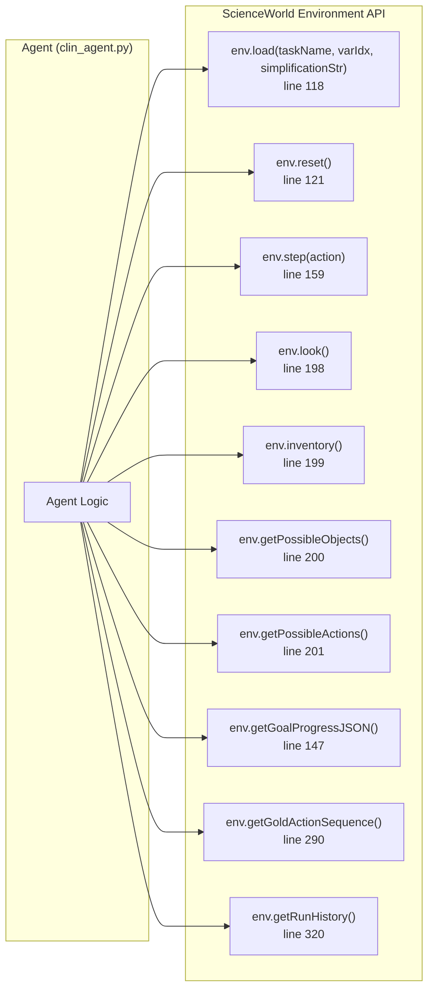
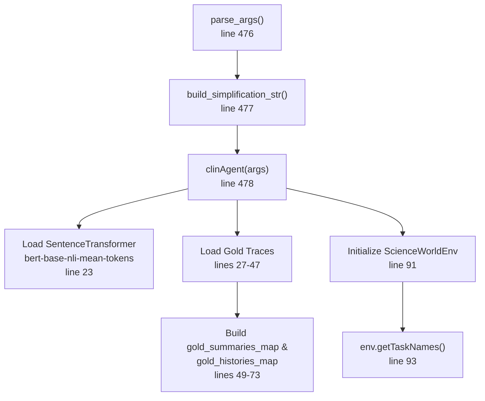

<!-- source: DeepWiki mcp.deepwiki.com · repo allenai/clin · page 4 System Architecture · fetched 2026-10-26 -->

# System Architecture

<details>
<summary>Relevant source files</summary>

The following files were used as context for generating this wiki page:

- [model_utils.py](model_utils.py)
- [scienceworld/clin_agent.py](scienceworld/clin_agent.py)

</details>


## Purpose and Scope

This page provides a comprehensive technical overview of CLIN's system architecture, describing how its components interact to enable continual learning through persistent textual memory. The architecture consists of three primary modules: the agent orchestrator (`clin_agent.py`), the LLM integration layer (`model_utils.py`), and utilities for text processing (`utils.py`).

For detailed information about specific architectural subsystems, see:
- Agent orchestration logic: [Agent Orchestration](#4.2)
- LLM prompt construction and API calls: [LLM Integration Layer](#4.3)
- Action generation and semantic matching: [Action Generation and Validation](#4.4)
- Memory generation and retrieval: [Learning and Summarization System](#4.5)
- ScienceWorld environment interface: [ScienceWorld Integration](#4.6)

For conceptual understanding of CLIN's continual learning approach, see [Core Concepts](#3).

---

## High-Level Architecture

The CLIN system follows a layered architecture where the agent orchestrator coordinates between the LLM integration layer and the ScienceWorld environment. The system maintains persistent memory across episodes without updating model parameters.

### System Components Diagram



**Sources:** [scienceworld/clin_agent.py:1-483](), [model_utils.py:1-502]()

---

## Core Components

### Component Responsibilities Table

| Component | File | Key Functions | Responsibility |
|-----------|------|---------------|----------------|
| Agent Orchestrator | `scienceworld/clin_agent.py` | `clinAgent()`, `parse_args()` | Episode/trial management, configuration, coordination |
| LLM Integration | `model_utils.py` | `get_clin_sw_next_action_multi_turn()`, `run_chatgpt_query_multi_turn()` | GPT API calls, prompt construction, multi-turn dialogue |
| Action Validation | `model_utils.py` | `get_best_matched_action_using_sent_transformer()` | Semantic action matching, retry logic |
| Learning System | `model_utils.py` | `summarize_trace_for_preconditions_sTsW()`, `summarize()` | Episode summarization, memory generation |
| Text Processing | `utils.py` | `remove_stopwords_and_lemmatize()` | Text normalization for action matching |
| Environment Interface | `scienceworld/clin_agent.py` | Environment method calls | ScienceWorld interaction, observation retrieval |

**Sources:** [scienceworld/clin_agent.py:1-483](), [model_utils.py:1-502]()

---

## Agent Orchestrator (`clinAgent`)

The `clinAgent()` function [scienceworld/clin_agent.py:17-393]() serves as the main orchestrator, managing three nested loops: tasks, episodes, and trials within episodes.

### Execution Flow Diagram



**Sources:** [scienceworld/clin_agent.py:17-393]()

### Key Data Structures

The orchestrator maintains several critical data structures:

| Variable | Type | Purpose | Location |
|----------|------|---------|----------|
| `memory_of_runHistories` | List[Dict] | Stores all episode run histories | [scienceworld/clin_agent.py:84]() |
| `previous_actions` | List[str] | Action history within trial | [scienceworld/clin_agent.py:144]() |
| `previous_rationales` | List[str] | Rationale history within trial | [scienceworld/clin_agent.py:143]() |
| `previous_observations` | List[str] | Observation history within trial | [scienceworld/clin_agent.py:145]() |
| `gold_summaries_map` | Dict[str, Dict[str, str]] | Maps task/var to gold memories | [scienceworld/clin_agent.py:49-73]() |
| `runHistory` | Dict | Single episode's complete record | [scienceworld/clin_agent.py:320-339]() |

**Sources:** [scienceworld/clin_agent.py:17-393]()

---

## LLM Integration Layer

The LLM integration layer handles all communication with OpenAI's GPT models, constructing prompts with task context, memory, and action history.

### Prompt Construction Pipeline



**Sources:** [model_utils.py:104-316](), [model_utils.py:83-101]()

### Multi-Turn Message Structure

The `get_clin_sw_next_action_multi_turn()` function [model_utils.py:104-316]() constructs a multi-turn conversation with the following structure:



The system maintains a `new_messages` list that is populated in reverse chronological order for the last 3-6 action-observation pairs [model_utils.py:182](), with token counting to ensure it stays under `MAXTOKENSINHISTORY` (2500 tokens) [model_utils.py:18]().

**Sources:** [model_utils.py:104-316](), [model_utils.py:18]()

---

## Action Generation and Validation Pipeline

CLIN uses a two-stage process to convert LLM-generated free-form text into valid environment actions.

### Two-Stage Action Processing



**Sources:** [model_utils.py:27-80](), [scienceworld/clin_agent.py:189-265]()

### Retry Mechanism

The agent implements a retry mechanism with error feedback [scienceworld/clin_agent.py:189-265]():

1. **Maximum Retries**: Up to 3 attempts per action [scienceworld/clin_agent.py:192]()
2. **Score Threshold**: Actions with similarity score < 0.9 trigger retry [scienceworld/clin_agent.py:259]()
3. **Feedback Loop**: Failed matches provide error messages back to LLM [scienceworld/clin_agent.py:264]()
4. **Fallback**: After max retries, accept best match regardless of score [scienceworld/clin_agent.py:260]()

**Sources:** [scienceworld/clin_agent.py:189-265]()

---

## Learning and Summarization System

CLIN's learning system converts episode traces into structured textual memories using GPT-4 for summarization.

### Episode Summarization Data Flow



**Sources:** [model_utils.py:406-501](), [model_utils.py:338-404]()

### Memory Format Structure

The `format_memory()` function [model_utils.py:359-373]() structures previous episodes into the following format:

```
PREVIOUS LEARNINGS

TASK: {taskDescription}
EPISODE: {episodeIdx}
LEARNINGS: {summary}

EVALUATION REPORT (for the attempt associated with the learning):
REWARD_FINAL: {finalScore}. This means: {success_map(reward, finalScore)}
```

Learnings are constrained to specific causal abstraction formats [model_utils.py:445-448]():
- `X MAY BE NECESSARY to Y`
- `X SHOULD BE NECESSARY to Y`
- `X MAY CONTRIBUTE to Y`
- `X DOES NOT CONTRIBUTE to Y`

**Sources:** [model_utils.py:359-373](), [model_utils.py:443-449]()

---

## Token Management System

CLIN implements careful token management to stay within model context limits while maximizing information included in prompts.

### Token Budget Allocation

| Context Component | Token Budget | Truncation Strategy |
|-------------------|--------------|---------------------|
| System + Task Prompt | ~500-1000 | Fixed, not truncated |
| Memory (episode summaries) | Dynamic | Remove meta-memory first, then oldest episodes |
| Action History | Max 2500 tokens (`MAXTOKENSINHISTORY`) | Include only last 3-6 action-observation pairs |
| Current State + Query | ~200-500 | Fixed, not truncated |
| GPT Output | 256 tokens (action gen)<br/>1000 tokens (summarization) | Set in API call |

**Token Counting**: Uses `tiktoken` library with `cl100k_base` encoding [model_utils.py:17]() via `getTokenLength()` [model_utils.py:21-24]().

**Summarization Budget**: Total of 7500 tokens with 1000 reserved for output [model_utils.py:456]().

**Sources:** [model_utils.py:17-24](), [model_utils.py:173-213](), [model_utils.py:456-486]()

---

## Environment Integration

CLIN interfaces with the ScienceWorld environment through a minimal adapter pattern, primarily using direct method calls on the `ScienceWorldEnv` object.

### Environment Method Usage



### Environment Step Cycle

The `env.step()` call returns a tuple that drives the agent's execution [scienceworld/clin_agent.py:159]():

```python
observation, reward, isCompleted, info = env.step(generated_action_str)
```

**Return Values:**
- `observation` (str): Text description of new state
- `reward` (float): Immediate reward signal
- `isCompleted` (bool): Whether task is complete or terminated
- `info` (dict): Contains `score` and `valid` (list of valid actions)

**Sources:** [scienceworld/clin_agent.py:91](), [scienceworld/clin_agent.py:118-121](), [scienceworld/clin_agent.py:159](), [scienceworld/clin_agent.py:196-211]()

---

## Configuration and Initialization

### Command-Line Configuration

The system is configured entirely through command-line arguments parsed by `parse_args()` [scienceworld/clin_agent.py:419-470]():

**Key Parameters:**

| Argument | Type | Default | Purpose |
|----------|------|---------|---------|
| `--task-num` | str | "4" | Task number to execute |
| `--var-num` | int | 1 | Task variation number |
| `--gpt-model` | str | "gpt-4-0613" | GPT model selection |
| `--num-episodes` | int | 2 | Number of episodes to run |
| `--quadrant` | int | Required | Evaluation quadrant (1/2/3) |
| `--use-gold-memory-in-ep0` | int | 0 | Whether to use gold memory in episode 0 |
| `--gold-traces` | str | "" | Path to gold traces for bootstrapping |
| `--use-last-k-memories` | int | 3 | Number of previous episode memories to use |
| `--temperature` | float | 0.0 | GPT temperature for sampling |
| `--device` | str | Required | Device for SentenceTransformer (cpu/cuda) |

**Sources:** [scienceworld/clin_agent.py:419-470]()

### Initialization Sequence



**Sources:** [scienceworld/clin_agent.py:473-478](), [scienceworld/clin_agent.py:17-94]()

---

## Output and Persistence

### File Output Structure

The system generates two primary output files per run:

**Run History JSON** [scienceworld/clin_agent.py:115-116]():
- Filename: `Task{taskIdx}_Var{varIdx}_Ep{episodeIdx}_runhistories.json`
- Contains: Complete episode trace with actions, observations, rationales, scores
- Structure defined in `runHistory` dict [scienceworld/clin_agent.py:320-339]()

**Summary Text** [scienceworld/clin_agent.py:89-90]():
- Filename: `summary.txt`
- Contains: Aggregated results across all episodes
- Format: Tab-delimited table of task, variation, episode, score, completion status [scienceworld/clin_agent.py:386-389]()

### Run History Structure

The `runHistory` dictionary stored in JSON contains:

```python
{
    'episodeIdx': int,
    'finalScore': float,
    'finalScorePositive': float,
    'isCompleted': bool,
    'earlyStop': bool,
    'model': str,  # e.g., "gpt-4-0613"
    'gold-action-seq': str,
    'memory-seen': str,  # Summary string provided to agent
    'summary': str,  # Generated learning summary
    'history': [
        {
            'action': str,
            'observation': str,
            'rationale': str,
            'rawAction': str,  # Pre-matching action
            'topNActions': list,  # Top 5 semantic matches
            'subgoalProgress': dict
        }
    ]
}
```

**Sources:** [scienceworld/clin_agent.py:320-363](), [scienceworld/clin_agent.py:381-392]()

---

## External Dependencies

### Critical Dependencies

| Dependency | Version | Purpose | Usage Location |
|------------|---------|---------|----------------|
| `openai` | - | GPT API access | [model_utils.py:3](), [model_utils.py:90]() |
| `sentence-transformers` | - | Semantic action matching | [model_utils.py:7](), [scienceworld/clin_agent.py:13]() |
| `tiktoken` | - | Token counting | [model_utils.py:10](), [model_utils.py:17]() |
| `scienceworld` | custom branch | Task environment | [scienceworld/clin_agent.py:7]() |
| `torch` | - | SentenceTransformer backend | [scienceworld/clin_agent.py:12]() |
| `sklearn` | - | Cosine similarity computation | [model_utils.py:8]() |

**Note**: The ScienceWorld dependency requires the `exhaustivevalidactions` branch, indicating custom modifications to support exhaustive action enumeration.

**Sources:** [model_utils.py:1-15](), [scienceworld/clin_agent.py:1-14]()

---

## Design Patterns and Principles

### Key Architectural Patterns

1. **Stateless LLM Wrapper**: The LLM integration layer is stateless; all context is passed explicitly via messages [model_utils.py:104-316]()

2. **Persistent Memory Store**: The `memory_of_runHistories` list serves as an append-only log of all episodes [scienceworld/clin_agent.py:84]()

3. **Two-Stage Action Processing**: LLM generation is decoupled from action validation, enabling retry logic [scienceworld/clin_agent.py:189-265]()

4. **Token Budget Management**: Explicit token counting with graceful degradation (truncate meta-memory, then previous memories, then current trace) [model_utils.py:473-485]()

5. **Quadrant-Based Prompting**: Memory injection strategy varies based on evaluation quadrant [model_utils.py:131-154]()

### Error Handling Strategies

- **API Retry**: Both action generation and summarization retry on exception with 2-second delays [model_utils.py:96-99](), [model_utils.py:398-401]()
- **Action Retry**: Failed action matches trigger LLM regeneration with error feedback [scienceworld/clin_agent.py:264]()
- **Early Stopping**: Detects repeated actions (5 identical consecutive actions) [scienceworld/clin_agent.py:282-287]()
- **Step Limit**: Terminates if action sequence exceeds 1.5× gold sequence length [scienceworld/clin_agent.py:289-294]()

**Sources:** [model_utils.py:88-101](), [model_utils.py:382-401](), [scienceworld/clin_agent.py:189-294]()

---

