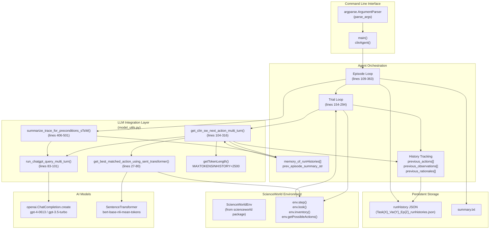
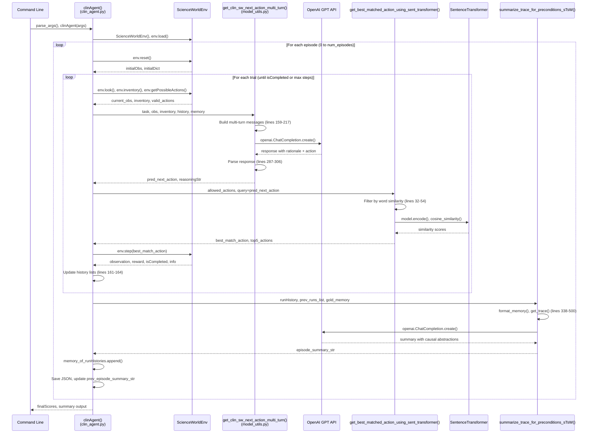

<!-- source: DeepWiki mcp.deepwiki.com · repo allenai/clin · page 4.1 Architecture Overview · fetched 2026-10-26 -->

# Architecture Overview

<details>
<summary>Relevant source files</summary>

The following files were used as context for generating this wiki page:

- [README.md](README.md)
- [model_utils.py](model_utils.py)
- [requirements.txt](requirements.txt)
- [scienceworld/clin_agent.py](scienceworld/clin_agent.py)

</details>


## Purpose and Scope

This document provides a high-level technical overview of CLIN's system architecture, explaining how the major components interact to implement a continually learning language agent. It covers the overall system structure, component relationships, and primary execution flows. For detailed implementation of specific subsystems, see:

- Agent orchestration details: [4.2](#4.2)
- LLM prompt construction and API interaction: [4.3](#4.3)
- Action generation and semantic matching: [4.4](#4.4)
- Memory generation and retrieval: [4.5](#4.5)
- ScienceWorld environment integration: [4.6](#4.6)

## System Overview

CLIN is implemented as a command-line Python application with three core execution layers:

1. **Agent Orchestration Layer**: Manages episode loops, trial execution, and state tracking ([scienceworld/clin_agent.py]())
2. **LLM Integration Layer**: Interfaces with OpenAI GPT models and performs semantic action matching ([model_utils.py]())
3. **Environment Layer**: Executes actions in the ScienceWorld simulation environment

The system operates through repeated episode-trial cycles, where each trial involves:
- Receiving observations from the environment
- Generating actions via LLM with memory context
- Validating actions through semantic matching
- Executing actions in the environment
- Recording experiences for memory generation

**Sources**: [README.md:1-59](), [scienceworld/clin_agent.py:1-483]()

## Component Architecture



**Component Mapping to Code Entities**

| Component | Primary File | Key Functions/Classes | Lines |
|-----------|-------------|----------------------|-------|
| Agent Orchestrator | scienceworld/clin_agent.py | `clinAgent()` | 17-393 |
| Episode Management | scienceworld/clin_agent.py | Episode loop | 109-363 |
| Trial Execution | scienceworld/clin_agent.py | Trial loop | 154-294 |
| Action Generation | model_utils.py | `get_clin_sw_next_action_multi_turn()` | 104-316 |
| Action Validation | model_utils.py | `get_best_matched_action_using_sent_transformer()` | 27-80 |
| LLM API Interface | model_utils.py | `run_chatgpt_query_multi_turn()` | 83-101 |
| Learning System | model_utils.py | `summarize_trace_for_preconditions_sTsW()` | 406-501 |
| Token Management | model_utils.py | `getTokenLength()`, `MAXTOKENSINHISTORY` | 17-24 |
| Environment Interface | scienceworld/clin_agent.py | `ScienceWorldEnv` instantiation and calls | 91-159 |

**Sources**: [scienceworld/clin_agent.py:17-393](), [model_utils.py:1-502]()

## Execution Flow



**Key Execution Phases**:

1. **Initialization** ([scienceworld/clin_agent.py:17-100]()): Parse arguments, load gold traces, initialize SentenceTransformer model, create environment instance
2. **Episode Loop** ([scienceworld/clin_agent.py:109-363]()): Outer loop managing memory accumulation across episodes
3. **Trial Loop** ([scienceworld/clin_agent.py:154-294]()): Inner loop executing action-observation cycles
4. **Action Generation** ([model_utils.py:104-316]()): Construct prompts with history and memory, query GPT
5. **Action Validation** ([model_utils.py:27-80](), [scienceworld/clin_agent.py:227-265]()): Semantic matching with retry logic
6. **Episode Summarization** ([model_utils.py:406-501](), [scienceworld/clin_agent.py:344-356]()): Generate learnings for next episode

**Sources**: [scienceworld/clin_agent.py:109-363](), [model_utils.py:104-316](), [model_utils.py:27-80](), [model_utils.py:406-501]()

## Key Components

### Agent Orchestrator

The `clinAgent()` function ([scienceworld/clin_agent.py:17-393]()) serves as the main orchestrator:

- **Episode Management**: Outer loop iterates through `numEpisodes`, maintaining `memory_of_runHistories` list
- **Trial Execution**: Inner loop executes action-observation cycles until `isCompleted` or max steps reached
- **State Tracking**: Maintains multiple parallel lists:
  - `previous_actions[]`: Executed actions ([scienceworld/clin_agent.py:144]())
  - `previous_observations[]`: Environment observations ([scienceworld/clin_agent.py:145]())
  - `previous_rationales[]`: LLM-generated reasoning ([scienceworld/clin_agent.py:143]())
  - `rationaleHistory[]`, `subgoalHistory[]`, `rawActionHistory[]`, `topNActionHistory[]`: Additional tracking
- **Gold Trace Loading**: Optionally loads pre-recorded traces from disk into `gold_summaries_map` ([scienceworld/clin_agent.py:26-73]())

**Sources**: [scienceworld/clin_agent.py:17-393]()

### LLM Integration Layer

Located in [model_utils.py](), this layer handles all LLM interactions:

- **Action Generation**: `get_clin_sw_next_action_multi_turn()` constructs multi-turn conversation history, manages token budgets (limited to `MAXTOKENSINHISTORY=2500`), and queries GPT models
- **Prompt Construction**: Builds system message, task description with quadrant-specific memory integration, and recent action-observation history ([model_utils.py:159-254]())
- **Token Management**: Uses `tiktoken` encoding (`cl100k_base`) to measure and limit context length ([model_utils.py:17-24]())
- **Response Parsing**: Extracts rationale and action from LLM response using `###` delimiter ([model_utils.py:287-306]())

**Sources**: [model_utils.py:104-316](), [model_utils.py:17-24]()

### Action Selection Pipeline

Implements a two-stage hybrid approach:

1. **LLM Generation**: GPT model generates free-form action text based on task, observation, and memory
2. **Semantic Matching**: 
   - Word-based filtering using lemmatization and stopword removal ([model_utils.py:32-54]())
   - Cosine similarity with SentenceTransformer embeddings on filtered candidates ([model_utils.py:56-80]())
   - Top-5 candidates returned with confidence scores
3. **Validation and Retry**: If match score < 0.9, system retries up to 3 times with error feedback ([scienceworld/clin_agent.py:191-265]())

**Sources**: [model_utils.py:27-80](), [scienceworld/clin_agent.py:191-265]()

### Memory System

The continual learning mechanism consists of:

- **Episode Memory**: Each episode's `runHistory` stored in `memory_of_runHistories[]` list
- **Summarization**: `summarize_trace_for_preconditions_sTsW()` generates structured learnings from traces ([model_utils.py:406-501]())
- **Memory Retrieval**: Last k memories (configurable via `--use-last-k-memories`) provided to summarization function ([scienceworld/clin_agent.py:345]())
- **Quadrant-Specific Integration**: Different prompting strategies for Q1 (same task/env), Q2 (cross-env), Q3 (cross-task) ([model_utils.py:131-154]())
- **Meta-Memory**: For Q2/Q3, gold traces can provide meta-learnings that supplement episode memories ([model_utils.py:425-431]())

**Sources**: [model_utils.py:406-501](), [scienceworld/clin_agent.py:343-356]()

### Environment Interface

CLIN interfaces with ScienceWorld through the `ScienceWorldEnv` class:

- **Environment Initialization**: `ScienceWorldEnv(jarPath, envStepLimit)` ([scienceworld/clin_agent.py:91]())
- **Task Loading**: `env.load(taskName, varIdx, simplificationStr, generateGoldPath=True)` ([scienceworld/clin_agent.py:118]())
- **Core Methods**:
  - `env.step(action)`: Returns `(observation, reward, isCompleted, info)` ([scienceworld/clin_agent.py:159]())
  - `env.look()`: Current observation ([scienceworld/clin_agent.py:198]())
  - `env.inventory()`: Current inventory ([scienceworld/clin_agent.py:199]())
  - `env.getPossibleActions()`: Valid action templates ([scienceworld/clin_agent.py:201]())
  - `env.getPossibleObjects()`: Available objects ([scienceworld/clin_agent.py:200]())
- **Gold Path Access**: `env.getGoldActionSequence()` provides reference trajectory ([scienceworld/clin_agent.py:316]())

**Sources**: [scienceworld/clin_agent.py:91-159](), [scienceworld/clin_agent.py:196-201]()

## Data Structures and Storage

### Runtime Data Structures

| Structure | Type | Purpose | Location |
|-----------|------|---------|----------|
| `memory_of_runHistories` | List[Dict] | Accumulated episode histories | [scienceworld/clin_agent.py:84]() |
| `gold_summaries_map` | Dict[taskIdx → Dict[varIdx → summary]] | Pre-recorded gold memories | [scienceworld/clin_agent.py:49-73]() |
| `previous_actions` | List[str] | Trial action history | [scienceworld/clin_agent.py:144]() |
| `previous_observations` | List[str] | Trial observation history | [scienceworld/clin_agent.py:145]() |
| `previous_rationales` | List[str] | Trial reasoning history | [scienceworld/clin_agent.py:143]() |
| `runHistory` | Dict | Episode execution record | [scienceworld/clin_agent.py:320-339]() |

### Persistent Storage

**Run History JSON** ([scienceworld/clin_agent.py:115-363]()):
```
logs/Task{X}_Var{Y}_Ep{Z}_runhistories.json
```

Contains:
- `taskIdx`, `taskName`, `variationIdx`, `episodeIdx`
- `history[]`: List of `{action, observation, rationale, rawAction, topNActions, subgoalProgress}`
- `finalScore`, `finalScorePositive`, `isCompleted`, `earlyStop`
- `model`, `gold-action-seq`, `memory-seen`, `summary`

**Summary Text** ([scienceworld/clin_agent.py:89-392]()):
```
logs/summary.txt
```

Contains tabular summary of all episode scores and completion status.

**Sources**: [scienceworld/clin_agent.py:84-392](), [model_utils.py:338-373]()

## Dependencies and External Systems

### Required Dependencies

| Package | Purpose | Usage Location |
|---------|---------|----------------|
| `openai` | GPT API access | [model_utils.py:90](), [model_utils.py:385]() |
| `sentence_transformers` | Semantic action matching | [scienceworld/clin_agent.py:23]() |
| `tiktoken` | Token counting | [model_utils.py:17]() |
| `scienceworld` | Environment simulation | [scienceworld/clin_agent.py:7]() |

**Sources**: [requirements.txt:1-4](), [README.md:13-36]()

### External API Requirements

- **OpenAI API Key**: Required environment variable `OPENAI_API_KEY` ([README.md:23]())
- **Java 1.8+**: Required for ScienceWorld environment ([README.md:13-14]())
- **ScienceWorld Branch**: Must clone `exhaustivevalidactions` branch ([README.md:33]())

**Sources**: [README.md:13-36]()

---

