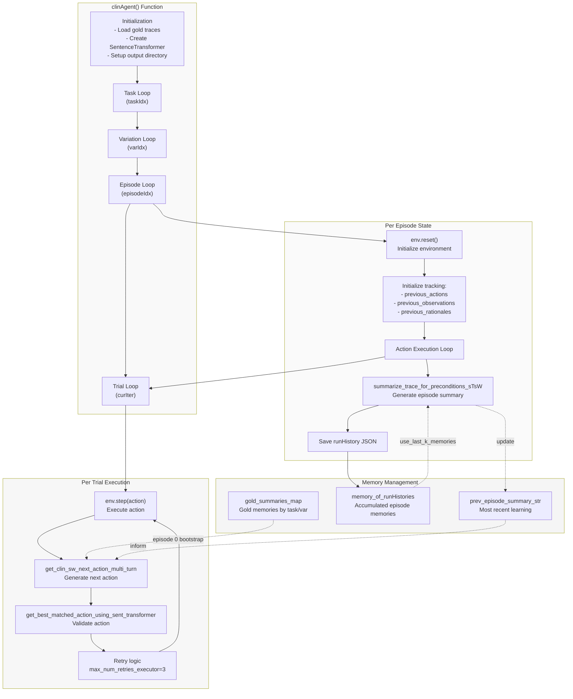
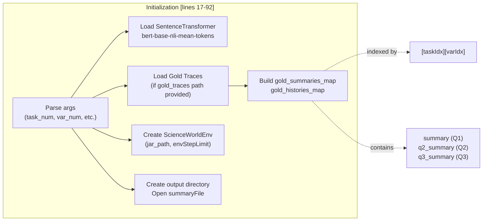
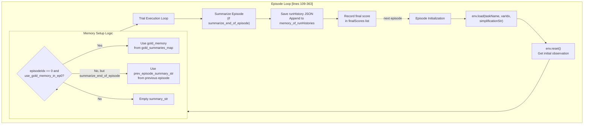
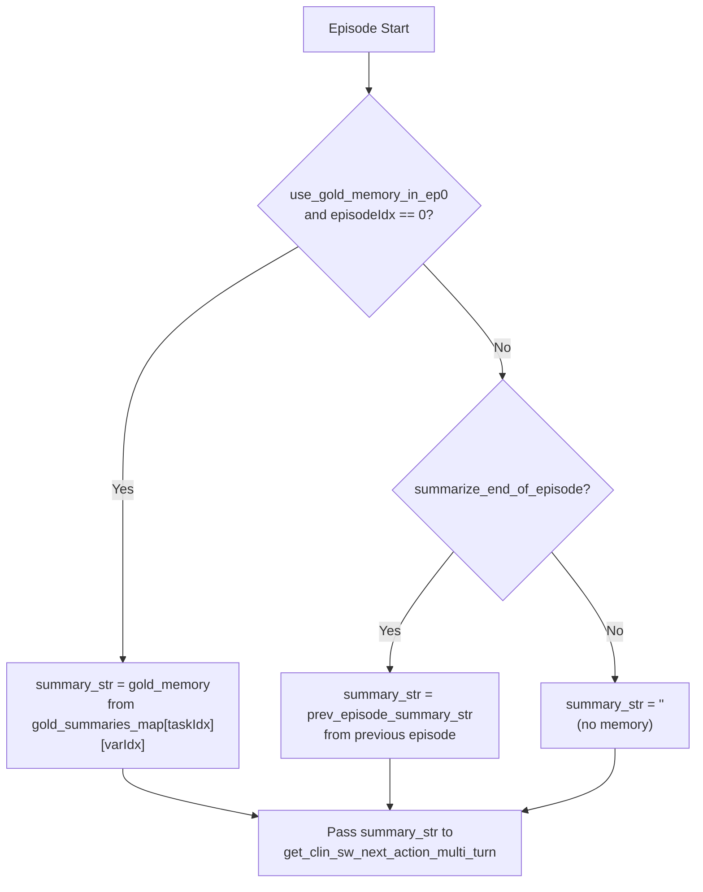
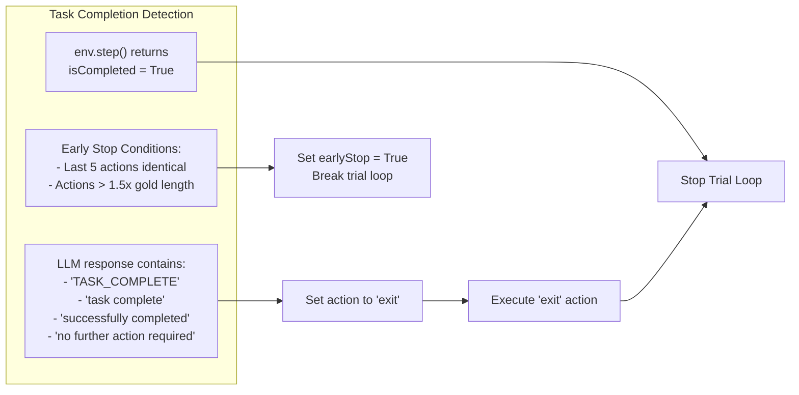
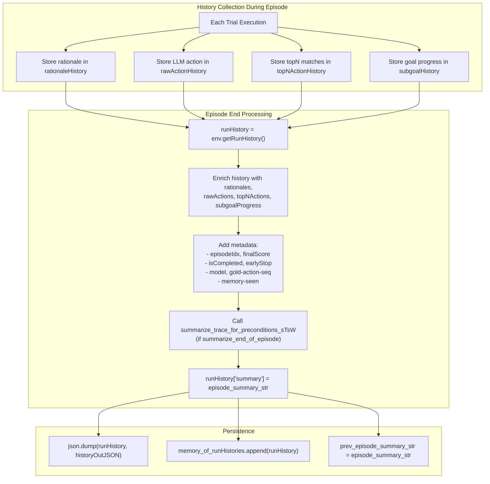
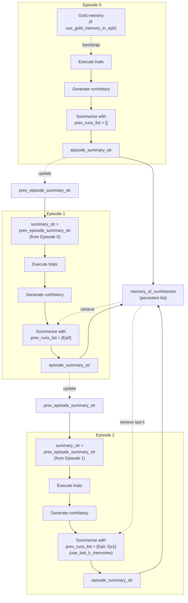
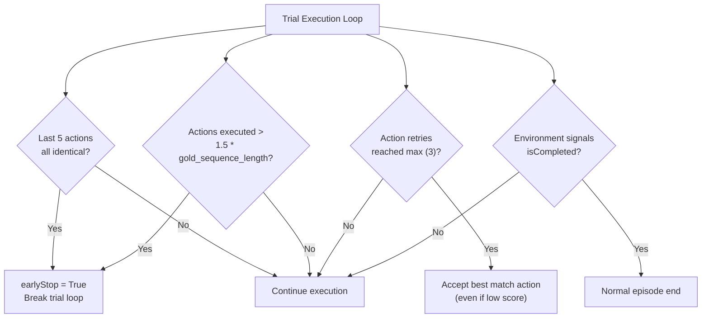
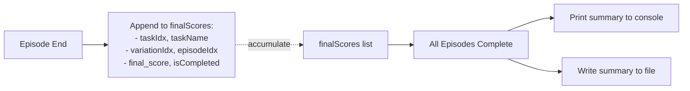

<!-- source: DeepWiki mcp.deepwiki.com · repo allenai/clin · page 4.2 Agent Orchestration · fetched 2026-10-26 -->

# Agent Orchestration

<details>
<summary>Relevant source files</summary>

The following files were used as context for generating this wiki page:

- [README.md](README.md)
- [requirements.txt](requirements.txt)
- [scienceworld/clin_agent.py](scienceworld/clin_agent.py)

</details>


## Purpose and Scope

This document provides a detailed technical overview of how the CLIN agent orchestrates its execution through episodes and trials. It covers the main control flow implemented in `scienceworld/clin_agent.py`, including episode management, trial loops, memory persistence, and coordination between subsystems.

For information about the specific LLM prompting and action generation logic, see [LLM Integration Layer](#4.3). For details on how memories are created and retrieved, see [Learning and Summarization System](#4.5). For environment interaction specifics, see [ScienceWorld Integration](#4.6).

**Sources:** [scienceworld/clin_agent.py:1-483]()

---

## Orchestration Architecture

The agent orchestration is implemented as a three-level nested loop structure: task/variation selection (outer), episode execution (middle), and trial-by-trial action execution (inner). The orchestrator maintains persistent memory across episodes and coordinates between the LLM, action validation, environment, and learning systems.



**Sources:** [scienceworld/clin_agent.py:17-393]()

---

## Initialization Phase

The `clinAgent()` function begins by initializing critical components before entering the main execution loops.

### Component Initialization

| Component | Code Entity | Purpose |
|-----------|-------------|---------|
| Sentence Transformer | `sent_transformer_model` | Semantic action matching |
| Environment | `ScienceWorldEnv` | Task simulation |
| Gold Memories | `gold_summaries_map` | Pre-recorded expert traces for bootstrapping |
| Memory Storage | `memory_of_runHistories` | Accumulated episode experiences |
| Output Files | `summaryFile`, `historyOutJSON` | Persistent storage |

The initialization phase loads gold traces from the specified path, organizing them into `gold_summaries_map` and `gold_histories_map` dictionaries indexed by task and variation. Gold traces can be provided as individual JSON files, JSONL files, or directories.



**Sources:** [scienceworld/clin_agent.py:17-92]()

The quadrant-specific summary selection occurs at initialization, where the appropriate summary field is chosen based on the `quadrant` parameter:

- **Quadrant 1**: Uses `summary` field (same task/environment adaptation)
- **Quadrant 2**: Uses `q2_summary` field (cross-environment generalization)
- **Quadrant 3**: Uses `q3_summary` field (cross-task generalization)

**Sources:** [scienceworld/clin_agent.py:51-73]()

---

## Episode Management

Episodes are the top-level learning units in CLIN. Each episode represents a complete attempt at a task variation, and the agent accumulates knowledge across episodes through its memory system.

### Episode Loop Structure



**Sources:** [scienceworld/clin_agent.py:109-363]()

### Episode State Tracking

Each episode maintains comprehensive state across multiple data structures:

| State Variable | Type | Purpose |
|----------------|------|---------|
| `previous_actions` | List[str] | Action history for LLM context |
| `previous_observations` | List[str] | Observation history for LLM context |
| `previous_rationales` | List[str] | Reasoning history for LLM context |
| `rationaleHistory` | List[str] | Full rationale trace for persistence |
| `rawActionHistory` | List[str] | Original LLM-generated actions |
| `topNActionHistory` | List[dict] | Sentence transformer top-N matches |
| `subgoalHistory` | List[dict] | Goal progress snapshots |
| `stepwise_prf_history` | List | Step-wise performance metrics |
| `sentenceTransformerRuntimes` | List[float] | Action matching timing data |

**Sources:** [scienceworld/clin_agent.py:141-151]()

### Episode Memory Bootstrap

At the start of each episode, the orchestrator determines which memory to provide to the LLM:



**Sources:** [scienceworld/clin_agent.py:129-134](), [scienceworld/clin_agent.py:183-188]()

---

## Trial Execution Loop

Within each episode, the agent executes individual trials (action steps) until a stopping condition is met. This is the core interaction loop between the agent and the environment.

### Trial Control Flow

```mermaid
graph TB
    TrialStart["Trial Start<br/>(isCompleted == False)"]
    
    EnvStep["env.step(generated_action_str)<br/>Execute action in environment"]
    UpdateHistory["Update History:<br/>- previous_actions.append<br/>- previous_observations.append<br/>- previous_rationales.append"]
    UpdateScore["Update score and<br/>subgoalHistory"]
    
    CheckCompleted{"isCompleted?"}
    
    PrepareMemory["Prepare summary_str<br/>for LLM context"]
    InitRetry["num_retries = 0<br/>generated_action_str = 'N/A'"]
    
    RetryLoop{"generated_action_str == 'N/A'<br/>and num_retries < 3?"}
    
    CallLLM["get_clin_sw_next_action_multi_turn<br/>(task, obs, inventory, summary_str, etc.)"]
    ParseResponse["Extract generated_rationale_str<br/>and generated_action_str"]
    
    CheckTaskComplete{"Response contains<br/>TASK_COMPLETE?"}
    SetExit["generated_action_str = 'exit'<br/>best_match_action = 'exit'"]
    
    GetValidActions["Get valid_actions_list<br/>from info['valid']"]
    FilterActions["Filter actions<br/>(remove reset, handle focus)"]
    
    MatchAction["get_best_matched_action_using_sent_transformer<br/>Returns best_match_action, topN"]
    
    CheckMatchScore{"best_match_score > 0.9<br/>or numeric action<br/>or num_retries == 3?"}
    
    AcceptAction["generated_action_str = best_match_action"]
    RejectAction["generated_action_str = 'N/A'<br/>feedback = error message<br/>num_retries += 1"]
    
    UpdateRationale["Append reasoning to rationaleHistory"]
    UpdateRawAction["Append to rawActionHistory,<br/>topNActionHistory"]
    IncrementIter["curIter += 1"]
    
    CheckEarlyStop{"Early stop conditions?<br/>- Last 5 actions same<br/>- Actions > 1.5x gold sequence"}
    
    EndTrial["End Trial"]
    NextTrial["Next Trial"]
    
    TrialStart --> EnvStep
    EnvStep --> UpdateHistory
    UpdateHistory --> UpdateScore
    UpdateScore --> CheckCompleted
    CheckCompleted -->|Yes| EndTrial
    CheckCompleted -->|No| PrepareMemory
    
    PrepareMemory --> InitRetry
    InitRetry --> RetryLoop
    RetryLoop -->|Yes| CallLLM
    CallLLM --> ParseResponse
    ParseResponse --> CheckTaskComplete
    
    CheckTaskComplete -->|Yes| SetExit
    CheckTaskComplete -->|No| GetValidActions
    GetValidActions --> FilterActions
    FilterActions --> MatchAction
    MatchAction --> CheckMatchScore
    
    CheckMatchScore -->|Yes| AcceptAction
    CheckMatchScore -->|No| RejectAction
    RejectAction --> RetryLoop
    
    SetExit --> UpdateRationale
    AcceptAction --> UpdateRationale
    RetryLoop -->|No (max retries)| UpdateRationale
    
    UpdateRationale --> UpdateRawAction
    UpdateRawAction --> IncrementIter
    IncrementIter --> CheckEarlyStop
    
    CheckEarlyStop -->|Yes| EndTrial
    CheckEarlyStop -->|No| NextTrial
    NextTrial --> TrialStart
```

**Sources:** [scienceworld/clin_agent.py:154-294]()

### Action Retry Mechanism

The orchestrator implements a robust retry mechanism to handle cases where the LLM-generated action cannot be matched to a valid environment action:

| Parameter | Value | Purpose |
|-----------|-------|---------|
| `max_num_retries_executor` | 3 | Maximum retry attempts per action |
| `generated_action_str` | "N/A" | Sentinel value indicating retry needed |
| `feedback` | Error message | Contextual feedback to LLM for retry |
| `best_match_score` | Similarity score | Threshold for accepting matched action (0.9) |

The retry loop operates as follows:

1. Initialize `num_retries = 0` and `generated_action_str = "N/A"`
2. While action is "N/A" and retries < 3:
   - Call `get_clin_sw_next_action_multi_turn()` with feedback
   - Parse LLM response to extract action
   - If response contains task completion keywords, set action to "exit"
   - Otherwise, match action using sentence transformer
   - If match score > 0.9 or numeric action or max retries reached: accept
   - Otherwise: reject, update feedback, increment retries

**Sources:** [scienceworld/clin_agent.py:189-265]()

### Task Completion Detection

The orchestrator detects task completion through multiple signal types:



**Sources:** [scienceworld/clin_agent.py:179-180](), [scienceworld/clin_agent.py:217-226](), [scienceworld/clin_agent.py:282-294]()

---

## History Tracking and Persistence

The orchestrator maintains detailed execution history for each episode, which serves multiple purposes: debugging, learning, and evaluation.

### Run History Construction



**Sources:** [scienceworld/clin_agent.py:319-363]()

### RunHistory Structure

The `runHistory` dictionary contains comprehensive episode information:

| Field | Type | Source | Purpose |
|-------|------|--------|---------|
| `history` | List[dict] | `env.getRunHistory()` | Base step-by-step actions and observations |
| `rationale` | str (per step) | `rationaleHistory` | LLM reasoning for each action |
| `rawAction` | str (per step) | `rawActionHistory` | Original LLM-generated action |
| `topNActions` | dict (per step) | `topNActionHistory` | Sentence transformer matches |
| `subgoalProgress` | dict (per step) | `subgoalHistory` | Goal completion state |
| `episodeIdx` | int | Episode counter | Episode identifier |
| `finalScore` | float | Environment score | Task performance |
| `finalScorePositive` | float | Maximum score achieved | Best score during episode |
| `isCompleted` | bool | Environment signal | Success indicator |
| `earlyStop` | bool | Orchestrator decision | Early termination indicator |
| `model` | str | `gpt_model` argument | LLM model used |
| `gold-action-seq` | str | `env.getGoldActionSequence()` | Reference solution |
| `memory-seen` | str | `summary_str` | Memory context provided |
| `summary` | str | Summarization output | Episode learnings |

**Sources:** [scienceworld/clin_agent.py:319-356]()

### File Output Pattern

Episode histories are saved with a structured filename pattern:

```
{output_path_prefix}/Task{taskIdx}_Var{varIdx}_Ep{episodeIdx}_runhistories.json
```

For example: `logs/testrun/Task4_Var1_Ep0_runhistories.json`

**Sources:** [scienceworld/clin_agent.py:115-116]()

---

## Memory Accumulation Across Episodes

The orchestrator implements continual learning through memory accumulation without parameter updates. After each episode, a summary is generated and stored for use in subsequent episodes.

### Memory Flow Across Episodes



**Sources:** [scienceworld/clin_agent.py:106-107](), [scienceworld/clin_agent.py:183-188](), [scienceworld/clin_agent.py:343-356]()

### Summarization Call

At the end of each episode (if `summarize_end_of_episode` is enabled), the orchestrator calls the summarization function with accumulated memory context:

```python
# Code entity mapping (not actual code)
episode_summary_str = summarize_trace_for_preconditions_sTsW(
    runHistory,                              # Current episode trace
    prev_runs_list=memory_of_runHistories[-use_last_k_memories:],  # Last K episodes
    gold_run=None,                           # Not used in CLIN
    demo_examples=None,                      # Not used in CLIN
    model="gpt-4",                           # Fixed to GPT-4 for summarization
    temp=temperature,                        # Temperature from args
    quadrant=quadrant,                       # Evaluation quadrant
    meta_summary=gold_memory if quadrant == 2 else '',  # Q2: cross-env meta-memory
    use_last_k_memories=use_last_k_memories  # Window size parameter
)
```

**Sources:** [scienceworld/clin_agent.py:345-354]()

The `use_last_k_memories` parameter controls the memory window: the orchestrator passes only the last K episode histories to the summarization function, implementing a sliding window approach to memory management.

**Sources:** [scienceworld/clin_agent.py:52](), [scienceworld/clin_agent.py:345]()

---

## Coordination with External Components

The orchestrator coordinates multiple external systems to execute the agent loop.

### Component Interaction Map

```mermaid
graph TB
    subgraph Orchestrator["clinAgent Orchestrator"]
        MainLoop["Main Orchestration Logic"]
    end
    
    subgraph LLMLayer["LLM Integration (model_utils.py)"]
        GetAction["get_clin_sw_next_action_multi_turn"]
        MatchAction["get_best_matched_action_using_sent_transformer"]
        Summarize["summarize_trace_for_preconditions_sTsW"]
    end
    
    subgraph Environment["ScienceWorld Environment"]
        EnvLoad["env.load"]
        EnvReset["env.reset"]
        EnvStep["env.step"]
        EnvLook["env.look"]
        EnvInventory["env.inventory"]
        EnvGetActions["env.getPossibleActions"]
        EnvGetObjects["env.getPossibleObjects"]
        EnvGetGold["env.getGoldActionSequence"]
        EnvGetHistory["env.getRunHistory"]
        EnvGetGoal["env.getGoalProgressJSON"]
    end
    
    subgraph MLModels["ML Models"]
        SentTrans["SentenceTransformer<br/>bert-base-nli-mean-tokens"]
        GPT["OpenAI GPT Models<br/>(via get_clin_sw_next_action_multi_turn)"]
    end
    
    subgraph Storage["File System"]
        JSONOut["runhistories.json files"]
        SummaryOut["summary.txt file"]
    end
    
    MainLoop -->|"Action generation"| GetAction
    GetAction -->|"API calls"| GPT
    
    MainLoop -->|"Action validation"| MatchAction
    MatchAction -->|"Semantic similarity"| SentTrans
    
    MainLoop -->|"Episode summarization"| Summarize
    Summarize -->|"API calls"| GPT
    
    MainLoop -->|"Initialize task/var"| EnvLoad
    MainLoop -->|"Start episode"| EnvReset
    MainLoop -->|"Execute action"| EnvStep
    MainLoop -->|"Get observations"| EnvLook
    MainLoop -->|"Get inventory"| EnvInventory
    MainLoop -->|"Get valid actions"| EnvGetActions
    MainLoop -->|"Get valid objects"| EnvGetObjects
    MainLoop -->|"Get reference solution"| EnvGetGold
    MainLoop -->|"Get execution trace"| EnvGetHistory
    MainLoop -->|"Track progress"| EnvGetGoal
    
    MainLoop -->|"Write episode data"| JSONOut
    MainLoop -->|"Write summary report"| SummaryOut
```



**Sources:** [scienceworld/clin_agent.py:9-11](), [scienceworld/clin_agent.py:91-92](), [scienceworld/clin_agent.py:196-211](), [scienceworld/clin_agent.py:245-250](), [scienceworld/clin_agent.py:346-354]()

### Environment API Calls

The orchestrator makes extensive use of the ScienceWorld environment API:

| Call | Line(s) | Frequency | Purpose |
|------|---------|-----------|---------|
| `env.load()` | 100, 118 | Per task/variation | Initialize task and variation |
| `env.reset()` | 121 | Per episode | Reset environment state |
| `env.step()` | 159 | Per trial | Execute action, get observation |
| `env.look()` | 198 | Per action generation | Get current observation |
| `env.inventory()` | 199 | Per action generation | Get inventory state |
| `env.getPossibleObjects()` | 200 | Per action generation | Get available objects |
| `env.getPossibleActions()` | 201 | Per action generation | Get valid actions |
| `env.getGoldActionSequence()` | 290, 316 | Per episode end | Get reference solution |
| `env.getRunHistory()` | 320 | Per episode end | Get execution trace |
| `env.getGoalProgressJSON()` | 147, 171 | Per trial | Track goal progress |
| `env.getTaskDescription()` | 102, 127, 197 | Initialization + per action | Get task specification |
| `env.getTaskNames()` | 93 | Once | Get available tasks |

**Sources:** [scienceworld/clin_agent.py:91-330]()

---

## Early Stopping and Error Handling

The orchestrator implements multiple early stopping conditions to prevent infinite loops and excessive resource consumption.

### Early Stopping Conditions



**Sources:** [scienceworld/clin_agent.py:260](), [scienceworld/clin_agent.py:282-294]()

### Stopping Condition Implementation

1. **Repeated Actions**: If the last 5 actions are identical, set `earlyStop = True` and break
   - **Implementation**: [scienceworld/clin_agent.py:282-287]()
   - **Purpose**: Detect stuck behavior loops

2. **Excessive Length**: If actions exceed 1.5× gold sequence length, set `earlyStop = True` and break
   - **Implementation**: [scienceworld/clin_agent.py:289-294]()
   - **Purpose**: Prevent inefficient exploration

3. **Max Retries**: If action matching fails 3 times, accept the best match regardless of score
   - **Implementation**: [scienceworld/clin_agent.py:260]()
   - **Purpose**: Ensure forward progress

4. **Environment Completion**: If `isCompleted == True` from environment, end episode normally
   - **Implementation**: [scienceworld/clin_agent.py:179-180]()
   - **Purpose**: Normal task completion

The `earlyStop` flag is recorded in the run history to distinguish between successful completion and premature termination:

**Sources:** [scienceworld/clin_agent.py:336]()

---

## Configuration and Parameterization

The orchestrator accepts numerous command-line arguments that control its behavior. These are parsed in the `parse_args()` function and passed to `clinAgent()`.

### Key Configuration Parameters

| Parameter | Type | Default | Purpose |
|-----------|------|---------|---------|
| `task_num` | str | "4" | Task index to execute |
| `var_num` | int | 1 | Task variation index |
| `env_step_limit` | int | 100 | Maximum steps per episode |
| `num_episodes` | int | 2 | Number of episodes to run |
| `gpt_model` | str | "gpt-4-0613" | GPT model for action generation |
| `summarize_end_of_episode` | int (bool) | 1 | Enable episode summarization |
| `device` | str | required | Device for sentence transformer |
| `temperature` | float | 0.0 | GPT sampling temperature |
| `use_gold_memory_in_ep0` | int (bool) | 0 | Bootstrap episode 0 with gold memory |
| `gold_traces` | str | "" | Path to gold trace files |
| `use_last_k_memories` | int | 3 | Memory window size |
| `quadrant` | int | required | Evaluation quadrant (1, 2, or 3) |
| `output_path_prefix` | str | "save-histories" | Output directory path |
| `simplifications_preset` | str | None | Game simplification preset |
| `jar_path` | str | None | Custom ScienceWorld JAR path |

**Sources:** [scienceworld/clin_agent.py:419-467]()

### Simplification Configuration

Environment simplifications can be specified via preset or individual flags:

| Simplification | Flag | Purpose |
|----------------|------|---------|
| Preset: "easy" | `--simplifications-preset easy` | Apply all simplifications |
| Teleport | `--teleport` | Instant location movement |
| Self-watering plants | `--self-watering-plants` | Plants maintain water |
| Open containers | `--open-containers` | All containers pre-opened |
| Open doors | `--open-doors` | All doors pre-opened |
| No electrical | `--no-electrical` | Remove electrical actions |

The `build_simplification_str()` function constructs the simplification string from these flags.

**Sources:** [scienceworld/clin_agent.py:395-413](), [scienceworld/clin_agent.py:454-466]()

---

## Summary Report Generation

After all episodes complete, the orchestrator generates a summary report with final scores across all episodes.

### Summary Output

The orchestrator tracks final scores in the `finalScores` list and writes both console output and a summary file:



**Sources:** [scienceworld/clin_agent.py:301-309](), [scienceworld/clin_agent.py:365-392]()

The summary format includes:

```
---------------------------------------------------------------------
 Summary (ChatGPT Agent)
 Simplifications: [simplification string]
---------------------------------------------------------------------
task    Name    var    epi    score    complete?
[taskIdx]    [taskName]    [varIdx]    [episodeIdx]    [final_score]    [isCompleted]
---------------------------------------------------------------------
```

**Sources:** [scienceworld/clin_agent.py:368-376]()

---

