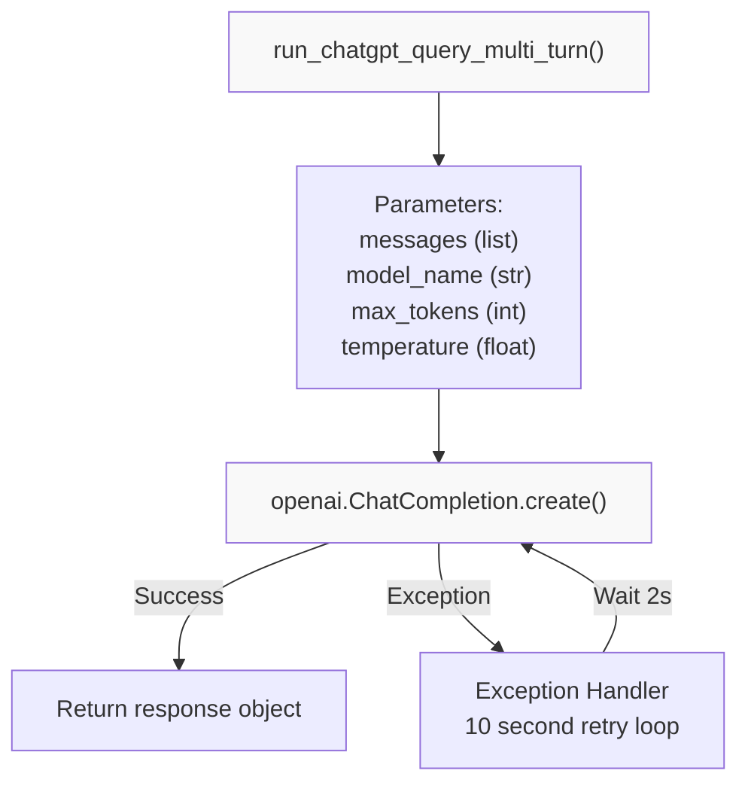
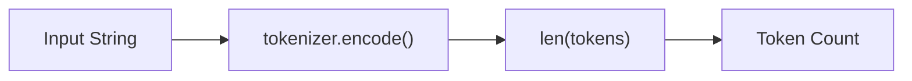
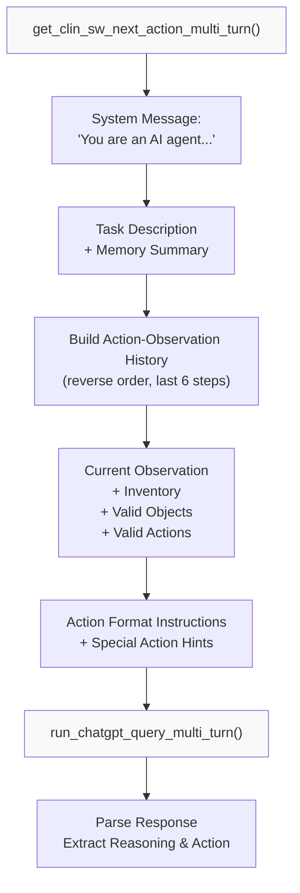
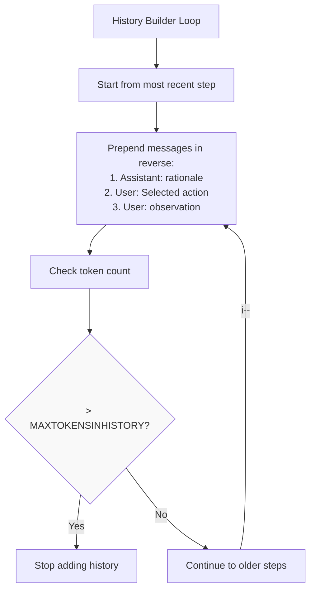
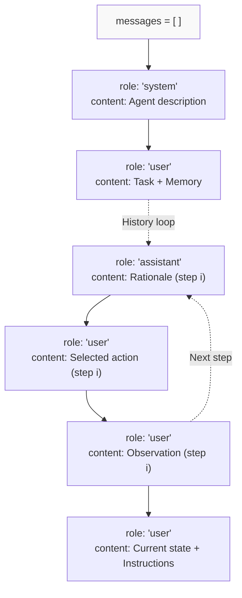
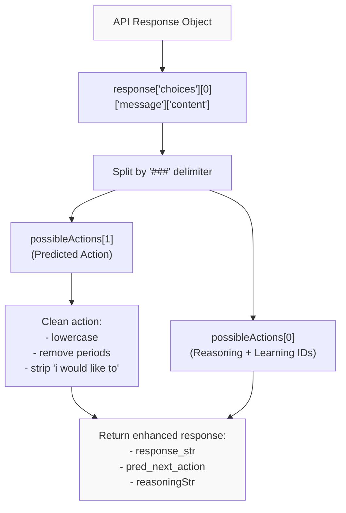
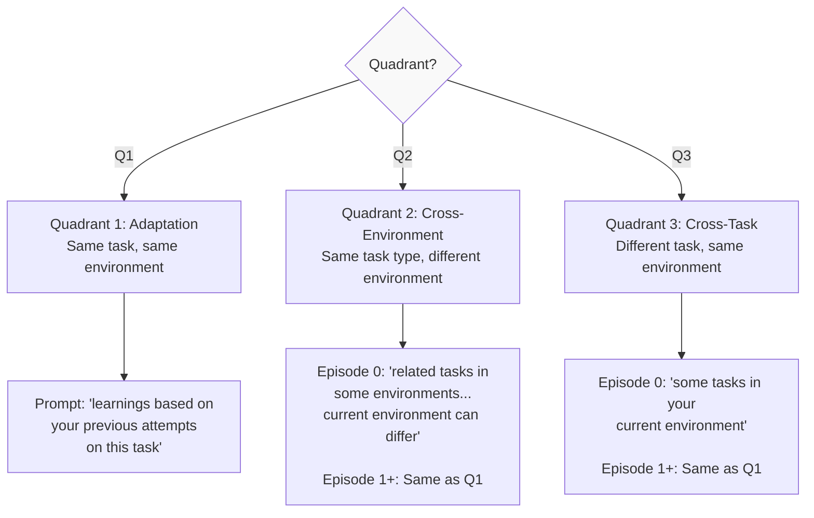

<!-- source: DeepWiki mcp.deepwiki.com · repo allenai/clin · page 4.3 LLM Integration Layer · fetched 2026-10-26 -->

# LLM Integration Layer

<details>
<summary>Relevant source files</summary>

The following files were used as context for generating this wiki page:

- [README.md](README.md)
- [model_utils.py](model_utils.py)
- [requirements.txt](requirements.txt)

</details>


## Purpose and Scope

This document describes how CLIN interfaces with Large Language Models (specifically OpenAI's GPT models) to generate actions and reasoning. The LLM Integration Layer handles API communication, prompt construction, token management, multi-turn conversation history, and response parsing.

For information about how the generated actions are validated and matched to environment actions, see [Action Generation and Validation](#4.4). For information about how learning summaries are generated using LLMs, see [Learning and Summarization System](#4.5). For overall agent coordination, see [Agent Orchestration](#4.2).

---

## OpenAI API Integration

### Authentication and Configuration

CLIN requires an OpenAI API key to be set as an environment variable:

```bash
export OPENAI_API_KEY=<your key>
```

**Supported Models:**
- `gpt-4-0613` (recommended for best performance)
- `gpt-3.5-turbo` (faster, lower cost)

The model is specified via the `--gpt-model` command-line argument and passed through to all LLM calls.

**Sources:** [README.md:23](), [model_utils.py:84-95]()

### Core API Call Function

The `run_chatgpt_query_multi_turn()` function manages all interactions with the OpenAI API:



**Error Handling:** The function implements automatic retry logic with a 2-second delay when API calls fail. It will retry indefinitely until successful.

**Sources:** [model_utils.py:83-101]()

---

## Token Management

### Token Counting with tiktoken

CLIN uses OpenAI's `tiktoken` library to accurately count tokens before sending requests, ensuring prompts don't exceed model context limits.

| Component | Purpose | Implementation |
|-----------|---------|---------------|
| **Tokenizer** | cl100k_base encoding | [model_utils.py:17]() |
| **Token Counter** | `getTokenLength(strIn)` | [model_utils.py:21-24]() |
| **History Limit** | `MAXTOKENSINHISTORY = 2500` | [model_utils.py:18]() |



**Token Budget Strategy:**

The system maintains different token budgets for different purposes:
- **Action History:** Maximum 2500 tokens (`MAXTOKENSINHISTORY`)
- **Summarization:** 7500 total budget, with 1000 reserved for output (see [model_utils.py:456-486]())

**Sources:** [model_utils.py:10-24](), [requirements.txt:3]()

---

## Prompt Construction Pipeline

The `get_clin_sw_next_action_multi_turn()` function orchestrates the entire prompt construction process. This is the central function for generating actions in CLIN.



**Sources:** [model_utils.py:104-316]()

### System Prompt

The system message establishes the agent's role:

```
"You are an AI agent helping execute a science experiment 
in a simulated environment with limited number of objects 
and actions available at each step."
```

**Sources:** [model_utils.py:160-163]()

### Task Description and Memory Injection

The task message includes:
1. **Base Task Description** - The specific ScienceWorld task
2. **Memory Summary** (if available) - Learnings from previous episodes
3. **Quadrant-Specific Instructions** - How to interpret memories based on evaluation quadrant

Memory injection varies by quadrant:

| Quadrant | Memory Type | Prompt Description |
|----------|-------------|-------------------|
| Q1 (Adaptation) | Episode memories from same task/environment | "learnings based on your previous attempts on this task" |
| Q2 (Cross-environment) | Meta-memories from related tasks in different environments | "related tasks in some environments...current environment can differ" |
| Q3 (Cross-task) | Meta-memories from different tasks in same environment | "some tasks in your current environment" |

**Sources:** [model_utils.py:124-157]()

### Action-Observation History Construction

CLIN builds conversation history by iterating backward through recent actions, observations, and rationales:



The loop:
- Iterates from `len(previous_actions) - 1` down to `max(len(previous_actions) - 6, -1)`
- Prepends messages to maintain chronological order
- Stops when token limit (`MAXTOKENSINHISTORY = 2500`) is reached
- Maintains structure: Rationale → Action → Observation → "What action next?"

**Sources:** [model_utils.py:170-216]()

### Current State Information

After history, the prompt includes current state:

```
Current Observation: [what agent sees]
Current Inventory: [what agent carries]
Possible Objects: [all valid OBJ values]
Possible Actions: [all valid action templates]
```

**Action Template Processing:**
- Filters out `focus` actions from the list (handled specially)
- Provides hints, e.g., replaces `"mix OBJ"` with `"mix OBJ (here, OBJ should be the container the items to be mixed are in)"`

**Sources:** [model_utils.py:218-247]()

### Response Format Instructions

The prompt explicitly instructs the LLM on the expected response format:

```
First, scan the (unordered) list of learnings, if provided. 
Decide if any of the learnings are applicable given the last 
observation to make progress in this task. Then only use selected 
learnings, if any, to construct a rationale for picking the next action.

Format your response as follows:
Write 'I used learning id(s):' as a comma separated list; the list can 
be empty if no learnings selected. Then, write $$$ followed by the 
rationale. Finally, write ### followed by the single next action you 
would like to take.
```

**Special Actions:**
- `TASK_COMPLETE` - Indicates task completion
- `FOCUS ON <OBJ>` - Critical action for focusing (limited uses)
- `wait` - Used after actions requiring time to see effects

**Sources:** [model_utils.py:242-249]()

---

## Multi-turn Conversation Management

### Message Structure

CLIN uses OpenAI's chat completion format with role-based messages:



**Message Roles:**
- **system**: Establishes agent identity and capabilities
- **user**: Provides observations, instructions, and queries
- **assistant**: Contains LLM-generated rationales (from previous steps)

**Sources:** [model_utils.py:159-216]()

### Building the Message History

The history is built by prepending messages (reverse iteration) to maintain chronological order:

```python
# Pseudocode from model_utils.py:181-216
for i in range(len(previous_actions) - 1, max(len(previous_actions) - 6, -1), -1):
    rationale = previous_rationales[i]
    action = previous_actions[i]
    observation = previous_observations[i]
    
    # Prepend in reverse order (building from start):
    previous_messages[:0] = [{"role": "user", "content": observation}]
    previous_messages[:0] = [{"role": "user", "content": f"Selected action: {action}"}]
    previous_messages[:0] = [{"role": "assistant", "content": rationale}]
    
    # Check token budget
    if getTokenLength(candidate_history) > MAXTOKENSINHISTORY:
        break
```

This ensures the conversation flows naturally: System → Task → (History) → Current State → Instructions.

**Sources:** [model_utils.py:181-216]()

---

## Response Processing

### Parsing Response Structure

After receiving the API response, CLIN extracts structured information:



**Parsing Logic:**
1. Split response by `"###"` delimiter
2. Extract reasoning from `possibleActions[0]`
3. Extract action from `possibleActions[1]`
4. Clean action string: lowercase, remove periods, strip conversational phrases
5. Handle edge cases: blank strings replaced with defaults

**Fallback Handling:**
- If reasoning is blank → set to `" "` (single space)
- If action is blank → set to `" UNKNOWN "`

**Sources:** [model_utils.py:275-306]()

### Response Augmentation

The function augments the API response object with parsed fields:

```python
response['response_str'] = response_str           # Raw LLM output
response['pred_next_action'] = next_action_str   # Cleaned action
response['reasoningStr'] = reasoningStr          # Reasoning portion
```

After parsing, the response and selected action are appended to the message history for the next turn.

**Sources:** [model_utils.py:276-313]()

---

## Quadrant-Specific Prompting

CLIN adapts its prompts based on the evaluation quadrant to provide context-appropriate memory:



**Key Differences:**

| Quadrant | Episode 0 Memory Source | Episode 1+ Memory Source | Prompt Emphasis |
|----------|------------------------|--------------------------|-----------------|
| Q1 | Recent episode memories | Recent episode memories | Direct applicability |
| Q2 | Cross-environment meta-memories | Same-episode memories | Environment differences |
| Q3 | Cross-task meta-memories | Same-episode memories | Task relatedness |

**Implementation Details:**
- Q2 and Q3 only use meta-memories in episode 0
- From episode 1 onward, all quadrants use the same prompt structure (recent episode memories)
- The distinction helps the agent understand the relevance and transferability of memories

**Sources:** [model_utils.py:131-154]()

---

## Function Reference Table

| Function | Purpose | Key Parameters | Returns |
|----------|---------|----------------|---------|
| `getTokenLength()` | Count tokens in string | `strIn` | `int` (token count) |
| `run_chatgpt_query_multi_turn()` | Execute OpenAI API call | `messages`, `model_name`, `max_tokens`, `temperature` | API response object |
| `get_clin_sw_next_action_multi_turn()` | Generate next action via LLM | `task`, `current_obs`, `current_inventory`, `objects_set`, `next_actions_set`, `previous_*`, `summary`, `quadrant` | Enhanced response with `pred_next_action`, `reasoningStr` |
| `success_map()` | Map reward scores to feedback | `metric`, `score` | Descriptive feedback string |
| `get_trace()` | Format episode trace | `data`, `truncate`, `quadrant` | Formatted trace string |
| `format_memory()` | Format memory list for prompt | `memories` | Formatted memory string |

**Sources:** [model_utils.py:21-373]()

---

## API Call Parameters

### Action Generation Call

```
model_name: gpt-4-0613 or gpt-3.5-turbo
max_tokens: 256
temperature: 0.0 (greedy decoding for reproducibility)
```

### Summarization Call

```
model_name: gpt-4-0613 (preferred)
max_tokens: 1000
temperature: 0.0-0.7 (configurable)
```

Temperature is set to 0.0 by default for deterministic behavior, critical for reproducible experiments.

**Sources:** [model_utils.py:86-95](), [model_utils.py:259-264]()

---

