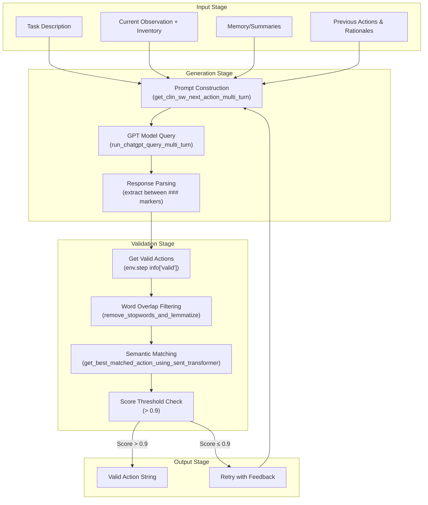
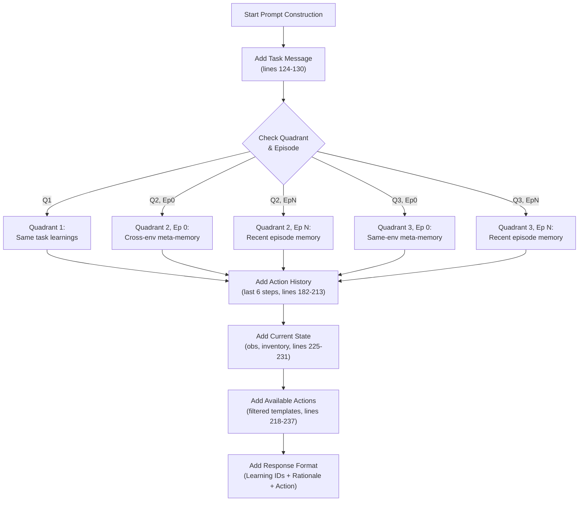
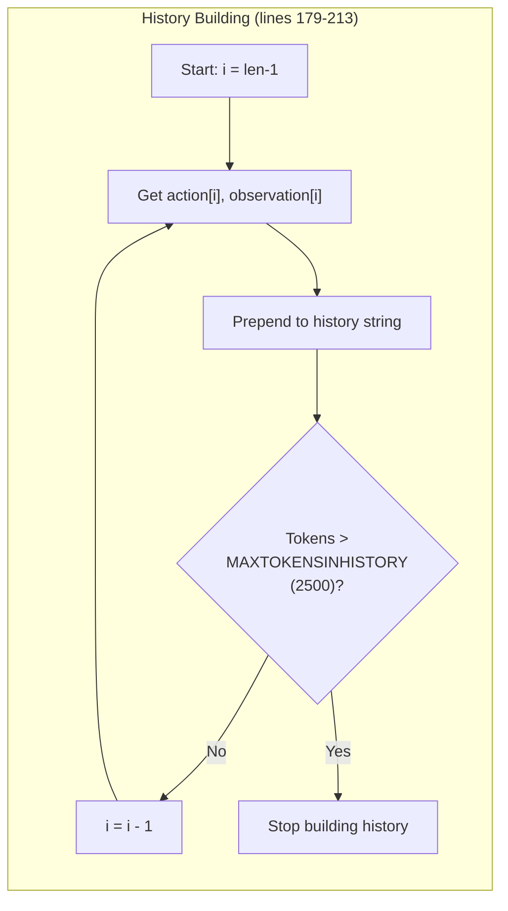
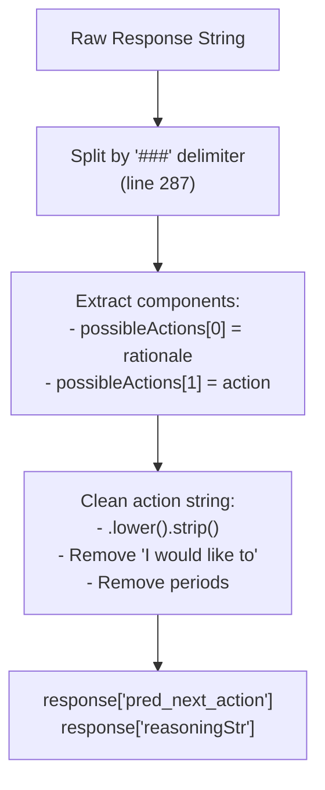
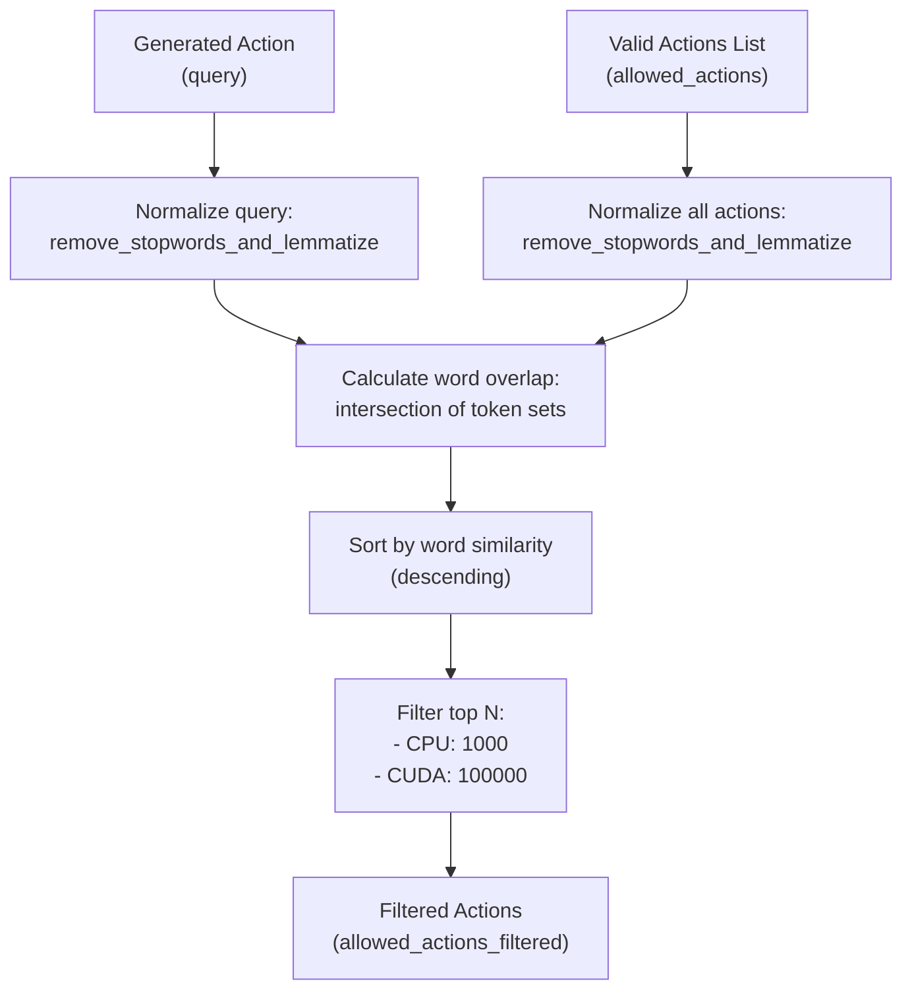
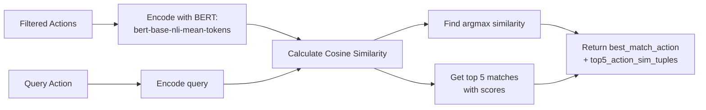
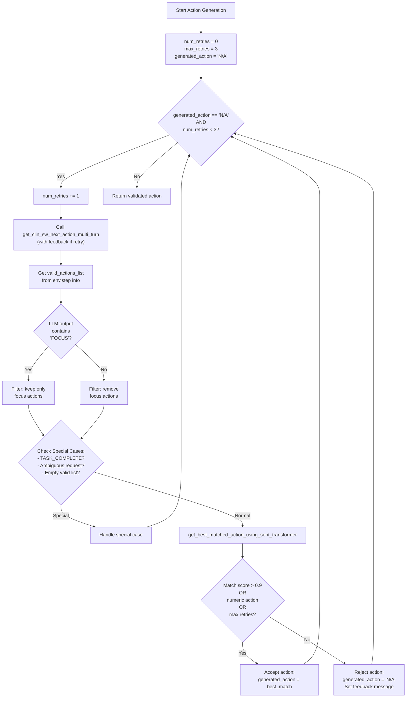
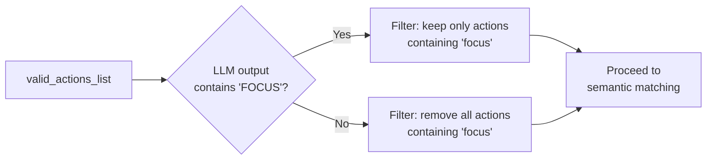

<!-- source: DeepWiki mcp.deepwiki.com · repo allenai/clin · page 4.4 Action Generation and Validation · fetched 2026-10-26 -->

# Action Generation and Validation

<details>
<summary>Relevant source files</summary>

The following files were used as context for generating this wiki page:

- [model_utils.py](model_utils.py)
- [scienceworld/clin_agent.py](scienceworld/clin_agent.py)
- [utils.py](utils.py)

</details>


## Purpose and Scope

This document describes the pipeline that converts high-level reasoning from Large Language Models (LLMs) into valid, executable actions in the ScienceWorld environment. The process consists of two main stages: **action generation** (querying GPT models to produce free-form action descriptions) and **action validation** (mapping these descriptions to valid environment actions using semantic similarity).

For information about how these validated actions are used in the broader agent loop, see [Agent Orchestration](#4.2). For details on prompt construction and multi-turn conversation management, see [LLM Integration Layer](#4.3).

---

## Pipeline Overview

The action generation and validation pipeline transforms natural language reasoning into executable environment commands through a three-stage process:



**Sources:** [model_utils.py:104-316](), [scienceworld/clin_agent.py:193-265]()

---

## Action Generation

### Prompt Construction

The `get_clin_sw_next_action_multi_turn` function constructs a complex multi-turn dialogue prompt that includes:

| Component | Content | Purpose |
|-----------|---------|---------|
| System Message | AI agent role description | Sets context for LLM |
| Task Information | Task description + learnings/memories | Provides goal and prior knowledge |
| Action History | Last 6 action-observation pairs | Maintains conversational context |
| Current State | Current observation + inventory | Describes immediate situation |
| Available Actions | Formatted list of valid action templates | Constrains action space |
| Response Format | Instructions for structured output | Ensures parseable responses |

The prompt structure varies based on the evaluation quadrant and episode number to incorporate appropriate memories:



**Sources:** [model_utils.py:104-168](), [model_utils.py:225-254]()

### Token Budget Management

The function maintains a maximum of 2500 tokens in the action history to prevent context overflow. History is built from most-recent to least-recent, stopping when the token threshold is exceeded:



**Sources:** [model_utils.py:17-24](), [model_utils.py:179-213]()

### Response Format and Parsing

The LLM is instructed to format responses with specific delimiters:

```
I used learning id(s): [comma-separated list or empty]
$$$
[Rationale text explaining the reasoning]
###
[single action command]
```

The parser extracts the action by splitting on `###` markers:



**Sources:** [model_utils.py:242-246](), [model_utils.py:286-306]()

---

## Action Validation and Semantic Matching

### Two-Pass Filtering Strategy

The `get_best_matched_action_using_sent_transformer` function uses a two-pass approach to efficiently match generated actions to valid environment actions:

**Pass 1: Word Overlap Filtering** - Reduces candidate actions from potentially thousands to top 1000-100000 (depending on device):



**Sources:** [model_utils.py:32-54](), [utils.py:40-51]()

**Pass 2: Semantic Similarity** - Uses SentenceTransformer embeddings for precise matching:



**Sources:** [model_utils.py:56-80]()

### Exact Match Shortcut

If the generated action exactly matches a valid action, the function immediately returns without semantic processing:

```python
if query in allowed_actions:
    return query, [(query, 1.0)]
```

**Sources:** [model_utils.py:29-30]()

---

## Retry Logic and Error Recovery

The agent orchestrator implements a retry mechanism with feedback when validation fails:



**Sources:** [scienceworld/clin_agent.py:191-265]()

### Feedback Messages

When validation fails (score ≤ 0.9), the system provides explicit feedback to the LLM for the next retry:

```python
feedback = "Your generated action '{}' cannot be matched to a valid action. " \
           "Please retry with a different phrasing or a different action.".format(
               response['pred_next_action'])
```

This feedback is appended to the next prompt to guide the model toward more valid actions.

**Sources:** [scienceworld/clin_agent.py:264](), [model_utils.py:248-249]()

---

## Special Case Handling

### Task Completion Detection

The system recognizes multiple variations of task completion indicators:

| Indicator | Handling |
|-----------|----------|
| `TASK_COMPLETE` | Set action to "exit" |
| `task complete` | Set action to "exit" |
| `successfully completed` | Set action to "exit" |
| `There is no further action required` | Set action to "exit" |

**Sources:** [scienceworld/clin_agent.py:217-224]()

### Focus Action Filtering

Focus actions require special handling due to their critical nature:



This ensures the agent can only use focus actions when explicitly intending to, preventing accidental focus attempts.

**Sources:** [scienceworld/clin_agent.py:230-233]()

### Ambiguous Request Handling

When the environment returns "Ambiguous request" with numbered options, the system:

1. Detects the ambiguous request in the observation
2. Creates a valid action list from numeric indices (0 to N)
3. Allows the LLM to respond with a number to disambiguate

```python
if "Ambiguous request" in observation:
    valid_actions_list = [str(x) for x in range(len(observation.split('\n')[1:]))]
```

**Sources:** [scienceworld/clin_agent.py:238-240](), [utils.py:54-71]()

### Numeric Action Acceptance

Numeric actions (0-20) are automatically accepted without score threshold checking to handle disambiguation and multi-choice scenarios:

```python
if best_match_action in ['0','1','2','3',...,'20'] or (num_retries==max_num_retries_executor):
    generated_action_str = best_match_action
```

**Sources:** [scienceworld/clin_agent.py:259-261]()

---

## Integration Points

### Input Sources

| Input | Source | Purpose |
|-------|--------|---------|
| Task Description | `env.getTaskDescription()` | Defines goal |
| Current Observation | `env.look()` | Current state |
| Current Inventory | `env.inventory()` | Agent's items |
| Valid Actions | `info['valid']` from `env.step()` | Executable actions |
| Possible Objects | `env.getPossibleObjects()` | Available entities |
| Previous History | Agent's memory arrays | Context |
| Memories/Summaries | Episode summaries | Learned knowledge |

**Sources:** [scienceworld/clin_agent.py:196-210]()

### Output Products

| Output | Type | Usage |
|--------|------|-------|
| `generated_action_str` | String | Executed in environment |
| `generated_rationale_str` | String | Stored in run history |
| `response['response_str']` | String | Full LLM response |
| `topN` | List[(str, float)] | Top 5 matched actions with scores |
| `sentenceTransformerRuntimes` | List[float] | Performance metrics |

**Sources:** [scienceworld/clin_agent.py:214-277]()

---

## Performance Characteristics

### Token Budget

- Maximum history tokens: 2500 (configurable via `MAXTOKENSINHISTORY`)
- Maximum response tokens: 256
- Token counting via `tiktoken` with `cl100k_base` encoding

**Sources:** [model_utils.py:17-24]()

### Semantic Matching Efficiency

- CPU mode: Filters to top 1000 actions before BERT encoding
- CUDA mode: Filters to top 100000 actions
- Runtime tracked per step in `sentenceTransformerRuntimes` array

**Sources:** [model_utils.py:46-52](), [scienceworld/clin_agent.py:252]()

### Retry Budget

- Maximum retries per action: 3
- Retry occurs when match score ≤ 0.9
- On max retries, accepts best match regardless of score

**Sources:** [scienceworld/clin_agent.py:192](), [scienceworld/clin_agent.py:259-261]()

---

