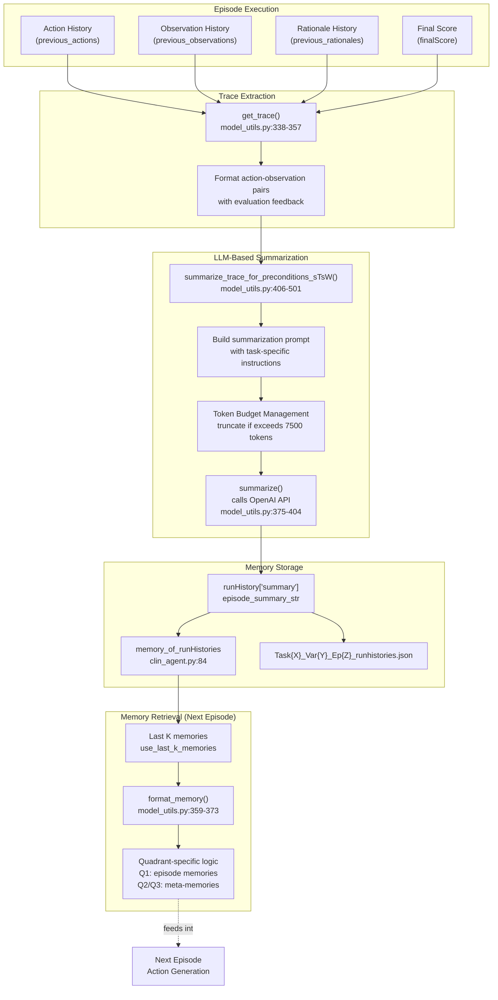
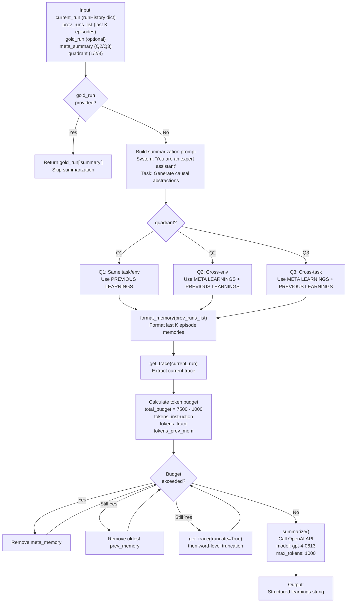
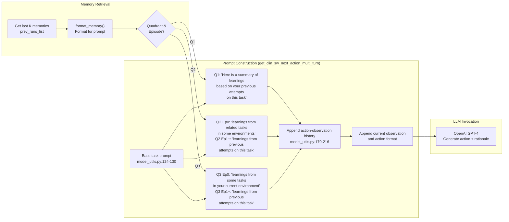

<!-- source: DeepWiki mcp.deepwiki.com · repo allenai/clin · page 4.5 Learning and Summarization System · fetched 2026-10-26 -->

# Learning and Summarization System

<details>
<summary>Relevant source files</summary>

The following files were used as context for generating this wiki page:

- [model_utils.py](model_utils.py)
- [scienceworld/clin_agent.py](scienceworld/clin_agent.py)

</details>


## Purpose and Scope

This document describes CLIN's learning and summarization system, which converts episode execution traces into structured textual memories. These memories encode causal abstractions about action preconditions and enable continual learning across episodes without parameter updates.

This page covers:
- **Episode trace extraction and formatting** for summarization
- **LLM-based summarization** to generate structured learnings
- **Memory storage and retrieval** mechanisms
- **Quadrant-specific memory behavior** for adaptation vs. generalization
- **Token budget management** for context window constraints

For information about how memories are used during action generation, see [LLM Integration Layer](#4.3). For agent-level orchestration of the learning cycle, see [Agent Orchestration](#4.2).

---

## System Overview

The learning and summarization system operates at episode boundaries. After each episode completes, the system extracts the action-observation trace, formats it with evaluation feedback, and invokes an LLM to generate structured learnings in the form of causal abstractions. These learnings accumulate in a memory pool and are retrieved for subsequent episodes based on the evaluation quadrant.



**Diagram: Learning and Summarization Pipeline**

The system flows from execution histories through trace formatting, LLM-based summarization, memory storage, and retrieval for future episodes.

Sources: [model_utils.py:338-501](), [scienceworld/clin_agent.py:84](), [scienceworld/clin_agent.py:342-357]()

---

## Trace Extraction and Formatting

### Trace Structure

The `get_trace()` function extracts a formatted trace from a run history dictionary. The trace is structured as a sequence of action-observation pairs with final evaluation feedback.

**Function signature:**
```python
get_trace(data, truncate=False, quadrant=1)
```

**Input:** Run history dictionary containing:
- `taskDescription`: Task being performed
- `history`: List of step dictionaries with `action` and `observation` fields
- `finalScore`: Numeric reward (0-100 scale)

**Output:** Formatted trace string

**Trace format:**
```
CURRENT TRACE

Task: {taskDescription}

Action: {action_1}
Observation: {observation_1}

Action: {action_2}
Observation: {observation_2}

...

EVALUATION REPORT:
REWARD_FINAL: {finalScore}. This means: {success_feedback}
```

Sources: [model_utils.py:338-357]()

### Success Feedback Mapping

The `success_map()` function translates numeric scores into qualitative feedback strings. This contextualizes the trace for the summarization LLM.

| Score Range | Feedback |
|-------------|----------|
| -100 | "The agent made critical mistakes and the task was terminated." |
| < 0 | "The agent performed very poorly and could not make any critical progress." |
| 0-19 | "The agent performed poorly and made some progress but not enough to solve the task." |
| 20-49 | "The agent performed moderately and made some critical progress but not enough to solve the task." |
| 50-89 | "The agent performed very well and made significant critical progress but not enough to solve the task." |
| 90-99 | "The agent performed exceptionally well and made significant critical progress, was just slight away from solving the task." |
| 100 | "The agent performed exceptionally well and successfully solved the task." |

This graded feedback helps the LLM understand the quality of the attempt when extracting learnings.

Sources: [model_utils.py:318-336]()

### Truncation for Token Budget

When `truncate=True`, observations are shortened to only the first sentence. This is a fallback mechanism when the full trace exceeds the token budget:

```python
if truncate:
    trace += "Observation: {}\n\n".format(item['observation'].split('.')[0])
else:
    trace += "Observation: {}\n\n".format(item['observation'])
```

Sources: [model_utils.py:346-349]()

---

## LLM-Based Summarization

### Core Summarization Function

The `summarize_trace_for_preconditions_sTsW()` function is the primary entry point for generating episode learnings. It orchestrates prompt construction, token budget management, and LLM invocation.



**Diagram: summarize_trace_for_preconditions_sTsW() Flow**

Sources: [model_utils.py:406-501]()

### Prompt Construction

The summarization prompt consists of multiple components assembled based on the quadrant:

**System Prompt:**
```
You are an expert assistant.
```

**Base Summary Prompt:**
```
You are given CURRENT TRACE, a sequence of actions that an agent made in a world 
to accomplish a task. Task is detailed at the beginning. For each action, there 
is a rationale why the agent made that action. There is an observation that 
provide details about the new state of the world after each action was executed. 
The CURRENT TRACE is accompanied by an EVALUATION REPORT indicating the success 
of the attempt to the task.

You can also be provided with PREVIOUS LEARNINGS which are learnings from the 
previous attempts by the agent for the same task in the same environment/world. 
TASK indicates the task description. EPISODE indicates the number of previous 
attempts of the task. PREVIOUS LEARNINGS also have EVALUATION REPORTs indicated 
how sucessful the respective attempt was for solving the task.
```

**Task Instruction:**
```
Generate a summary of learning, as a numbered list, that will help the agent to 
successfully accomplish the SAME task AGAIN, in the SAME world.

Each numbered item in the summary can ONLY be of the form:
X MAY BE NECCESSARY to Y.
X SHOULD BE NECCESSARY to Y.
X MAY BE CONTRIBUTE to Y.
X DOES NOT CONTRIBUTE to Y.

Summary of learning as a numbered list:
```

Sources: [model_utils.py:433-453]()

### Quadrant-Specific Behavior

The function adapts its behavior based on the evaluation quadrant:

| Quadrant | Scenario | Memory Sources | Meta-Memory Usage |
|----------|----------|----------------|-------------------|
| Q1 | Same task, same environment | Last K episode memories | Not used |
| Q2 | Same task, different environment | Last K episode memories + meta-memory | Used in episode 0, then regular memories |
| Q3 | Different task, same environment | Last K episode memories + meta-memory | Used in episode 0, then regular memories |

**Q2 Meta-Summary Prompt (Episode 0):**
```
You are also provided with a set of META LEARNINGS that contains useful insights 
from agent's previous best attempts to solve a same type of tasks that the you 
are currently solving in different environment configurations. Previous 
environment configurations may differ from the current one you are in, in terms 
of presence of objects, starting location etc.
```

**Q3 Meta-Summary Prompt (Episode 0):**
```
You are also provided with a set of META LEARNINGS that contains useful insights 
from agent's previous best attempts to solve tasks in the SAME environment 
configuration that you are currently in. These learnings will contain related 
information about the environment such as presence of objects, starting location, 
navigational information, etc.
```

Sources: [model_utils.py:423-431]()

### Token Budget Management

The function enforces a token budget to fit within the GPT-4 context window:

**Budget calculation:**
```python
total_budget = 7500 - 1000  # 6500 tokens for input
tokens_instruction = getTokenLength(final_prompt)
total_budget -= tokens_instruction
tokens_trace = getTokenLength(trace)
tokens_prev_mem = getTokenLength(prev_memories)
```

**Truncation strategy (applied in order):**

1. **Remove meta-memory** if present
2. **Remove oldest previous memory** iteratively
3. **Truncate trace observations** to first sentence
4. **Word-level truncation** of trace from beginning

```python
while tokens_trace + tokens_prev_mem > total_budget:
    if len(memories['meta_memory']) > 0:
        memories['meta_memory'] = ""
        tokens_prev_mem -= getTokenLength(meta_summary)
    elif len(memories['prev_memory']) > 0:
        tokens_prev_mem -= getTokenLength(format_memory([memories['prev_memory'][0]]))
        memories['prev_memory'] = memories['prev_memory'][1:]
    else:
        trace = get_trace(current_run, truncate=True)
        tokens_trace = getTokenLength(trace)
        if tokens_trace + tokens_prev_mem > total_budget:
            trace = ' '.join(trace.split(' ')[(total_budget - tokens_trace - tokens_prev_mem):])
        memories['trace'] = trace
```

This ensures the summarization call never exceeds the model's context limits.

Sources: [model_utils.py:456-486]()

### OpenAI API Call

The `summarize()` function wraps the OpenAI chat completion API with retry logic:

```python
def summarize(trace, summary_prompt, system_prompt, demo_examples="", 
              prev_memories="", model="gpt4", temp=0.7, tokens=1000):
    response = None
    while response is None:
        try:
            response = openai.ChatCompletion.create(
                model=model,
                messages=[{"role": "system", "content": system_prompt},
                         {"role": "user", "content": summary_prompt},
                         {"role": "user", "content": demo_examples},
                         {"role": "user", "content": prev_memories},
                         {"role": "user", "content": trace}],
                temperature=temp, 
                max_tokens=tokens,
                top_p=1,
                frequency_penalty=0,
                presence_penalty=0
            )
        except Exception as e:
            print(e)
            print("GPT3 error. Retrying in 10 seconds...")
            time.sleep(2)
    
    output_summary = response["choices"][0]["message"]["content"]
    return output_summary
```

**Parameters:**
- `model`: `"gpt-4-0613"` (default for summarization)
- `temperature`: `0.0` (greedy) or configurable
- `max_tokens`: `1000` for summary generation
- Retry logic handles transient API errors

Sources: [model_utils.py:375-404]()

---

## Memory Storage and Retrieval

### Memory Data Structure

Each episode's run history is stored with its generated summary:

```python
runHistory = {
    'taskDescription': str,
    'taskIdx': int,
    'variationIdx': int,
    'episodeIdx': int,
    'history': [
        {
            'action': str,
            'observation': str,
            'rationale': str,
            'rawAction': str,
            'topNActions': list,
            'subgoalProgress': dict
        },
        ...
    ],
    'finalScore': float,
    'finalScorePositive': float,
    'isCompleted': bool,
    'earlyStop': bool,
    'model': str,
    'gold-action-seq': str,
    'memory-seen': str,
    'summary': str  # Generated by summarize_trace_for_preconditions_sTsW()
}
```

Sources: [scienceworld/clin_agent.py:320-356]()

### Memory Pool Management

The agent maintains a persistent memory pool across episodes:

```python
memory_of_runHistories = []  # Initialized at agent start

# After each episode:
memory_of_runHistories.append(runHistory)
```

When summarizing a new episode, the last K memories are retrieved:

```python
prev_runs_list = memory_of_runHistories[-1 * use_last_k_memories:]
episode_summary_str = summarize_trace_for_preconditions_sTsW(
    runHistory,
    prev_runs_list=prev_runs_list,
    gold_run=None,
    demo_examples=None,
    model="gpt-4",
    temp=temperature,
    quadrant=quadrant,
    meta_summary=gold_memory if quadrant == 2 else '',
    use_last_k_memories=use_last_k_memories
)
```

**Default:** `use_last_k_memories = 3`

Sources: [scienceworld/clin_agent.py:84](), [scienceworld/clin_agent.py:342-354]()

### Memory Formatting for Retrieval

The `format_memory()` function converts a list of run histories into a formatted string for inclusion in action generation prompts:

```python
def format_memory(memories):
    memory_string = "\n\nPREVIOUS LEARNINGS\n\n"
    for m in memories:
        if m['summary']:
            memory_string += "TASK: {}\n".format(m['taskDescription'])
            memory_string += "EPISODE: {}\n".format(m['episodeIdx'])
            memory_string += "LEARNINGS: {}\n".format(m['summary'])
            
            memory_string += "\nEVALUATION REPORT (for the attempt associated with the learning):\n"
            final_score = m['finalScore']
            memory_string += "REWARD_FINAL: {}. This means: {}\n".format(
                final_score, success_map('reward', final_score))
            memory_string += '\n'
    
    return memory_string
```

**Output format:**
```
PREVIOUS LEARNINGS

TASK: {task_1}
EPISODE: {episode_idx_1}
LEARNINGS: {summary_1}

EVALUATION REPORT (for the attempt associated with the learning):
REWARD_FINAL: {score_1}. This means: {feedback_1}

TASK: {task_2}
EPISODE: {episode_idx_2}
LEARNINGS: {summary_2}

EVALUATION REPORT (for the attempt associated with the learning):
REWARD_FINAL: {score_2}. This means: {feedback_2}

...
```

This formatted memory is then injected into the action generation prompt at [model_utils.py:131-154]().

Sources: [model_utils.py:359-373]()

---

## Gold Memory System

### Loading Gold Traces

Gold traces are pre-recorded successful trajectories with manually or automatically generated summaries. They serve as bootstrap memories for episode 0.

**Loading from disk:**

```python
gold_path = args['gold_traces']
gold_summaries = []

if gold_path:
    if 'jsonl' in gold_path:
        # Load from JSONL file
        with open(gold_path, 'r', encoding='utf-8') as f:
            for line in f:
                gold_summaries.append(json.loads(line.rstrip('\n|\r')))
    elif 'json' in gold_path:
        # Load from single JSON file
        gold_summaries.append(json.load(open(gold_path, 'r', encoding='utf-8')))
    else:
        # Load from directory of JSON files
        for file_name in os.listdir(gold_path):
            if file_name.endswith('.json'):
                data = json.load(open(os.path.join(gold_path, file_name)))
                gold_summaries.append(data)
```

Sources: [scienceworld/clin_agent.py:26-48]()

### Gold Summary Mapping

Gold summaries are organized by task and variation:

```python
gold_summaries_map = {}
gold_histories_map = {}

for sum in gold_summaries:
    if sum["taskIdx"] in gold_summaries_map:
        if quadrant == 1:
            gold_summaries_map[sum["taskIdx"]].update({sum["variationIdx"]: sum["summary"]})
        elif quadrant == 2:
            gold_summaries_map[sum["taskIdx"]].update({sum["variationIdx"]: sum["q2_summary"]})
        elif quadrant == 3:
            gold_summaries_map[sum["taskIdx"]].update({sum["variationIdx"]: sum["q3_summary"]})
        
        gold_histories_map[sum["taskIdx"]].update({sum["variationIdx"]: sum["history"]})
    else:
        # Initialize new task entry
        if quadrant == 1:
            gold_summaries_map[sum["taskIdx"]] = {sum["variationIdx"]: sum["summary"]}
        elif quadrant == 2:
            gold_summaries_map[sum["taskIdx"]] = {sum["variationIdx"]: sum["q2_summary"]}
        elif quadrant == 3:
            gold_summaries_map[sum["taskIdx"]] = {sum["variationIdx"]: sum["q3_summary"]}
        
        gold_histories_map[sum["taskIdx"]] = {sum["variationIdx"]: sum["history"]}
```

**Structure:**
```python
gold_summaries_map = {
    taskIdx: {
        variationIdx: summary_string
    }
}
```

Sources: [scienceworld/clin_agent.py:49-73]()

### Gold Memory Usage

When `use_gold_memory_in_ep0 = True`, the gold summary is retrieved for episode 0:

```python
gold_memory = ""
if use_gold_memory_in_ep0:
    if str(taskIdx) in gold_summaries_map:
        if str(varIdx) in gold_summaries_map[str(taskIdx)]:
            gold_memory = gold_summaries_map[str(taskIdx)][str(varIdx)]
```

The gold memory is then used:
1. **Directly in episode 0** action generation (bypassing summarization)
2. **As meta-memory in Q2** for cross-environment generalization

```python
if use_gold_memory_in_ep0 and episodeIdx == 0:
    summary_str = gold_memory
elif summarize_end_of_episode:
    summary_str = prev_episode_summary_str
```

This allows CLIN to bootstrap from expert knowledge in the first episode.

Sources: [scienceworld/clin_agent.py:129-187]()

---

## Integration with Action Generation

### Memory Injection into Prompts

The formatted memory string is injected into the action generation prompt based on the quadrant and episode:



**Diagram: Memory Integration into Action Generation**

Sources: [model_utils.py:104-316]()

### Quadrant-Specific Memory Prompts

**Quadrant 1 (Adaptation):**
```python
if quadrant == 1:
    sw_prompt_task += \
        f"Here is a summary of learnings based on your previous attempts on this task." \
        f"These learnings capture important pre-conditions: X MAY BE NECESSARY to Y, " \
        f"X SHOULD BE NECESSARY to Y, and mistakes: X MAY NOT CONTRIBUTE to Y, " \
        f"X DOES NOT CONTRIBUTE to Y. These can be useful for predicting your next action:\n{summary}"
```

**Quadrant 2 (Cross-Environment):**
```python
if quadrant == 2:
    if episodeIdx == 0:
        sw_prompt_task += \
            f"Here is a summary of learnings based on your previous attempts to solve " \
            f"related tasks in some environments. However, your current envionment can " \
            f"differ from previous environments in terms of presence of objects, starting " \
            f"location etc. These learnings capture important pre-conditions: X MAY BE " \
            f"NECESSARY to Y, X SHOULD BE NECESSARY to Y, and mistakes: X MAY NOT " \
            f"CONTRIBUTE to Y, X DOES NOT CONTRIBUTE to Y. Some of these learnings can be " \
            f"useful for predicting your next action:\n{summary}"
    else:
        # Episodes 1+ use same prompt as Q1
```

**Quadrant 3 (Cross-Task):**
```python
if quadrant == 3:
    if episodeIdx == 0:
        sw_prompt_task += \
            f"Here is a summary of learnings based on your previous attempts to some " \
            f"tasks in your current environment. These learnings capture important " \
            f"pre-conditions: X MAY BE NECESSARY to Y, X SHOULD BE NECESSARY to Y, and " \
            f"mistakes: X MAY NOT CONTRIBUTE to Y, X DOES NOT CONTRIBUTE to Y. Some of " \
            f"these learnings can be useful for predicting your next action:\n{summary}"
    else:
        # Episodes 1+ use same prompt as Q1
```

The key distinction is that Q2 and Q3 warn the agent in episode 0 that the learnings may be from different contexts and should be applied selectively.

Sources: [model_utils.py:131-154]()

---

## Configuration and Parameters

### Command-Line Arguments

The learning system is controlled by several command-line arguments in `clin_agent.py`:

| Argument | Type | Default | Description |
|----------|------|---------|-------------|
| `--summarize_end_of_episode` | int (bool) | 1 | Enable/disable end-of-episode summarization |
| `--use-gold-memory-in-ep0` | int (bool) | 0 | Use gold memory for episode 0 bootstrap |
| `--gold-traces` | str | "" | Path to gold trace file/directory |
| `--use-last-k-memories` | int | 3 | Number of recent memories to use in summarization |
| `--quadrant` | int | required | Evaluation quadrant (1/2/3) |
| `--temperature` | float | 0.0 | Temperature for LLM calls |
| `--gpt-model` | str | "gpt-4-0613" | GPT model for summarization |

Sources: [scienceworld/clin_agent.py:434-450]()

### Token Budget Configuration

Token limits are hardcoded constants:

```python
# In model_utils.py
MAXTOKENSINHISTORY = 2500  # For action-observation history in prompts

# In summarize_trace_for_preconditions_sTsW()
total_budget = 7500 - 1000  # 6500 tokens for summarization input
max_tokens = 1000  # For summary output
```

These values are tuned for GPT-4's 8K context window, leaving room for the prompt template and generated summary.

Sources: [model_utils.py:18](), [model_utils.py:456-457]()

---

## Memory Output and Persistence

### JSON Output Structure

Each episode's run history is saved to a JSON file:

**Filename format:**
```
Task{taskIdx}_Var{varIdx}_Ep{episodeIdx}_runhistories.json
```

**Relevant fields:**
```json
{
    "taskDescription": "...",
    "taskIdx": 4,
    "variationIdx": 1,
    "episodeIdx": 2,
    "history": [
        {
            "action": "...",
            "observation": "...",
            "rationale": "...",
            "rawAction": "...",
            "topNActions": [...],
            "subgoalProgress": {...}
        }
    ],
    "finalScore": 85.0,
    "finalScorePositive": 85.0,
    "isCompleted": false,
    "earlyStop": false,
    "model": "gpt-4-0613",
    "gold-action-seq": "...",
    "memory-seen": "... (formatted memory used during episode) ...",
    "summary": "... (generated learnings) ..."
}
```

The `summary` field contains the output of `summarize_trace_for_preconditions_sTsW()` and is the key persistent learning artifact.

Sources: [scienceworld/clin_agent.py:320-362]()

### Summary Text File

A high-level summary is also written to a text file:

**Filename:** `{output_path_prefix}/summary.txt`

**Contents:**
```
---------------------------------------------------------------------
 Summary (ChatGPT Agent)
 Simplifications: {simplificationStr}
---------------------------------------------------------------------
task    Name    var    epi    score    complete?
{taskIdx}    {taskName}    {varIdx}    {episodeIdx}    {finalScore}    {isCompleted}
...
---------------------------------------------------------------------
Completed.
```

This provides a quick overview of performance across episodes.

Sources: [scienceworld/clin_agent.py:381-392]()

---

## Summary

The learning and summarization system implements CLIN's core continual learning mechanism through:

1. **Trace Extraction**: Formatting episode histories with evaluation feedback
2. **LLM Summarization**: Invoking GPT-4 to extract causal abstractions
3. **Memory Management**: Storing summaries and retrieving last K for future use
4. **Quadrant Adaptation**: Adjusting memory usage for adaptation vs. generalization
5. **Token Budget Control**: Truncating inputs to fit context windows
6. **Gold Bootstrap**: Supporting expert memory initialization

The system enables learning without parameter updates by accumulating textual knowledge that guides future decision-making. This architecture is the foundation of CLIN's ability to adapt within episodes and generalize across task variations and environments.

---

