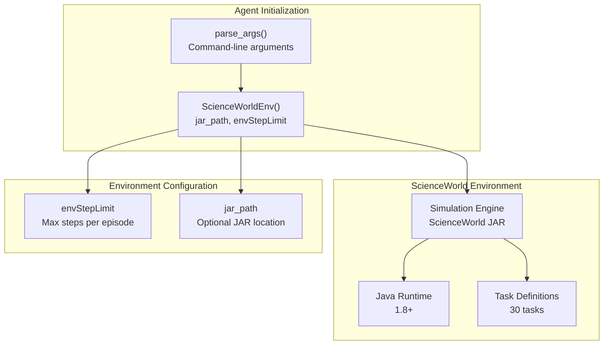
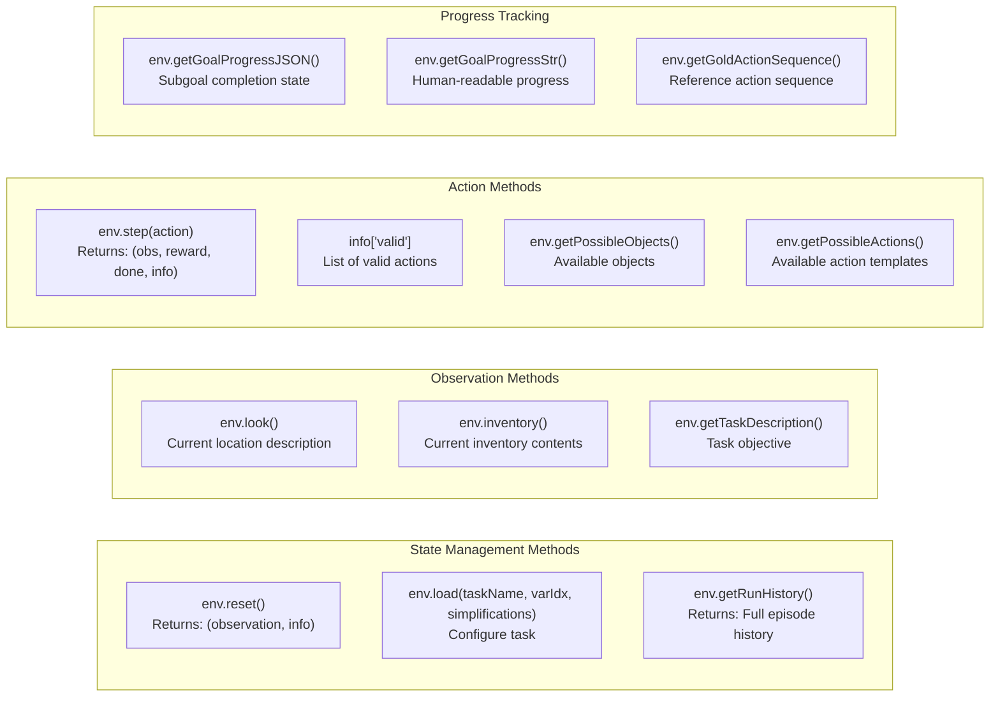
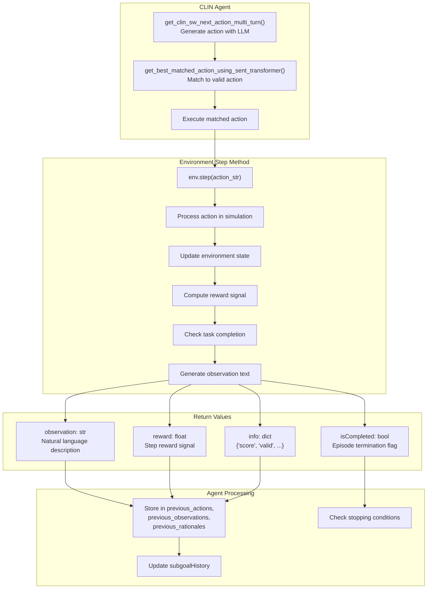
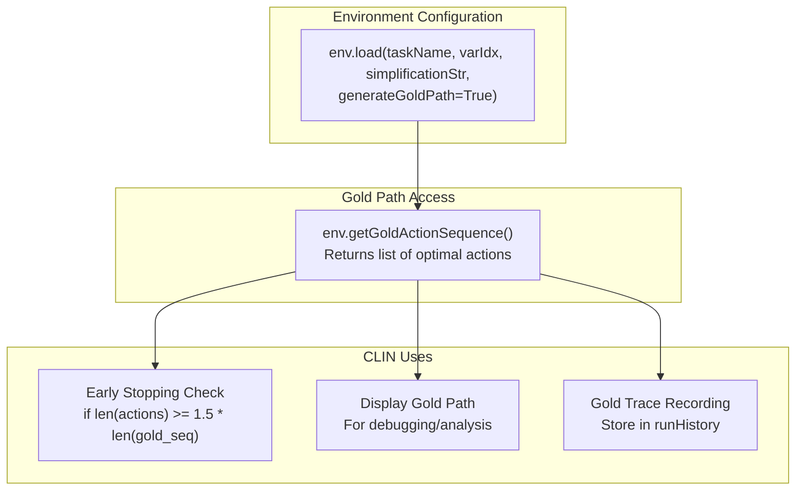
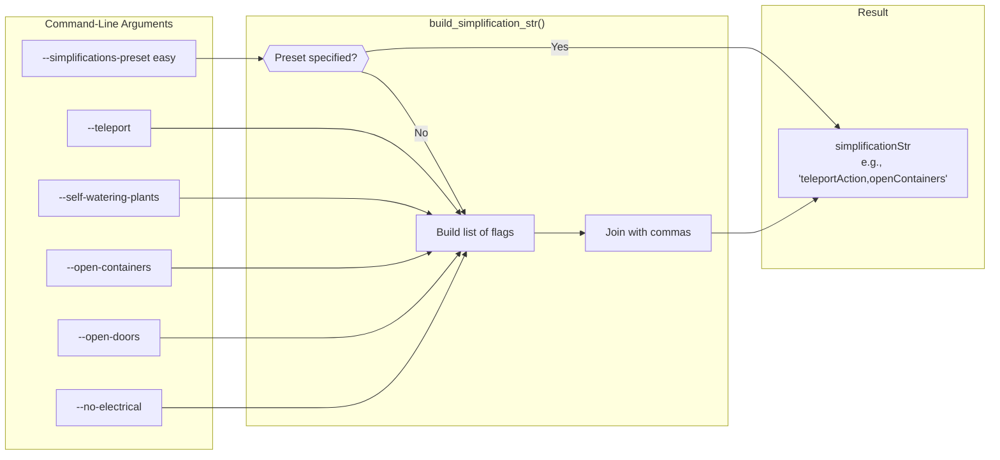
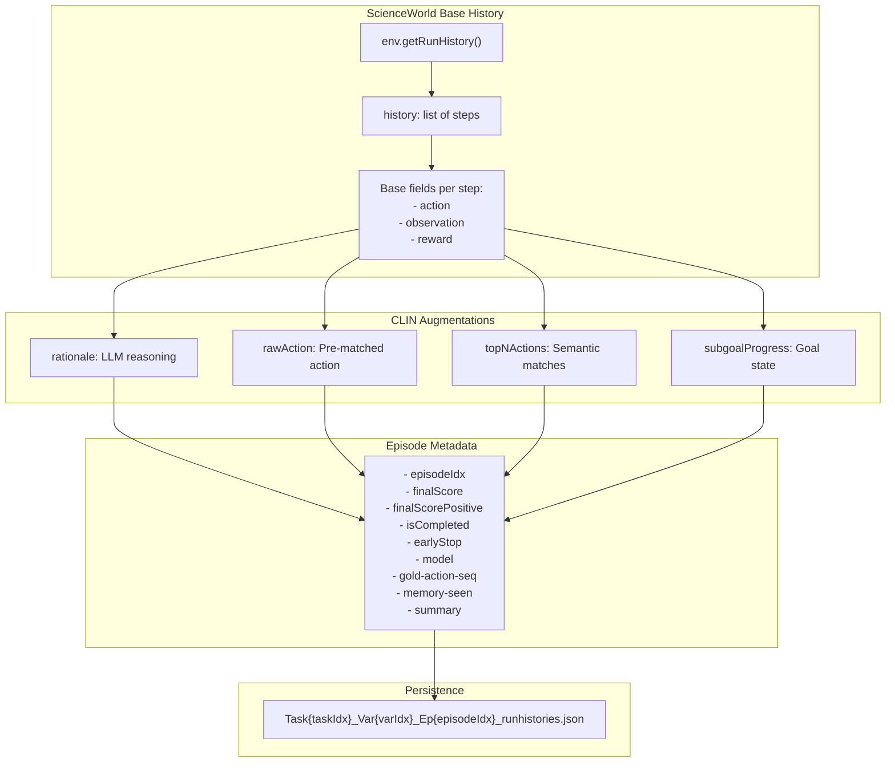

<!-- source: DeepWiki mcp.deepwiki.com · repo allenai/clin · page 4.6 ScienceWorld Integration · fetched 2026-10-26 -->

# ScienceWorld Integration

<details>
<summary>Relevant source files</summary>

The following files were used as context for generating this wiki page:

- [README.md](README.md)
- [requirements.txt](requirements.txt)
- [scienceworld/clin_agent.py](scienceworld/clin_agent.py)

</details>


## Purpose and Scope

This document describes how CLIN integrates with the ScienceWorld text-based simulation environment. It covers environment initialization, the observation-action loop, environment API methods, and configuration options. For information about how actions are generated and validated before being sent to ScienceWorld, see [Action Generation and Validation](#4.4). For details on how the agent orchestrates episode management, see [Agent Orchestration](#4.2).

---

## ScienceWorld Environment Overview

ScienceWorld is a text-based simulation environment designed for embodied science tasks. CLIN uses a specific branch called `exhaustivevalidactions` from the `allenai/ScienceWorld` repository, which provides comprehensive lists of valid actions at each step.

**Key Characteristics:**
- **Text-based interface**: Observations and actions are natural language strings
- **Interactive simulation**: Environment responds to actions with observations and rewards
- **Task-based**: 30 different science tasks with multiple variations per task
- **Action validation**: Provides exhaustive lists of valid actions at each state
- **Gold paths**: Reference action sequences for optimal task completion
- **Java-based**: Requires Java 1.8+ runtime

**Sources:** [README.md:11-36]()

---

## Installation and Configuration

### Environment Setup

The ScienceWorld environment must be installed from the specific branch:

```bash
cd ..
git clone https://github.com/allenai/ScienceWorld.git
cd ScienceWorld
git checkout exhaustivevalidactions
git pull
pip install -e .
```

The `exhaustivevalidactions` branch is critical for CLIN's operation as it provides comprehensive action lists that the semantic matching system requires.

**Sources:** [README.md:27-36]()

### Java Requirement

ScienceWorld requires Java 1.8 or higher to run the simulation engine. The JAR file path can be optionally specified via the `--jar_path` command-line argument, though ScienceWorld typically uses a builtin JAR if none is provided.

**Sources:** [README.md:13-14](), [scienceworld/clin_agent.py:422-423]()

---

## Environment Initialization

### ScienceWorldEnv Instantiation

The environment is initialized once per agent run and reused across multiple episodes:

```python
env = ScienceWorldEnv("", args['jar_path'], envStepLimit=args['env_step_limit'])
```

**Initialization Diagram: Environment Setup Flow**



**Sources:** [scienceworld/clin_agent.py:91]()

### Task and Variation Loading

Each episode requires loading a specific task and variation:

```python
# Initial load to get task metadata
env.load(taskName, 0, "")

# Episode-specific load with variation and simplifications
env.load(taskName, varIdx, simplificationStr, generateGoldPath=True)
```

The `load` method configures:
- **taskName**: One of 30 available science tasks
- **varIdx**: Variation number (0-29 typically available per task)
- **simplificationStr**: Comma-separated simplification flags
- **generateGoldPath**: Whether to generate reference gold action sequences

**Sources:** [scienceworld/clin_agent.py:100](), [scienceworld/clin_agent.py:118]()

---

## Environment Interaction API

### Core Interaction Methods

**Environment Initialization and State Management**



**Sources:** [scienceworld/clin_agent.py:121](), [scienceworld/clin_agent.py:159](), [scienceworld/clin_agent.py:198-201](), [scienceworld/clin_agent.py:227](), [scienceworld/clin_agent.py:290](), [scienceworld/clin_agent.py:297](), [scienceworld/clin_agent.py:320]()

### Key Method Reference Table

| Method | Purpose | Returns | Used In CLIN |
|--------|---------|---------|--------------|
| `env.reset()` | Reset environment to initial state | `(observation_str, info_dict)` | Episode start [line 121]() |
| `env.step(action)` | Execute action in environment | `(observation, reward, isCompleted, info)` | Every action [line 159]() |
| `env.look()` | Get current location description | `str` | Context for LLM prompt [line 198]() |
| `env.inventory()` | Get current inventory contents | `str` | Context for LLM prompt [line 199]() |
| `env.getPossibleObjects()` | Get set of accessible objects | `set[str]` | Context for LLM prompt [line 200]() |
| `env.getPossibleActions()` | Get available action templates | `set[str]` | Context for LLM prompt [line 201]() |
| `env.getTaskDescription()` | Get task objective | `str` | Context for LLM prompt [line 197]() |
| `env.getTaskNames()` | Get list of all task names | `list[str]` | Task selection [line 93]() |
| `env.getGoalProgressJSON()` | Get subgoal completion state | `dict` | Track progress [line 171]() |
| `env.getGoldActionSequence()` | Get reference action sequence | `list[str]` | Early stopping heuristic [line 290]() |
| `env.getRunHistory()` | Get complete episode history | `dict` | Episode recording [line 320]() |

**Sources:** [scienceworld/clin_agent.py:93-320]()

---

## Observation-Action-Reward Loop

### Step Cycle

**Step Execution Flow**



**Sources:** [scienceworld/clin_agent.py:154-294]()

### Step Return Values

The `env.step(action_str)` method returns a tuple:

1. **observation** (`str`): Natural language description of what happened
2. **reward** (`float`): Immediate reward signal for the action
3. **isCompleted** (`bool`): Whether the episode has terminated
4. **info** (`dict`): Additional information including:
   - `info['score']`: Cumulative episode score
   - `info['valid']`: List of valid actions from the current state

**Sources:** [scienceworld/clin_agent.py:159](), [scienceworld/clin_agent.py:166-176](), [scienceworld/clin_agent.py:227]()

### Observation Processing

Observations are processed and stored in the agent's history:

```python
observation_str = observation.replace("\n", " ")  # Keep entire history
previous_observations.append(observation_str)
```

The observation string provides:
- Description of action result
- Changes in environment state
- Feedback on action success/failure
- Updated location and inventory information

**Sources:** [scienceworld/clin_agent.py:163-164]()

---

## Valid Actions and Validation

### Valid Action Lists

After each step, the environment provides an exhaustive list of valid actions via `info['valid']`. This list is critical for CLIN's semantic matching approach:

```python
valid_actions_list = info['valid']
valid_actions_list = [x for x in valid_actions_list if 'reset' not in x]
```

**Valid Actions Filtering**

CLIN applies several filters to the valid actions list:

1. **Reset removal**: Exclude 'reset' actions [line 228]()
2. **Focus filtering**: If generated action contains "FOCUS", keep only focus actions; otherwise exclude them [lines 230-233]()
3. **Ambiguous request handling**: Parse numbered options when environment presents disambiguation [lines 238-240]()

**Sources:** [scienceworld/clin_agent.py:227-241]()

### Action Templates and Objects

The environment provides action templates and object combinations:

```python
templates, lut = env.getPossibleActionObjectCombinations()
objects_set = env.getPossibleObjects()
next_actions_set = env.getPossibleActions()
```

These are used to provide context to the LLM for more targeted action generation.

**Sources:** [scienceworld/clin_agent.py:124](), [scienceworld/clin_agent.py:200-201]()

---

## Gold Action Sequences

### Gold Path Generation

The environment can generate reference "gold" action sequences that optimally complete tasks:

```python
env.load(taskName, varIdx, simplificationStr, generateGoldPath=True)
gold_path = env.getGoldActionSequence()
```

**Uses of Gold Sequences:**

1. **Early stopping heuristic**: Exit if agent's sequence exceeds 1.5x gold sequence length [lines 289-294]()
2. **Reference for evaluation**: Compare agent performance to optimal solution
3. **Training gold traces**: Can be used to generate gold memories for episode 0 bootstrapping (see [Gold Traces and Memory Initialization](#5.3))

**Gold Path Integration Diagram**



**Sources:** [scienceworld/clin_agent.py:118](), [scienceworld/clin_agent.py:289-294](), [scienceworld/clin_agent.py:316-317](), [scienceworld/clin_agent.py:338]()

---

## Simplifications and Game Configuration

### Simplification System

ScienceWorld supports various game simplifications to reduce task difficulty. CLIN configures these via the `simplificationStr` parameter.

**Available Simplifications:**

| Simplification | Flag | Effect |
|----------------|------|--------|
| Teleport | `teleportAction` | Instant movement to any location |
| Self-watering plants | `selfWateringFlowerPots` | Plants don't require frequent watering |
| Open containers | `openContainers` | All containers start opened |
| Open doors | `openDoors` | All doors start opened |
| No electrical | `noElectricalAction` | Removes electrical actions from action space |

**Simplification String Construction**



**Sources:** [scienceworld/clin_agent.py:395-413](), [scienceworld/clin_agent.py:454-466]()

### Preset Configuration

The "easy" preset applies all simplifications, creating the most accessible evaluation scenario:

```bash
python scienceworld/clin_agent.py --simplifications-preset "easy" ...
```

This preset is used in the example command and simplifies all aspects of the environment.

**Sources:** [README.md:47](), [scienceworld/clin_agent.py:455-456]()

---

## Episode and Task Management

### Multi-Episode Structure

**Episode Management Flow**

```mermaid
graph TB
    subgraph "Episode Loop (episodeIdx)"
        LoadTask["env.load(taskName, varIdx,<br/>simplificationStr, generateGoldPath=True)"]
        ResetEnv["env.reset()<br/>Get initial observation"]
        
        subgraph "Trial Loop (curIter)"
            GetContext["env.look(), env.inventory(),<br/>env.getPossibleObjects(),<br/>env.getPossibleActions()"]
            GenerateAction["LLM generates action"]
            MatchValid["Match to valid action"]
            ExecuteStep["env.step(action)"]
            CheckDone{{"isCompleted?"}}
            CheckEarly{{"Early stop?"}}
        end
        
        GetHistory["env.getRunHistory()"]
        SaveHistory["Save to JSON file"]
        Summarize["summarize_trace_for_preconditions_sTsW()"]
    end
    
    LoadTask --> ResetEnv
    ResetEnv --> GetContext
    GetContext --> GenerateAction
    GenerateAction --> MatchValid
    MatchValid --> ExecuteStep
    ExecuteStep --> CheckDone
    CheckDone -->|No| CheckEarly
    CheckEarly -->|No| GetContext
    CheckDone -->|Yes| GetHistory
    CheckEarly -->|Yes| GetHistory
    GetHistory --> SaveHistory
    SaveHistory --> Summarize
```



**Sources:** [scienceworld/clin_agent.py:109-363]()

### Task and Variation Selection

Tasks are identified by numeric indices (0-29 for 30 tasks), and each task has multiple variations:

```python
taskIdx = int(args['task_num'])  # e.g., 4
varIdx = int(args['var_num'])    # e.g., 1

taskNames = env.getTaskNames()
taskName = taskNames[taskIdx]
```

The agent runs on a specific task-variation pair per execution. To evaluate across multiple tasks or variations, multiple runs are required.

**Sources:** [scienceworld/clin_agent.py:19-20](), [scienceworld/clin_agent.py:93-104]()

---

## Progress Tracking and Completion

### Goal Progress Monitoring

The environment tracks subgoal completion through two methods:

```python
# Structured JSON format
goal_progress_json = env.getGoalProgressJSON()
subgoalHistory.append(goal_progress_json)

# Human-readable string format
goal_progress_str = env.getGoalProgressStr()
```

Goal progress is stored in the run history for each step, enabling analysis of task completion patterns.

**Sources:** [scienceworld/clin_agent.py:171](), [scienceworld/clin_agent.py:297](), [scienceworld/clin_agent.py:329]()

### Completion Detection

Episode termination occurs when:

1. **Task completion**: `isCompleted == True` from `env.step()` [line 179]()
2. **Early stopping conditions**:
   - Last 5 actions are identical (stuck behavior) [lines 283-287]()
   - Action sequence exceeds 1.5x gold sequence length [lines 289-294]()

**Sources:** [scienceworld/clin_agent.py:179-180](), [scienceworld/clin_agent.py:282-294]()

---

## Run History Capture

### History Structure

The environment provides a complete run history via `env.getRunHistory()`, which CLIN augments with additional metadata:

```python
runHistory = env.getRunHistory()

# Add CLIN-specific metadata
for idx, rationaleStr in enumerate(rationaleHistory):
    runHistory['history'][idx]['rationale'] = rationaleStr
    runHistory['history'][idx]['rawAction'] = rawActionHistory[idx]
    runHistory['history'][idx]['topNActions'] = topNActionHistory[idx]
    runHistory['history'][idx]['subgoalProgress'] = subgoalHistory[idx]

# Add episode-level metadata
runHistory['episodeIdx'] = episodeIdx
runHistory['finalScore'] = score
runHistory['isCompleted'] = isCompleted
runHistory['gold-action-seq'] = gold_path
runHistory['summary'] = episode_summary_str
```

**Run History Structure Diagram**



**Sources:** [scienceworld/clin_agent.py:320-362]()

---

## Environment Step Limit

The `envStepLimit` parameter constrains the maximum number of steps per episode:

```python
env = ScienceWorldEnv("", args['jar_path'], envStepLimit=args['env_step_limit'])
```

When this limit is reached, the environment sets `isCompleted = True`, terminating the episode. The default value used in the example is 2 steps (for testing), but typical runs use 100 steps.

**Sources:** [scienceworld/clin_agent.py:91](), [scienceworld/clin_agent.py:428-429](), [README.md:47]()

---

## Integration with CLIN Components

### Connecting to Action Generation

The environment methods provide context for LLM action generation:

```python
response = get_clin_sw_next_action_multi_turn(
    task=env.getTaskDescription(),
    current_obs=env.look(),
    current_inventory=env.inventory(),
    objects_set=env.getPossibleObjects(),
    next_actions_set=env.getPossibleActions(),
    # ... other parameters
)
```

These environment queries give the LLM rich context about the current state. See [LLM Integration Layer](#4.3) for details on prompt construction.

**Sources:** [scienceworld/clin_agent.py:196-211]()

### Connecting to Action Validation

Valid actions from the environment are used in semantic matching:

```python
valid_actions_list = info['valid']
best_match_action, topN = get_best_matched_action_using_sent_transformer(
    allowed_actions=valid_actions_list,
    query=generated_action_str,
    model=sent_transformer_model,
    device=args['device']
)
```

See [Action Generation and Validation](#4.4) for the full validation pipeline.

**Sources:** [scienceworld/clin_agent.py:227](), [scienceworld/clin_agent.py:245-250]()

### Connecting to Learning System

Run histories from the environment are used to generate learning summaries:

```python
runHistory = env.getRunHistory()
# ... augment with rationales ...

episode_summary_str = summarize_trace_for_preconditions_sTsW(
    runHistory,
    prev_runs_list=memory_of_runHistories[-1 * use_last_k_memories:],
    # ... other parameters
)
```

See [Learning and Summarization System](#4.5) for details on memory generation.

**Sources:** [scienceworld/clin_agent.py:320](), [scienceworld/clin_agent.py:346-354]()

---

## Summary

ScienceWorld provides the interactive simulation environment for CLIN's continual learning experiments. The integration is characterized by:

- **Text-based interface**: Natural language observations and actions
- **Rich API**: Comprehensive methods for state queries, action validation, and progress tracking
- **Gold paths**: Reference solutions for evaluation and early stopping
- **Configurable difficulty**: Simplification system to adjust task complexity
- **Comprehensive history**: Detailed episode transcripts for learning and analysis
- **Exhaustive action lists**: Critical for CLIN's semantic matching approach

The `exhaustivevalidactions` branch is essential for providing the complete valid action lists that enable CLIN's LLM+semantic-matching action selection approach.

**Sources:** [scienceworld/clin_agent.py:1-483](), [README.md:1-59]()

---

