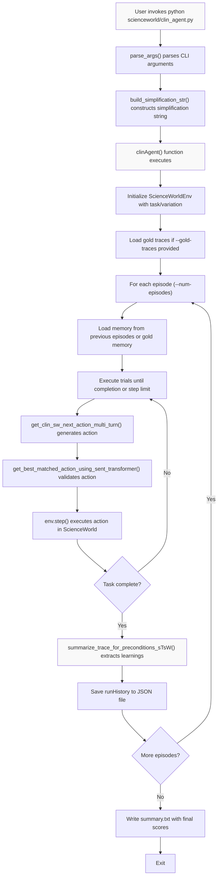
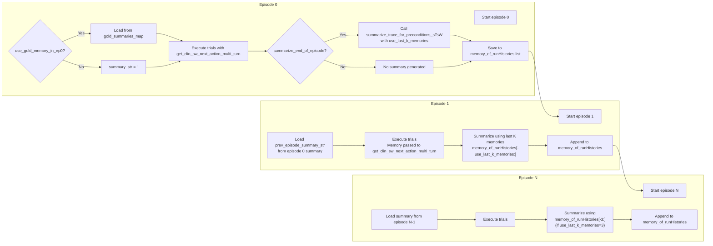
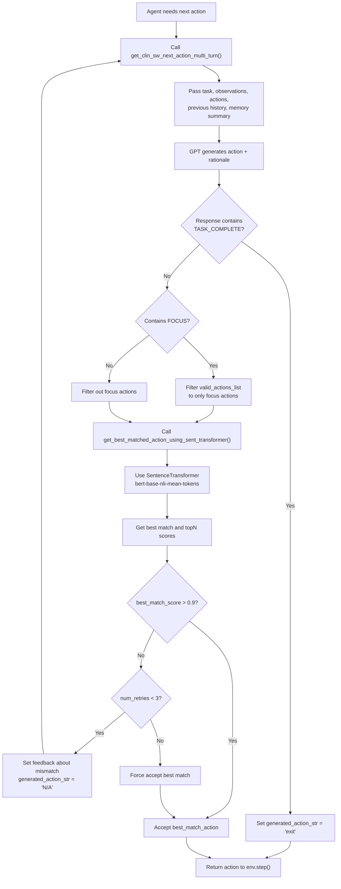
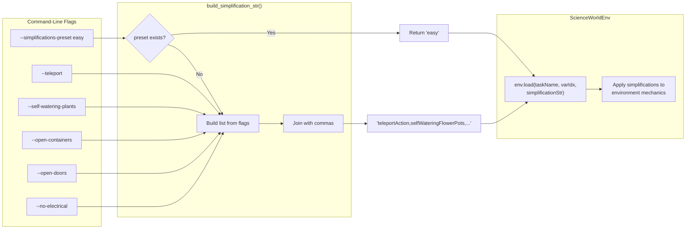

<!-- source: DeepWiki mcp.deepwiki.com · repo allenai/clin · page 5 Usage Guide · fetched 2026-10-26 -->

# Usage Guide

<details>
<summary>Relevant source files</summary>

The following files were used as context for generating this wiki page:

- [README.md](README.md)
- [requirements.txt](requirements.txt)
- [scienceworld/clin_agent.py](scienceworld/clin_agent.py)

</details>


This document provides comprehensive guidance for running experiments with the CLIN agent. It covers command-line usage, configuration options, and practical workflows for different experimental scenarios.

**Scope**: This page focuses on practical usage of the CLIN agent after installation. For installation instructions, see [Getting Started](#2). For understanding the underlying concepts and architecture, see [Core Concepts](#3) and [System Architecture](#4).

## Basic Execution Pattern

The CLIN agent follows a standard execution pattern consisting of multiple episodes, where each episode allows the agent to attempt a task and learn from the experience. The basic workflow is:



**Sources**: [scienceworld/clin_agent.py:473-483](), [scienceworld/clin_agent.py:17-393]()

## Command-Line Invocation

The CLIN agent is executed through the `clin_agent.py` script with various command-line arguments controlling experimental parameters. The entry point is the `main()` function which orchestrates argument parsing and agent execution.

### Required Arguments

| Argument | Type | Purpose | Code Reference |
|----------|------|---------|----------------|
| `--device` | string | Device for SentenceTransformer model (`cpu`, `cuda`, `cuda:0`) | [scienceworld/clin_agent.py:436-437]() |
| `--quadrant` | integer | Evaluation scenario: 1=adaptation, 2=cross-env, 3=cross-task | [scienceworld/clin_agent.py:446-450]() |

### Core Experimental Parameters

| Argument | Default | Purpose | Code Reference |
|----------|---------|---------|----------------|
| `--task-num` | `"4"` | Task index to run | [scienceworld/clin_agent.py:424-425]() |
| `--var-num` | `1` | Task variation index | [scienceworld/clin_agent.py:426-427]() |
| `--num-episodes` | `2` | Number of learning episodes | [scienceworld/clin_agent.py:430-431]() |
| `--env-step-limit` | `100` | Maximum steps per episode | [scienceworld/clin_agent.py:428-429]() |
| `--gpt-model` | `"gpt-4-0613"` | LLM model (`gpt-3.5-turbo` or `gpt-4-0613`) | [scienceworld/clin_agent.py:432-433]() |
| `--temperature` | `0.0` | Sampling temperature for LLM | [scienceworld/clin_agent.py:438-439]() |
| `--output-path-prefix` | `"save-histories"` | Directory prefix for output files | [scienceworld/clin_agent.py:451-452]() |

### Memory Configuration

| Argument | Default | Purpose | Code Reference |
|----------|---------|---------|----------------|
| `--summarize_end_of_episode` | `1` | Enable learning summarization after episodes | [scienceworld/clin_agent.py:434-435]() |
| `--use-gold-memory-in-ep0` | `0` | Bootstrap episode 0 with gold trace memory | [scienceworld/clin_agent.py:440-441]() |
| `--gold-traces` | `""` | Path to gold trace files (file/directory/JSONL) | [scienceworld/clin_agent.py:442-443]() |
| `--use-last-k-memories` | `3` | Number of recent episode memories to use | [scienceworld/clin_agent.py:444-445]() |

### Environment Simplifications

| Argument | Effect | Code Reference |
|----------|--------|----------------|
| `--simplifications-preset easy` | Apply all simplifications | [scienceworld/clin_agent.py:455-456]() |
| `--teleport` | Enable instant location movement | [scienceworld/clin_agent.py:457-458]() |
| `--self-watering-plants` | Plants don't require frequent watering | [scienceworld/clin_agent.py:459-460]() |
| `--open-containers` | All containers start opened | [scienceworld/clin_agent.py:461-462]() |
| `--open-doors` | All doors start opened | [scienceworld/clin_agent.py:463-464]() |
| `--no-electrical` | Remove electrical actions from action space | [scienceworld/clin_agent.py:465-466]() |

**Sources**: [scienceworld/clin_agent.py:419-470](), [README.md:46-48]()

## Typical Usage Examples

The following diagram maps common experimental scenarios to their corresponding command-line configurations:

```mermaid
flowchart TD
    subgraph Quadrant1["Quadrant 1: Rapid Adaptation"]
        Q1Desc["Same task, same environment<br/>Agent learns across episodes"]
        Q1Cmd["python scienceworld/clin_agent.py<br/>--task-num 4 --var-num 1<br/>--quadrant 1<br/>--num-episodes 10<br/>--use-last-k-memories 3<br/>--summarize_end_of_episode 1"]
    end
    
    subgraph Quadrant2["Quadrant 2: Cross-Environment"]
        Q2Desc["Same task, different environment<br/>Test generalization to new variations"]
        Q2Cmd["python scienceworld/clin_agent.py<br/>--task-num 4 --var-num 2<br/>--quadrant 2<br/>--use-gold-memory-in-ep0 1<br/>--gold-traces path/to/q2_summary.json"]
    end
    
    subgraph Quadrant3["Quadrant 3: Cross-Task"]
        Q3Desc["Different task, same environment<br/>Test task transfer learning"]
        Q3Cmd["python scienceworld/clin_agent.py<br/>--task-num 5 --var-num 1<br/>--quadrant 3<br/>--use-gold-memory-in-ep0 1<br/>--gold-traces path/to/q3_summary.json"]
    end
    
    subgraph Bootstrap["Episode 0 Bootstrapping"]
        BSDesc["Start with expert knowledge"]
        BSCmd["--use-gold-memory-in-ep0 1<br/>--gold-traces path/to/gold_dir/"]
    end
    
    Q1Desc --> Q1Cmd
    Q2Desc --> Q2Cmd
    Q3Desc --> Q3Cmd
    BSDesc --> BSCmd
```



**Sources**: [scienceworld/clin_agent.py:51-73](), [scienceworld/clin_agent.py:129-134](), [scienceworld/clin_agent.py:184-188]()

### Example 1: Basic Adaptation Experiment

```bash
python scienceworld/clin_agent.py \
    --task-num "4" \
    --var-num 1 \
    --env-step-limit 100 \
    --num-episodes 5 \
    --gpt-model "gpt-4-0613" \
    --summarize_end_of_episode 1 \
    --device "cpu" \
    --temperature 0.0 \
    --use-gold-memory-in-ep0 0 \
    --gold-traces "" \
    --use-last-k-memories 3 \
    --quadrant 1 \
    --simplifications-preset "easy" \
    --output-path-prefix logs/experiment1/
```

This runs a standard adaptation experiment where the agent learns across 5 episodes of the same task and variation, using the last 3 episode memories for learning summarization.

**Sources**: [README.md:46-48]()

### Example 2: Cross-Environment Generalization with Bootstrapping

```bash
python scienceworld/clin_agent.py \
    --task-num "4" \
    --var-num 3 \
    --num-episodes 1 \
    --quadrant 2 \
    --use-gold-memory-in-ep0 1 \
    --gold-traces "path/to/task4_gold_summaries/" \
    --gpt-model "gpt-4-0613" \
    --device "cuda:0" \
    --temperature 0.0 \
    --simplifications-preset "easy" \
    --output-path-prefix logs/q2_experiment/
```

This evaluates generalization to a new environment variation (var-num 3) using pre-computed gold memories from previous task 4 runs to bootstrap episode 0.

**Sources**: [scienceworld/clin_agent.py:26-47](), [scienceworld/clin_agent.py:129-134]()

## Memory and Learning Flow

The following diagram shows how memory and learning parameters control the agent's behavior across episodes:



**Sources**: [scienceworld/clin_agent.py:84-88](), [scienceworld/clin_agent.py:106-188](), [scienceworld/clin_agent.py:344-356]()

### Memory Loading Logic

The agent's memory loading follows this logic at the start of each episode:

1. **Episode 0**: 
   - If `--use-gold-memory-in-ep0 1`, loads from `gold_summaries_map[taskIdx][varIdx]`
   - The gold memory type depends on `--quadrant`: `summary` (Q1), `q2_summary` (Q2), or `q3_summary` (Q3)
   - Otherwise uses empty string `""`

2. **Episode 1+**:
   - If `--summarize_end_of_episode 1`, uses `prev_episode_summary_str` from previous episode
   - Otherwise uses empty string `""`

3. **Summarization**:
   - Uses `memory_of_runHistories[-use_last_k_memories:]` to access recent episode histories
   - Calls `summarize_trace_for_preconditions_sTsW()` with these memories
   - For Q2 (cross-environment), passes gold Q2 summary as `meta_summary` parameter

**Sources**: [scienceworld/clin_agent.py:129-134](), [scienceworld/clin_agent.py:184-188](), [scienceworld/clin_agent.py:344-356]()

## Gold Traces Format and Loading

Gold traces can be provided in three formats, handled by the loading logic at [scienceworld/clin_agent.py:26-47]():

### Format 1: Single JSON File
```json
{
  "taskIdx": "4",
  "variationIdx": "1",
  "summary": "...",
  "q2_summary": "...",
  "q3_summary": "...",
  "history": [...]
}
```

### Format 2: JSONL File (Multiple Traces)
```jsonl
{"taskIdx": "4", "variationIdx": "1", "summary": "...", "history": [...]}
{"taskIdx": "4", "variationIdx": "2", "summary": "...", "history": [...]}
```

### Format 3: Directory of JSON Files
```
gold_traces/
  ├── task4_var1.json
  ├── task4_var2.json
  └── task5_var1.json
```

The loading creates two data structures:
- `gold_summaries_map[taskIdx][variationIdx]`: The summary string for memory
- `gold_histories_map[taskIdx][variationIdx]`: The full trajectory history

**Sources**: [scienceworld/clin_agent.py:26-73]()

## Action Generation and Validation Pipeline

The agent's action generation involves a multi-step pipeline with retry logic:



**Sources**: [scienceworld/clin_agent.py:189-266](), [scienceworld/clin_agent.py:9-11]()

### Retry Mechanism Details

The retry logic at [scienceworld/clin_agent.py:189-266]() implements the following:

- **Maximum retries**: 3 attempts per action (`max_num_retries_executor = 3`)
- **Retry trigger**: `best_match_score <= 0.9` and action not numeric (disambiguation choice)
- **Feedback format**: `"Your generated action '{pred_action}' cannot be matched to a valid action. Please retry with a different phrasing or a different action."`
- **Force acceptance**: After 3 retries or when `valid_actions_list` is empty

This ensures the agent can recover from LLM outputs that don't closely match valid environment actions.

**Sources**: [scienceworld/clin_agent.py:191-266]()

## Output Files and Directory Structure

Each experiment produces multiple output files organized by task, variation, and episode:

### Output File Naming Convention

```
{output_path_prefix}/
├── Task{taskIdx}_Var{varIdx}_Ep{episodeIdx}_runhistories.json
├── Task{taskIdx}_Var{varIdx}_Ep{episodeIdx+1}_runhistories.json
└── summary.txt
```

### Run History JSON Structure

Each `runhistories.json` file contains:

| Field | Type | Description | Code Reference |
|-------|------|-------------|----------------|
| `episodeIdx` | integer | Episode number | [scienceworld/clin_agent.py:332]() |
| `finalScore` | float | Task completion score | [scienceworld/clin_agent.py:333]() |
| `finalScorePositive` | float | Highest positive score achieved | [scienceworld/clin_agent.py:334]() |
| `isCompleted` | boolean | Whether task was completed | [scienceworld/clin_agent.py:335]() |
| `earlyStop` | boolean | Whether agent stopped due to repetition/length | [scienceworld/clin_agent.py:336]() |
| `model` | string | GPT model used | [scienceworld/clin_agent.py:337]() |
| `gold-action-seq` | string | Gold trajectory for reference | [scienceworld/clin_agent.py:338]() |
| `memory-seen` | string | Memory/summary used during episode | [scienceworld/clin_agent.py:339]() |
| `summary` | string | Generated learning summary for next episode | [scienceworld/clin_agent.py:355]() |
| `history` | array | Step-by-step trajectory | [scienceworld/clin_agent.py:320-329]() |

### History Entry Structure

Each entry in the `history` array contains:

```json
{
  "observation": "...",
  "action": "...",
  "reward": 0.0,
  "score": 0.0,
  "rationale": "...",
  "rawAction": "...",
  "topNActions": [...],
  "subgoalProgress": {...}
}
```

- `rationale`: LLM's reasoning for the action ([scienceworld/clin_agent.py:326]())
- `rawAction`: Unmodified action from LLM ([scienceworld/clin_agent.py:327]())
- `topNActions`: Semantic similarity scores from SentenceTransformer ([scienceworld/clin_agent.py:328]())
- `subgoalProgress`: Task-specific goal completion status ([scienceworld/clin_agent.py:329]())

### Summary.txt Format

The `summary.txt` file provides a human-readable overview:

```
---------------------------------------------------------------------
 Summary (ChatGPT Agent)
 Simplifications: easy
---------------------------------------------------------------------
task	Name	var	epi	score	complete?
4	task-4-boil	1	0	0.5	False
4	task-4-boil	1	1	1.0	True
---------------------------------------------------------------------
```

**Sources**: [scienceworld/clin_agent.py:85-91](), [scienceworld/clin_agent.py:115-116](), [scienceworld/clin_agent.py:320-363](), [scienceworld/clin_agent.py:381-392]()

## Early Stopping Conditions

The agent implements two early stopping mechanisms to prevent infinite loops:

### 1. Repetition Detection

```python
if (previous_actions[-1] == previous_actions[-2] == 
    previous_actions[-3] == previous_actions[-4] == 
    previous_actions[-5]):
    print("Last 5 actions were the same. Exiting.")
    earlyStop = True
```

**Code**: [scienceworld/clin_agent.py:282-287]()

### 2. Length Limit

```python
if len(previous_actions) >= 1.5 * len(env.getGoldActionSequence()):
    print("Model generated an action sequence which is 1.5 times longer "
          "than the gold action sequence without succeeding at the task. Exiting.")
    earlyStop = True
```

**Code**: [scienceworld/clin_agent.py:289-294]()

When `earlyStop` is triggered, it's recorded in the run history as `runHistory['earlyStop'] = True` ([scienceworld/clin_agent.py:336]()).

**Sources**: [scienceworld/clin_agent.py:282-294](), [scienceworld/clin_agent.py:336]()

## Environment Simplifications

The `build_simplification_str()` function at [scienceworld/clin_agent.py:395-413]() converts command-line flags into a comma-separated string passed to ScienceWorld:



**Mapping Table**:

| CLI Flag | Simplification String | Effect |
|----------|----------------------|--------|
| `--teleport` | `teleportAction` | Agent can instantly move to any location |
| `--self-watering-plants` | `selfWateringFlowerPots` | Plants maintain water automatically |
| `--open-containers` | `openContainers` | All containers start in open state |
| `--open-doors` | `openDoors` | All doors start in open state |
| `--no-electrical` | `noElectricalAction` | Removes electrical interactions from action space |
| `--simplifications-preset easy` | `easy` | Applies all available simplifications |

The preset `easy` is typically used for initial experiments to reduce task complexity.

**Sources**: [scienceworld/clin_agent.py:395-413](), [scienceworld/clin_agent.py:75](), [scienceworld/clin_agent.py:118]()

## Monitoring Execution

### Console Output

During execution, the agent prints detailed information at each step:

```
----------------------------------------------------------------
Step: 5
>>> You are in the kitchen. You see a stove, a fridge, and a sink.
Reward: 0.0
Score: 0.5
isCompleted: False
GPT4 generated action: open fridge
Reasoning rationale: I need to check what's inside the fridge...
Next ChatGPT action: open fridge
Next ChatGPT action (mapped): open fridge
----------------------------------------------------------------
```

Key printed information:
- Current step number ([scienceworld/clin_agent.py:156]())
- Observation from environment ([scienceworld/clin_agent.py:173]())
- Reward and score ([scienceworld/clin_agent.py:174-175]())
- Completion status ([scienceworld/clin_agent.py:176]())
- Generated action before and after semantic matching ([scienceworld/clin_agent.py:215](), [scienceworld/clin_agent.py:272]())
- Reasoning rationale ([scienceworld/clin_agent.py:268]())
- Sentence transformer runtimes ([scienceworld/clin_agent.py:254]())

### Progress Tracking

At episode completion:
- Gold path is displayed ([scienceworld/clin_agent.py:316-317]())
- Goal progress details shown ([scienceworld/clin_agent.py:296-297]())
- Final score and completion status printed ([scienceworld/clin_agent.py:312-313]())

**Sources**: [scienceworld/clin_agent.py:154-277](), [scienceworld/clin_agent.py:296-317]()

## Troubleshooting Common Issues

### Issue: "N/A" Actions and Repeated Retries

**Symptom**: Console shows `ERROR: retry:1 gen=... match=... score...`

**Cause**: LLM-generated action has low semantic similarity (<0.9) to valid actions

**Solution**: 
- Lower the threshold at [scienceworld/clin_agent.py:259-261]()
- Increase temperature for more action variety
- Verify the action space is not empty due to filtering

### Issue: Early Stop Due to Repetition

**Symptom**: `Last 5 actions were the same. Exiting.`

**Cause**: Agent is stuck in a loop, often due to insufficient memory or wrong task understanding

**Solution**:
- Check memory quality in previous episodes
- Increase `--use-last-k-memories` to provide more context
- Review LLM rationales for reasoning errors

### Issue: OOM or Long Runtimes

**Symptom**: CUDA out of memory or very slow execution

**Cause**: SentenceTransformer running on GPU with insufficient memory, or too many valid actions

**Solution**:
- Set `--device "cpu"` to offload SentenceTransformer
- Use `--simplifications-preset "easy"` to reduce action space
- Reduce `--env-step-limit` for shorter episodes

**Sources**: [scienceworld/clin_agent.py:244-252](), [scienceworld/clin_agent.py:282-294]()

---

