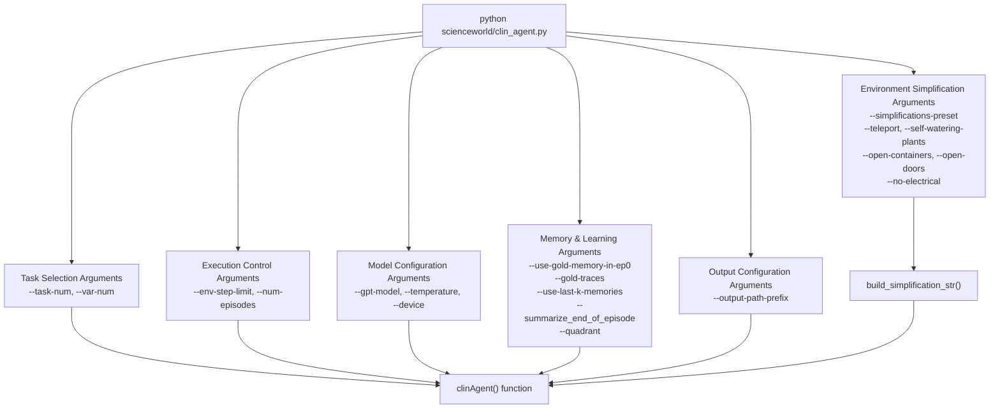
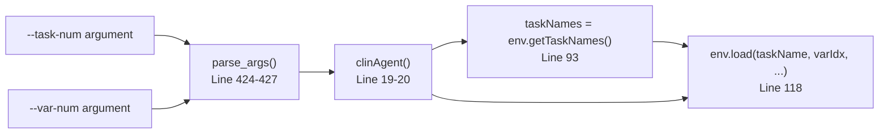
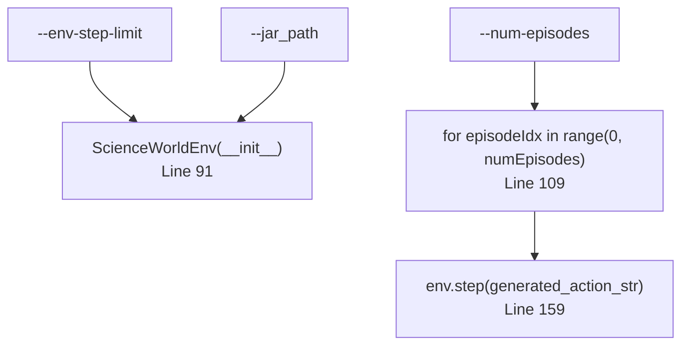
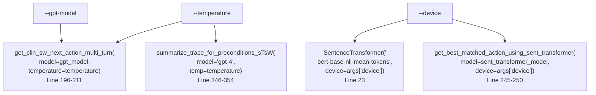
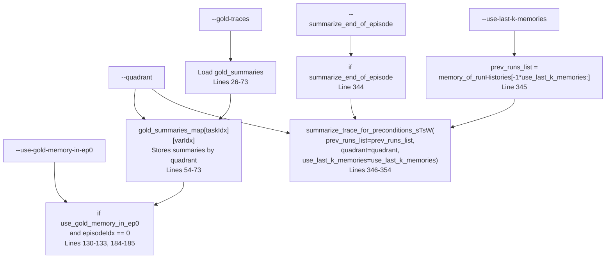
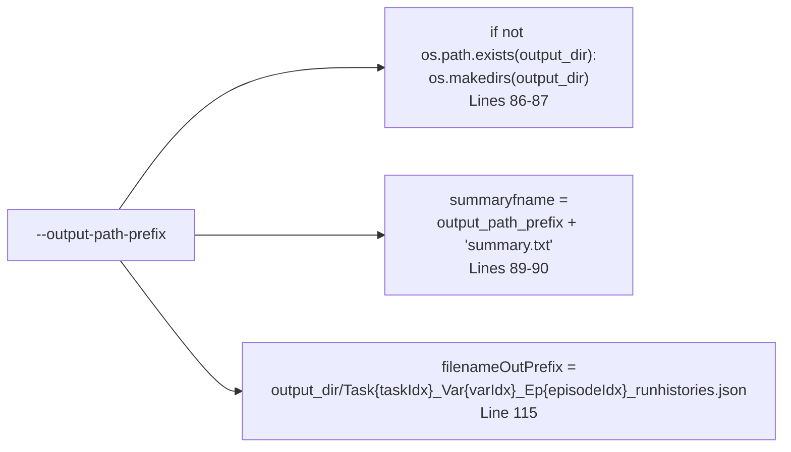
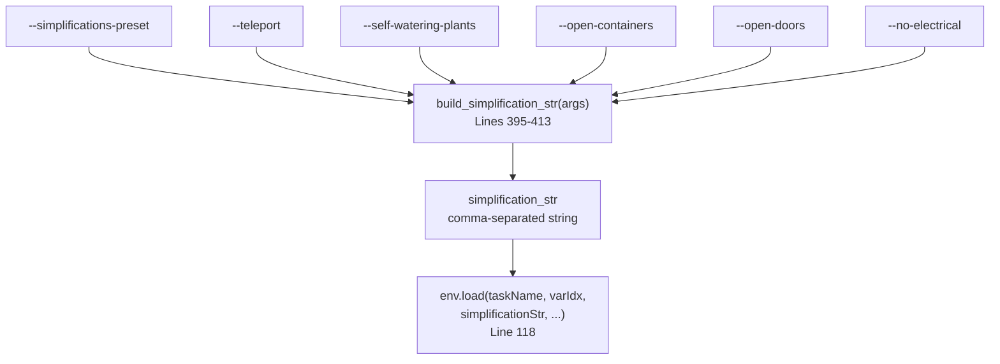
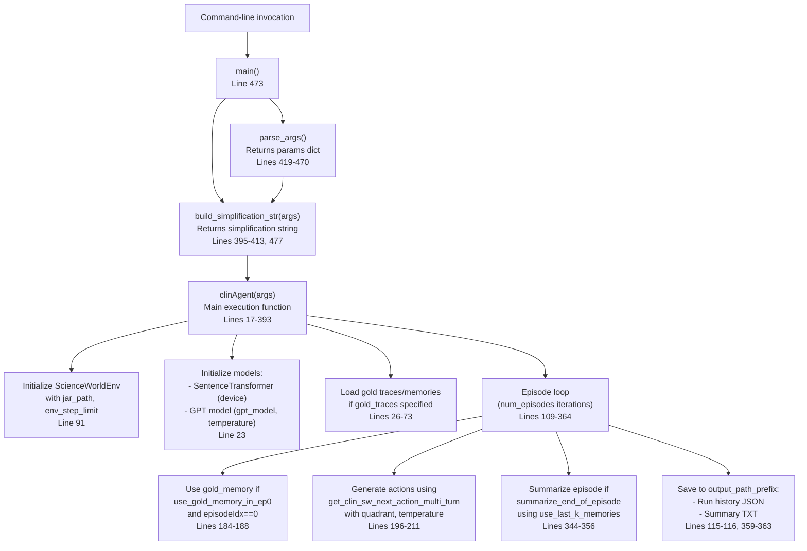

<!-- source: DeepWiki mcp.deepwiki.com · repo allenai/clin · page 5.1 Command-Line Arguments Reference · fetched 2026-10-26 -->

# Command-Line Arguments Reference

<details>
<summary>Relevant source files</summary>

The following files were used as context for generating this wiki page:

- [README.md](README.md)
- [requirements.txt](requirements.txt)
- [scienceworld/clin_agent.py](scienceworld/clin_agent.py)

</details>


This page provides a complete reference for all command-line arguments accepted by the CLIN agent. These arguments control task selection, model configuration, memory management, episode execution, and environment simplification settings.

For guidance on how to combine these arguments to run specific experiments, see [Running Experiments](#5.2). For details on the output files generated based on the `--output-path-prefix` argument, see [Understanding Output Files](#5.4). For more information about environment simplifications, see [Environment Simplifications](#5.5).

---

## Argument Categories Overview

The CLIN agent accepts arguments in six functional categories:



**Sources:** [scienceworld/clin_agent.py:419-470](), [scienceworld/clin_agent.py:395-413]()

---

## Task Selection Arguments

These arguments specify which ScienceWorld task and variation to execute.

| Argument | Type | Required | Default | Description |
|----------|------|----------|---------|-------------|
| `--task-num` | string | No | `"4"` | Task index to execute (ScienceWorld task ID) |
| `--var-num` | integer | No | `1` | Task variation index to execute |

### Usage Details

**`--task-num`**: Specifies the ScienceWorld task by its numeric index. The agent queries available task names via `env.getTaskNames()` and selects the task at this index.

**`--var-num`**: Each ScienceWorld task has multiple variations with different object configurations and goals. This argument selects which variation to execute.

### Code Mapping



**Sources:** [scienceworld/clin_agent.py:424-427](), [scienceworld/clin_agent.py:19-20](), [scienceworld/clin_agent.py:93-100](), [scienceworld/clin_agent.py:118]()

### Example
```bash
--task-num "4" --var-num 1
```
This selects task 4, variation 1 from the ScienceWorld environment.

---

## Execution Control Arguments

These arguments control the episode lifecycle and execution limits.

| Argument | Type | Required | Default | Description |
|----------|------|----------|---------|-------------|
| `--env-step-limit` | integer | No | `100` | Maximum number of steps allowed per episode |
| `--num-episodes` | integer | No | `2` | Number of sequential episodes to execute |
| `--jar_path` | string | No | (builtin) | Path to custom ScienceWorld JAR file |

### Usage Details

**`--env-step-limit`**: Sets the maximum number of actions the agent can take in a single episode before the environment forces termination. Passed to `ScienceWorldEnv` constructor.

**`--num-episodes`**: Controls how many sequential episodes to run. Each episode starts with a fresh environment reset but maintains memory from previous episodes (if `--summarize_end_of_episode` is enabled).

**`--jar_path`**: Optional path to a custom ScienceWorld JAR file. If not specified, uses the built-in JAR from the ScienceWorld package installation.

### Code Mapping



**Sources:** [scienceworld/clin_agent.py:428-431](), [scienceworld/clin_agent.py:91](), [scienceworld/clin_agent.py:109]()

### Example
```bash
--env-step-limit 50 --num-episodes 5
```
Run 5 episodes, each limited to 50 actions maximum.

---

## Model Configuration Arguments

These arguments configure the language models used for action generation and semantic matching.

| Argument | Type | Required | Default | Description |
|----------|------|----------|---------|-------------|
| `--gpt-model` | string | No | `"gpt-4-0613"` | OpenAI GPT model identifier |
| `--temperature` | float | No | `0.0` | Sampling temperature for GPT model |
| `--device` | string | **Yes** | N/A | Device for SentenceTransformer (`cpu`, `cuda`, `cuda:0`, etc.) |

### Usage Details

**`--gpt-model`**: Specifies which OpenAI model to use for action generation. Valid choices include:
- `"gpt-4-0613"`: GPT-4 model (more capable, more expensive)
- `"gpt-3.5-turbo"`: GPT-3.5 model (faster, less expensive)

**`--temperature`**: Controls randomness in GPT model outputs:
- `0.0`: Deterministic (always selects most likely token)
- Higher values (e.g., `0.7`, `1.0`): More random/creative outputs

**`--device`**: **Required argument**. Specifies the computation device for the SentenceTransformer model used in action matching. Must be compatible with PyTorch device specifications.

### Code Mapping



**Sources:** [scienceworld/clin_agent.py:432-439](), [scienceworld/clin_agent.py:23](), [scienceworld/clin_agent.py:196-211](), [scienceworld/clin_agent.py:245-250](), [scienceworld/clin_agent.py:346-354]()

### Example
```bash
--gpt-model "gpt-4-0613" --temperature 0.0 --device "cuda:0"
```
Use GPT-4 with deterministic sampling, run SentenceTransformer on GPU 0.

---

## Memory and Learning Arguments

These arguments control CLIN's continual learning mechanism, including memory initialization, retrieval, and summarization behavior.

| Argument | Type | Required | Default | Description |
|----------|------|----------|---------|-------------|
| `--summarize_end_of_episode` | integer | No | `1` | Whether to generate episode summaries (0=no, 1=yes) |
| `--use-gold-memory-in-ep0` | integer | No | `0` | Whether to use gold memory for episode 0 (0=no, 1=yes) |
| `--gold-traces` | string | No | `""` | Path to gold traces (file, directory, or empty string) |
| `--use-last-k-memories` | integer | No | `3` | Number of recent episode memories to use for summarization |
| `--quadrant` | integer | **Yes** | N/A | Evaluation quadrant (1=adapt, 2=gen-env, 3=gen-task) |

### Usage Details

**`--summarize_end_of_episode`**: Controls whether the agent generates a learning summary after each episode completes. When enabled (`1`), the agent invokes `summarize_trace_for_preconditions_sTsW` to extract causal abstractions from the episode trajectory.

**`--use-gold-memory-in-ep0`**: When enabled (`1`), the agent uses a pre-existing gold memory summary for episode 0 instead of starting with no knowledge. The gold memory is loaded from `--gold-traces`.

**`--gold-traces`**: Path to gold trace files containing:
- Pre-recorded successful trajectories
- Episode summaries (for episode 0 bootstrapping)
- Can be a single `.json` file, a `.jsonl` file, or a directory containing multiple `.json` files

**`--use-last-k-memories`**: When summarizing learnings at the end of an episode, the agent looks back at the last K episode histories to generate the summary. Higher values provide more context but may dilute recent learnings.

**`--quadrant`**: **Required argument**. Specifies the evaluation scenario, which determines how memories are retrieved and used:
- `1`: Adaptation (same task, same environment) - uses episode-specific memories
- `2`: Cross-environment generalization (same task, different environment) - uses `q2_summary` field and generates meta-memories
- `3`: Cross-task generalization (different task) - uses `q3_summary` field and generates meta-memories

### Code Mapping



**Sources:** [scienceworld/clin_agent.py:434-451](), [scienceworld/clin_agent.py:26-73](), [scienceworld/clin_agent.py:130-133](), [scienceworld/clin_agent.py:184-188](), [scienceworld/clin_agent.py:344-356]()

### Gold Trace File Format

Gold traces must be JSON files containing:
- `taskIdx`: Task index
- `variationIdx`: Variation index
- `summary`: Episode summary for quadrant 1
- `q2_summary`: Cross-environment summary for quadrant 2
- `q3_summary`: Cross-task summary for quadrant 3
- `history`: Run history with actions and observations

### Example
```bash
--summarize_end_of_episode 1 --use-gold-memory-in-ep0 1 \
--gold-traces "gold_traces/task4/" --use-last-k-memories 3 --quadrant 1
```
Enable summarization, bootstrap episode 0 with gold memories from directory, use last 3 episodes for context, evaluate in adaptation scenario (quadrant 1).

---

## Output Configuration Arguments

These arguments control where and how the agent saves execution logs and results.

| Argument | Type | Required | Default | Description |
|----------|------|----------|---------|-------------|
| `--output-path-prefix` | string | No | `"save-histories"` | Directory path prefix for output files |

### Usage Details

**`--output-path-prefix`**: Specifies the base directory where all output files are written. The agent creates:
- Individual episode run history JSON files: `Task{taskIdx}_Var{varIdx}_Ep{episodeIdx}_runhistories.json`
- Summary text file: `summary.txt`

The directory is automatically created if it doesn't exist.

### Code Mapping



**Sources:** [scienceworld/clin_agent.py:451-452](), [scienceworld/clin_agent.py:85-90](), [scienceworld/clin_agent.py:115]()

### Example
```bash
--output-path-prefix logs/experiment1/
```
Save all output files to the `logs/experiment1/` directory.

---

## Environment Simplification Arguments

These arguments modify the ScienceWorld environment to reduce complexity. Simplifications can be specified individually or via a preset.

| Argument | Type | Required | Default | Description |
|----------|------|----------|---------|-------------|
| `--simplifications-preset` | choice | No | None | Apply a preset bundle of simplifications (`easy`) |
| `--teleport` | flag | No | False | Enable instant teleportation to any location |
| `--self-watering-plants` | flag | No | False | Plants don't require frequent watering |
| `--open-containers` | flag | No | False | All containers start opened |
| `--open-doors` | flag | No | False | All doors start opened |
| `--no-electrical` | flag | No | False | Remove electrical actions from action space |

### Usage Details

**`--simplifications-preset`**: Applies a predefined bundle of simplifications:
- `"easy"`: Applies all available simplifications (teleport, self-watering plants, open containers, open doors, no electrical)

**Individual Simplification Flags**: Each flag can be specified independently to enable that specific simplification. These flags are boolean (presence = enabled).

**Priority**: If `--simplifications-preset` is specified, individual flags are ignored.

### Code Mapping



**Sources:** [scienceworld/clin_agent.py:454-466](), [scienceworld/clin_agent.py:395-413](), [scienceworld/clin_agent.py:118]()

### Simplification String Construction

The `build_simplification_str()` function converts arguments into a comma-separated string:

```mermaid
graph LR
    args["Command-line flags"]
    
    check_preset["If simplifications-preset?"]
    return_preset["Return preset value"]
    
    check_teleport["If teleport?"]
    add_teleport["Add 'teleportAction'"]
    
    check_watering["If self-watering-plants?"]
    add_watering["Add 'selfWateringFlowerPots'"]
    
    check_containers["If open-containers?"]
    add_containers["Add 'openContainers'"]
    
    check_doors["If open-doors?"]
    add_doors["Add 'openDoors'"]
    
    check_electrical["If no-electrical?"]
    add_electrical["Add 'noElectricalAction'"]
    
    join["Join with commas"]
    result["simplification_str"]
    
    args --> check_preset
    check_preset -->|Yes| return_preset
    check_preset -->|No| check_teleport
    
    check_teleport -->|Yes| add_teleport
    check_teleport -->|No| check_watering
    add_teleport --> check_watering
    
    check_watering -->|Yes| add_watering
    check_watering -->|No| check_containers
    add_watering --> check_containers
    
    check_containers -->|Yes| add_containers
    check_containers -->|No| check_doors
    add_containers --> check_doors
    
    check_doors -->|Yes| add_doors
    check_doors -->|No| check_electrical
    add_doors --> check_electrical
    
    check_electrical -->|Yes| add_electrical
    check_electrical -->|No| join
    add_electrical --> join
    
    join --> result
    return_preset --> result
```



**Sources:** [scienceworld/clin_agent.py:395-413]()

### Example
```bash
# Using preset (recommended)
--simplifications-preset "easy"

# Using individual flags
--teleport --open-doors --no-electrical
```

---

## Complete Example Command

Here is the example command from the README with all arguments annotated:

```bash
python scienceworld/clin_agent.py \
  --task-num "4" \                    # Task selection: Task 4
  --var-num 1 \                       # Task selection: Variation 1
  --env-step-limit 2 \                # Execution: 2 steps per episode (for testing)
  --num-episodes 1 \                  # Execution: Run 1 episode
  --gpt-model "gpt-4-0613" \          # Model: Use GPT-4
  --summarize_end_of_episode 1 \      # Learning: Enable summarization
  --device "cpu" \                    # Model: Use CPU for SentenceTransformer
  --temperature 0.0 \                 # Model: Deterministic generation
  --use-gold-memory-in-ep0 0 \        # Learning: No gold memory in episode 0
  --gold-traces "" \                  # Learning: No gold traces
  --use-last-k-memories 3 \           # Learning: Use last 3 memories
  --quadrant 1 \                      # Learning: Adaptation scenario
  --simplifications-preset "easy" \   # Environment: Apply all simplifications
  --output-path-prefix logs/testrun/ # Output: Save to logs/testrun/
```

**Sources:** [README.md:45-48]()

---

## Argument Processing Flow



**Sources:** [scienceworld/clin_agent.py:419-483](), [scienceworld/clin_agent.py:17-393](), [scienceworld/clin_agent.py:395-413]()

---

## Validation and Constraints

### Required Arguments

The following arguments **must** be specified:
- `--device`: Required for SentenceTransformer initialization
- `--quadrant`: Required for memory retrieval logic

All other arguments have default values and are optional.

### Argument Dependencies

| Primary Argument | Dependent Argument | Relationship |
|------------------|-------------------|--------------|
| `--use-gold-memory-in-ep0` | `--gold-traces` | If set to `1`, `--gold-traces` must point to valid trace files |
| `--simplifications-preset` | Individual simplification flags | If preset is specified, individual flags are ignored |
| `--summarize_end_of_episode` | `--use-last-k-memories` | Summarization uses last K memories; no effect if summarization disabled |

### Type Validation

Arguments are validated by `argparse`:
- Integer arguments (`--task-num`, `--var-num`, `--env-step-limit`, `--num-episodes`, etc.) must be valid integers
- Float arguments (`--temperature`) must be valid floats
- Choice arguments (`--simplifications-preset`) must match specified choices
- Boolean flags (`--teleport`, `--open-doors`, etc.) are presence-based (no validation needed)

**Sources:** [scienceworld/clin_agent.py:419-470]()

---

## Summary Table

| Category | Arguments | Purpose |
|----------|-----------|---------|
| **Task Selection** | `--task-num`, `--var-num` | Select which ScienceWorld task and variation to execute |
| **Execution Control** | `--env-step-limit`, `--num-episodes`, `--jar_path` | Control episode lifecycle and environment configuration |
| **Model Configuration** | `--gpt-model`, `--temperature`, `--device` | Configure LLMs and computation devices |
| **Memory & Learning** | `--summarize_end_of_episode`, `--use-gold-memory-in-ep0`, `--gold-traces`, `--use-last-k-memories`, `--quadrant` | Control continual learning behavior and memory management |
| **Output Configuration** | `--output-path-prefix` | Specify where to save execution logs |
| **Environment Simplification** | `--simplifications-preset`, `--teleport`, `--self-watering-plants`, `--open-containers`, `--open-doors`, `--no-electrical` | Reduce environment complexity |

**Sources:** [scienceworld/clin_agent.py:419-470]()

---

