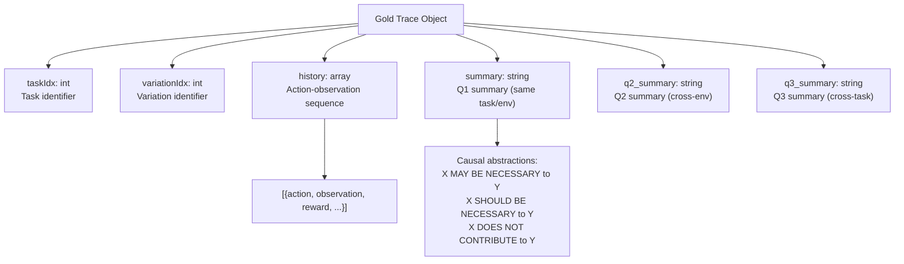
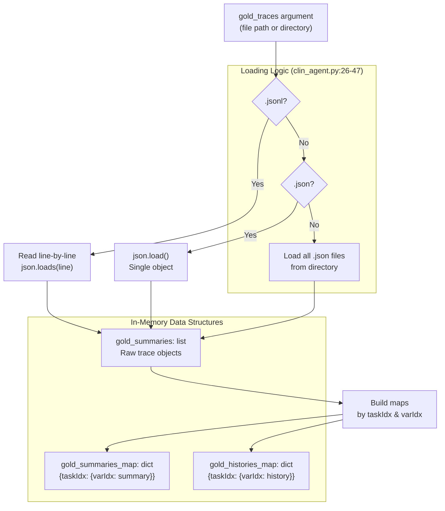
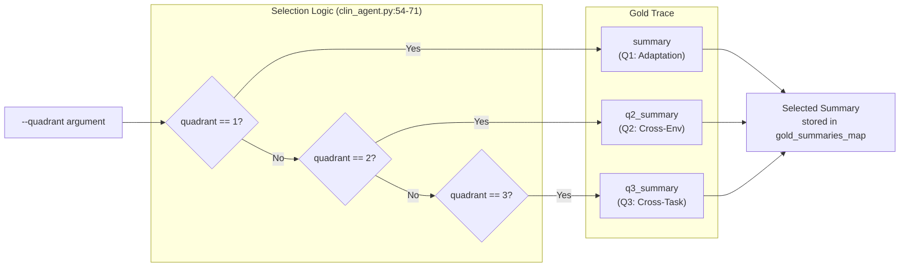
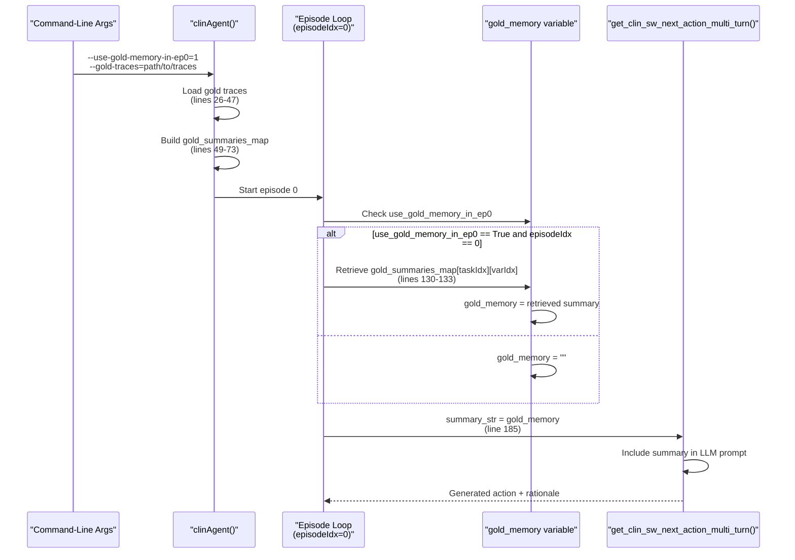
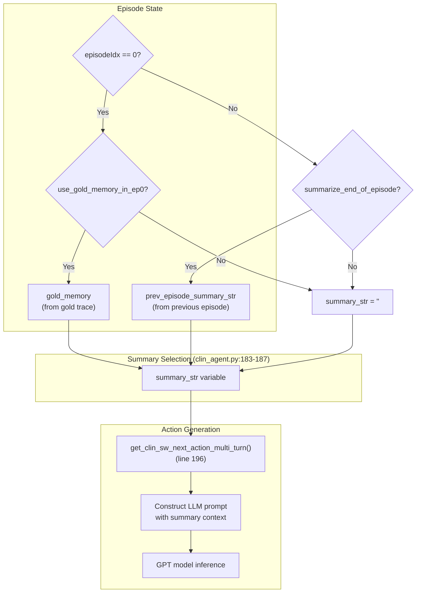
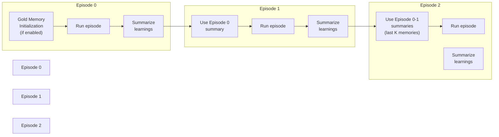

<!-- source: DeepWiki mcp.deepwiki.com · repo allenai/clin · page 5.3 Gold Traces and Memory Initialization · fetched 2026-10-26 -->

# Gold Traces and Memory Initialization

<details>
<summary>Relevant source files</summary>

The following files were used as context for generating this wiki page:

- [README.md](README.md)
- [requirements.txt](requirements.txt)
- [scienceworld/clin_agent.py](scienceworld/clin_agent.py)

</details>


## Purpose and Scope

This page explains how to use pre-recorded gold traces to bootstrap CLIN agent's memory in episode 0. Gold traces are reference trajectories with associated summaries that allow the agent to start with prior knowledge rather than learning from scratch. This is particularly useful for rapid adaptation and for testing the agent's ability to leverage existing knowledge.

For information about how memories are generated during episodes, see [Learning and Summarization System](#4.5). For details on how memories are retrieved and used during action generation, see [Memory Architecture](#3.2).

---

## What are Gold Traces?

Gold traces are pre-recorded reference trajectories from successful task completions. Each gold trace contains:

- **Task and variation identifiers** (`taskIdx`, `variationIdx`)
- **Action-observation history** sequences from environment interactions
- **Episode summaries** containing learned causal abstractions
- **Quadrant-specific summaries** (Q1, Q2, Q3) for different evaluation contexts

The primary purpose of gold traces is to **seed the agent's memory** in episode 0, enabling the agent to start with domain knowledge. This is controlled by the `--use-gold-memory-in-ep0` command-line flag.

**Sources:** [scienceworld/clin_agent.py:26-47](), [scienceworld/clin_agent.py:79](), [README.md:47]()

---

## Gold Trace File Format

Gold traces can be provided in three formats:

| Format | Description | Use Case |
|--------|-------------|----------|
| **Single JSON file** (`.json`) | Contains one gold trace object | Single task/variation bootstrap |
| **JSONL file** (`.jsonl`) | Contains multiple gold traces, one per line | Multiple task/variation bootstrap |
| **Directory of JSON files** | Directory containing multiple `.json` files | Batch loading of gold traces |

### Gold Trace JSON Structure



**Diagram: Gold Trace JSON Object Structure**

Each gold trace must contain summaries for all three quadrants because the same trace may be used in different evaluation contexts. The appropriate summary is selected at runtime based on the `--quadrant` argument.

**Sources:** [scienceworld/clin_agent.py:54-73]()

---

## Loading Gold Traces

The `clinAgent` function loads gold traces during initialization and organizes them into lookup maps indexed by task and variation.



**Diagram: Gold Trace Loading Process**

The loading process creates two separate maps:
- `gold_summaries_map`: Maps `taskIdx -> varIdx -> summary_string`
- `gold_histories_map`: Maps `taskIdx -> varIdx -> history_array`

The summary selected depends on the quadrant argument, ensuring the agent receives context-appropriate knowledge.

**Sources:** [scienceworld/clin_agent.py:26-73]()

---

## Quadrant-Specific Summary Selection

CLIN evaluates agents in three different evaluation contexts (quadrants), each requiring different types of knowledge. Gold traces contain separate summaries for each quadrant:



**Diagram: Quadrant-Based Summary Selection**

| Quadrant | Evaluation Scenario | Summary Type | Content Focus |
|----------|---------------------|--------------|---------------|
| **Q1** | Same task, same environment | `summary` | Task-specific preconditions and action sequences |
| **Q2** | Same task, different environment | `q2_summary` | Environment-invariant task patterns |
| **Q3** | Different task, same environment | `q3_summary` | Cross-task abstractions and generalizable strategies |

**Sources:** [scienceworld/clin_agent.py:51-73]()

---

## Memory Initialization in Episode 0

When `--use-gold-memory-in-ep0` is set to 1, the agent initializes its memory with the gold summary before starting episode 0. This bootstrapping allows the agent to leverage prior knowledge immediately.



**Diagram: Memory Initialization Flow in Episode 0**

The initialization occurs at [clin_agent.py:129-133]():
1. Check if `use_gold_memory_in_ep0` is enabled
2. Check if current episode is episode 0
3. Retrieve the appropriate summary from `gold_summaries_map` using current `taskIdx` and `varIdx`
4. Store in `gold_memory` variable

For subsequent episodes (episodeIdx > 0), the agent uses summaries generated from previous episodes instead of gold memory [clin_agent.py:186-187]().

**Sources:** [scienceworld/clin_agent.py:129-133](), [scienceworld/clin_agent.py:184-187]()

---

## Memory Usage During Action Generation

Once initialized, the gold memory (or episode-generated memory) is passed to the action generation system:



**Diagram: Memory Flow to Action Generation**

The `summary_str` variable contains either:
- Gold memory (episode 0 with gold traces enabled)
- Previous episode summary (episode > 0 with summarization enabled)
- Empty string (no memory)

This summary is passed as the `summary` parameter to `get_clin_sw_next_action_multi_turn()` [clin_agent.py:206]().

**Sources:** [scienceworld/clin_agent.py:183-211]()

---

## Command-Line Configuration

### Required Arguments

| Argument | Type | Description |
|----------|------|-------------|
| `--gold-traces` | str | Path to gold trace file, JSONL file, or directory containing JSON files |
| `--use-gold-memory-in-ep0` | int (0 or 1) | Enable (1) or disable (0) gold memory in episode 0 |
| `--quadrant` | int (1, 2, or 3) | Evaluation quadrant for selecting appropriate summary |

### Example Usage

```bash
# Enable gold memory for episode 0, Quadrant 1 (adaptation)
python scienceworld/clin_agent.py \
  --task-num "4" \
  --var-num 1 \
  --num-episodes 3 \
  --use-gold-memory-in-ep0 1 \
  --gold-traces "path/to/gold_traces.jsonl" \
  --quadrant 1 \
  --gpt-model "gpt-4-0613" \
  --output-path-prefix logs/with_gold/

# Disable gold memory (learn from scratch)
python scienceworld/clin_agent.py \
  --task-num "4" \
  --var-num 1 \
  --num-episodes 3 \
  --use-gold-memory-in-ep0 0 \
  --gold-traces "" \
  --quadrant 1 \
  --gpt-model "gpt-4-0613" \
  --output-path-prefix logs/no_gold/
```

**Sources:** [scienceworld/clin_agent.py:440-443](), [README.md:45-48]()

---

## Memory Initialization vs Continual Learning

It's important to distinguish between memory initialization and continual learning:

| Aspect | Gold Memory Initialization | Continual Learning |
|--------|---------------------------|-------------------|
| **When** | Episode 0 only | All episodes after episode 0 |
| **Source** | Pre-recorded gold traces | Agent's own experience |
| **Purpose** | Bootstrap with prior knowledge | Accumulate knowledge over time |
| **Control Flag** | `--use-gold-memory-in-ep0` | `--summarize_end_of_episode` |
| **Code Location** | [clin_agent.py:130-133]() | [clin_agent.py:343-356]() |



**Diagram: Memory Initialization vs Continual Learning Across Episodes**

The `--use-last-k-memories` argument [clin_agent.py:444-445]() controls how many recent episode memories are used when generating new summaries [clin_agent.py:345]().

**Sources:** [scienceworld/clin_agent.py:130-133](), [scienceworld/clin_agent.py:343-356](), [scienceworld/clin_agent.py:444-445]()

---

## Implementation Details

### Gold Trace Lookup Implementation

The `gold_summaries_map` and `gold_histories_map` are nested dictionaries organized as:

```
gold_summaries_map = {
    "taskIdx_1": {
        "varIdx_1": "summary_string_1",
        "varIdx_2": "summary_string_2",
        ...
    },
    "taskIdx_2": {
        ...
    }
}
```

The lookup at episode start [clin_agent.py:131-133]() performs:
```python
if str(taskIdx) in gold_summaries_map:
    if str(varIdx) in gold_summaries_map[str(taskIdx)]:
        gold_memory = gold_summaries_map[str(taskIdx)][str(varIdx)]
```

Note that taskIdx and varIdx are converted to strings for dictionary key lookup.

**Sources:** [scienceworld/clin_agent.py:49-73](), [scienceworld/clin_agent.py:131-133]()

---

## Storage in Run History

The gold memory (or episode summary) used during an episode is stored in the run history JSON output as `memory-seen` [clin_agent.py:339](). This allows for reproducibility and analysis of what knowledge the agent had access to during each episode.

The run history output includes:
- `episodeIdx`: Current episode number
- `memory-seen`: The summary string used (gold or previous episode)
- `summary`: The new summary generated at end of episode
- `history`: Complete action-observation sequence

**Sources:** [scienceworld/clin_agent.py:339](), [scienceworld/clin_agent.py:332-356]()

---

## Best Practices

1. **Use quadrant-appropriate summaries**: Ensure gold traces contain summaries for all three quadrants to support different evaluation scenarios
2. **Match task/variation**: Gold traces should match the specific task and variation being evaluated
3. **Verify format**: Check that JSON files are properly formatted and contain all required fields (`taskIdx`, `variationIdx`, `summary`, `q2_summary`, `q3_summary`, `history`)
4. **Start with gold for baseline**: Use `--use-gold-memory-in-ep0 1` to establish a performance baseline, then disable to measure learning from scratch
5. **Monitor memory usage**: Check the `memory-seen` field in output JSON files to verify the correct memory is being used

**Sources:** [scienceworld/clin_agent.py:26-73](), [scienceworld/clin_agent.py:130-133](), [scienceworld/clin_agent.py:339]()

---

