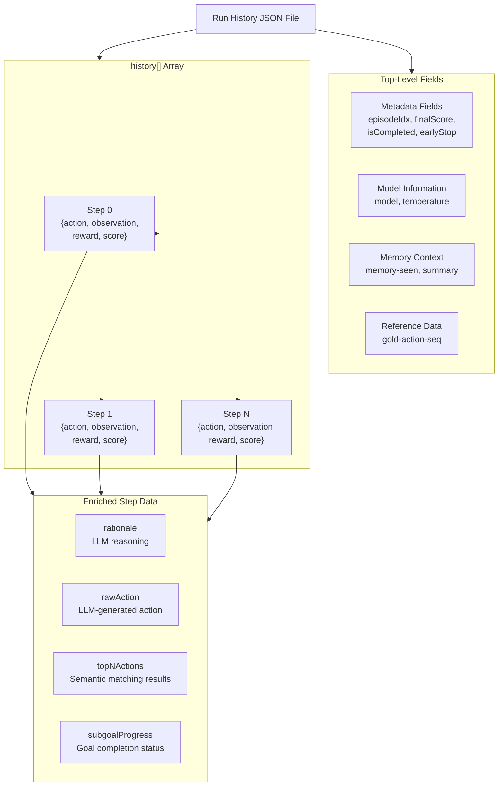
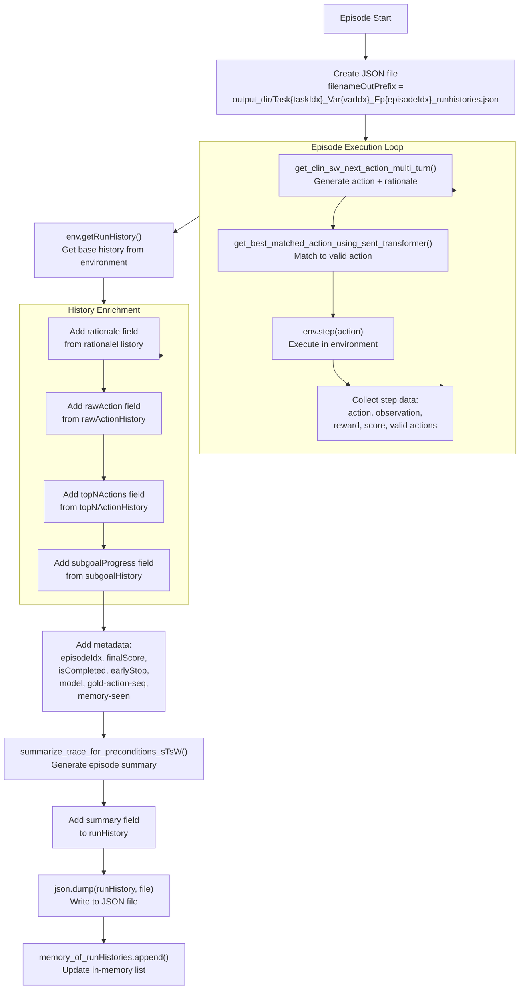
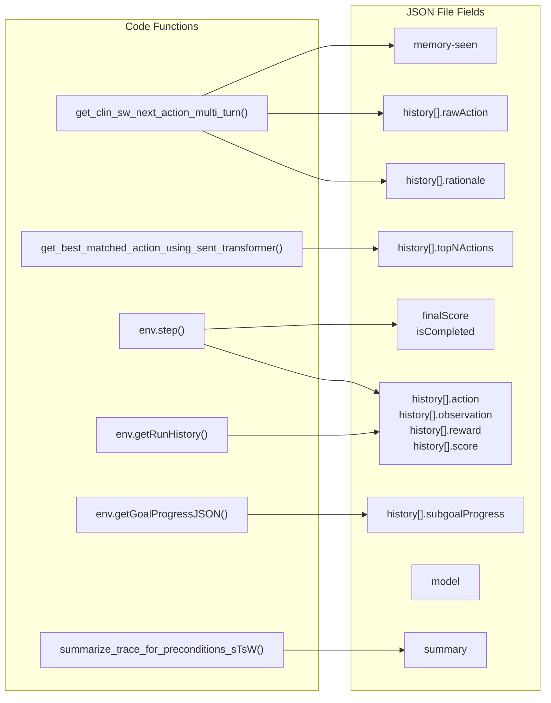
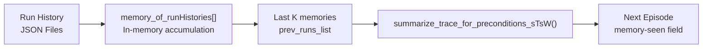

<!-- source: DeepWiki mcp.deepwiki.com · repo allenai/clin · page 5.4 Understanding Output Files · fetched 2026-10-26 -->

# Understanding Output Files

<details>
<summary>Relevant source files</summary>

The following files were used as context for generating this wiki page:

- [README.md](README.md)
- [requirements.txt](requirements.txt)
- [scienceworld/clin_agent.py](scienceworld/clin_agent.py)

</details>


## Purpose and Scope

This document explains the structure and contents of files generated by CLIN during execution. When CLIN runs episodes, it produces detailed JSON files containing complete run histories and a summary text file with aggregate results. Understanding these outputs is essential for analyzing agent behavior, debugging, and reproducing results.

For information about running experiments and specifying output paths, see [Running Experiments](#5.2). For details on how memories are generated from these outputs, see [Learning and Summarization System](#4.5).

---

## Output Directory and File Organization

CLIN writes all output files to the directory specified by the `--output-path-prefix` command-line argument. The directory structure follows a predictable pattern based on task, variation, and episode identifiers.

### Directory Structure

```
output-path-prefix/
├── Task{taskIdx}_Var{varIdx}_Ep{episodeIdx}_runhistories.json
├── Task{taskIdx}_Var{varIdx}_Ep{episodeIdx+1}_runhistories.json
├── ...
└── summary.txt
```

### File Naming Convention

| File Pattern | Description | Example |
|--------------|-------------|---------|
| `Task{N}_Var{M}_Ep{K}_runhistories.json` | Detailed episode history for task N, variation M, episode K | `Task4_Var1_Ep0_runhistories.json` |
| `summary.txt` | Aggregate results across all episodes | `summary.txt` |

**Sources:** [scienceworld/clin_agent.py:85-90](), [scienceworld/clin_agent.py:115-116]()

---

## Run History JSON Files

Each episode generates a single JSON file containing comprehensive information about agent execution. These files are the primary data source for debugging, analysis, and memory generation.

### JSON File Structure Overview



**Sources:** [scienceworld/clin_agent.py:320-363]()

### Top-Level JSON Fields

The following table describes all top-level fields in the run history JSON:

| Field Name | Type | Description | Source |
|------------|------|-------------|--------|
| `episodeIdx` | integer | Zero-indexed episode number | [scienceworld/clin_agent.py:332]() |
| `finalScore` | float | Final task score achieved | [scienceworld/clin_agent.py:333]() |
| `finalScorePositive` | float | Highest positive score reached during episode | [scienceworld/clin_agent.py:334]() |
| `isCompleted` | boolean | Whether task was successfully completed | [scienceworld/clin_agent.py:335]() |
| `earlyStop` | boolean | Whether episode was stopped early (repetitive actions or excessive length) | [scienceworld/clin_agent.py:336]() |
| `model` | string | GPT model identifier used (e.g., `"gpt-4-0613"`) | [scienceworld/clin_agent.py:337]() |
| `gold-action-seq` | string | Gold (optimal) action sequence from ScienceWorld | [scienceworld/clin_agent.py:338]() |
| `memory-seen` | string | Memory context provided to agent during this episode | [scienceworld/clin_agent.py:339]() |
| `summary` | string | Episode summary with causal abstractions (learnings) | [scienceworld/clin_agent.py:355]() |
| `history` | array | Step-by-step execution trace (see next section) | From `env.getRunHistory()` |

**Sources:** [scienceworld/clin_agent.py:332-355]()

### History Array Structure

The `history` array contains one entry per step. Each step includes both base fields from ScienceWorld and enriched fields added by CLIN.

#### Base Fields (from ScienceWorld)

| Field | Type | Description |
|-------|------|-------------|
| `action` | string | The validated action executed in the environment |
| `observation` | string | Environment observation received after action |
| `reward` | float | Immediate reward from this step |
| `score` | float | Cumulative score at this step |
| `valid` | array | List of valid actions available at this step |

#### Enriched Fields (added by CLIN)

| Field | Type | Description | Added At |
|-------|------|-------------|----------|
| `rationale` | string | LLM reasoning for why action was chosen | [scienceworld/clin_agent.py:326]() |
| `rawAction` | string | Original action string generated by LLM before semantic matching | [scienceworld/clin_agent.py:327]() |
| `topNActions` | array | Top N semantically similar valid actions with similarity scores | [scienceworld/clin_agent.py:328]() |
| `subgoalProgress` | object | JSON object showing goal completion progress | [scienceworld/clin_agent.py:329]() |

**Sources:** [scienceworld/clin_agent.py:323-329]()

### Example JSON Structure

```json
{
  "episodeIdx": 0,
  "finalScore": 50.0,
  "finalScorePositive": 50.0,
  "isCompleted": true,
  "earlyStop": false,
  "model": "gpt-4-0613",
  "gold-action-seq": "['look around', 'open door to hallway', ...]",
  "memory-seen": "To MEASURE MELTING POINT of substances:\n- focus on thermometer MAY BE NECESSARY\n- activate thermometer SHOULD BE NECESSARY\n...",
  "summary": "To complete MEASURE MELTING POINT:\n1. The substance SHOULD BE heated\n2. thermometer readings SHOULD BE recorded\n...",
  "history": [
    {
      "action": "look around",
      "observation": "You are in a kitchen. You see a table...",
      "reward": 0.0,
      "score": 0.0,
      "valid": ["open door to hallway", "pick up apple", ...],
      "rationale": "I need to first observe the environment to locate necessary items",
      "rawAction": "look around",
      "topNActions": [["look around", 1.0]],
      "subgoalProgress": {"totalSubgoals": 5, "completedSubgoals": 0}
    },
    {
      "action": "open door to hallway",
      "observation": "The door is now open...",
      "reward": 0.0,
      "score": 0.0,
      "valid": ["move to hallway", "close door", ...],
      "rationale": "Need to access other rooms to find thermometer",
      "rawAction": "open the hallway door",
      "topNActions": [["open door to hallway", 0.95], ["close door to hallway", 0.67]],
      "subgoalProgress": {"totalSubgoals": 5, "completedSubgoals": 0}
    }
  ]
}
```

---

## Output Generation Flow

The following diagram shows how output files are generated during episode execution:



**Sources:** [scienceworld/clin_agent.py:115-363]()

---

## Summary Text File

The `summary.txt` file provides a human-readable tabular summary of all episodes executed in a single run. This file is useful for quick assessment of agent performance without parsing JSON.

### Summary File Structure

The summary file contains:

1. **Header Section**: Information about simplifications used
2. **Results Table**: Tab-separated values showing episode outcomes
3. **Footer**: Completion indicator

### Example Summary File

```
---------------------------------------------------------------------
 Summary (ChatGPT Agent)
 Simplifications: easy
---------------------------------------------------------------------
task	Name	var	epi	score	complete?
4	MEASURE MELTING POINT	1	0	50.0	True
4	MEASURE MELTING POINT	1	1	75.0	True
4	MEASURE MELTING POINT	1	2	100.0	True
---------------------------------------------------------------------
Completed.
```

### Summary Table Columns

| Column | Description | Example Value |
|--------|-------------|---------------|
| `task` | Task index number | `4` |
| `Name` | Full task name | `MEASURE MELTING POINT` |
| `var` | Variation index number | `1` |
| `epi` | Episode index number | `0` |
| `score` | Final score achieved | `50.0` |
| `complete?` | Task completion status | `True` or `False` |

**Sources:** [scienceworld/clin_agent.py:381-392]()

---

## Data Flow: Code to Output Files

This diagram shows the mapping between code functions and the output file fields they populate:



**Sources:** [scienceworld/clin_agent.py:196-363]()

---

## Interpreting Output Files

### Key Indicators in JSON Files

#### Success Indicators

- **Task Completion**: `isCompleted: true` and `finalScore > 0`
- **Normal Termination**: `earlyStop: false`
- **Goal Progress**: Increasing `completedSubgoals` in `subgoalProgress` fields

#### Failure Indicators

- **Repetitive Behavior**: `earlyStop: true` with last 5 actions identical [scienceworld/clin_agent.py:282-287]()
- **Excessive Length**: `earlyStop: true` when action sequence exceeds 1.5× gold sequence length [scienceworld/clin_agent.py:289-294]()
- **Action Matching Failures**: Multiple entries with low similarity scores in `topNActions`

#### Memory Utilization

- **Episode 0 with Gold Memory**: `memory-seen` contains gold trace learnings when `--use-gold-memory-in-ep0 1` [scienceworld/clin_agent.py:184-185]()
- **Subsequent Episodes**: `memory-seen` contains `summary` from previous episode [scienceworld/clin_agent.py:186-187]()
- **Empty Memory**: `memory-seen: ""` indicates no prior learnings used

### Action Matching Analysis

The `rawAction` and `topNActions` fields reveal the semantic matching process:

```json
{
  "rawAction": "heat the thermometer slowly",
  "action": "activate thermometer",
  "topNActions": [
    ["activate thermometer", 0.78],
    ["deactivate thermometer", 0.65],
    ["focus on thermometer", 0.62]
  ]
}
```

**Interpretation:**
- High similarity (>0.9): Strong match, confident action selection
- Medium similarity (0.7-0.9): Reasonable match, action executed [scienceworld/clin_agent.py:259-261]()
- Low similarity (<0.7): Retry triggered unless max retries reached [scienceworld/clin_agent.py:259-266]()

**Sources:** [scienceworld/clin_agent.py:245-266]()

### Episode Summary Structure

The `summary` field contains causal abstractions learned from the episode. These follow specific formats:

**Quadrant 1 Format** (Same Task/Same Environment):
```
To complete [TASK NAME]:
- [ACTION] MAY BE NECESSARY to [GOAL]
- [ACTION] SHOULD BE NECESSARY to [GOAL]
- [ACTION] DOES NOT CONTRIBUTE to [GOAL]
```

**Quadrant 2 Format** (Cross-Environment):
```
Meta-learnings for [TASK NAME] across environments:
- [ABSTRACT PRINCIPLE] generalizes across variations
- [CONSTRAINT] must be satisfied regardless of environment
```

**Quadrant 3 Format** (Cross-Task):
```
General principles learned:
- [HIGH-LEVEL STRATEGY] applies across tasks
- [ABSTRACT CONCEPT] is important for goal achievement
```

**Sources:** [scienceworld/clin_agent.py:344-355](), see [Causal Abstractions](#3.3) for detailed format specifications

---

## File Usage in Continual Learning

The output files serve multiple purposes in CLIN's continual learning cycle:

### Memory Generation



**Sources:** [scienceworld/clin_agent.py:345-356](), [scienceworld/clin_agent.py:360]()

### Cross-Episode Learning

The `--use-last-k-memories` parameter controls how many previous episodes inform learning:

1. **Episode N completes**: JSON written with full history
2. **Episode N added to memory**: `memory_of_runHistories.append(runHistory)` [scienceworld/clin_agent.py:360]()
3. **Episode N+1 summarization**: Last K memories retrieved [scienceworld/clin_agent.py:345]()
4. **New summary generated**: Incorporates learnings from last K episodes [scienceworld/clin_agent.py:346-354]()
5. **Episode N+1 execution**: New summary used as `memory-seen` [scienceworld/clin_agent.py:187]()

**Sources:** [scienceworld/clin_agent.py:84](), [scienceworld/clin_agent.py:186-187](), [scienceworld/clin_agent.py:345-356]()

---

## Programmatic Access to Output Files

### Loading JSON Files

```python
import json

# Load a single run history
with open("logs/Task4_Var1_Ep0_runhistories.json", "r") as f:
    run_history = json.load(f)

# Access top-level fields
episode_idx = run_history["episodeIdx"]
final_score = run_history["finalScore"]
is_completed = run_history["isCompleted"]
summary = run_history["summary"]

# Iterate through steps
for step in run_history["history"]:
    action = step["action"]
    observation = step["observation"]
    rationale = step["rationale"]
    score = step["score"]
```

### Parsing Summary File

```python
# Read summary.txt and extract results
with open("logs/summary.txt", "r") as f:
    lines = f.readlines()

# Find table rows (skip header)
results = []
for line in lines:
    if line.startswith(str) and "\t" in line:
        parts = line.strip().split("\t")
        if len(parts) == 6 and parts[0].isdigit():
            results.append({
                "task": int(parts[0]),
                "name": parts[1],
                "var": int(parts[2]),
                "epi": int(parts[3]),
                "score": float(parts[4]),
                "complete": parts[5] == "True"
            })
```

**Sources:** [scienceworld/clin_agent.py:359-363](), [scienceworld/clin_agent.py:381-392]()

---

## Common Output Analysis Tasks

### Computing Success Rate

```python
import json
import os

def compute_success_rate(output_dir):
    """Compute success rate across all episodes in output directory."""
    total = 0
    successful = 0
    
    for filename in os.listdir(output_dir):
        if filename.endswith("_runhistories.json"):
            with open(os.path.join(output_dir, filename), "r") as f:
                data = json.load(f)
                total += 1
                if data["isCompleted"]:
                    successful += 1
    
    return successful / total if total > 0 else 0.0
```

### Extracting Learning Trajectories

```python
def extract_scores_over_episodes(output_dir, task_idx, var_idx):
    """Extract final scores across episodes for a task/variation."""
    scores = []
    episode_idx = 0
    
    while True:
        filename = f"Task{task_idx}_Var{var_idx}_Ep{episode_idx}_runhistories.json"
        filepath = os.path.join(output_dir, filename)
        
        if not os.path.exists(filepath):
            break
            
        with open(filepath, "r") as f:
            data = json.load(f)
            scores.append(data["finalScore"])
        
        episode_idx += 1
    
    return scores
```

### Analyzing Action Matching Quality

```python
def analyze_matching_quality(json_file):
    """Analyze semantic matching scores across episode."""
    with open(json_file, "r") as f:
        data = json.load(f)
    
    similarities = []
    for step in data["history"]:
        if step.get("topNActions") and len(step["topNActions"]) > 0:
            # Top-1 similarity score
            similarities.append(step["topNActions"][0][1])
    
    if similarities:
        avg_similarity = sum(similarities) / len(similarities)
        min_similarity = min(similarities)
        return {
            "average": avg_similarity,
            "minimum": min_similarity,
            "num_steps": len(similarities)
        }
    return None
```

---

## Output File Best Practices

### Storage Considerations

- **JSON File Size**: Typically 50-500 KB per episode depending on episode length
- **Disk Space**: Plan for ~1 MB per task variation across multiple episodes
- **Retention**: Keep JSON files for reproducibility and future analysis

### File Organization Tips

1. **Use Descriptive Prefixes**: Set `--output-path-prefix` to include experiment identifiers
   ```bash
   --output-path-prefix logs/experiment1_gpt4_q1/
   ```

2. **Separate Quadrants**: Use different directories for different evaluation quadrants
   ```bash
   logs/quadrant1/
   logs/quadrant2_cross_env/
   logs/quadrant3_cross_task/
   ```

3. **Archive Completed Runs**: Move completed experiment directories to archive for long-term storage

### Debugging with Outputs

When debugging agent behavior:

1. **Check `earlyStop` flag**: Identifies premature termination
2. **Examine `rationale` fields**: Reveals agent's reasoning at each step
3. **Compare `rawAction` vs `action`**: Identifies semantic matching issues
4. **Review `topNActions` scores**: Low scores indicate prompt or action space problems
5. **Analyze `memory-seen`**: Ensures correct memory context was provided

**Sources:** [scienceworld/clin_agent.py:85-392]()

---

