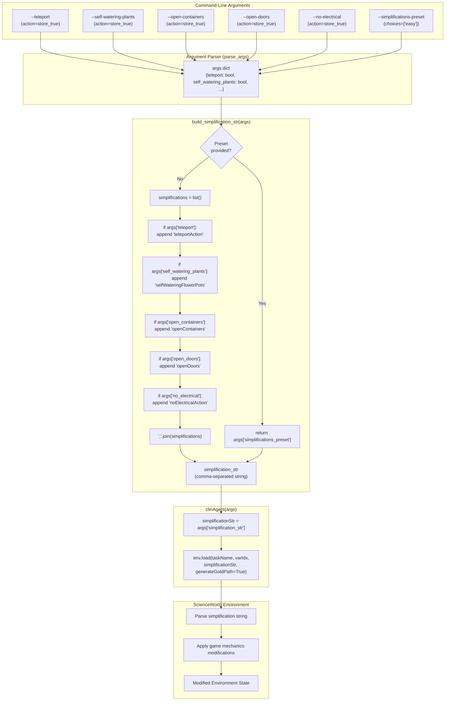
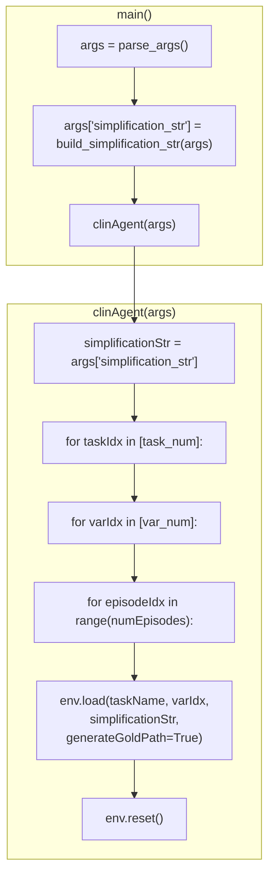

<!-- source: DeepWiki mcp.deepwiki.com · repo allenai/clin · page 5.5 Environment Simplifications · fetched 2026-10-26 -->

# Environment Simplifications

<details>
<summary>Relevant source files</summary>

The following files were used as context for generating this wiki page:

- [README.md](README.md)
- [requirements.txt](requirements.txt)
- [scienceworld/clin_agent.py](scienceworld/clin_agent.py)

</details>


## Purpose and Scope

This page documents the environment simplification system in CLIN, which allows users to modify the ScienceWorld environment to reduce task complexity. Simplifications can make tasks easier by removing certain mechanics (e.g., navigation requirements, electrical actions) or automating routine maintenance (e.g., plant watering). This is particularly useful for rapid prototyping, debugging, and evaluating agent performance under different difficulty settings.

For information about running experiments with these settings, see [Running Experiments](#5.2). For details on command-line arguments in general, see [Command-Line Arguments Reference](#5.1).

---

## Overview

Environment simplifications are optional game mechanics modifications passed to the ScienceWorld environment at initialization time. They reduce task complexity by:

1. **Removing action requirements** (e.g., teleportation eliminates navigation steps)
2. **Automating maintenance tasks** (e.g., self-watering plants)
3. **Pre-opening interactive objects** (e.g., containers and doors)
4. **Reducing action space size** (e.g., removing electrical actions)

Simplifications are specified via command-line arguments and converted into a comma-separated string that ScienceWorld interprets during environment loading.

**Sources:** [scienceworld/clin_agent.py:395-413](), [scienceworld/clin_agent.py:454-466]()

---

## Available Simplifications

CLIN supports five individual simplification flags that can be combined or used through a preset configuration:

| Simplification Flag | String Identifier | Description | Impact on Task Difficulty |
|-------------------|------------------|-------------|--------------------------|
| `--teleport` | `teleportAction` | Agents can instantly move to any location without navigation | Removes all navigation complexity; agent can focus on object manipulation |
| `--self-watering-plants` | `selfWateringFlowerPots` | Plants automatically maintain hydration | Eliminates periodic watering requirements in plant-related tasks |
| `--open-containers` | `openContainers` | All containers (boxes, cupboards, etc.) start opened | Removes need for explicit "open" actions before accessing contents |
| `--open-doors` | `openDoors` | All doors between rooms start opened | Simplifies navigation by eliminating door interaction steps |
| `--no-electrical` | `noElectricalAction` | Removes electrical actions from action space | Reduces action space size; useful when electrical tasks are irrelevant |

Additionally, a preset option is available:

| Preset | Equivalent Flags | Use Case |
|--------|-----------------|----------|
| `--simplifications-preset easy` | All five flags enabled | Maximum simplification; fastest experimentation and debugging |

**Sources:** [scienceworld/clin_agent.py:454-466](), [README.md:47]()

---

## Command-Line Configuration

### Individual Simplification Flags

Simplifications are enabled through boolean command-line arguments. Each flag is optional and can be combined:

```bash
python scienceworld/clin_agent.py \
    --task-num "4" \
    --var-num 1 \
    --teleport \
    --open-doors \
    --no-electrical
```

This example enables teleportation, open doors, and removes electrical actions.

### Preset Configuration

The `--simplifications-preset` argument applies predefined combinations:

```bash
python scienceworld/clin_agent.py \
    --task-num "4" \
    --var-num 1 \
    --simplifications-preset "easy"
```

Currently, only the `easy` preset is defined, which applies all five simplifications.

**Sources:** [scienceworld/clin_agent.py:454-466](), [README.md:47]()

---

## Simplification Processing Pipeline



**Diagram: Simplification Configuration Flow from CLI to Environment**

**Sources:** [scienceworld/clin_agent.py:395-413](), [scienceworld/clin_agent.py:419-470](), [scienceworld/clin_agent.py:473-478]()

---

## Implementation Details

### Building the Simplification String

The `build_simplification_str` function converts command-line arguments into a format that ScienceWorld understands:

```python
def build_simplification_str(args):
    """ Build simplification_str from args. """
    simplifications = list()
    if args["teleport"]:
        simplifications.append("teleportAction")
    if args["self_watering_plants"]:
        simplifications.append("selfWateringFlowerPots")
    if args["open_containers"]:
        simplifications.append("openContainers")
    if args["open_doors"]:
        simplifications.append("openDoors")
    if args["no_electrical"]:
        simplifications.append("noElectricalAction")
    
    return args["simplifications_preset"] or ",".join(simplifications)
```

**Key behaviors:**
- If `--simplifications-preset` is provided, it takes precedence and the function returns the preset name directly
- Otherwise, individual flags are checked and their corresponding identifiers are collected
- The identifiers are joined with commas to form the final string
- An empty string is returned if no simplifications are specified

**Sources:** [scienceworld/clin_agent.py:395-413]()

### Integration with Main Agent Loop

The simplification string is used during environment initialization:



**Diagram: Simplification String Usage in Agent Execution**

The simplification string is:
1. Built once at program start ([scienceworld/clin_agent.py:477]())
2. Stored in the `args` dictionary
3. Extracted in `clinAgent` ([scienceworld/clin_agent.py:75]())
4. Passed to `env.load()` for each episode ([scienceworld/clin_agent.py:118]())

**Sources:** [scienceworld/clin_agent.py:473-478](), [scienceworld/clin_agent.py:75](), [scienceworld/clin_agent.py:118]()

---

## Argument Parser Configuration

The argument parser defines simplification options in a dedicated argument group:

```python
simplification_group = parser.add_argument_group('Game simplifications')
simplification_group.add_argument("--simplifications-preset", choices=['easy'],
                                  help="Choose a preset among: 'easy' (apply all possible simplifications).")
simplification_group.add_argument("--teleport", action="store_true",
                                  help="Lets agents instantly move to any location.")
simplification_group.add_argument("--self-watering-plants", action="store_true",
                                  help="Plants do not have to be frequently watered.")
simplification_group.add_argument("--open-containers", action="store_true",
                                  help="All containers are opened by default.")
simplification_group.add_argument("--open-doors", action="store_true",
                                  help="All doors are opened by default.")
simplification_group.add_argument("--no-electrical", action="store_true",
                                  help="Remove the electrical actions (reduces the size of the action space).")
```

All boolean flags use `action="store_true"`, meaning:
- Default value is `False` when flag is absent
- Value becomes `True` when flag is present
- No argument value is required (presence/absence is sufficient)

**Sources:** [scienceworld/clin_agent.py:454-466]()

---

## Use Cases and Recommendations

### Rapid Prototyping and Debugging

Use `--simplifications-preset easy` when:
- Testing new prompt strategies
- Debugging agent logic without environment complexity
- Quickly iterating on memory or learning mechanisms
- Validating basic task completion before scaling difficulty

**Example:**
```bash
python scienceworld/clin_agent.py \
    --task-num "4" \
    --var-num 1 \
    --simplifications-preset "easy" \
    --num-episodes 1
```

### Selective Complexity Reduction

Use individual flags when:
- Isolating specific task aspects (e.g., test reasoning without navigation)
- Creating custom difficulty levels
- Benchmarking against specific baseline conditions

**Example (navigation-focused evaluation):**
```bash
python scienceworld/clin_agent.py \
    --task-num "4" \
    --var-num 1 \
    --open-containers \
    --open-doors \
    --self-watering-plants
    # Note: teleport NOT enabled - navigation still required
```

### Full Complexity Evaluation

Omit all simplification flags when:
- Reproducing paper results (which used full complexity)
- Benchmarking final performance
- Comparing against baseline RL agents

**Example:**
```bash
python scienceworld/clin_agent.py \
    --task-num "4" \
    --var-num 1
    # No simplification flags - full complexity
```

**Sources:** [README.md:47]()

---

## Simplification String Format

The simplification string passed to ScienceWorld follows this format:

```
"identifier1,identifier2,identifier3"
```

**Valid examples:**
- `""` (empty string, no simplifications)
- `"teleportAction"` (single simplification)
- `"teleportAction,openDoors,openContainers"` (multiple simplifications)
- `"easy"` (preset name)

The order of identifiers in the comma-separated string does not matter. ScienceWorld parses this string and applies the corresponding mechanics modifications during environment initialization.

**Sources:** [scienceworld/clin_agent.py:395-413]()

---

## Interaction with Other Configuration

### Relationship with Task Selection

Simplifications apply universally to the selected task and variation:

```python
env.load(taskName, varIdx, simplificationStr, generateGoldPath=True)
```

The same simplification settings persist across all episodes within a run. To test different simplification levels, run separate experiments with different configurations.

### Compatibility with Evaluation Quadrants

Simplifications are orthogonal to evaluation quadrants ([Core Concepts: Evaluation Quadrants](#3.4)):
- **Quadrant 1 (Adaptation)**: Simplifications can speed up within-episode learning
- **Quadrant 2 (Cross-Environment)**: Simplifications apply to both source and target environments
- **Quadrant 3 (Cross-Task)**: Simplifications may affect task transferability

The paper's reported results use full complexity (no simplifications) to ensure fair comparison with baselines.

**Sources:** [scienceworld/clin_agent.py:118]()

---

## Summary Table: Simplification Configuration

| Configuration Method | Command-Line Syntax | Resulting `simplification_str` | Use Case |
|---------------------|---------------------|-------------------------------|----------|
| No simplifications | *(omit all flags)* | `""` | Full complexity evaluation |
| Single simplification | `--teleport` | `"teleportAction"` | Targeted complexity reduction |
| Multiple simplifications | `--teleport --open-doors` | `"teleportAction,openDoors"` | Custom difficulty level |
| Full preset | `--simplifications-preset easy` | `"easy"` | Maximum simplification |
| Preset override | `--simplifications-preset easy --teleport` | `"easy"` | Preset takes precedence |

**Note:** When both `--simplifications-preset` and individual flags are provided, the preset takes precedence and individual flags are ignored.

**Sources:** [scienceworld/clin_agent.py:395-413](), [scienceworld/clin_agent.py:454-466]()

---

