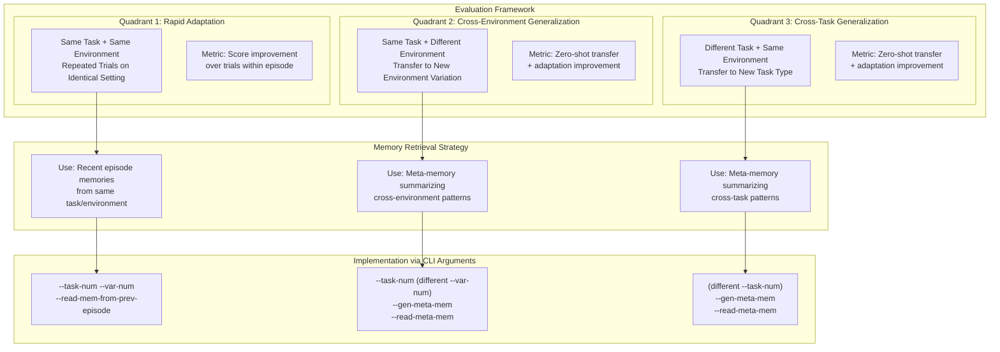
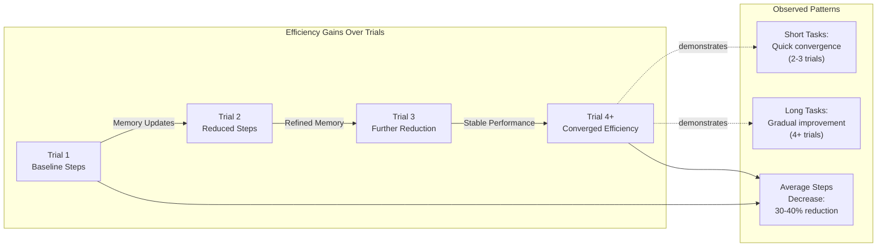
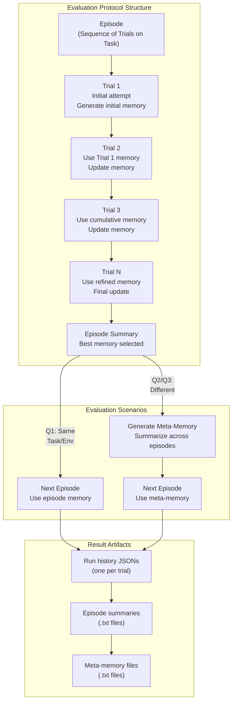
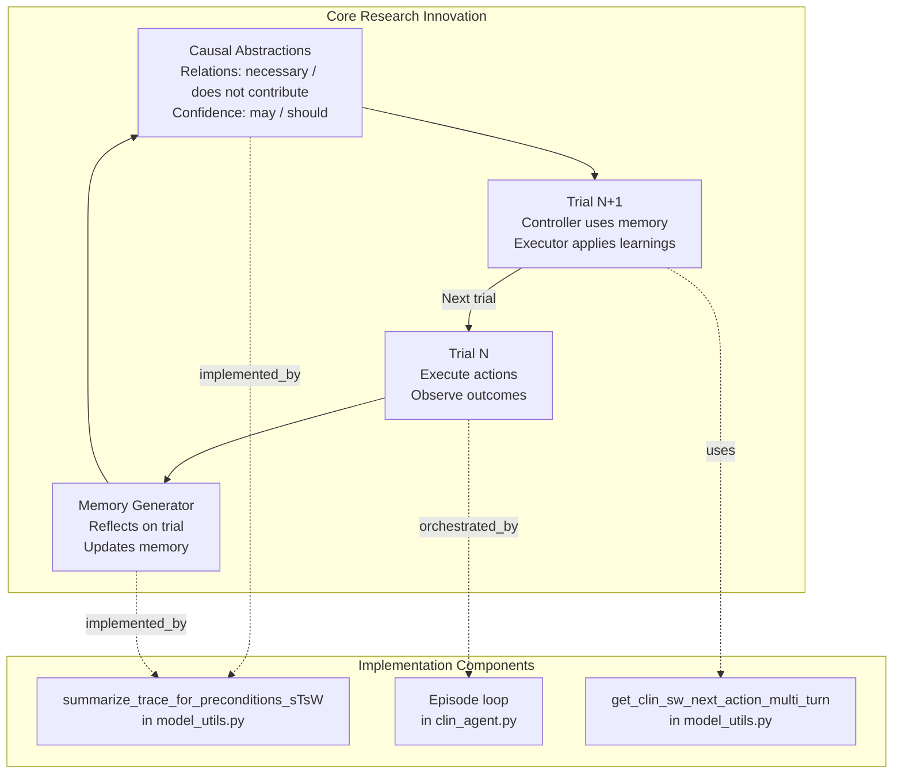

<!-- source: DeepWiki mcp.deepwiki.com · repo allenai/clin · page 6 Research and Results · fetched 2026-10-26 -->

# Research and Results

Relevant source files

The following files were used as context for generating this wiki page:

- [index.html](index.html)

## Purpose and Scope

This section presents the research findings, empirical results, and methodology from the CLIN paper. It summarizes the key experimental results demonstrating CLIN's ability to adapt rapidly to repeated trials and generalize to new environments and tasks. For implementation details of CLIN's architecture, see [System Architecture](#4). For guidance on running your own experiments to reproduce these results, see [Running Experiments](#5.2).

## Research Contribution

CLIN represents the first language-based agent to achieve continual improvement over multiple trials without requiring parameter updates. The core innovation is a **persistent, dynamic, textual memory centered on causal abstractions** that enables the agent to learn from experience and transfer knowledge across different scenarios.

### Key Claims

| Contribution | Description |
|--------------|-------------|
| **Continual Learning Without Updates** | Achieves continual improvement using only textual memory, without fine-tuning or parameter updates |
| **Rapid Adaptation** | Outperforms state-of-the-art reflective agents (Reflexion) by 23 absolute points on repeated trials |
| **Cross-Environment Generalization** | Improves zero-shot performance by 4 points when transferring to new environments |
| **Cross-Task Generalization** | Improves zero-shot performance by 13 points when transferring to new tasks |
| **Compound Learning** | Combines generalization with adaptation for an additional 17 points (environments) or 7 points (tasks) improvement |

Sources: [index.html:150-156]()

## Evaluation Framework

CLIN's performance is evaluated across three distinct scenarios, referred to as evaluation quadrants. These quadrants test different aspects of continual learning and generalization.

### Evaluation Quadrants

**Quadrant Mapping to Code:**

- **Q1 (Adaptation)**: Set via consistent `--task-num` and `--var-num` across episodes, with `--read-mem-from-prev-episode` enabled
- **Q2 (Cross-Environment)**: Change `--var-num` while keeping `--task-num` constant, using `--gen-meta-mem` and `--read-meta-mem` 
- **Q3 (Cross-Task)**: Change `--task-num` entirely, using `--gen-meta-mem` and `--read-meta-mem`

For detailed documentation on evaluation quadrants, see [Evaluation Quadrants](#3.4). For command-line arguments, see [Command-Line Arguments Reference](#5.1).

Sources: [index.html:172-176]()

## Key Results at a Glance

### Performance Comparison Across Quadrants

The following table summarizes CLIN's performance improvements across all evaluation scenarios:

| Scenario | Baseline (Trial 1) | CLIN Final Performance | Improvement | Comparison |
|----------|-------------------|----------------------|-------------|------------|
| **Q1: Adaptation (Same Task/Env)** | Initial Zero-shot | +23 points over Reflexion | 23 points | State-of-the-art |
| **Q2: Cross-Environment** | Zero-shot transfer | +4 → +21 points (with adaptation) | 4 + 17 points | Beats RL agents |
| **Q3: Cross-Task** | Zero-shot transfer | +13 → +20 points (with adaptation) | 13 + 7 points | Beats language agents |

### Efficiency Metrics

CLIN demonstrates rapid adaptation on both short and long tasks by solving tasks with progressively fewer steps in later trials. This efficiency improvement is automatic, driven by the accumulation of causal abstractions in memory.

Sources: [index.html:190-194]()

## Experimental Setup

### Benchmark Environment

All experiments are conducted in **ScienceWorld**, a text-based simulation environment for scientific reasoning tasks. The benchmark includes:

- **30 task types** (e.g., "grow a plant", "measure temperature", "find living things")
- **Multiple environment variations** for each task (different room layouts, object locations)
- **Textual observations** describing the current state
- **Action-based interaction** with discrete action space

### Evaluation Protocol

### Command-Line Configuration

Experiments are configured via [clin_agent.py]() with key arguments:

| Argument | Purpose | Example Values |
|----------|---------|----------------|
| `--task-num` | Selects task type | `0-29` (30 tasks) |
| `--var-num` | Selects environment variation | `0-9` (varies by task) |
| `--model` | Specifies GPT model | `gpt-4-0613`, `gpt-3.5-turbo` |
| `--read-mem-from-prev-episode` | Enables episode memory | Boolean flag |
| `--gen-meta-mem` | Generates meta-memory | Boolean flag |
| `--read-meta-mem` | Uses meta-memory | Boolean flag |
| `--use-gold-mem-in-ep0` | Bootstraps with gold trace | Boolean flag |

Sources: [index.html:178-182]()

## Research Artifacts

The research results are presented through multiple artifacts included in this repository:

### Visual Assets

| Asset | Purpose | Location |
|-------|---------|----------|
| **Teaser Video** | Demonstrates CLIN's adaptation behavior | [static/images/clin-with-credits.mp4]() |
| **Conceptual Diagram** | Shows memory creation and adaptation | [static/images/clin.png]() |
| **Architecture Diagram** | Illustrates controller-executor-memory system | [static/images/clin_arch.png]() |
| **Memory Structure** | Shows causal abstraction format | [static/images/clin_memory.png]() |
| **Adaptation Results** | Performance curves over trials | [static/images/clin_adaptation.png]() |
| **Generalization Results** | Cross-environment and cross-task performance | [static/images/clin_generalization.png]() |
| **Results Table** | Comprehensive comparison with baselines | [static/images/clin-table.png]() |

### Published Research

- **Paper**: Available on arXiv at [https://arxiv.org/pdf/2310.10134.pdf](https://arxiv.org/pdf/2310.10134.pdf)
- **Authors**: Majumder et al. (Allen Institute for AI, University of Arizona, University of Pennsylvania)
- **Publication Year**: 2023

Sources: [index.html:1-252]()

## Memory-Driven Learning Architecture

The research demonstrates how CLIN's memory architecture enables continual learning:

### Memory Semantics

CLIN's memory uses a structured semantic format with two key dimensions:

1. **Causal Relations**:
   - `"X necessary for Y"`: Action X is required to achieve goal Y
   - `"X does not contribute to Y"`: Action X does not help achieve goal Y

2. **Confidence Levels**:
   - `"X may be necessary"`: Lower confidence assertion
   - `"X should be necessary"`: Higher confidence assertion

This structured format allows the LLM controller to reason about action necessity and avoid repeating ineffective strategies.

Sources: [index.html:184-188]()

## Detailed Results by Section

For in-depth analysis of specific result categories, see the following sub-pages:

- **[Research Overview](#6.1)**: Comprehensive summary of research goals, methodology, and significance
- **[Rapid Adaptation Results](#6.2)**: Detailed Q1 results showing within-episode improvement
- **[Generalization Performance](#6.3)**: Q2 and Q3 results demonstrating transfer learning capabilities
- **[Comparison with Baselines](#6.4)**: Head-to-head comparisons with Reflexion, RL agents, and other approaches
- **[Related Work](#6.5)**: Positioning CLIN within the broader research landscape

## Reproducibility

All results can be reproduced using the provided code:

1. **Setup**: Follow instructions in [Installation](#2.2) to configure the environment
2. **Run Experiments**: Use the patterns documented in [Running Experiments](#5.2)
3. **Analyze Outputs**: Parse the JSON run histories described in [Understanding Output Files](#5.4)

The research results were generated using GPT-4 (`gpt-4-0613`) as the primary model, with comparisons to GPT-3.5 Turbo documented in the paper.

Sources: [index.html:1-252]()

---

