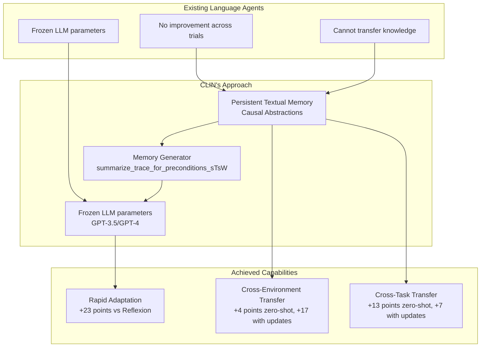
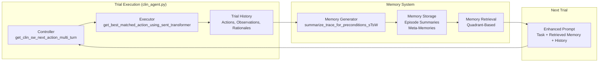
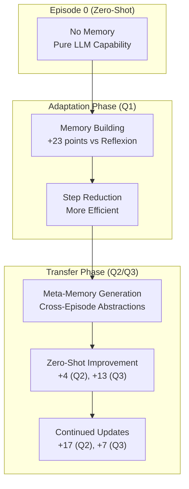

<!-- source: DeepWiki mcp.deepwiki.com · repo allenai/clin · page 6.1 Research Overview · fetched 2026-10-26 -->

# Research Overview

<details>
<summary>Relevant source files</summary>

The following files were used as context for generating this wiki page:

- [index.html](index.html)

</details>


## Purpose and Scope

This page summarizes the research contribution, key findings, and significance of CLIN (Continually Learning Language Agent). It provides an overview of the research problem CLIN addresses, the novel approach it introduces, and the empirical results demonstrating its effectiveness. For implementation details of CLIN's architecture, see [System Architecture](#4). For specific performance metrics and experimental results, see [Rapid Adaptation Results](#6.2), [Generalization Performance](#6.3), and [Comparison with Baselines](#6.4).

**Sources:** [index.html:1-252]()

---

## Research Problem

Language agents built on large language models (LLMs) can interact with external environments to perform complex tasks through zero-shot prompting, avoiding the startup costs of reinforcement learning. However, these agents face a critical limitation: **they do not continually improve over time** beyond performance refinement on a specific task. When faced with repeated trials of the same task, or when encountering new but related tasks and environments, existing language agents cannot accumulate and leverage experience from previous attempts.

This limitation prevents language agents from exhibiting true continual learning behavior, where an agent should:
- Rapidly adapt when solving the same task repeatedly
- Transfer knowledge to new environments with similar dynamics
- Generalize learnings to related but different tasks
- Achieve these improvements **without requiring parameter updates** to the underlying frozen LLM

**Sources:** [index.html:151-156]()

---

## Research Contribution

CLIN is **the first language-based agent** to achieve continual learning across multiple trials with varied environments and tasks, without requiring parameter updates to the underlying model. The key innovation is the use of a **persistent, dynamic, textual memory centered on causal abstractions** rather than general hints or raw trajectory data.

### Core Innovation



**Diagram: CLIN's Research Innovation - Bridging Problem to Solution**

The agent implementation in `clin_agent.py` orchestrates this continual learning process, while `model_utils.py` provides the memory generation and retrieval mechanisms that enable learning without parameter updates.

**Sources:** [index.html:151-156]()

---

## Key Technical Contributions

### 1. Causal Abstraction Memory System

CLIN's memory uses structured causal abstractions rather than free-form text or raw trajectories. The memory format uses two primary relations:

| Relation | Meaning | Example |
|----------|---------|---------|
| **NECESSARY** | Action X is required to achieve goal Y | "Going to the kitchen SHOULD BE NECESSARY to find seeds" |
| **DOES NOT CONTRIBUTE** | Action X does not help achieve goal Y | "Opening the freezer DOES NOT CONTRIBUTE to finding seeds" |

Memory assertions include linguistic uncertainty measures (`MAY`, `SHOULD`) to encode confidence levels based on the number of supporting observations.

**Sources:** [index.html:184-188]()

### 2. Memory Update and Retrieval Architecture



**Diagram: Memory Update and Retrieval Flow in CLIN**

At the end of each trial, the `summarize_trace_for_preconditions_sTsW` function in `model_utils.py` analyzes the trial trace and generates causal abstractions. These are stored and retrieved in subsequent trials based on the evaluation quadrant (see [Evaluation Quadrants](#3.4)).

**Sources:** [index.html:178-182]()

### 3. Hierarchical Memory for Generalization

For cross-environment and cross-task generalization, CLIN generates **meta-memories** that abstract learnings from multiple episodes:

- **Episode Memory**: Learnings from a single sequence of trials on one task-environment pair
- **Meta-Memory**: Higher-level abstractions generated from multiple episode memories, identifying patterns that transfer across contexts

**Sources:** [index.html:172-177]()

---

## Performance Results Summary

### Rapid Adaptation (Quadrant 1: Same Task, Same Environment)

| Metric | Result |
|--------|--------|
| Performance improvement over Reflexion | **+23 absolute points** |
| Adaptation behavior | Consistent improvement across trials |
| Efficiency gain | Solves tasks with fewer steps in later trials |
| Task coverage | Both short and long tasks |

CLIN demonstrates rapid adaptation by learning from each trial and applying that knowledge immediately to subsequent trials on the same task.

**Sources:** [index.html:190-194]()

### Cross-Environment Generalization (Quadrant 2)

| Metric | Result |
|--------|--------|
| Zero-shot transfer performance | **+4 points** over baseline |
| With continual updates | **+17 additional points** |
| Comparison to RL agents | Outperforms with positive transfer |
| Step efficiency | Fewer steps compared to no-generalization setup |

**Sources:** [index.html:196-203]()

### Cross-Task Generalization (Quadrant 3)

| Metric | Result |
|--------|--------|
| Zero-shot transfer performance | **+13 points** over baseline |
| With continual updates | **+7 additional points** |
| Comparison to baselines | Beats RL and language agents |
| Achievement | State-of-the-art without gold trajectories |

**Sources:** [index.html:196-203]()

### Key Performance Characteristics



**Diagram: Progressive Performance Improvement Through Memory Accumulation**

**Sources:** [index.html:190-203]()

---

## Research Significance

### Novel Architecture for Frozen Models

CLIN demonstrates a new architecture paradigm where agents built on **frozen, pre-trained LLMs can still continually and rapidly improve over time**. This has significant implications:

1. **No Parameter Updates Required**: Unlike traditional continual learning that requires model fine-tuning or parameter updates, CLIN achieves learning purely through textual memory accumulation.

2. **Rapid Adaptation**: The agent improves immediately from trial to trial, without the need for extensive training episodes required by reinforcement learning approaches.

3. **Knowledge Transfer**: Learnings generalize across different environments and tasks, demonstrating that causal abstractions capture transferable knowledge.

4. **Scalability**: The approach works with any LLM backend (GPT-3.5, GPT-4) without requiring model access or modification.

**Sources:** [index.html:151-156]()

### Positioning in Research Landscape

CLIN is positioned alongside concurrent work on non-parametric continual learning for language agents:

- **Voyager**: Learning in Minecraft through skill libraries
- **ExpeL**: Learning through experience and reflection
- **Reflexion**: Self-reflection for task improvement

CLIN distinguishes itself through:
- Structured causal abstractions (vs. general hints)
- Formal evaluation across three quadrants (adaptation, cross-environment, cross-task)
- Demonstrated positive transfer learning
- State-of-the-art performance without requiring gold demonstrations

**Sources:** [index.html:205-209]()

### Evaluation Environment

The research uses the **ScienceWorld** benchmark, a text-based simulation environment for complex scientific tasks. ScienceWorld provides:
- Interactive physics simulation
- Multiple task types (e.g., growing plants, measuring properties)
- Varied environments (different locations, object configurations)
- Long action sequences requiring planning

The `exhaustivevalidactions` branch of ScienceWorld is specifically used to provide comprehensive valid action sets for the agent to choose from (see [ScienceWorld Integration](#4.6)).

**Sources:** [index.html:151-156](), [index.html:205-209]()

---

## Implementation Highlights

The research implementation consists of three primary code modules:

| Module | Primary Functions | Research Role |
|--------|------------------|---------------|
| `clin_agent.py` | Episode/trial orchestration, history tracking | Main experimental framework |
| `model_utils.py` | `get_clin_sw_next_action_multi_turn`<br/>`summarize_trace_for_preconditions_sTsW`<br/>`get_best_matched_action_using_sent_transformer` | Core learning and decision-making |
| `utils.py` | Text processing, lemmatization | Supporting utilities |

The agent orchestration in `clin_agent.py` manages the experimental loop, while the learning mechanisms in `model_utils.py` implement the memory generation and retrieval that enable continual learning. For detailed architectural documentation, see [Architecture Overview](#4.1).

**Sources:** [index.html:178-182]()

---

## Citation and Publication

The CLIN research was published in 2023 and is available on arXiv. The paper presents the full methodology, experimental setup, ablation studies, and detailed results across all evaluation quadrants.

```
@article{majumder2023clin,
  author    = "Majumder, Bodhisattwa Prasad and Dalvi Mishra, Bhavana and 
               Jansen, Peter and Tafjord, Oyvind and Tandon, Niket and 
               Zhang, Li and Callison-Burch, Chris and Clark, Peter",
  title     = "CLIN: A Continually Learning Language Agent for Rapid Task 
               Adaptation and Generalization",
  journal   = "arXiv",
  year      = "2023",
}
```

**Sources:** [index.html:216-226]()

---

## Summary

CLIN represents a significant advancement in language agent research by demonstrating that **continual learning is achievable with frozen LLMs through structured memory mechanisms**. The key insight is that causal abstractions stored in persistent textual memory can encode transferable knowledge that enables rapid adaptation (+23 points over baselines) and successful generalization to new environments (+21 points) and tasks (+20 points). This opens new avenues for building practical language agents that improve with experience without requiring expensive model retraining.

For detailed information about specific aspects of CLIN:
- Memory structure and causal abstractions: see [Memory Architecture](#3.2) and [Causal Abstractions](#3.3)
- Implementation architecture: see [System Architecture](#4)
- Experimental methodology: see [Running Experiments](#5.2)
- Detailed results: see [Rapid Adaptation Results](#6.2), [Generalization Performance](#6.3)
- Comparative analysis: see [Comparison with Baselines](#6.4)

**Sources:** [index.html:1-252]()

---

