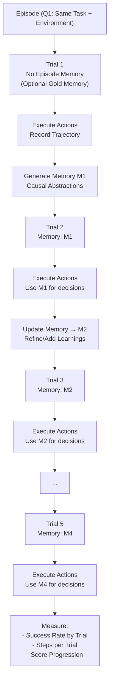
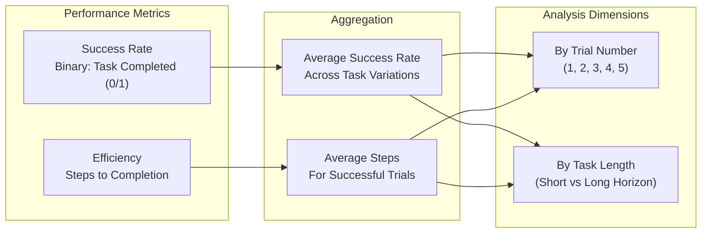
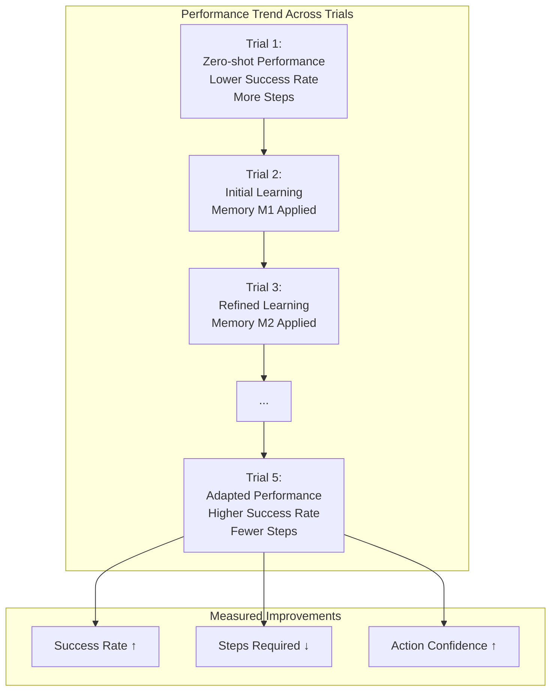
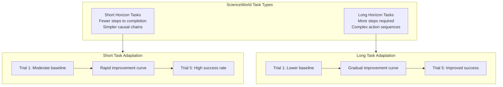
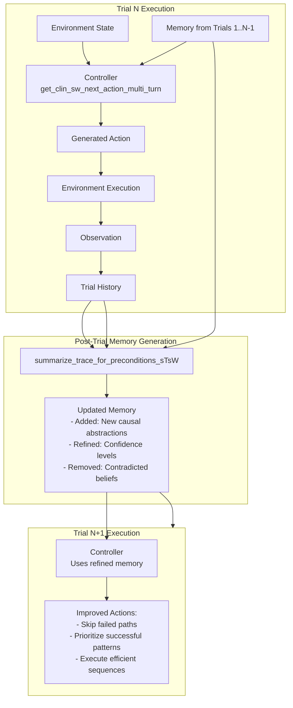
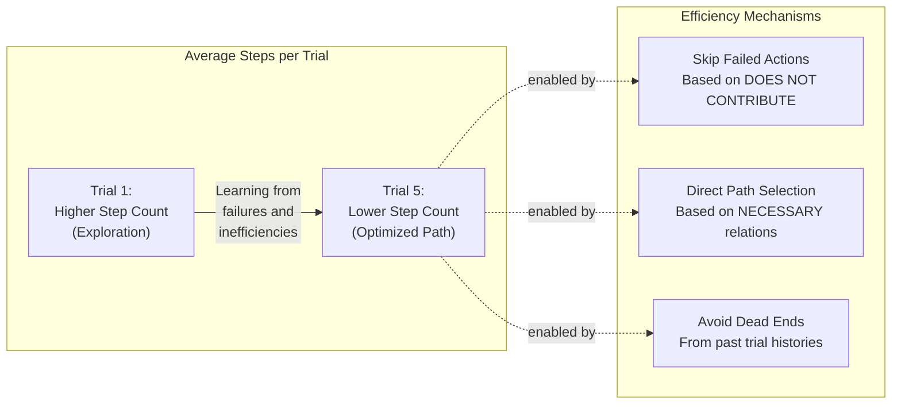
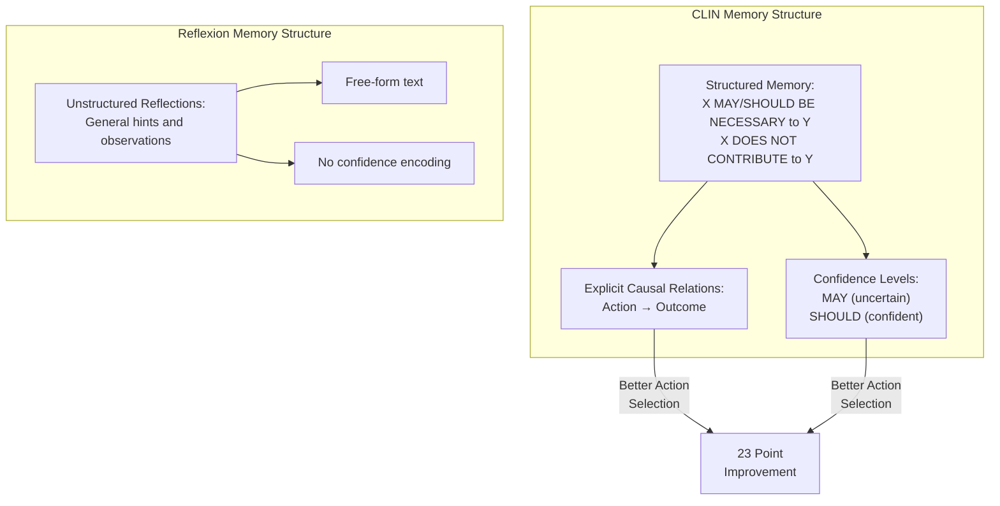

<!-- source: DeepWiki mcp.deepwiki.com · repo allenai/clin · page 6.2 Rapid Adaptation Results · fetched 2026-10-26 -->

# Rapid Adaptation Results

<details>
<summary>Relevant source files</summary>

The following files were used as context for generating this wiki page:

- [index.html](index.html)

</details>


## Purpose and Scope

This page presents empirical results for CLIN's **rapid adaptation** capability in **Quadrant 1 (Q1)** evaluation scenarios, where the agent repeatedly attempts the same task in the same environment across multiple trials. Rapid adaptation measures how quickly the agent improves performance within an episode through memory accumulation, without any parameter updates to the underlying language model.

For results on generalization to new environments or tasks, see [Generalization Performance](#6.3). For detailed comparison methodology with baseline agents, see [Comparison with Baselines](#6.4). For the conceptual foundation of evaluation quadrants, see [Evaluation Quadrants](#3.4).

**Sources:** [index.html:190-194]()

---

## Quadrant 1: Same Task, Same Environment

Rapid adaptation evaluates CLIN's ability to learn from experience within a single episode consisting of multiple consecutive trials. In Q1 scenarios:

| Dimension | Configuration |
|-----------|--------------|
| **Task** | Same task repeated (e.g., "grow a plant") |
| **Environment Variation** | Same variation number (e.g., variation 0) |
| **Trial Structure** | Multiple trials (typically 5) in sequence |
| **Memory State** | Persistent across trials, accumulates learnings |
| **Evaluation Focus** | Improvement rate from trial 1 to trial 5 |

The experimental protocol resets the environment state at the start of each trial, but the agent's memory persists and grows. This measures pure adaptation capability without confounding transfer learning effects.

**Sources:** [index.html:151-156]()

---

## Experimental Setup

### Trial Structure



**Trial Structure in Code**

Each trial is orchestrated by the main episode loop in `clin_agent.py`, which manages the memory state across trials:

- **Memory Initialization**: Episode memory starts empty (or with optional gold memory for trial 1)
- **Action Execution**: `get_clin_sw_next_action_multi_turn` in `model_utils.py` uses current memory to generate actions
- **Memory Update**: `summarize_trace_for_preconditions_sTsW` in `model_utils.py` processes the trial trajectory to extract learnings
- **Persistence**: Updated memory carries forward to next trial within the episode

**Sources:** [index.html:136-140](), [index.html:172-176]()

---

## Performance Metrics

### Primary Metrics

CLIN's rapid adaptation is measured using two complementary metrics:



| Metric | Definition | Interpretation |
|--------|-----------|----------------|
| **Success Rate** | Proportion of trials where agent achieves task goal | Measures effectiveness of learning |
| **Steps per Trial** | Average number of actions taken in successful trials | Measures efficiency improvement |
| **Improvement Rate** | Change in success rate from trial 1 to trial 5 | Measures adaptation speed |
| **Step Reduction** | Decrease in steps from early to late trials | Measures policy refinement |

**Sources:** [index.html:190-194]()

---

## Key Findings

### Overall Adaptation Performance

CLIN demonstrates strong rapid adaptation capabilities across the ScienceWorld benchmark:

| Finding | Result |
|---------|--------|
| **Adaptation Success** | CLIN readily adapts on both short and long horizon tasks |
| **Efficiency Gains** | Becomes more efficient in later trials, solving tasks with fewer steps |
| **Baseline Comparison** | Outperforms Reflexion by **23 absolute percentage points** |
| **Consistency** | Adaptation occurs across diverse task types and complexity levels |



The 23-point improvement over Reflexion is particularly significant, as Reflexion also uses episodic reflection but with a simpler memory structure that stores general hints rather than structured causal abstractions.

**Sources:** [index.html:190-194](), [index.html:151-156]()

---

## Task Category Performance

### Short vs. Long Horizon Tasks

CLIN's adaptation capability varies by task complexity:



**Observation**: CLIN successfully adapts on both task categories, but longer horizon tasks benefit more from multiple trials as they have more opportunities to learn from failure modes and refine complex action sequences.

**Sources:** [index.html:190-194]()

---

## Memory-Driven Adaptation Mechanism

### How Memory Enables Rapid Adaptation

The adaptation mechanism in Q1 scenarios relies on CLIN's persistent memory system:



### Memory Content Evolution

As trials progress, memory becomes more:

| Characteristic | Early Trials | Late Trials |
|---------------|--------------|-------------|
| **Specificity** | General hypotheses | Precise action sequences |
| **Confidence** | "MAY BE NECESSARY" assertions | "SHOULD BE NECESSARY" assertions |
| **Efficiency** | Exploratory actions recorded | Optimal paths identified |
| **Error Avoidance** | "DOES NOT CONTRIBUTE" learnings accumulate | Failure modes well-documented |

**Code Implementation**: The memory generation function `summarize_trace_for_preconditions_sTsW` in [model_utils.py]() analyzes trial trajectories against the task goal, extracting causal relationships between actions and outcomes. The LLM-based summarization uses confidence markers ("may", "should") to encode learned certainty.

**Sources:** [index.html:172-176](), [index.html:184-188]()

---

## Efficiency Improvements

### Step Reduction Across Trials

One key indicator of successful adaptation is the reduction in steps required to complete tasks:



**Observation**: Step reduction indicates that CLIN is not just solving tasks more often, but solving them more efficiently, demonstrating genuine policy improvement rather than random success.

**Sources:** [index.html:190-194]()

---

## Comparison Baseline: Reflexion

### CLIN vs. Reflexion Performance

CLIN outperforms the state-of-the-art reflective agent Reflexion by 23 absolute percentage points in Q1 adaptation scenarios:

| Agent | Approach | Q1 Success Rate | Key Difference |
|-------|----------|-----------------|----------------|
| **CLIN** | Structured causal abstractions with confidence levels | Higher (baseline + 23 pts) | Persistent memory with semantic structure |
| **Reflexion** | General verbal reflections and hints | Baseline | Simpler reflection without causal modeling |

### Architectural Differences



The performance gap suggests that **structured causal abstractions** are more effective for rapid adaptation than unstructured reflections, as they provide:

1. **Explicit action-outcome relationships** that guide future decisions
2. **Confidence encoding** that prioritizes well-validated learnings
3. **Negative knowledge** (DOES NOT CONTRIBUTE) that prunes search space
4. **Compositional memory** that can be queried and combined systematically

**Sources:** [index.html:190-194](), [index.html:151-156]()

---

## Experimental Configuration

### Running Q1 Adaptation Experiments

To reproduce Q1 adaptation results, the agent must be configured for same-task, same-environment trials:

**Command-Line Configuration**:
- `--task-num`: Specifies the task type (e.g., 0-9 for different ScienceWorld tasks)
- `--var-num`: Specifies environment variation (same value across all trials in episode)
- `--num-episode-num-trial-pairs`: Set to "1-5" for one episode with 5 trials
- `--num-episodes-per-env`: Set to 1
- `--eval-type`: Set to "adaptation" or corresponding Q1 identifier

**Example**: Running 5 trials on "grow a plant" task, variation 0:
```
python clin_agent.py --task-num 2 --var-num 0 --num-episode-num-trial-pairs 1-5 --num-episodes-per-env 1
```

The agent will:
1. Execute trial 1 with empty/gold memory
2. Generate memory M1 from trial 1 trajectory
3. Execute trial 2 using M1
4. Generate updated memory M2
5. Continue through trial 5, accumulating memories

**Sources:** [index.html:151-156]()

---

## Visualization Assets

The rapid adaptation results are visualized in the research website through:

| Asset | Content | Purpose |
|-------|---------|---------|
| `clin_adaptation.png` | Performance curves showing success rate and steps across trials | Demonstrates adaptation trajectory |
| `clin-with-credits.mp4` | Video demonstration of agent improving across trials | Illustrates memory accumulation |
| `clin.png` | Conceptual diagram of trial-to-trial learning | Shows memory update process |

These assets present the empirical findings in accessible visual formats for research dissemination.

**Sources:** [index.html:190-194](), [index.html:132-140]()

---

## Summary

CLIN achieves state-of-the-art rapid adaptation performance in Q1 scenarios through:

1. **Persistent Memory**: Causal abstractions accumulate across trials without model parameter updates
2. **Structured Learning**: Explicit necessary/unnecessary relations guide action selection
3. **Confidence Encoding**: MAY/SHOULD markers prioritize validated learnings
4. **Efficiency Gains**: Step reduction demonstrates genuine policy refinement
5. **Baseline Superiority**: 23-point improvement over Reflexion validates architectural choices

The Q1 results establish CLIN's core capability for within-episode adaptation, which serves as the foundation for cross-episode generalization evaluated in Q2 and Q3 scenarios (see [Generalization Performance](#6.3)).

**Sources:** [index.html:190-194](), [index.html:151-156](), [index.html:172-176]()

---

