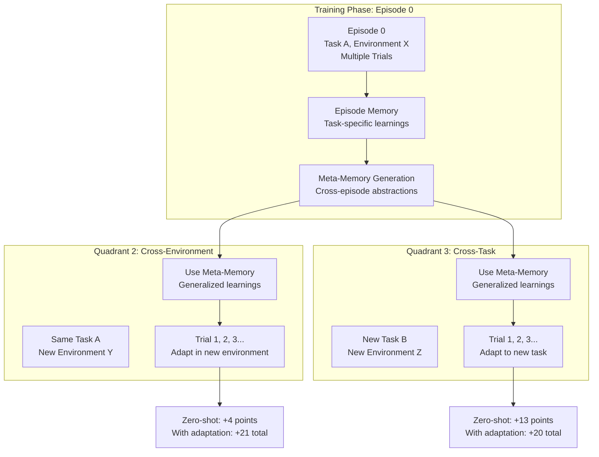
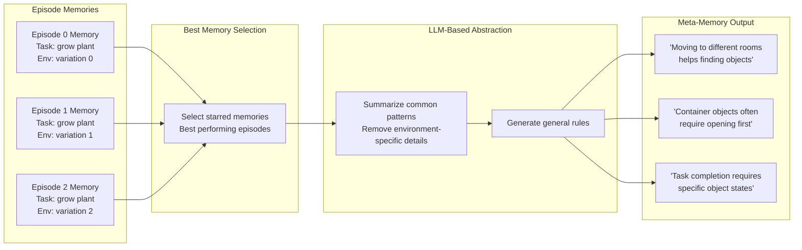
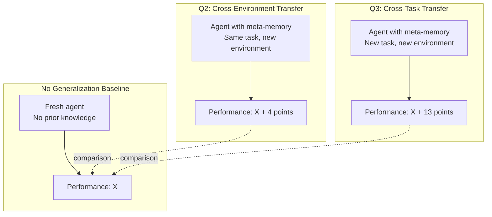
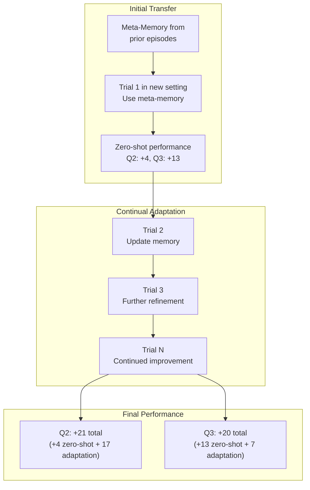
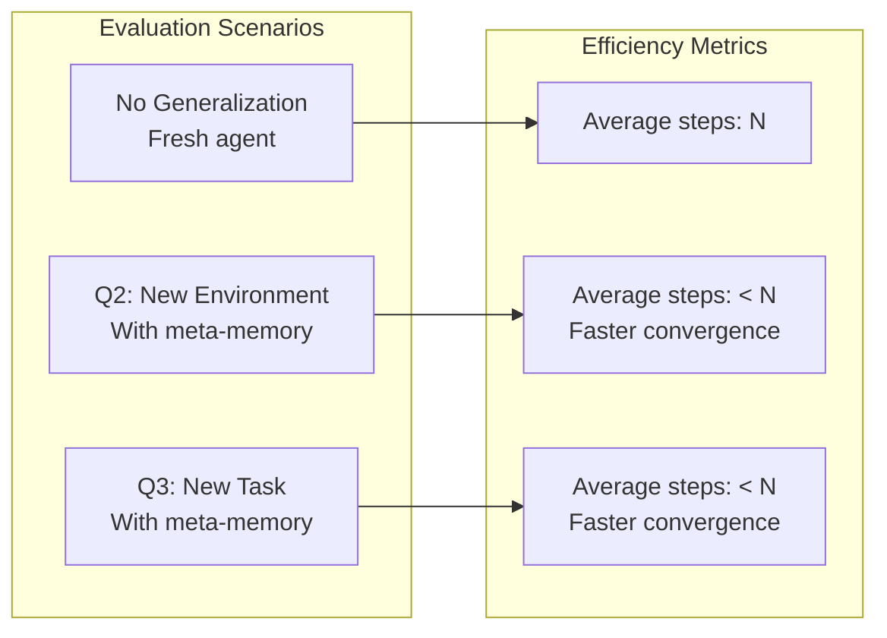
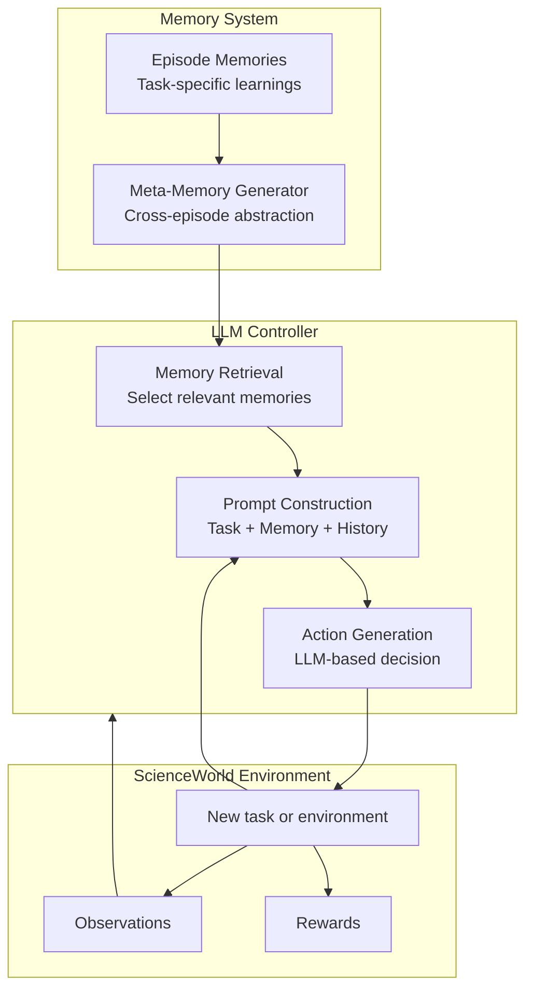

<!-- source: DeepWiki mcp.deepwiki.com · repo allenai/clin · page 6.3 Generalization Performance · fetched 2026-10-26 -->

# Generalization Performance

Relevant source files

The following files were used as context for generating this wiki page:

- [index.html](index.html)

## Purpose and Scope

This page documents CLIN's performance on generalization tasks, specifically Quadrants 2 and 3, where the agent must transfer learned knowledge to new environments (Q2) or entirely new tasks (Q3). This covers both zero-shot transfer capabilities and the additional improvements achieved through continual adaptation in the new settings.

For performance on repeated trials within the same task and environment (Quadrant 1), see [Rapid Adaptation Results](#6.2). For implementation details of the memory system that enables generalization, see [Memory Architecture](#3.2). For comparison with baseline systems, see [Comparison with Baselines](#6.4).

---

## Generalization Evaluation Quadrants

CLIN's generalization capabilities are evaluated across two distinct scenarios that test different aspects of knowledge transfer.

### Evaluation Framework

**Sources:** [index.html:151-156](), [index.html:172-176]()

### Quadrant Definitions

| Quadrant | Task | Environment | Transfer Type | Primary Challenge |
|----------|------|-------------|---------------|-------------------|
| Q1 (Adaptation) | Same | Same | Within-episode learning | Rapid improvement through memory updates |
| Q2 (Cross-Environment) | Same | Different | Cross-episode transfer | Apply task knowledge to new environment layout |
| Q3 (Cross-Task) | Different | Different | Cross-episode transfer | Abstract general strategies to novel task |

**Sources:** [index.html:151-156]()

---

## Meta-Memory Mechanism for Generalization

To enable transfer across episodes, CLIN generates meta-memories that abstract learned knowledge from multiple prior episodes into generalizable strategies.

### Meta-Memory Generation Process

**Sources:** [index.html:172-176]()

### Meta-Memory Characteristics

Meta-memories differ from episode-level memories in their abstraction level and applicability:

| Aspect | Episode Memory | Meta-Memory |
|--------|----------------|-------------|
| Scope | Single task-environment combination | Multiple episodes across variations |
| Specificity | References specific objects/locations | Uses general categories |
| Example | "Going to kitchen helps find seeds" | "Moving to different rooms helps finding objects" |
| Usage Context | Same task and environment (Q1) | New environments (Q2) or tasks (Q3) |
| Generation | After each trial within episode | After completing multiple episodes |

**Sources:** [index.html:172-176]()

---

## Zero-Shot Transfer Performance

CLIN demonstrates positive transfer learning even before any adaptation trials in the new setting, outperforming both reinforcement learning agents and other language agents.

### Initial Transfer Results

**Zero-Shot Improvements:**
- **Cross-Environment (Q2):** +4 absolute points over no-generalization baseline
- **Cross-Task (Q3):** +13 absolute points over no-generalization baseline

**Sources:** [index.html:151-156]()

### Performance Comparison with Baselines

CLIN beats previous reinforcement learning agents and language agents through positive transfer learning, achieving state-of-the-art results without using gold trajectories as demonstrations.

**Sources:** [index.html:200-202]()

---

## Generalization with Continual Adaptation

After the initial zero-shot transfer, CLIN continues to improve through memory updates during subsequent trials in the new setting.

### Combined Generalization and Adaptation Pipeline

**Sources:** [index.html:151-156]()

### Cumulative Performance Gains

| Evaluation Setting | Zero-Shot Gain | Additional Adaptation Gain | Total Improvement |
|-------------------|----------------|---------------------------|-------------------|
| **Q2: Cross-Environment** | +4 points | +17 points | +21 points |
| **Q3: Cross-Task** | +13 points | +7 points | +20 points |

The results demonstrate that:
1. Meta-memories provide immediate benefit through positive transfer
2. The continual learning mechanism continues to function in new settings
3. Task-level generalization (Q3) shows stronger initial transfer but smaller adaptation gains
4. Environment-level generalization (Q2) shows smaller initial transfer but larger adaptation gains

**Sources:** [index.html:151-156]()

---

## Efficiency Analysis

Beyond raw performance improvements, CLIN demonstrates enhanced efficiency in generalization scenarios by solving tasks with fewer steps compared to the no-generalization baseline.

### Step Efficiency Comparison

**Key Findings:**
- Both Q2 (new environments) and Q3 (new tasks) require fewer average steps compared to the no-generalization setup
- Fewer steps indicate more efficient exploration and action selection
- The meta-memory guides the agent toward productive action sequences from the start

**Sources:** [index.html:200-203]()

---

## State-of-the-Art Results

The combination of generalization and adaptation enables CLIN to achieve state-of-the-art performance on the ScienceWorld benchmark without requiring gold trajectory demonstrations.

### Achievement Summary

| Aspect | Result |
|--------|--------|
| **Comparison** | Beats previous RL agents and language agents |
| **Transfer Learning** | Positive transfer in both Q2 and Q3 |
| **Demonstration Requirements** | No gold trajectories needed |
| **Performance Type** | State-of-the-art on generalization tasks |
| **Efficiency** | Fewer steps to task completion |

**Sources:** [index.html:200-202]()

### System Integration for Generalization

The generalization capabilities emerge from the interaction of multiple system components described in the architecture:

**Sources:** [index.html:179-182]()

---

## Visual Results Summary

The research website presents two key visualizations demonstrating generalization performance:

1. **Performance Table** (`clin-table.png`): Quantitative comparison showing CLIN's superiority over RL agents and language agents with positive transfer learning metrics
2. **Generalization Chart** (`clin_generalization.png`): Visual comparison of step efficiency and performance across Q2 (unseen environments) and Q3 (new tasks), demonstrating both fewer steps and better outcomes compared to no-generalization baseline

**Sources:** [index.html:197](), [index.html:203]()

---

## Related Documentation

- **Memory Architecture**: For detailed explanation of how meta-memories are structured and stored, see [Memory Architecture](#3.2)
- **Evaluation Quadrants**: For comprehensive overview of all three evaluation scenarios, see [Evaluation Quadrants](#3.4)
- **Adaptation Results**: For performance within the same task and environment (Q1), see [Rapid Adaptation Results](#6.2)
- **Implementation**: For code-level details on learning and summarization, see [Learning and Summarization System](#4.5)

**Sources:** [index.html:1-252]()

---

