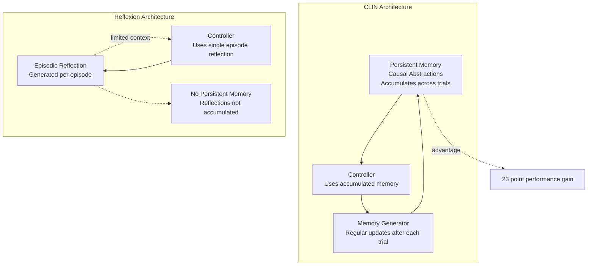
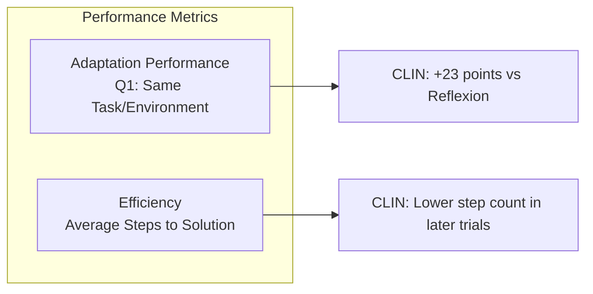
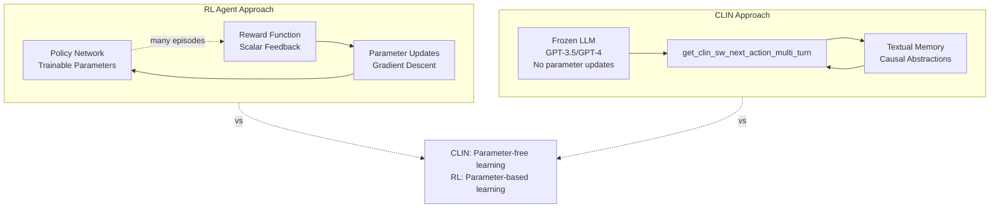
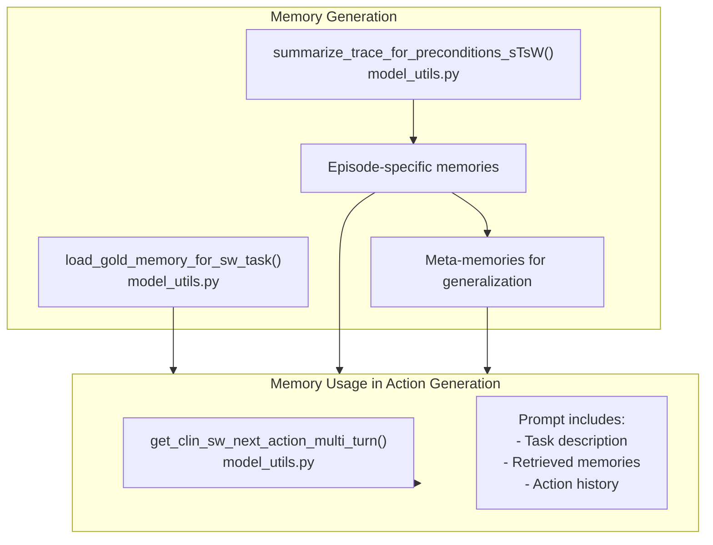
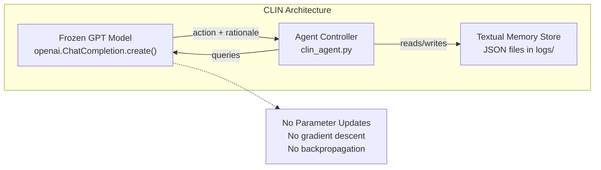
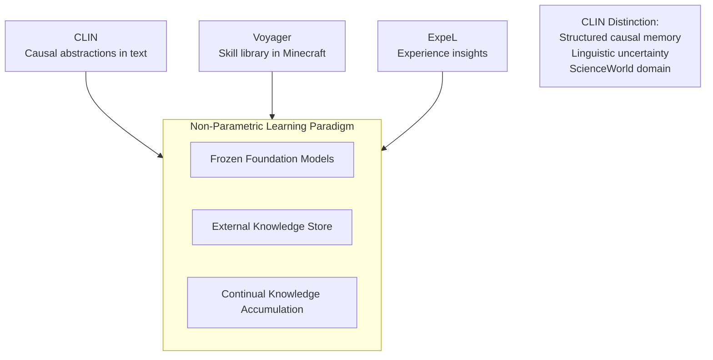

<!-- source: DeepWiki mcp.deepwiki.com · repo allenai/clin · page 6.4 Comparison with Baselines · fetched 2026-10-26 -->

# Comparison with Baselines

Relevant source files

The following files were used as context for generating this wiki page:

- [index.html](index.html)

This page documents CLIN's performance relative to baseline systems, including state-of-the-art language agents, reinforcement learning approaches, and concurrent continual learning methods. It provides quantitative comparisons, explains methodological differences, and identifies where these baselines diverge from CLIN's architecture.

For detailed results on specific evaluation scenarios, see [Rapid Adaptation Results](#6.2) and [Generalization Performance](#6.3). For broader context on related systems, see [Related Work](#6.5).

---

## Baselines Overview

CLIN was evaluated against three categories of baseline systems in the ScienceWorld environment:

| Baseline Category | Representative Systems | Key Characteristic |
|------------------|----------------------|-------------------|
| Reflective Language Agents | Reflexion | Uses episodic reflection but lacks persistent memory |
| Reinforcement Learning | ScienceWorld RL Agents | Parameter-based learning with reward optimization |
| Concurrent Continual Learning | Voyager, ExpeL | Non-parametric learning with skill libraries |

**Sources:** [index.html:151-207]()

---

## Reflexion: State-of-the-Art Reflective Agent

### System Description

Reflexion represents the state-of-the-art in reflective language agents. It generates reflective summaries after task failures but does not maintain a persistent, structured memory across multiple trials.

### Key Differences from CLIN

**Methodological Distinctions:**

1. **Memory Persistence:** CLIN maintains a dynamic memory using `summarize_trace_for_preconditions_sTsW()` in [model_utils.py]() that accumulates learnings across trials. Reflexion generates per-episode reflections without structured accumulation.

2. **Causal Abstractions:** CLIN structures memories using explicit causal relations (necessary/does not contribute) with uncertainty modifiers (may/should). Reflexion uses unstructured textual hints.

3. **Memory Updates:** CLIN's memory generator updates the knowledge base after every trial, while Reflexion's reflections are episodic and non-cumulative.

### Performance Comparison

According to the research results, CLIN outperforms Reflexion by **23 absolute percentage points** on adaptation tasks (Quadrant 1: same task, same environment).

This improvement is attributed to CLIN's ability to accumulate and structure knowledge across trials, whereas Reflexion regenerates context without building on previous learnings.

**Sources:** [index.html:192-194](), [index.html:155]()

---

## Reinforcement Learning Agents

### System Description

Traditional reinforcement learning (RL) agents in ScienceWorld learn through parameter updates based on reward signals. These agents optimize policies through trial-and-error with gradient-based learning.

### Key Differences from CLIN

**Methodological Distinctions:**

1. **Learning Mechanism:** RL agents update neural network parameters through backpropagation. CLIN uses frozen language models with textual memory updates via `get_clin_sw_next_action_multi_turn()` in [model_utils.py]().

2. **Sample Efficiency:** RL agents typically require many episodes to converge. CLIN shows rapid adaptation within a few trials by leveraging pre-trained language model knowledge.

3. **Interpretability:** CLIN's memory contains explicit causal statements (e.g., "moving to kitchen MAY BE NECESSARY to find seeds"). RL policies are opaque neural networks.

4. **Zero-Shot Capability:** CLIN can operate in zero-shot scenarios with no prior task experience. RL agents require task-specific training.

### Performance Comparison

CLIN demonstrates **positive transfer learning** over both RL and language agent baselines, particularly in generalization scenarios:

| Scenario | CLIN Advantage | Key Factor |
|---------|---------------|-----------|
| Cross-Environment (Q2) | +4 points zero-shot, +21 total with adaptation | Meta-memory generalization |
| Cross-Task (Q3) | +13 points zero-shot, +20 total with adaptation | Task-agnostic causal abstractions |

**Sources:** [index.html:201-203]()

---

## Implementation Evidence in Codebase

The following code elements demonstrate CLIN's distinct approach compared to baselines:

### Memory System (vs. Reflexion's Episodic Reflection)

The memory system enables cumulative learning that Reflexion lacks:
- Memories are generated via LLM prompting in `summarize_trace_for_preconditions_sTsW()`
- Memories persist across trials and episodes
- Structured format with causal relations and uncertainty

### Frozen Model Architecture (vs. RL Parameter Updates)

Key implementation points:
- No model fine-tuning code exists in the repository
- All learning happens through textual memory manipulation
- The `model_utils.py` module interfaces with OpenAI API but never updates model weights

**Sources:** [clin_agent.py](), [model_utils.py]()

---

## Concurrent Work: Voyager and ExpeL

### Relationship to CLIN

The research website acknowledges concurrent work (Voyager, ExpeL) that independently developed non-parametric continual learning approaches:

### Distinguishing Features

While these systems share the non-parametric learning paradigm, CLIN differentiates through:

1. **Memory Structure:** CLIN uses explicit causal abstractions with linguistic uncertainty (may/should, necessary/does not contribute)

2. **Domain:** CLIN targets scientific reasoning tasks in ScienceWorld, while Voyager focuses on open-world Minecraft exploration

3. **Abstraction Level:** CLIN's memories are semantic causal relations, not procedural skills or general insights

**Sources:** [index.html:206-208]()

---

## Comparative Performance Summary

### Adaptation (Quadrant 1)

Performance on repeated trials of the same task in the same environment:

| System | Characteristics | Performance vs CLIN |
|--------|----------------|-------------------|
| CLIN | Persistent causal memory | Baseline |
| Reflexion | Episodic reflection | -23 points |
| RL Agents | Parameter updates | Inferior (positive transfer shown) |

CLIN's advantage stems from structured memory accumulation enabling rapid learning.

### Generalization (Quadrants 2 & 3)

Performance when transferring to new environments or tasks:

| Scenario | CLIN Approach | Advantage over Baselines |
|---------|--------------|------------------------|
| New Environment (Q2) | Meta-memory from cross-environment patterns | +4 zero-shot, +21 with adaptation |
| New Task (Q3) | Meta-memory from cross-task patterns | +13 zero-shot, +20 with adaptation |

The meta-memory mechanism allows CLIN to generalize abstractions across different contexts, which traditional RL agents and episodic reflection systems cannot achieve.

**Sources:** [index.html:190-203]()

---

## Evaluation Setup

### Where Comparisons Are Conducted

The codebase evaluates CLIN performance but does not implement baseline systems. Comparisons are made by:

1. Running CLIN experiments with various configurations in [clin_agent.py]()
2. Recording performance metrics in JSON files under `logs/` directory
3. Comparing against published baseline results from:
   - Reflexion paper results
   - ScienceWorld benchmark RL baselines
   - Concurrent work publications

### Relevant Command-Line Arguments

Evaluation configurations that enable comparison scenarios:

| Argument | Purpose | Relevance to Baselines |
|----------|---------|----------------------|
| `--quadrant` | Selects evaluation scenario (1, 2, or 3) | Tests adaptation vs. generalization |
| `--episode-num` | Episode identifier | Tracks learning across episodes |
| `--use-gold-memory` | Bootstrap with gold traces | Compares with/without demonstrations |
| `--simplification-str` | Environment simplifications | Matches baseline evaluation settings |

**Sources:** [clin_agent.py](), README documentation

---

## Key Takeaways

CLIN's performance advantages over baselines derive from three architectural decisions:

1. **Persistent, Structured Memory:** Unlike Reflexion's episodic reflection, CLIN maintains a cumulative knowledge base with explicit causal structure

2. **Frozen Model + Textual Learning:** Unlike RL agents with parameter updates, CLIN learns through textual memory updates while keeping the language model frozen

3. **Meta-Memory for Generalization:** Unlike systems without transfer mechanisms, CLIN generates abstracted meta-memories for cross-environment and cross-task generalization

These design choices enable CLIN to achieve:
- **23-point improvement** over Reflexion in adaptation
- **Positive transfer** over RL agents in generalization
- **Sample efficiency** through leveraging pre-trained knowledge
- **Interpretability** through explicit causal abstractions

**Sources:** [index.html:151-208]()

---

