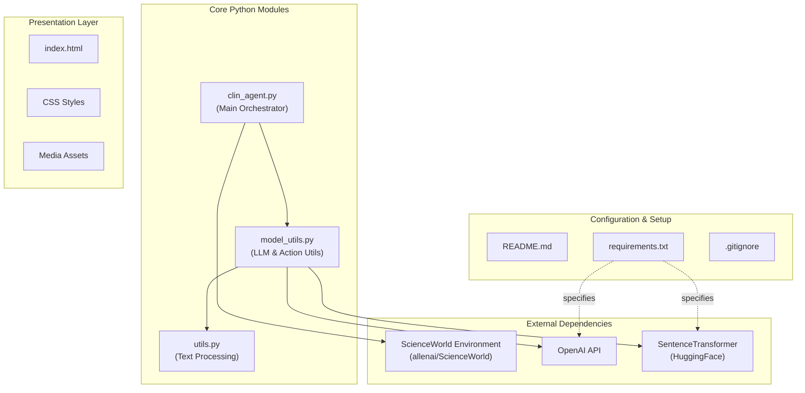
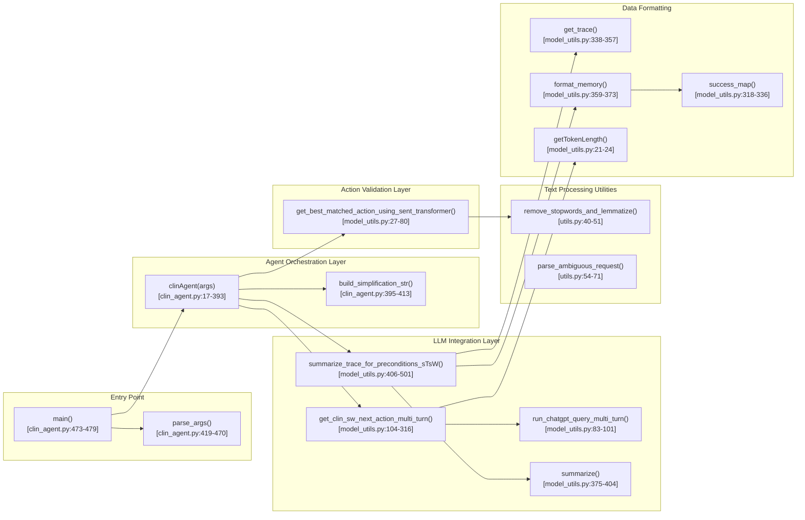
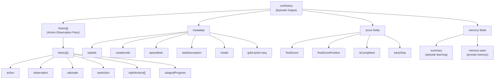
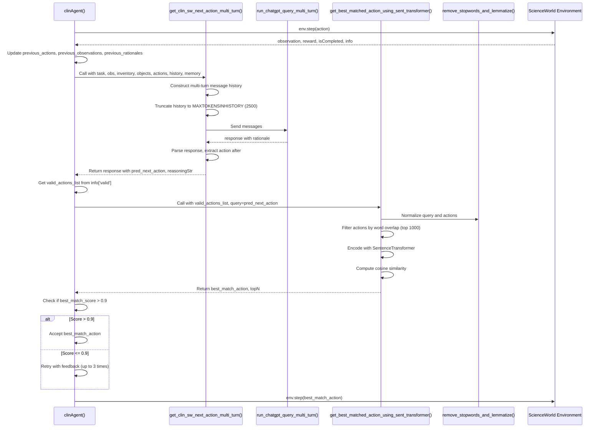
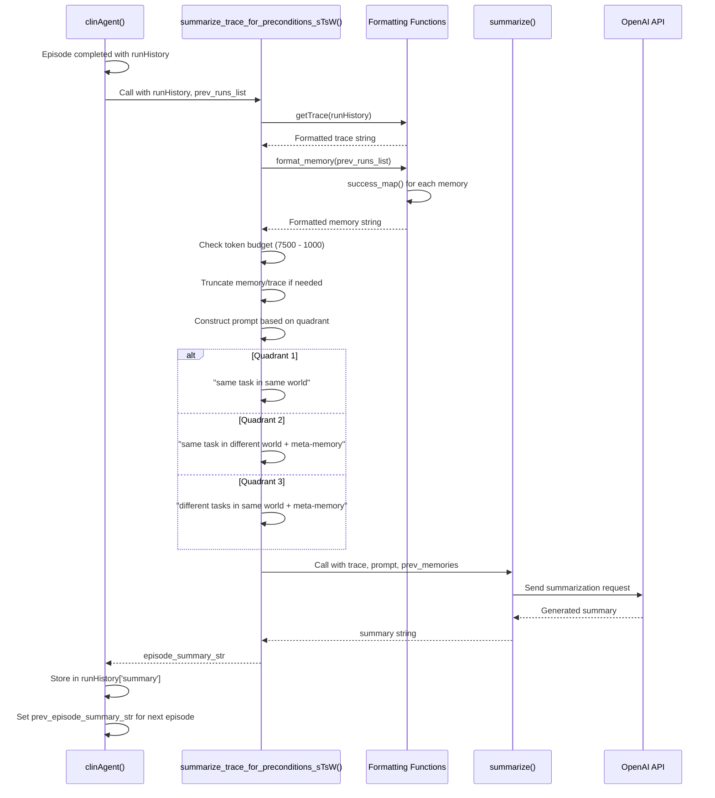
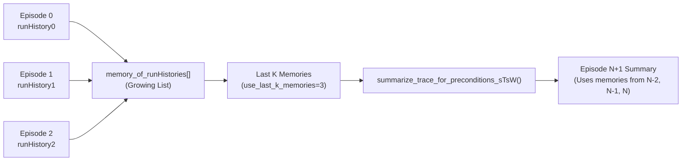

<!-- source: DeepWiki mcp.deepwiki.com · repo allenai/clin · page 7 Developer Guide · fetched 2026-10-26 -->

# Developer Guide

<details>
<summary>Relevant source files</summary>

The following files were used as context for generating this wiki page:

- [model_utils.py](model_utils.py)
- [scienceworld/clin_agent.py](scienceworld/clin_agent.py)
- [utils.py](utils.py)

</details>


This guide is intended for developers who want to understand, modify, or extend the CLIN codebase. It provides an overview of the code structure, key modules, data structures, and extension points.

For step-by-step instructions on setting up and running CLIN, see [Getting Started](#2). For detailed explanations of how the system works internally, see [System Architecture](#4). For information on specific utility functions, see [Text Processing Utilities](#7.2).

---

## Repository Organization

The CLIN repository follows a flat structure with three core Python modules and supporting configuration files:



**Sources:** Repository structure analysis, [.gitignore](), [requirements.txt](), [README.md]()

---

## Module Dependency Graph

The code is organized into three primary modules with clear separation of concerns:



**Sources:** [clin_agent.py](), [model_utils.py](), [utils.py]()

---

## Key Module Responsibilities

### clin_agent.py: Main Agent Orchestrator

The entry point and primary orchestration module. Contains a single main function that manages the entire agent lifecycle:

| Function | Line Range | Responsibility |
|----------|------------|----------------|
| `main()` | [473-479]() | Entry point that parses arguments and invokes agent |
| `parse_args()` | [419-470]() | Command-line argument parsing with argparse |
| `clinAgent(args)` | [17-393]() | Main agent loop managing episodes, trials, and memory |
| `build_simplification_str()` | [395-413]() | Constructs environment simplification configuration |

**Key responsibilities:**
- Episode and trial iteration
- ScienceWorld environment initialization and interaction
- Action-observation loop execution
- Memory management across episodes
- Run history persistence to JSON files

**Sources:** [clin_agent.py:1-483]()

### model_utils.py: LLM and Action Utilities

Contains all LLM interaction logic, action validation, and learning summarization:

| Function | Line Range | Responsibility |
|----------|------------|----------------|
| `get_clin_sw_next_action_multi_turn()` | [104-316]() | Constructs prompts and queries LLM for next action |
| `run_chatgpt_query_multi_turn()` | [83-101]() | Executes OpenAI API calls with retry logic |
| `get_best_matched_action_using_sent_transformer()` | [27-80]() | Matches LLM output to valid environment actions |
| `summarize_trace_for_preconditions_sTsW()` | [406-501]() | Generates causal abstraction summaries from episodes |
| `summarize()` | [375-404]() | Low-level LLM call for summarization |
| `get_trace()` | [338-357]() | Formats episode history for summarization |
| `format_memory()` | [359-373]() | Formats memory list for prompt inclusion |
| `success_map()` | [318-336]() | Maps reward scores to natural language feedback |
| `getTokenLength()` | [21-24]() | Counts tokens using tiktoken |

**Sources:** [model_utils.py:1-502]()

### utils.py: Text Processing Utilities

Low-level text processing functions used by action matching:

| Function | Line Range | Responsibility |
|----------|------------|----------------|
| `remove_stopwords_and_lemmatize()` | [40-51]() | Removes stopwords and applies lemmatization/stemming |
| `remove_stopwords()` | [30-36]() | Basic stopword removal without lemmatization |
| `parse_ambiguous_request()` | [54-71]() | Parses ScienceWorld ambiguous action prompts |

**Constants:**
- `STOP_WORDS`: List of English stopwords [6-21]()
- `LEMMATIZER`: WordNet lemmatizer instance [22]()
- `STEMMER`: Snowball stemmer instance [24]()
- `PUNCTUATION`: Set of punctuation characters [26]()

**Sources:** [utils.py:1-71]()

---

## Core Data Structures

### Run History JSON Schema

Each episode generates a JSON file with the following structure:



**Key fields:**
- `history`: Array of action-observation-rationale tuples
- `episodeIdx`: Episode number (0-indexed)
- `finalScore`: Final reward from ScienceWorld
- `summary`: Generated causal abstractions from this episode
- `memory-seen`: Memory string shown to agent during episode
- `rationale`: LLM's reasoning for each action
- `rawAction`: LLM's raw action before validation
- `topNActions`: Top-5 matched valid actions with similarity scores

**Generated by:** [clin_agent.py:320-363]()

**Sources:** [clin_agent.py:320-363]()

---

## Function Call Flow: Action Selection

The following diagram shows how the agent selects an action at each step:



**Sources:** [clin_agent.py:196-265](), [model_utils.py:104-316](), [model_utils.py:27-80]()

---

## Function Call Flow: Episode Summarization

After each episode, learnings are extracted and formatted:



**Sources:** [clin_agent.py:344-356](), [model_utils.py:406-501](), [model_utils.py:375-404]()

---

## Important Constants and Configuration

### Token Management

```python
# From model_utils.py:18
MAXTOKENSINHISTORY = 2500
```

The agent maintains a sliding window of recent action-observation history, limited to 2500 tokens. This prevents context overflow while preserving recent context.

**Implementation:** [model_utils.py:173-213]()

### Token Budget for Summarization

```python
# From model_utils.py:456
total_budget = 7500 - 1000  # 6500 tokens
```

Summarization prompts have a 6500 token budget, split between:
- Instructions and system prompt
- Previous episode memories
- Current episode trace
- Meta-memories (for Q2/Q3)

**Implementation:** [model_utils.py:456-486]()

### Retry Logic

| Operation | Max Retries | Implementation |
|-----------|-------------|----------------|
| OpenAI API calls | Infinite (with 2s sleep) | [model_utils.py:88-99]() |
| Action validation | 3 | [clin_agent.py:192-265]() |
| Duplicate action detection | 5 consecutive | [clin_agent.py:282-287]() |

**Sources:** [model_utils.py:18](), [model_utils.py:88-99](), [model_utils.py:456](), [clin_agent.py:192-265]()

---

## Extension Points

### Adding Support for New LLM Models

To add a new LLM provider or model:

1. **Modify `run_chatgpt_query_multi_turn()`** [model_utils.py:83-101]() to support the new API
2. **Update `model_name` parameter validation** in [clin_agent.py:432-433]()
3. **Adjust token counting** if the model uses a different tokenizer than `cl100k_base` [model_utils.py:17]()

Example modification points:
- OpenAI API call: [model_utils.py:90-95]()
- Model name parameter: [clin_agent.py:432-433]()
- Tokenizer initialization: [model_utils.py:17]()

### Modifying Prompts

Prompts are constructed in `get_clin_sw_next_action_multi_turn()`:

| Prompt Component | Line Range | Purpose |
|------------------|------------|---------|
| Task instruction | [124-130]() | Defines the agent's role |
| Memory injection | [131-154]() | Inserts learnings based on quadrant |
| History context | [156-157]() | Introduces action history |
| Current state | [225-231]() | Shows observation and inventory |
| Action format | [233-237]() | Lists valid action templates |
| Output format | [242-247]() | Specifies learning IDs, rationale, action structure |

**Quadrant-specific prompts:**
- Q1 (adaptation): [132-135]()
- Q2 (cross-environment): [137-144]()
- Q3 (cross-task): [146-154]()

**Sources:** [model_utils.py:104-316]()

### Modifying Summarization Logic

Summarization behavior is controlled in `summarize_trace_for_preconditions_sTsW()`:

| Aspect | Implementation | Line Range |
|--------|----------------|------------|
| Causal abstraction format | Prompt template | [443-449]() |
| Memory window size | `use_last_k_memories` parameter | [444]() |
| Token budget | `total_budget` calculation | [456-486]() |
| Quadrant-specific instructions | Meta-memory prompts | [424-431]() |

To change the learning format (e.g., from "X MAY BE NECESSARY to Y" to a different structure):
1. Modify the prompt at [443-449]()
2. Update any parsing logic that expects this format

**Sources:** [model_utils.py:406-501]()

### Customizing Action Validation

The action matching pipeline uses a two-stage approach:

**Stage 1: Word overlap filtering** [model_utils.py:32-52]()
- Normalizes actions using lemmatization and stopword removal
- Filters to top 1000 actions by word overlap
- Can be adjusted by changing `max_filtered_actions` [48-50]()

**Stage 2: SentenceTransformer semantic matching** [model_utils.py:56-76]()
- Uses `bert-base-nli-mean-tokens` model
- Computes cosine similarity
- Returns top-5 matches

To use a different SentenceTransformer model:
1. Change the model name in [clin_agent.py:23]()
2. Ensure the model is compatible with `sentence_transformers` library

To adjust the matching threshold:
- Modify the threshold check at [clin_agent.py:259]() (currently 0.9)

**Sources:** [model_utils.py:27-80](), [clin_agent.py:23](), [clin_agent.py:259]()

---

## Error Handling Patterns

### OpenAI API Error Handling

All OpenAI API calls include retry logic with exponential backoff:

```python
# Pattern used in model_utils.py
response = None
while response is None:
    try:
        response = openai.ChatCompletion.create(...)
    except Exception as e:
        print(e)
        print("GPT3 error. Retrying in 10 seconds...")
        time.sleep(2)  # Note: Message says 10s but sleeps 2s
```

**Locations:**
- [model_utils.py:88-99]() for action generation
- [model_utils.py:383-401]() for summarization

### Action Validation Error Handling

When the LLM generates an action that cannot be matched to valid actions:

1. First attempt: Try to match with SentenceTransformer
2. If match score < 0.9: Generate feedback message
3. Retry with feedback (up to 3 times): [clin_agent.py:192-265]()
4. After 3 failures: Accept the best match regardless of score

**Feedback message format:** [clin_agent.py:264]()
```
"Your generated action '{action}' cannot be matched to a valid action. 
Please retry with a different phrasing or a different action."
```

### Early Stopping Conditions

The agent stops early if:
1. **Duplicate actions:** Last 5 actions are identical [clin_agent.py:282-287]()
2. **Excessive length:** Action sequence exceeds 1.5× gold sequence length [clin_agent.py:289-294]()
3. **Task completion signals:** LLM outputs "TASK_COMPLETE" or similar phrases [clin_agent.py:217-226]()

**Sources:** [model_utils.py:88-99](), [model_utils.py:383-401](), [clin_agent.py:192-265](), [clin_agent.py:282-294]()

---

## Working with Gold Traces

Gold traces provide reference trajectories and memories for bootstrapping:

### Gold Trace File Format

Gold traces are JSON files with the following structure:
- `taskIdx`: Task number
- `variationIdx`: Variation number
- `summary`: Q1 memory (same task, same environment)
- `q2_summary`: Q2 memory (cross-environment)
- `q3_summary`: Q3 memory (cross-task)
- `history`: Action-observation sequence

### Loading Gold Traces

Gold traces can be provided in three formats:
1. **Single JSON file:** `--gold-traces path/to/file.json`
2. **JSONL file:** `--gold-traces path/to/file.jsonl` (one JSON per line)
3. **Directory:** `--gold-traces path/to/directory/` (loads all `.json` files)

**Loading logic:** [clin_agent.py:27-47]()

### Using Gold Memories

Gold memories are used when `--use-gold-memory-in-ep0` is set:
- Episode 0 uses the gold memory directly [clin_agent.py:130-133](), [clin_agent.py:184-185]()
- Subsequent episodes use their own generated summaries [clin_agent.py:186-187]()

For Q2/Q3, gold memories serve as "meta-memories" throughout all episodes [clin_agent.py:353]()

**Sources:** [clin_agent.py:27-74](), [clin_agent.py:130-133](), [clin_agent.py:184-187]()

---

## Memory Management Across Episodes

### Memory Accumulation



**Implementation:**
1. `memory_of_runHistories` accumulates all episode run histories [clin_agent.py:84](), [clin_agent.py:360]()
2. When summarizing episode N, the last K memories are used [clin_agent.py:345]()
3. Default K=3 (configurable via `--use-last-k-memories`)

### Memory Formatting for Prompts

The `format_memory()` function [model_utils.py:359-373]() formats memories as:

```
PREVIOUS LEARNINGS

TASK: {task description}
EPISODE: {episode number}
LEARNINGS: {summary string}

EVALUATION REPORT (for the attempt associated with the learning):
REWARD_FINAL: {score}. This means: {success description}
```

This format is included in both:
- Action selection prompts [model_utils.py:131-154]()
- Summarization prompts [model_utils.py:466-494]()

**Sources:** [clin_agent.py:84](), [clin_agent.py:345](), [clin_agent.py:360](), [model_utils.py:359-373]()

---

## Quadrant-Specific Behavior

### Quadrant 1: Adaptation (Same Task, Same Environment)

**Memory strategy:** Use recent episode summaries directly
- Episode 0: Can use gold memory if `--use-gold-memory-in-ep0=1`
- Episode 1+: Use summaries from previous episodes

**Prompt modification:** [model_utils.py:132-135]()
```
"Here is a summary of learnings based on your previous attempts on this task."
```

**Summarization:** No meta-memory, only previous episode memories [model_utils.py:443-449]()

### Quadrant 2: Cross-Environment (Same Task, New Environment)

**Memory strategy:** Use meta-memories for episode 0, then self-generated memories
- Episode 0: Use Q2 meta-memory from gold traces [clin_agent.py:138-140]()
- Episode 1+: Use episode summaries from current environment

**Prompt modification for Episode 0:** [model_utils.py:138-140]()
```
"Here is a summary of learnings based on your previous attempts to solve related tasks 
in some environments. However, your current environment can differ from previous 
environments in terms of presence of objects, starting location etc."
```

**Summarization:** Include meta-summary in prompt context [model_utils.py:469](), [model_utils.py:492-494]()

### Quadrant 3: Cross-Task (New Task, Same Environment)

**Memory strategy:** Use meta-memories for episode 0, then self-generated memories
- Episode 0: Use Q3 meta-memory from gold traces [clin_agent.py:148-150]()
- Episode 1+: Use episode summaries from current task

**Prompt modification for Episode 0:** [model_utils.py:148-150]()
```
"Here is a summary of learnings based on your previous attempts to some tasks 
in your current environment. These learnings will contain related information 
about the environment such as presence of objects, starting location, 
navigational information, etc."
```

**Summarization:** Include meta-summary but with different context [model_utils.py:429-431]()

**Sources:** [model_utils.py:116-154](), [model_utils.py:424-431](), [model_utils.py:469](), [model_utils.py:492-494](), [clin_agent.py:51-73]()

---

## Command-Line Interface

The agent is invoked through `parse_args()` which defines all command-line arguments:

### Core Arguments

| Argument | Type | Default | Description |
|----------|------|---------|-------------|
| `--task-num` | str | "4" | Task index to run |
| `--var-num` | int | 1 | Task variation index |
| `--num-episodes` | int | 2 | Number of episodes to run |
| `--gpt-model` | str | "gpt-4-0613" | GPT model name |
| `--device` | str | Required | Device for SentenceTransformer |
| `--quadrant` | int | Required | Evaluation quadrant (1, 2, or 3) |

### Memory Configuration

| Argument | Type | Default | Description |
|----------|------|---------|-------------|
| `--use-gold-memory-in-ep0` | int | 0 | Whether to use gold memory in episode 0 |
| `--gold-traces` | str | "" | Path to gold traces (file/dir) |
| `--use-last-k-memories` | int | 3 | Number of previous memories to use |
| `--summarize-end-of-episode` | int | 1 | Whether to generate summaries |

### Environment Configuration

| Argument | Type | Default | Description |
|----------|------|---------|-------------|
| `--jar-path` | str | None | Path to ScienceWorld JAR |
| `--env-step-limit` | int | 100 | Max steps per episode |
| `--simplifications-preset` | str | None | Preset simplifications ("easy") |
| `--teleport` | flag | False | Enable instant movement |
| `--self-watering-plants` | flag | False | Plants don't need watering |
| `--open-containers` | flag | False | Containers start open |
| `--open-doors` | flag | False | Doors start open |
| `--no-electrical` | flag | False | Remove electrical actions |

### Output Configuration

| Argument | Type | Default | Description |
|----------|------|---------|-------------|
| `--output-path-prefix` | str | "save-histories" | Output directory for results |
| `--temperature` | float | 0.0 | LLM temperature |

**Implementation:** [clin_agent.py:419-470]()

**Sources:** [clin_agent.py:419-470]()

---

## File I/O and Persistence

### Output File Structure

Each episode generates files in the output directory:

```
{output_path_prefix}/
├── Task{taskIdx}_Var{varIdx}_Ep{episodeIdx}_runhistories.json
├── summary.txt
```

### Run History JSON

Generated at: [clin_agent.py:115-116]()
Written at: [clin_agent.py:359-363]()

Contains:
- Complete action-observation history
- Rationales for each action
- Top-N matched actions for each step
- Subgoal progress tracking
- Episode summary (learnings)
- Final score and completion status

### Summary Text File

Generated at: [clin_agent.py:89-90]()
Written at: [clin_agent.py:381-392]()

Contains:
- Simplification settings
- Tabular summary of all episodes
- Final scores and completion status

**Format:**
```
---------------------------------------------------------------------
 Summary (ChatGPT Agent)
 Simplifications: {simplificationStr}
---------------------------------------------------------------------
task	Name	var	epi	score	complete?
{taskIdx}	{taskName}	{varIdx}	{episodeIdx}	{score}	{isCompleted}
...
---------------------------------------------------------------------
```

**Sources:** [clin_agent.py:89-90](), [clin_agent.py:115-116](), [clin_agent.py:359-363](), [clin_agent.py:381-392]()

---

For detailed information on specific subsystems, see:
- [Code Structure](#7.1) for detailed file organization
- [Text Processing Utilities](#7.2) for stopword removal and lemmatization functions
- [Extending CLIN](#7.3) for adding new capabilities
- [Dependencies and Requirements](#7.4) for Python package details

---

