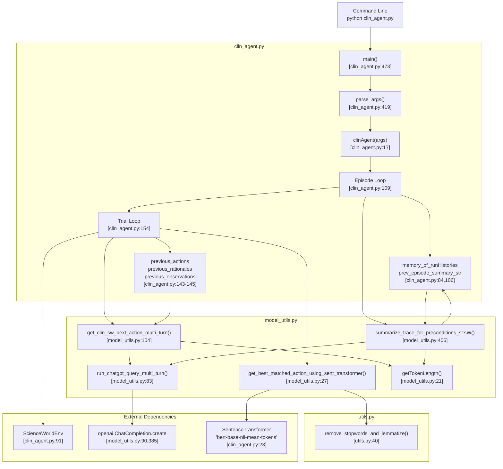
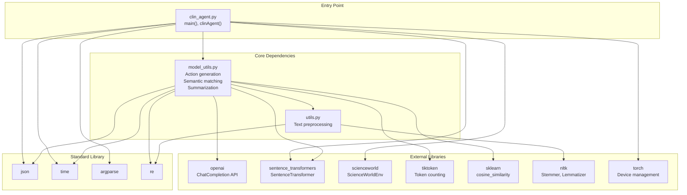

<!-- source: DeepWiki mcp.deepwiki.com · repo allenai/clin · page 7.1 Code Structure · fetched 2026-10-26 -->

# Code Structure

<details>
<summary>Relevant source files</summary>

The following files were used as context for generating this wiki page:

- [.gitignore](.gitignore)
- [model_utils.py](model_utils.py)
- [scienceworld/clin_agent.py](scienceworld/clin_agent.py)
- [utils.py](utils.py)

</details>


## Purpose and Scope

This page provides a technical overview of the CLIN repository's code organization, including file layout, module responsibilities, and key code entities. It is intended for developers who want to understand or extend the codebase.

For installation and setup instructions, see [Prerequisites](#2.1) and [Installation](#2.2). For information on extending functionality, see [Extending CLIN](#7.3). For detailed API documentation of text processing functions, see [Text Processing Utilities](#7.2).

---

## Repository Layout

The CLIN repository follows a flat structure with three primary Python modules at the root level, plus a presentation website and configuration files.

```
clin/
├── scienceworld/
│   └── clin_agent.py          # Main agent orchestrator and episode loop
├── model_utils.py              # LLM integration and action matching utilities
├── utils.py                    # Text processing and parsing utilities
├── requirements.txt            # Python dependencies
├── README.md                   # Setup and usage documentation
├── index.html                  # Project website (presentation layer)
├── videos/                     # Media assets for website
├── images/                     # Diagrams and screenshots for website
└── .gitignore                  # Git configuration

```

The repository separates **execution code** (the three Python modules) from **presentation assets** (website files). Output data is stored in a `logs/` directory (excluded from version control via [.gitignore:1]()).

**Sources:** [.gitignore:1-4](), [scienceworld/clin_agent.py:1](), [model_utils.py:1](), [utils.py:1]()

---

## Core Python Modules

### Module Overview Table

| Module | Primary Responsibility | Key Functions | Lines of Code |
|--------|----------------------|---------------|---------------|
| `scienceworld/clin_agent.py` | Agent orchestration, episode management, memory handling | `clinAgent()`, `parse_args()`, `build_simplification_str()` | 483 |
| `model_utils.py` | LLM interaction, action generation, semantic matching, learning summarization | `get_clin_sw_next_action_multi_turn()`, `get_best_matched_action_using_sent_transformer()`, `summarize_trace_for_preconditions_sTsW()` | 502 |
| `utils.py` | Text preprocessing, stop word removal, lemmatization | `remove_stopwords_and_lemmatize()`, `parse_ambiguous_request()` | 71 |

**Sources:** [scienceworld/clin_agent.py:1-483](), [model_utils.py:1-502](), [utils.py:1-71]()

---

## Detailed Module Breakdown

### 1. `scienceworld/clin_agent.py` - Agent Orchestrator

**Primary Function:** `clinAgent(args)`

This is the main entry point and orchestration layer. It manages:

- **Episode Loop**: Iterates through multiple episodes (trials) for continual learning [scienceworld/clin_agent.py:109-364]()
- **Environment Interaction**: Interfaces with the ScienceWorld environment via the `ScienceWorldEnv` class [scienceworld/clin_agent.py:91]()
- **Memory Management**: Maintains `memory_of_runHistories` list to accumulate episode learnings [scienceworld/clin_agent.py:84]()
- **Gold Trace Loading**: Loads pre-recorded gold summaries from files or directories [scienceworld/clin_agent.py:27-47]()
- **History Persistence**: Writes episode transcripts to JSON files [scienceworld/clin_agent.py:115-116]()

#### Key Functions

| Function | Purpose | Location |
|----------|---------|----------|
| `clinAgent(args)` | Main agent loop; orchestrates episodes, trials, and memory | [scienceworld/clin_agent.py:17-393]() |
| `parse_args()` | Parses command-line arguments including task numbers, model selection, and quadrant settings | [scienceworld/clin_agent.py:419-471]() |
| `build_simplification_str(args)` | Constructs environment simplification string from boolean flags | [scienceworld/clin_agent.py:395-413]() |

#### State Variables Within Episode Loop

- `previous_actions`: List of action strings executed so far [scienceworld/clin_agent.py:144]()
- `previous_rationales`: List of reasoning strings from LLM [scienceworld/clin_agent.py:143]()
- `previous_observations`: List of environment observation strings [scienceworld/clin_agent.py:145]()
- `prev_episode_summary_str`: Learning summary from previous episode [scienceworld/clin_agent.py:106]()
- `memory_of_runHistories`: Accumulator for all episode run histories [scienceworld/clin_agent.py:84]()

**Sources:** [scienceworld/clin_agent.py:17-393](), [scienceworld/clin_agent.py:419-471]()

---

### 2. `model_utils.py` - LLM Integration Layer

This module provides three major subsystems:

#### 2.1 Action Generation Subsystem

**Primary Function:** `get_clin_sw_next_action_multi_turn()`

Constructs multi-turn conversation prompts and queries GPT models to generate the next action with rationale. Manages:

- **Prompt Construction**: Builds system message, task description, memory injection, and action history [model_utils.py:124-168]()
- **Token Budget Management**: Truncates history to fit within `MAXTOKENSINHISTORY` (2500 tokens) [model_utils.py:18](), [model_utils.py:173-213]()
- **Quadrant-Specific Prompting**: Adapts memory presentation based on evaluation quadrant [model_utils.py:131-154]()
- **Response Parsing**: Extracts reasoning and action from delimited LLM response (split by `###`) [model_utils.py:287-298]()

Key parameters:
- `task`: Task description string
- `current_obs`: Current environment observation
- `next_actions_set`: Valid action templates
- `previous_rationales`, `previous_actions`, `previous_observations`: Episode history
- `summary`: Learning summary string to inject into prompt
- `quadrant`: Evaluation quadrant (1, 2, or 3)

**Sources:** [model_utils.py:104-316]()

#### 2.2 Action Matching Subsystem

**Primary Function:** `get_best_matched_action_using_sent_transformer()`

Maps free-form LLM-generated actions to valid environment actions using semantic similarity:

1. **First Pass - Lexical Filtering**: Counts common words between query and actions, keeping top 1000 (or 100,000 on GPU) [model_utils.py:32-54]()
2. **Second Pass - Semantic Matching**: Uses `SentenceTransformer('bert-base-nli-mean-tokens')` [model_utils.py:23]() to compute cosine similarity [model_utils.py:57-63]()
3. **Returns**: Best-matched action and top-5 actions with similarity scores [model_utils.py:66-80]()

The text preprocessing uses `remove_stopwords_and_lemmatize()` from `utils.py` [model_utils.py:32-41]().

**Sources:** [model_utils.py:27-81]()

#### 2.3 Learning Summarization Subsystem

**Primary Function:** `summarize_trace_for_preconditions_sTsW()`

Generates structured learning summaries from episode traces using GPT-4:

- **Memory Retrieval**: Accesses last K episode memories from `prev_runs_list` [model_utils.py:423]()
- **Token Budget Management**: Truncates memories and traces to fit 7500 token budget [model_utils.py:456-486]()
- **Quadrant-Aware Prompting**: Includes meta-memories for Q2 and Q3 evaluations [model_utils.py:424-431]()
- **Structured Output**: Returns numbered list of causal abstractions [model_utils.py:443-449]()

Helper functions:
- `get_trace()`: Converts run history to readable trace format [model_utils.py:338-357]()
- `format_memory()`: Formats previous episode memories with evaluation reports [model_utils.py:359-373]()
- `success_map()`: Maps numeric scores to natural language feedback [model_utils.py:318-336]()

**Sources:** [model_utils.py:406-501]()

#### 2.4 Tokenization and GPT Query Management

**Utility Functions:**

| Function | Purpose | Location |
|----------|---------|----------|
| `getTokenLength(strIn)` | Counts tokens using `tiktoken` encoder (`cl100k_base`) | [model_utils.py:21-24]() |
| `run_chatgpt_query_multi_turn()` | Wraps OpenAI API with retry logic on exceptions | [model_utils.py:83-101]() |
| `summarize()` | Generic summarization function with system/user prompts | [model_utils.py:375-404]() |

The global `tokenizer` is initialized using `tiktoken.get_encoding("cl100k_base")` [model_utils.py:17]().

**Sources:** [model_utils.py:10-24](), [model_utils.py:83-101](), [model_utils.py:375-404]()

---

### 3. `utils.py` - Text Processing Utilities

Provides linguistic preprocessing for action matching and text normalization.

#### Key Functions

| Function | Purpose | Algorithm | Location |
|----------|---------|-----------|----------|
| `remove_stopwords_and_lemmatize()` | Removes stop words, applies stemming/lemmatization | Uses NLTK's `SnowballStemmer` and `WordNetLemmatizer` | [utils.py:40-51]() |
| `remove_stopwords()` | Basic stop word removal | Filters against `STOP_WORDS` list (115 words) | [utils.py:30-36]() |
| `parse_ambiguous_request()` | Parses ambiguous action prompts from environment | Regex extraction of indexed actions | [utils.py:54-71]() |

#### Global Data Structures

- `STOP_WORDS`: List of 115 common English stop words [utils.py:6-21]()
- `LEMMATIZER`: WordNet lemmatizer instance [utils.py:22]()
- `STEMMER`: Snowball stemmer for English [utils.py:24]()
- `PUNCTUATION`: Set of punctuation characters to filter [utils.py:26]()

**Sources:** [utils.py:1-71]()

---

## Code Entity Relationship Diagram

The following diagram maps the flow from CLI invocation through the main agent loop, showing actual function calls and data structures:



**Sources:** [scienceworld/clin_agent.py:17-393](), [model_utils.py:27-316](), [model_utils.py:406-501](), [utils.py:40-51]()

---

## Data Flow: Action Generation Pipeline

This diagram shows the detailed flow from environment observation to executed action, with specific data structures:

```mermaid
graph LR
    subgraph "Environment State"
        Env["ScienceWorldEnv<br/>env.step(action)"]
        Obs["observation: str<br/>reward: float<br/>info: dict"]
        Valid["info['valid']<br/>List[str]"]
    end
    
    subgraph "Agent Loop [clin_agent.py:154-295]"
        History["previous_actions: List[str]<br/>previous_rationales: List[str]<br/>previous_observations: List[str]"]
        Memory["prev_episode_summary_str: str<br/>gold_memory: str"]
    end
    
    subgraph "Action Generation [model_utils.py:104-316]"
        BuildPrompt["Build Multi-Turn Messages<br/>- Task description<br/>- Memory injection<br/>- Action history (last 6)<br/>- Token truncation"]
        GPTQuery["run_chatgpt_query_multi_turn()<br/>model: gpt-4-0613<br/>max_tokens: 256"]
        ParseResp["Parse Response<br/>Split on '###'<br/>Extract rationale + action"]
        
        Response["response: dict<br/>'response_str': str<br/>'pred_next_action': str<br/>'reasoningStr': str"]
    end
    
    subgraph "Action Matching [model_utils.py:27-81]"
        Preprocess["remove_stopwords_and_lemmatize()<br/>query & actions"]
        LexicalFilter["Lexical Filter<br/>Count common words<br/>Keep top 1000"]
        Encode["SentenceTransformer.encode()<br/>bert-base-nli-mean-tokens"]
        CosSim["cosine_similarity()<br/>sklearn.metrics.pairwise"]
        BestMatch["best_match_action: str<br/>topN: List[Tuple[str, float]]"]
    end
    
    subgraph "Validation & Retry [clin_agent.py:193-265]"
        CheckScore["similarity > 0.9?"]
        Retry["num_retries < 3"]
        Feedback["feedback: str"]
    end
    
    Env --> Obs
    Obs --> Valid
    
    History --> BuildPrompt
    Memory --> BuildPrompt
    BuildPrompt --> GPTQuery
    GPTQuery --> ParseResp
    ParseResp --> Response
    
    Response --> Preprocess
    Valid --> Preprocess
    Preprocess --> LexicalFilter
    LexicalFilter --> Encode
    Encode --> CosSim
    CosSim --> BestMatch
    
    BestMatch --> CheckScore
    CheckScore -->|No| Retry
    Retry -->|Yes| Feedback
    Feedback --> BuildPrompt
    
    CheckScore -->|Yes| Env
    History --> Env
```



**Sources:** [scienceworld/clin_agent.py:154-295](), [model_utils.py:104-316](), [model_utils.py:27-81]()

---

## Module Dependencies



**Sources:** [scienceworld/clin_agent.py:1-15](), [model_utils.py:1-15](), [utils.py:1-4]()

---

## Supporting Files

### Configuration Files

| File | Purpose | Key Contents |
|------|---------|--------------|
| `requirements.txt` | Python dependency specification | OpenAI, SentenceTransformers, ScienceWorld, tiktoken, scikit-learn, NLTK |
| `.gitignore` | Git exclusion rules | `logs/`, `.DS_Store`, `*.pyc` |
| `README.md` | Setup instructions and usage guide | Installation steps, command examples, API key setup |

### Output Directory Structure

Generated at runtime when agent executes:

```
logs/
└── [task/variation/episode]/
    ├── Task{N}_Var{M}_Ep{K}_runhistories.json
    └── summary.txt
```

JSON files contain complete episode traces with actions, observations, rationales, and learning summaries [scienceworld/clin_agent.py:115-116](), [scienceworld/clin_agent.py:359-363]().

**Sources:** [.gitignore:1-4](), [scienceworld/clin_agent.py:85-90](), [scienceworld/clin_agent.py:115-116]()

---

## Key Data Structures

### Episode Run History Structure

The `runHistory` dictionary persisted to JSON files [scienceworld/clin_agent.py:320-363]():

```python
{
    "taskIdx": int,
    "taskName": str,
    "variationIdx": int,
    "episodeIdx": int,
    "taskDescription": str,
    "history": [
        {
            "action": str,              # Action executed
            "observation": str,          # Environment response
            "rationale": str,            # LLM reasoning
            "rawAction": str,            # Pre-matching action
            "topNActions": List[Tuple], # Similarity scores
            "subgoalProgress": dict      # Goal completion state
        }
    ],
    "finalScore": float,
    "finalScorePositive": float,
    "isCompleted": bool,
    "earlyStop": bool,
    "model": str,                    # GPT model name
    "gold-action-seq": str,          # Gold action sequence
    "memory-seen": str,              # Summary used in episode
    "summary": str                   # Generated learning summary
}
```

This structure is built incrementally during the episode [scienceworld/clin_agent.py:320-339]() and written to disk after completion [scienceworld/clin_agent.py:359-363]().

**Sources:** [scienceworld/clin_agent.py:320-363]()

---

## Constants and Configuration

### Token Budget Management

| Constant | Value | Purpose | Location |
|----------|-------|---------|----------|
| `MAXTOKENSINHISTORY` | 2500 | Maximum tokens for action history in prompts | [model_utils.py:18]() |
| `maxTokensInHistory` | 2500 | Used in action generation | [model_utils.py:173]() |
| `total_budget` | 6500 (7500-1000) | Budget for summarization prompts | [model_utils.py:456]() |

### Action History Window

The agent includes the **last 6 action-observation pairs** in prompts [model_utils.py:182](), truncating based on token count.

### Retry Logic

- **Action Matching Retries**: Maximum 3 attempts [scienceworld/clin_agent.py:192]()
- **Similarity Threshold**: Actions with similarity > 0.9 are accepted [scienceworld/clin_agent.py:259]()
- **GPT Query Retries**: Infinite with 2-second delay on exceptions [model_utils.py:88-99]()

**Sources:** [model_utils.py:18](), [model_utils.py:173](), [model_utils.py:456](), [scienceworld/clin_agent.py:182](), [scienceworld/clin_agent.py:192](), [scienceworld/clin_agent.py:259]()

---

## Execution Flow Summary

1. **Initialization**: `main()` → `parse_args()` → `clinAgent(args)` [scienceworld/clin_agent.py:473-478]()
2. **Gold Memory Loading**: Read gold traces from file/directory [scienceworld/clin_agent.py:27-73]()
3. **Episode Loop**: Iterate through episodes [scienceworld/clin_agent.py:109]()
4. **Trial Loop**: Generate actions until task completion [scienceworld/clin_agent.py:154]()
   - Call `get_clin_sw_next_action_multi_turn()` [scienceworld/clin_agent.py:196]()
   - Call `get_best_matched_action_using_sent_transformer()` [scienceworld/clin_agent.py:245]()
   - Execute action in environment [scienceworld/clin_agent.py:159]()
5. **Episode Summarization**: Call `summarize_trace_for_preconditions_sTsW()` [scienceworld/clin_agent.py:346]()
6. **Persistence**: Write run history to JSON [scienceworld/clin_agent.py:361]()

**Sources:** [scienceworld/clin_agent.py:17-393](), [scienceworld/clin_agent.py:473-478]()

---

