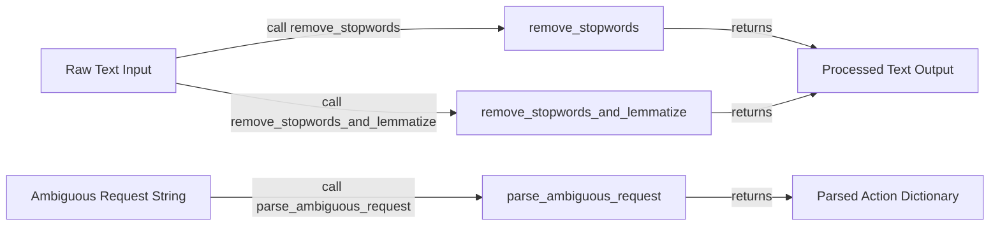

<!-- source: DeepWiki mcp.deepwiki.com · repo allenai/clin · page 7.2 Text Processing Utilities · fetched 2026-10-26 -->

# Text Processing Utilities

<details>
<summary>Relevant source files</summary>

The following files were used as context for generating this wiki page:

- [utils.py](utils.py)

</details>


This document describes the text processing utility functions provided in the CLIN codebase. These utilities are primarily responsible for stop word removal, stemming, lemmatization, and parsing of ambiguous request strings. They are foundational for normalizing and preparing text for downstream tasks such as action matching, memory summarization, and LLM prompt construction.

**Scope:**  
- This page covers the implementation and usage of text processing functions in `utils.py`, including stop word removal, stemming, lemmatization, and request parsing.
- For information about the overall code structure, see [Code Structure](#7.1).
- For details on how these utilities are used in the agent's decision-making and memory systems, see [Agent Orchestration](#4.2) and [Learning and Summarization System](#4.5).

---

## Purpose of Text Processing Utilities

Text processing utilities in CLIN standardize and clean natural language inputs and outputs. This ensures consistent comparison, matching, and storage of text data, which is critical for:
- Semantic action matching
- Memory summarization
- Preprocessing LLM inputs and outputs

These utilities are implemented in `utils.py` and are used throughout the execution layer of the system.

**Sources:**  
[utils.py:1-71]()

---

## Key Functions and Their Roles

The following table summarizes the main text processing functions and constants:

| Function / Constant                | Purpose                                                                                 | File Reference         |
|------------------------------------|----------------------------------------------------------------------------------------|-----------------------|
| `STOP_WORDS`                      | List of common English stop words for filtering                                        | [utils.py:6-21]()     |
| `PUNCTUATION`                     | Set of punctuation characters to remove                                                | [utils.py:26]()       |
| `remove_stopwords`                 | Removes stop words and (optionally) applies stemming                                  | [utils.py:30-37]()    |
| `remove_stopwords_and_lemmatize`   | Removes stop words, (optionally) applies stemming and/or lemmatization                 | [utils.py:40-52]()    |
| `parse_ambiguous_request`          | Parses ambiguous request strings into a dictionary of index-action pairs               | [utils.py:54-71]()    |

**Sources:**  
[utils.py:6-71]()

---

## Function Details

### Stop Word Removal and Stemming

- **`remove_stopwords(text, do_stemming=False)`**  
  - Tokenizes input text, removes stop words and punctuation, and (optionally) applies stemming using NLTK's `SnowballStemmer`.
  - Returns a space-separated string of filtered tokens.

- **`remove_stopwords_and_lemmatize(text, do_stemming=False, lemmatize=False)`**  
  - Tokenizes input text, removes stop words and punctuation.
  - (Optionally) applies stemming and/or lemmatization using NLTK's `WordNetLemmatizer`.
  - Returns a space-separated string of processed tokens.

**Example Usage Table:**

| Input Text                  | Function                       | Stemming | Lemmatization | Output                |
|-----------------------------|-------------------------------|----------|---------------|-----------------------|
| "The cats are running."     | `remove_stopwords`            | False    | N/A           | "cats running"        |
| "The cats are running."     | `remove_stopwords`            | True     | N/A           | "cat run"             |
| "The cats are running."     | `remove_stopwords_and_lemmatize` | False | True          | "cat run"             |

**Sources:**  
[utils.py:30-37]()  
[utils.py:40-52]()

---

### Ambiguous Request Parsing

- **`parse_ambiguous_request(request_string)`**  
  - Parses a string that starts with "Ambiguous request" and contains numbered action options.
  - Returns a dictionary mapping integer indices to action strings.

**Example Input:**
```
Ambiguous request
1: open the door
2: close the window
3: turn on the light
```

**Example Output:**
```python
{1: "open the door", 2: "close the window", 3: "turn on the light"}
```

**Sources:**  
[utils.py:54-71]()

---

## Diagram: Text Processing Utilities in Code

**Title:** "Text Processing Utilities: Code Entities and Data Flow"

```mermaid
flowchart TD
    subgraph "utils.py"
        STOPWORDS["STOP_WORDS [utils.py:6-21]"]
        PUNCT["PUNCTUATION [utils.py:26]"]
        STEMMER["SnowballStemmer [utils.py:24]"]
        LEMMATIZER["WordNetLemmatizer [utils.py:22]"]
        RemoveSW["remove_stopwords(text, do_stemming) [utils.py:30-37]"]
        RemoveSWLem["remove_stopwords_and_lemmatize(text, do_stemming, lemmatize) [utils.py:40-52]"]
        ParseAmbig["parse_ambiguous_request(request_string) [utils.py:54-71]"]
    end

    RemoveSW -- uses --> STOPWORDS
    RemoveSW -- uses --> PUNCT
    RemoveSW -- uses --> STEMMER
    RemoveSWLem -- uses --> STOPWORDS
    RemoveSWLem -- uses --> PUNCT
    RemoveSWLem -- uses --> STEMMER
    RemoveSWLem -- uses --> LEMMATIZER
    ParseAmbig -- uses --> "re (regex)"

    classDef code fill:#fff,stroke:#333,stroke-width:1px;
    class STOPWORDS,PUNCT,STEMMER,LEMMATIZER,RemoveSW,RemoveSWLem,ParseAmbig code;
```

**Sources:**  
[utils.py:6-71]()

---

## Diagram: Natural Language Input to Processed Output

**Title:** "Natural Language to Processed Text: Utility Function Pathways"



**Sources:**  
[utils.py:30-37]()  
[utils.py:40-52]()  
[utils.py:54-71]()

---

## Usage Context

These text processing utilities are used throughout the CLIN execution layer, including:
- Action matching and validation (see [Action Generation and Validation](#4.4))
- Memory summarization and retrieval (see [Learning and Summarization System](#4.5))
- Preprocessing LLM prompts and outputs

They are not intended for use in the presentation layer or website code.

**Sources:**  
[utils.py:1-71]()

---

## Summary Table: Utility Functions

| Function Name                    | Input Type         | Output Type         | Typical Use Case                        |
|----------------------------------|--------------------|---------------------|-----------------------------------------|
| `remove_stopwords`               | `str`              | `str`               | Normalize text for matching/comparison  |
| `remove_stopwords_and_lemmatize` | `str`              | `str`               | Further normalization for semantic tasks|
| `parse_ambiguous_request`        | `str`              | `dict[int, str]`    | Parse LLM ambiguous action responses    |

**Sources:**  
[utils.py:30-37]()  
[utils.py:40-52]()  
[utils.py:54-71]()

---

## Additional Notes

- These utilities depend on NLTK for tokenization, stemming, and lemmatization. Ensure NLTK data is downloaded and available in your environment.
- The stop word list and punctuation set are defined locally in `utils.py` and can be modified if needed for domain-specific requirements.

**Sources:**  
[utils.py:1-71]()

---

