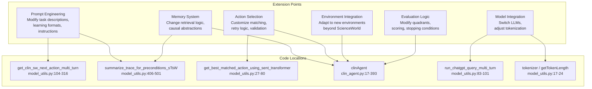
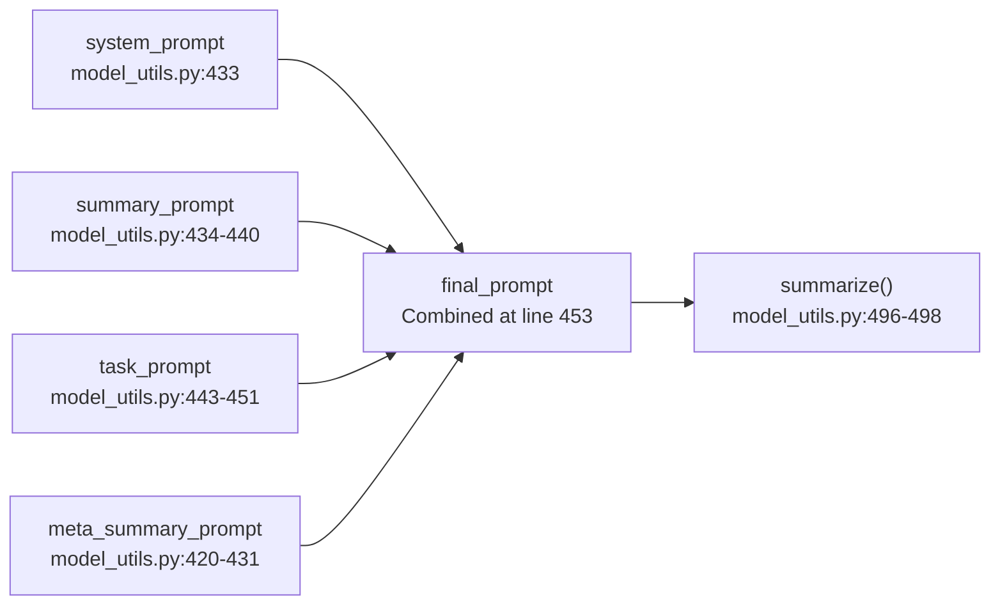
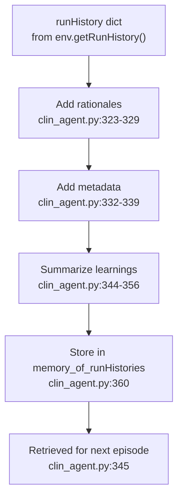
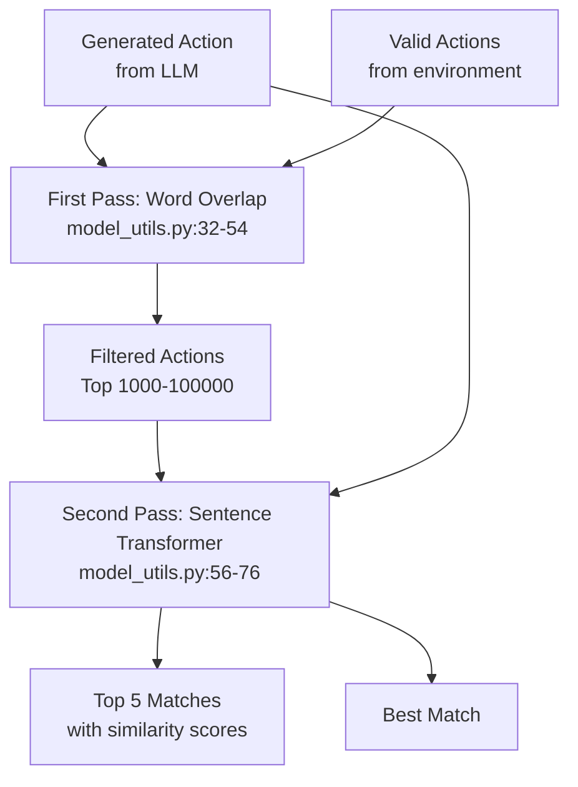
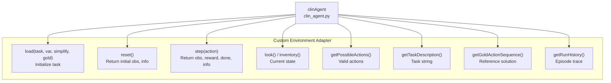
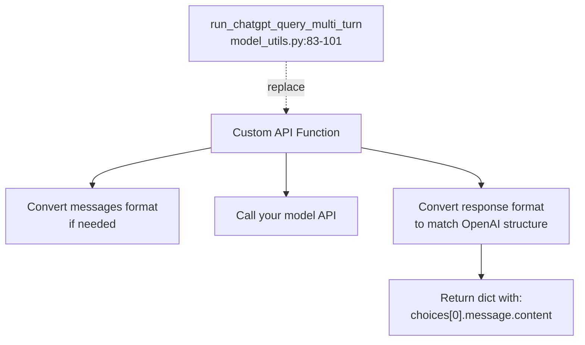
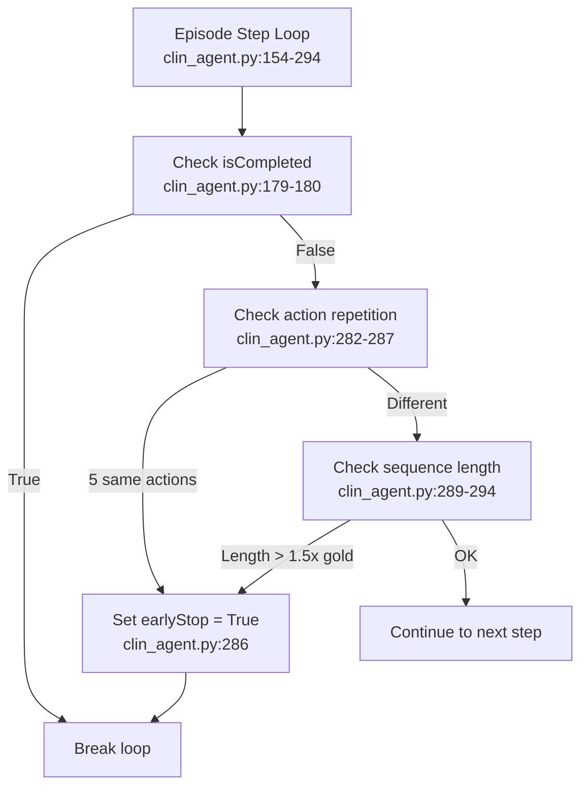

<!-- source: DeepWiki mcp.deepwiki.com · repo allenai/clin · page 7.3 Extending CLIN · fetched 2026-10-26 -->

# Extending CLIN

<details>
<summary>Relevant source files</summary>

The following files were used as context for generating this wiki page:

- [model_utils.py](model_utils.py)
- [scienceworld/clin_agent.py](scienceworld/clin_agent.py)

</details>


## Purpose and Scope

This guide provides technical details for developers who want to extend or modify the CLIN system. It covers key extension points in the codebase, including prompt modification, memory system customization, action selection adaptation, and environment integration. For basic usage without code modifications, see [Quick Start Example](#2.3). For understanding the overall code organization, see [Code Structure](#7.1).

---

## Extension Points Overview

The following diagram maps the primary extension points in CLIN to their corresponding code locations:



**Sources:** [model_utils.py:1-502](), [clin_agent.py:1-483]()

---

## Modifying Prompts

### Action Generation Prompts

The primary action generation prompt is constructed in `get_clin_sw_next_action_multi_turn`. This function builds a multi-turn conversation with task-specific instructions and memory context.

| Prompt Component | Code Location | Purpose |
|-----------------|---------------|---------|
| Task description | [model_utils.py:124-130]() | Introduces the task to the agent |
| Memory integration | [model_utils.py:131-154]() | Injects learnings from previous episodes |
| History context | [model_utils.py:156-216]() | Provides recent action-observation pairs |
| Action format instructions | [model_utils.py:222-246]() | Specifies valid action templates |
| Response format | [model_utils.py:242-246]() | Defines output structure (learnings, rationale, action) |

**Modifying task instructions:** Edit the `sw_prompt_task` string construction at [model_utils.py:124-157](). The base prompt is defined at lines 124-130, with quadrant-specific memory prompts added conditionally.

**Customizing response format:** Modify the format specification at [model_utils.py:242-246]() to change how the model structures its output. The current format expects:
```
I used learning id(s): <comma-separated list>
$$$ <rationale>
### <action>
```

**Adjusting action hints:** Modify the `actions_str` replacement logic at [model_utils.py:222-223]() to add clarifying hints for specific action templates.

### Summarization Prompts

Learning summarization prompts are constructed in `summarize_trace_for_preconditions_sTsW`.



**Modifying causal abstraction format:** The format "X MAY BE NECESSARY to Y" is defined at [model_utils.py:445-448](). To change the learning structure, modify these lines and the corresponding instructions in `summary_prompt`.

**Changing summarization instructions:** Edit `summary_prompt` at [model_utils.py:434-440]() to alter how the model interprets traces. Edit `task_prompt` at [model_utils.py:443-451]() to change the desired output format.

**Quadrant-specific prompts:** Meta-memory prompts for quadrants 2 and 3 are conditionally added at [model_utils.py:424-431](). Modify these to change cross-environment or cross-task learning behavior.

**Sources:** [model_utils.py:375-501]()

---

## Customizing the Memory System

### Memory Retrieval and Storage

Memory management occurs in the main agent loop at [clin_agent.py:84-364]().

| Memory Component | Storage Location | Retrieval Location |
|-----------------|------------------|-------------------|
| Episode summaries | `memory_of_runHistories` list | [clin_agent.py:345]() |
| Gold memories | `gold_summaries_map` dict | [clin_agent.py:49-73]() |
| Meta-memories | Passed via `gold_memory` | [clin_agent.py:353]() |
| Recent learnings | `prev_episode_summary_str` | [clin_agent.py:187]() |

**Changing memory window size:** Modify the `use_last_k_memories` parameter at [clin_agent.py:345]() and [clin_agent.py:444](). This controls how many previous episodes inform the current summarization.

**Custom memory indexing:** The current implementation uses dictionaries keyed by `taskIdx` and `variationIdx`. To implement more sophisticated indexing (e.g., similarity-based retrieval), modify the memory structures at [clin_agent.py:49-73]() and retrieval logic at [clin_agent.py:130-133]().

### Memory Format Customization



**Adding custom fields to memory:** Extend the `runHistory` dictionary after line [clin_agent.py:339](). The structure is saved to JSON at [clin_agent.py:361](), so any serializable data can be added.

**Custom learning formats:** Modify `format_memory` at [model_utils.py:359-373]() to change how memories are formatted for prompt injection. The current format includes task, episode, learnings, and evaluation report.

**Sources:** [clin_agent.py:17-393](), [model_utils.py:359-373](), [model_utils.py:406-501]()

---

## Adapting Action Selection

### Semantic Action Matching

The action matching pipeline uses a two-pass approach implemented in `get_best_matched_action_using_sent_transformer`.



**Changing the semantic model:** Replace `bert-base-nli-mean-tokens` at [clin_agent.py:23]() with a different SentenceTransformer model. Ensure it supports the same encoding interface.

**Adjusting filtering parameters:**
- First-pass filter size: [model_utils.py:48-52]() (1000 for CPU, 100000 for CUDA)
- Top-N returned: [model_utils.py:73]() (currently 5)

**Modifying text normalization:** The preprocessing uses `remove_stopwords_and_lemmatize` at [model_utils.py:32-42](). To change normalization, modify the utility function in `utils.py` or call a different function here.

### Retry Logic and Validation

The agent retries action generation when semantic matching fails, implemented at [clin_agent.py:191-265]().

**Adjusting retry threshold:** The matching threshold is set at [clin_agent.py:259-261](). Actions with similarity score > 0.9 are accepted. Lower this threshold for more permissive matching, raise it for stricter matching.

**Changing max retries:** Modify `max_num_retries_executor` at [clin_agent.py:192](). Currently set to 3.

**Custom validation logic:** Add validation checks before line [clin_agent.py:259](). For example, to validate action syntax or check for specific keywords.

**Feedback messages:** Modify the feedback template at [clin_agent.py:264]() to provide different error messages to the model on retry.

**Sources:** [model_utils.py:27-80](), [clin_agent.py:191-265]()

---

## Integrating New Environments

### Environment Interface Requirements

CLIN currently integrates with ScienceWorld via the `ScienceWorldEnv` class. To adapt to a new environment, implement the following interface:

| Required Method | Purpose | Called At |
|----------------|---------|-----------|
| `load(taskName, varIdx, simplification, generateGoldPath)` | Initialize environment for a specific task/variation | [clin_agent.py:118]() |
| `reset()` | Reset environment to initial state | [clin_agent.py:121]() |
| `step(action)` | Execute action, return observation, reward, done, info | [clin_agent.py:159]() |
| `look()` | Get current observation | [clin_agent.py:198]() |
| `inventory()` | Get current inventory | [clin_agent.py:199]() |
| `getPossibleObjects()` | Get valid object names | [clin_agent.py:200]() |
| `getPossibleActions()` | Get valid action templates | [clin_agent.py:201]() |
| `getTaskDescription()` | Get task description | [clin_agent.py:197]() |
| `getGoldActionSequence()` | Get reference solution | [clin_agent.py:290]() |
| `getGoalProgressJSON()` | Get subgoal progress | [clin_agent.py:147]() |
| `getRunHistory()` | Get episode history | [clin_agent.py:320]() |



**Implementing the adapter:**

1. Create a wrapper class that provides the required interface
2. Replace `ScienceWorldEnv` import at [clin_agent.py:7]()
3. Instantiate your environment at [clin_agent.py:91]()
4. Ensure `info` dict from `step()` contains `'valid'` (list of valid actions) and `'score'` (current score)

**Observation format:** CLIN expects string observations. If your environment returns structured data, convert it to natural language in your adapter's `look()` method.

**Action format:** The agent generates free-text actions. Your adapter should either:
- Accept templated actions like ScienceWorld (e.g., "pick up OBJ")
- Convert free-text to environment-specific commands in the `step()` method
- Provide a comprehensive list in `getPossibleActions()` for semantic matching

### Gold Trace Format

If using gold traces for episode 0 bootstrapping, they must follow this format:

```json
{
  "taskIdx": "4",
  "variationIdx": "1",
  "summary": "Learning text for Q1",
  "q2_summary": "Learning text for Q2",
  "q3_summary": "Learning text for Q3",
  "history": [...]
}
```

The loading logic is at [clin_agent.py:26-73](). Modify to support different formats.

**Sources:** [clin_agent.py:7-392](), [clin_agent.py:91]()

---

## Switching LLM Models

### Using Different OpenAI Models

CLIN uses OpenAI's chat completion API at [model_utils.py:83-101]().

**Changing the model:** Set `--gpt-model` parameter to any OpenAI chat model:
- `gpt-3.5-turbo` (faster, cheaper)
- `gpt-4` (more capable)
- `gpt-4-0613` (default, deterministic)
- `gpt-4-turbo` (longer context)

**Adjusting token limits:**
- Action generation: [model_utils.py:262]() (currently 256)
- Summarization: [model_utils.py:498]() (currently 1000)
- History context: [model_utils.py:18]() (currently 2500)

### Integrating Non-OpenAI Models

To use models outside OpenAI's API (e.g., local models, Anthropic Claude, etc.):



**Implementation steps:**

1. **Create API wrapper:** Implement a function matching the signature of `run_chatgpt_query_multi_turn` that returns a dict with structure:
   ```python
   {
       'choices': [{
           'message': {
               'content': '<response text>'
           }
       }]
   }
   ```

2. **Replace API calls:** Update calls at:
   - [model_utils.py:259-264]() for action generation
   - [model_utils.py:385-397]() for summarization

3. **Adjust tokenization:** If your model uses a different tokenizer, replace `tiktoken` usage at [model_utils.py:17-24]().

**Temperature control:** Both action generation and summarization support temperature parameters passed through command-line arguments ([clin_agent.py:438]()).

**Sources:** [model_utils.py:83-101](), [model_utils.py:17-24]()

---

## Adding New Evaluation Scenarios

### Quadrant System

CLIN supports three evaluation quadrants, controlled via the `--quadrant` parameter:

| Quadrant | Scenario | Memory Source | Code Location |
|----------|----------|---------------|---------------|
| 1 | Same task, same environment | Previous episodes of same task | [model_utils.py:132-135]() |
| 2 | Same task, different environment | Cross-environment meta-memory | [model_utils.py:137-144]() |
| 3 | Different task, same environment | Cross-task meta-memory | [model_utils.py:146-154]() |

**Adding new quadrants:**

1. **Add quadrant parameter handling:** Extend the conditional logic at [model_utils.py:131-154]() to handle new quadrant numbers.

2. **Customize memory retrieval:** Modify the memory loading logic at [clin_agent.py:56-73]() to load appropriate memories for your quadrant.

3. **Adjust summarization prompts:** Add quadrant-specific prompts in `summarize_trace_for_preconditions_sTsW` at [model_utils.py:423-431]().

**Example: Adding Quadrant 4 (few-shot transfer):**

```python
# In model_utils.py, after line 154:
if quadrant == 4:
    sw_prompt_task += \
        f"Here are a few example solutions from related tasks. "\
        f"Use these patterns to guide your approach:\n{summary}"

# In clin_agent.py, after line 71:
elif quadrant == 4:
    gold_summaries_map[sum["taskIdx"]] = {
        sum["variationIdx"]: sum["q4_summary"]
    }
```

**Sources:** [model_utils.py:131-154](), [model_utils.py:423-431](), [clin_agent.py:51-73]()

---

## Customizing Episode Management

### Early Stopping Conditions

CLIN implements several early stopping conditions in the agent loop:



**Modifying repetition detection:** Change the threshold at [clin_agent.py:284]() (currently 5 identical actions) or the comparison logic at [clin_agent.py:282-287]().

**Adjusting length limits:** Modify the multiplier at [clin_agent.py:290]() (currently 1.5x gold sequence length).

**Adding custom stopping conditions:** Insert checks before [clin_agent.py:280](). Set `earlyStop = True` and `break` to terminate the episode.

### Episode Limits and Scoring

**Episode count:** Set via `--num-episodes` at [clin_agent.py:430]() or in function call at [clin_agent.py:109]().

**Step limit:** Set via `--env-step-limit` at [clin_agent.py:428]() or when creating the environment at [clin_agent.py:91]().

**Score tracking:** Scores are extracted from environment info at [clin_agent.py:166-168](). The final score is stored in the run history at [clin_agent.py:333]().

**Custom metrics:** To track additional metrics:

1. Store values in variables during the episode loop (after [clin_agent.py:168]())
2. Add to `runHistory` dict before saving (after [clin_agent.py:339]())
3. Include in final scores list (modify [clin_agent.py:301-309]())

**Sources:** [clin_agent.py:154-294](), [clin_agent.py:301-339]()

---

## Command-Line Argument Extension

To add new command-line arguments for your extensions:

**Adding arguments:** Extend `parse_args()` at [clin_agent.py:419-470]():

```python
parser.add_argument("--your-new-flag", type=str, default="value",
                    help="Description of your flag")
```

**Argument groups:** Use argument groups for related flags (see simplification group at [clin_agent.py:454-466]()).

**Accessing in code:** Arguments are stored in the `args` dict passed to `clinAgent` at [clin_agent.py:478](). Access with `args['your_new_flag']`.

**Sources:** [clin_agent.py:419-470](), [clin_agent.py:473-478]()

---

