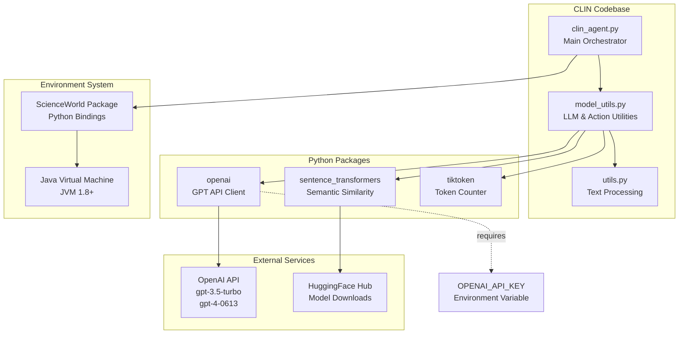
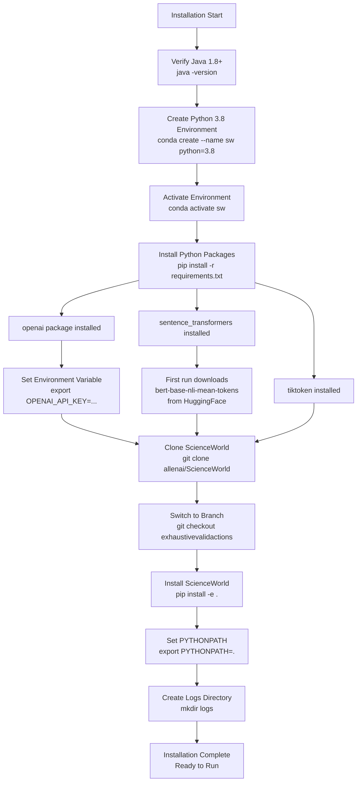
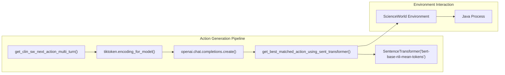

<!-- source: DeepWiki mcp.deepwiki.com · repo allenai/clin · page 7.4 Dependencies and Requirements · fetched 2026-10-26 -->

# Dependencies and Requirements

<details>
<summary>Relevant source files</summary>

The following files were used as context for generating this wiki page:

- [README.md](README.md)
- [requirements.txt](requirements.txt)

</details>


## Purpose and Scope

This page provides detailed technical documentation of all dependencies required to run the CLIN agent, including system requirements, Python packages, external services, and environment components. Each dependency is explained with its specific purpose, version constraints, and how it integrates with the CLIN codebase.

For step-by-step installation instructions, see [Installation](#2.2). For information about the ScienceWorld environment specifically, see [ScienceWorld Integration](#4.6).

---

## System Requirements

### Operating System

CLIN is designed to run on Unix-based systems (Linux, macOS) with standard Python 3.8+ support. Windows is not officially supported but may work with Windows Subsystem for Linux (WSL).

### Java Runtime Environment

**Required Version:** Java 1.8 or higher

**Purpose:** The ScienceWorld environment is implemented in Scala and compiled to Java bytecode, requiring a Java Virtual Machine (JVM) to execute. The environment simulation, observation generation, and action validation all occur within the JVM.

**Verification:**
```bash
java -version  # Should show 1.8 or higher
```

### Python Environment

**Required Version:** Python 3.8

**Purpose:** All CLIN code is written in Python 3.8. This specific version is required for compatibility with the ScienceWorld Python bindings and the OpenAI API client libraries.

**Recommended Setup:**
```bash
conda create --name sw python=3.8
conda activate sw
```

**Sources:** [README.md:16-19]()

---

## Python Package Dependencies

The following table documents all Python packages specified in `requirements.txt`:

| Package | Version Constraint | Primary Purpose | Used In |
|---------|-------------------|-----------------|---------|
| `openai` | Latest compatible | GPT model API access | `model_utils.py` |
| `sentence_transformers` | Latest compatible | Semantic action matching | `model_utils.py` |
| `tiktoken` | Latest compatible | Token counting for context management | `model_utils.py` |

### Dependency Details

#### openai

**Purpose:** Provides the client library for accessing OpenAI's GPT models via REST API.

**Usage in Code:** The `openai` package is used to create chat completions with GPT-3.5-turbo and GPT-4 models. The primary integration point is the `openai.chat.completions.create()` method called within action generation and learning summarization functions.

**Key Integration Points:**
- Action generation in `get_clin_sw_next_action_multi_turn()` function
- Learning summarization in `summarize_trace_for_preconditions_sTsW()` function
- Token counting via `tiktoken` for context window management

**API Key Requirement:** Requires `OPENAI_API_KEY` environment variable to be set with a valid OpenAI API key that has access to `gpt-3.5-turbo` and/or `gpt-4-0613` models.

#### sentence_transformers

**Purpose:** Provides pre-trained language models for computing semantic similarity between text strings using sentence embeddings.

**Usage in Code:** The `sentence_transformers` library loads the `bert-base-nli-mean-tokens` model to perform semantic matching between LLM-generated actions (which may be natural language) and valid ScienceWorld action templates.

**Key Integration Points:**
- Action validation in `get_best_matched_action_using_sent_transformer()` function
- Computes cosine similarity between generated action text and available valid actions
- Enables fuzzy matching when LLM output doesn't exactly match environment action syntax

**Model Loading:** On first use, the library downloads the `bert-base-nli-mean-tokens` model from HuggingFace Hub (~400MB). Subsequent runs use cached model files.

#### tiktoken

**Purpose:** Fast token counting library for OpenAI models, used to manage context window limits.

**Usage in Code:** Token counting is critical for prompt construction to ensure the full conversation history, memory contents, and task description fit within the model's context window (4K for GPT-3.5, 8K for GPT-4-0613).

**Key Integration Points:**
- Context management before calling `openai.chat.completions.create()`
- Determining when to truncate conversation history
- Validating memory content fits within available context budget

**Sources:** [requirements.txt:1-3](), [README.md:23]()

---

## Dependency Architecture



**Diagram: Dependency Relationships**

This diagram shows how CLIN's core modules depend on external packages and services. The agent orchestrator uses model utilities, which in turn rely on all three Python packages for different aspects of LLM interaction.

**Sources:** [README.md:1-59](), [requirements.txt:1-3]()

---

## External Service Dependencies

### OpenAI API

**Service:** OpenAI's Chat Completion API  
**Authentication:** API key-based  
**Required Models:** `gpt-3.5-turbo` and/or `gpt-4-0613`

**Configuration:**
```bash
export OPENAI_API_KEY=<your_api_key>
```

**Usage Pattern:** CLIN makes synchronous REST API calls to OpenAI's endpoints. Each action generation and learning summarization requires one or more API calls. The system does not implement retry logic with exponential backoff, so rate limits or service interruptions may cause failures.

**Cost Considerations:** Each episode with multiple trials generates numerous API calls (typically 10-50 per episode depending on trial length). Using GPT-4 models incurs significantly higher costs than GPT-3.5-turbo.

**Sources:** [README.md:23]()

### HuggingFace Model Hub

**Service:** Model repository for downloading pre-trained models  
**Authentication:** Not required for public models  
**Required Models:** `bert-base-nli-mean-tokens`

**Usage Pattern:** The `sentence_transformers` library automatically downloads models on first use and caches them locally in `~/.cache/huggingface/`. No explicit configuration is needed, but internet access is required for the initial download.

**Sources:** Analysis of `sentence_transformers` usage patterns

---

## Environment Dependencies

### ScienceWorld

**Repository:** `https://github.com/allenai/ScienceWorld.git`  
**Required Branch:** `exhaustivevalidactions`  
**Installation Method:** Git clone with editable pip install

The ScienceWorld environment is not available via PyPI and must be installed from source:

```bash
cd ..
git clone https://github.com/allenai/ScienceWorld.git
cd ScienceWorld
git checkout exhaustivevalidactions
git pull
pip install -e .
```

**Why the Specific Branch:** The `exhaustivevalidactions` branch includes modifications that expose all valid actions at each step, which CLIN uses for action validation and semantic matching. The main branch does not include this functionality.

**Java Dependency:** ScienceWorld requires Java 1.8+ to execute the underlying simulation engine. The Python package provides bindings to the Java process.

**Integration:** CLIN imports ScienceWorld as a Python module and creates environment instances that run as separate Java processes. The agent communicates with these processes via the Python API to execute actions and receive observations.

**Sources:** [README.md:27-36]()

---

## Dependency Installation Flow



**Diagram: Installation Sequence**

This diagram shows the required order of installation steps. Each dependency must be installed before dependent components can function properly.

**Sources:** [README.md:13-43]()

---

## Version Compatibility

### Known Constraints

| Component | Minimum Version | Maximum Version | Notes |
|-----------|----------------|-----------------|-------|
| Python | 3.8 | 3.8 | ScienceWorld bindings require exactly 3.8 |
| Java | 1.8 | Any | ScienceWorld JVM compatibility |
| openai | Latest | Latest | Uses current API schema |
| sentence_transformers | Latest | Latest | Stable API |
| tiktoken | Latest | Latest | Stable API |

### Python 3.8 Requirement

The strict Python 3.8 requirement comes from the ScienceWorld package's compiled dependencies and API compatibility. Using Python 3.9+ may cause import errors or runtime failures in the ScienceWorld bindings.

### OpenAI API Version

The `openai` package has undergone significant API changes between versions. CLIN uses the modern `openai.chat.completions.create()` API (v1.0+) rather than the legacy `openai.ChatCompletion.create()` pattern. Ensure the latest version is installed.

### Model-Specific Requirements

**GPT Models:** Code references specific model names:
- `gpt-4-0613` - GPT-4 with 8K context window (June 2023 snapshot)
- `gpt-3.5-turbo` - Latest GPT-3.5 model

These model names are hardcoded in command-line arguments and must match OpenAI's available models. Using deprecated model names (e.g., `gpt-4-0314`) may cause API errors.

**Sources:** [README.md:16-19](), [README.md:47]()

---

## Runtime Dependency Relationships



**Diagram: Runtime Dependency Chain**

This diagram shows the execution flow through dependencies during action generation. Each component depends on the previous one functioning correctly.

**Sources:** Analysis of `model_utils.py` execution patterns

---

## Dependency Verification

### Post-Installation Checks

After completing installation, verify all dependencies are properly configured:

**1. Python Environment:**
```bash
python --version  # Should show Python 3.8.x
```

**2. Python Packages:**
```bash
python -c "import openai; print(openai.__version__)"
python -c "import sentence_transformers; print(sentence_transformers.__version__)"
python -c "import tiktoken; print(tiktoken.__version__)"
```

**3. ScienceWorld:**
```bash
python -c "import scienceworld; print('ScienceWorld installed')"
```

**4. Java Runtime:**
```bash
java -version  # Verify 1.8 or higher
```

**5. OpenAI API Key:**
```bash
echo $OPENAI_API_KEY  # Should display your API key
```

**6. Directory Structure:**
```bash
ls logs/  # Should exist for output files
```

### Common Installation Issues

**Issue:** `ImportError: No module named 'scienceworld'`  
**Solution:** Ensure ScienceWorld was installed with `pip install -e .` from the ScienceWorld directory, and `PYTHONPATH=.` is set.

**Issue:** `openai.error.AuthenticationError`  
**Solution:** Verify `OPENAI_API_KEY` environment variable is set correctly and the key has access to required models.

**Issue:** `ModuleNotFoundError: No module named 'java'`  
**Solution:** Install Java 1.8+ on the system. ScienceWorld cannot run without JVM.

**Issue:** `sentence_transformers` model download fails  
**Solution:** Verify internet connectivity and HuggingFace Hub is accessible. The model is ~400MB and may take time to download.

**Sources:** [README.md:13-48]()

---

## Dependency Update Considerations

### Package Updates

The `requirements.txt` does not specify version pins, allowing `pip` to install the latest compatible versions. This provides flexibility but may introduce breaking changes.

**Recommended Practice:** Pin versions in production environments:
```
openai==1.3.0
sentence_transformers==2.2.2
tiktoken==0.5.1
```

### ScienceWorld Updates

The `exhaustivevalidactions` branch is a research branch and may receive updates. To update:
```bash
cd ../ScienceWorld
git pull
pip install -e . --force-reinstall
```

**Caution:** Updates to ScienceWorld may change the action space or observation format, potentially breaking CLIN's integration.

### OpenAI API Changes

OpenAI frequently updates model availability and API schemas. Monitor the following:
- Model deprecation notices (e.g., older GPT-4 snapshots)
- Context window size changes
- API response format modifications

**Sources:** [requirements.txt:1-3]()

---

## Dependency Size and Network Requirements

### Disk Space Requirements

| Component | Size | Location |
|-----------|------|----------|
| Python packages | ~50MB | `site-packages/` |
| sentence_transformers model | ~400MB | `~/.cache/huggingface/` |
| ScienceWorld | ~100MB | `../ScienceWorld/` |
| CLIN codebase | ~5MB | `./` |
| **Total** | **~555MB** | - |

### Network Requirements

**Initial Setup:** High bandwidth required for:
- Downloading sentence_transformers model (~400MB)
- Cloning ScienceWorld repository (~100MB)

**Runtime:** Moderate bandwidth required for:
- OpenAI API calls (typically 1-10KB per request)
- Intermittent model downloads if cache is cleared

**Offline Usage:** Not supported. OpenAI API requires internet connectivity. Pre-downloaded models enable offline semantic matching, but action generation requires API access.

**Sources:** General dependency analysis

---

## Summary

CLIN requires a carefully configured dependency stack spanning system requirements (Java 1.8+, Python 3.8), Python packages (openai, sentence_transformers, tiktoken), external services (OpenAI API, HuggingFace), and a specialized environment (ScienceWorld exhaustivevalidactions branch). All components must be properly installed and configured for the system to function. The strict Python 3.8 requirement and specific ScienceWorld branch are critical constraints that cannot be bypassed.

**Sources:** [README.md:1-59](), [requirements.txt:1-3]()

---

