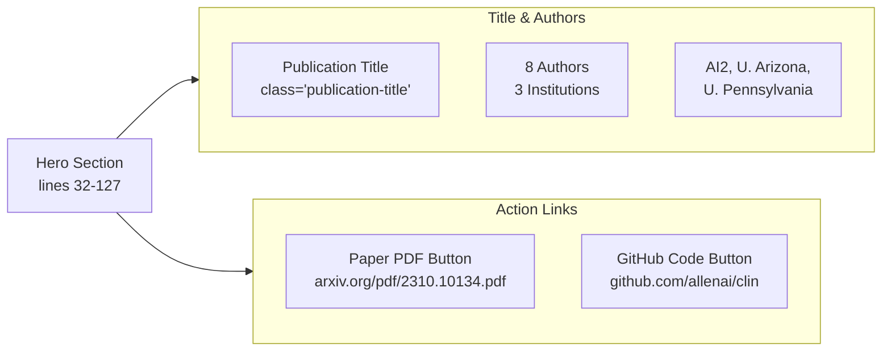
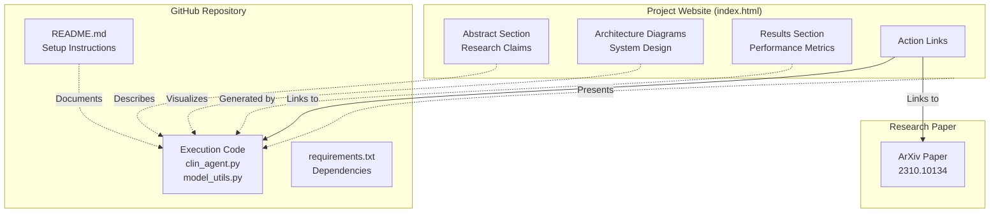
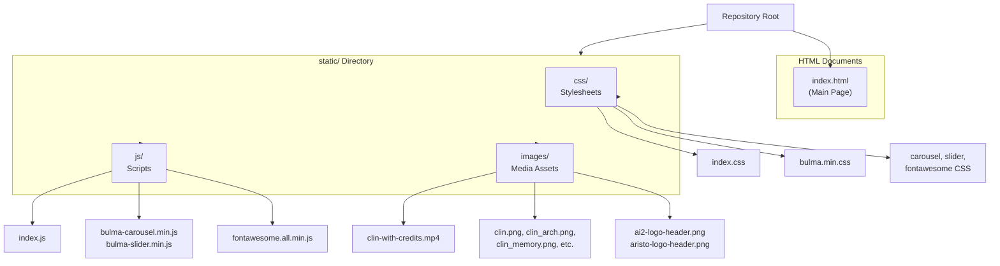

<!-- source: DeepWiki mcp.deepwiki.com · repo allenai/clin · page 8 Project Website · fetched 2026-10-26 -->

# Project Website

<details>
<summary>Relevant source files</summary>

The following files were used as context for generating this wiki page:

- [index.html](index.html)
- [static/css/index.css](static/css/index.css)

</details>


## Purpose and Scope

The project website is a static, single-page HTML presentation that showcases the CLIN research project, its methodology, results, and contributions. This documentation covers the website's architecture, content organization, and role within the repository.

This page provides an overview of the website component. For detailed information about the HTML structure and CSS styling, see [Website Structure](#8.1). For documentation of images, videos, and other media files, see [Media Assets](#8.2). For information about the actual agent implementation that the website presents, see [Agent Orchestration](#4.2) and [System Architecture](#4).

## Overview

The project website serves as the public-facing research dissemination layer for CLIN. Unlike the execution code (pages 4-7), the website is purely presentational and does not execute any agent logic. It is a static HTML page hosted at the repository root that:

- Presents the research paper's abstract and key contributions
- Visualizes CLIN's architecture and memory system through diagrams
- Displays empirical results comparing CLIN to baseline methods
- Provides links to the arXiv paper and GitHub repository
- Credits the research team and institutional affiliations

The website is completely self-contained and can be deployed to any static hosting service without backend dependencies.

**Sources:** [index.html:1-252]()

## Website Architecture

The website follows a single-page design with vertical scrolling through multiple sections. Below is the high-level organization:

### Page Structure Diagram

```mermaid
graph TD
    HTML["index.html<br/>(Root Document)"]
    
    subgraph HeadSection["HTML Head Section"]
        Meta["Meta Tags<br/>charset, description, keywords"]
        Fonts["Google Fonts<br/>Google Sans, Noto Sans"]
        CSS["CSS Resources"]
        JS["JavaScript Libraries"]
    end
    
    subgraph CSSResources["CSS Framework & Styling"]
        Bulma["bulma.min.css<br/>(Framework)"]
        BulmaCarousel["bulma-carousel.min.css"]
        BulmaSlider["bulma-slider.min.css"]
        FontAwesome["fontawesome.all.min.css"]
        Academicons["academicons.min.css"]
        CustomCSS["static/css/index.css<br/>(Custom Styles)"]
    end
    
    subgraph JSResources["JavaScript Libraries"]
        jQuery["jQuery 3.5.1"]
        FontAwesomeJS["fontawesome.all.min.js"]
        CarouselJS["bulma-carousel.min.js"]
        SliderJS["bulma-slider.min.js"]
        CustomJS["static/js/index.js"]
    end
    
    subgraph BodySections["Body Content Sections"]
        Hero["Hero Section<br/>Title, Authors, Links"]
        Teaser["Teaser Section<br/>Demo Video"]
        Abstract["Abstract Section<br/>Research Overview"]
        Content["Content Section<br/>Diagrams & Results"]
        BibTeX["BibTeX Section<br/>Citation"]
        Footer["Footer Section<br/>Logos & Credits"]
    end
    
    HTML --> HeadSection
    HTML --> BodySections
    
    HeadSection --> CSS
    HeadSection --> JS
    
    CSS --> Bulma
    CSS --> BulmaCarousel
    CSS --> BulmaSlider
    CSS --> FontAwesome
    CSS --> Academicons
    CSS --> CustomCSS
    
    JS --> jQuery
    JS --> FontAwesomeJS
    JS --> CarouselJS
    JS --> SliderJS
    JS --> CustomJS
    
    Hero --> Teaser
    Teaser --> Abstract
    Abstract --> Content
    Content --> BibTeX
    BibTeX --> Footer
```



**Sources:** [index.html:1-28](), [index.html:29-252]()

## Content Sections

The website is organized into distinct semantic sections, each serving a specific purpose:

### Section Breakdown

| Section | HTML Class/ID | Line Range | Purpose |
|---------|---------------|------------|---------|
| Hero | `class="hero"` | [32-127]() | Paper title, author list with affiliations, and action buttons (Paper PDF, GitHub link) |
| Teaser | `class="hero teaser"` | [129-141]() | Auto-playing demonstration video showing CLIN in action |
| Abstract | `class="section"` | [144-162]() | Research abstract explaining CLIN's contributions and key findings |
| Content | `class="section"` | [164-212]() | Main content area with architecture diagrams, memory visualization, adaptation results, and generalization performance |
| BibTeX | `id="BibTeX"` | [216-226]() | Citation information in BibTeX format |
| Footer | `class="footer"` | [229-249]() | AI2 and Aristo logos, credits, and template attribution |

**Sources:** [index.html:32-249]()

### Hero Section Details

The hero section establishes the research context:



The hero section uses structured markup with author blocks [index.html:38-62]() that include hyperlinks to personal websites and superscript notation for institutional affiliations [index.html:64-68]().

**Sources:** [index.html:32-127]()

### Teaser Video Section

The teaser section [index.html:129-141]() features an auto-playing, looping video demonstration:

```html
<video id="teaser" autoplay muted loop playsinline height="100%">
  <source src="./static/images/clin-with-credits.mp4" type="video/mp4">
</video>
```

This video is stored at `static/images/clin-with-credits.mp4` and demonstrates CLIN adapting across multiple trials with captions.

**Sources:** [index.html:129-141]()

### Content Section Organization

The main content section [index.html:144-212]() contains multiple subsections, each with a specific visualization:

| Subsection | Image Asset | Line Range | Content Type |
|------------|-------------|------------|--------------|
| Abstract | N/A | [149-161]() | Text description of CLIN's approach and results |
| Concept Diagram | `clin.png` | [170-177]() | Illustrates memory creation/adaptation and generalization |
| Architecture | `clin_arch.png` | [178-182]() | Shows controller, executor, memory generator, and simulator |
| Memory Schema | `clin_memory.png` | [184-188]() | Visualizes causal relations (necessary, does not contribute) |
| Adaptation Results | `clin_adaptation.png` | [190-194]() | Performance graphs for rapid adaptation |
| Generalization Table | `clin-table.png` | [196-198]() | Comparison with RL and language agent baselines |
| Generalization Graphs | `clin_generalization.png` | [200-203]() | Transfer learning performance visualization |
| Related Work | N/A | [205-208]() | Links to Voyager, ExpeL, and other related projects |

**Sources:** [index.html:144-212]()

## Technology Stack

The website leverages a modern frontend technology stack without requiring any backend infrastructure:

### Frameworks and Libraries

| Technology | Version/Source | Purpose |
|------------|----------------|---------|
| **Bulma CSS** | `bulma.min.css` | CSS framework providing grid system, typography, and component styling |
| **Bulma Carousel** | `bulma-carousel.min.css` | Carousel component extensions |
| **Bulma Slider** | `bulma-slider.min.css` | Slider component extensions |
| **Font Awesome** | CDN + local | Icon library for buttons and UI elements |
| **Academicons** | CDN (v1) | Academic-specific icons (e.g., arXiv icon) |
| **jQuery** | 3.5.1 (Google CDN) | JavaScript library for DOM manipulation |
| **Google Fonts** | Google Sans, Noto Sans, Castoro | Typography |

**Sources:** [index.html:11-27]()

### Custom Styling

The file `static/css/index.css` [static/css/index.css:1-177]() provides custom styling that overrides Bulma defaults:

- **Typography**: Sets `Noto Sans` as the body font [static/css/index.css:1-5]()
- **Image centering**: Centers all images with auto margins [static/css/index.css:20-23]()
- **Publication-specific styles**: Custom classes for `.publication-title`, `.publication-authors`, etc. [static/css/index.css:50-109]()
- **Video container styling**: Responsive video embed handling [static/css/index.css:111-127]()

**Sources:** [static/css/index.css:1-177]()

## Integration with Repository

The website serves as a bridge between the research publication and the executable codebase:

### Website-Repository Relationship Diagram



**Sources:** [index.html:73-109]()

### Link Mappings

The website provides two primary external links:

1. **Paper PDF Link** [index.html:74-81](): Directs to `https://arxiv.org/pdf/2310.10134.pdf`
2. **GitHub Code Link** [index.html:102-110](): Directs to `https://github.com/allenai/clin`

Commented-out sections [index.html:82-90](), [index.html:92-100](), [index.html:112-119]() suggest placeholders for additional resources (arXiv abstract page, video presentations, datasets) that were not included in the final version.

**Sources:** [index.html:71-121]()

### Conceptual Alignment

The website's content sections directly correspond to implementation components:

| Website Content | Implementation Component | Reference |
|-----------------|--------------------------|-----------|
| "Controller" in architecture diagram | `get_clin_sw_next_action_multi_turn()` function | See [LLM Integration Layer](#4.3) |
| "Executor" in architecture diagram | `get_best_matched_action_using_sent_transformer()` function | See [Action Generation and Validation](#4.4) |
| "Memory Generator" | `summarize_trace_for_preconditions_sTsW()` function | See [Learning and Summarization System](#4.5) |
| "Memory" persistent storage | Episode summaries and run histories | See [Memory Architecture](#3.2) |
| Adaptation results graphs | Generated from experimental runs | See [Running Experiments](#5.2) |

**Sources:** [index.html:178-182]()

## Deployment Characteristics

The website is designed for static hosting with the following characteristics:

### Static Asset Organization



### Deployment Requirements

- **No backend server required**: Pure HTML/CSS/JavaScript
- **No build process needed**: Can be served directly
- **CDN dependencies**: Requires internet connectivity for Google Fonts and jQuery CDN
- **Relative paths**: All local assets use relative paths (`./static/...`)
- **Browser compatibility**: Requires HTML5 video support and modern CSS

**Sources:** [index.html:1-252]()

## BibTeX and Attribution

The website includes a dedicated BibTeX section [index.html:216-226]() for academic citation:

```bibtex
@article{majumder2023clin,
  author    = "Majumder, Bodhisattwa Prasad and Dalvi Mishra, Bhavana and Jansen, Peter and Tafjord, Oyvind and Tandon, Niket and Zhang, Li and Callison-Burch, Burch and Clark, Peter",
  title     = "CLIN: A Continually Learning Language Agent for Rapid Task Adaptation and Generalization",
  journal   = "arXiv",
  year      = "2023",
}
```

The footer [index.html:229-249]() displays institutional branding:
- Allen Institute for AI (AI2) logo [index.html:235]()
- Aristo project logo [index.html:239]()
- Template attribution to the Nerfies project [index.html:246]()

**Sources:** [index.html:216-249]()

## Summary

The project website is a self-contained, static presentation layer that:

1. **Separates concerns**: Presentation code (HTML/CSS) is isolated from execution code (Python)
2. **Requires no execution environment**: Can be hosted on any static file server
3. **Bridges research and implementation**: Links to both the paper and the codebase
4. **Follows modern web standards**: Uses responsive design with Bulma framework
5. **Provides rich multimedia**: Includes video demonstrations and result visualizations

The website structure is documented in detail in [Website Structure](#8.1), and all media assets are cataloged in [Media Assets](#8.2).

**Sources:** [index.html:1-252](), [static/css/index.css:1-177]()

---

