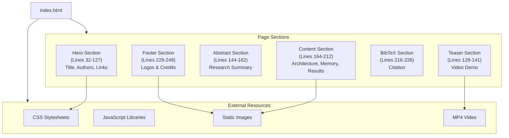
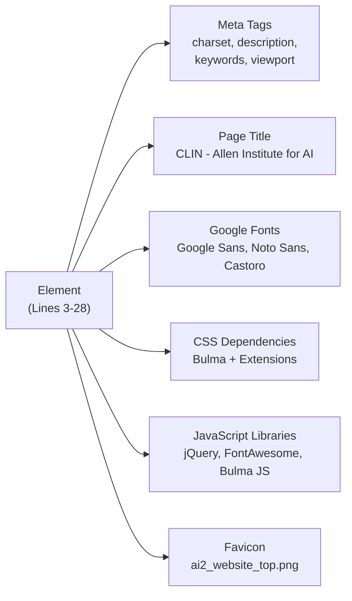
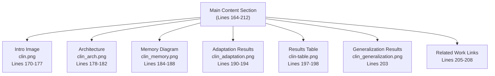
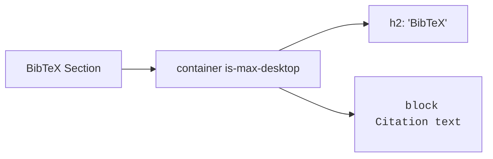
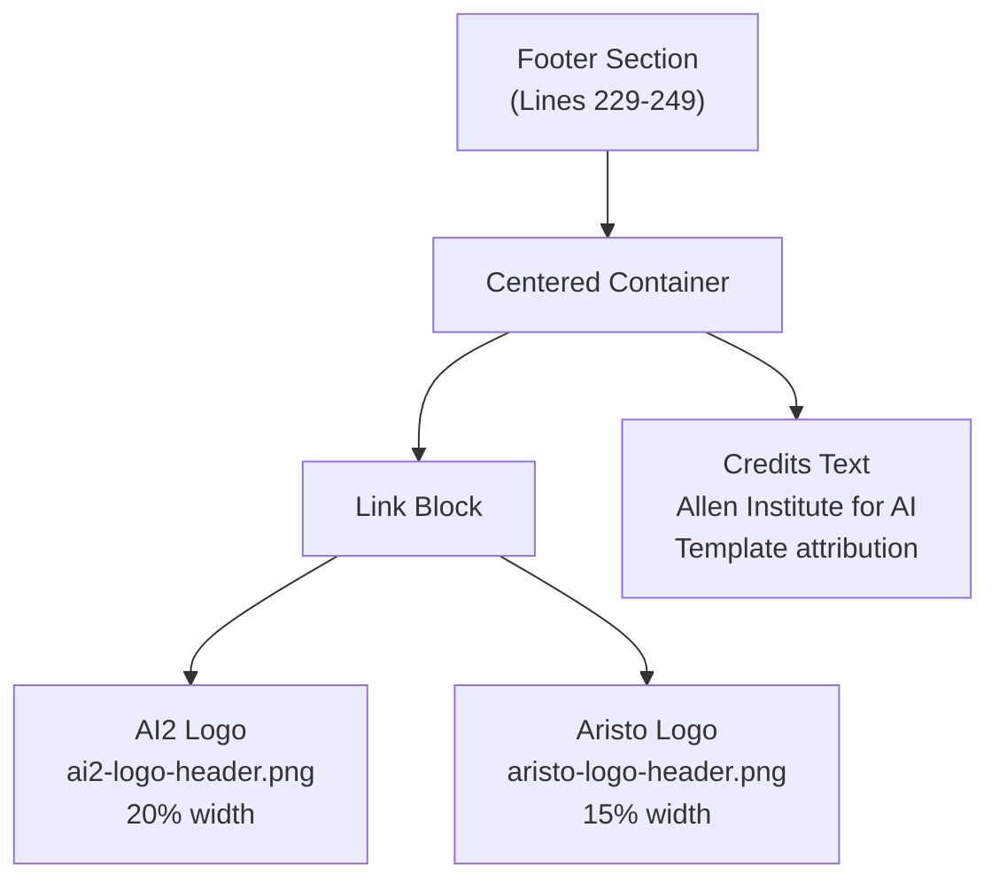
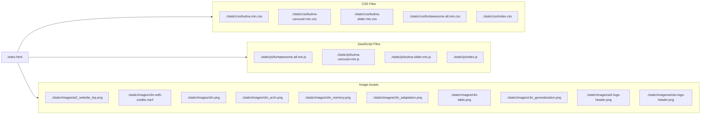

<!-- source: DeepWiki mcp.deepwiki.com · repo allenai/clin · page 8.1 Website Structure · fetched 2026-10-26 -->

# Website Structure

<details>
<summary>Relevant source files</summary>

The following files were used as context for generating this wiki page:

- [index.html](index.html)
- [static/css/index.css](static/css/index.css)

</details>


## Purpose and Scope

This document describes the structure, styling, and organization of the research presentation website included in the CLIN repository. The website ([index.html:1-252]()) serves as a public-facing showcase for the CLIN research paper, providing an abstract, visual demonstrations, architecture diagrams, and results.

For information about the specific media assets (images, videos, logos) referenced by the website, see [Media Assets](#8.2). For the core CLIN agent implementation, see [Agent Orchestration](#4.2).

---

## Website Technology Stack

The CLIN website is built using the Bulma CSS framework and includes custom styling to present research content in an academic format.

### External Dependencies

| Dependency | Purpose | Source |
|------------|---------|--------|
| Bulma CSS | Responsive CSS framework | [index.html:14]() |
| Bulma Carousel | Image carousel component | [index.html:15]() |
| Bulma Slider | Slider component | [index.html:16]() |
| FontAwesome | Icon library | [index.html:17,24]() |
| Academicons | Academic-specific icons | [index.html:19]() |
| Google Fonts | Typography (Google Sans, Noto Sans, Castoro) | [index.html:11-12]() |
| jQuery | JavaScript utilities | [index.html:23]() |

### Custom Files

| File Path | Purpose |
|-----------|---------|
| `static/css/index.css` | Custom styling overrides |
| `static/js/index.js` | Custom JavaScript behavior |
| `static/images/ai2_website_top.png` | Favicon |

**Sources:** [index.html:11-27]()

---

## Document Structure Overview

The website follows a single-page layout with distinct sections organized vertically. Each section serves a specific purpose in presenting the research.



**Title: Website Section Flow**

**Sources:** [index.html:1-252]()

---

## HTML Structure Breakdown

### Head Section

The document head defines metadata, dependencies, and page configuration:



**Title: HTML Head Structure**

The meta description ([index.html:5-6]()) provides SEO-optimized text: "CLIN: A Continually Learning Language Agent for Rapid Task Adaptation and Generalization".

**Sources:** [index.html:3-28]()

---

### Hero Section

The hero section ([index.html:32-127]()) presents the paper title, author list, and action links.

**Key Elements:**

| Element | Class/ID | Purpose | Lines |
|---------|----------|---------|-------|
| Section container | `class="hero"` | Top-level hero wrapper | 32 |
| Title | `class="title is-2 publication-title"` | Main paper title | 37 |
| Author blocks | `class="author-block"` | Individual author entries | 39-61 |
| Affiliation spans | `class="author-block"` | Institution labels | 65-67 |
| Link buttons | `class="link-block"` | Paper PDF, GitHub links | 73-110 |

The author names link to personal/institutional websites, and superscript notation (e.g., `<sup>1</sup>`) indicates affiliations.

**Sources:** [index.html:32-127]()

---

### Teaser Video Section

The teaser section ([index.html:129-141]()) displays an autoplay video demonstration:

```html
<video id="teaser" autoplay muted loop playsinline height="100%">
  <source src="./static/images/clin-with-credits.mp4" type="video/mp4">
</video>
```

The video element uses the following attributes:
- `autoplay`: Starts playback automatically
- `muted`: Prevents audio (required for autoplay in most browsers)
- `loop`: Repeats continuously
- `playsinline`: Enables inline playback on mobile devices

**Sources:** [index.html:129-141]()

---

### Abstract Section

The abstract section ([index.html:144-162]()) presents the research summary in a centered, four-fifths-width column.

**Structure:**
- Container: `class="container is-max-desktop"`
- Column wrapper: `class="column is-four-fifths"`
- Content: `class="content has-text-justified"` (justified text alignment)

The abstract emphasizes key phrases using `<strong>` tags, specifically highlighting "persistent, dynamic, textual memory, centered on causal abstractions" as the core innovation.

**Sources:** [index.html:144-162]()

---

## Content Section Layout

The main content section ([index.html:164-212]()) contains subsections for architecture diagrams, memory explanations, and results.



**Title: Content Section Components**

Each subsection uses an `<h3>` heading with `class="title is-4"` for consistent styling.

**Sources:** [index.html:164-212]()

---

### Image Rendering Pattern

Images throughout the content section follow a consistent pattern for centering and sizing:

```html

```

**Image Size Configuration:**

| Image | Max Width | Lines |
|-------|-----------|-------|
| `clin.png` | 100% (default) | 170 |
| `clin_arch.png` | 100% (default) | 179 |
| `clin_memory.png` | 50% | 188 |
| `clin_adaptation.png` | 80% | 194 |
| `clin-table.png` | 80% | 197 |
| `clin_generalization.png` | 70% | 203 |

**Sources:** [index.html:170-203]()

---

### Related Work Links

The related work section ([index.html:205-208]()) includes hyperlinks to:
- **Voyager**: `https://voyager.minedojo.org/`
- **ExpeL**: `https://arxiv.org/pdf/2308.10144.pdf`
- **Interactive Teaching System**: Allen AI blog post
- **Self-Refine**: `https://selfrefine.info/`
- **ScienceWorld**: `https://sciworld.apps.allenai.org/`

**Sources:** [index.html:205-208]()

---

## BibTeX Citation Section

The BibTeX section ([index.html:216-226]()) provides a formatted citation block:



**Title: BibTeX Section Structure**

The citation uses `@article` entry type with fields for author, title, journal (arXiv), and year (2023).

**Sources:** [index.html:216-226]()

---

## Footer Section

The footer ([index.html:229-249]()) displays institutional logos and credits:



**Title: Footer Component Structure**

The footer credits the website template source: "The website template is borrowed from [here](https://nerfies.github.io/)." ([index.html:246]())

**Sources:** [index.html:229-249]()

---

## Custom CSS Styling

The `static/css/index.css` file provides custom styling overrides for the Bulma framework.

### Typography Configuration

```css
body {
  font-family: 'Noto Sans', sans-serif;
  font-size: 15px;
  color: rgb(0, 0, 0);
}
```

**Sources:** [static/css/index.css:1-5]()

### Image Centering

All images use automatic horizontal centering:

```css
img {
  display: block;
  margin-left: auto;
  margin-right: auto;
}
```

**Sources:** [static/css/index.css:20-23]()

### Section-Specific Styles

| CSS Class | Purpose | Lines |
|-----------|---------|-------|
| `.footer .icon-link` | Footer icon sizing (25px) | [static/css/index.css:25-28]() |
| `.link-block a` | Vertical spacing for link buttons | [static/css/index.css:30-33]() |
| `.teaser .hero-body` | Teaser section padding | [static/css/index.css:40-43]() |
| `.teaser` | Teaser font family (Google Sans) | [static/css/index.css:45-47]() |
| `.publication-title` | Title font (Google Sans) | [static/css/index.css:69-71]() |
| `.publication-authors` | Author list font (Google Sans) | [static/css/index.css:73-75]() |
| `.publication-authors a` | Author link color (blue: `hsl(229, 86%, 53%)`) | [static/css/index.css:92-94]() |
| `.publication-video` | Video container (56.25% padding for 16:9 aspect ratio) | [static/css/index.css:111-119]() |

**Sources:** [static/css/index.css:1-177]()

---

## File Reference Mapping

The following diagram maps HTML references to actual file paths in the repository:



**Title: Asset Reference Structure**

**Sources:** [index.html:14-27](), [index.html:21](), [index.html:133](), [index.html:170-239]()

---

## Responsive Design

The website uses Bulma's responsive container classes:

- `is-max-desktop`: Constrains width on large screens
- `is-centered`: Centers content horizontally
- `is-four-fifths`: Sets column width to 80% of container

The viewport meta tag ([index.html:8]()) ensures proper mobile scaling:
```html
<meta name="viewport" content="width=device-width, initial-scale=1">
```

**Sources:** [index.html:8](), [index.html:34](), [index.html:130](), [index.html:145]()

---

## External Link Configuration

The website includes three primary external links in the hero section:

| Link Type | URL | Icon | Lines |
|-----------|-----|------|-------|
| Paper PDF | `https://arxiv.org/pdf/2310.10134.pdf` | `fa-file-pdf` | 74-81 |
| GitHub Repository | `https://github.com/allenai/clin` | `fa-github` | 103-110 |

Commented-out sections ([index.html:82-90](), [index.html:92-100](), [index.html:112-119]()) indicate placeholders for arXiv link, video link, and dataset link that were not included in the final version.

**Sources:** [index.html:73-120]()

---

## Summary

The CLIN website structure consists of:

1. **Single HTML file** (`index.html`) with six main sections
2. **Bulma CSS framework** with custom overrides in `static/css/index.css`
3. **External dependencies** loaded from CDNs (fonts, icons, Bulma components)
4. **Local assets** in `static/` directory (images, videos, logos)
5. **Responsive layout** using Bulma's grid system and responsive utilities
6. **Semantic HTML** with clear section divisions and accessibility considerations

The website follows academic website conventions with hero section, abstract, visual results, citation, and institutional branding. All styling leverages the Bulma framework's utility classes with minimal custom CSS for specific typography and spacing adjustments.

**Sources:** [index.html:1-252](), [static/css/index.css:1-177]()

---

