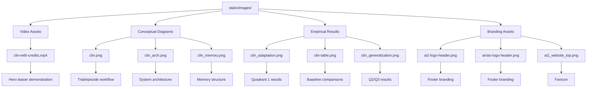
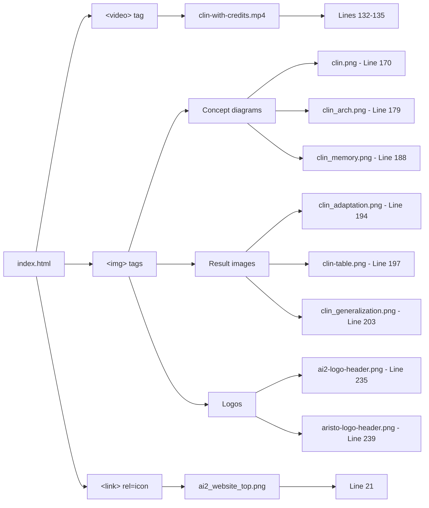

<!-- source: DeepWiki mcp.deepwiki.com · repo allenai/clin · page 8.2 Media Assets · fetched 2026-10-26 -->

# Media Assets

<details>
<summary>Relevant source files</summary>

The following files were used as context for generating this wiki page:

- [index.html](index.html)
- [static/images/clin-table.png](static/images/clin-table.png)
- [static/images/clin-with-credits.mp4](static/images/clin-with-credits.mp4)
- [static/images/clin.png](static/images/clin.png)
- [static/images/clin_adaptation.png](static/images/clin_adaptation.png)
- [static/images/clin_arch.png](static/images/clin_arch.png)
- [static/images/clin_generalization.png](static/images/clin_generalization.png)
- [static/images/clin_memory.png](static/images/clin_memory.png)

</details>


This document catalogs the static media assets included in the repository for the CLIN project website. These assets consist of images, videos, and logos stored in the `static/images/` directory and referenced by `index.html` for research presentation purposes.

For information about the website structure and HTML implementation, see [Website Structure](#8.1).

## Asset Directory Structure

The repository organizes presentation media in a flat directory structure:

```
static/
└── images/
    ├── clin-with-credits.mp4       # Teaser video
    ├── clin.png                     # Main concept diagram
    ├── clin_arch.png                # System architecture
    ├── clin_memory.png              # Memory structure diagram
    ├── clin_adaptation.png          # Adaptation results
    ├── clin-table.png               # Performance comparison table
    ├── clin_generalization.png      # Generalization results
    ├── ai2-logo-header.png          # Allen Institute for AI logo
    ├── aristo-logo-header.png       # Aristo team logo
    └── ai2_website_top.png          # Favicon
```

**Sources:** [index.html:1-252]()

## Asset Categories

### Video Assets

| File | Purpose | Referenced At | Usage |
|------|---------|---------------|-------|
| `clin-with-credits.mp4` | Animated demonstration of CLIN's continual learning behavior across trials | [index.html:132-135]() | Hero section teaser with autoplay, muted loop |

The teaser video demonstrates CLIN adapting over multiple trials in the ScienceWorld environment. The video element is configured with `autoplay`, `muted`, `loop`, and `playsinline` attributes for automatic presentation.

**Sources:** [index.html:132-135]()

### Conceptual Diagrams

| File | Dimensions | Purpose |
|------|------------|---------|
| `clin.png` | 2654×1078 px | Illustrates CLIN's memory creation/adaptation workflow across trials and episodes |
| `clin_arch.png` | 10794×5944 px | System architecture showing Controller, Executor, Memory Generator, and Simulator components |
| `clin_memory.png` | Not specified in HTML | Memory structure showing causal abstractions with necessity/contribution relations |

These diagrams visualize the core concepts:
- **clin.png** shows the trial-by-trial learning process with memory updates
- **clin_arch.png** displays the four-component architecture
- **clin_memory.png** depicts the semantic structure of memories using "necessary"/"does not contribute" relations with "may"/"should" confidence modifiers

**Sources:** [index.html:170](), [index.html:179](), [index.html:188](), [static/images/clin.png:1-28](), [static/images/clin_arch.png:1-28]()

### Empirical Results

| File | Dimensions | Purpose |
|------|------------|---------|
| `clin_adaptation.png` | 2420×1040 px | Performance graphs showing rapid adaptation on same task/environment (Quadrant 1) |
| `clin-table.png` | 2328×1358 px | Comparison table of CLIN vs baselines (Reflexion, RL agents) across quadrants |
| `clin_generalization.png` | Not specified | Performance graphs for cross-environment (Q2) and cross-task (Q3) generalization |

These assets present the experimental results from the paper, demonstrating:
- Adaptation speed and efficiency improvements across trials
- 23-point improvement over Reflexion baseline
- Positive transfer learning in generalization scenarios

**Sources:** [index.html:194](), [index.html:197](), [index.html:203](), [static/images/clin_adaptation.png:1-28](), [static/images/clin-table.png:1-28]()

### Branding Assets

| File | Purpose | Location |
|------|---------|----------|
| `ai2_website_top.png` | Favicon for browser tabs | [index.html:21]() |
| `ai2-logo-header.png` | Allen Institute for AI institutional logo | [index.html:235]() |
| `aristo-logo-header.png` | Aristo team logo | [index.html:239]() |

These assets establish institutional affiliation and branding in the website footer.

**Sources:** [index.html:21](), [index.html:235](), [index.html:239]()

## Image Format Specifications

All PNG assets contain ICC color profiles and are stored with metadata indicating their origin as screenshots:

```
<exif:UserComment>Screenshot</exif:UserComment>
```

The images use the standard PNG format with:
- ICC Profile: RGB color space definition
- Physical dimensions: Specified in pHYs chunks at 9600 pixels/meter
- Metadata: XMP data with pixel dimensions and user comments

**Sources:** [static/images/clin.png:15-27](), [static/images/clin_arch.png:15-27](), [static/images/clin_adaptation.png:15-27](), [static/images/clin-table.png:15-27]()

## Video Format Specifications

The teaser video `clin-with-credits.mp4` uses:
- Container: MP4 (MPEG-4 Part 14)
- Video codec: H.264/AVC (indicated by `avc1` in file header)
- Structure: Contains `moov` (movie metadata) and `mdat` (media data) atoms
- Optimized for web playback with streaming support

**Sources:** [static/images/clin-with-credits.mp4:1-50]()

## Asset References in HTML

### Hero Section Video

```html
<video id="teaser" autoplay muted loop playsinline height="100%">
  <source src="./static/images/clin-with-credits.mp4" type="video/mp4">
</video>
```

The video is embedded with attributes ensuring automatic playback on page load without user interaction.

**Sources:** [index.html:132-135]()

### Inline Images

All diagram and result images are embedded using `` tags with `src` attributes pointing to relative paths in `./static/images/`:

```html


```

Styling controls maximum width percentages to ensure responsive display across device sizes.

**Sources:** [index.html:170](), [index.html:179](), [index.html:188](), [index.html:194](), [index.html:197](), [index.html:203]()

### Footer Logos

```html


```

Logos are sized at 20% and 15% maximum width respectively for balanced footer presentation.

**Sources:** [index.html:235](), [index.html:239]()

## Asset Purpose Summary



**Sources:** [index.html:1-252]()

## Asset Usage Flow



**Sources:** [index.html:21](), [index.html:132-135](), [index.html:170](), [index.html:179](), [index.html:188](), [index.html:194](), [index.html:197](), [index.html:203](), [index.html:235](), [index.html:239]()

## File Size Considerations

The media assets comprise a significant portion of the repository:

| Asset Type | Typical Size Range |
|------------|-------------------|
| PNG screenshots | 500 KB - 2 MB (high resolution) |
| MP4 video | ~23 MB (full teaser with audio) |
| Logo PNGs | < 100 KB (optimized graphics) |

The high-resolution images maintain quality for zooming and display on high-DPI screens, while the video size reflects inclusion of audio credits and smooth animation.

**Sources:** [static/images/clin-with-credits.mp4:1-50](), [static/images/clin.png:1-28](), [static/images/clin_arch.png:1-28](), [static/images/clin_adaptation.png:1-28](), [static/images/clin-table.png:1-28]()

---

