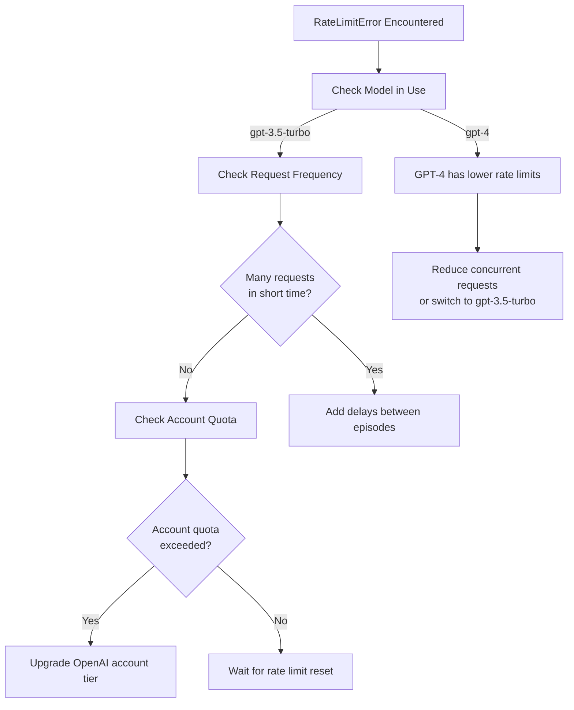
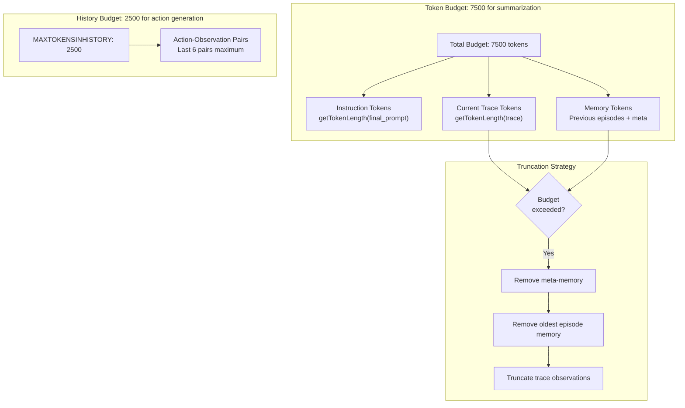
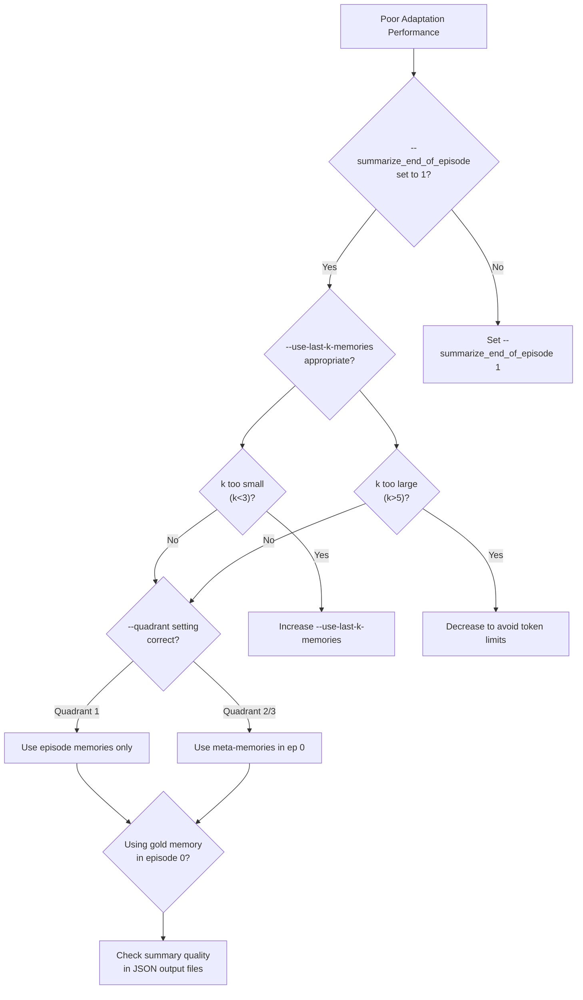
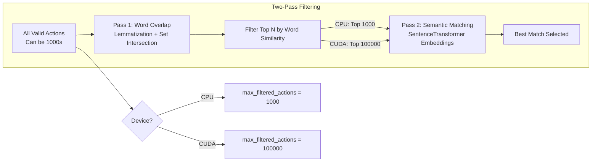

<!-- source: DeepWiki mcp.deepwiki.com · repo allenai/clin · page 9 FAQ and Troubleshooting · fetched 2026-10-26 -->

# FAQ and Troubleshooting

<details>
<summary>Relevant source files</summary>

The following files were used as context for generating this wiki page:

- [README.md](README.md)
- [model_utils.py](model_utils.py)
- [requirements.txt](requirements.txt)
- [scienceworld/clin_agent.py](scienceworld/clin_agent.py)

</details>


This page provides solutions to common issues encountered when installing, configuring, and running CLIN experiments. It covers installation problems, runtime errors, API configuration issues, and performance troubleshooting.

For detailed information about system setup, see [Getting Started](#2). For understanding command-line arguments, see [Command-Line Arguments Reference](#5.1). For interpreting output files, see [Understanding Output Files](#5.4).

## Common Installation Issues

### Java Runtime Not Found

**Symptom:** Error message stating "Java not found" or "Could not find Java runtime" when attempting to run CLIN.

**Solution:**
- Verify Java 1.8+ is installed: `java -version`
- Install Java if missing: `sudo apt-get install default-jre` (Linux) or download from Oracle
- Ensure Java is in your system PATH

**Related Code:** [README.md:13-14]()

Sources: [README.md:13-14]()

---

### ScienceWorld Branch Mismatch

**Symptom:** Missing methods like `getPossibleActionObjectCombinations()` or `getGoldActionSequence()`, or environment initialization failures.

**Solution:**
The CLIN system requires the specific `exhaustivevalidactions` branch of ScienceWorld:

```bash
cd ..
git clone https://github.com/allenai/ScienceWorld.git
cd ScienceWorld
git checkout exhaustivevalidactions
git pull
pip install -e .
```

**Important:** The default `main` branch does not include the exhaustive valid actions feature that CLIN depends on.

Sources: [README.md:28-36](), [scienceworld/clin_agent.py:124]()

---

### Missing Python Dependencies

**Symptom:** `ModuleNotFoundError` for `openai`, `sentence_transformers`, or `tiktoken`.

**Solution:**
Install all required dependencies:

```bash
pip install -r requirements.txt
```

**Dependencies Required:**
| Package | Purpose | Version Notes |
|---------|---------|---------------|
| `openai` | GPT model API access | Latest version recommended |
| `sentence_transformers` | Semantic action matching | Downloads models on first use |
| `tiktoken` | Token counting for prompt management | Required for GPT-4 tokenization |

Sources: [requirements.txt:1-3](), [model_utils.py:17]()

---

### Module Import Errors

**Symptom:** `ModuleNotFoundError: No module named 'model_utils'` or `No module named 'utils'`.

**Solution:**
Set the PYTHONPATH environment variable to include the CLIN repository root:

```bash
export PYTHONPATH=.
```

Add this to your shell profile (`.bashrc` or `.zshrc`) for persistence.

Sources: [README.md:22]()

---

## API Configuration Issues

### OpenAI API Key Not Set

**Symptom:** Error message `openai.error.AuthenticationError: No API key provided` or similar authentication failure.

**Solution:**
Set your OpenAI API key as an environment variable:

```bash
export OPENAI_API_KEY=sk-your-key-here
```

**Verification:**
```bash
echo $OPENAI_API_KEY  # Should display your key
```

**Persistent Configuration:**
Add to `~/.bashrc` or `~/.zshrc`:
```bash
echo 'export OPENAI_API_KEY=sk-your-key-here' >> ~/.bashrc
source ~/.bashrc
```

Sources: [README.md:23](), [model_utils.py:90-101]()

---

### Invalid or Expired API Key

**Symptom:** `openai.error.AuthenticationError: Incorrect API key provided` or 401 HTTP errors.

**Solution:**
1. Verify key validity at https://platform.openai.com/api-keys
2. Check for extra spaces or characters in the key
3. Ensure the key has not been revoked
4. Verify your OpenAI account has available credits

Sources: [model_utils.py:83-101]()

---

### API Rate Limiting

**Symptom:** `openai.error.RateLimitError` or error messages about rate limits, especially during long runs.

**Diagnosis Flow:**



**Solutions:**
- The code already includes retry logic with 2-second delays: [model_utils.py:88-101]()
- Reduce `--num-episodes` to run fewer episodes per execution
- Switch from `gpt-4-0613` to `gpt-3.5-turbo` for higher rate limits
- Increase time between runs
- Upgrade your OpenAI account tier

Sources: [model_utils.py:97-99](), [scienceworld/clin_agent.py:432-433]()

---

## Runtime Errors

### Action Matching Failures

**Symptom:** Agent repeatedly generates "N/A" actions or logs show "Your generated action '...' cannot be matched to a valid action."

**Common Causes and Solutions:**

| Issue | Symptom | Solution |
|-------|---------|----------|
| Low similarity score | `best_match_score < 0.9` | Action semantically distant from valid actions - expected behavior, retry mechanism handles this |
| Empty valid actions | `len(valid_actions_list) == 0` | Check environment state; may indicate task completion |
| FOCUS handling | FOCUS actions filtered incorrectly | Ensure "focus" keyword triggers focus action filtering |
| Retry exhaustion | Multiple N/A after 3 retries | Model struggling with action space; check prompt and valid actions |

**Debugging Action Matching:**

```mermaid
graph LR
    GPTGen["GPT generates action<br/>get_clin_sw_next_action_multi_turn"]
    ParseAction["Parse action from response<br/>possibleActions.split('###')"]
    GetValid["Get valid actions<br/>info['valid']"]
    Filter["Filter actions<br/>Remove reset, handle FOCUS"]
    
    SentMatch["Semantic matching<br/>get_best_matched_action_using_sent_transformer"]
    WordSim["Word overlap similarity<br/>lemmatize and filter"]
    SentTrans["SentenceTransformer<br/>bert-base-nli-mean-tokens"]
    TopMatch["Select best match<br/>cosine_similarity"]
    
    CheckScore{"Score > 0.9?"}
    Retry{"Retries < 3?"}
    Execute["Execute action"]
    RetryPrompt["Retry with feedback"]
    
    GPTGen --> ParseAction
    ParseAction --> GetValid
    GetValid --> Filter
    Filter --> SentMatch
    
    SentMatch --> WordSim
    WordSim --> SentTrans
    SentTrans --> TopMatch
    TopMatch --> CheckScore
    
    CheckScore -->|"Yes"| Execute
    CheckScore -->|"No"| Retry
    Retry -->|"Yes"| RetryPrompt
    Retry -->|"No"| Execute
    RetryPrompt --> GPTGen
```



**Related Code:**
- Action generation: [model_utils.py:104-316]()
- Action matching: [model_utils.py:27-80]()
- Retry logic: [scienceworld/clin_agent.py:191-265]()

Sources: [scienceworld/clin_agent.py:191-265](), [model_utils.py:27-80]()

---

### Token Limit Exceeded

**Symptom:** Error messages about context length or token limits, especially in later episodes with accumulated memory.

**Understanding Token Management:**



**Solutions:**

1. **For Summarization Token Issues** [model_utils.py:456-486]():
   - Reduce `--use-last-k-memories` (default: 3)
   - System automatically truncates: meta-memory → episode memories → trace observations
   
2. **For Action Generation Token Issues** [model_utils.py:18, 173-213]():
   - System limits history to last 6 action-observation pairs
   - Controlled by `MAXTOKENSINHISTORY = 2500`
   - Automatically stops when threshold exceeded

3. **Manual Adjustments:**
   ```python
   # In model_utils.py, adjust constants if needed
   MAXTOKENSINHISTORY = 2500  # Reduce if still hitting limits
   total_budget = 7500 - 1000  # Line 456, reduce if needed
   ```

Sources: [model_utils.py:18](), [model_utils.py:173-213](), [model_utils.py:456-486]()

---

### Device Configuration Errors

**Symptom:** CUDA out of memory errors or CPU running too slowly.

**Device Selection Strategy:**

| Device Argument | Use Case | Max Filtered Actions | Notes |
|-----------------|----------|---------------------|-------|
| `--device cpu` | Default, no GPU | 1000 actions | Slower but more compatible |
| `--device cuda` | NVIDIA GPU available | 100000 actions | Much faster semantic matching |
| `--device cuda:0` | Specific GPU | 100000 actions | Use when multiple GPUs present |

**Solutions:**
- **CUDA OOM:** Switch to `--device cpu`
- **Slow Performance:** Install CUDA-compatible PyTorch and use `--device cuda`
- **Check GPU Availability:**
  ```python
  import torch
  print(torch.cuda.is_available())  # Should return True if CUDA works
  print(torch.cuda.device_count())  # Number of GPUs
  ```

**Related Code:** [model_utils.py:47-54](), [scienceworld/clin_agent.py:23](), [scienceworld/clin_agent.py:436-437]()

Sources: [model_utils.py:47-54](), [scienceworld/clin_agent.py:23](), [scienceworld/clin_agent.py:436-437]()

---

### Infinite Action Loops

**Symptom:** Agent repeats the same action 5+ times consecutively, gets stuck in loops.

**Detection and Prevention:**

The system includes automatic loop detection: [scienceworld/clin_agent.py:282-294]()

```python
# Last 5 actions identical - exits automatically
if (previous_actions[-1] == previous_actions[-2] == 
    previous_actions[-3] == previous_actions[-4] == 
    previous_actions[-5]):
    print("Last 5 actions were the same. Exiting.")
    earlyStop = True
    break

# Action sequence 1.5x gold length - exits automatically  
if len(previous_actions) >= 1.5*len(env.getGoldActionSequence()):
    print("Model generated sequence 1.5x longer than gold. Exiting.")
    earlyStop = True
    break
```

**If loops persist:**
- Check summarization quality - poor memories lead to repeated mistakes
- Verify temperature setting: `--temperature 0.0` (greedy) vs higher (more random)
- Review valid actions at the stuck state to ensure environment is responding correctly

Sources: [scienceworld/clin_agent.py:282-294]()

---

## Memory and Learning Issues

### Poor Adaptation Performance

**Symptom:** Agent doesn't improve across episodes despite accumulating memories.

**Diagnostic Checklist:**



**Solutions:**

1. **Enable Summarization:** `--summarize_end_of_episode 1` [scienceworld/clin_agent.py:434-435]()

2. **Adjust Memory Window:** `--use-last-k-memories 3` (recommended: 2-4) [scienceworld/clin_agent.py:444-445]()

3. **Verify Quadrant Settings:** [scienceworld/clin_agent.py:446-450]()
   - **Quadrant 1 (adaptation):** Same task, same environment
   - **Quadrant 2 (cross-env):** Same task, different environment
   - **Quadrant 3 (cross-task):** Different task, same environment

4. **Check Summary Quality:**
   - Open `Task*_Var*_Ep*_runhistories.json` files
   - Look for `summary` field - should contain numbered causal abstractions
   - Format: "X MAY BE NECESSARY to Y", "X DOES NOT CONTRIBUTE to Y"

Sources: [scienceworld/clin_agent.py:344-356](), [model_utils.py:406-501]()

---

### Gold Memory Not Loading

**Symptom:** `--use-gold-memory-in-ep0 1` specified but agent doesn't show improved episode 0 performance.

**Troubleshooting Steps:**

1. **Verify Gold Traces File:**
   - Check `--gold-traces` path exists
   - Supported formats: `.json`, `.jsonl`, or directory of `.json` files
   - [scienceworld/clin_agent.py:26-47]()

2. **Verify JSON Structure:**
   ```json
   {
     "taskIdx": "4",
     "variationIdx": "1",
     "summary": "1. Opening door MAY BE NECESSARY to...",
     "q2_summary": "Meta-learnings for quadrant 2...",
     "q3_summary": "Meta-learnings for quadrant 3...",
     "history": [...]
   }
   ```

3. **Check Mapping Logic:** [scienceworld/clin_agent.py:54-73]()
   - Gold memories indexed by `taskIdx` and `variationIdx` strings
   - Must match task/variation being run
   - Different summaries for different quadrants

4. **Verify Usage:** [scienceworld/clin_agent.py:129-134](), [scienceworld/clin_agent.py:184-187]()
   - Gold memory only used when `episodeIdx == 0`
   - Check logs for "memory-seen" field in output JSON

Sources: [scienceworld/clin_agent.py:26-134](), [scienceworld/clin_agent.py:184-187]()

---

## Output and File Issues

### Missing or Empty Log Files

**Symptom:** No output files generated in specified directory, or files are empty.

**Solutions:**

1. **Create Output Directory:**
   ```bash
   mkdir -p logs/testrun
   ```
   The code doesn't create the directory automatically: [README.md:42-43]()

2. **Check Path Specification:**
   - Use `--output-path-prefix logs/testrun/` (note trailing slash)
   - Absolute or relative paths supported
   - [scienceworld/clin_agent.py:85-87](), [scienceworld/clin_agent.py:451-452]()

3. **Verify Write Permissions:**
   ```bash
   ls -ld logs/testrun  # Check directory permissions
   ```

4. **Check for Errors:**
   - Episode must complete for files to be written
   - Files written at end of each episode: [scienceworld/clin_agent.py:358-363]()

Sources: [README.md:42-43](), [scienceworld/clin_agent.py:85-87](), [scienceworld/clin_agent.py:358-363]()

---

### Understanding Score Values

**Symptom:** Confusion about what different score values mean.

**Score Interpretation:**

| Score Range | Meaning | Agent Performance |
|-------------|---------|------------------|
| -100 | Critical Failure | Made critical mistakes, task terminated |
| < 0 | Very Poor | Could not make any critical progress |
| 0-19 | Poor | Some progress but insufficient |
| 20-49 | Moderate | Some critical progress, not enough to solve |
| 50-89 | Very Good | Significant progress, close to solving |
| 90-99 | Exceptional | Nearly solved, just short of completion |
| 100 | Success | Task completed successfully |

**Related Code:** [model_utils.py:318-336]()

**Checking Results:**
- `finalScore` in JSON output: [scienceworld/clin_agent.py:333]()
- Summary report in console: [scienceworld/clin_agent.py:372-376]()
- `summary.txt` file: [scienceworld/clin_agent.py:89-90]()

Sources: [model_utils.py:318-336](), [scienceworld/clin_agent.py:333](), [scienceworld/clin_agent.py:372-376]()

---

## Performance Issues

### Slow Sentence Transformer Matching

**Symptom:** Long delays between actions, console shows "actions_sorted_desc_word_sim" with thousands of actions.

**Performance Optimization Flow:**



**Solutions:**

1. **Use GPU:** `--device cuda` provides 100x more actions in pass 2 [model_utils.py:47-54]()

2. **First Pass is CPU-Based:** Word overlap filtering is fast and reduces search space [model_utils.py:32-54]()

3. **Expected Timing:**
   - CPU: 0.5-2 seconds per action
   - CUDA: 0.1-0.5 seconds per action
   - Logged in `sentenceTransformerRuntimes`: [scienceworld/clin_agent.py:252-254]()

Sources: [model_utils.py:27-80](), [scienceworld/clin_agent.py:243-254]()

---

### High Token Costs

**Symptom:** Large OpenAI bills from running experiments.

**Cost Optimization Strategies:**

1. **Model Selection:**
   - `gpt-3.5-turbo`: ~10x cheaper than GPT-4
   - `gpt-4-0613`: Better performance but much higher cost
   - Specify with `--gpt-model` [scienceworld/clin_agent.py:432-433]()

2. **Reduce Episode Count:**
   - Use `--num-episodes 2` for testing
   - Only run full episode counts for final evaluation

3. **Token Usage Monitoring:**
   - Each action generation uses ~2500 tokens for history [model_utils.py:18]()
   - Each summarization uses ~7500 tokens budget [model_utils.py:456]()
   - Monitor in OpenAI dashboard

4. **Simplifications to Reduce Steps:**
   - Use `--simplifications-preset easy` to reduce action space
   - Fewer steps = fewer API calls
   - [scienceworld/clin_agent.py:455-456]()

Sources: [model_utils.py:18](), [model_utils.py:456](), [scienceworld/clin_agent.py:432-433](), [scienceworld/clin_agent.py:455-466]()

---

## Common Command-Line Errors

### Invalid Argument Values

**Symptom:** `argparse` errors or unexpected behavior.

**Correct Usage Examples:**

```bash
# Minimal working example
python scienceworld/clin_agent.py \
  --task-num "4" \
  --var-num 1 \
  --env-step-limit 100 \
  --num-episodes 2 \
  --gpt-model "gpt-4-0613" \
  --summarize_end_of_episode 1 \
  --device "cpu" \
  --temperature 0.0 \
  --use-gold-memory-in-ep0 0 \
  --gold-traces "" \
  --use-last-k-memories 3 \
  --quadrant 1 \
  --simplifications-preset "easy" \
  --output-path-prefix logs/testrun/

# With gold memory (Quadrant 1)
python scienceworld/clin_agent.py \
  --task-num "4" \
  --var-num 1 \
  --use-gold-memory-in-ep0 1 \
  --gold-traces "path/to/gold_traces.json" \
  --quadrant 1 \
  [... other args ...]

# Cross-environment generalization (Quadrant 2)
python scienceworld/clin_agent.py \
  --task-num "4" \
  --var-num 5 \
  --quadrant 2 \
  --gold-traces "path/to/q2_traces.json" \
  [... other args ...]
```

**Argument Validation:**

| Argument | Type | Valid Values | Notes |
|----------|------|--------------|-------|
| `--task-num` | string | "0"-"29" | ScienceWorld task index |
| `--var-num` | int | 0-N | Variation index per task |
| `--gpt-model` | string | "gpt-3.5-turbo", "gpt-4-0613" | Must match OpenAI model names |
| `--device` | string | "cpu", "cuda", "cuda:0" | Must be valid PyTorch device |
| `--quadrant` | int | 1, 2, 3 | Required for proper memory handling |
| `--temperature` | float | 0.0-1.0 | 0.0 for deterministic |
| `--summarize_end_of_episode` | int | 0, 1 | Boolean as integer |
| `--use-gold-memory-in-ep0` | int | 0, 1 | Boolean as integer |

Sources: [scienceworld/clin_agent.py:419-471](), [README.md:46-48]()

---

## Debugging Strategies

### Enabling Verbose Logging

**Key Debug Points in Code:**

1. **Action Generation:** [model_utils.py:256-279]()
   - Uncomment `print()` statements to see full prompts
   - Response parsing shows reasoning and action extraction

2. **Action Matching:** [model_utils.py:28-80]()
   - Prints filtered action list size
   - Shows top 5 matched actions with similarity scores

3. **Episode Progress:** [scienceworld/clin_agent.py:155-176]()
   - Step number, observation, reward, score printed each iteration

4. **Summarization:** [model_utils.py:376-404]()
   - Prints trace, summary prompt, and generated summary

**Custom Debug Output:**

```python
# Add to track specific issues
print(f"Token count: {getTokenLength(current_str)}")
print(f"Valid actions: {len(info['valid'])}")
print(f"Memory tokens: {getTokenLength(summary_str)}")
```

Sources: [model_utils.py:28-80](), [model_utils.py:256-279](), [model_utils.py:376-404](), [scienceworld/clin_agent.py:155-176]()

---

### Analyzing Output JSON Files

**JSON Structure:**

```json
{
  "episodeIdx": 0,
  "finalScore": 50,
  "finalScorePositive": 50,
  "isCompleted": false,
  "earlyStop": false,
  "model": "gpt-4-0613",
  "taskDescription": "Your task is to...",
  "gold-action-seq": ["look around", "open door", ...],
  "memory-seen": "1. Opening door MAY BE NECESSARY...",
  "summary": "Generated summary for this episode",
  "history": [
    {
      "action": "look around",
      "observation": "You are in a room...",
      "rationale": "I used learning id(s): 1, 3 $$$ Based on...",
      "rawAction": "look around",
      "topNActions": [["look around", 1.0], ...],
      "subgoalProgress": {...}
    }
  ]
}
```

**What to Check:**
- `finalScore`: Did it improve across episodes?
- `earlyStop`: True if hit loop or length limit
- `memory-seen`: What memories were available
- `summary`: Quality of generated learnings
- `history[i].rationale`: Which learnings agent used
- `history[i].topNActions`: How confident was action matching

Sources: [scienceworld/clin_agent.py:320-363]()

---

## Frequently Asked Questions

### Can I use other GPT models?

**Answer:** The code is designed for `gpt-3.5-turbo` and `gpt-4-0613`. Other models may work if they support the ChatCompletion API, but:
- Token counting uses `cl100k_base` encoding [model_utils.py:17]()
- Prompt format assumes chat-style models
- Not tested with models like GPT-4-turbo or GPT-3.5-turbo-16k

### Why does the agent use both GPT and SentenceTransformer?

**Answer:** Hybrid approach for reliability:
- **GPT:** Generates high-level action intent based on task and memory [model_utils.py:104-316]()
- **SentenceTransformer:** Maps intent to exact valid environment action [model_utils.py:27-80]()
- This separation handles cases where GPT generates semantically correct but syntactically invalid actions

### How long does a typical experiment take?

**Timing Estimates:**
- **Single episode:** 10-30 minutes (depends on env-step-limit and task complexity)
- **With GPU:** ~2x faster action matching
- **Summarization:** 10-30 seconds per episode
- **Full experiment (10 episodes):** 2-5 hours

### Can I parallelize multiple tasks/variations?

**Answer:** Yes, with caution:
- Run separate processes for different task/variation combinations
- Each needs unique `--output-path-prefix`
- Watch OpenAI rate limits - may need delays between starting processes
- Memory usage: ~1-2GB per process + GPU memory if using CUDA

### What if I want to use a local LLM instead of OpenAI?

**Answer:** Major code modifications required:
- Replace `openai.ChatCompletion.create()` calls [model_utils.py:90-101]()
- Implement compatible API wrapper
- May need to adjust prompt formatting
- Token counting would need model-specific tokenizer

Sources: [model_utils.py:17](), [model_utils.py:27-80](), [model_utils.py:90-101](), [model_utils.py:104-316]()

---

## Getting Additional Help

If issues persist after trying these solutions:

1. **Check GitHub Issues:** Visit https://github.com/allenai/clin/issues for known problems
2. **Review Papers:** See the ArXiv paper linked in [README.md:6-8]() for methodology details
3. **Inspect Logs:** Console output and JSON files contain detailed execution traces
4. **Simplify Setup:** Start with the exact command from [README.md:46-48]() and minimal episodes
5. **Verify Environment:** Ensure all [Prerequisites](#2.1) are correctly installed

For conceptual questions about the learning approach, see [Core Concepts](#3). For understanding system architecture, see [System Architecture](#4).