# Page: Home

# Home

<details>
<summary>Relevant source files</summary>

The following files were used as context for generating this wiki page:

- [README.md](README.md)
- [index.html](index.html)
- [requirements.txt](requirements.txt)

</details>


## Purpose and Scope

This wiki documents the **CLIN (Continually Learning Language Agent)** codebase, a research system for rapid task adaptation and generalization using persistent textual memory. This home page provides an architectural overview and explains the core concepts. For installation instructions and running experiments, see [Getting Started](#2). For detailed technical documentation of individual components, see [System Architecture](#4). For research findings and results, see [Research and Results](#6).

---

## What is CLIN?

CLIN is a language-based agent that **continually learns without parameter updates**. Unlike traditional agents that require model fine-tuning or reinforcement learning, CLIN uses a **persistent, dynamic, textual memory** to accumulate knowledge across multiple trials and episodes. The agent operates in the ScienceWorld environment, performing complex scientific tasks such as growing plants, finding objects, or conducting experiments.

The system is implemented in Python and consists of three core modules:
- **`scienceworld/clin_agent.py`** - Agent orchestration, episode/trial management, and memory coordination
- **`scienceworld/model_utils.py`** - LLM integration, action generation, and learning summarization
- **`scienceworld/utils.py`** - Text processing utilities for action parsing and normalization

**Key Innovation**: CLIN learns by maintaining **causal abstractions** in memory (e.g., "moving to room X MAY BE NECESSARY to find object Y") rather than through model parameter updates, enabling rapid adaptation without retraining.

**Sources**: [README.md:1-11](), [index.html:150-157]()

---

## Core Problem and Solution

### Problem
Language agents powered by Large Language Models (LLMs) can interact with environments but typically:
1. Do not improve performance across multiple trials on the same task
2. Cannot transfer learned knowledge to new environments or tasks
3. Require expensive fine-tuning or reinforcement learning to adapt

### Solution
CLIN addresses these limitations through:

| Capability | Mechanism |
|------------|-----------|
| **Rapid Adaptation** | Accumulates episode memories encoding what actions helped/hindered success |
| **Cross-Task Transfer** | Generates meta-memories that abstract learnings for new tasks (Quadrant 3) |
| **Cross-Environment Transfer** | Reuses episode memories with environment-specific adaptations (Quadrant 2) |
| **No Parameter Updates** | All learning stored in textual memory, no model fine-tuning required |

CLIN outperforms state-of-the-art reflective agents (Reflexion) by **23 absolute points** on adaptation tasks and achieves **positive transfer learning** to new environments (+4 points) and tasks (+13 points).

**Sources**: [index.html:150-157](), [index.html:190-204]()

---

## System Architecture Overview

The following diagram shows CLIN's architecture with actual code file paths and primary functions:

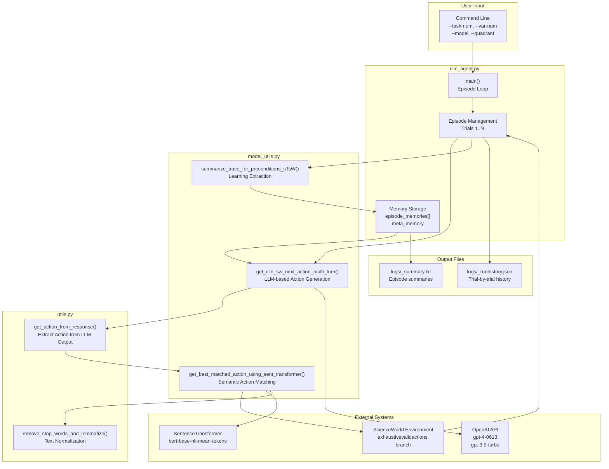

**Sources**: [README.md:45-48]()

---

## Key Components

### 1. Agent Orchestrator (`clin_agent.py`)
The main entry point that manages the continual learning lifecycle:

- **Episode Loop**: Sequences of trials on the same or related tasks
- **Trial Execution**: Individual attempts at solving a task, accumulating observations and actions
- **Memory Management**: Stores and retrieves episode memories and meta-memories
- **History Tracking**: Records all actions, observations, rationales, and scores

The orchestrator coordinates between LLM-based decision making, environment interaction, and memory updates. For detailed documentation, see [Agent Orchestration](#4.2).

### 2. LLM Integration Layer (`model_utils.py`)
Interfaces with GPT models to generate actions and extract learnings:

- **`get_clin_sw_next_action_multi_turn()`**: Multi-turn conversation with LLM to generate next action given task, memory, and history
- **`get_best_matched_action_using_sent_transformer()`**: Semantic matching to find the closest valid environment action to LLM output
- **`summarize_trace_for_preconditions_sTsW()`**: Extracts causal abstractions from successful/failed trials

For implementation details, see [LLM Integration Layer](#4.3) and [Learning and Summarization System](#4.5).

### 3. Text Processing Utilities (`utils.py`)
Helper functions for action parsing and text normalization:

- **`get_action_from_response()`**: Extracts structured action from LLM's natural language response
- **`remove_stop_words_and_lemmatize()`**: Normalizes text for semantic matching

For complete documentation, see [Text Processing Utilities](#7.2).

### 4. External Dependencies

| Dependency | Purpose | Configuration |
|------------|---------|---------------|
| OpenAI API | GPT-3.5/GPT-4 for action generation and summarization | Requires `OPENAI_API_KEY` environment variable |
| ScienceWorld | Interactive text-based scientific tasks | Must clone from `allenai/ScienceWorld` repo, `exhaustivevalidactions` branch |
| SentenceTransformer | Semantic similarity for action matching | Downloads `bert-base-nli-mean-tokens` model automatically |
| tiktoken | Token counting for prompt management | Installed via pip |

**Sources**: [README.md:13-36](), [requirements.txt:1-4]()

---

## Continual Learning Workflow

The following diagram illustrates CLIN's learning cycle with specific code functions:

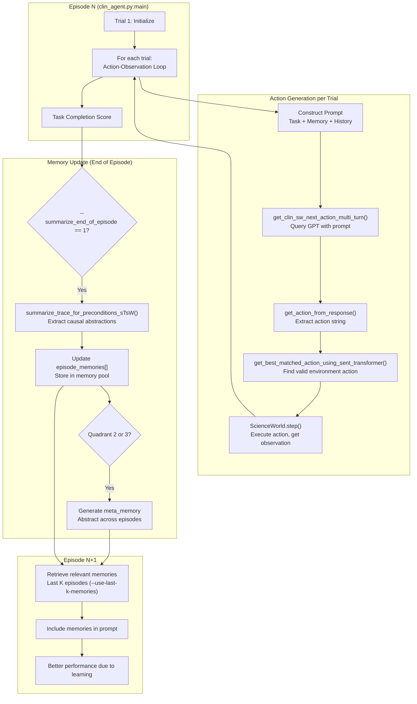

### Memory Structure

CLIN's memory consists of **causal abstractions** with the following semantic structure:

```
[Action X] [Relation] [Goal Y]

Relations:
- MAY BE NECESSARY to
- SHOULD BE NECESSARY to  
- DOES NOT CONTRIBUTE to

Confidence Levels:
- MAY: Low confidence (from limited observations)
- SHOULD: High confidence (from repeated observations)
```

**Example Memory Entries**:
- "Moving to the kitchen MAY BE NECESSARY to find seeds"
- "Opening the door SHOULD BE NECESSARY to move between rooms"
- "Reading the thermometer DOES NOT CONTRIBUTE to growing a plant"

For detailed explanation of memory architecture and causal abstractions, see [Memory Architecture](#3.2) and [Causal Abstractions](#3.3).

**Sources**: [index.html:172-177](), [index.html:184-188]()

---

## Evaluation Quadrants

CLIN is evaluated across three scenarios that test different aspects of continual learning:

| Quadrant | Scenario | Memory Strategy |
|----------|----------|-----------------|
| **Q1: Adaptation** | Same task, same environment variant across trials | Use episode memories from recent trials directly |
| **Q2: Cross-Environment** | Same task, different environment variants across episodes | Generate meta-memory abstracting common patterns |
| **Q3: Cross-Task** | Different tasks across episodes | Generate meta-memory with high-level task strategies |

The `--quadrant` command-line argument controls which evaluation mode is used. For detailed results and performance metrics, see [Evaluation Quadrants](#3.4) and [Research and Results](#6).

**Sources**: [README.md:47](), [index.html:195-204]()

---

## Research Context

CLIN was developed by researchers at the Allen Institute for AI (AI2), University of Arizona, and University of Pennsylvania. The system demonstrates:

- **23-point improvement** over Reflexion on adaptation tasks (Quadrant 1)
- **4-point zero-shot transfer** to new environments (Quadrant 2)
- **13-point zero-shot transfer** to new tasks (Quadrant 3)
- **17-point additional gain** from continued adaptation after transfer (Q2)

The research is published on arXiv and includes:
- **Paper**: [https://arxiv.org/pdf/2310.10134.pdf](https://arxiv.org/pdf/2310.10134.pdf)
- **Project Website**: [https://allenai.github.io/clin/](https://allenai.github.io/clin/)
- **Code Repository**: [https://github.com/allenai/clin](https://github.com/allenai/clin)

The project website (`index.html`) contains additional visualizations, architecture diagrams, and result charts. For related work and comparison with other systems (Voyager, ExpeL, Reflexion), see [Related Work](#6.5).

**Sources**: [index.html:1-252](), [README.md:1-9](), [README.md:50-58]()

---

## Getting Started

To begin using CLIN:

1. **Prerequisites**: Install Java 1.8+, Python 3.8, and obtain an OpenAI API key (see [Prerequisites](#2.1))
2. **Installation**: Set up the Python environment and clone ScienceWorld (see [Installation](#2.2))
3. **Run First Experiment**: Execute the example command to run a test trial (see [Quick Start Example](#2.3))

**Example Command**:
```bash
python scienceworld/clin_agent.py \
  --task-num "4" \
  --var-num 1 \
  --env-step-limit 2 \
  --num-episodes 1 \
  --gpt-model "gpt-4-0613" \
  --summarize_end_of_episode 1 \
  --device "cpu" \
  --temperature 0.0 \
  --use-gold-memory-in-ep0 0 \
  --gold-traces "" \
  --use-last-k-memories 3 \
  --quadrant 1 \
  --simplifications-preset "easy" \
  --output-path-prefix logs/testrun/
```

For complete command-line argument documentation, see [Command-Line Arguments Reference](#5.1).

**Sources**: [README.md:13-48]()

---

## Repository Structure

The repository contains two primary layers:

### Execution Layer (Core System)
- **`scienceworld/clin_agent.py`** - Main agent orchestrator (importance: 21.29)
- **`scienceworld/model_utils.py`** - LLM and action utilities (importance: 4.25)
- **`scienceworld/utils.py`** - Text processing helpers (importance: 2.25)
- **`requirements.txt`** - Python dependencies
- **`README.md`** - Setup and usage instructions
- **`.gitignore`** - Repository configuration

### Presentation Layer (Research Website)
- **`index.html`** - Project website with abstract, results, and visualizations (importance: 11.11)
- **`static/`** - CSS styles, JavaScript, images, and video assets
- **`static/images/`** - Architecture diagrams, result charts, and logos

For detailed code structure and developer guidance, see [Code Structure](#7.1) and [Developer Guide](#7).

**Sources**: [README.md:1-59](), [index.html:1-252]()

---

## Next Steps

- **To install and run CLIN**: Proceed to [Getting Started](#2)
- **To understand core concepts**: Read [Core Concepts](#3) for continual learning theory
- **To explore implementation details**: See [System Architecture](#4)
- **To run experiments**: Consult [Usage Guide](#5)
- **To review research findings**: See [Research and Results](#6)
- **To extend or modify CLIN**: Read [Developer Guide](#7)

---

# Page: Getting Started

# Getting Started

<details>
<summary>Relevant source files</summary>

The following files were used as context for generating this wiki page:

- [README.md](README.md)
- [requirements.txt](requirements.txt)

</details>


This document provides an overview of the setup process for running CLIN (Continually Learning Language Agent) experiments. It covers the high-level workflow for installing dependencies, configuring the environment, and executing your first CLIN agent run.

For detailed prerequisite requirements, see [Prerequisites](#2.1). For step-by-step installation instructions, see [Installation](#2.2). For a walkthrough of your first experiment, see [Quick Start Example](#2.3).

---

## Overview

Getting CLIN operational requires four primary setup stages:

1. **System Prerequisites**: Install Java runtime and configure Python environment
2. **Dependency Installation**: Install Python packages and clone ScienceWorld environment
3. **API Configuration**: Set up OpenAI API authentication
4. **Execution Setup**: Create output directories and verify installation

The setup process integrates three external systems: the OpenAI API (for GPT models), HuggingFace (for SentenceTransformer models), and the ScienceWorld environment (for task simulation).

---

## Setup Process Flow

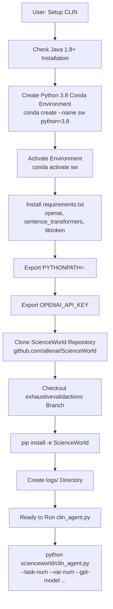

**Figure 1: Complete Setup Workflow**

Sources: [README.md:13-48]()

---

## Dependency Architecture

The following diagram maps the concrete dependencies required by CLIN to their sources and purposes:

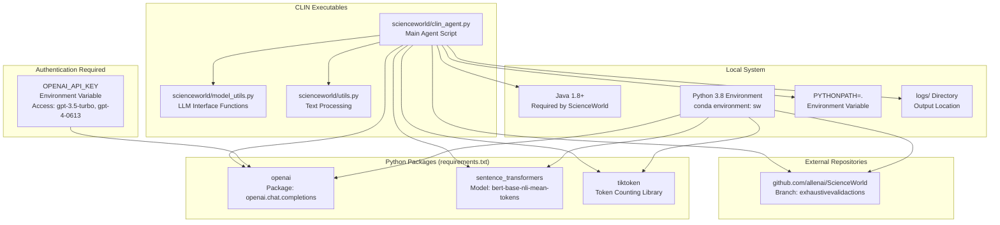

**Figure 2: Dependency Architecture and Code Entity Mapping**

Sources: [README.md:13-48](), [requirements.txt:1-4]()

---

## Installation Components Summary

| Component | Source | Purpose | Verification |
|-----------|--------|---------|--------------|
| **Java 1.8+** | System package manager | ScienceWorld runtime | `java -version` |
| **Python 3.8** | Conda environment | CLIN runtime | `python --version` |
| **openai** | PyPI (requirements.txt) | GPT model API client | Import test |
| **sentence_transformers** | PyPI (requirements.txt) | Semantic action matching | Downloads models on first run |
| **tiktoken** | PyPI (requirements.txt) | Token counting for GPT | Import test |
| **ScienceWorld** | GitHub (exhaustivevalidactions) | Task environment | `import scienceworld` |
| **OPENAI_API_KEY** | User-provided | API authentication | Required for execution |
| **logs/** | Created manually | Output directory | Must exist before running |

Sources: [README.md:13-48](), [requirements.txt:1-4]()

---

## Execution Entry Point

After completing setup, the primary entry point is `scienceworld/clin_agent.py`, invoked with command-line arguments:

```bash
python scienceworld/clin_agent.py \
    --task-num "4" \
    --var-num 1 \
    --env-step-limit 2 \
    --num-episodes 1 \
    --gpt-model "gpt-4-0613" \
    --summarize_end_of_episode 1 \
    --device "cpu" \
    --temperature 0.0 \
    --use-gold-memory-in-ep0 0 \
    --gold-traces "" \
    --use-last-k-memories 3 \
    --quadrant 1 \
    --simplifications-preset "easy" \
    --output-path-prefix logs/testrun/
```

This command structure demonstrates the key configuration dimensions:
- **Task specification**: `--task-num`, `--var-num`
- **Episode control**: `--num-episodes`, `--env-step-limit`
- **Model configuration**: `--gpt-model`, `--temperature`, `--device`
- **Memory settings**: `--use-gold-memory-in-ep0`, `--use-last-k-memories`, `--quadrant`
- **Environment setup**: `--simplifications-preset`
- **Output location**: `--output-path-prefix`

Sources: [README.md:45-48]()

---

## Setup Verification Workflow

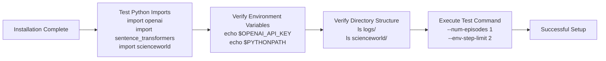

**Figure 3: Post-Installation Verification Flow**

Sources: [README.md:13-48]()

---

## Environment Variables Reference

Two environment variables must be configured in your shell session:

| Variable | Value | Purpose | Scope |
|----------|-------|---------|-------|
| **PYTHONPATH** | `.` (current directory) | Prevents module import errors for `scienceworld/` modules | Session-level |
| **OPENAI_API_KEY** | Your OpenAI API key | Authenticates requests to GPT-3.5-Turbo and GPT-4 models | Session-level |

Both must be set before running `clin_agent.py`. Example:

```bash
export PYTHONPATH=.
export OPENAI_API_KEY=sk-...
```

Sources: [README.md:22-23]()

---

## Next Steps

- **[Prerequisites](#2.1)**: Review detailed system requirements and API access
- **[Installation](#2.2)**: Follow step-by-step installation instructions
- **[Quick Start Example](#2.3)**: Run your first CLIN experiment with guided explanation
- **[Command-Line Arguments Reference](#5.1)**: Understand all available configuration options
- **[Running Experiments](#5.2)**: Learn how to configure experiments for different scenarios

Sources: [README.md:1-59]()

---

# Page: Prerequisites

# Prerequisites

<details>
<summary>Relevant source files</summary>

The following files were used as context for generating this wiki page:

- [README.md](README.md)
- [requirements.txt](requirements.txt)

</details>


This page details all software, system requirements, API credentials, and access permissions that must be in place before installing and running CLIN. This covers operating system requirements, runtime environments, third-party service accounts, and external repository dependencies.

For installation instructions once prerequisites are met, see [Installation](#2.2). For understanding the external systems CLIN integrates with, see [ScienceWorld Integration](#4.6).

---

## Purpose and Scope

This document specifies:
- Required runtime environments (Java, Python)
- Third-party API access requirements (OpenAI)
- External repository dependencies (ScienceWorld, HuggingFace models)
- System compatibility requirements
- Authentication credentials needed

This page does **not** cover installation steps (see [Installation](#2.2)) or command-line usage (see [Command-Line Arguments Reference](#5.1)).

---

## System Requirements Overview

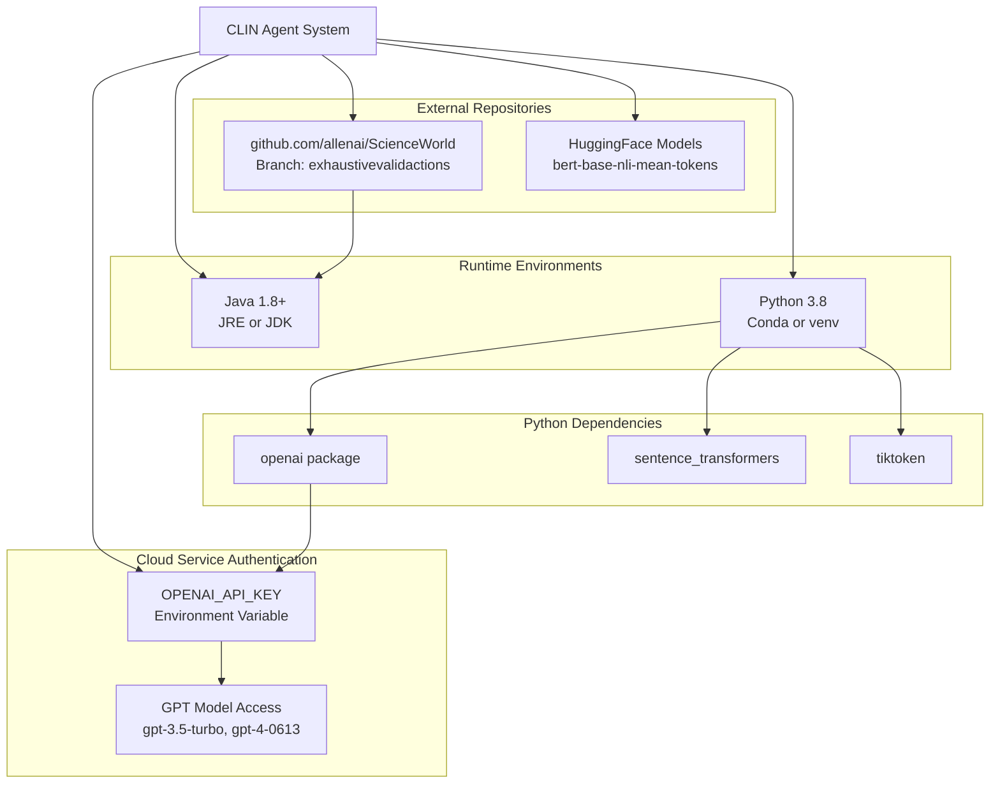

**Diagram: CLIN Prerequisites Dependency Map**

Sources: [README.md:13-36](), [requirements.txt:1-4]()

---

## Java Runtime Environment

CLIN requires Java because the ScienceWorld environment is implemented in Java and runs as a Java process that the Python agent communicates with.

### Requirements

| Component | Specification | Notes |
|-----------|--------------|-------|
| Java Version | 1.8 or higher | JRE or JDK acceptable |
| Typical Source | System package manager | Often pre-installed on Linux |
| Purpose | ScienceWorld execution | Java environment simulator |

### Verification

To verify Java installation:

```bash
java -version
```

Expected output should show version 1.8 or higher (e.g., `java version "1.8.0"` or `java version "11.0.0"`).

### Platform Notes

- **Linux**: Usually ships with OpenJDK pre-installed
- **macOS**: Install via Homebrew (`brew install openjdk`) or download from Oracle
- **Windows**: Download from Oracle or use OpenJDK builds

Sources: [README.md:13-14]()

---

## Python Environment

### Version Requirement

CLIN requires **Python 3.8** specifically. This version is specified for compatibility with the dependency stack, particularly the ScienceWorld Python bindings.

### Environment Management

The system expects a dedicated Python environment (virtual environment or Conda environment). Using a dedicated environment prevents dependency conflicts with other Python projects.

**Recommended approach** (using Conda):
```bash
conda create --name sw python=3.8
```

Sources: [README.md:16-19]()

---

## OpenAI API Access

CLIN's core reasoning capabilities depend on OpenAI's GPT models via their API. This is the most critical prerequisite for running CLIN.

### Required API Key

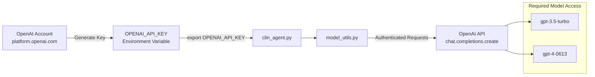

**Diagram: OpenAI Authentication Flow**

### API Key Setup

| Requirement | Details |
|-------------|---------|
| Account | Active OpenAI Platform account |
| Billing | Payment method on file (API is usage-based) |
| Environment Variable | `OPENAI_API_KEY` must be exported |
| Export Command | `export OPENAI_API_KEY=<your key>` |

### Required Model Access

The API key must have access to at least one of these models:

| Model Identifier | Purpose | Usage in CLIN |
|------------------|---------|---------------|
| `gpt-3.5-turbo` | Fast, cost-effective reasoning | Default model for experiments |
| `gpt-4-0613` | High-capability reasoning | Specified via `--gpt-model` argument |

**Note**: The exact model identifier `gpt-4-0613` indicates a specific GPT-4 checkpoint. Ensure your API key has access to this version or the model you plan to use.

Sources: [README.md:23]()

---

## External Repository Dependencies

### ScienceWorld Environment

CLIN operates within the ScienceWorld interactive environment, which must be cloned and installed separately from a specific branch.

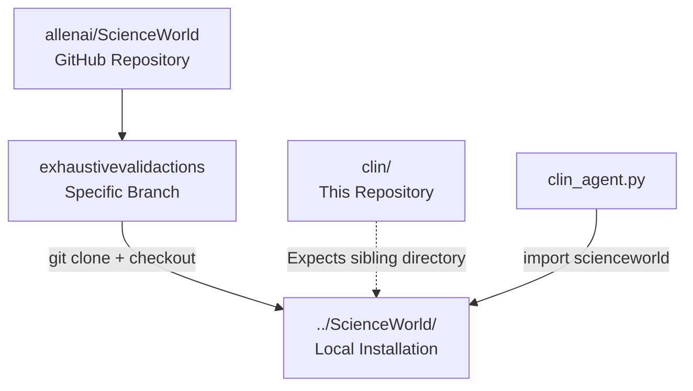

**Diagram: ScienceWorld Repository Dependency**

| Property | Value |
|----------|-------|
| Repository URL | `https://github.com/allenai/ScienceWorld.git` |
| Required Branch | `exhaustivevalidactions` |
| Installation Location | `../ScienceWorld/` (sibling to clin directory) |
| Installation Method | `pip install -e .` (editable mode) |

**Critical**: The `exhaustivevalidactions` branch contains modifications required by CLIN. The main branch will not work.

Sources: [README.md:27-36]()

### HuggingFace Model Hub

CLIN downloads pre-trained models from HuggingFace for semantic action matching.

| Component | Model Identifier | Purpose |
|-----------|-----------------|---------|
| SentenceTransformer | `bert-base-nli-mean-tokens` | Semantic similarity matching between LLM-generated actions and valid environment actions |

**Network Requirements**: First run requires internet access to download model weights (~400MB). Models are cached locally after first download.

Sources: [requirements.txt:2]()

---

## Python Package Dependencies

The following Python packages must be available (installed during [Installation](#2.2) phase):

### Core Dependencies Table

| Package | Version Constraints | Purpose |
|---------|-------------------|---------|
| `openai` | Latest compatible | OpenAI API client for GPT model access |
| `sentence_transformers` | Latest compatible | Semantic similarity computation using BERT models |
| `tiktoken` | Latest compatible | Token counting for OpenAI models (prompt length management) |

### Dependency Resolution Map

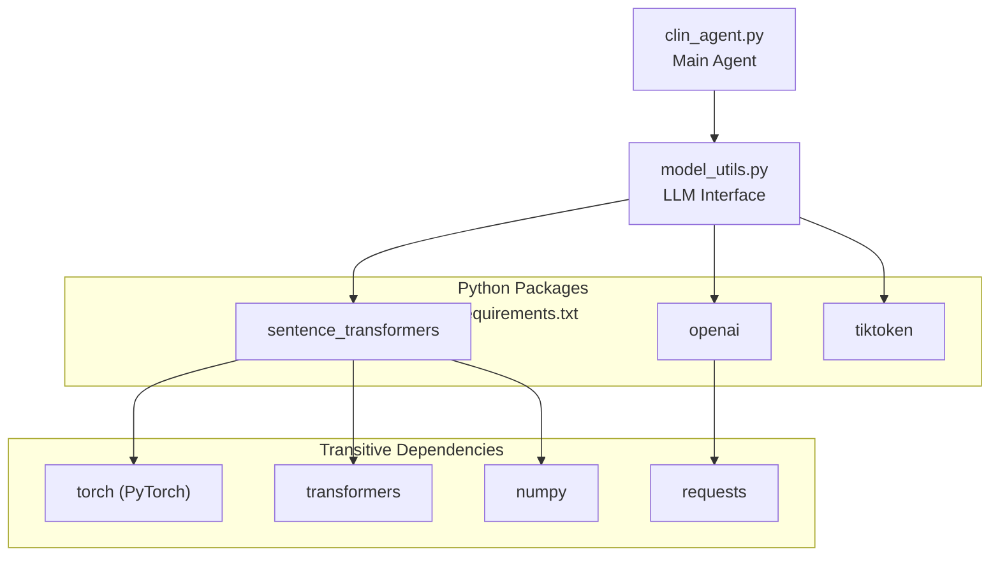

**Diagram: Python Package Dependency Tree**

**Note**: Transitive dependencies (PyTorch, Transformers, etc.) are automatically installed by pip when installing `sentence_transformers`.

Sources: [requirements.txt:1-4]()

---

## Environment Variables

CLIN requires specific environment variables to be set before execution.

### Required Environment Variables

| Variable Name | Purpose | Set During | Example |
|---------------|---------|------------|---------|
| `OPENAI_API_KEY` | OpenAI API authentication | Before running agent | `export OPENAI_API_KEY=sk-...` |
| `PYTHONPATH` | Python module resolution | Before running agent | `export PYTHONPATH=.` |

### PYTHONPATH Configuration

Setting `PYTHONPATH=.` ensures Python can resolve module imports correctly when running scripts from the repository root. This prevents `ModuleNotFoundError` exceptions.

```bash
export PYTHONPATH=.
```

This must be set in each terminal session, or added to shell configuration files (`~/.bashrc`, `~/.zshrc`) for persistence.

Sources: [README.md:22-23]()

---

## File System Requirements

### Directory Structure Expectations

CLIN expects specific relative paths for external dependencies and output directories.

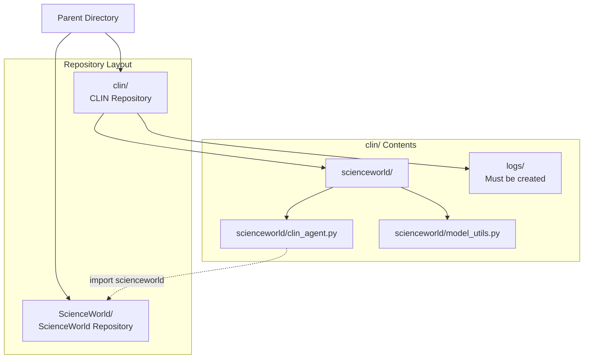

**Diagram: Expected Directory Structure**

### Required Directories

| Directory | Location | Must Exist Before | Created By |
|-----------|----------|-------------------|------------|
| `logs/` | `clin/logs/` | First run | User (`mkdir logs`) |
| `ScienceWorld/` | `../ScienceWorld/` (sibling to clin) | First run | Git clone |

The `logs/` directory must be manually created before running CLIN. This directory stores all run histories, summaries, and debug outputs.

Sources: [README.md:40-43]()

---

## Network and Connectivity

### Required Network Access

| Service | Endpoint | Required For | Fallback |
|---------|----------|--------------|----------|
| OpenAI API | `api.openai.com` | All LLM inference | None - critical |
| HuggingFace Hub | `huggingface.co` | Initial model download | Models cached after first download |
| GitHub | `github.com` | ScienceWorld clone | Can use pre-cloned repository |

### Offline Operation

After initial setup:
- **HuggingFace models**: Cached in `~/.cache/huggingface/`, enabling offline operation for action matching
- **OpenAI API**: Requires continuous internet access; no offline mode available
- **ScienceWorld**: Runs locally after installation

---

## Hardware Requirements

### Minimum Specifications

| Component | Requirement | Notes |
|-----------|-------------|-------|
| RAM | 4 GB minimum | 8 GB recommended for GPT-4 experiments with large contexts |
| Storage | 2 GB free | Includes Python environment, models, and output logs |
| CPU | Modern x86_64 | GPU not required (SentenceTransformer runs on CPU) |
| GPU | Optional | Can accelerate SentenceTransformer with `--device cuda` |

### Device Selection

CLIN supports CPU and GPU execution for the SentenceTransformer model via the `--device` flag:
- `--device cpu`: Default, works on all systems
- `--device cuda`: Requires NVIDIA GPU with CUDA toolkit

Sources: [README.md:47]()

---

## Operating System Compatibility

CLIN is developed and tested on **Linux** systems. The codebase is Python-based and should work on other UNIX-like systems with minor adjustments.

| OS | Support Level | Notes |
|----|---------------|-------|
| Linux | Fully supported | Primary development platform |
| macOS | Compatible | Requires Java and Python installation |
| Windows | Requires WSL | Native Windows not tested; use Windows Subsystem for Linux |

---

## Pre-Installation Checklist

Before proceeding to [Installation](#2.2), verify:

- [ ] Java 1.8+ installed and accessible (`java -version` succeeds)
- [ ] Python 3.8 available (Conda or virtualenv)
- [ ] OpenAI API key obtained and ready to export
- [ ] API key has access to `gpt-3.5-turbo` or `gpt-4-0613`
- [ ] Internet connectivity available for initial downloads
- [ ] Sufficient disk space (2+ GB) available
- [ ] Git installed for cloning repositories
- [ ] Shell environment ready for `export` commands

Sources: [README.md:13-43]()

---

# Page: Installation

# Installation

<details>
<summary>Relevant source files</summary>

The following files were used as context for generating this wiki page:

- [README.md](README.md)
- [requirements.txt](requirements.txt)

</details>


## Purpose and Scope

This document provides step-by-step instructions for installing CLIN and its dependencies. The installation process includes setting up a Python environment, installing Python packages, configuring the ScienceWorld environment, and setting required environment variables.

For system requirements and prerequisites, see [Prerequisites](#2.1). For running your first experiment after installation, see [Quick Start Example](#2.3).

**Sources:** [README.md:1-59]()

---

## Installation Overview

The CLIN installation consists of five major components that must be installed in sequence. The process takes approximately 10-15 minutes on a standard system.

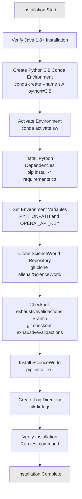

**Installation Flow Diagram**

The installation creates the following directory structure:

```
clin/                          # CLIN repository root
├── requirements.txt           # Python dependencies specification
├── scienceworld/
│   └── clin_agent.py         # Main agent script
├── logs/                      # Created during installation
│   └── testrun/              # Example output directory
└── ../ScienceWorld/           # Cloned separately, sibling directory
    └── scienceworld/          # Installed Python package
```

**Sources:** [README.md:13-48]()

---

## Step 1: Java Installation

ScienceWorld requires Java 1.8 or higher to execute its simulation environment. Most Linux distributions ship with Java pre-installed.

### Verification

Check your Java installation:

```bash
java -version
```

Expected output should show version 1.8.0 or higher. If Java is not installed, install it using your system's package manager:

| Platform | Command |
|----------|---------|
| Ubuntu/Debian | `sudo apt-get install openjdk-8-jdk` |
| macOS | `brew install openjdk@8` |
| Windows | Download from Oracle or AdoptOpenJDK |

**Sources:** [README.md:13-14]()

---

## Step 2: Python Environment Setup

CLIN requires Python 3.8 in an isolated conda environment to avoid dependency conflicts.

### Create and Activate Environment

```bash
conda create --name sw python=3.8
conda activate sw
```

The environment name `sw` (short for ScienceWorld) is used throughout the documentation but can be customized.

### Why Python 3.8?

Python 3.8 is specified for compatibility with:
- OpenAI API client library
- SentenceTransformer models
- ScienceWorld Python bindings

**Sources:** [README.md:16-19]()

---

## Step 3: Installing Python Dependencies

The [requirements.txt:1-3]() file specifies three core dependencies:

| Package | Purpose | Used By |
|---------|---------|---------|
| `openai` | GPT-3.5/GPT-4 API client | [scienceworld/model_utils.py]() for action generation |
| `sentence_transformers` | Semantic similarity matching | [scienceworld/model_utils.py]() for action validation |
| `tiktoken` | Token counting for prompts | [scienceworld/model_utils.py]() for context management |

### Installation Command

```bash
pip install -r requirements.txt
```

This command installs all three packages and their transitive dependencies. The installation downloads:
- OpenAI Python client (latest version)
- Pre-trained SentenceTransformer models from HuggingFace
- Tiktoken encoding libraries

### Dependency Resolution

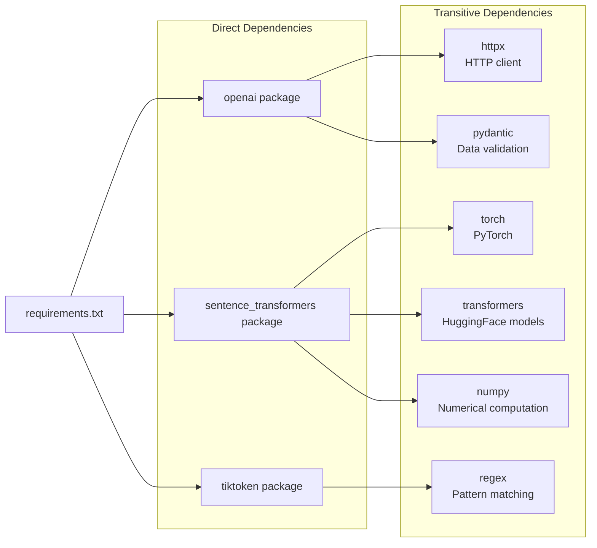

**Dependency Graph**

**Sources:** [requirements.txt:1-3](), [README.md:20]()

---

## Step 4: Environment Variable Configuration

CLIN requires two environment variables to function correctly.

### Setting Environment Variables

```bash
export PYTHONPATH=.
export OPENAI_API_KEY=<your key>
```

| Variable | Purpose | Required Models |
|----------|---------|-----------------|
| `PYTHONPATH` | Enables module imports from repo root | N/A |
| `OPENAI_API_KEY` | Authenticates with OpenAI API | `gpt-3.5-turbo`, `gpt-4-0613` |

### Variable Details

**`PYTHONPATH=.`**
- Prevents `ModuleNotFoundError` when running scripts
- Allows imports like `from scienceworld.model_utils import ...`
- Must be set from the CLIN repository root directory

**`OPENAI_API_KEY`**
- Required for calling GPT models in [scienceworld/model_utils.py]()
- Obtain from https://platform.openai.com/api-keys
- Must have access to `gpt-3.5-turbo` or `gpt-4-0613`
- Billed per token usage

### Persistent Configuration

For permanent configuration, add to your shell profile:

```bash
# ~/.bashrc or ~/.zshrc
export PYTHONPATH=/path/to/clin:$PYTHONPATH
export OPENAI_API_KEY=sk-...
```

**Sources:** [README.md:22-23]()

---

## Step 5: ScienceWorld Installation

ScienceWorld is an external dependency that must be cloned and installed separately. CLIN requires a specific branch with exhaustive valid actions.

### Installation Steps

```bash
cd ..                          # Move to parent directory
git clone https://github.com/allenai/ScienceWorld.git
cd ScienceWorld
git checkout exhaustivevalidactions
git pull
pip install -e .
```

### Installation Details

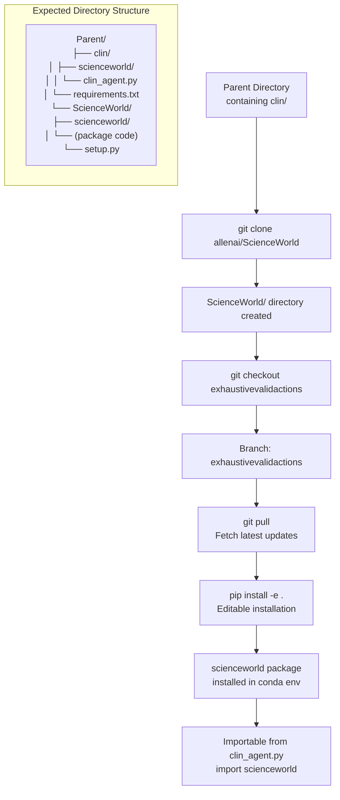

**ScienceWorld Installation Flow**

### Branch: `exhaustivevalidactions`

This branch is critical because it provides:
- Exhaustive lists of valid actions for each game state
- Action templates used by [scienceworld/model_utils.py:get_best_matched_action_using_sent_transformer]()
- Required for semantic action matching

The main branch does **not** contain these features, so the specific checkout is mandatory.

### Editable Installation (`-e` flag)

The `-e` flag installs ScienceWorld in development mode:
- Changes to ScienceWorld code take effect immediately
- No need to reinstall after modifications
- Package installed as symlink to cloned directory

**Sources:** [README.md:27-36]()

---

## Step 6: Directory Structure Setup

Before running CLIN, create the logs directory for storing run outputs.

### Creating Log Directory

```bash
cd ../clin                     # Return to CLIN repo
mkdir logs
```

### Expected Directory Structure After Installation

```
workspace/
├── clin/                                    # CLIN repository
│   ├── scienceworld/
│   │   ├── clin_agent.py                   # Main agent orchestrator
│   │   ├── model_utils.py                  # LLM integration
│   │   └── utils.py                        # Text processing
│   ├── requirements.txt                     # Python dependencies
│   ├── README.md                           # Installation guide
│   ├── logs/                               # Created by mkdir
│   │   └── testrun/                        # Example experiment dir
│   │       ├── run_history_*.json          # Generated during runs
│   │       └── summaries_*.txt             # Generated summaries
│   └── .gitignore
│
└── ScienceWorld/                            # Sibling directory
    ├── scienceworld/                        # Python package
    │   ├── __init__.py
    │   └── (environment code)
    ├── setup.py
    └── (other ScienceWorld files)
```

### Log Directory Organization

The `logs/` directory stores all experimental outputs:
- Run history JSON files with action traces
- Episode summary text files with learnings
- Subdirectories organized by experiment name

For details on output file structure, see [Understanding Output Files](#5.4).

**Sources:** [README.md:40-43]()

---

## Step 7: Installation Verification

Verify the installation by running a minimal test command.

### Test Command

```bash
python scienceworld/clin_agent.py \
    --task-num "4" \
    --var-num 1 \
    --env-step-limit 2 \
    --num-episodes 1 \
    --gpt-model "gpt-4-0613" \
    --summarize_end_of_episode 1 \
    --device "cpu" \
    --temperature 0.0 \
    --use-gold-memory-in-ep0 0 \
    --gold-traces "" \
    --use-last-k-memories 3 \
    --quadrant 1 \
    --simplifications-preset "easy" \
    --output-path-prefix logs/testrun/
```

### Expected Behavior

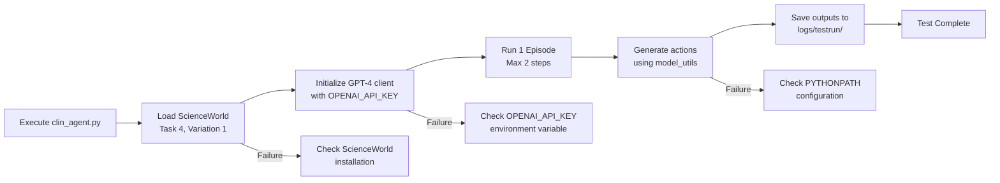

**Installation Verification Flow**

### Success Indicators

A successful test run produces:
1. Console output showing action-observation pairs
2. JSON file at `logs/testrun/run_history_*.json`
3. Summary file at `logs/testrun/summaries_*.txt`
4. No Python import errors or API authentication failures

### Common Verification Issues

| Error | Cause | Solution |
|-------|-------|----------|
| `ModuleNotFoundError: No module named 'scienceworld'` | ScienceWorld not installed | Repeat Step 5 |
| `openai.error.AuthenticationError` | Invalid API key | Check `OPENAI_API_KEY` variable |
| `ModuleNotFoundError: No module named 'scienceworld.model_utils'` | `PYTHONPATH` not set | Run `export PYTHONPATH=.` from repo root |
| `java.lang.NoClassDefFoundError` | Java not installed/configured | Install Java 1.8+ (Step 1) |

For additional troubleshooting, see [FAQ and Troubleshooting](#9).

**Sources:** [README.md:45-48]()

---

## Installation Component Dependencies

The following diagram shows how installed components interact with each other and which files utilize them.

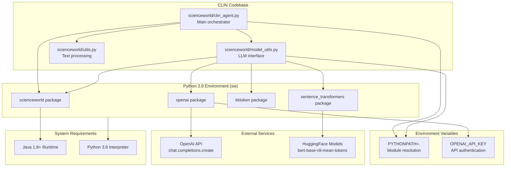

**Component Dependency Map**

This diagram maps installed components to the code entities that depend on them:

- **[scienceworld/clin_agent.py]()**: Main entry point, requires all components
- **[scienceworld/model_utils.py]()**: Directly uses `openai`, `sentence_transformers`, `tiktoken`
- **[scienceworld/utils.py]()**: Text processing utilities, no external dependencies
- **`scienceworld` package**: Python wrapper around Java-based ScienceWorld environment

**Sources:** [README.md:1-59](), [requirements.txt:1-3]()

---

## Post-Installation Checklist

Before proceeding to run experiments, verify:

- [ ] Java 1.8+ installed and accessible via `java -version`
- [ ] Conda environment `sw` created with Python 3.8
- [ ] Environment activated: `conda activate sw`
- [ ] All packages from `requirements.txt` installed
- [ ] `PYTHONPATH` set to CLIN repository root
- [ ] `OPENAI_API_KEY` set and valid
- [ ] ScienceWorld cloned in parent directory
- [ ] ScienceWorld checked out to `exhaustivevalidactions` branch
- [ ] ScienceWorld installed with `pip install -e .`
- [ ] `logs/` directory created in CLIN repository
- [ ] Test command executes without errors

After completing these steps, proceed to [Quick Start Example](#2.3) to run your first CLIN experiment.

**Sources:** [README.md:13-48]()

---

# Page: Quick Start Example

# Quick Start Example

<details>
<summary>Relevant source files</summary>

The following files were used as context for generating this wiki page:

- [README.md](README.md)
- [requirements.txt](requirements.txt)
- [scienceworld/clin_agent.py](scienceworld/clin_agent.py)

</details>


This page walks through running your first CLIN experiment, explaining the command-line arguments and expected outputs. This assumes you have completed the installation steps in [Installation](#2.2).

For comprehensive documentation of all command-line arguments, see [Command-Line Arguments Reference](#5.1). For guidance on running more complex experiments across multiple tasks and variations, see [Running Experiments](#5.2). For understanding the output file formats in detail, see [Understanding Output Files](#5.4).

---

## The Basic Example Command

After completing installation, you can run a minimal CLIN experiment with the following command from the repository root:

```bash
python scienceworld/clin_agent.py \
  --task-num "4" \
  --var-num 1 \
  --env-step-limit 2 \
  --num-episodes 1 \
  --gpt-model "gpt-4-0613" \
  --summarize_end_of_episode 1 \
  --device "cpu" \
  --temperature 0.0 \
  --use-gold-memory-in-ep0 0 \
  --gold-traces "" \
  --use-last-k-memories 3 \
  --quadrant 1 \
  --simplifications-preset "easy" \
  --output-path-prefix logs/testrun/
```

This command runs CLIN on **task 4** (a ScienceWorld task) with **variation 1**, executing **1 episode** with a maximum of **2 environment steps** per episode. The agent uses **GPT-4** for decision-making and operates in **Quadrant 1** (adaptation mode: same task, same environment across episodes).

**Sources:** [README.md:46-48]()

---

## Execution Flow: From Command to Output

The following diagram illustrates how the command-line invocation flows through the system to produce outputs:

**Diagram: Quick Start Execution Pipeline**

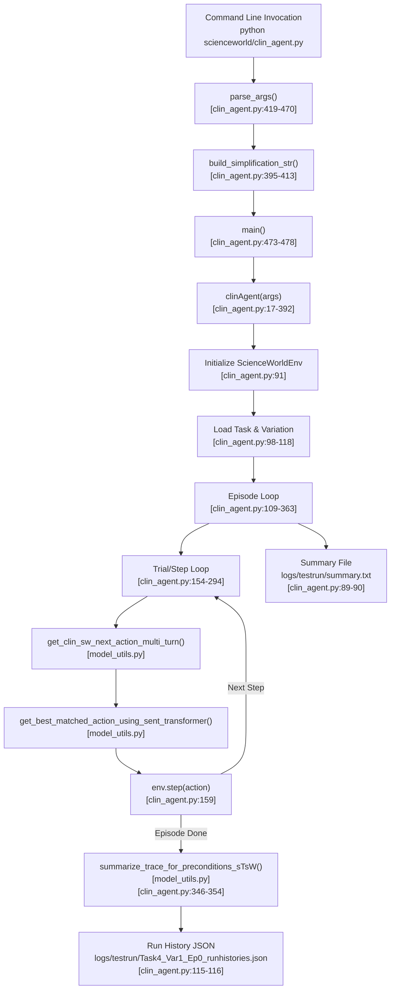

**Sources:** [scienceworld/clin_agent.py:17-392](), [scienceworld/clin_agent.py:419-478](), [README.md:46-48]()

---

## Command-Line Arguments Breakdown

The following table explains each argument in the example command and how it affects execution:

| Argument | Value | Purpose | Code Reference |
|----------|-------|---------|----------------|
| `--task-num` | `"4"` | Specifies which ScienceWorld task to run (task index) | [clin_agent.py:424-425]() |
| `--var-num` | `1` | Specifies the task variation number (environment configuration) | [clin_agent.py:426-427]() |
| `--env-step-limit` | `2` | Maximum steps per episode before forced termination | [clin_agent.py:428-429]() |
| `--num-episodes` | `1` | Number of episodes to run sequentially (for continual learning) | [clin_agent.py:430-431]() |
| `--gpt-model` | `"gpt-4-0613"` | OpenAI model to use for action generation | [clin_agent.py:432-433]() |
| `--summarize_end_of_episode` | `1` | Whether to generate episode summary for memory (1=yes, 0=no) | [clin_agent.py:434-435]() |
| `--device` | `"cpu"` | Device for SentenceTransformer model (`"cpu"`, `"cuda"`, `"cuda:0"`) | [clin_agent.py:436-437]() |
| `--temperature` | `0.0` | OpenAI API temperature parameter (0.0 = deterministic) | [clin_agent.py:438-439]() |
| `--use-gold-memory-in-ep0` | `0` | Bootstrap episode 0 with gold trace memory (1=yes, 0=no) | [clin_agent.py:440-441]() |
| `--gold-traces` | `""` | Path to gold trace files for memory bootstrapping | [clin_agent.py:442-443]() |
| `--use-last-k-memories` | `3` | Number of previous episode memories to use for summarization | [clin_agent.py:444-445]() |
| `--quadrant` | `1` | Evaluation quadrant: 1=adapt, 2=cross-env, 3=cross-task | [clin_agent.py:446-450]() |
| `--simplifications-preset` | `"easy"` | Apply all environment simplifications for easier task | [clin_agent.py:455-456]() |
| `--output-path-prefix` | `logs/testrun/` | Directory path prefix for output files | [clin_agent.py:451-452]() |

**Sources:** [scienceworld/clin_agent.py:419-470]()

---

## Argument-to-Code Mapping

The following diagram shows how command-line arguments map to code variables and system behavior:

**Diagram: Command-Line Arguments to Code Entities**

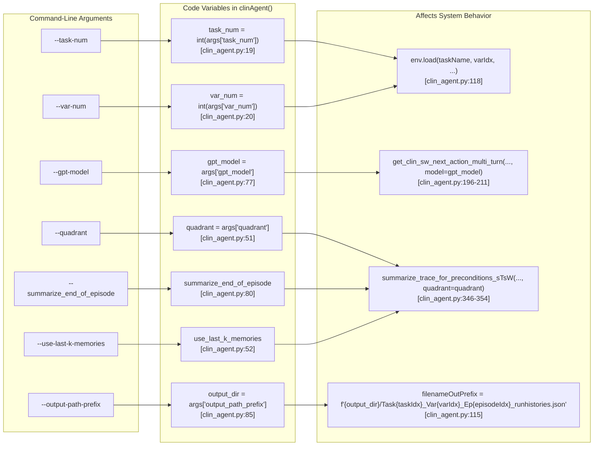

**Sources:** [scienceworld/clin_agent.py:17-90](), [scienceworld/clin_agent.py:196-211](), [scienceworld/clin_agent.py:346-354]()

---

## Expected Execution Behavior

When you run the quick start command, you will observe the following console output pattern:

### Initialization Phase

```
ScienceWorld 1.0 API Examples - CLIN Agent
Running CLIN agent for taskIdx:4, varIdx:1
Task Names: [list of task names]
Task Name: [Name of task 4]
Task Description: [Description of the task]
Task Variation: 1
```

**Sources:** [scienceworld/clin_agent.py:21](), [scienceworld/clin_agent.py:93-127]()

### Trial Execution Phase

For each step within the episode, you will see:

```
----------------------------------------------------------------
Step: 0
GPT4 generated action: [action string from LLM]
Sentence transformer runtimes: [timing list]
Reasoning rationale: [LLM's reasoning]
Next ChatGPT action: [matched valid action]
Next ChatGPT action (mapped): [same as above]

>>> [observation from environment]
Reward: [numeric reward]
Score: [current score]
isCompleted: [True/False]
```

This pattern repeats for each step until:
- Task is completed (`isCompleted: True`)
- Step limit is reached (`--env-step-limit`)
- Early stopping conditions are triggered [clin_agent.py:282-294]()

**Sources:** [scienceworld/clin_agent.py:154-280]()

### Episode Completion Phase

```
Goal Progress:
[Goal progress string]
Final score: [final numeric score]
isCompleted: [True/False]
Gold Path: [gold action sequence]
Writing history file: logs/testrun/Task4_Var1_Ep0_runhistories.json
```

### Summary Output

```
---------------------------------------------------------------------
 Summary (ChatGPT Agent)
 Simplifications: easy
---------------------------------------------------------------------
task    Name    var    epi    score    complete?
4    [TaskName]    1    0    [score]    [True/False]
---------------------------------------------------------------------
Completed.
```

**Sources:** [scienceworld/clin_agent.py:296-392]()

---

## Generated Output Files

The quick start command creates the following files in the `logs/testrun/` directory:

### Output Directory Structure

```
logs/testrun/
├── Task4_Var1_Ep0_runhistories.json
└── summary.txt
```

**Diagram: Output File Generation and Structure**

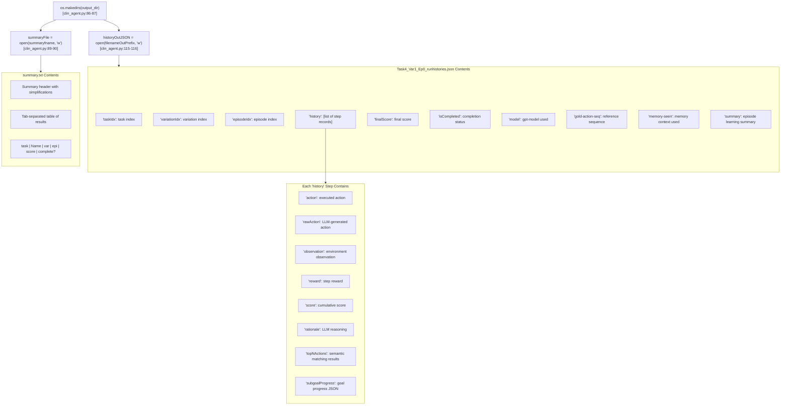

**Sources:** [scienceworld/clin_agent.py:85-90](), [scienceworld/clin_agent.py:115-116](), [scienceworld/clin_agent.py:320-363](), [scienceworld/clin_agent.py:381-392]()

### JSON Run History Structure

The `Task4_Var1_Ep0_runhistories.json` file contains a complete record of the episode, structured as follows:

| Field | Type | Description | Code Reference |
|-------|------|-------------|----------------|
| `taskIdx` | integer | Task index (4 in this example) | [clin_agent.py:320]() |
| `variationIdx` | integer | Variation index (1 in this example) | [clin_agent.py:320]() |
| `episodeIdx` | integer | Episode number (0 for first episode) | [clin_agent.py:332]() |
| `history` | array | List of step-by-step records | [clin_agent.py:323-329]() |
| `finalScore` | float | Final score achieved | [clin_agent.py:333]() |
| `finalScorePositive` | float | Highest positive score during episode | [clin_agent.py:334]() |
| `isCompleted` | boolean | Whether task was completed successfully | [clin_agent.py:335]() |
| `earlyStop` | boolean | Whether episode ended via early stopping | [clin_agent.py:336]() |
| `model` | string | GPT model used (`"gpt-4-0613"`) | [clin_agent.py:337]() |
| `gold-action-seq` | string | Gold reference action sequence | [clin_agent.py:338]() |
| `memory-seen` | string | Memory context provided to agent | [clin_agent.py:339]() |
| `summary` | string | Episode learning summary (if enabled) | [clin_agent.py:355]() |

Each entry in the `history` array contains:
- `action`: The action executed in the environment
- `rawAction`: The original action string from the LLM [clin_agent.py:327]()
- `observation`: The observation received after the action
- `reward`: The reward received
- `score`: The cumulative score
- `rationale`: The LLM's reasoning for the action [clin_agent.py:326]()
- `topNActions`: Semantic similarity scores for action matching [clin_agent.py:328]()
- `subgoalProgress`: Goal progress tracking [clin_agent.py:329]()

**Sources:** [scienceworld/clin_agent.py:320-363]()

### Summary Text File

The `summary.txt` file contains a human-readable tabular summary:

```
---------------------------------------------------------------------
 Summary (ChatGPT Agent)
 Simplifications: easy
---------------------------------------------------------------------
task    Name    var    epi    score    complete?
4    [TaskName]    1    0    [0.0-1.0]    [True/False]
---------------------------------------------------------------------
Completed.
```

**Sources:** [scienceworld/clin_agent.py:381-392]()

---

## Understanding the Quick Start Quadrant Setting

The `--quadrant 1` argument places this experiment in **Quadrant 1 (Adaptation)**, which means:

- **Same task** across episodes
- **Same environment variation** across episodes
- Agent learns to **adapt** and improve performance on repeated trials

This is the simplest learning scenario. For cross-environment generalization (Quadrant 2) and cross-task generalization (Quadrant 3), see [Evaluation Quadrants](#3.4).

The quadrant setting affects:
- Which memory summaries are loaded and used [clin_agent.py:58-73]()
- How episode summaries are generated [clin_agent.py:352]()
- Memory retrieval strategy during action generation

**Sources:** [scienceworld/clin_agent.py:51-73](), [scienceworld/clin_agent.py:346-354]()

---

## Modifying the Quick Start Command

### Running Multiple Episodes

To observe continual learning, increase `--num-episodes`:

```bash
--num-episodes 3
```

This will generate:
- `Task4_Var1_Ep0_runhistories.json`
- `Task4_Var1_Ep1_runhistories.json`
- `Task4_Var1_Ep2_runhistories.json`

Episodes 1 and 2 will use memories learned from previous episodes [clin_agent.py:183-211]().

### Using GPT-3.5 Instead of GPT-4

```bash
--gpt-model "gpt-3.5-turbo"
```

This uses a faster, cheaper model but may have reduced performance.

### Increasing Step Limit

```bash
--env-step-limit 50
```

Allows the agent more steps to complete the task. The default limit in the quick start (2) is very restrictive for demonstration purposes.

**Sources:** [scienceworld/clin_agent.py:419-470](), [README.md:46-48]()

---

## Next Steps

After running the quick start example successfully:

- **Understand the architecture**: See [Architecture Overview](#4.1) for how CLIN components interact
- **Learn about memory**: See [Memory Architecture](#3.2) to understand how episode summaries enable continual learning
- **Run full experiments**: See [Running Experiments](#5.2) for guidance on evaluating across multiple tasks and variations
- **Analyze outputs**: See [Understanding Output Files](#5.4) for detailed explanation of JSON structure and memory summaries
- **Use gold traces**: See [Gold Traces and Memory Initialization](#5.3) to bootstrap episode 0 with expert demonstrations
- **Explore different quadrants**: See [Evaluation Quadrants](#3.4) for cross-environment and cross-task evaluation

**Sources:** [README.md:1-59](), [scienceworld/clin_agent.py:1-483]()

---

# Page: Core Concepts

# Core Concepts

<details>
<summary>Relevant source files</summary>

The following files were used as context for generating this wiki page:

- [index.html](index.html)
- [model_utils.py](model_utils.py)

</details>


## Purpose and Scope

This page explains the fundamental concepts underlying CLIN's approach to continual learning. It covers the high-level architecture of how CLIN learns without parameter updates, the structure of its memory system, and the different evaluation scenarios.

For implementation details of these concepts, see [System Architecture](#4). For practical usage instructions, see [Usage Guide](#5). For research results demonstrating these concepts, see [Research and Results](#6).

---

## Overview

CLIN (Continually Learning Language Agent) implements a continual learning system that improves performance over time without updating the underlying language model's parameters. Instead of fine-tuning, CLIN maintains a **persistent textual memory** that accumulates structured knowledge across multiple trials and episodes.

The system operates in a **trial-episode framework** where:
- A **trial** is a single attempt at completing a task
- An **episode** is a sequence of trials on the same task-environment combination
- Learning occurs through memory updates after each trial
- Knowledge transfers across episodes through memory retrieval

**Key Innovation**: CLIN encodes learnings as **causal abstractions** rather than general advice, capturing relationships between actions and outcomes using structured semantic forms.

Sources: [index.html:151-156](), [model_utils.py:406-501]()

---

## Trials and Episodes

### Trial-Episode Structure

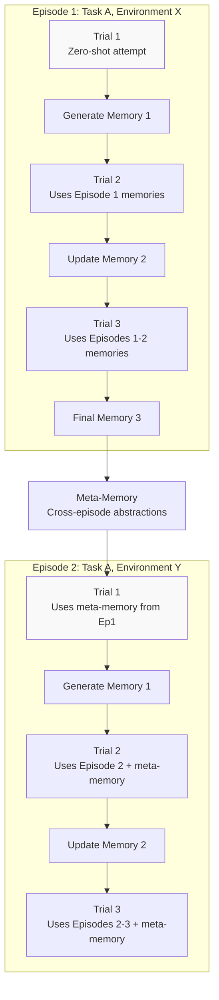

**Trial-Episode Framework**

Each trial consists of:
1. Receiving task description and initial observation
2. Generating actions based on current memory and history
3. Executing actions in the environment
4. Recording the trajectory (actions, observations, rationales)
5. Computing final score/reward

After each trial, the system generates a **summary** that captures learnings in structured form. This summary becomes part of the memory for future trials.

Sources: [model_utils.py:104-316](), [model_utils.py:406-501]()

---

## Memory Architecture

CLIN maintains two types of memory:

### Episode Memories

Episode memories capture learnings from trials within the same task-environment combination. The system maintains the last K episode memories (configurable via `use_last_k_memories` parameter, default 3).

**Memory Generation**: After each trial, `summarize_trace_for_preconditions_sTsW()` converts the trial trajectory into structured learnings.

**Memory Structure**: Each memory includes:
- Task description
- Episode index
- Structured learnings (causal abstractions)
- Performance evaluation (final score)

### Meta-Memories

Meta-memories are cross-episode generalizations that enable transfer learning. They abstract learnings from multiple episodes to apply in new contexts.

**Generation**: Created by summarizing the best-performing memories from previous episodes
**Usage**: Provided to Trial 1 of new episodes in Quadrants 2 and 3 (see below)

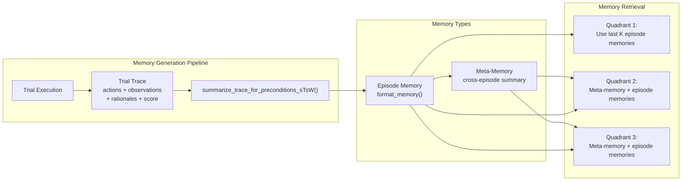

**Memory Retrieval in Action Generation**

Sources: [model_utils.py:359-373](), [model_utils.py:406-501]()

---

## Causal Abstractions

Causal abstractions are the structured semantic forms that encode CLIN's learnings. Unlike general advice or hints, causal abstractions explicitly represent relationships between preconditions and outcomes.

### Semantic Forms

CLIN uses four primary forms with two confidence levels:

| Form | Meaning | Example |
|------|---------|---------|
| **X MAY BE NECESSARY to Y** | Low confidence positive | "Moving to kitchen MAY BE NECESSARY to find seeds" |
| **X SHOULD BE NECESSARY to Y** | High confidence positive | "Opening cabinet SHOULD BE NECESSARY to access items inside" |
| **X MAY NOT CONTRIBUTE to Y** | Low confidence negative | "Examining table MAY NOT CONTRIBUTE to growing plant" |
| **X DOES NOT CONTRIBUTE to Y** | High confidence negative | "Looking around repeatedly DOES NOT CONTRIBUTE to task completion" |

### Confidence Levels

- **MAY**: Lower confidence, based on limited evidence or uncertain causality
- **SHOULD**: Higher confidence, based on consistent evidence or clear causality
- **DOES NOT**: Definitive negative, learned from mistakes or failed actions

```mermaid
graph TB
    subgraph CausalForms["Causal Abstraction Forms"]
        Positive["Positive Abstractions<br/>What helps achieve goals"]
        Negative["Negative Abstractions<br/>What doesn't contribute"]
        
        Positive --> MayPos["MAY BE NECESSARY<br/>Low confidence"]
        Positive --> ShouldPos["SHOULD BE NECESSARY<br/>High confidence"]
        
        Negative --> MayNeg["MAY NOT CONTRIBUTE<br/>Low confidence"]
        Negative --> DoesNot["DOES NOT CONTRIBUTE<br/>High confidence"]
    end
    
    subgraph Generation["Generation in Code"]
        SummarizeFunc["summarize_trace_for_preconditions_sTsW()"]
        Prompt["summary_prompt:<br/>'Each item can ONLY be of the form:<br/>X MAY BE NECESSARY to Y...'"]
        
        SummarizeFunc --> Prompt
    end
    
    subgraph Usage["Usage in Prompts"]
        TaskPrompt["get_clin_sw_next_action_multi_turn()"]
        Context["'These learnings capture<br/>important pre-conditions...<br/>can be useful for predicting<br/>your next action'"]
        
        TaskPrompt --> Context
    end
    
    Prompt --> MayPos
    Prompt --> ShouldPos
    Prompt --> MayNeg
    Prompt --> DoesNot
    
    MayPos --> Context
    ShouldPos --> Context
    MayNeg --> Context
    DoesNot --> Context
```

**Causal Abstraction Structure and Code Mapping**

### Prompt Structure

The system enforces this structure through prompts. In `summarize_trace_for_preconditions_sTsW()`, the task prompt specifies:

```
"Each numbered item in the summary can ONLY be of the form:
X MAY BE NECCESSARY to Y.
X SHOULD BE NECCESSARY to Y.
X MAY BE CONTRIBUTE to Y.
X DOES NOT CONTRIBUTE to Y."
```

This constraint ensures all learnings follow the causal abstraction format rather than free-form text.

Sources: [model_utils.py:433-449](), [index.html:173-177](), [index.html:184-188]()

---

## Evaluation Quadrants

CLIN is evaluated across three quadrants that test different aspects of continual learning:

### Quadrant 1: Adaptation (Same Task, Same Environment)

**Scenario**: Repeated trials on identical task-environment combinations

**Memory Strategy**: 
- Trial 1: Optional gold memory for bootstrapping
- Trial 2+: Last K episode memories from previous trials
- No meta-memory used

**Prompt Context** (in `get_clin_sw_next_action_multi_turn()`):
```
"Here is a summary of learnings based on your previous attempts on this task.
These learnings capture important pre-conditions... can be useful for predicting your next action"
```

**Goal**: Rapid adaptation through experience accumulation

### Quadrant 2: Cross-Environment Generalization

**Scenario**: New environment with same task type

**Memory Strategy**:
- Episode 0, Trial 1: Meta-memory from previous environments
- Episode 0, Trial 2+: Meta-memory + episode memories
- Subsequent episodes: Episode memories (task-specific learning takes over)

**Prompt Context**:
```
"Here is a summary of learnings based on your previous attempts to solve related tasks 
in some environments. However, your current environment can differ from previous environments 
in terms of presence of objects, starting location etc."
```

**Goal**: Transfer task-solving strategies to new environment configurations

### Quadrant 3: Cross-Task Generalization

**Scenario**: New task in same environment

**Memory Strategy**:
- Episode 0, Trial 1: Meta-memory from other tasks in this environment
- Episode 0, Trial 2+: Meta-memory + episode memories
- Subsequent episodes: Episode memories

**Prompt Context**:
```
"Here is a summary of learnings based on your previous attempts to some tasks 
in your current environment. These learnings will contain related information 
about the environment such as presence of objects, starting location, navigational information, etc."
```

**Goal**: Leverage environment knowledge for new tasks

```mermaid
graph TB
    subgraph Q1["Quadrant 1: Adaptation"]
        Q1Desc["Same Task + Same Environment"]
        Q1Mem["Memory: Last K episode memories"]
        Q1Goal["Goal: Rapid adaptation"]
        
        Q1Desc --> Q1Mem
        Q1Mem --> Q1Goal
    end
    
    subgraph Q2["Quadrant 2: Cross-Environment"]
        Q2Desc["Same Task + New Environment"]
        Q2Mem["Memory: Meta-memory (Ep0, T1)<br/>+ episode memories"]
        Q2Goal["Goal: Transfer task strategies"]
        
        Q2Desc --> Q2Mem
        Q2Mem --> Q2Goal
    end
    
    subgraph Q3["Quadrant 3: Cross-Task"]
        Q3Desc["New Task + Same Environment"]
        Q3Mem["Memory: Meta-memory (Ep0, T1)<br/>+ episode memories"]
        Q3Goal["Goal: Leverage environment knowledge"]
        
        Q3Desc --> Q3Mem
        Q3Mem --> Q3Goal
    end
    
    subgraph CodeMapping["Code Implementation"]
        QuadParam["quadrant parameter"]
        MemSelect["Memory selection logic"]
        PromptGen["Prompt context generation"]
        
        QuadParam --> MemSelect
        QuadParam --> PromptGen
    end
    
    Q1Mem -.-> MemSelect
    Q2Mem -.-> MemSelect
    Q3Mem -.-> MemSelect
```

**Evaluation Quadrants and Memory Strategies**

### Implementation Mapping

The quadrant parameter controls:
1. **Memory retrieval**: Which memories to include in context [model_utils.py:131-154]()
2. **Prompt phrasing**: How to contextualize memories for the LLM [model_utils.py:131-154]()
3. **Meta-memory usage**: When to include cross-episode abstractions [model_utils.py:424-431]()

Sources: [model_utils.py:116-154](), [model_utils.py:423-431](), [index.html:190-203]()

---

## The Learning Cycle

CLIN's learning cycle integrates all core concepts:

```mermaid
sequenceDiagram
    participant Trial as Trial Execution
    participant Env as ScienceWorld Environment
    participant Action as get_clin_sw_next_action_multi_turn()
    participant Memory as Memory System
    participant Summarize as summarize_trace_for_preconditions_sTsW()
    
    Note over Trial: Start Trial N
    Trial->>Memory: Retrieve memories (quadrant-based)
    Memory-->>Action: Episode memories + meta-memory
    
    loop Each Action Step
        Action->>Action: Construct prompt with:<br/>- Task<br/>- Memories<br/>- Action history
        Action->>Env: Execute action
        Env-->>Action: Observation + reward
        Action->>Trial: Store (action, observation, rationale)
    end
    
    Note over Trial: Trial Complete
    Trial->>Summarize: Pass trial trace + prev memories
    Summarize->>Summarize: Generate causal abstractions:<br/>MAY/SHOULD BE NECESSARY<br/>DOES NOT CONTRIBUTE
    Summarize-->>Memory: Store episode memory
    
    Note over Memory: Memory updated for Trial N+1
```

**Complete Learning Cycle Flow**

### Cycle Stages

1. **Memory Retrieval**: Based on quadrant and episode index, retrieve relevant memories
2. **Action Generation**: Use memories to inform decision-making in multi-turn dialogue
3. **Execution**: Perform actions, record observations and rationales
4. **Summarization**: Convert trajectory into causal abstractions
5. **Memory Storage**: Add new learnings to memory pool
6. **Transfer**: Meta-memories enable cross-episode generalization

### Key Functions

| Stage | Function | File |
|-------|----------|------|
| Memory Retrieval | `format_memory()` | [model_utils.py:359-373]() |
| Action Generation | `get_clin_sw_next_action_multi_turn()` | [model_utils.py:104-316]() |
| Trace Extraction | `get_trace()` | [model_utils.py:338-357]() |
| Summarization | `summarize_trace_for_preconditions_sTsW()` | [model_utils.py:406-501]() |
| LLM Call | `summarize()` | [model_utils.py:375-404]() |

Sources: [model_utils.py:104-316](), [model_utils.py:338-501]()

---

## Token Management

CLIN carefully manages token budgets to fit within LLM context limits:

### Action Generation Budget

- Maximum history tokens: `MAXTOKENSINHISTORY = 2500` [model_utils.py:18]()
- Recent action-observation pairs included until budget exhausted
- Typically includes last 3-6 action-observation pairs [model_utils.py:182]()

### Summarization Budget

- Total budget: 7500 tokens (instruction + memories + trace)
- Instruction tokens: ~1000 tokens reserved
- Remaining 6500 tokens shared between trace and previous memories

**Budget Allocation Strategy** [model_utils.py:456-486]():
1. Calculate token counts for instruction, trace, and memories
2. If over budget, first remove meta-memory
3. Then remove oldest episode memories one by one
4. Finally truncate trace if still over budget

```mermaid
graph TD
    Budget["Total Budget: 7500 tokens"]
    Instruction["Instruction: ~1000 tokens"]
    Remaining["Remaining: 6500 tokens"]
    
    Budget --> Instruction
    Budget --> Remaining
    
    Remaining --> Trace["Current Trace"]
    Remaining --> PrevMem["Previous Memories"]
    
    Check{Over Budget?}
    Remaining --> Check
    
    Check -->|Yes| RemoveMeta["Remove meta-memory"]
    RemoveMeta --> Check2{Still Over?}
    
    Check2 -->|Yes| RemoveOldest["Remove oldest episode memory"]
    RemoveOldest --> Check3{Still Over?}
    
    Check3 -->|Yes| TruncateTrace["Truncate trace"]
    TruncateTrace --> Done["Fit within budget"]
    
    Check -->|No| Done
    Check2 -->|No| Done
    Check3 -->|No| Done
```

**Token Budget Management Algorithm**

Sources: [model_utils.py:18](), [model_utils.py:173-213](), [model_utils.py:456-486]()

---

## Summary

CLIN's core concepts form a cohesive system for continual learning:

- **Trial-Episode Framework**: Structured learning over time
- **Causal Abstractions**: Explicit encoding of action-outcome relationships
- **Dual Memory System**: Episode memories for adaptation, meta-memories for generalization
- **Quadrant-Based Evaluation**: Three scenarios testing different learning capabilities
- **Token-Aware Design**: Careful management of context windows

These concepts enable CLIN to improve continuously without parameter updates, achieving state-of-the-art performance on adaptation (23 points over Reflexion) and demonstrating positive transfer across environments and tasks.

For implementation details, see [System Architecture](#4). For usage instructions, see [Usage Guide](#5).

---

# Page: Continual Learning Without Parameter Updates

# Continual Learning Without Parameter Updates

<details>
<summary>Relevant source files</summary>

The following files were used as context for generating this wiki page:

- [index.html](index.html)
- [model_utils.py](model_utils.py)

</details>


## Purpose and Scope

This document explains CLIN's core innovation: achieving continual learning through persistent textual memory rather than model parameter updates. It covers the fundamental approach of maintaining and utilizing memory across episodes without fine-tuning the underlying language model.

For details on the specific memory structure and causal abstractions, see [Memory Architecture](#3.2) and [Causal Abstractions](#3.3). For information on how memories are selected based on evaluation scenario, see [Evaluation Quadrants](#3.4). For implementation details of the agent orchestration, see [Agent Orchestration](#4.2).

---

## Overview of the Approach

CLIN achieves continual learning by maintaining a **persistent textual memory** that is injected into the language model's context window at inference time. This approach fundamentally differs from traditional continual learning methods that update model parameters through fine-tuning or gradient descent.

The key principle: **learning occurs through memory accumulation, not weight updates**. The underlying language model (GPT-3.5 or GPT-4) remains frozen throughout all episodes and trials.

Sources: [index.html:151-156]()

---

## Contrast with Traditional Continual Learning

### Traditional Continual Learning (Parameter-Based)

```mermaid
graph LR
    subgraph "Episode N"
        E1[Experience] --> L1[Loss Computation]
        L1 --> G1[Gradient Updates]
        G1 --> M1[Modified Parameters]
    end
    
    subgraph "Episode N+1"
        M1 --> E2[New Experience]
        E2 --> L2[Loss Computation]
        L2 --> G2[Gradient Updates]
        G2 --> M2[Modified Parameters]
    end
    
    M2 -.Risk of.-> CF[Catastrophic Forgetting]
```

**Diagram: Traditional continual learning modifies model parameters across episodes**

### CLIN's Approach (Memory-Based)

```mermaid
graph LR
    subgraph "Episode N"
        E1[Experience/Trial] --> S1[summarize_trace_for_preconditions_sTsW]
        S1 --> Mem1[Episode Memory Text]
    end
    
    subgraph "Memory Store"
        Mem1 --> Pool[Memory Pool]
        Pool --> Retrieve[format_memory]
    end
    
    subgraph "Episode N+1"
        Retrieve --> Prompt[get_clin_sw_next_action_multi_turn]
        Prompt --> Frozen[Frozen LLM Parameters]
        Frozen --> Action[Generated Action]
        Action --> E2[New Experience/Trial]
        E2 --> S2[summarize_trace_for_preconditions_sTsW]
    end
```

**Diagram: CLIN maintains frozen parameters and learns through textual memory**

| Aspect | Parameter-Based Learning | CLIN (Memory-Based) |
|--------|-------------------------|---------------------|
| **Model Parameters** | Updated after each episode | Remain frozen |
| **Knowledge Storage** | Neural network weights | Textual memory |
| **Catastrophic Forgetting** | High risk | No risk - all memories retained |
| **Computational Cost** | Requires gradient computation | Only inference |
| **Interpretability** | Black box | Readable text |
| **Deployment** | Requires model retraining/fine-tuning | Model remains unchanged |

Sources: [index.html:151-156](), [model_utils.py:104-316]()

---

## Memory as Context: The Core Mechanism

CLIN's continual learning occurs through **context manipulation** rather than parameter updates. Each action decision involves:

1. Retrieving relevant memories from previous episodes
2. Injecting memories into the LLM prompt
3. Generating actions based on task + memory + current history
4. Storing new learnings for future use

### Memory Injection Pipeline

```mermaid
graph TB
    subgraph "Memory Storage"
        PrevEp[prev_runs_list<br/>Previous Episode Memories]
        MetaMem[meta_summary<br/>Cross-Episode Abstractions]
        GoldMem[gold_run<br/>Optional Bootstrap Memory]
    end
    
    subgraph "Prompt Construction: get_clin_sw_next_action_multi_turn"
        Task[sw_prompt_task<br/>Task Description]
        MemFormat[format_memory<br/>Format Previous Learnings]
        History[Action-Observation History<br/>Last 3-6 steps]
        Current[Current Observation<br/>+ Inventory + Valid Actions]
    end
    
    subgraph "LLM Processing"
        Messages[messages array<br/>system + user roles]
        API[openai.ChatCompletion.create]
        Response[Generated Response<br/>rationale + action]
    end
    
    PrevEp --> MemFormat
    MetaMem --> MemFormat
    GoldMem --> MemFormat
    
    Task --> Messages
    MemFormat --> Messages
    History --> Messages
    Current --> Messages
    
    Messages --> API
    API --> Response
    
    Response --> NextAction[pred_next_action]
    Response --> Reasoning[reasoningStr]
```

**Diagram: Memory-to-Action pipeline showing how frozen LLM uses textual memory**

The critical function is `get_clin_sw_next_action_multi_turn`, which constructs prompts containing:

- **System prompt**: Defines agent role [model_utils.py:160-164]()
- **Task description**: Current task specification [model_utils.py:124-130]()
- **Memory summary**: Formatted previous learnings [model_utils.py:131-154]()
- **Action history**: Recent action-observation pairs [model_utils.py:170-216]()
- **Current state**: Observation, inventory, valid actions [model_utils.py:225-246]()

Sources: [model_utils.py:104-316](), [model_utils.py:359-373]()

---

## Episode-to-Memory Pipeline

After each trial, CLIN converts the execution trace into structured learnings through the `summarize_trace_for_preconditions_sTsW` function:

```mermaid
graph TB
    subgraph "Trial Execution Data"
        History[history array<br/>action, observation, rationale]
        FinalScore[finalScore<br/>Task completion reward]
        TaskDesc[taskDescription]
    end
    
    subgraph "Trace Extraction: get_trace"
        TraceStr["Formatted trace:<br/>Task + Actions + Observations + Score"]
    end
    
    subgraph "Memory Generation: summarize_trace_for_preconditions_sTsW"
        PrevMem[prev_runs_list<br/>Last K episode memories]
        MetaMem[meta_summary<br/>If quadrant 2 or 3]
        
        SysPrompt[system_prompt:<br/>You are an expert assistant]
        SummaryPrompt[summary_prompt:<br/>Extract learnings as causal abstractions]
        
        TokenBudget[Token Budget Management<br/>7500 - 1000 = 6500 tokens]
        
        LLMCall[summarize function<br/>openai.ChatCompletion.create]
    end
    
    subgraph "Output"
        Summary["Numbered list of learnings:<br/>X MAY/SHOULD BE NECESSARY to Y<br/>X DOES/MAY NOT CONTRIBUTE to Y"]
    end
    
    History --> TraceStr
    FinalScore --> TraceStr
    TaskDesc --> TraceStr
    
    TraceStr --> TokenBudget
    PrevMem --> TokenBudget
    MetaMem --> TokenBudget
    
    TokenBudget --> LLMCall
    SysPrompt --> LLMCall
    SummaryPrompt --> LLMCall
    
    LLMCall --> Summary
    Summary --> MemoryStore[Added to run history JSON]
```

**Diagram: Converting trial execution into structured memory learnings**

### Token Budget Management

The function implements sophisticated token budget management to fit within LLM context limits [model_utils.py:456-486]():

1. Calculate budget: `7500 - 1000 = 6500` tokens for content
2. Measure instruction tokens: `getTokenLength(final_prompt)`
3. Measure trace tokens: `getTokenLength(trace)`
4. Measure previous memory tokens: `getTokenLength(prev_memories)`
5. If over budget, progressively truncate:
   - First remove meta-memory
   - Then remove oldest episode memories
   - Finally truncate trace observations

This ensures memory generation always succeeds within model constraints.

Sources: [model_utils.py:406-501](), [model_utils.py:338-357]()

---

## Memory Injection into Prompts

The `get_clin_sw_next_action_multi_turn` function injects memory differently based on the evaluation quadrant:

### Quadrant 1: Same Task, Same Environment

```python
# Lines 131-135 in model_utils.py
sw_prompt_task += \
    f"Here is a summary of learnings based on your previous attempts on this task." \
    f"These learnings capture important pre-conditions: X MAY BE NECESSARY to Y, X SHOULD BE NECESSARY to Y, and mistakes: X MAY NOT CONTRIBUTE to Y, X DOES NOT CONTRIBUTE to Y. These can be useful for predicting your next action:\n{summary}"
```

Memory is presented as **direct learnings from previous attempts** on the same task.

### Quadrant 2: Cross-Environment Generalization

```python
# Lines 136-144 in model_utils.py
if episodeIdx == 0:
    sw_prompt_task += \
        f"Here is a summary of learnings based on your previous attempts to solve related tasks in some environments. However, your current envionment can differ from previous environments in terms of presence of objects, starting location etc." \
        f"These learnings capture important pre-conditions... Some of these learnings can be useful for predicting your next action:\n{summary}"
else:
    # Same as Quadrant 1 after episode 0
```

For episode 0, memory is presented as **potentially useful meta-learnings** with caveats about environmental differences.

### Quadrant 3: Cross-Task Generalization

```python
# Lines 146-154 in model_utils.py
if episodeIdx == 0:
    sw_prompt_task += \
        f"Here is a summary of learnings based on your previous attempts to some tasks in your current environment." \
        f"These learnings capture important pre-conditions... Some of these learnings can be useful for predicting your next action:\n{summary}"
else:
    # Same as Quadrant 1 after episode 0
```

For episode 0, memory emphasizes **environmental familiarity** (same environment, different tasks).

Sources: [model_utils.py:131-154]()

---

## Learning Types Encoded in Memory

CLIN's memory system encodes four types of causal abstractions:

| Learning Type | Certainty | Meaning | Example |
|---------------|-----------|---------|---------|
| **SHOULD BE NECESSARY** | High | Action X is very likely required for goal Y | "Moving to kitchen SHOULD BE NECESSARY to finding seeds" |
| **MAY BE NECESSARY** | Medium | Action X might be required for goal Y | "Opening drawer MAY BE NECESSARY to finding items" |
| **DOES NOT CONTRIBUTE** | High | Action X definitely doesn't help with goal Y | "Examining painting DOES NOT CONTRIBUTE to growing plants" |
| **MAY NOT CONTRIBUTE** | Medium | Action X probably doesn't help with goal Y | "Going to bedroom MAY NOT CONTRIBUTE to finding kitchen items" |

These abstractions are generated by the LLM summarization process and constrained through the prompt template [model_utils.py:443-449]():

```python
"Each numbered item in the summary can ONLY be of the form:\n" \
    "X MAY BE NECCESSARY to Y.\n" \
    "X SHOULD BE NECCESSARY to Y.\n" \
    "X MAY BE CONTRIBUTE to Y.\n" \
    "X DOES NOT CONTRIBUTE to Y.\n\n"
```

Sources: [model_utils.py:443-449](), [index.html:186-187]()

---

## Benefits and Trade-offs

### Benefits of Memory-Based Learning

1. **No Catastrophic Forgetting**: All memories are retained in textual form
2. **Interpretability**: Learnings are human-readable causal statements
3. **Computational Efficiency**: Only inference required, no gradient computation
4. **Deployment Simplicity**: Same frozen model used throughout
5. **Flexible Retrieval**: Memories can be selectively included based on context
6. **Rapid Adaptation**: New learnings immediately available in next trial

### Trade-offs and Limitations

1. **Context Window Limits**: Bounded by LLM maximum context length
2. **Memory Management**: Requires token budget management and truncation strategies
3. **Retrieval Quality**: Depends on ability to identify relevant memories
4. **No Weight Consolidation**: Cannot compress knowledge into more efficient representations
5. **LLM Quality Dependency**: Memory generation quality depends on base model capabilities
6. **Inference Cost**: Longer prompts increase per-query cost and latency

### Comparison with Other Non-Parametric Approaches

```mermaid
graph TB
    subgraph "Non-Parametric Continual Learning Approaches"
        CLIN["CLIN<br/>Causal abstractions in text"]
        Voyager["Voyager<br/>Code snippets as skills"]
        ExpeL["ExpeL<br/>Natural language experiences"]
        RAG["RAG Systems<br/>Document retrieval"]
    end
    
    CLIN --> Structured["Structured Format<br/>Causal relations + confidence"]
    Voyager --> Executable["Executable Knowledge<br/>Reusable code"]
    ExpeL --> Unstructured["Unstructured Text<br/>Natural language"]
    RAG --> External["External Knowledge<br/>Retrieved documents"]
    
    Structured --> Benefit1["Enables reasoning<br/>about preconditions"]
    Executable --> Benefit2["Direct action execution"]
    Unstructured --> Benefit3["Flexible representation"]
    External --> Benefit4["Scales to large corpora"]
```

**Diagram: CLIN's position among non-parametric learning approaches**

Sources: [index.html:206-208](), [model_utils.py:104-316]()

---

## Implementation Summary

The complete memory-based learning cycle involves these key functions:

| Function | File | Purpose |
|----------|------|---------|
| `get_clin_sw_next_action_multi_turn` | [model_utils.py:104-316]() | Constructs prompts with memory, queries LLM for actions |
| `summarize_trace_for_preconditions_sTsW` | [model_utils.py:406-501]() | Converts episode traces to structured learnings |
| `summarize` | [model_utils.py:375-404]() | Makes LLM API call to generate summaries |
| `get_trace` | [model_utils.py:338-357]() | Extracts formatted trace from run history |
| `format_memory` | [model_utils.py:359-373]() | Formats previous episode memories for prompt injection |
| `run_chatgpt_query_multi_turn` | [model_utils.py:83-101]() | Handles LLM API calls with retry logic |

These functions work together to implement continual learning without any parameter updates to the underlying language model.

Sources: [model_utils.py:1-502]()

---

# Page: Memory Architecture

# Memory Architecture

<details>
<summary>Relevant source files</summary>

The following files were used as context for generating this wiki page:

- [index.html](index.html)
- [model_utils.py](model_utils.py)
- [scienceworld/clin_agent.py](scienceworld/clin_agent.py)

</details>


## Purpose and Scope

This document describes CLIN's memory architecture, which enables continual learning without parameter updates through persistent textual memory. The memory system stores causal abstractions learned from past episodes and retrieves them to inform future decision-making.

For information about how memories are used during action generation, see [LLM Integration Layer](#4.3). For details on learning and summarization algorithms, see [Learning and Summarization System](#4.5). For evaluation scenario details, see [Evaluation Quadrants](#3.4).

---

## Memory Components Overview

CLIN's memory system consists of three primary components: episode memories, meta-memories, and gold memories. These are stored as structured textual summaries containing causal abstractions.

```mermaid
graph TB
    subgraph MemoryTypes["Memory Types"]
        EpisodeMemory["Episode Memory<br/>(per trial summary)"]
        MetaMemory["Meta-Memory<br/>(cross-episode summary)"]
        GoldMemory["Gold Memory<br/>(bootstrap memory)"]
    end
    
    subgraph Storage["Storage Data Structures"]
        RunHistories["memory_of_runHistories<br/>List[Dict]"]
        GoldSummariesMap["gold_summaries_map<br/>Dict[taskIdx][varIdx]"]
        GoldHistoriesMap["gold_histories_map<br/>Dict[taskIdx][varIdx]"]
    end
    
    subgraph Runtime["Runtime Usage"]
        SummaryStr["summary_str<br/>(passed to LLM)"]
        PrevEpisodeSummary["prev_episode_summary_str<br/>(from last episode)"]
    end
    
    EpisodeMemory --> RunHistories
    MetaMemory --> GoldSummariesMap
    GoldMemory --> GoldSummariesMap
    
    RunHistories --> PrevEpisodeSummary
    PrevEpisodeSummary --> SummaryStr
    GoldSummariesMap --> SummaryStr
    
    SummaryStr --> ActionGeneration["Action Generation<br/>get_clin_sw_next_action_multi_turn"]
```

**Sources:** [scienceworld/clin_agent.py:84-89](), [scienceworld/clin_agent.py:49-73](), [model_utils.py:359-373]()

### Episode Memory

Episode memories are generated after each trial and stored in `memory_of_runHistories`. Each entry contains:

| Field | Type | Description |
|-------|------|-------------|
| `episodeIdx` | int | Episode number (0-indexed) |
| `taskDescription` | str | Task being attempted |
| `finalScore` | float | Final reward received |
| `history` | List[Dict] | Action-observation pairs with rationales |
| `summary` | str | Causal abstractions learned |
| `memory-seen` | str | Memory provided during episode |

**Sources:** [scienceworld/clin_agent.py:320-363]()

### Meta-Memory

Meta-memories are pre-generated summaries used for generalization to new environments (Q2) or new tasks (Q3). They abstract learnings across multiple episodes:

- **Q2 Meta-Memory:** Contains learnings from same task in different environments, stored in `q2_summary` field
- **Q3 Meta-Memory:** Contains learnings from different tasks in same environment, stored in `q3_summary` field

**Sources:** [scienceworld/clin_agent.py:54-73](), [model_utils.py:424-431]()

### Gold Memory

Gold memories bootstrap episode 0 with expert knowledge from pre-recorded gold traces. They are loaded from JSON files and indexed by task and variation.

**Sources:** [scienceworld/clin_agent.py:26-47](), [scienceworld/clin_agent.py:129-134]()

---

## Causal Abstraction Structure

CLIN memories consist of numbered lists of causal abstractions using specific semantic relations and uncertainty modifiers.

```mermaid
graph LR
    subgraph CausalRelations["Causal Relations"]
        Necessary["NECESSARY to<br/>(positive contribution)"]
        NotContribute["DOES NOT CONTRIBUTE to<br/>(negative contribution)"]
    end
    
    subgraph UncertaintyModifiers["Uncertainty Modifiers"]
        May["MAY<br/>(lower confidence)"]
        Should["SHOULD<br/>(higher confidence)"]
    end
    
    subgraph Examples["Example Abstractions"]
        Ex1["X MAY BE NECESSARY to Y"]
        Ex2["X SHOULD BE NECESSARY to Y"]
        Ex3["X DOES NOT CONTRIBUTE to Y"]
    end
    
    May --> Ex1
    Should --> Ex2
    Necessary --> Ex1
    Necessary --> Ex2
    NotContribute --> Ex3
```

### Semantic Template Format

Memories follow strict templates defined in the summarization prompt:

```
X MAY BE NECESSARY to Y
X SHOULD BE NECESSARY to Y
X MAY BE CONTRIBUTE to Y
X DOES NOT CONTRIBUTE to Y
```

Where:
- **X**: An action or precondition (e.g., "moving to the kitchen", "picking up the seed")
- **Y**: A goal or outcome (e.g., "finding seeds", "planting seeds")

**Sources:** [model_utils.py:443-449](), [index.html:186-187]()

### Example Memory Entry

```
1. Moving to the kitchen MAY BE NECESSARY to finding seeds.
2. Picking up the seed SHOULD BE NECESSARY to planting seeds.
3. Using the thermometer DOES NOT CONTRIBUTE to growing plants.
```

**Sources:** [index.html:173-175]()

---

## Memory Storage and Lifecycle

The memory system follows a clear lifecycle from generation through storage to retrieval.

```mermaid
graph TB
    Start["Episode Begins"]
    Execute["Execute Actions<br/>Track history"]
    Complete["Episode Completes<br/>isCompleted=True"]
    
    Summarize["summarize_trace_for_preconditions_sTsW<br/>Generate episode summary"]
    Store["Store in memory_of_runHistories<br/>Append to list"]
    Save["Save to JSON<br/>Task{X}_Var{Y}_Ep{Z}_runhistories.json"]
    
    NextEp["Next Episode Begins"]
    Retrieve["Retrieve last K memories<br/>use_last_k_memories parameter"]
    Format["format_memory<br/>Format for LLM prompt"]
    Use["Pass summary_str to<br/>get_clin_sw_next_action_multi_turn"]
    
    Start --> Execute
    Execute --> Complete
    Complete --> Summarize
    Summarize --> Store
    Store --> Save
    
    Save --> NextEp
    NextEp --> Retrieve
    Retrieve --> Format
    Format --> Use
```

**Sources:** [scienceworld/clin_agent.py:344-363](), [model_utils.py:406-501]()

### Memory Persistence

Memories are persisted in two ways:

1. **In-Memory List:** `memory_of_runHistories` accumulates run histories across episodes within a single execution
2. **JSON Files:** Each episode's run history is saved to disk at `{output_path_prefix}/Task{taskIdx}_Var{varIdx}_Ep{episodeIdx}_runhistories.json`

**Sources:** [scienceworld/clin_agent.py:84](), [scienceworld/clin_agent.py:115-116](), [scienceworld/clin_agent.py:359-363]()

---

## Memory Generation Process

Episode summaries are generated through a multi-step LLM-based process that synthesizes action traces into causal abstractions.

```mermaid
graph TB
    subgraph Inputs["Input Components"]
        CurrentRun["current_run<br/>(current episode data)"]
        PrevRuns["prev_runs_list<br/>(last K episode histories)"]
        MetaSummary["meta_summary<br/>(Q2/Q3 bootstrap)"]
        Quadrant["quadrant<br/>(1, 2, or 3)"]
    end
    
    subgraph Processing["summarize_trace_for_preconditions_sTsW"]
        BuildPrompt["Build Summarization Prompt<br/>system_prompt + task_prompt"]
        FormatTrace["get_trace<br/>Format action-observation history"]
        FormatPrevMem["format_memory<br/>Format previous K memories"]
        ManageTokens["Token Budget Management<br/>MAXTOKENSINHISTORY=2500"]
        CallLLM["openai.ChatCompletion.create<br/>model=gpt-4"]
    end
    
    Output["Generated Summary<br/>(numbered list of causal abstractions)"]
    
    CurrentRun --> FormatTrace
    PrevRuns --> FormatPrevMem
    MetaSummary --> FormatPrevMem
    Quadrant --> BuildPrompt
    
    FormatTrace --> ManageTokens
    FormatPrevMem --> ManageTokens
    BuildPrompt --> ManageTokens
    
    ManageTokens --> CallLLM
    CallLLM --> Output
```

**Sources:** [model_utils.py:406-501]()

### Trace Formatting

The `get_trace()` function formats episode history into a structured trace:

```
CURRENT TRACE

Task: [task description]

Action: [action taken]
Observation: [observation received]

Action: [next action]
Observation: [next observation]

...

EVALUATION REPORT:
REWARD_FINAL: [score]. This means: [success_map feedback]
```

**Sources:** [model_utils.py:338-357]()

### Prompt Construction

The summarization prompt instructs the LLM to extract causal abstractions:

```python
summary_prompt = "You are given CURRENT TRACE, a sequence of actions that an agent made in a world to accomplish a task..."

task_prompt = "Generate a summary of learning, as a numbered list, that will help the agent to successfully accomplish the SAME task AGAIN, in the SAME world.\n" \
              "Each numbered item in the summary can ONLY be of the form:\n" \
              "X MAY BE NECCESSARY to Y.\n" \
              "X SHOULD BE NECCESSARY to Y.\n" \
              "X MAY BE CONTRIBUTE to Y.\n" \
              "X DOES NOT CONTRIBUTE to Y.\n\n"
```

**Sources:** [model_utils.py:433-453]()

---

## Memory Retrieval and Usage

Memories are retrieved and formatted before being injected into the action generation prompt.

```mermaid
graph TB
    subgraph RetrievalLogic["Memory Retrieval Logic"]
        CheckEp0["episodeIdx == 0?"]
        CheckGold["use_gold_memory_in_ep0?"]
        UseGold["Use gold_memory<br/>from gold_summaries_map"]
        UsePrev["Use prev_episode_summary_str<br/>from last episode"]
    end
    
    subgraph Formatting["format_memory Function"]
        IterMemories["Iterate memories list"]
        BuildString["Build memory_string"]
        AddTask["Add TASK: {taskDescription}"]
        AddEpisode["Add EPISODE: {episodeIdx}"]
        AddLearnings["Add LEARNINGS: {summary}"]
        AddScore["Add EVALUATION REPORT:<br/>REWARD_FINAL: {finalScore}"]
    end
    
    subgraph Injection["Prompt Injection"]
        QuadrantCheck["Check quadrant"]
        Q1Prompt["Q1: 'learnings based on your<br/>previous attempts on this task'"]
        Q2Prompt["Q2: 'learnings from related tasks<br/>in different environments'"]
        Q3Prompt["Q3: 'learnings from tasks<br/>in current environment'"]
        FinalPrompt["Inject into sw_prompt_task<br/>in get_clin_sw_next_action_multi_turn"]
    end
    
    CheckEp0 -->|Yes| CheckGold
    CheckEp0 -->|No| UsePrev
    CheckGold -->|Yes| UseGold
    CheckGold -->|No| UsePrev
    
    UseGold --> Formatting
    UsePrev --> Formatting
    
    IterMemories --> BuildString
    BuildString --> AddTask
    AddTask --> AddEpisode
    AddEpisode --> AddLearnings
    AddLearnings --> AddScore
    
    AddScore --> QuadrantCheck
    QuadrantCheck -->|Q1| Q1Prompt
    QuadrantCheck -->|Q2| Q2Prompt
    QuadrantCheck -->|Q3| Q3Prompt
    
    Q1Prompt --> FinalPrompt
    Q2Prompt --> FinalPrompt
    Q3Prompt --> FinalPrompt
```

**Sources:** [scienceworld/clin_agent.py:183-188](), [model_utils.py:359-373](), [model_utils.py:131-154]()

### `use_last_k_memories` Parameter

The system retrieves only the K most recent memories to avoid overwhelming the prompt:

```python
prev_runs_list = memory_of_runHistories[-1 * use_last_k_memories:]
```

Default value: `use_last_k_memories = 3`

**Sources:** [scienceworld/clin_agent.py:345](), [scienceworld/clin_agent.py:444-445]()

### Memory Formatting Output

The `format_memory()` function produces:

```
PREVIOUS LEARNINGS

TASK: [task description]
EPISODE: [episode number]
LEARNINGS: [causal abstractions]

EVALUATION REPORT (for the attempt associated with the learning):
REWARD_FINAL: [score]. This means: [feedback]

[Repeat for each memory in last K episodes]
```

**Sources:** [model_utils.py:359-373]()

---

## Quadrant-Specific Memory Handling

CLIN adapts its memory usage based on the evaluation quadrant, which determines the learning scenario.

```mermaid
graph TB
    subgraph Quadrants["Evaluation Quadrants"]
        Q1["Quadrant 1<br/>Same Task + Same Environment<br/>(Adaptation)"]
        Q2["Quadrant 2<br/>Same Task + Different Environment<br/>(Cross-Environment Generalization)"]
        Q3["Quadrant 3<br/>Different Task + Same Environment<br/>(Cross-Task Generalization)"]
    end
    
    subgraph Q1Behavior["Q1 Memory Behavior"]
        Q1Ep0["Episode 0:<br/>Use gold_memory if available"]
        Q1EpN["Episode N>0:<br/>Use prev_episode_summary_str"]
        Q1Prompt["Prompt: 'learnings based on<br/>your previous attempts<br/>on this task'"]
    end
    
    subgraph Q2Behavior["Q2 Memory Behavior"]
        Q2Ep0["Episode 0:<br/>Use q2_summary as meta_summary"]
        Q2EpN["Episode N>0:<br/>Use prev_episode_summary_str"]
        Q2Prompt["Prompt: 'learnings from related tasks<br/>in different environments.<br/>Current environment can differ...'"]
    end
    
    subgraph Q3Behavior["Q3 Memory Behavior"]
        Q3Ep0["Episode 0:<br/>Use q3_summary as meta_summary"]
        Q3EpN["Episode N>0:<br/>Use prev_episode_summary_str"]
        Q3Prompt["Prompt: 'learnings from tasks<br/>in SAME environment configuration'"]
    end
    
    Q1 --> Q1Ep0
    Q1Ep0 --> Q1EpN
    Q1EpN --> Q1Prompt
    
    Q2 --> Q2Ep0
    Q2Ep0 --> Q2EpN
    Q2EpN --> Q2Prompt
    
    Q3 --> Q3Ep0
    Q3Ep0 --> Q3EpN
    Q3EpN --> Q3Prompt
```

**Sources:** [model_utils.py:131-154](), [scienceworld/clin_agent.py:51-73]()

### Quadrant-Specific Prompt Injection

| Quadrant | Episode 0 Memory | Episode N>0 Memory | Prompt Framing |
|----------|------------------|-------------------|----------------|
| **Q1** | `gold_memory` (optional) | `prev_episode_summary_str` | "previous attempts on this task" |
| **Q2** | `q2_summary` as meta-memory | `prev_episode_summary_str` | "related tasks in different environments" |
| **Q3** | `q3_summary` as meta-memory | `prev_episode_summary_str` | "tasks in SAME environment configuration" |

**Sources:** [model_utils.py:131-154]()

### Meta-Memory in Summarization

For Q2 and Q3, meta-memories are passed to the summarization function when episode count is below `use_last_k_memories`:

```python
if len(prev_runs_list) < use_last_k_memories:
    if quadrant == 2:
        if meta_summary:
            meta_summary_prompt = "You are also provided with a set of META LEARNINGS..."
            prev_memories = "META LEARNINGS:\n" + meta_summary + prev_memories
```

**Sources:** [model_utils.py:423-431]()

---

## Gold Memory Bootstrapping

Gold memories provide expert knowledge to bootstrap learning in episode 0.

```mermaid
graph TB
    subgraph Loading["Gold Memory Loading"]
        LoadPath["gold_traces argument<br/>(path to JSON/JSONL/directory)"]
        ReadFiles["Read gold trace files<br/>json.load or json.loads"]
        BuildMaps["Build gold_summaries_map<br/>and gold_histories_map<br/>Indexed by taskIdx, variationIdx"]
    end
    
    subgraph Selection["Quadrant-Based Selection"]
        CheckQuad["Check quadrant parameter"]
        Q1Select["quadrant==1:<br/>Use 'summary' field"]
        Q2Select["quadrant==2:<br/>Use 'q2_summary' field"]
        Q3Select["quadrant==3:<br/>Use 'q3_summary' field"]
    end
    
    subgraph Usage["Episode 0 Usage"]
        CheckFlag["use_gold_memory_in_ep0==True?"]
        Lookup["Lookup gold_summaries_map<br/>[taskIdx][varIdx]"]
        SetGoldMemory["gold_memory = summary"]
        PassToAction["Pass as summary_str to<br/>get_clin_sw_next_action_multi_turn"]
    end
    
    LoadPath --> ReadFiles
    ReadFiles --> BuildMaps
    BuildMaps --> CheckQuad
    
    CheckQuad --> Q1Select
    CheckQuad --> Q2Select
    CheckQuad --> Q3Select
    
    Q1Select --> CheckFlag
    Q2Select --> CheckFlag
    Q3Select --> CheckFlag
    
    CheckFlag -->|Yes| Lookup
    Lookup --> SetGoldMemory
    SetGoldMemory --> PassToAction
```

**Sources:** [scienceworld/clin_agent.py:26-73](), [scienceworld/clin_agent.py:129-134]()

### Gold Trace File Structure

Gold traces are JSON objects containing:

```json
{
  "taskIdx": "4",
  "variationIdx": "1",
  "summary": "1. Moving to location X MAY BE NECESSARY to finding object Y...",
  "q2_summary": "Meta-learning for Q2...",
  "q3_summary": "Meta-learning for Q3...",
  "history": [
    {"action": "...", "observation": "...", "rationale": "..."}
  ]
}
```

**Sources:** [scienceworld/clin_agent.py:29-46](), [scienceworld/clin_agent.py:54-73]()

### Bypassing Summarization with Gold Memory

When gold memory is used in episode 0, the summarization step is bypassed:

```python
if gold_run:
    return gold_run['summary']  # returns gold memory
```

**Sources:** [model_utils.py:416-417]()

---

## Token Budget Management

The memory system carefully manages token counts to fit within LLM context windows.

```mermaid
graph TB
    subgraph Constants["Token Budget Constants"]
        MaxHistory["MAXTOKENSINHISTORY = 2500<br/>(for action history)"]
        TotalBudget["total_budget = 7500 - 1000<br/>(for summarization)"]
    end
    
    subgraph ActionGeneration["Action Generation Token Management"]
        BuildHistory["Build action_observation_history_str<br/>from most recent to oldest"]
        CountTokens["getTokenLength<br/>using tiktoken.encode"]
        CheckLimit["tokens > MAXTOKENSINHISTORY?"]
        StopAdding["Stop adding older history"]
    end
    
    subgraph Summarization["Summarization Token Management"]
        CalcInstruction["tokens_instruction =<br/>getTokenLength(final_prompt)"]
        CalcTrace["tokens_trace =<br/>getTokenLength(trace)"]
        CalcPrevMem["tokens_prev_mem =<br/>getTokenLength(prev_memories)"]
        CheckBudget["tokens_trace + tokens_prev_mem<br/>> total_budget?"]
        
        DropMeta["Drop meta_memory"]
        DropOldest["Drop oldest prev_memory"]
        TruncTrace["Truncate trace"]
    end
    
    MaxHistory --> BuildHistory
    BuildHistory --> CountTokens
    CountTokens --> CheckLimit
    CheckLimit -->|Yes| StopAdding
    
    TotalBudget --> CalcInstruction
    CalcInstruction --> CalcTrace
    CalcTrace --> CalcPrevMem
    CalcPrevMem --> CheckBudget
    
    CheckBudget -->|Yes| DropMeta
    DropMeta -->|Still over| DropOldest
    DropOldest -->|Still over| TruncTrace
```

**Sources:** [model_utils.py:18](), [model_utils.py:173-213](), [model_utils.py:456-486]()

### Action History Token Management

In `get_clin_sw_next_action_multi_turn()`, action history is built from most recent to oldest and stops when exceeding `MAXTOKENSINHISTORY`:

```python
maxTokensInHistory = MAXTOKENSINHISTORY  # 2500

for i in range(len(previous_actions) - 1, max(len(previous_actions) - 6, -1), -1):
    # Build candidate history string
    action_observation_history_str_candidate = f"assistant: {rationale} step: {i}\n action: {action}\n observation: {observation}\n\n" + action_observation_history_str
    
    if getTokenLength(action_observation_history_str_candidate) > maxTokensInHistory:
        break  # Stop adding older history
    else:
        action_observation_history_str = action_observation_history_str_candidate
```

**Sources:** [model_utils.py:173-213]()

### Summarization Token Management

The `summarize_trace_for_preconditions_sTsW()` function implements a cascading strategy to fit within budget:

```python
total_budget = 7500 - 1000  # Reserve 1000 tokens for output
tokens_instruction = getTokenLength(final_prompt)
total_budget -= tokens_instruction

# Calculate token usage
tokens_trace = getTokenLength(trace)
tokens_prev_mem = getTokenLength(prev_memories)

# Trim if over budget
while tokens_trace + tokens_prev_mem > total_budget:
    if len(memories['meta_memory']) > 0:
        # Drop meta-memory first
        memories['meta_memory'] = ""
    elif len(memories['prev_memory']) > 0:
        # Drop oldest previous memory
        memories['prev_memory'] = memories['prev_memory'][1:]
    else:
        # Truncate trace as last resort
        trace = get_trace(current_run, truncate=True)
```

**Sources:** [model_utils.py:456-486]()

### Token Counting with tiktoken

All token counting uses the `tiktoken` library with the `cl100k_base` encoding:

```python
import tiktoken
tokenizer = tiktoken.get_encoding("cl100k_base")

def getTokenLength(strIn):
    tokens = tokenizer.encode(strIn)
    numTokens = len(tokens)
    return numTokens
```

**Sources:** [model_utils.py:10](), [model_utils.py:17](), [model_utils.py:21-24]()

---

## Memory Data Flow Summary

The complete memory data flow through CLIN's execution cycle:

```mermaid
graph TB
    subgraph Initialization["Initialization Phase"]
        LoadGold["Load gold_summaries_map<br/>from --gold-traces"]
        InitMemList["Initialize memory_of_runHistories = []"]
    end
    
    subgraph EpisodeLoop["Episode Loop (episodeIdx 0 to N)"]
        StartEp["Start Episode"]
        
        RetrieveMem["Retrieve Memory:<br/>Episode 0: gold_memory or ''<br/>Episode N: prev_episode_summary_str"]
        
        TrialLoop["Trial Loop (actions until complete)"]
        
        Summarize["summarize_trace_for_preconditions_sTsW<br/>Generate episode_summary_str"]
        
        AppendMem["memory_of_runHistories.append(runHistory)"]
        
        SaveJSON["Save to JSON:<br/>Task{X}_Var{Y}_Ep{Z}_runhistories.json"]
        
        UpdatePrev["prev_episode_summary_str = episode_summary_str"]
    end
    
    subgraph TrialDetails["Within Trial Loop"]
        FormatMem["format_memory<br/>Format last K memories"]
        
        InjectPrompt["Inject into sw_prompt_task<br/>with quadrant-specific framing"]
        
        CallAction["get_clin_sw_next_action_multi_turn<br/>summary=summary_str"]
        
        Execute["Execute action in environment"]
        
        StoreHistory["Store action, observation, rationale<br/>in previous_actions/observations/rationales"]
    end
    
    LoadGold --> InitMemList
    InitMemList --> StartEp
    
    StartEp --> RetrieveMem
    RetrieveMem --> TrialLoop
    
    TrialLoop --> FormatMem
    FormatMem --> InjectPrompt
    InjectPrompt --> CallAction
    CallAction --> Execute
    Execute --> StoreHistory
    StoreHistory -->|Continue| TrialLoop
    
    TrialLoop -->|Complete| Summarize
    Summarize --> AppendMem
    AppendMem --> SaveJSON
    SaveJSON --> UpdatePrev
    UpdatePrev -->|Next Episode| StartEp
```

**Sources:** [scienceworld/clin_agent.py:17-393](), [model_utils.py:104-316](), [model_utils.py:406-501]()

---

# Page: Causal Abstractions

# Causal Abstractions

<details>
<summary>Relevant source files</summary>

The following files were used as context for generating this wiki page:

- [index.html](index.html)
- [model_utils.py](model_utils.py)

</details>


## Purpose and Scope

This document explains the semantic structure of causal abstractions, which are the fundamental building blocks of CLIN's memory system. Causal abstractions encode learnings about relationships between actions and goals using a structured linguistic format that captures both causality and uncertainty.

For information about how these abstractions are stored and retrieved in the memory system, see [Memory Architecture](#3.2). For details on how memories are generated from episode traces, see [Learning and Summarization System](#4.5).

---

## What Are Causal Abstractions?

Causal abstractions are structured textual statements that capture learned relationships between actions (X) and goals (Y). They form the semantic vocabulary through which CLIN expresses and accumulates knowledge across trials and episodes without modifying model parameters.

Each causal abstraction takes one of four canonical forms, combining a **semantic relation** (positive or negative causality) with a **confidence modifier** (tentative or strong):

| Form | Semantic Relation | Confidence | Meaning |
|------|------------------|------------|---------|
| `X MAY BE NECESSARY to Y` | Positive (necessary) | Tentative (may) | X might be required for Y |
| `X SHOULD BE NECESSARY to Y` | Positive (necessary) | Strong (should) | X is likely required for Y |
| `X MAY NOT CONTRIBUTE to Y` | Negative (does not contribute) | Tentative (may not) | X might be irrelevant to Y |
| `X DOES NOT CONTRIBUTE to Y` | Negative (does not contribute) | Strong (does not) | X is irrelevant or harmful to Y |

**Sources:** [model_utils.py:444-448](), [index.html:186-187]()

---

## Causal Abstraction Structure

```mermaid
graph TB
    subgraph CausalAbstraction["Causal Abstraction Structure"]
        Action["Action Component (X)<br/>e.g., 'moving to kitchen'<br/>'opening fridge'<br/>'picking up seeds'"]
        Relation["Semantic Relation<br/>NECESSARY<br/>DOES NOT CONTRIBUTE"]
        Confidence["Confidence Modifier<br/>MAY / SHOULD"]
        Goal["Goal Component (Y)<br/>e.g., 'finding seeds'<br/>'planting seeds'<br/>'growing plant'"]
    end
    
    subgraph Construction["Construction Process"]
        Episode["Episode Trace<br/>actions + observations<br/>+ reward"]
        LLM["LLM Summarization<br/>summarize_trace_for_preconditions_sTsW"]
        Memory["Structured Memory<br/>List of Causal Abstractions"]
    end
    
    Action --> Confidence
    Confidence --> Relation
    Relation --> Goal
    
    Episode --> LLM
    LLM --> Memory
    Memory --> Action
    
    style CausalAbstraction fill:#f9f9f9
    style Construction fill:#f0f0f0
```

**Diagram: Structure and Generation of Causal Abstractions**

**Sources:** [model_utils.py:434-449](), [model_utils.py:406-501]()

---

## Semantic Relations

### Positive Relation: NECESSARY

The `NECESSARY` relation indicates that action X is a precondition for achieving goal Y. This captures successful action patterns that should be repeated.

**Examples from the codebase prompts:**
- "moving to kitchen MAY BE NECESSARY to finding seeds"
- "placing seeds in pot SHOULD BE NECESSARY to planting seeds"

**Usage in prompts:** These appear in the summary field that is inserted into the task prompt.

**Sources:** [model_utils.py:445-446](), [model_utils.py:134-135]()

### Negative Relation: DOES NOT CONTRIBUTE

The `DOES NOT CONTRIBUTE` relation indicates that action X is irrelevant or counterproductive to achieving goal Y. This captures mistakes that should be avoided.

**Examples:**
- "examining thermometer MAY NOT CONTRIBUTE to growing plant"
- "opening drawer DOES NOT CONTRIBUTE to finding seeds (when seeds are in kitchen)"

**Usage in prompts:** These warn against repeating ineffective actions.

**Sources:** [model_utils.py:447-448](), [model_utils.py:135]()

---

## Confidence Modifiers

### Tentative Confidence: MAY

The `MAY` modifier expresses tentative confidence in a causal relationship. It is used when:
- Evidence is limited (early episodes)
- The relationship might be context-dependent
- Multiple strategies could work

**Code representation:** In generated summaries, `MAY` indicates lower certainty learnings.

**Sources:** [model_utils.py:445-447]()

### Strong Confidence: SHOULD

The `SHOULD` modifier expresses strong confidence in a causal relationship. It is used when:
- Evidence is consistent across multiple trials
- The relationship appears reliable
- The action-goal connection is direct

**Code representation:** In generated summaries, `SHOULD` indicates higher certainty learnings.

**Sources:** [model_utils.py:445-446]()

---

## Generation Process

```mermaid
graph LR
    subgraph Input["Input to Summarization"]
        Trace["Episode Trace<br/>get_trace()"]
        PrevMem["Previous Memories<br/>format_memory()"]
        MetaMem["Meta-Memory<br/>(Quadrants 2,3)"]
    end
    
    subgraph Prompt["Prompt Construction"]
        SysPrompt["system_prompt:<br/>'expert assistant'"]
        SummaryPrompt["summary_prompt:<br/>Task description"]
        TaskPrompt["task_prompt:<br/>Generate numbered list<br/>ONLY in 4 forms"]
    end
    
    subgraph LLMCall["LLM Processing"]
        GPT["openai.ChatCompletion.create<br/>summarize()"]
        Response["output_summary:<br/>Numbered list of abstractions"]
    end
    
    subgraph Output["Structured Output"]
        Abstractions["Causal Abstractions<br/>1. X MAY BE NECESSARY to Y<br/>2. X SHOULD BE NECESSARY to Y<br/>3. X DOES NOT CONTRIBUTE to Y"]
    end
    
    Trace --> SysPrompt
    PrevMem --> SummaryPrompt
    MetaMem --> TaskPrompt
    
    SysPrompt --> GPT
    SummaryPrompt --> GPT
    TaskPrompt --> GPT
    
    GPT --> Response
    Response --> Abstractions
    
    style Prompt fill:#f9f9f9
    style LLMCall fill:#f0f0f0
```

**Diagram: Generation Pipeline for Causal Abstractions**

Causal abstractions are generated by the `summarize_trace_for_preconditions_sTsW` function, which:

1. **Constructs a trace** from the episode using `get_trace()` [model_utils.py:338-357]()
2. **Formats previous memories** using `format_memory()` [model_utils.py:359-373]()
3. **Builds a strict prompt** that constrains output to the four canonical forms [model_utils.py:443-449]()
4. **Calls the LLM** via `summarize()` [model_utils.py:375-404]()
5. **Returns structured abstractions** as a numbered list

**Sources:** [model_utils.py:406-501](), [model_utils.py:375-404](), [model_utils.py:338-373]()

---

## Prompt Engineering for Strict Format

The generation prompt explicitly constrains the LLM to produce only valid causal abstractions:

```
"Generate a summary of learning, as a numbered list, that will help the agent 
to successfully accomplish the SAME task AGAIN, in the SAME world.
Each numbered item in the summary can ONLY be of the form:
    X MAY BE NECCESSARY to Y.
    X SHOULD BE NECCESSARY to Y.
    X MAY BE CONTRIBUTE to Y.
    X DOES NOT CONTRIBUTE to Y.

Summary of learning as a numbered list:"
```

**Key implementation details:**
- The word "ONLY" emphasizes format strictness [model_utils.py:444]()
- The four forms are explicitly enumerated [model_utils.py:445-448]()
- The prompt requests a numbered list for structured parsing
- Different prompts exist for quadrant 0 (general advice) vs. quadrants 1-3 (causal abstractions) [model_utils.py:442-451]()

**Sources:** [model_utils.py:443-451]()

---

## Usage in Action Generation

Causal abstractions are injected into the action generation prompt to inform decision-making. The injection varies by evaluation quadrant:

### Quadrant 1 (Same Task, Same Environment)

```python
"Here is a summary of learnings based on your previous attempts on this task.
These learnings capture important pre-conditions: X MAY BE NECESSARY to Y, 
X SHOULD BE NECESSARY to Y, and mistakes: X MAY NOT CONTRIBUTE to Y, 
X DOES NOT CONTRIBUTE to Y. These can be useful for predicting your next action:
{summary}"
```

**Sources:** [model_utils.py:132-135]()

### Quadrant 2 (Cross-Environment Generalization)

For episode 0, the prompt emphasizes that meta-learnings may not directly apply:

```python
"Here is a summary of learnings based on your previous attempts to solve 
related tasks in some environments. However, your current envionment can 
differ from previous environments in terms of presence of objects, 
starting location etc."
```

For episode 1+, treats them as same-task learnings.

**Sources:** [model_utils.py:137-144]()

### Quadrant 3 (Cross-Task Generalization)

For episode 0, emphasizes environment-specific learnings:

```python
"Here is a summary of learnings based on your previous attempts to some 
tasks in your current environment. These learnings capture important 
pre-conditions... Some of these learnings can be useful for predicting 
your next action"
```

**Sources:** [model_utils.py:146-154]()

---

## Interaction with Agent Reasoning

```mermaid
graph TB
    subgraph PromptConstruction["Prompt Construction in get_clin_sw_next_action_multi_turn"]
        TaskDesc["Task Description"]
        Summary["Causal Abstractions<br/>(summary parameter)"]
        History["Action-Observation History<br/>(previous_rationales,<br/>previous_actions,<br/>previous_observations)"]
        CurrentState["Current Observation<br/>+ Inventory"]
    end
    
    subgraph AgentReasoning["Agent Response Format"]
        LearningIDs["'I used learning id(s):'<br/>comma-separated list"]
        Separator1["$$$"]
        Rationale["Rationale for next action"]
        Separator2["###"]
        Action["Next action"]
    end
    
    subgraph Parsing["Response Parsing"]
        Split["response_str.split('###')"]
        ExtractReasoning["reasoningStr = possibleActions[0]"]
        ExtractAction["next_action_str = possibleActions[1]"]
    end
    
    TaskDesc --> LearningIDs
    Summary --> LearningIDs
    History --> Rationale
    CurrentState --> Rationale
    
    LearningIDs --> Separator1
    Separator1 --> Rationale
    Rationale --> Separator2
    Separator2 --> Action
    
    Action --> Split
    Split --> ExtractReasoning
    Split --> ExtractAction
    
    style PromptConstruction fill:#f9f9f9
    style AgentReasoning fill:#f0f0f0
    style Parsing fill:#e8e8e8
```

**Diagram: How Causal Abstractions Inform Action Selection**

The agent is explicitly prompted to:
1. **Scan the list of causal abstractions** (learnings)
2. **Decide which are applicable** given the current observation
3. **Reference selected learning IDs** in the response
4. **Construct a rationale** using those learnings
5. **Propose the next action** based on the rationale

This creates an explicit reasoning chain from causal abstractions → rationale → action.

**Sources:** [model_utils.py:242-247](), [model_utils.py:286-312]()

---

## Memory Token Budget Management

The summarization function implements careful token budget management to fit causal abstractions within LLM context limits:

| Component | Token Budget Management |
|-----------|------------------------|
| **Total Budget** | 7500 - 1000 = 6500 tokens |
| **Instruction Tokens** | Measured via `getTokenLength()` |
| **Trace Tokens** | Full episode trace with actions/observations |
| **Previous Memory Tokens** | Last K episode summaries |
| **Meta-Memory Tokens** | Cross-episode abstractions (Q2/Q3) |

**Truncation priority (when budget exceeded):**
1. Remove meta-memory first [model_utils.py:474-476]()
2. Remove oldest previous memories [model_utils.py:477-479]()
3. Truncate trace observations [model_utils.py:481-485]()

**Sources:** [model_utils.py:456-486](), [model_utils.py:21-24]()

---

## Example Causal Abstractions from Website

The project website illustrates concrete examples:

**Trial 1 learnings:**
- "going to kitchen MAY BE NECESSARY to finding seeds"
- "moving seeds to pot MAY BE NECESSARY to planting seeds"

**Trial 2+ learnings:**
- "moving to different rooms MAY BE NECESSARY to finding objects" (generalized)

These examples demonstrate:
- **Specificity:** Kitchen → seeds (concrete)
- **Generalization:** Different rooms → objects (abstract)
- **Causal chains:** Going → finding → moving → planting

**Sources:** [index.html:173-176]()

---

## Comparison with Quadrant 0 (Reflexion-style)

When `quadrant=0`, CLIN generates general advice instead of causal abstractions:

```python
if quadrant != 0:
    task_prompt = "Generate a summary of learning, as a numbered list, 
                   that will help the agent to successfully accomplish 
                   the SAME task AGAIN, in the SAME world.
                   Each numbered item in the summary can ONLY be of the form:
                   X MAY BE NECCESSARY to Y. ..."
else:
    task_prompt = "Generate a numbered list of general advice based on 
                   your previous attempt, that will help the robot to 
                   successfully accomplish the SAME task in the SAME 
                   environment in future."
```

This distinction highlights that causal abstractions are a specific innovation of CLIN (quadrants 1-3), distinct from general reflective advice (baseline comparison).

**Sources:** [model_utils.py:442-451]()

---

## Key Design Decisions

### Why Four Canonical Forms?

The four-form structure provides:
- **Positive/Negative symmetry:** Captures both what to do and what to avoid
- **Confidence gradation:** Distinguishes tentative from reliable learnings
- **Parseable structure:** Enables potential automated reasoning (though current implementation treats as text)
- **Linguistic clarity:** Easily understood by both LLMs and humans

### Why "NECESSARY" Instead of Other Relations?

The choice of "necessary" (rather than "sufficient" or "helps") emphasizes:
- **Precondition semantics:** X must happen before Y
- **Strong causality:** Clear action-goal dependencies
- **Planning utility:** Useful for forward chaining in task planning

**Sources:** [model_utils.py:444-448]()

---

## Summary Table

| Aspect | Implementation |
|--------|----------------|
| **Structure** | `X <CONFIDENCE> <RELATION> to Y` |
| **Relations** | NECESSARY, DOES NOT CONTRIBUTE |
| **Confidence** | MAY, SHOULD |
| **Generation** | `summarize_trace_for_preconditions_sTsW()` |
| **Storage** | String field in episode JSON: `run['summary']` |
| **Retrieval** | Formatted via `format_memory()` |
| **Usage** | Injected into task prompt in `get_clin_sw_next_action_multi_turn()` |
| **Token Limit** | Adaptive truncation to fit 6500 token budget |

**Sources:** [model_utils.py:406-501](), [model_utils.py:359-373](), [model_utils.py:104-316]()

---

# Page: Evaluation Quadrants

# Evaluation Quadrants

<details>
<summary>Relevant source files</summary>

The following files were used as context for generating this wiki page:

- [README.md](README.md)
- [index.html](index.html)
- [requirements.txt](requirements.txt)
- [scienceworld/clin_agent.py](scienceworld/clin_agent.py)

</details>


## Purpose and Scope

This document explains the three evaluation quadrants used to measure CLIN's continual learning capabilities. Each quadrant represents a different continual learning scenario that tests whether the agent can adapt within the same context (Quadrant 1), generalize to new environments (Quadrant 2), or generalize to new tasks (Quadrant 3). These quadrants determine how memory is constructed, retrieved, and applied during agent execution.

For details on how memories are structured, see [Memory Architecture](#3.2). For information on running experiments with specific quadrants, see [Running Experiments](#5.2).

---

## Overview of Quadrants

CLIN evaluates continual learning across three distinct scenarios that differ in what remains constant and what changes between learning episodes:

| Quadrant | Name | Task | Environment | Memory Strategy | Learning Type |
|----------|------|------|-------------|-----------------|---------------|
| **Q1** | Adaptation | Same | Same | Recent episode memories | Within-context adaptation |
| **Q2** | Cross-Environment Generalization | Same | Different | Meta-memory + recent episodes | Transfer to new environments |
| **Q3** | Cross-Task Generalization | Different | Same | Meta-memory + recent episodes | Transfer to new tasks |

**Sources:** [scienceworld/clin_agent.py:446-450](), [index.html:200-203]()

---

## Quadrant 1: Adaptation (Same Task, Same Environment)

### Description

Quadrant 1 evaluates **rapid adaptation** within a fixed context. The agent repeatedly attempts the same task in the same environment variation, learning from each trial to improve performance in subsequent trials. This tests the agent's ability to quickly identify what actions contribute to task success and optimize its behavior.

### Memory Usage

In Q1, the agent uses episode-specific memories without abstraction:
- Memories are summaries of previous trials on the **exact same task and environment**
- The last K episode summaries are retrieved and provided as context (controlled by `--use-last-k-memories`)
- No meta-memory abstraction is performed
- Gold traces (if provided via `--use-gold-memory-in-ep0`) are loaded as `summary` field

### Example Scenario

```
Task: "Grow a plant"
Environment: Kitchen with specific seed locations
Episodes: 5 trials on the same task/environment
Goal: Reduce steps needed and increase success rate across trials
```

**Sources:** [scienceworld/clin_agent.py:51-73](), [scienceworld/clin_agent.py:446-450]()

---

## Quadrant 2: Cross-Environment Generalization

### Description

Quadrant 2 evaluates **cross-environment generalization**. The agent learns from one or more environment variations, then applies that knowledge to a new, unseen environment variation of the **same task**. This tests whether the agent can extract environment-invariant strategies.

### Memory Usage

In Q2, the agent uses abstracted meta-memories:
- Gold traces are loaded as `q2_summary` field, which contains cross-environment abstractions
- During episode summarization, the `meta_summary` parameter is populated with the Q2 gold summary
- The summarization process generates generalizations that abstract away environment-specific details
- Recent episode memories from the new environment are combined with the meta-memory

### Example Scenario

```
Training: Grow a plant in Kitchen (variation 0)
Testing: Grow a plant in Greenhouse (variation 1)
Meta-memory: "Moving to different rooms helps finding objects"
Goal: Positive transfer from learned environment to new environment
```

**Sources:** [scienceworld/clin_agent.py:57-73](), [scienceworld/clin_agent.py:352-354]()

---

## Quadrant 3: Cross-Task Generalization

### Description

Quadrant 3 evaluates **cross-task generalization**. The agent learns from one or more tasks, then applies that knowledge to a new, unseen task in the **same environment**. This tests whether the agent can extract task-invariant strategies and identify reusable action patterns.

### Memory Usage

In Q3, the agent uses abstracted meta-memories similar to Q2:
- Gold traces are loaded as `q3_summary` field, which contains cross-task abstractions
- The summarization process identifies reusable patterns across different task objectives
- Recent episode memories from the new task are combined with task-agnostic knowledge

### Example Scenario

```
Training: Grow a plant, Find object X
Testing: Boil water (new task)
Meta-memory: Task-agnostic strategies about navigation, object manipulation
Goal: Positive transfer from learned tasks to new task
```

**Sources:** [scienceworld/clin_agent.py:57-73](), [scienceworld/clin_agent.py:446-450]()

---

## Memory Flow by Quadrant

The following diagram illustrates how memory is constructed and retrieved differently for each quadrant:

**Memory Retrieval Strategy by Quadrant**

```mermaid
graph TD
    subgraph Q1["Quadrant 1: Adaptation"]
        Q1Ep0["Episode 0"] --> Q1Mem0["Episode 0 Memory"]
        Q1Ep1["Episode 1"] --> Q1Mem1["Episode 1 Memory"]
        Q1Ep2["Episode 2"] --> Q1Mem2["Episode 2 Memory"]
        Q1Mem0 --> Q1Retrieve["Retrieve Last K<br/>Episode Memories"]
        Q1Mem1 --> Q1Retrieve
        Q1Mem2 --> Q1Retrieve
        Q1Retrieve --> Q1Next["Episode 3<br/>Same Task/Env"]
    end
    
    subgraph Q2["Quadrant 2: Cross-Environment"]
        Q2Train["Training Episodes<br/>Environment A"] --> Q2Meta["Generate Meta-Memory<br/>q2_summary"]
        Q2Meta --> Q2New["New Environment B<br/>Episode 0"]
        Q2New --> Q2NewMem["Episode 0 Memory<br/>Env B"]
        Q2Meta --> Q2Combine["Combine Meta-Memory<br/>+ Recent Episodes"]
        Q2NewMem --> Q2Combine
        Q2Combine --> Q2Next["Episode 1<br/>Environment B"]
    end
    
    subgraph Q3["Quadrant 3: Cross-Task"]
        Q3Train["Training Episodes<br/>Task A"] --> Q3Meta["Generate Meta-Memory<br/>q3_summary"]
        Q3Meta --> Q3New["New Task B<br/>Episode 0"]
        Q3New --> Q3NewMem["Episode 0 Memory<br/>Task B"]
        Q3Meta --> Q3Combine["Combine Meta-Memory<br/>+ Recent Episodes"]
        Q3NewMem --> Q3Combine
        Q3Combine --> Q3Next["Episode 1<br/>Task B"]
    end
```

**Sources:** [scienceworld/clin_agent.py:51-73](), [scienceworld/clin_agent.py:344-356]()

---

## Memory Field Selection

The quadrant parameter determines which summary field is extracted from gold traces during initialization:

**Gold Trace Summary Field Selection**

```mermaid
graph LR
    GoldTrace["Gold Trace JSON"] --> Check{quadrant value?}
    Check -->|"quadrant == 1"| Field1["summary field"]
    Check -->|"quadrant == 2"| Field2["q2_summary field"]
    Check -->|"quadrant == 3"| Field3["q3_summary field"]
    
    Field1 --> Map1["gold_summaries_map"]
    Field2 --> Map1
    Field3 --> Map1
    
    Map1 --> Usage["Used in Episode 0<br/>if use_gold_memory_in_ep0"]
```

**Sources:** [scienceworld/clin_agent.py:54-73]()

---

## Implementation Flow

The quadrant parameter flows through multiple system components:

**Quadrant Parameter Flow Through Code**

```mermaid
graph TD
    CLI["Command Line<br/>--quadrant"] --> Parse["parse_args()"]
    Parse --> CliAgent["clinAgent(args)"]
    
    CliAgent --> LoadGold["Load Gold Traces<br/>Lines 26-73"]
    LoadGold --> SelectField{Select Summary Field}
    SelectField -->|Q1| Sum1["summary"]
    SelectField -->|Q2| Sum2["q2_summary"]
    SelectField -->|Q3| Sum3["q3_summary"]
    
    Sum1 --> GoldMap["gold_summaries_map"]
    Sum2 --> GoldMap
    Sum3 --> GoldMap
    
    CliAgent --> EpisodeLoop["Episode Loop"]
    EpisodeLoop --> ActionGen["get_clin_sw_next_action_multi_turn()<br/>Line 196-211"]
    
    GoldMap --> ActionGen
    CliAgent --> Summarize["summarize_trace_for_preconditions_sTsW()<br/>Line 346-354"]
    
    ActionGen -.quadrant parameter.-> LLMPrompt["Prompt Construction<br/>in model_utils.py"]
    Summarize -.quadrant parameter.-> SumPrompt["Summary Prompt<br/>in model_utils.py"]
    Summarize -.meta_summary only if Q2.-> MetaMem["Meta-Memory Context"]
```

**Sources:** [scienceworld/clin_agent.py:446-450](), [scienceworld/clin_agent.py:51-73](), [scienceworld/clin_agent.py:196-211](), [scienceworld/clin_agent.py:346-354]()

---

## Command-Line Usage

The quadrant is specified via the `--quadrant` argument when running the agent:

```bash
# Quadrant 1: Adaptation
python scienceworld/clin_agent.py --quadrant 1 --task-num 4 --var-num 1 --num-episodes 5

# Quadrant 2: Cross-environment generalization
python scienceworld/clin_agent.py --quadrant 2 --task-num 4 --var-num 2 --use-gold-memory-in-ep0 1 --gold-traces path/to/q2_gold.json

# Quadrant 3: Cross-task generalization
python scienceworld/clin_agent.py --quadrant 3 --task-num 5 --var-num 1 --use-gold-memory-in-ep0 1 --gold-traces path/to/q3_gold.json
```

**Key Observations:**
- Q1 typically runs multiple episodes (`--num-episodes > 1`) on the same task/variation
- Q2 and Q3 often use `--use-gold-memory-in-ep0 1` with gold traces containing meta-memories
- Q2 changes `--var-num` to test new environments
- Q3 changes `--task-num` to test new tasks

**Sources:** [README.md:47](), [scienceworld/clin_agent.py:446-450]()

---

## Experimental Design Implications

The quadrant choice affects experimental setup:

| Aspect | Q1 | Q2 | Q3 |
|--------|----|----|-------|
| **Training Phase** | First N-1 episodes | Previous environment variations | Previous tasks |
| **Test Phase** | Episode N | New environment variation | New task |
| **Memory Initialization** | Empty or gold summary | Q2 meta-memory from gold | Q3 meta-memory from gold |
| **Success Metric** | Improvement from Ep 0 to Ep N | Transfer from trained env to new env | Transfer from trained task to new task |
| **Baseline Comparison** | Episode 0 performance | Zero-shot on new environment | Zero-shot on new task |

**Sources:** [index.html:190-203](), [scienceworld/clin_agent.py:446-450]()

---

## Meta-Memory Generation

For Q2 and Q3, the meta-memory is passed to the summarization function to guide abstraction:

```
summarize_trace_for_preconditions_sTsW(
    runHistory,
    prev_runs_list,
    gold_run=None,
    demo_examples=None,
    model="gpt-4",
    temp=temperature,
    quadrant=quadrant,
    meta_summary=gold_memory if quadrant == 2 else '',
    use_last_k_memories=use_last_k_memories
)
```

The `meta_summary` parameter is only populated for Q2, passing the cross-environment abstractions from gold traces. This context guides the LLM to generate summaries that align with the meta-level abstractions learned from training environments.

**Sources:** [scienceworld/clin_agent.py:346-354]()

---

## Summary

The evaluation quadrants provide a structured framework for measuring continual learning:

- **Q1** tests rapid adaptation through trial-and-error within a fixed context
- **Q2** tests generalization of task strategies across different environment layouts
- **Q3** tests transfer of action patterns and strategies across different task objectives

The quadrant parameter controls memory retrieval, summarization context, and experimental interpretation, enabling rigorous evaluation of CLIN's continual learning capabilities across diverse scenarios.

---

# Page: System Architecture

# System Architecture

<details>
<summary>Relevant source files</summary>

The following files were used as context for generating this wiki page:

- [model_utils.py](model_utils.py)
- [scienceworld/clin_agent.py](scienceworld/clin_agent.py)

</details>


## Purpose and Scope

This page provides a comprehensive technical overview of CLIN's system architecture, describing how its components interact to enable continual learning through persistent textual memory. The architecture consists of three primary modules: the agent orchestrator (`clin_agent.py`), the LLM integration layer (`model_utils.py`), and utilities for text processing (`utils.py`).

For detailed information about specific architectural subsystems, see:
- Agent orchestration logic: [Agent Orchestration](#4.2)
- LLM prompt construction and API calls: [LLM Integration Layer](#4.3)
- Action generation and semantic matching: [Action Generation and Validation](#4.4)
- Memory generation and retrieval: [Learning and Summarization System](#4.5)
- ScienceWorld environment interface: [ScienceWorld Integration](#4.6)

For conceptual understanding of CLIN's continual learning approach, see [Core Concepts](#3).

---

## High-Level Architecture

The CLIN system follows a layered architecture where the agent orchestrator coordinates between the LLM integration layer and the ScienceWorld environment. The system maintains persistent memory across episodes without updating model parameters.

### System Components Diagram

```mermaid
graph TB
    subgraph CLI["Command Line Interface"]
        ArgParser["parse_args()<br/>scienceworld/clin_agent.py:419-470"]
        MainEntry["main()<br/>scienceworld/clin_agent.py:473-478"]
    end
    
    subgraph AgentCore["Agent Orchestrator<br/>scienceworld/clin_agent.py"]
        ClinAgent["clinAgent()<br/>lines 17-393"]
        EpisodeLoop["Episode Loop<br/>lines 109-363"]
        TrialLoop["Trial Loop<br/>lines 154-294"]
        MemoryStore["memory_of_runHistories<br/>line 84"]
    end
    
    subgraph LLMLayer["LLM Integration Layer<br/>model_utils.py"]
        ActionGen["get_clin_sw_next_action_multi_turn()<br/>lines 104-316"]
        ChatGPT["run_chatgpt_query_multi_turn()<br/>lines 83-101"]
        Summarizer["summarize_trace_for_preconditions_sTsW()<br/>lines 406-501"]
        TokenCounter["getTokenLength()<br/>lines 21-24"]
    end
    
    subgraph ActionPipeline["Action Validation Pipeline<br/>model_utils.py"]
        ActionMatch["get_best_matched_action_using_sent_transformer()<br/>lines 27-80"]
        STModel["SentenceTransformer<br/>bert-base-nli-mean-tokens"]
    end
    
    subgraph Environment["ScienceWorld Environment"]
        SWEnv["ScienceWorldEnv<br/>scienceworld package"]
        EnvMethods["step(), reset(), look()<br/>inventory(), getPossibleActions()"]
    end
    
    subgraph Storage["Persistent Storage"]
        JSON["Run History JSON<br/>Task{X}_Var{Y}_Ep{Z}_runhistories.json"]
        Summary["Summary Text<br/>summary.txt"]
    end
    
    ArgParser --> MainEntry
    MainEntry --> ClinAgent
    ClinAgent --> EpisodeLoop
    EpisodeLoop --> TrialLoop
    
    TrialLoop --> ActionGen
    ActionGen --> ChatGPT
    ChatGPT --> |"rationale + action"| ActionMatch
    ActionMatch --> STModel
    ActionMatch --> |"best_match_action"| EnvMethods
    
    EnvMethods --> |"observation, reward, isCompleted"| TrialLoop
    TrialLoop --> MemoryStore
    
    EpisodeLoop --> Summarizer
    Summarizer --> ChatGPT
    Summarizer --> MemoryStore
    
    MemoryStore --> ActionGen
    MemoryStore --> JSON
    ClinAgent --> Summary
    
    ClinAgent --> SWEnv
    SWEnv --> EnvMethods
```

**Sources:** [scienceworld/clin_agent.py:1-483](), [model_utils.py:1-502]()

---

## Core Components

### Component Responsibilities Table

| Component | File | Key Functions | Responsibility |
|-----------|------|---------------|----------------|
| Agent Orchestrator | `scienceworld/clin_agent.py` | `clinAgent()`, `parse_args()` | Episode/trial management, configuration, coordination |
| LLM Integration | `model_utils.py` | `get_clin_sw_next_action_multi_turn()`, `run_chatgpt_query_multi_turn()` | GPT API calls, prompt construction, multi-turn dialogue |
| Action Validation | `model_utils.py` | `get_best_matched_action_using_sent_transformer()` | Semantic action matching, retry logic |
| Learning System | `model_utils.py` | `summarize_trace_for_preconditions_sTsW()`, `summarize()` | Episode summarization, memory generation |
| Text Processing | `utils.py` | `remove_stopwords_and_lemmatize()` | Text normalization for action matching |
| Environment Interface | `scienceworld/clin_agent.py` | Environment method calls | ScienceWorld interaction, observation retrieval |

**Sources:** [scienceworld/clin_agent.py:1-483](), [model_utils.py:1-502]()

---

## Agent Orchestrator (`clinAgent`)

The `clinAgent()` function [scienceworld/clin_agent.py:17-393]() serves as the main orchestrator, managing three nested loops: tasks, episodes, and trials within episodes.

### Execution Flow Diagram

```mermaid
graph TD
    Init["Initialize Agent<br/>clinAgent() lines 17-91"]
    LoadTask["Load Task & Variation<br/>lines 98-118"]
    EpStart["Start Episode<br/>lines 109-121"]
    ResetEnv["env.reset()<br/>line 121"]
    LoadGold["Load Gold Memory (if ep0)<br/>lines 129-133"]
    
    TrialStart["Initialize Trial<br/>lines 141-152"]
    StepEnv["env.step(action)<br/>line 159"]
    UpdateHistory["Update History<br/>lines 161-171"]
    CheckComplete{"isCompleted?<br/>line 179"}
    
    GenAction["Generate Action<br/>get_clin_sw_next_action_multi_turn()<br/>lines 196-211"]
    MatchAction["Match to Valid Action<br/>get_best_matched_action_using_sent_transformer()<br/>lines 245-250"]
    Retry{"Retry?<br/>lines 259-265"}
    CheckEarlyStop{"Early Stop?<br/>lines 282-294"}
    
    EpSummarize["Summarize Episode<br/>summarize_trace_for_preconditions_sTsW()<br/>lines 346-354"]
    SaveJSON["Save Run History JSON<br/>lines 358-363"]
    
    Init --> LoadTask
    LoadTask --> EpStart
    EpStart --> ResetEnv
    ResetEnv --> LoadGold
    LoadGold --> TrialStart
    
    TrialStart --> GenAction
    GenAction --> MatchAction
    MatchAction --> Retry
    Retry -->|"score < 0.9"| GenAction
    Retry -->|"score >= 0.9"| StepEnv
    
    StepEnv --> UpdateHistory
    UpdateHistory --> CheckComplete
    CheckComplete -->|"No"| CheckEarlyStop
    CheckEarlyStop -->|"No"| GenAction
    CheckEarlyStop -->|"Yes"| EpSummarize
    CheckComplete -->|"Yes"| EpSummarize
    
    EpSummarize --> SaveJSON
```

**Sources:** [scienceworld/clin_agent.py:17-393]()

### Key Data Structures

The orchestrator maintains several critical data structures:

| Variable | Type | Purpose | Location |
|----------|------|---------|----------|
| `memory_of_runHistories` | List[Dict] | Stores all episode run histories | [scienceworld/clin_agent.py:84]() |
| `previous_actions` | List[str] | Action history within trial | [scienceworld/clin_agent.py:144]() |
| `previous_rationales` | List[str] | Rationale history within trial | [scienceworld/clin_agent.py:143]() |
| `previous_observations` | List[str] | Observation history within trial | [scienceworld/clin_agent.py:145]() |
| `gold_summaries_map` | Dict[str, Dict[str, str]] | Maps task/var to gold memories | [scienceworld/clin_agent.py:49-73]() |
| `runHistory` | Dict | Single episode's complete record | [scienceworld/clin_agent.py:320-339]() |

**Sources:** [scienceworld/clin_agent.py:17-393]()

---

## LLM Integration Layer

The LLM integration layer handles all communication with OpenAI's GPT models, constructing prompts with task context, memory, and action history.

### Prompt Construction Pipeline

```mermaid
graph LR
    subgraph Input["Input Components"]
        Task["Task Description"]
        Memory["Summary String<br/>(episode memories)"]
        History["Previous Actions/<br/>Observations/<br/>Rationales"]
        CurrentState["Current Observation<br/>& Inventory"]
        ValidActions["Possible Actions<br/>& Objects"]
    end
    
    subgraph Construction["Prompt Construction<br/>get_clin_sw_next_action_multi_turn()"]
        SystemMsg["System Message<br/>lines 160-164"]
        TaskPrompt["Task Prompt<br/>lines 124-157"]
        MemoryPrompt["Memory Injection<br/>lines 131-154"]
        HistoryBuild["History Construction<br/>lines 170-216"]
        ActionQuery["Action Query<br/>lines 225-249"]
        TokenLimit["Token Limit Check<br/>MAXTOKENSINHISTORY=2500<br/>lines 173-213"]
    end
    
    subgraph API["OpenAI API"]
        Messages["messages list"]
        ChatCompletion["openai.ChatCompletion.create()<br/>lines 90-95"]
        Response["response dict"]
    end
    
    Task --> TaskPrompt
    Memory --> MemoryPrompt
    History --> HistoryBuild
    CurrentState --> ActionQuery
    ValidActions --> ActionQuery
    
    SystemMsg --> Messages
    TaskPrompt --> Messages
    MemoryPrompt --> Messages
    HistoryBuild --> TokenLimit
    TokenLimit --> Messages
    ActionQuery --> Messages
    
    Messages --> ChatCompletion
    ChatCompletion --> Response
```

**Sources:** [model_utils.py:104-316](), [model_utils.py:83-101]()

### Multi-Turn Message Structure

The `get_clin_sw_next_action_multi_turn()` function [model_utils.py:104-316]() constructs a multi-turn conversation with the following structure:

```mermaid
graph TB
    M1["Message 1: System<br/>'You are an AI agent...'<br/>lines 160-164"]
    M2["Message 2: User<br/>Task + Memory + Instructions<br/>lines 124-157"]
    M3["Message 3+: Assistant<br/>Previous Rationale<br/>lines 203-205"]
    M4["Message 4+: User<br/>Selected Action<br/>lines 199-201"]
    M5["Message 5+: User<br/>Observation + Query<br/>lines 191-197"]
    M6["Message N: User<br/>Current State + Action Query<br/>lines 225-253"]
    
    M1 --> M2
    M2 --> M3
    M3 --> M4
    M4 --> M5
    M5 --> M3
    M5 --> M6
```

The system maintains a `new_messages` list that is populated in reverse chronological order for the last 3-6 action-observation pairs [model_utils.py:182](), with token counting to ensure it stays under `MAXTOKENSINHISTORY` (2500 tokens) [model_utils.py:18]().

**Sources:** [model_utils.py:104-316](), [model_utils.py:18]()

---

## Action Generation and Validation Pipeline

CLIN uses a two-stage process to convert LLM-generated free-form text into valid environment actions.

### Two-Stage Action Processing

```mermaid
graph TB
    subgraph Stage1["Stage 1: LLM Generation"]
        LLMOutput["GPT Response<br/>response_str"]
        Parse["Extract Action<br/>split by '###'<br/>lines 287-298"]
        CleanAction["Clean Action String<br/>lower().strip()<br/>lines 292-297"]
    end
    
    subgraph Stage2["Stage 2: Semantic Matching"]
        GetValid["Get Valid Actions<br/>info['valid']<br/>line 227"]
        Filter["Filter Actions<br/>remove 'reset', handle 'focus'<br/>lines 228-233"]
        
        Normalize["Normalize Text<br/>remove_stopwords_and_lemmatize()<br/>lines 32-42"]
        WordSim["Word Similarity Filter<br/>intersection of tokens<br/>lines 36-52"]
        TopN["Get Top N by Word Sim<br/>max_filtered_actions=1000<br/>lines 48-52"]
        
        Encode["Encode with SentenceTransformer<br/>model.encode()<br/>lines 57-58"]
        CosineSim["Cosine Similarity<br/>cosine_similarity()<br/>lines 59-62"]
        BestMatch["Select Best Match<br/>np.argmax(sim)<br/>line 63"]
        
        ScoreCheck{"Score > 0.9?<br/>line 259"}
        RetryLogic{"Retries < 3?<br/>line 193"}
    end
    
    LLMOutput --> Parse
    Parse --> CleanAction
    CleanAction --> GetValid
    
    GetValid --> Filter
    Filter --> Normalize
    Normalize --> WordSim
    WordSim --> TopN
    TopN --> Encode
    Encode --> CosineSim
    CosineSim --> BestMatch
    
    BestMatch --> ScoreCheck
    ScoreCheck -->|"No"| RetryLogic
    RetryLogic -->|"Yes"| Stage1
    ScoreCheck -->|"Yes"| Execute["Execute Action"]
    RetryLogic -->|"No"| Execute
```

**Sources:** [model_utils.py:27-80](), [scienceworld/clin_agent.py:189-265]()

### Retry Mechanism

The agent implements a retry mechanism with error feedback [scienceworld/clin_agent.py:189-265]():

1. **Maximum Retries**: Up to 3 attempts per action [scienceworld/clin_agent.py:192]()
2. **Score Threshold**: Actions with similarity score < 0.9 trigger retry [scienceworld/clin_agent.py:259]()
3. **Feedback Loop**: Failed matches provide error messages back to LLM [scienceworld/clin_agent.py:264]()
4. **Fallback**: After max retries, accept best match regardless of score [scienceworld/clin_agent.py:260]()

**Sources:** [scienceworld/clin_agent.py:189-265]()

---

## Learning and Summarization System

CLIN's learning system converts episode traces into structured textual memories using GPT-4 for summarization.

### Episode Summarization Data Flow

```mermaid
graph TB
    subgraph Input["Episode Data"]
        RunHistory["runHistory<br/>taskDescription<br/>history[actions, observations]<br/>finalScore"]
        PrevMemories["memory_of_runHistories<br/>last K episodes<br/>lines 345"]
        MetaSummary["meta_summary<br/>(for Q2/Q3)<br/>lines 353"]
    end
    
    subgraph Processing["summarize_trace_for_preconditions_sTsW()"]
        CheckGold{"use_gold_memory_in_ep0<br/>& episodeIdx==0?<br/>lines 416-417"}
        FormatTrace["get_trace()<br/>Format current episode<br/>lines 338-357"]
        FormatMemory["format_memory()<br/>Format previous episodes<br/>lines 359-373"]
        BuildPrompt["Build Summarization Prompt<br/>lines 433-453"]
        TokenBudget["Token Budget Management<br/>7500 - 1000 for output<br/>lines 456-486"]
        TruncateMemory["Truncate if Needed<br/>Remove meta > prev > truncate trace<br/>lines 473-485"]
    end
    
    subgraph API["GPT-4 Summarization"]
        SummarizeCall["summarize()<br/>lines 375-404"]
        GPT4["openai.ChatCompletion.create()<br/>model='gpt-4'<br/>lines 385-397"]
    end
    
    subgraph Output["Memory Output"]
        Summary["Episode Summary String<br/>Causal Abstractions<br/>line 403"]
        Store["Store in runHistory['summary']<br/>line 355"]
        Persist["Append to memory_of_runHistories<br/>line 360"]
    end
    
    RunHistory --> CheckGold
    CheckGold -->|"Yes"| ReturnGold["Return gold_run['summary']<br/>line 417"]
    CheckGold -->|"No"| FormatTrace
    
    PrevMemories --> FormatMemory
    MetaSummary --> FormatMemory
    
    FormatTrace --> TokenBudget
    FormatMemory --> TokenBudget
    TokenBudget --> TruncateMemory
    TruncateMemory --> BuildPrompt
    
    BuildPrompt --> SummarizeCall
    SummarizeCall --> GPT4
    GPT4 --> Summary
    
    Summary --> Store
    Store --> Persist
```

**Sources:** [model_utils.py:406-501](), [model_utils.py:338-404]()

### Memory Format Structure

The `format_memory()` function [model_utils.py:359-373]() structures previous episodes into the following format:

```
PREVIOUS LEARNINGS

TASK: {taskDescription}
EPISODE: {episodeIdx}
LEARNINGS: {summary}

EVALUATION REPORT (for the attempt associated with the learning):
REWARD_FINAL: {finalScore}. This means: {success_map(reward, finalScore)}
```

Learnings are constrained to specific causal abstraction formats [model_utils.py:445-448]():
- `X MAY BE NECESSARY to Y`
- `X SHOULD BE NECESSARY to Y`
- `X MAY CONTRIBUTE to Y`
- `X DOES NOT CONTRIBUTE to Y`

**Sources:** [model_utils.py:359-373](), [model_utils.py:443-449]()

---

## Token Management System

CLIN implements careful token management to stay within model context limits while maximizing information included in prompts.

### Token Budget Allocation

| Context Component | Token Budget | Truncation Strategy |
|-------------------|--------------|---------------------|
| System + Task Prompt | ~500-1000 | Fixed, not truncated |
| Memory (episode summaries) | Dynamic | Remove meta-memory first, then oldest episodes |
| Action History | Max 2500 tokens (`MAXTOKENSINHISTORY`) | Include only last 3-6 action-observation pairs |
| Current State + Query | ~200-500 | Fixed, not truncated |
| GPT Output | 256 tokens (action gen)<br/>1000 tokens (summarization) | Set in API call |

**Token Counting**: Uses `tiktoken` library with `cl100k_base` encoding [model_utils.py:17]() via `getTokenLength()` [model_utils.py:21-24]().

**Summarization Budget**: Total of 7500 tokens with 1000 reserved for output [model_utils.py:456]().

**Sources:** [model_utils.py:17-24](), [model_utils.py:173-213](), [model_utils.py:456-486]()

---

## Environment Integration

CLIN interfaces with the ScienceWorld environment through a minimal adapter pattern, primarily using direct method calls on the `ScienceWorldEnv` object.

### Environment Method Usage

```mermaid
graph LR
    subgraph Agent["Agent (clin_agent.py)"]
        AgentLogic["Agent Logic"]
    end
    
    subgraph EnvInterface["ScienceWorld Environment API"]
        LoadMethod["env.load(taskName, varIdx, simplificationStr)<br/>line 118"]
        ResetMethod["env.reset()<br/>line 121"]
        StepMethod["env.step(action)<br/>line 159"]
        LookMethod["env.look()<br/>line 198"]
        InventoryMethod["env.inventory()<br/>line 199"]
        GetObjects["env.getPossibleObjects()<br/>line 200"]
        GetActions["env.getPossibleActions()<br/>line 201"]
        GetGoal["env.getGoalProgressJSON()<br/>line 147"]
        GetGold["env.getGoldActionSequence()<br/>line 290"]
        GetHistory["env.getRunHistory()<br/>line 320"]
    end
    
    AgentLogic --> LoadMethod
    AgentLogic --> ResetMethod
    AgentLogic --> StepMethod
    AgentLogic --> LookMethod
    AgentLogic --> InventoryMethod
    AgentLogic --> GetObjects
    AgentLogic --> GetActions
    AgentLogic --> GetGoal
    AgentLogic --> GetGold
    AgentLogic --> GetHistory
```

### Environment Step Cycle

The `env.step()` call returns a tuple that drives the agent's execution [scienceworld/clin_agent.py:159]():

```python
observation, reward, isCompleted, info = env.step(generated_action_str)
```

**Return Values:**
- `observation` (str): Text description of new state
- `reward` (float): Immediate reward signal
- `isCompleted` (bool): Whether task is complete or terminated
- `info` (dict): Contains `score` and `valid` (list of valid actions)

**Sources:** [scienceworld/clin_agent.py:91](), [scienceworld/clin_agent.py:118-121](), [scienceworld/clin_agent.py:159](), [scienceworld/clin_agent.py:196-211]()

---

## Configuration and Initialization

### Command-Line Configuration

The system is configured entirely through command-line arguments parsed by `parse_args()` [scienceworld/clin_agent.py:419-470]():

**Key Parameters:**

| Argument | Type | Default | Purpose |
|----------|------|---------|---------|
| `--task-num` | str | "4" | Task number to execute |
| `--var-num` | int | 1 | Task variation number |
| `--gpt-model` | str | "gpt-4-0613" | GPT model selection |
| `--num-episodes` | int | 2 | Number of episodes to run |
| `--quadrant` | int | Required | Evaluation quadrant (1/2/3) |
| `--use-gold-memory-in-ep0` | int | 0 | Whether to use gold memory in episode 0 |
| `--gold-traces` | str | "" | Path to gold traces for bootstrapping |
| `--use-last-k-memories` | int | 3 | Number of previous episode memories to use |
| `--temperature` | float | 0.0 | GPT temperature for sampling |
| `--device` | str | Required | Device for SentenceTransformer (cpu/cuda) |

**Sources:** [scienceworld/clin_agent.py:419-470]()

### Initialization Sequence

```mermaid
graph TD
    ParseArgs["parse_args()<br/>line 476"]
    BuildSimp["build_simplification_str()<br/>line 477"]
    CallAgent["clinAgent(args)<br/>line 478"]
    
    LoadSTModel["Load SentenceTransformer<br/>bert-base-nli-mean-tokens<br/>line 23"]
    LoadGoldTraces["Load Gold Traces<br/>lines 27-47"]
    BuildGoldMaps["Build gold_summaries_map &<br/>gold_histories_map<br/>lines 49-73"]
    InitEnv["Initialize ScienceWorldEnv<br/>line 91"]
    GetTaskNames["env.getTaskNames()<br/>line 93"]
    
    ParseArgs --> BuildSimp
    BuildSimp --> CallAgent
    CallAgent --> LoadSTModel
    CallAgent --> LoadGoldTraces
    LoadGoldTraces --> BuildGoldMaps
    CallAgent --> InitEnv
    InitEnv --> GetTaskNames
```

**Sources:** [scienceworld/clin_agent.py:473-478](), [scienceworld/clin_agent.py:17-94]()

---

## Output and Persistence

### File Output Structure

The system generates two primary output files per run:

**Run History JSON** [scienceworld/clin_agent.py:115-116]():
- Filename: `Task{taskIdx}_Var{varIdx}_Ep{episodeIdx}_runhistories.json`
- Contains: Complete episode trace with actions, observations, rationales, scores
- Structure defined in `runHistory` dict [scienceworld/clin_agent.py:320-339]()

**Summary Text** [scienceworld/clin_agent.py:89-90]():
- Filename: `summary.txt`
- Contains: Aggregated results across all episodes
- Format: Tab-delimited table of task, variation, episode, score, completion status [scienceworld/clin_agent.py:386-389]()

### Run History Structure

The `runHistory` dictionary stored in JSON contains:

```python
{
    'episodeIdx': int,
    'finalScore': float,
    'finalScorePositive': float,
    'isCompleted': bool,
    'earlyStop': bool,
    'model': str,  # e.g., "gpt-4-0613"
    'gold-action-seq': str,
    'memory-seen': str,  # Summary string provided to agent
    'summary': str,  # Generated learning summary
    'history': [
        {
            'action': str,
            'observation': str,
            'rationale': str,
            'rawAction': str,  # Pre-matching action
            'topNActions': list,  # Top 5 semantic matches
            'subgoalProgress': dict
        }
    ]
}
```

**Sources:** [scienceworld/clin_agent.py:320-363](), [scienceworld/clin_agent.py:381-392]()

---

## External Dependencies

### Critical Dependencies

| Dependency | Version | Purpose | Usage Location |
|------------|---------|---------|----------------|
| `openai` | - | GPT API access | [model_utils.py:3](), [model_utils.py:90]() |
| `sentence-transformers` | - | Semantic action matching | [model_utils.py:7](), [scienceworld/clin_agent.py:13]() |
| `tiktoken` | - | Token counting | [model_utils.py:10](), [model_utils.py:17]() |
| `scienceworld` | custom branch | Task environment | [scienceworld/clin_agent.py:7]() |
| `torch` | - | SentenceTransformer backend | [scienceworld/clin_agent.py:12]() |
| `sklearn` | - | Cosine similarity computation | [model_utils.py:8]() |

**Note**: The ScienceWorld dependency requires the `exhaustivevalidactions` branch, indicating custom modifications to support exhaustive action enumeration.

**Sources:** [model_utils.py:1-15](), [scienceworld/clin_agent.py:1-14]()

---

## Design Patterns and Principles

### Key Architectural Patterns

1. **Stateless LLM Wrapper**: The LLM integration layer is stateless; all context is passed explicitly via messages [model_utils.py:104-316]()

2. **Persistent Memory Store**: The `memory_of_runHistories` list serves as an append-only log of all episodes [scienceworld/clin_agent.py:84]()

3. **Two-Stage Action Processing**: LLM generation is decoupled from action validation, enabling retry logic [scienceworld/clin_agent.py:189-265]()

4. **Token Budget Management**: Explicit token counting with graceful degradation (truncate meta-memory, then previous memories, then current trace) [model_utils.py:473-485]()

5. **Quadrant-Based Prompting**: Memory injection strategy varies based on evaluation quadrant [model_utils.py:131-154]()

### Error Handling Strategies

- **API Retry**: Both action generation and summarization retry on exception with 2-second delays [model_utils.py:96-99](), [model_utils.py:398-401]()
- **Action Retry**: Failed action matches trigger LLM regeneration with error feedback [scienceworld/clin_agent.py:264]()
- **Early Stopping**: Detects repeated actions (5 identical consecutive actions) [scienceworld/clin_agent.py:282-287]()
- **Step Limit**: Terminates if action sequence exceeds 1.5× gold sequence length [scienceworld/clin_agent.py:289-294]()

**Sources:** [model_utils.py:88-101](), [model_utils.py:382-401](), [scienceworld/clin_agent.py:189-294]()

---

# Page: Architecture Overview

# Architecture Overview

<details>
<summary>Relevant source files</summary>

The following files were used as context for generating this wiki page:

- [README.md](README.md)
- [model_utils.py](model_utils.py)
- [requirements.txt](requirements.txt)
- [scienceworld/clin_agent.py](scienceworld/clin_agent.py)

</details>


## Purpose and Scope

This document provides a high-level technical overview of CLIN's system architecture, explaining how the major components interact to implement a continually learning language agent. It covers the overall system structure, component relationships, and primary execution flows. For detailed implementation of specific subsystems, see:

- Agent orchestration details: [4.2](#4.2)
- LLM prompt construction and API interaction: [4.3](#4.3)
- Action generation and semantic matching: [4.4](#4.4)
- Memory generation and retrieval: [4.5](#4.5)
- ScienceWorld environment integration: [4.6](#4.6)

## System Overview

CLIN is implemented as a command-line Python application with three core execution layers:

1. **Agent Orchestration Layer**: Manages episode loops, trial execution, and state tracking ([scienceworld/clin_agent.py]())
2. **LLM Integration Layer**: Interfaces with OpenAI GPT models and performs semantic action matching ([model_utils.py]())
3. **Environment Layer**: Executes actions in the ScienceWorld simulation environment

The system operates through repeated episode-trial cycles, where each trial involves:
- Receiving observations from the environment
- Generating actions via LLM with memory context
- Validating actions through semantic matching
- Executing actions in the environment
- Recording experiences for memory generation

**Sources**: [README.md:1-59](), [scienceworld/clin_agent.py:1-483]()

## Component Architecture

```mermaid
graph TB
    subgraph CLI["Command Line Interface"]
        ArgParser["argparse.ArgumentParser<br/>(parse_args)"]
        MainEntry["main()<br/>clinAgent()"]
    end
    
    subgraph AgentCore["Agent Orchestration<br/>(clin_agent.py)"]
        EpisodeLoop["Episode Loop<br/>(lines 109-363)"]
        TrialLoop["Trial Loop<br/>(lines 154-294)"]
        MemoryStore["memory_of_runHistories[]<br/>prev_episode_summary_str"]
        HistoryTracker["History Tracking<br/>previous_actions[]<br/>previous_observations[]<br/>previous_rationales[]"]
    end
    
    subgraph LLMLayer["LLM Integration Layer<br/>(model_utils.py)"]
        ActionGen["get_clin_sw_next_action_multi_turn()<br/>(lines 104-316)"]
        ActionMatch["get_best_matched_action_using_sent_transformer()<br/>(lines 27-80)"]
        Summarizer["summarize_trace_for_preconditions_sTsW()<br/>(lines 406-501)"]
        ChatGPT["run_chatgpt_query_multi_turn()<br/>(lines 83-101)"]
        TokenMgmt["getTokenLength()<br/>MAXTOKENSINHISTORY=2500"]
    end
    
    subgraph Models["AI Models"]
        GPT["openai.ChatCompletion.create<br/>gpt-4-0613 / gpt-3.5-turbo"]
        SentTrans["SentenceTransformer<br/>bert-base-nli-mean-tokens"]
    end
    
    subgraph Environment["ScienceWorld Environment"]
        SWEnv["ScienceWorldEnv<br/>(from scienceworld package)"]
        EnvMethods["env.step()<br/>env.look()<br/>env.inventory()<br/>env.getPossibleActions()"]
    end
    
    subgraph Storage["Persistent Storage"]
        JSON["runHistory JSON<br/>(Task{X}_Var{Y}_Ep{Z}_runhistories.json)"]
        Summary["summary.txt"]
    end
    
    ArgParser --> MainEntry
    MainEntry --> EpisodeLoop
    EpisodeLoop --> TrialLoop
    EpisodeLoop --> Summarizer
    
    TrialLoop --> ActionGen
    TrialLoop --> HistoryTracker
    TrialLoop --> EnvMethods
    
    ActionGen --> ChatGPT
    ActionGen --> TokenMgmt
    ActionGen --> HistoryTracker
    ActionGen --> MemoryStore
    
    ChatGPT --> GPT
    
    ActionGen --> ActionMatch
    ActionMatch --> SentTrans
    ActionMatch --> EnvMethods
    
    EnvMethods --> TrialLoop
    
    Summarizer --> ChatGPT
    Summarizer --> MemoryStore
    MemoryStore --> ActionGen
    
    HistoryTracker --> JSON
    EpisodeLoop --> JSON
    EpisodeLoop --> Summary
```

**Component Mapping to Code Entities**

| Component | Primary File | Key Functions/Classes | Lines |
|-----------|-------------|----------------------|-------|
| Agent Orchestrator | scienceworld/clin_agent.py | `clinAgent()` | 17-393 |
| Episode Management | scienceworld/clin_agent.py | Episode loop | 109-363 |
| Trial Execution | scienceworld/clin_agent.py | Trial loop | 154-294 |
| Action Generation | model_utils.py | `get_clin_sw_next_action_multi_turn()` | 104-316 |
| Action Validation | model_utils.py | `get_best_matched_action_using_sent_transformer()` | 27-80 |
| LLM API Interface | model_utils.py | `run_chatgpt_query_multi_turn()` | 83-101 |
| Learning System | model_utils.py | `summarize_trace_for_preconditions_sTsW()` | 406-501 |
| Token Management | model_utils.py | `getTokenLength()`, `MAXTOKENSINHISTORY` | 17-24 |
| Environment Interface | scienceworld/clin_agent.py | `ScienceWorldEnv` instantiation and calls | 91-159 |

**Sources**: [scienceworld/clin_agent.py:17-393](), [model_utils.py:1-502]()

## Execution Flow

```mermaid
sequenceDiagram
    participant CLI as Command Line
    participant Agent as clinAgent()<br/>(clin_agent.py)
    participant Env as ScienceWorldEnv
    participant ActionGen as get_clin_sw_next_action_multi_turn()<br/>(model_utils.py)
    participant GPT as OpenAI GPT API
    participant Matcher as get_best_matched_action_using_sent_transformer()
    participant SentTrans as SentenceTransformer
    participant Summarize as summarize_trace_for_preconditions_sTsW()
    
    CLI->>Agent: parse_args(), clinAgent(args)
    Agent->>Env: ScienceWorldEnv(), env.load()
    
    loop For each episode (0 to num_episodes)
        Agent->>Env: env.reset()
        Env-->>Agent: initialObs, initialDict
        
        loop For each trial (until isCompleted or max steps)
            Agent->>Env: env.look(), env.inventory(), env.getPossibleActions()
            Env-->>Agent: current_obs, inventory, valid_actions
            
            Agent->>ActionGen: task, obs, inventory, history, memory
            ActionGen->>ActionGen: Build multi-turn messages (lines 159-217)
            ActionGen->>GPT: openai.ChatCompletion.create()
            GPT-->>ActionGen: response with rationale + action
            ActionGen->>ActionGen: Parse response (lines 287-306)
            ActionGen-->>Agent: pred_next_action, reasoningStr
            
            Agent->>Matcher: allowed_actions, query=pred_next_action
            Matcher->>Matcher: Filter by word similarity (lines 32-54)
            Matcher->>SentTrans: model.encode(), cosine_similarity()
            SentTrans-->>Matcher: similarity scores
            Matcher-->>Agent: best_match_action, top5_actions
            
            Agent->>Env: env.step(best_match_action)
            Env-->>Agent: observation, reward, isCompleted, info
            
            Agent->>Agent: Update history lists (lines 161-164)
        end
        
        Agent->>Summarize: runHistory, prev_runs_list, gold_memory
        Summarize->>Summarize: format_memory(), get_trace() (lines 338-500)
        Summarize->>GPT: openai.ChatCompletion.create()
        GPT-->>Summarize: summary with causal abstractions
        Summarize-->>Agent: episode_summary_str
        
        Agent->>Agent: memory_of_runHistories.append()
        Agent->>Agent: Save JSON, update prev_episode_summary_str
    end
    
    Agent-->>CLI: finalScores, summary output
```

**Key Execution Phases**:

1. **Initialization** ([scienceworld/clin_agent.py:17-100]()): Parse arguments, load gold traces, initialize SentenceTransformer model, create environment instance
2. **Episode Loop** ([scienceworld/clin_agent.py:109-363]()): Outer loop managing memory accumulation across episodes
3. **Trial Loop** ([scienceworld/clin_agent.py:154-294]()): Inner loop executing action-observation cycles
4. **Action Generation** ([model_utils.py:104-316]()): Construct prompts with history and memory, query GPT
5. **Action Validation** ([model_utils.py:27-80](), [scienceworld/clin_agent.py:227-265]()): Semantic matching with retry logic
6. **Episode Summarization** ([model_utils.py:406-501](), [scienceworld/clin_agent.py:344-356]()): Generate learnings for next episode

**Sources**: [scienceworld/clin_agent.py:109-363](), [model_utils.py:104-316](), [model_utils.py:27-80](), [model_utils.py:406-501]()

## Key Components

### Agent Orchestrator

The `clinAgent()` function ([scienceworld/clin_agent.py:17-393]()) serves as the main orchestrator:

- **Episode Management**: Outer loop iterates through `numEpisodes`, maintaining `memory_of_runHistories` list
- **Trial Execution**: Inner loop executes action-observation cycles until `isCompleted` or max steps reached
- **State Tracking**: Maintains multiple parallel lists:
  - `previous_actions[]`: Executed actions ([scienceworld/clin_agent.py:144]())
  - `previous_observations[]`: Environment observations ([scienceworld/clin_agent.py:145]())
  - `previous_rationales[]`: LLM-generated reasoning ([scienceworld/clin_agent.py:143]())
  - `rationaleHistory[]`, `subgoalHistory[]`, `rawActionHistory[]`, `topNActionHistory[]`: Additional tracking
- **Gold Trace Loading**: Optionally loads pre-recorded traces from disk into `gold_summaries_map` ([scienceworld/clin_agent.py:26-73]())

**Sources**: [scienceworld/clin_agent.py:17-393]()

### LLM Integration Layer

Located in [model_utils.py](), this layer handles all LLM interactions:

- **Action Generation**: `get_clin_sw_next_action_multi_turn()` constructs multi-turn conversation history, manages token budgets (limited to `MAXTOKENSINHISTORY=2500`), and queries GPT models
- **Prompt Construction**: Builds system message, task description with quadrant-specific memory integration, and recent action-observation history ([model_utils.py:159-254]())
- **Token Management**: Uses `tiktoken` encoding (`cl100k_base`) to measure and limit context length ([model_utils.py:17-24]())
- **Response Parsing**: Extracts rationale and action from LLM response using `###` delimiter ([model_utils.py:287-306]())

**Sources**: [model_utils.py:104-316](), [model_utils.py:17-24]()

### Action Selection Pipeline

Implements a two-stage hybrid approach:

1. **LLM Generation**: GPT model generates free-form action text based on task, observation, and memory
2. **Semantic Matching**: 
   - Word-based filtering using lemmatization and stopword removal ([model_utils.py:32-54]())
   - Cosine similarity with SentenceTransformer embeddings on filtered candidates ([model_utils.py:56-80]())
   - Top-5 candidates returned with confidence scores
3. **Validation and Retry**: If match score < 0.9, system retries up to 3 times with error feedback ([scienceworld/clin_agent.py:191-265]())

**Sources**: [model_utils.py:27-80](), [scienceworld/clin_agent.py:191-265]()

### Memory System

The continual learning mechanism consists of:

- **Episode Memory**: Each episode's `runHistory` stored in `memory_of_runHistories[]` list
- **Summarization**: `summarize_trace_for_preconditions_sTsW()` generates structured learnings from traces ([model_utils.py:406-501]())
- **Memory Retrieval**: Last k memories (configurable via `--use-last-k-memories`) provided to summarization function ([scienceworld/clin_agent.py:345]())
- **Quadrant-Specific Integration**: Different prompting strategies for Q1 (same task/env), Q2 (cross-env), Q3 (cross-task) ([model_utils.py:131-154]())
- **Meta-Memory**: For Q2/Q3, gold traces can provide meta-learnings that supplement episode memories ([model_utils.py:425-431]())

**Sources**: [model_utils.py:406-501](), [scienceworld/clin_agent.py:343-356]()

### Environment Interface

CLIN interfaces with ScienceWorld through the `ScienceWorldEnv` class:

- **Environment Initialization**: `ScienceWorldEnv(jarPath, envStepLimit)` ([scienceworld/clin_agent.py:91]())
- **Task Loading**: `env.load(taskName, varIdx, simplificationStr, generateGoldPath=True)` ([scienceworld/clin_agent.py:118]())
- **Core Methods**:
  - `env.step(action)`: Returns `(observation, reward, isCompleted, info)` ([scienceworld/clin_agent.py:159]())
  - `env.look()`: Current observation ([scienceworld/clin_agent.py:198]())
  - `env.inventory()`: Current inventory ([scienceworld/clin_agent.py:199]())
  - `env.getPossibleActions()`: Valid action templates ([scienceworld/clin_agent.py:201]())
  - `env.getPossibleObjects()`: Available objects ([scienceworld/clin_agent.py:200]())
- **Gold Path Access**: `env.getGoldActionSequence()` provides reference trajectory ([scienceworld/clin_agent.py:316]())

**Sources**: [scienceworld/clin_agent.py:91-159](), [scienceworld/clin_agent.py:196-201]()

## Data Structures and Storage

### Runtime Data Structures

| Structure | Type | Purpose | Location |
|-----------|------|---------|----------|
| `memory_of_runHistories` | List[Dict] | Accumulated episode histories | [scienceworld/clin_agent.py:84]() |
| `gold_summaries_map` | Dict[taskIdx → Dict[varIdx → summary]] | Pre-recorded gold memories | [scienceworld/clin_agent.py:49-73]() |
| `previous_actions` | List[str] | Trial action history | [scienceworld/clin_agent.py:144]() |
| `previous_observations` | List[str] | Trial observation history | [scienceworld/clin_agent.py:145]() |
| `previous_rationales` | List[str] | Trial reasoning history | [scienceworld/clin_agent.py:143]() |
| `runHistory` | Dict | Episode execution record | [scienceworld/clin_agent.py:320-339]() |

### Persistent Storage

**Run History JSON** ([scienceworld/clin_agent.py:115-363]()):
```
logs/Task{X}_Var{Y}_Ep{Z}_runhistories.json
```

Contains:
- `taskIdx`, `taskName`, `variationIdx`, `episodeIdx`
- `history[]`: List of `{action, observation, rationale, rawAction, topNActions, subgoalProgress}`
- `finalScore`, `finalScorePositive`, `isCompleted`, `earlyStop`
- `model`, `gold-action-seq`, `memory-seen`, `summary`

**Summary Text** ([scienceworld/clin_agent.py:89-392]()):
```
logs/summary.txt
```

Contains tabular summary of all episode scores and completion status.

**Sources**: [scienceworld/clin_agent.py:84-392](), [model_utils.py:338-373]()

## Dependencies and External Systems

### Required Dependencies

| Package | Purpose | Usage Location |
|---------|---------|----------------|
| `openai` | GPT API access | [model_utils.py:90](), [model_utils.py:385]() |
| `sentence_transformers` | Semantic action matching | [scienceworld/clin_agent.py:23]() |
| `tiktoken` | Token counting | [model_utils.py:17]() |
| `scienceworld` | Environment simulation | [scienceworld/clin_agent.py:7]() |

**Sources**: [requirements.txt:1-4](), [README.md:13-36]()

### External API Requirements

- **OpenAI API Key**: Required environment variable `OPENAI_API_KEY` ([README.md:23]())
- **Java 1.8+**: Required for ScienceWorld environment ([README.md:13-14]())
- **ScienceWorld Branch**: Must clone `exhaustivevalidactions` branch ([README.md:33]())

**Sources**: [README.md:13-36]()

---

# Page: Agent Orchestration

# Agent Orchestration

<details>
<summary>Relevant source files</summary>

The following files were used as context for generating this wiki page:

- [README.md](README.md)
- [requirements.txt](requirements.txt)
- [scienceworld/clin_agent.py](scienceworld/clin_agent.py)

</details>


## Purpose and Scope

This document provides a detailed technical overview of how the CLIN agent orchestrates its execution through episodes and trials. It covers the main control flow implemented in `scienceworld/clin_agent.py`, including episode management, trial loops, memory persistence, and coordination between subsystems.

For information about the specific LLM prompting and action generation logic, see [LLM Integration Layer](#4.3). For details on how memories are created and retrieved, see [Learning and Summarization System](#4.5). For environment interaction specifics, see [ScienceWorld Integration](#4.6).

**Sources:** [scienceworld/clin_agent.py:1-483]()

---

## Orchestration Architecture

The agent orchestration is implemented as a three-level nested loop structure: task/variation selection (outer), episode execution (middle), and trial-by-trial action execution (inner). The orchestrator maintains persistent memory across episodes and coordinates between the LLM, action validation, environment, and learning systems.

```mermaid
graph TB
    subgraph MainOrchestrator["clinAgent() Function"]
        Init["Initialization<br/>- Load gold traces<br/>- Create SentenceTransformer<br/>- Setup output directory"]
        TaskLoop["Task Loop<br/>(taskIdx)"]
        VarLoop["Variation Loop<br/>(varIdx)"]
        EpisodeLoop["Episode Loop<br/>(episodeIdx)"]
        TrialLoop["Trial Loop<br/>(curIter)"]
        
        Init --> TaskLoop
        TaskLoop --> VarLoop
        VarLoop --> EpisodeLoop
        EpisodeLoop --> TrialLoop
    end
    
    subgraph MemorySystem["Memory Management"]
        GoldSummaries["gold_summaries_map<br/>Gold memories by task/var"]
        MemoryRunHistories["memory_of_runHistories<br/>Accumulated episode memories"]
        PrevEpisodeSummary["prev_episode_summary_str<br/>Most recent learning"]
    end
    
    subgraph PerEpisode["Per Episode State"]
        EnvReset["env.reset()<br/>Initialize environment"]
        HistoryInit["Initialize tracking:<br/>- previous_actions<br/>- previous_observations<br/>- previous_rationales"]
        ActionLoop["Action Execution Loop"]
        Summarize["summarize_trace_for_preconditions_sTsW<br/>Generate episode summary"]
        SaveHistory["Save runHistory JSON"]
    end
    
    subgraph PerTrial["Per Trial Execution"]
        Step["env.step(action)<br/>Execute action"]
        GetAction["get_clin_sw_next_action_multi_turn<br/>Generate next action"]
        MatchAction["get_best_matched_action_using_sent_transformer<br/>Validate action"]
        RetryLogic["Retry logic<br/>max_num_retries_executor=3"]
    end
    
    EpisodeLoop --> EnvReset
    EnvReset --> HistoryInit
    HistoryInit --> ActionLoop
    ActionLoop --> TrialLoop
    
    TrialLoop --> Step
    Step --> GetAction
    GetAction --> MatchAction
    MatchAction --> RetryLogic
    RetryLogic --> Step
    
    ActionLoop --> Summarize
    Summarize --> SaveHistory
    SaveHistory --> MemoryRunHistories
    
    GoldSummaries -.episode 0 bootstrap.-> GetAction
    PrevEpisodeSummary -.inform.-> GetAction
    MemoryRunHistories -.use_last_k_memories.-> Summarize
    Summarize -.update.-> PrevEpisodeSummary
    
    style MainOrchestrator fill:#f9f9f9
    style MemorySystem fill:#f5f5f5
    style PerEpisode fill:#fafafa
    style PerTrial fill:#f7f7f7
```

**Sources:** [scienceworld/clin_agent.py:17-393]()

---

## Initialization Phase

The `clinAgent()` function begins by initializing critical components before entering the main execution loops.

### Component Initialization

| Component | Code Entity | Purpose |
|-----------|-------------|---------|
| Sentence Transformer | `sent_transformer_model` | Semantic action matching |
| Environment | `ScienceWorldEnv` | Task simulation |
| Gold Memories | `gold_summaries_map` | Pre-recorded expert traces for bootstrapping |
| Memory Storage | `memory_of_runHistories` | Accumulated episode experiences |
| Output Files | `summaryFile`, `historyOutJSON` | Persistent storage |

The initialization phase loads gold traces from the specified path, organizing them into `gold_summaries_map` and `gold_histories_map` dictionaries indexed by task and variation. Gold traces can be provided as individual JSON files, JSONL files, or directories.

```mermaid
graph LR
    subgraph Initialization["Initialization [lines 17-92]"]
        ParseArgs["Parse args<br/>(task_num, var_num, etc.)"]
        LoadSentTrans["Load SentenceTransformer<br/>bert-base-nli-mean-tokens"]
        LoadGoldTraces["Load Gold Traces<br/>(if gold_traces path provided)"]
        BuildMaps["Build gold_summaries_map<br/>gold_histories_map"]
        CreateEnv["Create ScienceWorldEnv<br/>(jar_path, envStepLimit)"]
        CreateOutputDir["Create output directory<br/>Open summaryFile"]
    end
    
    ParseArgs --> LoadSentTrans
    ParseArgs --> LoadGoldTraces
    LoadGoldTraces --> BuildMaps
    ParseArgs --> CreateEnv
    ParseArgs --> CreateOutputDir
    
    BuildMaps -.indexed by.-> TaskVarKey["[taskIdx][varIdx]"]
    BuildMaps -.contains.-> QuadrantSummaries["summary (Q1)<br/>q2_summary (Q2)<br/>q3_summary (Q3)"]
```

**Sources:** [scienceworld/clin_agent.py:17-92]()

The quadrant-specific summary selection occurs at initialization, where the appropriate summary field is chosen based on the `quadrant` parameter:

- **Quadrant 1**: Uses `summary` field (same task/environment adaptation)
- **Quadrant 2**: Uses `q2_summary` field (cross-environment generalization)
- **Quadrant 3**: Uses `q3_summary` field (cross-task generalization)

**Sources:** [scienceworld/clin_agent.py:51-73]()

---

## Episode Management

Episodes are the top-level learning units in CLIN. Each episode represents a complete attempt at a task variation, and the agent accumulates knowledge across episodes through its memory system.

### Episode Loop Structure

```mermaid
graph TB
    subgraph EpisodeLoop["Episode Loop [lines 109-363]"]
        EpInit["Episode Initialization"]
        EnvLoad["env.load(taskName, varIdx,<br/>simplificationStr)"]
        EnvReset["env.reset()<br/>Get initial observation"]
        MemorySetup["Setup Episode Memory"]
        TrialExecution["Trial Execution Loop"]
        EpisodeSummarize["Summarize Episode<br/>(if summarize_end_of_episode)"]
        SaveRunHistory["Save runHistory JSON<br/>Append to memory_of_runHistories"]
        RecordFinalScore["Record final score<br/>in finalScores list"]
    end
    
    EpInit --> EnvLoad
    EnvLoad --> EnvReset
    EnvReset --> MemorySetup
    MemorySetup --> TrialExecution
    TrialExecution --> EpisodeSummarize
    EpisodeSummarize --> SaveRunHistory
    SaveRunHistory --> RecordFinalScore
    RecordFinalScore -.next episode.-> EpInit
    
    subgraph MemorySetup["Memory Setup Logic"]
        CheckEp0{"episodeIdx == 0 and<br/>use_gold_memory_in_ep0?"}
        UseGold["Use gold_memory<br/>from gold_summaries_map"]
        UsePrev["Use prev_episode_summary_str<br/>from previous episode"]
        NoMemory["Empty summary_str"]
    end
    
    MemorySetup --> CheckEp0
    CheckEp0 -->|Yes| UseGold
    CheckEp0 -->|No, but summarize_end_of_episode| UsePrev
    CheckEp0 -->|No| NoMemory
```

**Sources:** [scienceworld/clin_agent.py:109-363]()

### Episode State Tracking

Each episode maintains comprehensive state across multiple data structures:

| State Variable | Type | Purpose |
|----------------|------|---------|
| `previous_actions` | List[str] | Action history for LLM context |
| `previous_observations` | List[str] | Observation history for LLM context |
| `previous_rationales` | List[str] | Reasoning history for LLM context |
| `rationaleHistory` | List[str] | Full rationale trace for persistence |
| `rawActionHistory` | List[str] | Original LLM-generated actions |
| `topNActionHistory` | List[dict] | Sentence transformer top-N matches |
| `subgoalHistory` | List[dict] | Goal progress snapshots |
| `stepwise_prf_history` | List | Step-wise performance metrics |
| `sentenceTransformerRuntimes` | List[float] | Action matching timing data |

**Sources:** [scienceworld/clin_agent.py:141-151]()

### Episode Memory Bootstrap

At the start of each episode, the orchestrator determines which memory to provide to the LLM:

```mermaid
graph TD
    EpisodeStart["Episode Start"]
    
    CheckBootstrap{"use_gold_memory_in_ep0<br/>and episodeIdx == 0?"}
    CheckSummarize{"summarize_end_of_episode?"}
    
    LoadGold["summary_str = gold_memory<br/>from gold_summaries_map[taskIdx][varIdx]"]
    LoadPrev["summary_str = prev_episode_summary_str<br/>from previous episode"]
    EmptySummary["summary_str = ''<br/>(no memory)"]
    
    PassToLLM["Pass summary_str to<br/>get_clin_sw_next_action_multi_turn"]
    
    EpisodeStart --> CheckBootstrap
    CheckBootstrap -->|Yes| LoadGold
    CheckBootstrap -->|No| CheckSummarize
    CheckSummarize -->|Yes| LoadPrev
    CheckSummarize -->|No| EmptySummary
    
    LoadGold --> PassToLLM
    LoadPrev --> PassToLLM
    EmptySummary --> PassToLLM
```

**Sources:** [scienceworld/clin_agent.py:129-134](), [scienceworld/clin_agent.py:183-188]()

---

## Trial Execution Loop

Within each episode, the agent executes individual trials (action steps) until a stopping condition is met. This is the core interaction loop between the agent and the environment.

### Trial Control Flow

```mermaid
graph TB
    TrialStart["Trial Start<br/>(isCompleted == False)"]
    
    EnvStep["env.step(generated_action_str)<br/>Execute action in environment"]
    UpdateHistory["Update History:<br/>- previous_actions.append<br/>- previous_observations.append<br/>- previous_rationales.append"]
    UpdateScore["Update score and<br/>subgoalHistory"]
    
    CheckCompleted{"isCompleted?"}
    
    PrepareMemory["Prepare summary_str<br/>for LLM context"]
    InitRetry["num_retries = 0<br/>generated_action_str = 'N/A'"]
    
    RetryLoop{"generated_action_str == 'N/A'<br/>and num_retries < 3?"}
    
    CallLLM["get_clin_sw_next_action_multi_turn<br/>(task, obs, inventory, summary_str, etc.)"]
    ParseResponse["Extract generated_rationale_str<br/>and generated_action_str"]
    
    CheckTaskComplete{"Response contains<br/>TASK_COMPLETE?"}
    SetExit["generated_action_str = 'exit'<br/>best_match_action = 'exit'"]
    
    GetValidActions["Get valid_actions_list<br/>from info['valid']"]
    FilterActions["Filter actions<br/>(remove reset, handle focus)"]
    
    MatchAction["get_best_matched_action_using_sent_transformer<br/>Returns best_match_action, topN"]
    
    CheckMatchScore{"best_match_score > 0.9<br/>or numeric action<br/>or num_retries == 3?"}
    
    AcceptAction["generated_action_str = best_match_action"]
    RejectAction["generated_action_str = 'N/A'<br/>feedback = error message<br/>num_retries += 1"]
    
    UpdateRationale["Append reasoning to rationaleHistory"]
    UpdateRawAction["Append to rawActionHistory,<br/>topNActionHistory"]
    IncrementIter["curIter += 1"]
    
    CheckEarlyStop{"Early stop conditions?<br/>- Last 5 actions same<br/>- Actions > 1.5x gold sequence"}
    
    EndTrial["End Trial"]
    NextTrial["Next Trial"]
    
    TrialStart --> EnvStep
    EnvStep --> UpdateHistory
    UpdateHistory --> UpdateScore
    UpdateScore --> CheckCompleted
    CheckCompleted -->|Yes| EndTrial
    CheckCompleted -->|No| PrepareMemory
    
    PrepareMemory --> InitRetry
    InitRetry --> RetryLoop
    RetryLoop -->|Yes| CallLLM
    CallLLM --> ParseResponse
    ParseResponse --> CheckTaskComplete
    
    CheckTaskComplete -->|Yes| SetExit
    CheckTaskComplete -->|No| GetValidActions
    GetValidActions --> FilterActions
    FilterActions --> MatchAction
    MatchAction --> CheckMatchScore
    
    CheckMatchScore -->|Yes| AcceptAction
    CheckMatchScore -->|No| RejectAction
    RejectAction --> RetryLoop
    
    SetExit --> UpdateRationale
    AcceptAction --> UpdateRationale
    RetryLoop -->|No (max retries)| UpdateRationale
    
    UpdateRationale --> UpdateRawAction
    UpdateRawAction --> IncrementIter
    IncrementIter --> CheckEarlyStop
    
    CheckEarlyStop -->|Yes| EndTrial
    CheckEarlyStop -->|No| NextTrial
    NextTrial --> TrialStart
```

**Sources:** [scienceworld/clin_agent.py:154-294]()

### Action Retry Mechanism

The orchestrator implements a robust retry mechanism to handle cases where the LLM-generated action cannot be matched to a valid environment action:

| Parameter | Value | Purpose |
|-----------|-------|---------|
| `max_num_retries_executor` | 3 | Maximum retry attempts per action |
| `generated_action_str` | "N/A" | Sentinel value indicating retry needed |
| `feedback` | Error message | Contextual feedback to LLM for retry |
| `best_match_score` | Similarity score | Threshold for accepting matched action (0.9) |

The retry loop operates as follows:

1. Initialize `num_retries = 0` and `generated_action_str = "N/A"`
2. While action is "N/A" and retries < 3:
   - Call `get_clin_sw_next_action_multi_turn()` with feedback
   - Parse LLM response to extract action
   - If response contains task completion keywords, set action to "exit"
   - Otherwise, match action using sentence transformer
   - If match score > 0.9 or numeric action or max retries reached: accept
   - Otherwise: reject, update feedback, increment retries

**Sources:** [scienceworld/clin_agent.py:189-265]()

### Task Completion Detection

The orchestrator detects task completion through multiple signal types:

```mermaid
graph LR
    subgraph CompletionSignals["Task Completion Detection"]
        EnvSignal["env.step() returns<br/>isCompleted = True"]
        LLMSignal["LLM response contains:<br/>- 'TASK_COMPLETE'<br/>- 'task complete'<br/>- 'successfully completed'<br/>- 'no further action required'"]
        EarlyStopSignal["Early Stop Conditions:<br/>- Last 5 actions identical<br/>- Actions > 1.5x gold length"]
    end
    
    EnvSignal --> StopTrial["Stop Trial Loop"]
    LLMSignal --> SetExit["Set action to 'exit'"]
    EarlyStopSignal --> SetEarlyStop["Set earlyStop = True<br/>Break trial loop"]
    
    SetExit --> NextStep["Execute 'exit' action"]
    NextStep --> StopTrial
```

**Sources:** [scienceworld/clin_agent.py:179-180](), [scienceworld/clin_agent.py:217-226](), [scienceworld/clin_agent.py:282-294]()

---

## History Tracking and Persistence

The orchestrator maintains detailed execution history for each episode, which serves multiple purposes: debugging, learning, and evaluation.

### Run History Construction

```mermaid
graph TB
    subgraph HistoryCollection["History Collection During Episode"]
        TrialExecution["Each Trial Execution"]
        StoreRationale["Store rationale in rationaleHistory"]
        StoreRawAction["Store LLM action in rawActionHistory"]
        StoreTopN["Store topN matches in topNActionHistory"]
        StoreSubgoal["Store goal progress in subgoalHistory"]
    end
    
    subgraph EpisodeEnd["Episode End Processing"]
        GetRunHistory["runHistory = env.getRunHistory()"]
        EnrichHistory["Enrich history with rationales,<br/>rawActions, topNActions, subgoalProgress"]
        AddMetadata["Add metadata:<br/>- episodeIdx, finalScore<br/>- isCompleted, earlyStop<br/>- model, gold-action-seq<br/>- memory-seen"]
        Summarize["Call summarize_trace_for_preconditions_sTsW<br/>(if summarize_end_of_episode)"]
        AddSummary["runHistory['summary'] = episode_summary_str"]
    end
    
    subgraph Persistence["Persistence"]
        SaveJSON["json.dump(runHistory, historyOutJSON)"]
        AppendMemory["memory_of_runHistories.append(runHistory)"]
        UpdatePrevSummary["prev_episode_summary_str = episode_summary_str"]
    end
    
    TrialExecution --> StoreRationale
    TrialExecution --> StoreRawAction
    TrialExecution --> StoreTopN
    TrialExecution --> StoreSubgoal
    
    StoreRationale --> GetRunHistory
    StoreRawAction --> GetRunHistory
    StoreTopN --> GetRunHistory
    StoreSubgoal --> GetRunHistory
    
    GetRunHistory --> EnrichHistory
    EnrichHistory --> AddMetadata
    AddMetadata --> Summarize
    Summarize --> AddSummary
    
    AddSummary --> SaveJSON
    AddSummary --> AppendMemory
    AddSummary --> UpdatePrevSummary
```

**Sources:** [scienceworld/clin_agent.py:319-363]()

### RunHistory Structure

The `runHistory` dictionary contains comprehensive episode information:

| Field | Type | Source | Purpose |
|-------|------|--------|---------|
| `history` | List[dict] | `env.getRunHistory()` | Base step-by-step actions and observations |
| `rationale` | str (per step) | `rationaleHistory` | LLM reasoning for each action |
| `rawAction` | str (per step) | `rawActionHistory` | Original LLM-generated action |
| `topNActions` | dict (per step) | `topNActionHistory` | Sentence transformer matches |
| `subgoalProgress` | dict (per step) | `subgoalHistory` | Goal completion state |
| `episodeIdx` | int | Episode counter | Episode identifier |
| `finalScore` | float | Environment score | Task performance |
| `finalScorePositive` | float | Maximum score achieved | Best score during episode |
| `isCompleted` | bool | Environment signal | Success indicator |
| `earlyStop` | bool | Orchestrator decision | Early termination indicator |
| `model` | str | `gpt_model` argument | LLM model used |
| `gold-action-seq` | str | `env.getGoldActionSequence()` | Reference solution |
| `memory-seen` | str | `summary_str` | Memory context provided |
| `summary` | str | Summarization output | Episode learnings |

**Sources:** [scienceworld/clin_agent.py:319-356]()

### File Output Pattern

Episode histories are saved with a structured filename pattern:

```
{output_path_prefix}/Task{taskIdx}_Var{varIdx}_Ep{episodeIdx}_runhistories.json
```

For example: `logs/testrun/Task4_Var1_Ep0_runhistories.json`

**Sources:** [scienceworld/clin_agent.py:115-116]()

---

## Memory Accumulation Across Episodes

The orchestrator implements continual learning through memory accumulation without parameter updates. After each episode, a summary is generated and stored for use in subsequent episodes.

### Memory Flow Across Episodes

```mermaid
graph TB
    subgraph Episode0["Episode 0"]
        Ep0Gold["Gold memory<br/>(if use_gold_memory_in_ep0)"]
        Ep0Trials["Execute trials"]
        Ep0RunHistory["Generate runHistory"]
        Ep0Summarize["Summarize with<br/>prev_runs_list = []"]
        Ep0Summary["episode_summary_str"]
    end
    
    subgraph Episode1["Episode 1"]
        Ep1Memory["summary_str =<br/>prev_episode_summary_str<br/>(from Episode 0)"]
        Ep1Trials["Execute trials"]
        Ep1RunHistory["Generate runHistory"]
        Ep1Summarize["Summarize with<br/>prev_runs_list = [Ep0]"]
        Ep1Summary["episode_summary_str"]
    end
    
    subgraph Episode2["Episode 2"]
        Ep2Memory["summary_str =<br/>prev_episode_summary_str<br/>(from Episode 1)"]
        Ep2Trials["Execute trials"]
        Ep2RunHistory["Generate runHistory"]
        Ep2Summarize["Summarize with<br/>prev_runs_list = [Ep0, Ep1]<br/>(use_last_k_memories)"]
        Ep2Summary["episode_summary_str"]
    end
    
    MemoryStore["memory_of_runHistories<br/>(persistent list)"]
    
    Ep0Gold -.bootstrap.-> Ep0Trials
    Ep0Trials --> Ep0RunHistory
    Ep0RunHistory --> Ep0Summarize
    Ep0Summarize --> Ep0Summary
    Ep0Summary --> MemoryStore
    Ep0Summary -.update.-> PrevSummary1["prev_episode_summary_str"]
    
    PrevSummary1 --> Ep1Memory
    Ep1Memory --> Ep1Trials
    Ep1Trials --> Ep1RunHistory
    Ep1RunHistory --> Ep1Summarize
    MemoryStore -.retrieve.-> Ep1Summarize
    Ep1Summarize --> Ep1Summary
    Ep1Summary --> MemoryStore
    Ep1Summary -.update.-> PrevSummary2["prev_episode_summary_str"]
    
    PrevSummary2 --> Ep2Memory
    Ep2Memory --> Ep2Trials
    Ep2Trials --> Ep2RunHistory
    Ep2RunHistory --> Ep2Summarize
    MemoryStore -.retrieve last k.-> Ep2Summarize
    Ep2Summarize --> Ep2Summary
    Ep2Summary --> MemoryStore
```

**Sources:** [scienceworld/clin_agent.py:106-107](), [scienceworld/clin_agent.py:183-188](), [scienceworld/clin_agent.py:343-356]()

### Summarization Call

At the end of each episode (if `summarize_end_of_episode` is enabled), the orchestrator calls the summarization function with accumulated memory context:

```python
# Code entity mapping (not actual code)
episode_summary_str = summarize_trace_for_preconditions_sTsW(
    runHistory,                              # Current episode trace
    prev_runs_list=memory_of_runHistories[-use_last_k_memories:],  # Last K episodes
    gold_run=None,                           # Not used in CLIN
    demo_examples=None,                      # Not used in CLIN
    model="gpt-4",                           # Fixed to GPT-4 for summarization
    temp=temperature,                        # Temperature from args
    quadrant=quadrant,                       # Evaluation quadrant
    meta_summary=gold_memory if quadrant == 2 else '',  # Q2: cross-env meta-memory
    use_last_k_memories=use_last_k_memories  # Window size parameter
)
```

**Sources:** [scienceworld/clin_agent.py:345-354]()

The `use_last_k_memories` parameter controls the memory window: the orchestrator passes only the last K episode histories to the summarization function, implementing a sliding window approach to memory management.

**Sources:** [scienceworld/clin_agent.py:52](), [scienceworld/clin_agent.py:345]()

---

## Coordination with External Components

The orchestrator coordinates multiple external systems to execute the agent loop.

### Component Interaction Map

```mermaid
graph TB
    subgraph Orchestrator["clinAgent Orchestrator"]
        MainLoop["Main Orchestration Logic"]
    end
    
    subgraph LLMLayer["LLM Integration (model_utils.py)"]
        GetAction["get_clin_sw_next_action_multi_turn"]
        MatchAction["get_best_matched_action_using_sent_transformer"]
        Summarize["summarize_trace_for_preconditions_sTsW"]
    end
    
    subgraph Environment["ScienceWorld Environment"]
        EnvLoad["env.load"]
        EnvReset["env.reset"]
        EnvStep["env.step"]
        EnvLook["env.look"]
        EnvInventory["env.inventory"]
        EnvGetActions["env.getPossibleActions"]
        EnvGetObjects["env.getPossibleObjects"]
        EnvGetGold["env.getGoldActionSequence"]
        EnvGetHistory["env.getRunHistory"]
        EnvGetGoal["env.getGoalProgressJSON"]
    end
    
    subgraph MLModels["ML Models"]
        SentTrans["SentenceTransformer<br/>bert-base-nli-mean-tokens"]
        GPT["OpenAI GPT Models<br/>(via get_clin_sw_next_action_multi_turn)"]
    end
    
    subgraph Storage["File System"]
        JSONOut["runhistories.json files"]
        SummaryOut["summary.txt file"]
    end
    
    MainLoop -->|"Action generation"| GetAction
    GetAction -->|"API calls"| GPT
    
    MainLoop -->|"Action validation"| MatchAction
    MatchAction -->|"Semantic similarity"| SentTrans
    
    MainLoop -->|"Episode summarization"| Summarize
    Summarize -->|"API calls"| GPT
    
    MainLoop -->|"Initialize task/var"| EnvLoad
    MainLoop -->|"Start episode"| EnvReset
    MainLoop -->|"Execute action"| EnvStep
    MainLoop -->|"Get observations"| EnvLook
    MainLoop -->|"Get inventory"| EnvInventory
    MainLoop -->|"Get valid actions"| EnvGetActions
    MainLoop -->|"Get valid objects"| EnvGetObjects
    MainLoop -->|"Get reference solution"| EnvGetGold
    MainLoop -->|"Get execution trace"| EnvGetHistory
    MainLoop -->|"Track progress"| EnvGetGoal
    
    MainLoop -->|"Write episode data"| JSONOut
    MainLoop -->|"Write summary report"| SummaryOut
```

**Sources:** [scienceworld/clin_agent.py:9-11](), [scienceworld/clin_agent.py:91-92](), [scienceworld/clin_agent.py:196-211](), [scienceworld/clin_agent.py:245-250](), [scienceworld/clin_agent.py:346-354]()

### Environment API Calls

The orchestrator makes extensive use of the ScienceWorld environment API:

| Call | Line(s) | Frequency | Purpose |
|------|---------|-----------|---------|
| `env.load()` | 100, 118 | Per task/variation | Initialize task and variation |
| `env.reset()` | 121 | Per episode | Reset environment state |
| `env.step()` | 159 | Per trial | Execute action, get observation |
| `env.look()` | 198 | Per action generation | Get current observation |
| `env.inventory()` | 199 | Per action generation | Get inventory state |
| `env.getPossibleObjects()` | 200 | Per action generation | Get available objects |
| `env.getPossibleActions()` | 201 | Per action generation | Get valid actions |
| `env.getGoldActionSequence()` | 290, 316 | Per episode end | Get reference solution |
| `env.getRunHistory()` | 320 | Per episode end | Get execution trace |
| `env.getGoalProgressJSON()` | 147, 171 | Per trial | Track goal progress |
| `env.getTaskDescription()` | 102, 127, 197 | Initialization + per action | Get task specification |
| `env.getTaskNames()` | 93 | Once | Get available tasks |

**Sources:** [scienceworld/clin_agent.py:91-330]()

---

## Early Stopping and Error Handling

The orchestrator implements multiple early stopping conditions to prevent infinite loops and excessive resource consumption.

### Early Stopping Conditions

```mermaid
graph TD
    TrialLoop["Trial Execution Loop"]
    
    CheckRepeat{"Last 5 actions<br/>all identical?"}
    CheckLength{"Actions executed ><br/>1.5 * gold_sequence_length?"}
    CheckMaxRetries{"Action retries<br/>reached max (3)?"}
    CheckCompleted{"Environment signals<br/>isCompleted?"}
    
    SetEarlyStop["earlyStop = True<br/>Break trial loop"]
    AcceptAction["Accept best match action<br/>(even if low score)"]
    Continue["Continue execution"]
    NormalEnd["Normal episode end"]
    
    TrialLoop --> CheckRepeat
    TrialLoop --> CheckLength
    TrialLoop --> CheckMaxRetries
    TrialLoop --> CheckCompleted
    
    CheckRepeat -->|Yes| SetEarlyStop
    CheckRepeat -->|No| Continue
    
    CheckLength -->|Yes| SetEarlyStop
    CheckLength -->|No| Continue
    
    CheckMaxRetries -->|Yes| AcceptAction
    CheckMaxRetries -->|No| Continue
    
    CheckCompleted -->|Yes| NormalEnd
    CheckCompleted -->|No| Continue
```

**Sources:** [scienceworld/clin_agent.py:260](), [scienceworld/clin_agent.py:282-294]()

### Stopping Condition Implementation

1. **Repeated Actions**: If the last 5 actions are identical, set `earlyStop = True` and break
   - **Implementation**: [scienceworld/clin_agent.py:282-287]()
   - **Purpose**: Detect stuck behavior loops

2. **Excessive Length**: If actions exceed 1.5× gold sequence length, set `earlyStop = True` and break
   - **Implementation**: [scienceworld/clin_agent.py:289-294]()
   - **Purpose**: Prevent inefficient exploration

3. **Max Retries**: If action matching fails 3 times, accept the best match regardless of score
   - **Implementation**: [scienceworld/clin_agent.py:260]()
   - **Purpose**: Ensure forward progress

4. **Environment Completion**: If `isCompleted == True` from environment, end episode normally
   - **Implementation**: [scienceworld/clin_agent.py:179-180]()
   - **Purpose**: Normal task completion

The `earlyStop` flag is recorded in the run history to distinguish between successful completion and premature termination:

**Sources:** [scienceworld/clin_agent.py:336]()

---

## Configuration and Parameterization

The orchestrator accepts numerous command-line arguments that control its behavior. These are parsed in the `parse_args()` function and passed to `clinAgent()`.

### Key Configuration Parameters

| Parameter | Type | Default | Purpose |
|-----------|------|---------|---------|
| `task_num` | str | "4" | Task index to execute |
| `var_num` | int | 1 | Task variation index |
| `env_step_limit` | int | 100 | Maximum steps per episode |
| `num_episodes` | int | 2 | Number of episodes to run |
| `gpt_model` | str | "gpt-4-0613" | GPT model for action generation |
| `summarize_end_of_episode` | int (bool) | 1 | Enable episode summarization |
| `device` | str | required | Device for sentence transformer |
| `temperature` | float | 0.0 | GPT sampling temperature |
| `use_gold_memory_in_ep0` | int (bool) | 0 | Bootstrap episode 0 with gold memory |
| `gold_traces` | str | "" | Path to gold trace files |
| `use_last_k_memories` | int | 3 | Memory window size |
| `quadrant` | int | required | Evaluation quadrant (1, 2, or 3) |
| `output_path_prefix` | str | "save-histories" | Output directory path |
| `simplifications_preset` | str | None | Game simplification preset |
| `jar_path` | str | None | Custom ScienceWorld JAR path |

**Sources:** [scienceworld/clin_agent.py:419-467]()

### Simplification Configuration

Environment simplifications can be specified via preset or individual flags:

| Simplification | Flag | Purpose |
|----------------|------|---------|
| Preset: "easy" | `--simplifications-preset easy` | Apply all simplifications |
| Teleport | `--teleport` | Instant location movement |
| Self-watering plants | `--self-watering-plants` | Plants maintain water |
| Open containers | `--open-containers` | All containers pre-opened |
| Open doors | `--open-doors` | All doors pre-opened |
| No electrical | `--no-electrical` | Remove electrical actions |

The `build_simplification_str()` function constructs the simplification string from these flags.

**Sources:** [scienceworld/clin_agent.py:395-413](), [scienceworld/clin_agent.py:454-466]()

---

## Summary Report Generation

After all episodes complete, the orchestrator generates a summary report with final scores across all episodes.

### Summary Output

The orchestrator tracks final scores in the `finalScores` list and writes both console output and a summary file:

```mermaid
graph LR
    EpisodeEnd["Episode End"]
    AppendScore["Append to finalScores:<br/>- taskIdx, taskName<br/>- variationIdx, episodeIdx<br/>- final_score, isCompleted"]
    
    AllComplete["All Episodes Complete"]
    PrintSummary["Print summary to console"]
    WriteSummary["Write summary to file"]
    
    EpisodeEnd --> AppendScore
    AppendScore -.accumulate.-> FinalScoresList["finalScores list"]
    FinalScoresList --> AllComplete
    AllComplete --> PrintSummary
    AllComplete --> WriteSummary
```

**Sources:** [scienceworld/clin_agent.py:301-309](), [scienceworld/clin_agent.py:365-392]()

The summary format includes:

```
---------------------------------------------------------------------
 Summary (ChatGPT Agent)
 Simplifications: [simplification string]
---------------------------------------------------------------------
task    Name    var    epi    score    complete?
[taskIdx]    [taskName]    [varIdx]    [episodeIdx]    [final_score]    [isCompleted]
---------------------------------------------------------------------
```

**Sources:** [scienceworld/clin_agent.py:368-376]()

---

# Page: LLM Integration Layer

# LLM Integration Layer

<details>
<summary>Relevant source files</summary>

The following files were used as context for generating this wiki page:

- [README.md](README.md)
- [model_utils.py](model_utils.py)
- [requirements.txt](requirements.txt)

</details>


## Purpose and Scope

This document describes how CLIN interfaces with Large Language Models (specifically OpenAI's GPT models) to generate actions and reasoning. The LLM Integration Layer handles API communication, prompt construction, token management, multi-turn conversation history, and response parsing.

For information about how the generated actions are validated and matched to environment actions, see [Action Generation and Validation](#4.4). For information about how learning summaries are generated using LLMs, see [Learning and Summarization System](#4.5). For overall agent coordination, see [Agent Orchestration](#4.2).

---

## OpenAI API Integration

### Authentication and Configuration

CLIN requires an OpenAI API key to be set as an environment variable:

```bash
export OPENAI_API_KEY=<your key>
```

**Supported Models:**
- `gpt-4-0613` (recommended for best performance)
- `gpt-3.5-turbo` (faster, lower cost)

The model is specified via the `--gpt-model` command-line argument and passed through to all LLM calls.

**Sources:** [README.md:23](), [model_utils.py:84-95]()

### Core API Call Function

The `run_chatgpt_query_multi_turn()` function manages all interactions with the OpenAI API:

```mermaid
graph TB
    FunctionCall["run_chatgpt_query_multi_turn()"]
    Params["Parameters:<br/>messages (list)<br/>model_name (str)<br/>max_tokens (int)<br/>temperature (float)"]
    APICall["openai.ChatCompletion.create()"]
    Retry["Exception Handler<br/>10 second retry loop"]
    Response["Return response object"]
    
    FunctionCall --> Params
    Params --> APICall
    APICall -->|Success| Response
    APICall -->|Exception| Retry
    Retry -->|Wait 2s| APICall
    
    style FunctionCall fill:#f9f9f9
    style APICall fill:#f9f9f9
```

**Error Handling:** The function implements automatic retry logic with a 2-second delay when API calls fail. It will retry indefinitely until successful.

**Sources:** [model_utils.py:83-101]()

---

## Token Management

### Token Counting with tiktoken

CLIN uses OpenAI's `tiktoken` library to accurately count tokens before sending requests, ensuring prompts don't exceed model context limits.

| Component | Purpose | Implementation |
|-----------|---------|---------------|
| **Tokenizer** | cl100k_base encoding | [model_utils.py:17]() |
| **Token Counter** | `getTokenLength(strIn)` | [model_utils.py:21-24]() |
| **History Limit** | `MAXTOKENSINHISTORY = 2500` | [model_utils.py:18]() |

```mermaid
graph LR
    Input["Input String"]
    Encode["tokenizer.encode()"]
    Count["len(tokens)"]
    Output["Token Count"]
    
    Input --> Encode
    Encode --> Count
    Count --> Output
```

**Token Budget Strategy:**

The system maintains different token budgets for different purposes:
- **Action History:** Maximum 2500 tokens (`MAXTOKENSINHISTORY`)
- **Summarization:** 7500 total budget, with 1000 reserved for output (see [model_utils.py:456-486]())

**Sources:** [model_utils.py:10-24](), [requirements.txt:3]()

---

## Prompt Construction Pipeline

The `get_clin_sw_next_action_multi_turn()` function orchestrates the entire prompt construction process. This is the central function for generating actions in CLIN.

```mermaid
graph TB
    Start["get_clin_sw_next_action_multi_turn()"]
    SystemMsg["System Message:<br/>'You are an AI agent...'"]
    TaskMsg["Task Description<br/>+ Memory Summary"]
    HistoryLoop["Build Action-Observation History<br/>(reverse order, last 6 steps)"]
    CurrentState["Current Observation<br/>+ Inventory<br/>+ Valid Objects<br/>+ Valid Actions"]
    Instruction["Action Format Instructions<br/>+ Special Action Hints"]
    APICall["run_chatgpt_query_multi_turn()"]
    Parse["Parse Response<br/>Extract Reasoning & Action"]
    
    Start --> SystemMsg
    SystemMsg --> TaskMsg
    TaskMsg --> HistoryLoop
    HistoryLoop --> CurrentState
    CurrentState --> Instruction
    Instruction --> APICall
    APICall --> Parse
    
    style Start fill:#f9f9f9
    style APICall fill:#f9f9f9
```

**Sources:** [model_utils.py:104-316]()

### System Prompt

The system message establishes the agent's role:

```
"You are an AI agent helping execute a science experiment 
in a simulated environment with limited number of objects 
and actions available at each step."
```

**Sources:** [model_utils.py:160-163]()

### Task Description and Memory Injection

The task message includes:
1. **Base Task Description** - The specific ScienceWorld task
2. **Memory Summary** (if available) - Learnings from previous episodes
3. **Quadrant-Specific Instructions** - How to interpret memories based on evaluation quadrant

Memory injection varies by quadrant:

| Quadrant | Memory Type | Prompt Description |
|----------|-------------|-------------------|
| Q1 (Adaptation) | Episode memories from same task/environment | "learnings based on your previous attempts on this task" |
| Q2 (Cross-environment) | Meta-memories from related tasks in different environments | "related tasks in some environments...current environment can differ" |
| Q3 (Cross-task) | Meta-memories from different tasks in same environment | "some tasks in your current environment" |

**Sources:** [model_utils.py:124-157]()

### Action-Observation History Construction

CLIN builds conversation history by iterating backward through recent actions, observations, and rationales:

```mermaid
graph TB
    HistoryBuilder["History Builder Loop"]
    LastStep["Start from most recent step"]
    PrependMsgs["Prepend messages in reverse:<br/>1. Assistant: rationale<br/>2. User: Selected action<br/>3. User: observation"]
    TokenCheck["Check token count"]
    Decision{"> MAXTOKENSINHISTORY?"}
    StopLoop["Stop adding history"]
    Continue["Continue to older steps"]
    
    HistoryBuilder --> LastStep
    LastStep --> PrependMsgs
    PrependMsgs --> TokenCheck
    TokenCheck --> Decision
    Decision -->|Yes| StopLoop
    Decision -->|No| Continue
    Continue -->|i--| PrependMsgs
    
    style Decision fill:#f9f9f9
```

The loop:
- Iterates from `len(previous_actions) - 1` down to `max(len(previous_actions) - 6, -1)`
- Prepends messages to maintain chronological order
- Stops when token limit (`MAXTOKENSINHISTORY = 2500`) is reached
- Maintains structure: Rationale → Action → Observation → "What action next?"

**Sources:** [model_utils.py:170-216]()

### Current State Information

After history, the prompt includes current state:

```
Current Observation: [what agent sees]
Current Inventory: [what agent carries]
Possible Objects: [all valid OBJ values]
Possible Actions: [all valid action templates]
```

**Action Template Processing:**
- Filters out `focus` actions from the list (handled specially)
- Provides hints, e.g., replaces `"mix OBJ"` with `"mix OBJ (here, OBJ should be the container the items to be mixed are in)"`

**Sources:** [model_utils.py:218-247]()

### Response Format Instructions

The prompt explicitly instructs the LLM on the expected response format:

```
First, scan the (unordered) list of learnings, if provided. 
Decide if any of the learnings are applicable given the last 
observation to make progress in this task. Then only use selected 
learnings, if any, to construct a rationale for picking the next action.

Format your response as follows:
Write 'I used learning id(s):' as a comma separated list; the list can 
be empty if no learnings selected. Then, write $$$ followed by the 
rationale. Finally, write ### followed by the single next action you 
would like to take.
```

**Special Actions:**
- `TASK_COMPLETE` - Indicates task completion
- `FOCUS ON <OBJ>` - Critical action for focusing (limited uses)
- `wait` - Used after actions requiring time to see effects

**Sources:** [model_utils.py:242-249]()

---

## Multi-turn Conversation Management

### Message Structure

CLIN uses OpenAI's chat completion format with role-based messages:

```mermaid
graph TB
    MessageList["messages = [ ]"]
    System["role: 'system'<br/>content: Agent description"]
    User1["role: 'user'<br/>content: Task + Memory"]
    AssistantN["role: 'assistant'<br/>content: Rationale (step i)"]
    User2N["role: 'user'<br/>content: Selected action (step i)"]
    User3N["role: 'user'<br/>content: Observation (step i)"]
    UserFinal["role: 'user'<br/>content: Current state + Instructions"]
    
    MessageList --> System
    System --> User1
    User1 -.->|History loop| AssistantN
    AssistantN --> User2N
    User2N --> User3N
    User3N -.->|Next step| AssistantN
    User3N --> UserFinal
    
    style MessageList fill:#f9f9f9
```

**Message Roles:**
- **system**: Establishes agent identity and capabilities
- **user**: Provides observations, instructions, and queries
- **assistant**: Contains LLM-generated rationales (from previous steps)

**Sources:** [model_utils.py:159-216]()

### Building the Message History

The history is built by prepending messages (reverse iteration) to maintain chronological order:

```python
# Pseudocode from model_utils.py:181-216
for i in range(len(previous_actions) - 1, max(len(previous_actions) - 6, -1), -1):
    rationale = previous_rationales[i]
    action = previous_actions[i]
    observation = previous_observations[i]
    
    # Prepend in reverse order (building from start):
    previous_messages[:0] = [{"role": "user", "content": observation}]
    previous_messages[:0] = [{"role": "user", "content": f"Selected action: {action}"}]
    previous_messages[:0] = [{"role": "assistant", "content": rationale}]
    
    # Check token budget
    if getTokenLength(candidate_history) > MAXTOKENSINHISTORY:
        break
```

This ensures the conversation flows naturally: System → Task → (History) → Current State → Instructions.

**Sources:** [model_utils.py:181-216]()

---

## Response Processing

### Parsing Response Structure

After receiving the API response, CLIN extracts structured information:

```mermaid
graph TB
    Response["API Response Object"]
    Extract["response['choices'][0]['message']['content']"]
    Split["Split by '###' delimiter"]
    Reasoning["possibleActions[0]<br/>(Reasoning + Learning IDs)"]
    Action["possibleActions[1]<br/>(Predicted Action)"]
    Clean["Clean action:<br/>- lowercase<br/>- remove periods<br/>- strip 'i would like to'"]
    Package["Return enhanced response:<br/>- response_str<br/>- pred_next_action<br/>- reasoningStr"]
    
    Response --> Extract
    Extract --> Split
    Split --> Reasoning
    Split --> Action
    Action --> Clean
    Clean --> Package
    Reasoning --> Package
    
    style Response fill:#f9f9f9
    style Package fill:#f9f9f9
```

**Parsing Logic:**
1. Split response by `"###"` delimiter
2. Extract reasoning from `possibleActions[0]`
3. Extract action from `possibleActions[1]`
4. Clean action string: lowercase, remove periods, strip conversational phrases
5. Handle edge cases: blank strings replaced with defaults

**Fallback Handling:**
- If reasoning is blank → set to `" "` (single space)
- If action is blank → set to `" UNKNOWN "`

**Sources:** [model_utils.py:275-306]()

### Response Augmentation

The function augments the API response object with parsed fields:

```python
response['response_str'] = response_str           # Raw LLM output
response['pred_next_action'] = next_action_str   # Cleaned action
response['reasoningStr'] = reasoningStr          # Reasoning portion
```

After parsing, the response and selected action are appended to the message history for the next turn.

**Sources:** [model_utils.py:276-313]()

---

## Quadrant-Specific Prompting

CLIN adapts its prompts based on the evaluation quadrant to provide context-appropriate memory:

```mermaid
graph TB
    Quadrant{Quadrant?}
    Q1["Quadrant 1: Adaptation<br/>Same task, same environment"]
    Q2["Quadrant 2: Cross-Environment<br/>Same task type, different environment"]
    Q3["Quadrant 3: Cross-Task<br/>Different task, same environment"]
    
    Q1Prompt["Prompt: 'learnings based on<br/>your previous attempts<br/>on this task'"]
    Q2Prompt["Episode 0: 'related tasks in<br/>some environments...<br/>current environment can differ'<br/><br/>Episode 1+: Same as Q1"]
    Q3Prompt["Episode 0: 'some tasks in your<br/>current environment'<br/><br/>Episode 1+: Same as Q1"]
    
    Quadrant -->|Q1| Q1
    Quadrant -->|Q2| Q2
    Quadrant -->|Q3| Q3
    
    Q1 --> Q1Prompt
    Q2 --> Q2Prompt
    Q3 --> Q3Prompt
    
    style Quadrant fill:#f9f9f9
```

**Key Differences:**

| Quadrant | Episode 0 Memory Source | Episode 1+ Memory Source | Prompt Emphasis |
|----------|------------------------|--------------------------|-----------------|
| Q1 | Recent episode memories | Recent episode memories | Direct applicability |
| Q2 | Cross-environment meta-memories | Same-episode memories | Environment differences |
| Q3 | Cross-task meta-memories | Same-episode memories | Task relatedness |

**Implementation Details:**
- Q2 and Q3 only use meta-memories in episode 0
- From episode 1 onward, all quadrants use the same prompt structure (recent episode memories)
- The distinction helps the agent understand the relevance and transferability of memories

**Sources:** [model_utils.py:131-154]()

---

## Function Reference Table

| Function | Purpose | Key Parameters | Returns |
|----------|---------|----------------|---------|
| `getTokenLength()` | Count tokens in string | `strIn` | `int` (token count) |
| `run_chatgpt_query_multi_turn()` | Execute OpenAI API call | `messages`, `model_name`, `max_tokens`, `temperature` | API response object |
| `get_clin_sw_next_action_multi_turn()` | Generate next action via LLM | `task`, `current_obs`, `current_inventory`, `objects_set`, `next_actions_set`, `previous_*`, `summary`, `quadrant` | Enhanced response with `pred_next_action`, `reasoningStr` |
| `success_map()` | Map reward scores to feedback | `metric`, `score` | Descriptive feedback string |
| `get_trace()` | Format episode trace | `data`, `truncate`, `quadrant` | Formatted trace string |
| `format_memory()` | Format memory list for prompt | `memories` | Formatted memory string |

**Sources:** [model_utils.py:21-373]()

---

## API Call Parameters

### Action Generation Call

```
model_name: gpt-4-0613 or gpt-3.5-turbo
max_tokens: 256
temperature: 0.0 (greedy decoding for reproducibility)
```

### Summarization Call

```
model_name: gpt-4-0613 (preferred)
max_tokens: 1000
temperature: 0.0-0.7 (configurable)
```

Temperature is set to 0.0 by default for deterministic behavior, critical for reproducible experiments.

**Sources:** [model_utils.py:86-95](), [model_utils.py:259-264]()

---

# Page: Action Generation and Validation

# Action Generation and Validation

<details>
<summary>Relevant source files</summary>

The following files were used as context for generating this wiki page:

- [model_utils.py](model_utils.py)
- [scienceworld/clin_agent.py](scienceworld/clin_agent.py)
- [utils.py](utils.py)

</details>


## Purpose and Scope

This document describes the pipeline that converts high-level reasoning from Large Language Models (LLMs) into valid, executable actions in the ScienceWorld environment. The process consists of two main stages: **action generation** (querying GPT models to produce free-form action descriptions) and **action validation** (mapping these descriptions to valid environment actions using semantic similarity).

For information about how these validated actions are used in the broader agent loop, see [Agent Orchestration](#4.2). For details on prompt construction and multi-turn conversation management, see [LLM Integration Layer](#4.3).

---

## Pipeline Overview

The action generation and validation pipeline transforms natural language reasoning into executable environment commands through a three-stage process:

```mermaid
graph TB
    subgraph Input["Input Stage"]
        TaskDesc["Task Description"]
        ObsInv["Current Observation + Inventory"]
        Memory["Memory/Summaries"]
        History["Previous Actions & Rationales"]
    end
    
    subgraph Generation["Generation Stage"]
        PromptBuild["Prompt Construction<br/>(get_clin_sw_next_action_multi_turn)"]
        LLMQuery["GPT Model Query<br/>(run_chatgpt_query_multi_turn)"]
        Parse["Response Parsing<br/>(extract between ### markers)"]
    end
    
    subgraph Validation["Validation Stage"]
        ValidList["Get Valid Actions<br/>(env.step info['valid'])"]
        WordFilter["Word Overlap Filtering<br/>(remove_stopwords_and_lemmatize)"]
        SemMatch["Semantic Matching<br/>(get_best_matched_action_using_sent_transformer)"]
        ScoreCheck["Score Threshold Check<br/>(> 0.9)"]
    end
    
    subgraph Output["Output Stage"]
        ValidAction["Valid Action String"]
        Retry["Retry with Feedback"]
    end
    
    TaskDesc --> PromptBuild
    ObsInv --> PromptBuild
    Memory --> PromptBuild
    History --> PromptBuild
    
    PromptBuild --> LLMQuery
    LLMQuery --> Parse
    
    Parse --> ValidList
    ValidList --> WordFilter
    WordFilter --> SemMatch
    SemMatch --> ScoreCheck
    
    ScoreCheck -->|"Score > 0.9"| ValidAction
    ScoreCheck -->|"Score ≤ 0.9"| Retry
    Retry --> PromptBuild
```

**Sources:** [model_utils.py:104-316](), [scienceworld/clin_agent.py:193-265]()

---

## Action Generation

### Prompt Construction

The `get_clin_sw_next_action_multi_turn` function constructs a complex multi-turn dialogue prompt that includes:

| Component | Content | Purpose |
|-----------|---------|---------|
| System Message | AI agent role description | Sets context for LLM |
| Task Information | Task description + learnings/memories | Provides goal and prior knowledge |
| Action History | Last 6 action-observation pairs | Maintains conversational context |
| Current State | Current observation + inventory | Describes immediate situation |
| Available Actions | Formatted list of valid action templates | Constrains action space |
| Response Format | Instructions for structured output | Ensures parseable responses |

The prompt structure varies based on the evaluation quadrant and episode number to incorporate appropriate memories:

```mermaid
graph TD
    Start["Start Prompt Construction"]
    
    TaskMsg["Add Task Message<br/>(lines 124-130)"]
    
    CheckQuad{"Check Quadrant<br/>& Episode"}
    
    Q1["Quadrant 1:<br/>Same task learnings"]
    Q2Ep0["Quadrant 2, Ep 0:<br/>Cross-env meta-memory"]
    Q2EpN["Quadrant 2, Ep N:<br/>Recent episode memory"]
    Q3Ep0["Quadrant 3, Ep 0:<br/>Same-env meta-memory"]
    Q3EpN["Quadrant 3, Ep N:<br/>Recent episode memory"]
    
    AddHistory["Add Action History<br/>(last 6 steps, lines 182-213)"]
    AddState["Add Current State<br/>(obs, inventory, lines 225-231)"]
    AddActions["Add Available Actions<br/>(filtered templates, lines 218-237)"]
    AddFormat["Add Response Format<br/>(Learning IDs + Rationale + Action)"]
    
    Start --> TaskMsg
    TaskMsg --> CheckQuad
    
    CheckQuad -->|"Q1"| Q1
    CheckQuad -->|"Q2, Ep0"| Q2Ep0
    CheckQuad -->|"Q2, EpN"| Q2EpN
    CheckQuad -->|"Q3, Ep0"| Q3Ep0
    CheckQuad -->|"Q3, EpN"| Q3EpN
    
    Q1 --> AddHistory
    Q2Ep0 --> AddHistory
    Q2EpN --> AddHistory
    Q3Ep0 --> AddHistory
    Q3EpN --> AddHistory
    
    AddHistory --> AddState
    AddState --> AddActions
    AddActions --> AddFormat
```

**Sources:** [model_utils.py:104-168](), [model_utils.py:225-254]()

### Token Budget Management

The function maintains a maximum of 2500 tokens in the action history to prevent context overflow. History is built from most-recent to least-recent, stopping when the token threshold is exceeded:

```mermaid
graph LR
    subgraph HistoryBuild["History Building (lines 179-213)"]
        Start["Start: i = len-1"]
        GetStep["Get action[i], observation[i]"]
        BuildStr["Prepend to history string"]
        CheckTokens{"Tokens ><br/>MAXTOKENSINHISTORY<br/>(2500)?"}
        DecI["i = i - 1"]
        Stop["Stop building history"]
    end
    
    Start --> GetStep
    GetStep --> BuildStr
    BuildStr --> CheckTokens
    CheckTokens -->|"No"| DecI
    CheckTokens -->|"Yes"| Stop
    DecI --> GetStep
```

**Sources:** [model_utils.py:17-24](), [model_utils.py:179-213]()

### Response Format and Parsing

The LLM is instructed to format responses with specific delimiters:

```
I used learning id(s): [comma-separated list or empty]
$$$
[Rationale text explaining the reasoning]
###
[single action command]
```

The parser extracts the action by splitting on `###` markers:

```mermaid
graph TB
    RawResp["Raw Response String"]
    Split["Split by '###' delimiter<br/>(line 287)"]
    Extract["Extract components:<br/>- possibleActions[0] = rationale<br/>- possibleActions[1] = action"]
    Clean["Clean action string:<br/>- .lower().strip()<br/>- Remove 'I would like to'<br/>- Remove periods"]
    Output["response['pred_next_action']<br/>response['reasoningStr']"]
    
    RawResp --> Split
    Split --> Extract
    Extract --> Clean
    Clean --> Output
```

**Sources:** [model_utils.py:242-246](), [model_utils.py:286-306]()

---

## Action Validation and Semantic Matching

### Two-Pass Filtering Strategy

The `get_best_matched_action_using_sent_transformer` function uses a two-pass approach to efficiently match generated actions to valid environment actions:

**Pass 1: Word Overlap Filtering** - Reduces candidate actions from potentially thousands to top 1000-100000 (depending on device):

```mermaid
graph TB
    GenAction["Generated Action<br/>(query)"]
    ValidList["Valid Actions List<br/>(allowed_actions)"]
    
    Normalize1["Normalize query:<br/>remove_stopwords_and_lemmatize"]
    Normalize2["Normalize all actions:<br/>remove_stopwords_and_lemmatize"]
    
    CalcOverlap["Calculate word overlap:<br/>intersection of token sets"]
    
    SortBySim["Sort by word similarity<br/>(descending)"]
    
    Filter["Filter top N:<br/>- CPU: 1000<br/>- CUDA: 100000"]
    
    Filtered["Filtered Actions<br/>(allowed_actions_filtered)"]
    
    GenAction --> Normalize1
    ValidList --> Normalize2
    
    Normalize1 --> CalcOverlap
    Normalize2 --> CalcOverlap
    
    CalcOverlap --> SortBySim
    SortBySim --> Filter
    Filter --> Filtered
```

**Sources:** [model_utils.py:32-54](), [utils.py:40-51]()

**Pass 2: Semantic Similarity** - Uses SentenceTransformer embeddings for precise matching:

```mermaid
graph LR
    FilteredActions["Filtered Actions"]
    QueryAction["Query Action"]
    
    EncodeActions["Encode with BERT:<br/>bert-base-nli-mean-tokens"]
    EncodeQuery["Encode query"]
    
    CosineSim["Calculate Cosine Similarity"]
    
    FindMax["Find argmax similarity"]
    
    TopN["Get top 5 matches<br/>with scores"]
    
    BestMatch["Return best_match_action<br/>+ top5_action_sim_tuples"]
    
    FilteredActions --> EncodeActions
    QueryAction --> EncodeQuery
    
    EncodeActions --> CosineSim
    EncodeQuery --> CosineSim
    
    CosineSim --> FindMax
    CosineSim --> TopN
    
    FindMax --> BestMatch
    TopN --> BestMatch
```

**Sources:** [model_utils.py:56-80]()

### Exact Match Shortcut

If the generated action exactly matches a valid action, the function immediately returns without semantic processing:

```python
if query in allowed_actions:
    return query, [(query, 1.0)]
```

**Sources:** [model_utils.py:29-30]()

---

## Retry Logic and Error Recovery

The agent orchestrator implements a retry mechanism with feedback when validation fails:

```mermaid
graph TD
    Start["Start Action Generation"]
    
    InitRetry["num_retries = 0<br/>max_retries = 3<br/>generated_action = 'N/A'"]
    
    CheckRetry{"generated_action == 'N/A'<br/>AND<br/>num_retries < 3?"}
    
    IncRetry["num_retries += 1"]
    
    CallLLM["Call get_clin_sw_next_action_multi_turn<br/>(with feedback if retry)"]
    
    GetValid["Get valid_actions_list<br/>from env.step info"]
    
    FilterFocus{"LLM output<br/>contains<br/>'FOCUS'?"}
    
    KeepFocus["Filter: keep only<br/>focus actions"]
    RemoveFocus["Filter: remove<br/>focus actions"]
    
    CheckSpecial{"Check Special Cases:<br/>- TASK_COMPLETE?<br/>- Ambiguous request?<br/>- Empty valid list?"}
    
    HandleSpecial["Handle special case"]
    
    SemanticMatch["get_best_matched_action_using_sent_transformer"]
    
    CheckScore{"Match score > 0.9<br/>OR<br/>numeric action<br/>OR<br/>max retries?"}
    
    Accept["Accept action:<br/>generated_action = best_match"]
    
    Reject["Reject action:<br/>generated_action = 'N/A'<br/>Set feedback message"]
    
    End["Return validated action"]
    
    Start --> InitRetry
    InitRetry --> CheckRetry
    
    CheckRetry -->|"Yes"| IncRetry
    CheckRetry -->|"No"| End
    
    IncRetry --> CallLLM
    CallLLM --> GetValid
    GetValid --> FilterFocus
    
    FilterFocus -->|"Yes"| KeepFocus
    FilterFocus -->|"No"| RemoveFocus
    
    KeepFocus --> CheckSpecial
    RemoveFocus --> CheckSpecial
    
    CheckSpecial -->|"Special"| HandleSpecial
    CheckSpecial -->|"Normal"| SemanticMatch
    
    HandleSpecial --> CheckRetry
    SemanticMatch --> CheckScore
    
    CheckScore -->|"Yes"| Accept
    CheckScore -->|"No"| Reject
    
    Accept --> CheckRetry
    Reject --> CheckRetry
```

**Sources:** [scienceworld/clin_agent.py:191-265]()

### Feedback Messages

When validation fails (score ≤ 0.9), the system provides explicit feedback to the LLM for the next retry:

```python
feedback = "Your generated action '{}' cannot be matched to a valid action. " \
           "Please retry with a different phrasing or a different action.".format(
               response['pred_next_action'])
```

This feedback is appended to the next prompt to guide the model toward more valid actions.

**Sources:** [scienceworld/clin_agent.py:264](), [model_utils.py:248-249]()

---

## Special Case Handling

### Task Completion Detection

The system recognizes multiple variations of task completion indicators:

| Indicator | Handling |
|-----------|----------|
| `TASK_COMPLETE` | Set action to "exit" |
| `task complete` | Set action to "exit" |
| `successfully completed` | Set action to "exit" |
| `There is no further action required` | Set action to "exit" |

**Sources:** [scienceworld/clin_agent.py:217-224]()

### Focus Action Filtering

Focus actions require special handling due to their critical nature:

```mermaid
graph LR
    CheckFocus{"LLM output<br/>contains 'FOCUS'?"}
    
    ValidList["valid_actions_list"]
    
    FilterKeep["Filter: keep only actions<br/>containing 'focus'"]
    FilterRemove["Filter: remove all actions<br/>containing 'focus'"]
    
    ToMatch["Proceed to<br/>semantic matching"]
    
    CheckFocus -->|"Yes"| FilterKeep
    CheckFocus -->|"No"| FilterRemove
    
    ValidList --> CheckFocus
    
    FilterKeep --> ToMatch
    FilterRemove --> ToMatch
```

This ensures the agent can only use focus actions when explicitly intending to, preventing accidental focus attempts.

**Sources:** [scienceworld/clin_agent.py:230-233]()

### Ambiguous Request Handling

When the environment returns "Ambiguous request" with numbered options, the system:

1. Detects the ambiguous request in the observation
2. Creates a valid action list from numeric indices (0 to N)
3. Allows the LLM to respond with a number to disambiguate

```python
if "Ambiguous request" in observation:
    valid_actions_list = [str(x) for x in range(len(observation.split('\n')[1:]))]
```

**Sources:** [scienceworld/clin_agent.py:238-240](), [utils.py:54-71]()

### Numeric Action Acceptance

Numeric actions (0-20) are automatically accepted without score threshold checking to handle disambiguation and multi-choice scenarios:

```python
if best_match_action in ['0','1','2','3',...,'20'] or (num_retries==max_num_retries_executor):
    generated_action_str = best_match_action
```

**Sources:** [scienceworld/clin_agent.py:259-261]()

---

## Integration Points

### Input Sources

| Input | Source | Purpose |
|-------|--------|---------|
| Task Description | `env.getTaskDescription()` | Defines goal |
| Current Observation | `env.look()` | Current state |
| Current Inventory | `env.inventory()` | Agent's items |
| Valid Actions | `info['valid']` from `env.step()` | Executable actions |
| Possible Objects | `env.getPossibleObjects()` | Available entities |
| Previous History | Agent's memory arrays | Context |
| Memories/Summaries | Episode summaries | Learned knowledge |

**Sources:** [scienceworld/clin_agent.py:196-210]()

### Output Products

| Output | Type | Usage |
|--------|------|-------|
| `generated_action_str` | String | Executed in environment |
| `generated_rationale_str` | String | Stored in run history |
| `response['response_str']` | String | Full LLM response |
| `topN` | List[(str, float)] | Top 5 matched actions with scores |
| `sentenceTransformerRuntimes` | List[float] | Performance metrics |

**Sources:** [scienceworld/clin_agent.py:214-277]()

---

## Performance Characteristics

### Token Budget

- Maximum history tokens: 2500 (configurable via `MAXTOKENSINHISTORY`)
- Maximum response tokens: 256
- Token counting via `tiktoken` with `cl100k_base` encoding

**Sources:** [model_utils.py:17-24]()

### Semantic Matching Efficiency

- CPU mode: Filters to top 1000 actions before BERT encoding
- CUDA mode: Filters to top 100000 actions
- Runtime tracked per step in `sentenceTransformerRuntimes` array

**Sources:** [model_utils.py:46-52](), [scienceworld/clin_agent.py:252]()

### Retry Budget

- Maximum retries per action: 3
- Retry occurs when match score ≤ 0.9
- On max retries, accepts best match regardless of score

**Sources:** [scienceworld/clin_agent.py:192](), [scienceworld/clin_agent.py:259-261]()

---

# Page: Learning and Summarization System

# Learning and Summarization System

<details>
<summary>Relevant source files</summary>

The following files were used as context for generating this wiki page:

- [model_utils.py](model_utils.py)
- [scienceworld/clin_agent.py](scienceworld/clin_agent.py)

</details>


## Purpose and Scope

This document describes CLIN's learning and summarization system, which converts episode execution traces into structured textual memories. These memories encode causal abstractions about action preconditions and enable continual learning across episodes without parameter updates.

This page covers:
- **Episode trace extraction and formatting** for summarization
- **LLM-based summarization** to generate structured learnings
- **Memory storage and retrieval** mechanisms
- **Quadrant-specific memory behavior** for adaptation vs. generalization
- **Token budget management** for context window constraints

For information about how memories are used during action generation, see [LLM Integration Layer](#4.3). For agent-level orchestration of the learning cycle, see [Agent Orchestration](#4.2).

---

## System Overview

The learning and summarization system operates at episode boundaries. After each episode completes, the system extracts the action-observation trace, formats it with evaluation feedback, and invokes an LLM to generate structured learnings in the form of causal abstractions. These learnings accumulate in a memory pool and are retrieved for subsequent episodes based on the evaluation quadrant.

```mermaid
graph TB
    subgraph EpisodeExecution["Episode Execution"]
        Actions["Action History<br/>(previous_actions)"]
        Obs["Observation History<br/>(previous_observations)"]
        Rationales["Rationale History<br/>(previous_rationales)"]
        Score["Final Score<br/>(finalScore)"]
    end
    
    subgraph TraceExtraction["Trace Extraction"]
        GetTrace["get_trace()<br/>model_utils.py:338-357"]
        Formatter["Format action-observation pairs<br/>with evaluation feedback"]
    end
    
    subgraph Summarization["LLM-Based Summarization"]
        SummarizeFunc["summarize_trace_for_preconditions_sTsW()<br/>model_utils.py:406-501"]
        PromptBuilder["Build summarization prompt<br/>with task-specific instructions"]
        TokenMgmt["Token Budget Management<br/>truncate if exceeds 7500 tokens"]
        LLMCall["summarize()<br/>calls OpenAI API<br/>model_utils.py:375-404"]
    end
    
    subgraph MemoryStorage["Memory Storage"]
        RunHistory["runHistory['summary']<br/>episode_summary_str"]
        MemoryPool["memory_of_runHistories<br/>clin_agent.py:84"]
        JSONOutput["Task{X}_Var{Y}_Ep{Z}_runhistories.json"]
    end
    
    subgraph MemoryRetrieval["Memory Retrieval (Next Episode)"]
        LastK["Last K memories<br/>use_last_k_memories"]
        FormatMem["format_memory()<br/>model_utils.py:359-373"]
        QuadrantLogic["Quadrant-specific logic<br/>Q1: episode memories<br/>Q2/Q3: meta-memories"]
    end
    
    Actions --> GetTrace
    Obs --> GetTrace
    Rationales --> GetTrace
    Score --> GetTrace
    
    GetTrace --> Formatter
    Formatter --> SummarizeFunc
    SummarizeFunc --> PromptBuilder
    PromptBuilder --> TokenMgmt
    TokenMgmt --> LLMCall
    
    LLMCall --> RunHistory
    RunHistory --> MemoryPool
    RunHistory --> JSONOutput
    
    MemoryPool --> LastK
    LastK --> FormatMem
    FormatMem --> QuadrantLogic
    QuadrantLogic -.feeds into.-> NextEpisode["Next Episode<br/>Action Generation"]
```

**Diagram: Learning and Summarization Pipeline**

The system flows from execution histories through trace formatting, LLM-based summarization, memory storage, and retrieval for future episodes.

Sources: [model_utils.py:338-501](), [scienceworld/clin_agent.py:84](), [scienceworld/clin_agent.py:342-357]()

---

## Trace Extraction and Formatting

### Trace Structure

The `get_trace()` function extracts a formatted trace from a run history dictionary. The trace is structured as a sequence of action-observation pairs with final evaluation feedback.

**Function signature:**
```python
get_trace(data, truncate=False, quadrant=1)
```

**Input:** Run history dictionary containing:
- `taskDescription`: Task being performed
- `history`: List of step dictionaries with `action` and `observation` fields
- `finalScore`: Numeric reward (0-100 scale)

**Output:** Formatted trace string

**Trace format:**
```
CURRENT TRACE

Task: {taskDescription}

Action: {action_1}
Observation: {observation_1}

Action: {action_2}
Observation: {observation_2}

...

EVALUATION REPORT:
REWARD_FINAL: {finalScore}. This means: {success_feedback}
```

Sources: [model_utils.py:338-357]()

### Success Feedback Mapping

The `success_map()` function translates numeric scores into qualitative feedback strings. This contextualizes the trace for the summarization LLM.

| Score Range | Feedback |
|-------------|----------|
| -100 | "The agent made critical mistakes and the task was terminated." |
| < 0 | "The agent performed very poorly and could not make any critical progress." |
| 0-19 | "The agent performed poorly and made some progress but not enough to solve the task." |
| 20-49 | "The agent performed moderately and made some critical progress but not enough to solve the task." |
| 50-89 | "The agent performed very well and made significant critical progress but not enough to solve the task." |
| 90-99 | "The agent performed exceptionally well and made significant critical progress, was just slight away from solving the task." |
| 100 | "The agent performed exceptionally well and successfully solved the task." |

This graded feedback helps the LLM understand the quality of the attempt when extracting learnings.

Sources: [model_utils.py:318-336]()

### Truncation for Token Budget

When `truncate=True`, observations are shortened to only the first sentence. This is a fallback mechanism when the full trace exceeds the token budget:

```python
if truncate:
    trace += "Observation: {}\n\n".format(item['observation'].split('.')[0])
else:
    trace += "Observation: {}\n\n".format(item['observation'])
```

Sources: [model_utils.py:346-349]()

---

## LLM-Based Summarization

### Core Summarization Function

The `summarize_trace_for_preconditions_sTsW()` function is the primary entry point for generating episode learnings. It orchestrates prompt construction, token budget management, and LLM invocation.

```mermaid
graph TB
    Input["Input:<br/>current_run (runHistory dict)<br/>prev_runs_list (last K episodes)<br/>gold_run (optional)<br/>meta_summary (Q2/Q3)<br/>quadrant (1/2/3)"]
    
    CheckGold{"gold_run<br/>provided?"}
    ReturnGold["Return gold_run['summary']<br/>Skip summarization"]
    
    BuildPrompt["Build summarization prompt<br/>System: 'You are an expert assistant'<br/>Task: Generate causal abstractions"]
    
    CheckQuadrant{"quadrant?"}
    Q1Prompt["Q1: Same task/env<br/>Use PREVIOUS LEARNINGS"]
    Q2Prompt["Q2: Cross-env<br/>Use META LEARNINGS + PREVIOUS LEARNINGS"]
    Q3Prompt["Q3: Cross-task<br/>Use META LEARNINGS + PREVIOUS LEARNINGS"]
    
    FormatPrevMem["format_memory(prev_runs_list)<br/>Format last K episode memories"]
    
    GetTraceCall["get_trace(current_run)<br/>Extract current trace"]
    
    TokenCheck["Calculate token budget<br/>total_budget = 7500 - 1000<br/>tokens_instruction<br/>tokens_trace<br/>tokens_prev_mem"]
    
    BudgetExceeded{"Budget<br/>exceeded?"}
    
    TruncateMeta["Remove meta_memory"]
    TruncatePrev["Remove oldest prev_memory"]
    TruncateTrace["get_trace(truncate=True)<br/>then word-level truncation"]
    
    CallSummarize["summarize()<br/>Call OpenAI API<br/>model: gpt-4-0613<br/>max_tokens: 1000"]
    
    Output["Output:<br/>Structured learnings string"]
    
    Input --> CheckGold
    CheckGold -->|Yes| ReturnGold
    CheckGold -->|No| BuildPrompt
    
    BuildPrompt --> CheckQuadrant
    CheckQuadrant -->|Q1| Q1Prompt
    CheckQuadrant -->|Q2| Q2Prompt
    CheckQuadrant -->|Q3| Q3Prompt
    
    Q1Prompt --> FormatPrevMem
    Q2Prompt --> FormatPrevMem
    Q3Prompt --> FormatPrevMem
    
    FormatPrevMem --> GetTraceCall
    GetTraceCall --> TokenCheck
    
    TokenCheck --> BudgetExceeded
    BudgetExceeded -->|Yes| TruncateMeta
    TruncateMeta --> BudgetExceeded
    BudgetExceeded -->|Still Yes| TruncatePrev
    TruncatePrev --> BudgetExceeded
    BudgetExceeded -->|Still Yes| TruncateTrace
    TruncateTrace --> BudgetExceeded
    
    BudgetExceeded -->|No| CallSummarize
    CallSummarize --> Output
```

**Diagram: summarize_trace_for_preconditions_sTsW() Flow**

Sources: [model_utils.py:406-501]()

### Prompt Construction

The summarization prompt consists of multiple components assembled based on the quadrant:

**System Prompt:**
```
You are an expert assistant.
```

**Base Summary Prompt:**
```
You are given CURRENT TRACE, a sequence of actions that an agent made in a world 
to accomplish a task. Task is detailed at the beginning. For each action, there 
is a rationale why the agent made that action. There is an observation that 
provide details about the new state of the world after each action was executed. 
The CURRENT TRACE is accompanied by an EVALUATION REPORT indicating the success 
of the attempt to the task.

You can also be provided with PREVIOUS LEARNINGS which are learnings from the 
previous attempts by the agent for the same task in the same environment/world. 
TASK indicates the task description. EPISODE indicates the number of previous 
attempts of the task. PREVIOUS LEARNINGS also have EVALUATION REPORTs indicated 
how sucessful the respective attempt was for solving the task.
```

**Task Instruction:**
```
Generate a summary of learning, as a numbered list, that will help the agent to 
successfully accomplish the SAME task AGAIN, in the SAME world.

Each numbered item in the summary can ONLY be of the form:
X MAY BE NECCESSARY to Y.
X SHOULD BE NECCESSARY to Y.
X MAY BE CONTRIBUTE to Y.
X DOES NOT CONTRIBUTE to Y.

Summary of learning as a numbered list:
```

Sources: [model_utils.py:433-453]()

### Quadrant-Specific Behavior

The function adapts its behavior based on the evaluation quadrant:

| Quadrant | Scenario | Memory Sources | Meta-Memory Usage |
|----------|----------|----------------|-------------------|
| Q1 | Same task, same environment | Last K episode memories | Not used |
| Q2 | Same task, different environment | Last K episode memories + meta-memory | Used in episode 0, then regular memories |
| Q3 | Different task, same environment | Last K episode memories + meta-memory | Used in episode 0, then regular memories |

**Q2 Meta-Summary Prompt (Episode 0):**
```
You are also provided with a set of META LEARNINGS that contains useful insights 
from agent's previous best attempts to solve a same type of tasks that the you 
are currently solving in different environment configurations. Previous 
environment configurations may differ from the current one you are in, in terms 
of presence of objects, starting location etc.
```

**Q3 Meta-Summary Prompt (Episode 0):**
```
You are also provided with a set of META LEARNINGS that contains useful insights 
from agent's previous best attempts to solve tasks in the SAME environment 
configuration that you are currently in. These learnings will contain related 
information about the environment such as presence of objects, starting location, 
navigational information, etc.
```

Sources: [model_utils.py:423-431]()

### Token Budget Management

The function enforces a token budget to fit within the GPT-4 context window:

**Budget calculation:**
```python
total_budget = 7500 - 1000  # 6500 tokens for input
tokens_instruction = getTokenLength(final_prompt)
total_budget -= tokens_instruction
tokens_trace = getTokenLength(trace)
tokens_prev_mem = getTokenLength(prev_memories)
```

**Truncation strategy (applied in order):**

1. **Remove meta-memory** if present
2. **Remove oldest previous memory** iteratively
3. **Truncate trace observations** to first sentence
4. **Word-level truncation** of trace from beginning

```python
while tokens_trace + tokens_prev_mem > total_budget:
    if len(memories['meta_memory']) > 0:
        memories['meta_memory'] = ""
        tokens_prev_mem -= getTokenLength(meta_summary)
    elif len(memories['prev_memory']) > 0:
        tokens_prev_mem -= getTokenLength(format_memory([memories['prev_memory'][0]]))
        memories['prev_memory'] = memories['prev_memory'][1:]
    else:
        trace = get_trace(current_run, truncate=True)
        tokens_trace = getTokenLength(trace)
        if tokens_trace + tokens_prev_mem > total_budget:
            trace = ' '.join(trace.split(' ')[(total_budget - tokens_trace - tokens_prev_mem):])
        memories['trace'] = trace
```

This ensures the summarization call never exceeds the model's context limits.

Sources: [model_utils.py:456-486]()

### OpenAI API Call

The `summarize()` function wraps the OpenAI chat completion API with retry logic:

```python
def summarize(trace, summary_prompt, system_prompt, demo_examples="", 
              prev_memories="", model="gpt4", temp=0.7, tokens=1000):
    response = None
    while response is None:
        try:
            response = openai.ChatCompletion.create(
                model=model,
                messages=[{"role": "system", "content": system_prompt},
                         {"role": "user", "content": summary_prompt},
                         {"role": "user", "content": demo_examples},
                         {"role": "user", "content": prev_memories},
                         {"role": "user", "content": trace}],
                temperature=temp, 
                max_tokens=tokens,
                top_p=1,
                frequency_penalty=0,
                presence_penalty=0
            )
        except Exception as e:
            print(e)
            print("GPT3 error. Retrying in 10 seconds...")
            time.sleep(2)
    
    output_summary = response["choices"][0]["message"]["content"]
    return output_summary
```

**Parameters:**
- `model`: `"gpt-4-0613"` (default for summarization)
- `temperature`: `0.0` (greedy) or configurable
- `max_tokens`: `1000` for summary generation
- Retry logic handles transient API errors

Sources: [model_utils.py:375-404]()

---

## Memory Storage and Retrieval

### Memory Data Structure

Each episode's run history is stored with its generated summary:

```python
runHistory = {
    'taskDescription': str,
    'taskIdx': int,
    'variationIdx': int,
    'episodeIdx': int,
    'history': [
        {
            'action': str,
            'observation': str,
            'rationale': str,
            'rawAction': str,
            'topNActions': list,
            'subgoalProgress': dict
        },
        ...
    ],
    'finalScore': float,
    'finalScorePositive': float,
    'isCompleted': bool,
    'earlyStop': bool,
    'model': str,
    'gold-action-seq': str,
    'memory-seen': str,
    'summary': str  # Generated by summarize_trace_for_preconditions_sTsW()
}
```

Sources: [scienceworld/clin_agent.py:320-356]()

### Memory Pool Management

The agent maintains a persistent memory pool across episodes:

```python
memory_of_runHistories = []  # Initialized at agent start

# After each episode:
memory_of_runHistories.append(runHistory)
```

When summarizing a new episode, the last K memories are retrieved:

```python
prev_runs_list = memory_of_runHistories[-1 * use_last_k_memories:]
episode_summary_str = summarize_trace_for_preconditions_sTsW(
    runHistory,
    prev_runs_list=prev_runs_list,
    gold_run=None,
    demo_examples=None,
    model="gpt-4",
    temp=temperature,
    quadrant=quadrant,
    meta_summary=gold_memory if quadrant == 2 else '',
    use_last_k_memories=use_last_k_memories
)
```

**Default:** `use_last_k_memories = 3`

Sources: [scienceworld/clin_agent.py:84](), [scienceworld/clin_agent.py:342-354]()

### Memory Formatting for Retrieval

The `format_memory()` function converts a list of run histories into a formatted string for inclusion in action generation prompts:

```python
def format_memory(memories):
    memory_string = "\n\nPREVIOUS LEARNINGS\n\n"
    for m in memories:
        if m['summary']:
            memory_string += "TASK: {}\n".format(m['taskDescription'])
            memory_string += "EPISODE: {}\n".format(m['episodeIdx'])
            memory_string += "LEARNINGS: {}\n".format(m['summary'])
            
            memory_string += "\nEVALUATION REPORT (for the attempt associated with the learning):\n"
            final_score = m['finalScore']
            memory_string += "REWARD_FINAL: {}. This means: {}\n".format(
                final_score, success_map('reward', final_score))
            memory_string += '\n'
    
    return memory_string
```

**Output format:**
```
PREVIOUS LEARNINGS

TASK: {task_1}
EPISODE: {episode_idx_1}
LEARNINGS: {summary_1}

EVALUATION REPORT (for the attempt associated with the learning):
REWARD_FINAL: {score_1}. This means: {feedback_1}

TASK: {task_2}
EPISODE: {episode_idx_2}
LEARNINGS: {summary_2}

EVALUATION REPORT (for the attempt associated with the learning):
REWARD_FINAL: {score_2}. This means: {feedback_2}

...
```

This formatted memory is then injected into the action generation prompt at [model_utils.py:131-154]().

Sources: [model_utils.py:359-373]()

---

## Gold Memory System

### Loading Gold Traces

Gold traces are pre-recorded successful trajectories with manually or automatically generated summaries. They serve as bootstrap memories for episode 0.

**Loading from disk:**

```python
gold_path = args['gold_traces']
gold_summaries = []

if gold_path:
    if 'jsonl' in gold_path:
        # Load from JSONL file
        with open(gold_path, 'r', encoding='utf-8') as f:
            for line in f:
                gold_summaries.append(json.loads(line.rstrip('\n|\r')))
    elif 'json' in gold_path:
        # Load from single JSON file
        gold_summaries.append(json.load(open(gold_path, 'r', encoding='utf-8')))
    else:
        # Load from directory of JSON files
        for file_name in os.listdir(gold_path):
            if file_name.endswith('.json'):
                data = json.load(open(os.path.join(gold_path, file_name)))
                gold_summaries.append(data)
```

Sources: [scienceworld/clin_agent.py:26-48]()

### Gold Summary Mapping

Gold summaries are organized by task and variation:

```python
gold_summaries_map = {}
gold_histories_map = {}

for sum in gold_summaries:
    if sum["taskIdx"] in gold_summaries_map:
        if quadrant == 1:
            gold_summaries_map[sum["taskIdx"]].update({sum["variationIdx"]: sum["summary"]})
        elif quadrant == 2:
            gold_summaries_map[sum["taskIdx"]].update({sum["variationIdx"]: sum["q2_summary"]})
        elif quadrant == 3:
            gold_summaries_map[sum["taskIdx"]].update({sum["variationIdx"]: sum["q3_summary"]})
        
        gold_histories_map[sum["taskIdx"]].update({sum["variationIdx"]: sum["history"]})
    else:
        # Initialize new task entry
        if quadrant == 1:
            gold_summaries_map[sum["taskIdx"]] = {sum["variationIdx"]: sum["summary"]}
        elif quadrant == 2:
            gold_summaries_map[sum["taskIdx"]] = {sum["variationIdx"]: sum["q2_summary"]}
        elif quadrant == 3:
            gold_summaries_map[sum["taskIdx"]] = {sum["variationIdx"]: sum["q3_summary"]}
        
        gold_histories_map[sum["taskIdx"]] = {sum["variationIdx"]: sum["history"]}
```

**Structure:**
```python
gold_summaries_map = {
    taskIdx: {
        variationIdx: summary_string
    }
}
```

Sources: [scienceworld/clin_agent.py:49-73]()

### Gold Memory Usage

When `use_gold_memory_in_ep0 = True`, the gold summary is retrieved for episode 0:

```python
gold_memory = ""
if use_gold_memory_in_ep0:
    if str(taskIdx) in gold_summaries_map:
        if str(varIdx) in gold_summaries_map[str(taskIdx)]:
            gold_memory = gold_summaries_map[str(taskIdx)][str(varIdx)]
```

The gold memory is then used:
1. **Directly in episode 0** action generation (bypassing summarization)
2. **As meta-memory in Q2** for cross-environment generalization

```python
if use_gold_memory_in_ep0 and episodeIdx == 0:
    summary_str = gold_memory
elif summarize_end_of_episode:
    summary_str = prev_episode_summary_str
```

This allows CLIN to bootstrap from expert knowledge in the first episode.

Sources: [scienceworld/clin_agent.py:129-187]()

---

## Integration with Action Generation

### Memory Injection into Prompts

The formatted memory string is injected into the action generation prompt based on the quadrant and episode:

```mermaid
graph LR
    subgraph MemoryRetrieval["Memory Retrieval"]
        GetLastK["Get last K memories<br/>prev_runs_list"]
        FormatMem["format_memory()<br/>Format for prompt"]
        CheckQuadrant{"Quadrant &<br/>Episode?"}
    end
    
    subgraph PromptConstruction["Prompt Construction (get_clin_sw_next_action_multi_turn)"]
        BasePrompt["Base task prompt<br/>model_utils.py:124-130"]
        Q1Memory["Q1: 'Here is a summary of learnings<br/>based on your previous attempts<br/>on this task'"]
        Q2Memory["Q2 Ep0: 'learnings from related tasks<br/>in some environments'<br/>Q2 Ep1+: 'learnings from previous<br/>attempts on this task'"]
        Q3Memory["Q3 Ep0: 'learnings from some tasks<br/>in your current environment'<br/>Q3 Ep1+: 'learnings from previous<br/>attempts on this task'"]
        HistoryAppend["Append action-observation history<br/>model_utils.py:170-216"]
        CurrentState["Append current observation<br/>and action format"]
    end
    
    subgraph LLMCall["LLM Invocation"]
        GPT["OpenAI GPT-4<br/>Generate action + rationale"]
    end
    
    GetLastK --> FormatMem
    FormatMem --> CheckQuadrant
    
    CheckQuadrant -->|Q1| Q1Memory
    CheckQuadrant -->|Q2| Q2Memory
    CheckQuadrant -->|Q3| Q3Memory
    
    BasePrompt --> Q1Memory
    BasePrompt --> Q2Memory
    BasePrompt --> Q3Memory
    
    Q1Memory --> HistoryAppend
    Q2Memory --> HistoryAppend
    Q3Memory --> HistoryAppend
    
    HistoryAppend --> CurrentState
    CurrentState --> GPT
```

**Diagram: Memory Integration into Action Generation**

Sources: [model_utils.py:104-316]()

### Quadrant-Specific Memory Prompts

**Quadrant 1 (Adaptation):**
```python
if quadrant == 1:
    sw_prompt_task += \
        f"Here is a summary of learnings based on your previous attempts on this task." \
        f"These learnings capture important pre-conditions: X MAY BE NECESSARY to Y, " \
        f"X SHOULD BE NECESSARY to Y, and mistakes: X MAY NOT CONTRIBUTE to Y, " \
        f"X DOES NOT CONTRIBUTE to Y. These can be useful for predicting your next action:\n{summary}"
```

**Quadrant 2 (Cross-Environment):**
```python
if quadrant == 2:
    if episodeIdx == 0:
        sw_prompt_task += \
            f"Here is a summary of learnings based on your previous attempts to solve " \
            f"related tasks in some environments. However, your current envionment can " \
            f"differ from previous environments in terms of presence of objects, starting " \
            f"location etc. These learnings capture important pre-conditions: X MAY BE " \
            f"NECESSARY to Y, X SHOULD BE NECESSARY to Y, and mistakes: X MAY NOT " \
            f"CONTRIBUTE to Y, X DOES NOT CONTRIBUTE to Y. Some of these learnings can be " \
            f"useful for predicting your next action:\n{summary}"
    else:
        # Episodes 1+ use same prompt as Q1
```

**Quadrant 3 (Cross-Task):**
```python
if quadrant == 3:
    if episodeIdx == 0:
        sw_prompt_task += \
            f"Here is a summary of learnings based on your previous attempts to some " \
            f"tasks in your current environment. These learnings capture important " \
            f"pre-conditions: X MAY BE NECESSARY to Y, X SHOULD BE NECESSARY to Y, and " \
            f"mistakes: X MAY NOT CONTRIBUTE to Y, X DOES NOT CONTRIBUTE to Y. Some of " \
            f"these learnings can be useful for predicting your next action:\n{summary}"
    else:
        # Episodes 1+ use same prompt as Q1
```

The key distinction is that Q2 and Q3 warn the agent in episode 0 that the learnings may be from different contexts and should be applied selectively.

Sources: [model_utils.py:131-154]()

---

## Configuration and Parameters

### Command-Line Arguments

The learning system is controlled by several command-line arguments in `clin_agent.py`:

| Argument | Type | Default | Description |
|----------|------|---------|-------------|
| `--summarize_end_of_episode` | int (bool) | 1 | Enable/disable end-of-episode summarization |
| `--use-gold-memory-in-ep0` | int (bool) | 0 | Use gold memory for episode 0 bootstrap |
| `--gold-traces` | str | "" | Path to gold trace file/directory |
| `--use-last-k-memories` | int | 3 | Number of recent memories to use in summarization |
| `--quadrant` | int | required | Evaluation quadrant (1/2/3) |
| `--temperature` | float | 0.0 | Temperature for LLM calls |
| `--gpt-model` | str | "gpt-4-0613" | GPT model for summarization |

Sources: [scienceworld/clin_agent.py:434-450]()

### Token Budget Configuration

Token limits are hardcoded constants:

```python
# In model_utils.py
MAXTOKENSINHISTORY = 2500  # For action-observation history in prompts

# In summarize_trace_for_preconditions_sTsW()
total_budget = 7500 - 1000  # 6500 tokens for summarization input
max_tokens = 1000  # For summary output
```

These values are tuned for GPT-4's 8K context window, leaving room for the prompt template and generated summary.

Sources: [model_utils.py:18](), [model_utils.py:456-457]()

---

## Memory Output and Persistence

### JSON Output Structure

Each episode's run history is saved to a JSON file:

**Filename format:**
```
Task{taskIdx}_Var{varIdx}_Ep{episodeIdx}_runhistories.json
```

**Relevant fields:**
```json
{
    "taskDescription": "...",
    "taskIdx": 4,
    "variationIdx": 1,
    "episodeIdx": 2,
    "history": [
        {
            "action": "...",
            "observation": "...",
            "rationale": "...",
            "rawAction": "...",
            "topNActions": [...],
            "subgoalProgress": {...}
        }
    ],
    "finalScore": 85.0,
    "finalScorePositive": 85.0,
    "isCompleted": false,
    "earlyStop": false,
    "model": "gpt-4-0613",
    "gold-action-seq": "...",
    "memory-seen": "... (formatted memory used during episode) ...",
    "summary": "... (generated learnings) ..."
}
```

The `summary` field contains the output of `summarize_trace_for_preconditions_sTsW()` and is the key persistent learning artifact.

Sources: [scienceworld/clin_agent.py:320-362]()

### Summary Text File

A high-level summary is also written to a text file:

**Filename:** `{output_path_prefix}/summary.txt`

**Contents:**
```
---------------------------------------------------------------------
 Summary (ChatGPT Agent)
 Simplifications: {simplificationStr}
---------------------------------------------------------------------
task    Name    var    epi    score    complete?
{taskIdx}    {taskName}    {varIdx}    {episodeIdx}    {finalScore}    {isCompleted}
...
---------------------------------------------------------------------
Completed.
```

This provides a quick overview of performance across episodes.

Sources: [scienceworld/clin_agent.py:381-392]()

---

## Summary

The learning and summarization system implements CLIN's core continual learning mechanism through:

1. **Trace Extraction**: Formatting episode histories with evaluation feedback
2. **LLM Summarization**: Invoking GPT-4 to extract causal abstractions
3. **Memory Management**: Storing summaries and retrieving last K for future use
4. **Quadrant Adaptation**: Adjusting memory usage for adaptation vs. generalization
5. **Token Budget Control**: Truncating inputs to fit context windows
6. **Gold Bootstrap**: Supporting expert memory initialization

The system enables learning without parameter updates by accumulating textual knowledge that guides future decision-making. This architecture is the foundation of CLIN's ability to adapt within episodes and generalize across task variations and environments.

---

# Page: ScienceWorld Integration

# ScienceWorld Integration

<details>
<summary>Relevant source files</summary>

The following files were used as context for generating this wiki page:

- [README.md](README.md)
- [requirements.txt](requirements.txt)
- [scienceworld/clin_agent.py](scienceworld/clin_agent.py)

</details>


## Purpose and Scope

This document describes how CLIN integrates with the ScienceWorld text-based simulation environment. It covers environment initialization, the observation-action loop, environment API methods, and configuration options. For information about how actions are generated and validated before being sent to ScienceWorld, see [Action Generation and Validation](#4.4). For details on how the agent orchestrates episode management, see [Agent Orchestration](#4.2).

---

## ScienceWorld Environment Overview

ScienceWorld is a text-based simulation environment designed for embodied science tasks. CLIN uses a specific branch called `exhaustivevalidactions` from the `allenai/ScienceWorld` repository, which provides comprehensive lists of valid actions at each step.

**Key Characteristics:**
- **Text-based interface**: Observations and actions are natural language strings
- **Interactive simulation**: Environment responds to actions with observations and rewards
- **Task-based**: 30 different science tasks with multiple variations per task
- **Action validation**: Provides exhaustive lists of valid actions at each state
- **Gold paths**: Reference action sequences for optimal task completion
- **Java-based**: Requires Java 1.8+ runtime

**Sources:** [README.md:11-36]()

---

## Installation and Configuration

### Environment Setup

The ScienceWorld environment must be installed from the specific branch:

```bash
cd ..
git clone https://github.com/allenai/ScienceWorld.git
cd ScienceWorld
git checkout exhaustivevalidactions
git pull
pip install -e .
```

The `exhaustivevalidactions` branch is critical for CLIN's operation as it provides comprehensive action lists that the semantic matching system requires.

**Sources:** [README.md:27-36]()

### Java Requirement

ScienceWorld requires Java 1.8 or higher to run the simulation engine. The JAR file path can be optionally specified via the `--jar_path` command-line argument, though ScienceWorld typically uses a builtin JAR if none is provided.

**Sources:** [README.md:13-14](), [scienceworld/clin_agent.py:422-423]()

---

## Environment Initialization

### ScienceWorldEnv Instantiation

The environment is initialized once per agent run and reused across multiple episodes:

```python
env = ScienceWorldEnv("", args['jar_path'], envStepLimit=args['env_step_limit'])
```

**Initialization Diagram: Environment Setup Flow**

```mermaid
graph TB
    subgraph "Agent Initialization"
        ParseArgs["parse_args()<br/>Command-line arguments"]
        CreateEnv["ScienceWorldEnv()<br/>jar_path, envStepLimit"]
    end
    
    subgraph "ScienceWorld Environment"
        JavaRuntime["Java Runtime<br/>1.8+"]
        SimEngine["Simulation Engine<br/>ScienceWorld JAR"]
        TaskLoader["Task Definitions<br/>30 tasks"]
    end
    
    subgraph "Environment Configuration"
        StepLimit["envStepLimit<br/>Max steps per episode"]
        JarPath["jar_path<br/>Optional JAR location"]
    end
    
    ParseArgs --> CreateEnv
    CreateEnv --> StepLimit
    CreateEnv --> JarPath
    CreateEnv --> SimEngine
    SimEngine --> JavaRuntime
    SimEngine --> TaskLoader
```

**Sources:** [scienceworld/clin_agent.py:91]()

### Task and Variation Loading

Each episode requires loading a specific task and variation:

```python
# Initial load to get task metadata
env.load(taskName, 0, "")

# Episode-specific load with variation and simplifications
env.load(taskName, varIdx, simplificationStr, generateGoldPath=True)
```

The `load` method configures:
- **taskName**: One of 30 available science tasks
- **varIdx**: Variation number (0-29 typically available per task)
- **simplificationStr**: Comma-separated simplification flags
- **generateGoldPath**: Whether to generate reference gold action sequences

**Sources:** [scienceworld/clin_agent.py:100](), [scienceworld/clin_agent.py:118]()

---

## Environment Interaction API

### Core Interaction Methods

**Environment Initialization and State Management**

```mermaid
graph LR
    subgraph "State Management Methods"
        Reset["env.reset()<br/>Returns: (observation, info)"]
        Load["env.load(taskName, varIdx, simplifications)<br/>Configure task"]
        GetHistory["env.getRunHistory()<br/>Returns: Full episode history"]
    end
    
    subgraph "Observation Methods"
        Look["env.look()<br/>Current location description"]
        Inventory["env.inventory()<br/>Current inventory contents"]
        TaskDesc["env.getTaskDescription()<br/>Task objective"]
    end
    
    subgraph "Action Methods"
        Step["env.step(action)<br/>Returns: (obs, reward, done, info)"]
        GetValid["info['valid']<br/>List of valid actions"]
        GetObjs["env.getPossibleObjects()<br/>Available objects"]
        GetActs["env.getPossibleActions()<br/>Available action templates"]
    end
    
    subgraph "Progress Tracking"
        GoalJSON["env.getGoalProgressJSON()<br/>Subgoal completion state"]
        GoalStr["env.getGoalProgressStr()<br/>Human-readable progress"]
        GoldSeq["env.getGoldActionSequence()<br/>Reference action sequence"]
    end
```

**Sources:** [scienceworld/clin_agent.py:121](), [scienceworld/clin_agent.py:159](), [scienceworld/clin_agent.py:198-201](), [scienceworld/clin_agent.py:227](), [scienceworld/clin_agent.py:290](), [scienceworld/clin_agent.py:297](), [scienceworld/clin_agent.py:320]()

### Key Method Reference Table

| Method | Purpose | Returns | Used In CLIN |
|--------|---------|---------|--------------|
| `env.reset()` | Reset environment to initial state | `(observation_str, info_dict)` | Episode start [line 121]() |
| `env.step(action)` | Execute action in environment | `(observation, reward, isCompleted, info)` | Every action [line 159]() |
| `env.look()` | Get current location description | `str` | Context for LLM prompt [line 198]() |
| `env.inventory()` | Get current inventory contents | `str` | Context for LLM prompt [line 199]() |
| `env.getPossibleObjects()` | Get set of accessible objects | `set[str]` | Context for LLM prompt [line 200]() |
| `env.getPossibleActions()` | Get available action templates | `set[str]` | Context for LLM prompt [line 201]() |
| `env.getTaskDescription()` | Get task objective | `str` | Context for LLM prompt [line 197]() |
| `env.getTaskNames()` | Get list of all task names | `list[str]` | Task selection [line 93]() |
| `env.getGoalProgressJSON()` | Get subgoal completion state | `dict` | Track progress [line 171]() |
| `env.getGoldActionSequence()` | Get reference action sequence | `list[str]` | Early stopping heuristic [line 290]() |
| `env.getRunHistory()` | Get complete episode history | `dict` | Episode recording [line 320]() |

**Sources:** [scienceworld/clin_agent.py:93-320]()

---

## Observation-Action-Reward Loop

### Step Cycle

**Step Execution Flow**

```mermaid
graph TB
    subgraph "CLIN Agent"
        GenAction["get_clin_sw_next_action_multi_turn()<br/>Generate action with LLM"]
        MatchAction["get_best_matched_action_using_sent_transformer()<br/>Match to valid action"]
        SendAction["Execute matched action"]
    end
    
    subgraph "Environment Step Method"
        ReceiveAction["env.step(action_str)"]
        ProcessAction["Process action in simulation"]
        UpdateState["Update environment state"]
        ComputeReward["Compute reward signal"]
        CheckComplete["Check task completion"]
        GenerateObs["Generate observation text"]
    end
    
    subgraph "Return Values"
        ObsStr["observation: str<br/>Natural language description"]
        Reward["reward: float<br/>Step reward signal"]
        IsComplete["isCompleted: bool<br/>Episode termination flag"]
        InfoDict["info: dict<br/>{'score', 'valid', ...}"]
    end
    
    subgraph "Agent Processing"
        StoreHistory["Store in previous_actions,<br/>previous_observations,<br/>previous_rationales"]
        UpdateMemory["Update subgoalHistory"]
        CheckStop["Check stopping conditions"]
    end
    
    GenAction --> MatchAction
    MatchAction --> SendAction
    SendAction --> ReceiveAction
    ReceiveAction --> ProcessAction
    ProcessAction --> UpdateState
    UpdateState --> ComputeReward
    ComputeReward --> CheckComplete
    CheckComplete --> GenerateObs
    GenerateObs --> ObsStr
    GenerateObs --> Reward
    GenerateObs --> IsComplete
    GenerateObs --> InfoDict
    ObsStr --> StoreHistory
    Reward --> StoreHistory
    IsComplete --> CheckStop
    InfoDict --> StoreHistory
    StoreHistory --> UpdateMemory
```

**Sources:** [scienceworld/clin_agent.py:154-294]()

### Step Return Values

The `env.step(action_str)` method returns a tuple:

1. **observation** (`str`): Natural language description of what happened
2. **reward** (`float`): Immediate reward signal for the action
3. **isCompleted** (`bool`): Whether the episode has terminated
4. **info** (`dict`): Additional information including:
   - `info['score']`: Cumulative episode score
   - `info['valid']`: List of valid actions from the current state

**Sources:** [scienceworld/clin_agent.py:159](), [scienceworld/clin_agent.py:166-176](), [scienceworld/clin_agent.py:227]()

### Observation Processing

Observations are processed and stored in the agent's history:

```python
observation_str = observation.replace("\n", " ")  # Keep entire history
previous_observations.append(observation_str)
```

The observation string provides:
- Description of action result
- Changes in environment state
- Feedback on action success/failure
- Updated location and inventory information

**Sources:** [scienceworld/clin_agent.py:163-164]()

---

## Valid Actions and Validation

### Valid Action Lists

After each step, the environment provides an exhaustive list of valid actions via `info['valid']`. This list is critical for CLIN's semantic matching approach:

```python
valid_actions_list = info['valid']
valid_actions_list = [x for x in valid_actions_list if 'reset' not in x]
```

**Valid Actions Filtering**

CLIN applies several filters to the valid actions list:

1. **Reset removal**: Exclude 'reset' actions [line 228]()
2. **Focus filtering**: If generated action contains "FOCUS", keep only focus actions; otherwise exclude them [lines 230-233]()
3. **Ambiguous request handling**: Parse numbered options when environment presents disambiguation [lines 238-240]()

**Sources:** [scienceworld/clin_agent.py:227-241]()

### Action Templates and Objects

The environment provides action templates and object combinations:

```python
templates, lut = env.getPossibleActionObjectCombinations()
objects_set = env.getPossibleObjects()
next_actions_set = env.getPossibleActions()
```

These are used to provide context to the LLM for more targeted action generation.

**Sources:** [scienceworld/clin_agent.py:124](), [scienceworld/clin_agent.py:200-201]()

---

## Gold Action Sequences

### Gold Path Generation

The environment can generate reference "gold" action sequences that optimally complete tasks:

```python
env.load(taskName, varIdx, simplificationStr, generateGoldPath=True)
gold_path = env.getGoldActionSequence()
```

**Uses of Gold Sequences:**

1. **Early stopping heuristic**: Exit if agent's sequence exceeds 1.5x gold sequence length [lines 289-294]()
2. **Reference for evaluation**: Compare agent performance to optimal solution
3. **Training gold traces**: Can be used to generate gold memories for episode 0 bootstrapping (see [Gold Traces and Memory Initialization](#5.3))

**Gold Path Integration Diagram**

```mermaid
graph TB
    subgraph "Environment Configuration"
        LoadWithGold["env.load(taskName, varIdx, simplificationStr,<br/>generateGoldPath=True)"]
    end
    
    subgraph "Gold Path Access"
        GetGoldSeq["env.getGoldActionSequence()<br/>Returns list of optimal actions"]
    end
    
    subgraph "CLIN Uses"
        EarlyStop["Early Stopping Check<br/>if len(actions) >= 1.5 * len(gold_seq)"]
        Display["Display Gold Path<br/>For debugging/analysis"]
        GoldTrace["Gold Trace Recording<br/>Store in runHistory"]
    end
    
    LoadWithGold --> GetGoldSeq
    GetGoldSeq --> EarlyStop
    GetGoldSeq --> Display
    GetGoldSeq --> GoldTrace
```

**Sources:** [scienceworld/clin_agent.py:118](), [scienceworld/clin_agent.py:289-294](), [scienceworld/clin_agent.py:316-317](), [scienceworld/clin_agent.py:338]()

---

## Simplifications and Game Configuration

### Simplification System

ScienceWorld supports various game simplifications to reduce task difficulty. CLIN configures these via the `simplificationStr` parameter.

**Available Simplifications:**

| Simplification | Flag | Effect |
|----------------|------|--------|
| Teleport | `teleportAction` | Instant movement to any location |
| Self-watering plants | `selfWateringFlowerPots` | Plants don't require frequent watering |
| Open containers | `openContainers` | All containers start opened |
| Open doors | `openDoors` | All doors start opened |
| No electrical | `noElectricalAction` | Removes electrical actions from action space |

**Simplification String Construction**

```mermaid
graph LR
    subgraph "Command-Line Arguments"
        PresetArg["--simplifications-preset easy"]
        TeleportArg["--teleport"]
        SelfWaterArg["--self-watering-plants"]
        OpenContArg["--open-containers"]
        OpenDoorsArg["--open-doors"]
        NoElecArg["--no-electrical"]
    end
    
    subgraph "build_simplification_str()"
        CheckPreset{{"Preset specified?"}}
        BuildList["Build list of flags"]
        JoinFlags["Join with commas"]
    end
    
    subgraph "Result"
        SimplStr["simplificationStr<br/>e.g., 'teleportAction,openContainers'"]
    end
    
    PresetArg --> CheckPreset
    TeleportArg --> BuildList
    SelfWaterArg --> BuildList
    OpenContArg --> BuildList
    OpenDoorsArg --> BuildList
    NoElecArg --> BuildList
    CheckPreset -->|Yes| SimplStr
    CheckPreset -->|No| BuildList
    BuildList --> JoinFlags
    JoinFlags --> SimplStr
```

**Sources:** [scienceworld/clin_agent.py:395-413](), [scienceworld/clin_agent.py:454-466]()

### Preset Configuration

The "easy" preset applies all simplifications, creating the most accessible evaluation scenario:

```bash
python scienceworld/clin_agent.py --simplifications-preset "easy" ...
```

This preset is used in the example command and simplifies all aspects of the environment.

**Sources:** [README.md:47](), [scienceworld/clin_agent.py:455-456]()

---

## Episode and Task Management

### Multi-Episode Structure

**Episode Management Flow**

```mermaid
graph TB
    subgraph "Episode Loop (episodeIdx)"
        LoadTask["env.load(taskName, varIdx,<br/>simplificationStr, generateGoldPath=True)"]
        ResetEnv["env.reset()<br/>Get initial observation"]
        
        subgraph "Trial Loop (curIter)"
            GetContext["env.look(), env.inventory(),<br/>env.getPossibleObjects(),<br/>env.getPossibleActions()"]
            GenerateAction["LLM generates action"]
            MatchValid["Match to valid action"]
            ExecuteStep["env.step(action)"]
            CheckDone{{"isCompleted?"}}
            CheckEarly{{"Early stop?"}}
        end
        
        GetHistory["env.getRunHistory()"]
        SaveHistory["Save to JSON file"]
        Summarize["summarize_trace_for_preconditions_sTsW()"]
    end
    
    LoadTask --> ResetEnv
    ResetEnv --> GetContext
    GetContext --> GenerateAction
    GenerateAction --> MatchValid
    MatchValid --> ExecuteStep
    ExecuteStep --> CheckDone
    CheckDone -->|No| CheckEarly
    CheckEarly -->|No| GetContext
    CheckDone -->|Yes| GetHistory
    CheckEarly -->|Yes| GetHistory
    GetHistory --> SaveHistory
    SaveHistory --> Summarize
```

**Sources:** [scienceworld/clin_agent.py:109-363]()

### Task and Variation Selection

Tasks are identified by numeric indices (0-29 for 30 tasks), and each task has multiple variations:

```python
taskIdx = int(args['task_num'])  # e.g., 4
varIdx = int(args['var_num'])    # e.g., 1

taskNames = env.getTaskNames()
taskName = taskNames[taskIdx]
```

The agent runs on a specific task-variation pair per execution. To evaluate across multiple tasks or variations, multiple runs are required.

**Sources:** [scienceworld/clin_agent.py:19-20](), [scienceworld/clin_agent.py:93-104]()

---

## Progress Tracking and Completion

### Goal Progress Monitoring

The environment tracks subgoal completion through two methods:

```python
# Structured JSON format
goal_progress_json = env.getGoalProgressJSON()
subgoalHistory.append(goal_progress_json)

# Human-readable string format
goal_progress_str = env.getGoalProgressStr()
```

Goal progress is stored in the run history for each step, enabling analysis of task completion patterns.

**Sources:** [scienceworld/clin_agent.py:171](), [scienceworld/clin_agent.py:297](), [scienceworld/clin_agent.py:329]()

### Completion Detection

Episode termination occurs when:

1. **Task completion**: `isCompleted == True` from `env.step()` [line 179]()
2. **Early stopping conditions**:
   - Last 5 actions are identical (stuck behavior) [lines 283-287]()
   - Action sequence exceeds 1.5x gold sequence length [lines 289-294]()

**Sources:** [scienceworld/clin_agent.py:179-180](), [scienceworld/clin_agent.py:282-294]()

---

## Run History Capture

### History Structure

The environment provides a complete run history via `env.getRunHistory()`, which CLIN augments with additional metadata:

```python
runHistory = env.getRunHistory()

# Add CLIN-specific metadata
for idx, rationaleStr in enumerate(rationaleHistory):
    runHistory['history'][idx]['rationale'] = rationaleStr
    runHistory['history'][idx]['rawAction'] = rawActionHistory[idx]
    runHistory['history'][idx]['topNActions'] = topNActionHistory[idx]
    runHistory['history'][idx]['subgoalProgress'] = subgoalHistory[idx]

# Add episode-level metadata
runHistory['episodeIdx'] = episodeIdx
runHistory['finalScore'] = score
runHistory['isCompleted'] = isCompleted
runHistory['gold-action-seq'] = gold_path
runHistory['summary'] = episode_summary_str
```

**Run History Structure Diagram**

```mermaid
graph TB
    subgraph "ScienceWorld Base History"
        BaseHist["env.getRunHistory()"]
        StepList["history: list of steps"]
        BaseFields["Base fields per step:<br/>- action<br/>- observation<br/>- reward"]
    end
    
    subgraph "CLIN Augmentations"
        RationaleAdd["rationale: LLM reasoning"]
        RawActionAdd["rawAction: Pre-matched action"]
        TopNAdd["topNActions: Semantic matches"]
        SubgoalAdd["subgoalProgress: Goal state"]
    end
    
    subgraph "Episode Metadata"
        EpisodeFields["- episodeIdx<br/>- finalScore<br/>- finalScorePositive<br/>- isCompleted<br/>- earlyStop<br/>- model<br/>- gold-action-seq<br/>- memory-seen<br/>- summary"]
    end
    
    subgraph "Persistence"
        JSONFile["Task{taskIdx}_Var{varIdx}_Ep{episodeIdx}_runhistories.json"]
    end
    
    BaseHist --> StepList
    StepList --> BaseFields
    BaseFields --> RationaleAdd
    BaseFields --> RawActionAdd
    BaseFields --> TopNAdd
    BaseFields --> SubgoalAdd
    RationaleAdd --> EpisodeFields
    RawActionAdd --> EpisodeFields
    TopNAdd --> EpisodeFields
    SubgoalAdd --> EpisodeFields
    EpisodeFields --> JSONFile
```

**Sources:** [scienceworld/clin_agent.py:320-362]()

---

## Environment Step Limit

The `envStepLimit` parameter constrains the maximum number of steps per episode:

```python
env = ScienceWorldEnv("", args['jar_path'], envStepLimit=args['env_step_limit'])
```

When this limit is reached, the environment sets `isCompleted = True`, terminating the episode. The default value used in the example is 2 steps (for testing), but typical runs use 100 steps.

**Sources:** [scienceworld/clin_agent.py:91](), [scienceworld/clin_agent.py:428-429](), [README.md:47]()

---

## Integration with CLIN Components

### Connecting to Action Generation

The environment methods provide context for LLM action generation:

```python
response = get_clin_sw_next_action_multi_turn(
    task=env.getTaskDescription(),
    current_obs=env.look(),
    current_inventory=env.inventory(),
    objects_set=env.getPossibleObjects(),
    next_actions_set=env.getPossibleActions(),
    # ... other parameters
)
```

These environment queries give the LLM rich context about the current state. See [LLM Integration Layer](#4.3) for details on prompt construction.

**Sources:** [scienceworld/clin_agent.py:196-211]()

### Connecting to Action Validation

Valid actions from the environment are used in semantic matching:

```python
valid_actions_list = info['valid']
best_match_action, topN = get_best_matched_action_using_sent_transformer(
    allowed_actions=valid_actions_list,
    query=generated_action_str,
    model=sent_transformer_model,
    device=args['device']
)
```

See [Action Generation and Validation](#4.4) for the full validation pipeline.

**Sources:** [scienceworld/clin_agent.py:227](), [scienceworld/clin_agent.py:245-250]()

### Connecting to Learning System

Run histories from the environment are used to generate learning summaries:

```python
runHistory = env.getRunHistory()
# ... augment with rationales ...

episode_summary_str = summarize_trace_for_preconditions_sTsW(
    runHistory,
    prev_runs_list=memory_of_runHistories[-1 * use_last_k_memories:],
    # ... other parameters
)
```

See [Learning and Summarization System](#4.5) for details on memory generation.

**Sources:** [scienceworld/clin_agent.py:320](), [scienceworld/clin_agent.py:346-354]()

---

## Summary

ScienceWorld provides the interactive simulation environment for CLIN's continual learning experiments. The integration is characterized by:

- **Text-based interface**: Natural language observations and actions
- **Rich API**: Comprehensive methods for state queries, action validation, and progress tracking
- **Gold paths**: Reference solutions for evaluation and early stopping
- **Configurable difficulty**: Simplification system to adjust task complexity
- **Comprehensive history**: Detailed episode transcripts for learning and analysis
- **Exhaustive action lists**: Critical for CLIN's semantic matching approach

The `exhaustivevalidactions` branch is essential for providing the complete valid action lists that enable CLIN's LLM+semantic-matching action selection approach.

**Sources:** [scienceworld/clin_agent.py:1-483](), [README.md:1-59]()

---

# Page: Usage Guide

# Usage Guide

<details>
<summary>Relevant source files</summary>

The following files were used as context for generating this wiki page:

- [README.md](README.md)
- [requirements.txt](requirements.txt)
- [scienceworld/clin_agent.py](scienceworld/clin_agent.py)

</details>


This document provides comprehensive guidance for running experiments with the CLIN agent. It covers command-line usage, configuration options, and practical workflows for different experimental scenarios.

**Scope**: This page focuses on practical usage of the CLIN agent after installation. For installation instructions, see [Getting Started](#2). For understanding the underlying concepts and architecture, see [Core Concepts](#3) and [System Architecture](#4).

## Basic Execution Pattern

The CLIN agent follows a standard execution pattern consisting of multiple episodes, where each episode allows the agent to attempt a task and learn from the experience. The basic workflow is:

```mermaid
flowchart TD
    Start["User invokes python scienceworld/clin_agent.py"] --> ParseArgs["parse_args() parses CLI arguments"]
    ParseArgs --> BuildSimp["build_simplification_str() constructs simplification string"]
    BuildSimp --> CallAgent["clinAgent() function executes"]
    CallAgent --> InitEnv["Initialize ScienceWorldEnv with task/variation"]
    InitEnv --> LoadGold["Load gold traces if --gold-traces provided"]
    LoadGold --> EpisodeLoop["For each episode (--num-episodes)"]
    
    EpisodeLoop --> LoadMem["Load memory from previous episodes or gold memory"]
    LoadMem --> TrialLoop["Execute trials until completion or step limit"]
    TrialLoop --> GetAction["get_clin_sw_next_action_multi_turn() generates action"]
    GetAction --> MatchAction["get_best_matched_action_using_sent_transformer() validates action"]
    MatchAction --> StepEnv["env.step() executes action in ScienceWorld"]
    StepEnv --> CheckDone{Task complete?}
    CheckDone -->|No| TrialLoop
    CheckDone -->|Yes| Summarize["summarize_trace_for_preconditions_sTsW() extracts learnings"]
    Summarize --> SaveHistory["Save runHistory to JSON file"]
    SaveHistory --> NextEp{More episodes?}
    NextEp -->|Yes| EpisodeLoop
    NextEp -->|No| WriteSummary["Write summary.txt with final scores"]
    WriteSummary --> End["Exit"]
    
    style Start fill:#f9f9f9
    style CallAgent fill:#f9f9f9
    style Summarize fill:#f9f9f9
```

**Sources**: [scienceworld/clin_agent.py:473-483](), [scienceworld/clin_agent.py:17-393]()

## Command-Line Invocation

The CLIN agent is executed through the `clin_agent.py` script with various command-line arguments controlling experimental parameters. The entry point is the `main()` function which orchestrates argument parsing and agent execution.

### Required Arguments

| Argument | Type | Purpose | Code Reference |
|----------|------|---------|----------------|
| `--device` | string | Device for SentenceTransformer model (`cpu`, `cuda`, `cuda:0`) | [scienceworld/clin_agent.py:436-437]() |
| `--quadrant` | integer | Evaluation scenario: 1=adaptation, 2=cross-env, 3=cross-task | [scienceworld/clin_agent.py:446-450]() |

### Core Experimental Parameters

| Argument | Default | Purpose | Code Reference |
|----------|---------|---------|----------------|
| `--task-num` | `"4"` | Task index to run | [scienceworld/clin_agent.py:424-425]() |
| `--var-num` | `1` | Task variation index | [scienceworld/clin_agent.py:426-427]() |
| `--num-episodes` | `2` | Number of learning episodes | [scienceworld/clin_agent.py:430-431]() |
| `--env-step-limit` | `100` | Maximum steps per episode | [scienceworld/clin_agent.py:428-429]() |
| `--gpt-model` | `"gpt-4-0613"` | LLM model (`gpt-3.5-turbo` or `gpt-4-0613`) | [scienceworld/clin_agent.py:432-433]() |
| `--temperature` | `0.0` | Sampling temperature for LLM | [scienceworld/clin_agent.py:438-439]() |
| `--output-path-prefix` | `"save-histories"` | Directory prefix for output files | [scienceworld/clin_agent.py:451-452]() |

### Memory Configuration

| Argument | Default | Purpose | Code Reference |
|----------|---------|---------|----------------|
| `--summarize_end_of_episode` | `1` | Enable learning summarization after episodes | [scienceworld/clin_agent.py:434-435]() |
| `--use-gold-memory-in-ep0` | `0` | Bootstrap episode 0 with gold trace memory | [scienceworld/clin_agent.py:440-441]() |
| `--gold-traces` | `""` | Path to gold trace files (file/directory/JSONL) | [scienceworld/clin_agent.py:442-443]() |
| `--use-last-k-memories` | `3` | Number of recent episode memories to use | [scienceworld/clin_agent.py:444-445]() |

### Environment Simplifications

| Argument | Effect | Code Reference |
|----------|--------|----------------|
| `--simplifications-preset easy` | Apply all simplifications | [scienceworld/clin_agent.py:455-456]() |
| `--teleport` | Enable instant location movement | [scienceworld/clin_agent.py:457-458]() |
| `--self-watering-plants` | Plants don't require frequent watering | [scienceworld/clin_agent.py:459-460]() |
| `--open-containers` | All containers start opened | [scienceworld/clin_agent.py:461-462]() |
| `--open-doors` | All doors start opened | [scienceworld/clin_agent.py:463-464]() |
| `--no-electrical` | Remove electrical actions from action space | [scienceworld/clin_agent.py:465-466]() |

**Sources**: [scienceworld/clin_agent.py:419-470](), [README.md:46-48]()

## Typical Usage Examples

The following diagram maps common experimental scenarios to their corresponding command-line configurations:

```mermaid
flowchart TD
    subgraph Quadrant1["Quadrant 1: Rapid Adaptation"]
        Q1Desc["Same task, same environment<br/>Agent learns across episodes"]
        Q1Cmd["python scienceworld/clin_agent.py<br/>--task-num 4 --var-num 1<br/>--quadrant 1<br/>--num-episodes 10<br/>--use-last-k-memories 3<br/>--summarize_end_of_episode 1"]
    end
    
    subgraph Quadrant2["Quadrant 2: Cross-Environment"]
        Q2Desc["Same task, different environment<br/>Test generalization to new variations"]
        Q2Cmd["python scienceworld/clin_agent.py<br/>--task-num 4 --var-num 2<br/>--quadrant 2<br/>--use-gold-memory-in-ep0 1<br/>--gold-traces path/to/q2_summary.json"]
    end
    
    subgraph Quadrant3["Quadrant 3: Cross-Task"]
        Q3Desc["Different task, same environment<br/>Test task transfer learning"]
        Q3Cmd["python scienceworld/clin_agent.py<br/>--task-num 5 --var-num 1<br/>--quadrant 3<br/>--use-gold-memory-in-ep0 1<br/>--gold-traces path/to/q3_summary.json"]
    end
    
    subgraph Bootstrap["Episode 0 Bootstrapping"]
        BSDesc["Start with expert knowledge"]
        BSCmd["--use-gold-memory-in-ep0 1<br/>--gold-traces path/to/gold_dir/"]
    end
    
    Q1Desc --> Q1Cmd
    Q2Desc --> Q2Cmd
    Q3Desc --> Q3Cmd
    BSDesc --> BSCmd
```

**Sources**: [scienceworld/clin_agent.py:51-73](), [scienceworld/clin_agent.py:129-134](), [scienceworld/clin_agent.py:184-188]()

### Example 1: Basic Adaptation Experiment

```bash
python scienceworld/clin_agent.py \
    --task-num "4" \
    --var-num 1 \
    --env-step-limit 100 \
    --num-episodes 5 \
    --gpt-model "gpt-4-0613" \
    --summarize_end_of_episode 1 \
    --device "cpu" \
    --temperature 0.0 \
    --use-gold-memory-in-ep0 0 \
    --gold-traces "" \
    --use-last-k-memories 3 \
    --quadrant 1 \
    --simplifications-preset "easy" \
    --output-path-prefix logs/experiment1/
```

This runs a standard adaptation experiment where the agent learns across 5 episodes of the same task and variation, using the last 3 episode memories for learning summarization.

**Sources**: [README.md:46-48]()

### Example 2: Cross-Environment Generalization with Bootstrapping

```bash
python scienceworld/clin_agent.py \
    --task-num "4" \
    --var-num 3 \
    --num-episodes 1 \
    --quadrant 2 \
    --use-gold-memory-in-ep0 1 \
    --gold-traces "path/to/task4_gold_summaries/" \
    --gpt-model "gpt-4-0613" \
    --device "cuda:0" \
    --temperature 0.0 \
    --simplifications-preset "easy" \
    --output-path-prefix logs/q2_experiment/
```

This evaluates generalization to a new environment variation (var-num 3) using pre-computed gold memories from previous task 4 runs to bootstrap episode 0.

**Sources**: [scienceworld/clin_agent.py:26-47](), [scienceworld/clin_agent.py:129-134]()

## Memory and Learning Flow

The following diagram shows how memory and learning parameters control the agent's behavior across episodes:

```mermaid
flowchart LR
    subgraph Episode0["Episode 0"]
        E0Start["Start episode 0"]
        E0GoldCheck{use_gold_memory_in_ep0?}
        E0GoldCheck -->|Yes| E0LoadGold["Load from gold_summaries_map"]
        E0GoldCheck -->|No| E0Empty["summary_str = ''"]
        E0LoadGold --> E0Run["Execute trials with get_clin_sw_next_action_multi_turn"]
        E0Empty --> E0Run
        E0Run --> E0Sum{summarize_end_of_episode?}
        E0Sum -->|Yes| E0Summarize["Call summarize_trace_for_preconditions_sTsW<br/>with use_last_k_memories"]
        E0Sum -->|No| E0Skip["No summary generated"]
        E0Summarize --> E0Save["Save to memory_of_runHistories list"]
        E0Skip --> E0Save
    end
    
    subgraph Episode1["Episode 1"]
        E1Start["Start episode 1"]
        E1Load["Load prev_episode_summary_str<br/>from episode 0 summary"]
        E1Load --> E1Run["Execute trials<br/>Memory passed to get_clin_sw_next_action_multi_turn"]
        E1Run --> E1Sum["Summarize using last K memories<br/>memory_of_runHistories[-use_last_k_memories:]"]
        E1Sum --> E1Save["Append to memory_of_runHistories"]
    end
    
    subgraph EpisodeN["Episode N"]
        ENStart["Start episode N"]
        ENLoad["Load summary from episode N-1"]
        ENLoad --> ENRun["Execute trials"]
        ENRun --> ENSum["Summarize using<br/>memory_of_runHistories[-3:]<br/>(if use_last_k_memories=3)"]
        ENSum --> ENSave["Append to memory_of_runHistories"]
    end
    
    E0Save --> E1Start
    E1Save --> ENStart
```

**Sources**: [scienceworld/clin_agent.py:84-88](), [scienceworld/clin_agent.py:106-188](), [scienceworld/clin_agent.py:344-356]()

### Memory Loading Logic

The agent's memory loading follows this logic at the start of each episode:

1. **Episode 0**: 
   - If `--use-gold-memory-in-ep0 1`, loads from `gold_summaries_map[taskIdx][varIdx]`
   - The gold memory type depends on `--quadrant`: `summary` (Q1), `q2_summary` (Q2), or `q3_summary` (Q3)
   - Otherwise uses empty string `""`

2. **Episode 1+**:
   - If `--summarize_end_of_episode 1`, uses `prev_episode_summary_str` from previous episode
   - Otherwise uses empty string `""`

3. **Summarization**:
   - Uses `memory_of_runHistories[-use_last_k_memories:]` to access recent episode histories
   - Calls `summarize_trace_for_preconditions_sTsW()` with these memories
   - For Q2 (cross-environment), passes gold Q2 summary as `meta_summary` parameter

**Sources**: [scienceworld/clin_agent.py:129-134](), [scienceworld/clin_agent.py:184-188](), [scienceworld/clin_agent.py:344-356]()

## Gold Traces Format and Loading

Gold traces can be provided in three formats, handled by the loading logic at [scienceworld/clin_agent.py:26-47]():

### Format 1: Single JSON File
```json
{
  "taskIdx": "4",
  "variationIdx": "1",
  "summary": "...",
  "q2_summary": "...",
  "q3_summary": "...",
  "history": [...]
}
```

### Format 2: JSONL File (Multiple Traces)
```jsonl
{"taskIdx": "4", "variationIdx": "1", "summary": "...", "history": [...]}
{"taskIdx": "4", "variationIdx": "2", "summary": "...", "history": [...]}
```

### Format 3: Directory of JSON Files
```
gold_traces/
  ├── task4_var1.json
  ├── task4_var2.json
  └── task5_var1.json
```

The loading creates two data structures:
- `gold_summaries_map[taskIdx][variationIdx]`: The summary string for memory
- `gold_histories_map[taskIdx][variationIdx]`: The full trajectory history

**Sources**: [scienceworld/clin_agent.py:26-73]()

## Action Generation and Validation Pipeline

The agent's action generation involves a multi-step pipeline with retry logic:

```mermaid
flowchart TD
    Start["Agent needs next action"] --> CallGen["Call get_clin_sw_next_action_multi_turn()"]
    CallGen --> GenArgs["Pass task, observations, actions,<br/>previous history, memory summary"]
    GenArgs --> GPTCall["GPT generates action + rationale"]
    GPTCall --> CheckComplete{Response contains<br/>TASK_COMPLETE?}
    
    CheckComplete -->|Yes| SetExit["Set generated_action_str = 'exit'"]
    CheckComplete -->|No| CheckFocus{Contains FOCUS?}
    
    CheckFocus -->|Yes| FilterFocus["Filter valid_actions_list<br/>to only focus actions"]
    CheckFocus -->|No| FilterNonFocus["Filter out focus actions"]
    
    FilterFocus --> CallMatch["Call get_best_matched_action_using_sent_transformer()"]
    FilterNonFocus --> CallMatch
    
    CallMatch --> UseSentTrans["Use SentenceTransformer<br/>bert-base-nli-mean-tokens"]
    UseSentTrans --> GetTop["Get best match and topN scores"]
    GetTop --> CheckScore{best_match_score > 0.9?}
    
    CheckScore -->|Yes| Accept["Accept best_match_action"]
    CheckScore -->|No| CheckRetry{num_retries < 3?}
    
    CheckRetry -->|Yes| Feedback["Set feedback about mismatch<br/>generated_action_str = 'N/A'"]
    CheckRetry -->|No| ForceAccept["Force accept best match"]
    
    Feedback --> CallGen
    ForceAccept --> Accept
    SetExit --> Return["Return action to env.step()"]
    Accept --> Return
```

**Sources**: [scienceworld/clin_agent.py:189-266](), [scienceworld/clin_agent.py:9-11]()

### Retry Mechanism Details

The retry logic at [scienceworld/clin_agent.py:189-266]() implements the following:

- **Maximum retries**: 3 attempts per action (`max_num_retries_executor = 3`)
- **Retry trigger**: `best_match_score <= 0.9` and action not numeric (disambiguation choice)
- **Feedback format**: `"Your generated action '{pred_action}' cannot be matched to a valid action. Please retry with a different phrasing or a different action."`
- **Force acceptance**: After 3 retries or when `valid_actions_list` is empty

This ensures the agent can recover from LLM outputs that don't closely match valid environment actions.

**Sources**: [scienceworld/clin_agent.py:191-266]()

## Output Files and Directory Structure

Each experiment produces multiple output files organized by task, variation, and episode:

### Output File Naming Convention

```
{output_path_prefix}/
├── Task{taskIdx}_Var{varIdx}_Ep{episodeIdx}_runhistories.json
├── Task{taskIdx}_Var{varIdx}_Ep{episodeIdx+1}_runhistories.json
└── summary.txt
```

### Run History JSON Structure

Each `runhistories.json` file contains:

| Field | Type | Description | Code Reference |
|-------|------|-------------|----------------|
| `episodeIdx` | integer | Episode number | [scienceworld/clin_agent.py:332]() |
| `finalScore` | float | Task completion score | [scienceworld/clin_agent.py:333]() |
| `finalScorePositive` | float | Highest positive score achieved | [scienceworld/clin_agent.py:334]() |
| `isCompleted` | boolean | Whether task was completed | [scienceworld/clin_agent.py:335]() |
| `earlyStop` | boolean | Whether agent stopped due to repetition/length | [scienceworld/clin_agent.py:336]() |
| `model` | string | GPT model used | [scienceworld/clin_agent.py:337]() |
| `gold-action-seq` | string | Gold trajectory for reference | [scienceworld/clin_agent.py:338]() |
| `memory-seen` | string | Memory/summary used during episode | [scienceworld/clin_agent.py:339]() |
| `summary` | string | Generated learning summary for next episode | [scienceworld/clin_agent.py:355]() |
| `history` | array | Step-by-step trajectory | [scienceworld/clin_agent.py:320-329]() |

### History Entry Structure

Each entry in the `history` array contains:

```json
{
  "observation": "...",
  "action": "...",
  "reward": 0.0,
  "score": 0.0,
  "rationale": "...",
  "rawAction": "...",
  "topNActions": [...],
  "subgoalProgress": {...}
}
```

- `rationale`: LLM's reasoning for the action ([scienceworld/clin_agent.py:326]())
- `rawAction`: Unmodified action from LLM ([scienceworld/clin_agent.py:327]())
- `topNActions`: Semantic similarity scores from SentenceTransformer ([scienceworld/clin_agent.py:328]())
- `subgoalProgress`: Task-specific goal completion status ([scienceworld/clin_agent.py:329]())

### Summary.txt Format

The `summary.txt` file provides a human-readable overview:

```
---------------------------------------------------------------------
 Summary (ChatGPT Agent)
 Simplifications: easy
---------------------------------------------------------------------
task	Name	var	epi	score	complete?
4	task-4-boil	1	0	0.5	False
4	task-4-boil	1	1	1.0	True
---------------------------------------------------------------------
```

**Sources**: [scienceworld/clin_agent.py:85-91](), [scienceworld/clin_agent.py:115-116](), [scienceworld/clin_agent.py:320-363](), [scienceworld/clin_agent.py:381-392]()

## Early Stopping Conditions

The agent implements two early stopping mechanisms to prevent infinite loops:

### 1. Repetition Detection

```python
if (previous_actions[-1] == previous_actions[-2] == 
    previous_actions[-3] == previous_actions[-4] == 
    previous_actions[-5]):
    print("Last 5 actions were the same. Exiting.")
    earlyStop = True
```

**Code**: [scienceworld/clin_agent.py:282-287]()

### 2. Length Limit

```python
if len(previous_actions) >= 1.5 * len(env.getGoldActionSequence()):
    print("Model generated an action sequence which is 1.5 times longer "
          "than the gold action sequence without succeeding at the task. Exiting.")
    earlyStop = True
```

**Code**: [scienceworld/clin_agent.py:289-294]()

When `earlyStop` is triggered, it's recorded in the run history as `runHistory['earlyStop'] = True` ([scienceworld/clin_agent.py:336]()).

**Sources**: [scienceworld/clin_agent.py:282-294](), [scienceworld/clin_agent.py:336]()

## Environment Simplifications

The `build_simplification_str()` function at [scienceworld/clin_agent.py:395-413]() converts command-line flags into a comma-separated string passed to ScienceWorld:

```mermaid
flowchart LR
    subgraph CommandLine["Command-Line Flags"]
        Preset["--simplifications-preset easy"]
        Teleport["--teleport"]
        SelfWater["--self-watering-plants"]
        OpenCont["--open-containers"]
        OpenDoor["--open-doors"]
        NoElec["--no-electrical"]
    end
    
    subgraph Builder["build_simplification_str()"]
        CheckPreset{preset exists?}
        BuildList["Build list from flags"]
        JoinStr["Join with commas"]
    end
    
    subgraph ScienceWorld["ScienceWorldEnv"]
        LoadEnv["env.load(taskName, varIdx,<br/>simplificationStr)"]
        ApplySimp["Apply simplifications to<br/>environment mechanics"]
    end
    
    Preset --> CheckPreset
    Teleport --> BuildList
    SelfWater --> BuildList
    OpenCont --> BuildList
    OpenDoor --> BuildList
    NoElec --> BuildList
    
    CheckPreset -->|Yes| ReturnPreset["Return 'easy'"]
    CheckPreset -->|No| BuildList
    BuildList --> JoinStr
    JoinStr --> CombinedStr["'teleportAction,selfWateringFlowerPots,...'"]
    ReturnPreset --> LoadEnv
    CombinedStr --> LoadEnv
    LoadEnv --> ApplySimp
```

**Mapping Table**:

| CLI Flag | Simplification String | Effect |
|----------|----------------------|--------|
| `--teleport` | `teleportAction` | Agent can instantly move to any location |
| `--self-watering-plants` | `selfWateringFlowerPots` | Plants maintain water automatically |
| `--open-containers` | `openContainers` | All containers start in open state |
| `--open-doors` | `openDoors` | All doors start in open state |
| `--no-electrical` | `noElectricalAction` | Removes electrical interactions from action space |
| `--simplifications-preset easy` | `easy` | Applies all available simplifications |

The preset `easy` is typically used for initial experiments to reduce task complexity.

**Sources**: [scienceworld/clin_agent.py:395-413](), [scienceworld/clin_agent.py:75](), [scienceworld/clin_agent.py:118]()

## Monitoring Execution

### Console Output

During execution, the agent prints detailed information at each step:

```
----------------------------------------------------------------
Step: 5
>>> You are in the kitchen. You see a stove, a fridge, and a sink.
Reward: 0.0
Score: 0.5
isCompleted: False
GPT4 generated action: open fridge
Reasoning rationale: I need to check what's inside the fridge...
Next ChatGPT action: open fridge
Next ChatGPT action (mapped): open fridge
----------------------------------------------------------------
```

Key printed information:
- Current step number ([scienceworld/clin_agent.py:156]())
- Observation from environment ([scienceworld/clin_agent.py:173]())
- Reward and score ([scienceworld/clin_agent.py:174-175]())
- Completion status ([scienceworld/clin_agent.py:176]())
- Generated action before and after semantic matching ([scienceworld/clin_agent.py:215](), [scienceworld/clin_agent.py:272]())
- Reasoning rationale ([scienceworld/clin_agent.py:268]())
- Sentence transformer runtimes ([scienceworld/clin_agent.py:254]())

### Progress Tracking

At episode completion:
- Gold path is displayed ([scienceworld/clin_agent.py:316-317]())
- Goal progress details shown ([scienceworld/clin_agent.py:296-297]())
- Final score and completion status printed ([scienceworld/clin_agent.py:312-313]())

**Sources**: [scienceworld/clin_agent.py:154-277](), [scienceworld/clin_agent.py:296-317]()

## Troubleshooting Common Issues

### Issue: "N/A" Actions and Repeated Retries

**Symptom**: Console shows `ERROR: retry:1 gen=... match=... score...`

**Cause**: LLM-generated action has low semantic similarity (<0.9) to valid actions

**Solution**: 
- Lower the threshold at [scienceworld/clin_agent.py:259-261]()
- Increase temperature for more action variety
- Verify the action space is not empty due to filtering

### Issue: Early Stop Due to Repetition

**Symptom**: `Last 5 actions were the same. Exiting.`

**Cause**: Agent is stuck in a loop, often due to insufficient memory or wrong task understanding

**Solution**:
- Check memory quality in previous episodes
- Increase `--use-last-k-memories` to provide more context
- Review LLM rationales for reasoning errors

### Issue: OOM or Long Runtimes

**Symptom**: CUDA out of memory or very slow execution

**Cause**: SentenceTransformer running on GPU with insufficient memory, or too many valid actions

**Solution**:
- Set `--device "cpu"` to offload SentenceTransformer
- Use `--simplifications-preset "easy"` to reduce action space
- Reduce `--env-step-limit` for shorter episodes

**Sources**: [scienceworld/clin_agent.py:244-252](), [scienceworld/clin_agent.py:282-294]()

---

# Page: Command-Line Arguments Reference

# Command-Line Arguments Reference

<details>
<summary>Relevant source files</summary>

The following files were used as context for generating this wiki page:

- [README.md](README.md)
- [requirements.txt](requirements.txt)
- [scienceworld/clin_agent.py](scienceworld/clin_agent.py)

</details>


This page provides a complete reference for all command-line arguments accepted by the CLIN agent. These arguments control task selection, model configuration, memory management, episode execution, and environment simplification settings.

For guidance on how to combine these arguments to run specific experiments, see [Running Experiments](#5.2). For details on the output files generated based on the `--output-path-prefix` argument, see [Understanding Output Files](#5.4). For more information about environment simplifications, see [Environment Simplifications](#5.5).

---

## Argument Categories Overview

The CLIN agent accepts arguments in six functional categories:

```mermaid
graph TD
    CLI["python scienceworld/clin_agent.py"]
    
    TaskArgs["Task Selection Arguments<br/>--task-num, --var-num"]
    ExecArgs["Execution Control Arguments<br/>--env-step-limit, --num-episodes"]
    ModelArgs["Model Configuration Arguments<br/>--gpt-model, --temperature, --device"]
    MemArgs["Memory & Learning Arguments<br/>--use-gold-memory-in-ep0<br/>--gold-traces<br/>--use-last-k-memories<br/>--summarize_end_of_episode<br/>--quadrant"]
    OutputArgs["Output Configuration Arguments<br/>--output-path-prefix"]
    SimplifyArgs["Environment Simplification Arguments<br/>--simplifications-preset<br/>--teleport, --self-watering-plants<br/>--open-containers, --open-doors<br/>--no-electrical"]
    
    CLI --> TaskArgs
    CLI --> ExecArgs
    CLI --> ModelArgs
    CLI --> MemArgs
    CLI --> OutputArgs
    CLI --> SimplifyArgs
    
    TaskArgs --> clinAgent["clinAgent() function"]
    ExecArgs --> clinAgent
    ModelArgs --> clinAgent
    MemArgs --> clinAgent
    OutputArgs --> clinAgent
    SimplifyArgs --> build_simplification_str["build_simplification_str()"]
    
    build_simplification_str --> clinAgent
```

**Sources:** [scienceworld/clin_agent.py:419-470](), [scienceworld/clin_agent.py:395-413]()

---

## Task Selection Arguments

These arguments specify which ScienceWorld task and variation to execute.

| Argument | Type | Required | Default | Description |
|----------|------|----------|---------|-------------|
| `--task-num` | string | No | `"4"` | Task index to execute (ScienceWorld task ID) |
| `--var-num` | integer | No | `1` | Task variation index to execute |

### Usage Details

**`--task-num`**: Specifies the ScienceWorld task by its numeric index. The agent queries available task names via `env.getTaskNames()` and selects the task at this index.

**`--var-num`**: Each ScienceWorld task has multiple variations with different object configurations and goals. This argument selects which variation to execute.

### Code Mapping

```mermaid
graph LR
    task_num["--task-num argument"]
    var_num["--var-num argument"]
    
    parse_args["parse_args()<br/>Line 424-427"]
    clinAgent["clinAgent()<br/>Line 19-20"]
    taskNames["taskNames = env.getTaskNames()<br/>Line 93"]
    env_load["env.load(taskName, varIdx, ...)<br/>Line 118"]
    
    task_num --> parse_args
    var_num --> parse_args
    parse_args --> clinAgent
    clinAgent --> taskNames
    taskNames --> env_load
    clinAgent --> env_load
```

**Sources:** [scienceworld/clin_agent.py:424-427](), [scienceworld/clin_agent.py:19-20](), [scienceworld/clin_agent.py:93-100](), [scienceworld/clin_agent.py:118]()

### Example
```bash
--task-num "4" --var-num 1
```
This selects task 4, variation 1 from the ScienceWorld environment.

---

## Execution Control Arguments

These arguments control the episode lifecycle and execution limits.

| Argument | Type | Required | Default | Description |
|----------|------|----------|---------|-------------|
| `--env-step-limit` | integer | No | `100` | Maximum number of steps allowed per episode |
| `--num-episodes` | integer | No | `2` | Number of sequential episodes to execute |
| `--jar_path` | string | No | (builtin) | Path to custom ScienceWorld JAR file |

### Usage Details

**`--env-step-limit`**: Sets the maximum number of actions the agent can take in a single episode before the environment forces termination. Passed to `ScienceWorldEnv` constructor.

**`--num-episodes`**: Controls how many sequential episodes to run. Each episode starts with a fresh environment reset but maintains memory from previous episodes (if `--summarize_end_of_episode` is enabled).

**`--jar_path`**: Optional path to a custom ScienceWorld JAR file. If not specified, uses the built-in JAR from the ScienceWorld package installation.

### Code Mapping

```mermaid
graph TD
    env_step_limit["--env-step-limit"]
    num_episodes["--num-episodes"]
    jar_path["--jar_path"]
    
    ScienceWorldEnv["ScienceWorldEnv(__init__)<br/>Line 91"]
    episode_loop["for episodeIdx in range(0, numEpisodes)<br/>Line 109"]
    env_step["env.step(generated_action_str)<br/>Line 159"]
    
    env_step_limit --> ScienceWorldEnv
    jar_path --> ScienceWorldEnv
    num_episodes --> episode_loop
    episode_loop --> env_step
```

**Sources:** [scienceworld/clin_agent.py:428-431](), [scienceworld/clin_agent.py:91](), [scienceworld/clin_agent.py:109]()

### Example
```bash
--env-step-limit 50 --num-episodes 5
```
Run 5 episodes, each limited to 50 actions maximum.

---

## Model Configuration Arguments

These arguments configure the language models used for action generation and semantic matching.

| Argument | Type | Required | Default | Description |
|----------|------|----------|---------|-------------|
| `--gpt-model` | string | No | `"gpt-4-0613"` | OpenAI GPT model identifier |
| `--temperature` | float | No | `0.0` | Sampling temperature for GPT model |
| `--device` | string | **Yes** | N/A | Device for SentenceTransformer (`cpu`, `cuda`, `cuda:0`, etc.) |

### Usage Details

**`--gpt-model`**: Specifies which OpenAI model to use for action generation. Valid choices include:
- `"gpt-4-0613"`: GPT-4 model (more capable, more expensive)
- `"gpt-3.5-turbo"`: GPT-3.5 model (faster, less expensive)

**`--temperature`**: Controls randomness in GPT model outputs:
- `0.0`: Deterministic (always selects most likely token)
- Higher values (e.g., `0.7`, `1.0`): More random/creative outputs

**`--device`**: **Required argument**. Specifies the computation device for the SentenceTransformer model used in action matching. Must be compatible with PyTorch device specifications.

### Code Mapping

```mermaid
graph TD
    gpt_model["--gpt-model"]
    temperature["--temperature"]
    device["--device"]
    
    SentenceTransformer["SentenceTransformer('<br/>bert-base-nli-mean-tokens',<br/>device=args['device'])<br/>Line 23"]
    
    get_clin_sw_next_action["get_clin_sw_next_action_multi_turn(<br/>model=gpt_model,<br/>temperature=temperature)<br/>Line 196-211"]
    
    summarize_trace["summarize_trace_for_preconditions_sTsW(<br/>model='gpt-4',<br/>temp=temperature)<br/>Line 346-354"]
    
    get_best_matched_action["get_best_matched_action_using_sent_transformer(<br/>model=sent_transformer_model,<br/>device=args['device'])<br/>Line 245-250"]
    
    gpt_model --> get_clin_sw_next_action
    temperature --> get_clin_sw_next_action
    temperature --> summarize_trace
    device --> SentenceTransformer
    device --> get_best_matched_action
```

**Sources:** [scienceworld/clin_agent.py:432-439](), [scienceworld/clin_agent.py:23](), [scienceworld/clin_agent.py:196-211](), [scienceworld/clin_agent.py:245-250](), [scienceworld/clin_agent.py:346-354]()

### Example
```bash
--gpt-model "gpt-4-0613" --temperature 0.0 --device "cuda:0"
```
Use GPT-4 with deterministic sampling, run SentenceTransformer on GPU 0.

---

## Memory and Learning Arguments

These arguments control CLIN's continual learning mechanism, including memory initialization, retrieval, and summarization behavior.

| Argument | Type | Required | Default | Description |
|----------|------|----------|---------|-------------|
| `--summarize_end_of_episode` | integer | No | `1` | Whether to generate episode summaries (0=no, 1=yes) |
| `--use-gold-memory-in-ep0` | integer | No | `0` | Whether to use gold memory for episode 0 (0=no, 1=yes) |
| `--gold-traces` | string | No | `""` | Path to gold traces (file, directory, or empty string) |
| `--use-last-k-memories` | integer | No | `3` | Number of recent episode memories to use for summarization |
| `--quadrant` | integer | **Yes** | N/A | Evaluation quadrant (1=adapt, 2=gen-env, 3=gen-task) |

### Usage Details

**`--summarize_end_of_episode`**: Controls whether the agent generates a learning summary after each episode completes. When enabled (`1`), the agent invokes `summarize_trace_for_preconditions_sTsW` to extract causal abstractions from the episode trajectory.

**`--use-gold-memory-in-ep0`**: When enabled (`1`), the agent uses a pre-existing gold memory summary for episode 0 instead of starting with no knowledge. The gold memory is loaded from `--gold-traces`.

**`--gold-traces`**: Path to gold trace files containing:
- Pre-recorded successful trajectories
- Episode summaries (for episode 0 bootstrapping)
- Can be a single `.json` file, a `.jsonl` file, or a directory containing multiple `.json` files

**`--use-last-k-memories`**: When summarizing learnings at the end of an episode, the agent looks back at the last K episode histories to generate the summary. Higher values provide more context but may dilute recent learnings.

**`--quadrant`**: **Required argument**. Specifies the evaluation scenario, which determines how memories are retrieved and used:
- `1`: Adaptation (same task, same environment) - uses episode-specific memories
- `2`: Cross-environment generalization (same task, different environment) - uses `q2_summary` field and generates meta-memories
- `3`: Cross-task generalization (different task) - uses `q3_summary` field and generates meta-memories

### Code Mapping

```mermaid
graph TD
    summarize_flag["--summarize_end_of_episode"]
    use_gold_ep0["--use-gold-memory-in-ep0"]
    gold_traces["--gold-traces"]
    last_k["--use-last-k-memories"]
    quadrant["--quadrant"]
    
    load_gold["Load gold_summaries<br/>Lines 26-73"]
    gold_summaries_map["gold_summaries_map[taskIdx][varIdx]<br/>Stores summaries by quadrant<br/>Lines 54-73"]
    
    check_use_gold["if use_gold_memory_in_ep0<br/>and episodeIdx == 0<br/>Lines 130-133, 184-185"]
    
    summarize_check["if summarize_end_of_episode<br/>Line 344"]
    prev_runs_list["prev_runs_list =<br/>memory_of_runHistories[-1*use_last_k_memories:]<br/>Line 345"]
    
    summarize_trace["summarize_trace_for_preconditions_sTsW(<br/>prev_runs_list=prev_runs_list,<br/>quadrant=quadrant,<br/>use_last_k_memories=use_last_k_memories)<br/>Lines 346-354"]
    
    gold_traces --> load_gold
    load_gold --> gold_summaries_map
    use_gold_ep0 --> check_use_gold
    gold_summaries_map --> check_use_gold
    quadrant --> gold_summaries_map
    
    summarize_flag --> summarize_check
    last_k --> prev_runs_list
    summarize_check --> summarize_trace
    prev_runs_list --> summarize_trace
    quadrant --> summarize_trace
```

**Sources:** [scienceworld/clin_agent.py:434-451](), [scienceworld/clin_agent.py:26-73](), [scienceworld/clin_agent.py:130-133](), [scienceworld/clin_agent.py:184-188](), [scienceworld/clin_agent.py:344-356]()

### Gold Trace File Format

Gold traces must be JSON files containing:
- `taskIdx`: Task index
- `variationIdx`: Variation index
- `summary`: Episode summary for quadrant 1
- `q2_summary`: Cross-environment summary for quadrant 2
- `q3_summary`: Cross-task summary for quadrant 3
- `history`: Run history with actions and observations

### Example
```bash
--summarize_end_of_episode 1 --use-gold-memory-in-ep0 1 \
--gold-traces "gold_traces/task4/" --use-last-k-memories 3 --quadrant 1
```
Enable summarization, bootstrap episode 0 with gold memories from directory, use last 3 episodes for context, evaluate in adaptation scenario (quadrant 1).

---

## Output Configuration Arguments

These arguments control where and how the agent saves execution logs and results.

| Argument | Type | Required | Default | Description |
|----------|------|----------|---------|-------------|
| `--output-path-prefix` | string | No | `"save-histories"` | Directory path prefix for output files |

### Usage Details

**`--output-path-prefix`**: Specifies the base directory where all output files are written. The agent creates:
- Individual episode run history JSON files: `Task{taskIdx}_Var{varIdx}_Ep{episodeIdx}_runhistories.json`
- Summary text file: `summary.txt`

The directory is automatically created if it doesn't exist.

### Code Mapping

```mermaid
graph LR
    output_prefix["--output-path-prefix"]
    
    create_dir["if not os.path.exists(output_dir):<br/>os.makedirs(output_dir)<br/>Lines 86-87"]
    
    summary_file["summaryfname =<br/>output_path_prefix + 'summary.txt'<br/>Lines 89-90"]
    
    history_file["filenameOutPrefix =<br/>output_dir/Task{taskIdx}_Var{varIdx}_Ep{episodeIdx}_runhistories.json<br/>Line 115"]
    
    output_prefix --> create_dir
    output_prefix --> summary_file
    output_prefix --> history_file
```

**Sources:** [scienceworld/clin_agent.py:451-452](), [scienceworld/clin_agent.py:85-90](), [scienceworld/clin_agent.py:115]()

### Example
```bash
--output-path-prefix logs/experiment1/
```
Save all output files to the `logs/experiment1/` directory.

---

## Environment Simplification Arguments

These arguments modify the ScienceWorld environment to reduce complexity. Simplifications can be specified individually or via a preset.

| Argument | Type | Required | Default | Description |
|----------|------|----------|---------|-------------|
| `--simplifications-preset` | choice | No | None | Apply a preset bundle of simplifications (`easy`) |
| `--teleport` | flag | No | False | Enable instant teleportation to any location |
| `--self-watering-plants` | flag | No | False | Plants don't require frequent watering |
| `--open-containers` | flag | No | False | All containers start opened |
| `--open-doors` | flag | No | False | All doors start opened |
| `--no-electrical` | flag | No | False | Remove electrical actions from action space |

### Usage Details

**`--simplifications-preset`**: Applies a predefined bundle of simplifications:
- `"easy"`: Applies all available simplifications (teleport, self-watering plants, open containers, open doors, no electrical)

**Individual Simplification Flags**: Each flag can be specified independently to enable that specific simplification. These flags are boolean (presence = enabled).

**Priority**: If `--simplifications-preset` is specified, individual flags are ignored.

### Code Mapping

```mermaid
graph TD
    preset["--simplifications-preset"]
    teleport["--teleport"]
    self_water["--self-watering-plants"]
    open_cont["--open-containers"]
    open_doors["--open-doors"]
    no_elec["--no-electrical"]
    
    build_fn["build_simplification_str(args)<br/>Lines 395-413"]
    
    simplification_str["simplification_str<br/>comma-separated string"]
    
    env_load["env.load(taskName, varIdx,<br/>simplificationStr, ...)<br/>Line 118"]
    
    preset --> build_fn
    teleport --> build_fn
    self_water --> build_fn
    open_cont --> build_fn
    open_doors --> build_fn
    no_elec --> build_fn
    
    build_fn --> simplification_str
    simplification_str --> env_load
```

**Sources:** [scienceworld/clin_agent.py:454-466](), [scienceworld/clin_agent.py:395-413](), [scienceworld/clin_agent.py:118]()

### Simplification String Construction

The `build_simplification_str()` function converts arguments into a comma-separated string:

```mermaid
graph LR
    args["Command-line flags"]
    
    check_preset["If simplifications-preset?"]
    return_preset["Return preset value"]
    
    check_teleport["If teleport?"]
    add_teleport["Add 'teleportAction'"]
    
    check_watering["If self-watering-plants?"]
    add_watering["Add 'selfWateringFlowerPots'"]
    
    check_containers["If open-containers?"]
    add_containers["Add 'openContainers'"]
    
    check_doors["If open-doors?"]
    add_doors["Add 'openDoors'"]
    
    check_electrical["If no-electrical?"]
    add_electrical["Add 'noElectricalAction'"]
    
    join["Join with commas"]
    result["simplification_str"]
    
    args --> check_preset
    check_preset -->|Yes| return_preset
    check_preset -->|No| check_teleport
    
    check_teleport -->|Yes| add_teleport
    check_teleport -->|No| check_watering
    add_teleport --> check_watering
    
    check_watering -->|Yes| add_watering
    check_watering -->|No| check_containers
    add_watering --> check_containers
    
    check_containers -->|Yes| add_containers
    check_containers -->|No| check_doors
    add_containers --> check_doors
    
    check_doors -->|Yes| add_doors
    check_doors -->|No| check_electrical
    add_doors --> check_electrical
    
    check_electrical -->|Yes| add_electrical
    check_electrical -->|No| join
    add_electrical --> join
    
    join --> result
    return_preset --> result
```

**Sources:** [scienceworld/clin_agent.py:395-413]()

### Example
```bash
# Using preset (recommended)
--simplifications-preset "easy"

# Using individual flags
--teleport --open-doors --no-electrical
```

---

## Complete Example Command

Here is the example command from the README with all arguments annotated:

```bash
python scienceworld/clin_agent.py \
  --task-num "4" \                    # Task selection: Task 4
  --var-num 1 \                       # Task selection: Variation 1
  --env-step-limit 2 \                # Execution: 2 steps per episode (for testing)
  --num-episodes 1 \                  # Execution: Run 1 episode
  --gpt-model "gpt-4-0613" \          # Model: Use GPT-4
  --summarize_end_of_episode 1 \      # Learning: Enable summarization
  --device "cpu" \                    # Model: Use CPU for SentenceTransformer
  --temperature 0.0 \                 # Model: Deterministic generation
  --use-gold-memory-in-ep0 0 \        # Learning: No gold memory in episode 0
  --gold-traces "" \                  # Learning: No gold traces
  --use-last-k-memories 3 \           # Learning: Use last 3 memories
  --quadrant 1 \                      # Learning: Adaptation scenario
  --simplifications-preset "easy" \   # Environment: Apply all simplifications
  --output-path-prefix logs/testrun/ # Output: Save to logs/testrun/
```

**Sources:** [README.md:45-48]()

---

## Argument Processing Flow

```mermaid
graph TD
    CLI["Command-line invocation"]
    
    main["main()<br/>Line 473"]
    parse_args["parse_args()<br/>Returns params dict<br/>Lines 419-470"]
    build_simp["build_simplification_str(args)<br/>Returns simplification string<br/>Lines 395-413, 477"]
    
    clinAgent_fn["clinAgent(args)<br/>Main execution function<br/>Lines 17-393"]
    
    init_env["Initialize ScienceWorldEnv<br/>with jar_path, env_step_limit<br/>Line 91"]
    
    init_models["Initialize models:<br/>- SentenceTransformer (device)<br/>- GPT model (gpt_model, temperature)<br/>Line 23"]
    
    load_gold_mem["Load gold traces/memories<br/>if gold_traces specified<br/>Lines 26-73"]
    
    episode_loop["Episode loop<br/>(num_episodes iterations)<br/>Lines 109-364"]
    
    use_memory["Use gold_memory if<br/>use_gold_memory_in_ep0<br/>and episodeIdx==0<br/>Lines 184-188"]
    
    action_gen["Generate actions using<br/>get_clin_sw_next_action_multi_turn<br/>with quadrant, temperature<br/>Lines 196-211"]
    
    summarize_ep["Summarize episode if<br/>summarize_end_of_episode<br/>using use_last_k_memories<br/>Lines 344-356"]
    
    save_output["Save to output_path_prefix:<br/>- Run history JSON<br/>- Summary TXT<br/>Lines 115-116, 359-363"]
    
    CLI --> main
    main --> parse_args
    main --> build_simp
    parse_args --> build_simp
    build_simp --> clinAgent_fn
    
    clinAgent_fn --> init_env
    clinAgent_fn --> init_models
    clinAgent_fn --> load_gold_mem
    clinAgent_fn --> episode_loop
    
    episode_loop --> use_memory
    episode_loop --> action_gen
    episode_loop --> summarize_ep
    episode_loop --> save_output
```

**Sources:** [scienceworld/clin_agent.py:419-483](), [scienceworld/clin_agent.py:17-393](), [scienceworld/clin_agent.py:395-413]()

---

## Validation and Constraints

### Required Arguments

The following arguments **must** be specified:
- `--device`: Required for SentenceTransformer initialization
- `--quadrant`: Required for memory retrieval logic

All other arguments have default values and are optional.

### Argument Dependencies

| Primary Argument | Dependent Argument | Relationship |
|------------------|-------------------|--------------|
| `--use-gold-memory-in-ep0` | `--gold-traces` | If set to `1`, `--gold-traces` must point to valid trace files |
| `--simplifications-preset` | Individual simplification flags | If preset is specified, individual flags are ignored |
| `--summarize_end_of_episode` | `--use-last-k-memories` | Summarization uses last K memories; no effect if summarization disabled |

### Type Validation

Arguments are validated by `argparse`:
- Integer arguments (`--task-num`, `--var-num`, `--env-step-limit`, `--num-episodes`, etc.) must be valid integers
- Float arguments (`--temperature`) must be valid floats
- Choice arguments (`--simplifications-preset`) must match specified choices
- Boolean flags (`--teleport`, `--open-doors`, etc.) are presence-based (no validation needed)

**Sources:** [scienceworld/clin_agent.py:419-470]()

---

## Summary Table

| Category | Arguments | Purpose |
|----------|-----------|---------|
| **Task Selection** | `--task-num`, `--var-num` | Select which ScienceWorld task and variation to execute |
| **Execution Control** | `--env-step-limit`, `--num-episodes`, `--jar_path` | Control episode lifecycle and environment configuration |
| **Model Configuration** | `--gpt-model`, `--temperature`, `--device` | Configure LLMs and computation devices |
| **Memory & Learning** | `--summarize_end_of_episode`, `--use-gold-memory-in-ep0`, `--gold-traces`, `--use-last-k-memories`, `--quadrant` | Control continual learning behavior and memory management |
| **Output Configuration** | `--output-path-prefix` | Specify where to save execution logs |
| **Environment Simplification** | `--simplifications-preset`, `--teleport`, `--self-watering-plants`, `--open-containers`, `--open-doors`, `--no-electrical` | Reduce environment complexity |

**Sources:** [scienceworld/clin_agent.py:419-470]()

---

# Page: Running Experiments

# Running Experiments

<details>
<summary>Relevant source files</summary>

The following files were used as context for generating this wiki page:

- [README.md](README.md)
- [requirements.txt](requirements.txt)
- [scienceworld/clin_agent.py](scienceworld/clin_agent.py)

</details>


This page provides practical guidance for executing CLIN experiments in the ScienceWorld environment. It covers experiment setup, configuration patterns, and execution workflows for different evaluation scenarios.

For detailed information about individual command-line arguments, see [Command-Line Arguments Reference](#5.1). For specifics on gold trace usage, see [Gold Traces and Memory Initialization](#5.3). For understanding experiment outputs, see [Understanding Output Files](#5.4).

---

## Basic Experiment Execution

A CLIN experiment is executed by running `clin_agent.py` with appropriate command-line arguments. The minimal command structure requires specifying the task, model, device, and evaluation quadrant.

**Basic Command Structure**

```bash
python scienceworld/clin_agent.py \
  --task-num <task_id> \
  --var-num <variation_id> \
  --gpt-model <model_name> \
  --device <device> \
  --quadrant <quadrant_number>
```

**Example Minimal Experiment**

```bash
python scienceworld/clin_agent.py \
  --task-num "4" \
  --var-num 1 \
  --gpt-model "gpt-4-0613" \
  --device "cpu" \
  --quadrant 1 \
  --output-path-prefix logs/test/
```

The agent executes through the following high-level flow:

```mermaid
graph TD
    Start["Command Execution"] --> ParseArgs["parse_args()"]
    ParseArgs --> BuildSimp["build_simplification_str()"]
    BuildSimp --> InitAgent["clinAgent(args)"]
    
    InitAgent --> LoadGold["Load Gold Traces<br/>(if provided)"]
    LoadGold --> InitEnv["Initialize ScienceWorldEnv"]
    InitEnv --> TaskLoop["For each task"]
    
    TaskLoop --> VarLoop["For each variation"]
    VarLoop --> EpLoop["For each episode"]
    
    EpLoop --> RunEpisode["Execute Episode<br/>(action-observation loop)"]
    RunEpisode --> Summarize["Summarize Episode<br/>(if enabled)"]
    Summarize --> SaveHistory["Save Run History JSON"]
    SaveHistory --> NextEp{"More episodes?"}
    
    NextEp -->|Yes| EpLoop
    NextEp -->|No| SaveSummary["Save Summary TXT"]
    SaveSummary --> End["Experiment Complete"]
```

**Sources:** [README.md:45-48](), [scienceworld/clin_agent.py:17-393](), [scienceworld/clin_agent.py:419-470](), [scienceworld/clin_agent.py:473-482]()

---

## Experiment Types: Evaluation Quadrants

CLIN experiments are organized into three evaluation quadrants that determine how memory is utilized and what type of learning is being tested. The quadrant parameter fundamentally changes the experimental setup.

```mermaid
graph LR
    subgraph QuadrantSelection["Quadrant Selection"]
        Q1["Quadrant 1<br/>Adaptation"]
        Q2["Quadrant 2<br/>Cross-Environment"]
        Q3["Quadrant 3<br/>Cross-Task"]
    end
    
    subgraph MemoryRetrieval["Memory Retrieval Strategy"]
        Q1Mem["Episode Memories<br/>summary field"]
        Q2Mem["Meta-Memories<br/>q2_summary field"]
        Q3Mem["Meta-Memories<br/>q3_summary field"]
    end
    
    subgraph Evaluation["Evaluation Setup"]
        Q1Eval["Same task<br/>Same environment"]
        Q2Eval["Same task<br/>Different environment"]
        Q3Eval["Different task<br/>Same environment"]
    end
    
    Q1 --> Q1Mem
    Q2 --> Q2Mem
    Q3 --> Q3Mem
    
    Q1 --> Q1Eval
    Q2 --> Q2Eval
    Q3 --> Q3Eval
```

| Quadrant | Evaluation Type | Memory Used | Typical Use Case |
|----------|----------------|-------------|------------------|
| 1 | Adaptation | `summary` | Learning within a single task-environment combination |
| 2 | Cross-Environment | `q2_summary` | Generalizing task knowledge to new environments |
| 3 | Cross-Task | `q3_summary` | Transferring knowledge to different tasks |

**Quadrant Implementation Details**

The quadrant parameter affects memory loading in `clinAgent()`:

```mermaid
graph TD
    LoadGold["Load gold_summaries"] --> CheckQuadrant{"quadrant == ?"}
    
    CheckQuadrant -->|1| UseQ1["gold_summaries_map uses<br/>'summary' field"]
    CheckQuadrant -->|2| UseQ2["gold_summaries_map uses<br/>'q2_summary' field"]
    CheckQuadrant -->|3| UseQ3["gold_summaries_map uses<br/>'q3_summary' field"]
    
    UseQ1 --> StoreMap["Store in gold_summaries_map"]
    UseQ2 --> StoreMap
    UseQ3 --> StoreMap
    
    StoreMap --> MetaSummary{"Quadrant 2?"}
    MetaSummary -->|Yes| PassMeta["Pass q2_summary as<br/>meta_summary to<br/>summarize_trace_for_preconditions_sTsW"]
    MetaSummary -->|No| NoMeta["meta_summary = ''"]
```

**Example Commands by Quadrant**

Quadrant 1 (Adaptation):
```bash
python scienceworld/clin_agent.py \
  --task-num "4" --var-num 1 \
  --num-episodes 5 \
  --quadrant 1 \
  --use-last-k-memories 3 \
  --gpt-model "gpt-4-0613" --device "cpu"
```

Quadrant 2 (Cross-Environment):
```bash
python scienceworld/clin_agent.py \
  --task-num "4" --var-num 2 \
  --num-episodes 3 \
  --quadrant 2 \
  --gold-traces path/to/q2_gold_traces.json \
  --use-gold-memory-in-ep0 1 \
  --gpt-model "gpt-4-0613" --device "cpu"
```

Quadrant 3 (Cross-Task):
```bash
python scienceworld/clin_agent.py \
  --task-num "8" --var-num 0 \
  --num-episodes 3 \
  --quadrant 3 \
  --gold-traces path/to/q3_gold_traces.json \
  --gpt-model "gpt-4-0613" --device "cpu"
```

**Sources:** [scienceworld/clin_agent.py:51-73](), [scienceworld/clin_agent.py:352-354](), [scienceworld/clin_agent.py:446-450]()

---

## Configuring Task and Variation

ScienceWorld provides multiple tasks, each with multiple variations. Task and variation selection determines what specific problem the agent attempts to solve.

**Task and Variation Loop Structure**

```mermaid
graph TD
    InitEnv["ScienceWorldEnv initialized"] --> GetTasks["env.getTaskNames()"]
    GetTasks --> TaskLoop["for taskIdx in task_num"]
    
    TaskLoop --> LoadTask["env.load(taskName, 0, '')"]
    LoadTask --> GetDesc["env.getTaskDescription()"]
    
    GetDesc --> VarLoop["for varIdx in var_num"]
    VarLoop --> LoadVar["env.load(taskName, varIdx,<br/>simplificationStr,<br/>generateGoldPath=True)"]
    
    LoadVar --> Reset["env.reset()"]
    Reset --> GetActions["env.getPossibleActionObjectCombinations()"]
    GetActions --> EpisodeLoop["Episode execution begins"]
```

**Retrieving Available Tasks**

The agent retrieves task names at runtime:

```mermaid
graph LR
    CreateEnv["ScienceWorldEnv(...)"] --> GetNames["env.getTaskNames()"]
    GetNames --> TaskList["taskNames list"]
    TaskList --> SelectTask["taskNames[taskIdx]"]
    SelectTask --> TaskName["Specific task name"]
```

**Task Selection Examples**

Single task, single variation:
```bash
python scienceworld/clin_agent.py \
  --task-num "4" \
  --var-num 1 \
  --num-episodes 3
```

The code structure uses list comprehension that allows future extension to multiple tasks/variations, but the current implementation focuses on single task-variation pairs:

| Code Location | Purpose |
|---------------|---------|
| [clin_agent.py:97](scienceworld/clin_agent.py:97-98)() | `for taskIdx in [task_num]:` - Task loop |
| [clin_agent.py:104](scienceworld/clin_agent.py:104)() | `for varIdx in [var_num]:` - Variation loop |
| [clin_agent.py:99-102](scienceworld/clin_agent.py:99-102)() | Task name retrieval and loading |

**Sources:** [scienceworld/clin_agent.py:91-127](), [scienceworld/clin_agent.py:424-427]()

---

## Episode Configuration

Episodes are the core unit of continual learning in CLIN. Each episode represents a complete attempt at solving the task, and the agent learns across episodes by accumulating and reusing memory.

**Episode Loop and Memory Flow**

```mermaid
graph TD
    VarInit["Variation initialized"] --> EpInit["prev_episode_summary_str = ''"]
    EpInit --> EpLoop["for episodeIdx in range(0, numEpisodes)"]
    
    EpLoop --> CheckEp0{"episodeIdx == 0 AND<br/>use_gold_memory_in_ep0?"}
    CheckEp0 -->|Yes| LoadGoldMem["summary_str = gold_memory"]
    CheckEp0 -->|No| UsePrevMem["summary_str = prev_episode_summary_str"]
    
    LoadGoldMem --> RunTrials["Execute action-observation trials"]
    UsePrevMem --> RunTrials
    
    RunTrials --> CheckSummarize{"summarize_end_of_episode?"}
    CheckSummarize -->|Yes| Summarize["Call summarize_trace_for_preconditions_sTsW<br/>with last k memories"]
    CheckSummarize -->|No| NoSummary["episode_summary_str = ''"]
    
    Summarize --> UpdatePrev["prev_episode_summary_str = episode_summary_str"]
    NoSummary --> UpdatePrev
    
    UpdatePrev --> SaveHistory["Save runHistory to JSON"]
    SaveHistory --> AddToMemory["Append to memory_of_runHistories"]
    AddToMemory --> NextEp{"More episodes?"}
    NextEp -->|Yes| EpLoop
    NextEp -->|No| Complete["Episode loop complete"]
```

**Episode Configuration Parameters**

| Parameter | Type | Purpose | Typical Values |
|-----------|------|---------|----------------|
| `--num-episodes` | int | Number of episodes to run | 1 (testing), 3-5 (evaluation) |
| `--env-step-limit` | int | Maximum steps per episode | 100 (default), 2 (quick test) |
| `--use-gold-memory-in-ep0` | int (bool) | Bootstrap episode 0 with gold memory | 0 or 1 |
| `--summarize_end_of_episode` | int (bool) | Generate learnings after each episode | 0 or 1 |

**Episode Configurations**

Single Episode (No Learning):
```bash
python scienceworld/clin_agent.py \
  --task-num "4" --var-num 1 \
  --num-episodes 1 \
  --summarize_end_of_episode 0 \
  --env-step-limit 100 \
  --gpt-model "gpt-4-0613" --device "cpu" --quadrant 1
```

Multi-Episode with Learning:
```bash
python scienceworld/clin_agent.py \
  --task-num "4" --var-num 1 \
  --num-episodes 5 \
  --summarize_end_of_episode 1 \
  --use-last-k-memories 3 \
  --env-step-limit 100 \
  --gpt-model "gpt-4-0613" --device "cpu" --quadrant 1
```

Gold-Bootstrapped Learning:
```bash
python scienceworld/clin_agent.py \
  --task-num "4" --var-num 1 \
  --num-episodes 5 \
  --use-gold-memory-in-ep0 1 \
  --gold-traces path/to/gold_traces/ \
  --summarize_end_of_episode 1 \
  --gpt-model "gpt-4-0613" --device "cpu" --quadrant 1
```

**Sources:** [scienceworld/clin_agent.py:109-363](), [scienceworld/clin_agent.py:430-435](), [scienceworld/clin_agent.py:440-445]()

---

## Memory and Learning Settings

CLIN's continual learning depends on proper memory configuration. These settings control how the agent accumulates and utilizes knowledge across episodes.

**Memory System Flow**

```mermaid
graph TD
    EpisodeEnd["Episode completes"] --> CheckSummarize{"summarize_end_of_episode<br/>enabled?"}
    CheckSummarize -->|No| NoLearning["No memory generated"]
    CheckSummarize -->|Yes| GetLastK["Get last k memories:<br/>memory_of_runHistories[-use_last_k_memories:]"]
    
    GetLastK --> CallSummarize["summarize_trace_for_preconditions_sTsW(<br/>runHistory,<br/>prev_runs_list,<br/>gold_run,<br/>demo_examples,<br/>model,<br/>temp,<br/>quadrant,<br/>meta_summary,<br/>use_last_k_memories)"]
    
    CallSummarize --> GenSummary["episode_summary_str generated"]
    GenSummary --> StoreInHistory["runHistory['summary'] = episode_summary_str"]
    StoreInHistory --> UpdatePrev["prev_episode_summary_str = episode_summary_str"]
    UpdatePrev --> AppendMemory["memory_of_runHistories.append(runHistory)"]
    
    AppendMemory --> NextEpUse["Next episode uses<br/>prev_episode_summary_str"]
```

**Key Memory Parameters**

| Parameter | Function | Impact |
|-----------|----------|--------|
| `--summarize_end_of_episode` | Controls memory generation | 0 = no learning, 1 = generate learnings |
| `--use-last-k-memories` | Number of recent episodes to reference | Typical: 3, affects summarization context |
| `--use-gold-memory-in-ep0` | Bootstrap with gold trace memory | Only applies to episode 0 |
| `--gold-traces` | Path to gold trace files | Required if using gold memory |

**Memory Usage by Episode**

```mermaid
graph LR
    Ep0["Episode 0"] --> CheckGold{"use_gold_memory_in_ep0?"}
    CheckGold -->|Yes| GoldMem["Uses gold_memory"]
    CheckGold -->|No| EmptyMem["Uses empty string"]
    
    GoldMem --> Run0["Executes with bootstrap"]
    EmptyMem --> Run0
    
    Run0 --> Sum0["Generates summary_0"]
    Sum0 --> Ep1["Episode 1"]
    
    Ep1 --> UseSummary0["Uses summary_0"]
    UseSummary0 --> Run1["Executes"]
    Run1 --> Sum1["Generates summary_1"]
    
    Sum1 --> Ep2["Episode 2"]
    Ep2 --> UseSummary01["Uses summary_0, summary_1<br/>(if k >= 2)"]
```

**Memory Configuration Examples**

No Learning (Testing):
```bash
python scienceworld/clin_agent.py \
  --task-num "4" --var-num 1 \
  --num-episodes 1 \
  --summarize_end_of_episode 0 \
  --gpt-model "gpt-4-0613" --device "cpu" --quadrant 1
```

Full Continual Learning:
```bash
python scienceworld/clin_agent.py \
  --task-num "4" --var-num 1 \
  --num-episodes 5 \
  --summarize_end_of_episode 1 \
  --use-last-k-memories 3 \
  --gpt-model "gpt-4-0613" --device "cpu" --quadrant 1
```

Bootstrap with Gold Memory:
```bash
python scienceworld/clin_agent.py \
  --task-num "4" --var-num 1 \
  --num-episodes 5 \
  --use-gold-memory-in-ep0 1 \
  --gold-traces gold_traces/task4_var1.json \
  --summarize_end_of_episode 1 \
  --use-last-k-memories 3 \
  --gpt-model "gpt-4-0613" --device "cpu" --quadrant 1
```

**Quadrant-Specific Memory Handling**

For Quadrant 2 (cross-environment), the Q2 meta-summary is passed to the summarization function:

```mermaid
graph TD
    CheckQ["Quadrant == 2?"] -->|Yes| PassMeta["meta_summary = gold_memory"]
    CheckQ -->|No| EmptyMeta["meta_summary = ''"]
    
    PassMeta --> CallSum["summarize_trace_for_preconditions_sTsW(...,<br/>meta_summary=meta_summary)"]
    EmptyMeta --> CallSum
```

**Sources:** [scienceworld/clin_agent.py:343-356](), [scienceworld/clin_agent.py:444-445](), [scienceworld/clin_agent.py:184-188]()

---

## Output Organization

CLIN generates structured outputs for each experiment, organized by task, variation, and episode. Understanding the output structure is essential for analyzing results and debugging experiments.

**Output File Structure**

```mermaid
graph TD
    OutputPrefix["--output-path-prefix<br/>(e.g., logs/testrun/)"] --> CreateDir["Create directory if not exists"]
    
    CreateDir --> GenSummary["Generate summary.txt<br/>logs/testrun/summary.txt"]
    CreateDir --> GenHistories["Generate run history JSONs"]
    
    GenHistories --> FilePattern["Task{taskIdx}_Var{varIdx}_Ep{episodeIdx}_runhistories.json"]
    
    FilePattern --> Ex1["Example:<br/>Task4_Var1_Ep0_runhistories.json"]
    FilePattern --> Ex2["Example:<br/>Task4_Var1_Ep1_runhistories.json"]
    FilePattern --> Ex3["Example:<br/>Task4_Var1_Ep2_runhistories.json"]
```

**Filename Generation Code Flow**

```mermaid
graph LR
    InputArgs["--output-path-prefix"] --> CheckExists{"Directory exists?"}
    CheckExists -->|No| CreateDir["os.makedirs(output_dir)"]
    CheckExists -->|Yes| UseDir["Use existing directory"]
    
    CreateDir --> BuildFilename["filenameOutPrefix = f'{output_dir}/Task{taskIdx}_Var{varIdx}_Ep{episodeIdx}_runhistories.json'"]
    UseDir --> BuildFilename
    
    BuildFilename --> OpenJSON["historyOutJSON = open(filenameOutPrefix, 'w')"]
```

**Output File Organization Table**

| File Type | Naming Pattern | Content | Generated When |
|-----------|----------------|---------|----------------|
| Summary | `summary.txt` | Final scores, completion status for all episodes | Once per experiment |
| Run History | `Task{T}_Var{V}_Ep{E}_runhistories.json` | Detailed episode trace with actions, observations, rationales | Per episode |

**Example Output Directory Structure**

```
logs/testrun/
├── summary.txt
├── Task4_Var1_Ep0_runhistories.json
├── Task4_Var1_Ep1_runhistories.json
├── Task4_Var1_Ep2_runhistories.json
└── Task4_Var1_Ep3_runhistories.json
```

**Specifying Output Paths**

Default behavior (creates `save-histories/` in current directory):
```bash
python scienceworld/clin_agent.py \
  --task-num "4" --var-num 1 \
  --gpt-model "gpt-4-0613" --device "cpu" --quadrant 1
```

Custom output directory:
```bash
python scienceworld/clin_agent.py \
  --task-num "4" --var-num 1 \
  --output-path-prefix logs/experiment_q1_task4/ \
  --gpt-model "gpt-4-0613" --device "cpu" --quadrant 1
```

Organizing by experiment type:
```bash
# Quadrant 1 experiments
--output-path-prefix logs/q1_adaptation/task4_var1/

# Quadrant 2 experiments
--output-path-prefix logs/q2_crossenv/task4_var2/

# Ablation studies
--output-path-prefix logs/ablation/no_memory/
```

**Sources:** [scienceworld/clin_agent.py:85-90](), [scienceworld/clin_agent.py:115-116](), [scienceworld/clin_agent.py:451-452]()

---

## Common Experiment Patterns

This section provides practical command templates for common experimental scenarios.

**Quick Test Run (Minimal Steps)**

For rapid testing and debugging:

```bash
python scienceworld/clin_agent.py \
  --task-num "4" \
  --var-num 1 \
  --env-step-limit 2 \
  --num-episodes 1 \
  --gpt-model "gpt-3.5-turbo" \
  --summarize_end_of_episode 0 \
  --device "cpu" \
  --temperature 0.0 \
  --use-gold-memory-in-ep0 0 \
  --gold-traces "" \
  --use-last-k-memories 3 \
  --quadrant 1 \
  --simplifications-preset "easy" \
  --output-path-prefix logs/quicktest/
```

Key settings: `--env-step-limit 2`, `--num-episodes 1`, `--summarize_end_of_episode 0` minimize execution time.

**Full Evaluation Run (Publication Settings)**

For replicating paper results:

```bash
python scienceworld/clin_agent.py \
  --task-num "4" \
  --var-num 1 \
  --env-step-limit 100 \
  --num-episodes 5 \
  --gpt-model "gpt-4-0613" \
  --summarize_end_of_episode 1 \
  --device "cpu" \
  --temperature 0.0 \
  --use-gold-memory-in-ep0 0 \
  --gold-traces "" \
  --use-last-k-memories 3 \
  --quadrant 1 \
  --simplifications-preset "easy" \
  --output-path-prefix logs/eval_q1_task4_var1/
```

**Experiment Pattern Comparison**

```mermaid
graph TD
    subgraph QuickTest["Quick Test"]
        QT1["env-step-limit: 2"]
        QT2["num-episodes: 1"]
        QT3["summarize: 0"]
        QT4["gpt-3.5-turbo"]
    end
    
    subgraph FullEval["Full Evaluation"]
        FE1["env-step-limit: 100"]
        FE2["num-episodes: 5"]
        FE3["summarize: 1"]
        FE4["gpt-4-0613"]
    end
    
    subgraph Ablation["Ablation Study"]
        AB1["Vary one parameter"]
        AB2["Keep others constant"]
        AB3["Multiple runs"]
    end
    
    Purpose1["Purpose: Debug code"] --> QuickTest
    Purpose2["Purpose: Measure performance"] --> FullEval
    Purpose3["Purpose: Analyze components"] --> Ablation
```

**Ablation Study: Memory Window Size**

Testing different values of `--use-last-k-memories`:

```bash
# k=1
python scienceworld/clin_agent.py \
  --task-num "4" --var-num 1 \
  --use-last-k-memories 1 \
  --num-episodes 5 \
  --output-path-prefix logs/ablation_k1/ \
  [... other standard args ...]

# k=3
python scienceworld/clin_agent.py \
  --task-num "4" --var-num 1 \
  --use-last-k-memories 3 \
  --num-episodes 5 \
  --output-path-prefix logs/ablation_k3/ \
  [... other standard args ...]

# k=5
python scienceworld/clin_agent.py \
  --task-num "4" --var-num 1 \
  --use-last-k-memories 5 \
  --num-episodes 5 \
  --output-path-prefix logs/ablation_k5/ \
  [... other standard args ...]
```

**Ablation Study: Gold Memory Impact**

Testing with and without gold memory bootstrapping:

```bash
# Without gold memory
python scienceworld/clin_agent.py \
  --task-num "4" --var-num 1 \
  --use-gold-memory-in-ep0 0 \
  --gold-traces "" \
  --num-episodes 5 \
  --output-path-prefix logs/ablation_no_gold/ \
  [... other standard args ...]

# With gold memory
python scienceworld/clin_agent.py \
  --task-num "4" --var-num 1 \
  --use-gold-memory-in-ep0 1 \
  --gold-traces gold_traces/task4_var1.json \
  --num-episodes 5 \
  --output-path-prefix logs/ablation_with_gold/ \
  [... other standard args ...]
```

**Model Comparison**

Testing GPT-3.5 vs GPT-4:

```bash
# GPT-3.5-turbo
python scienceworld/clin_agent.py \
  --gpt-model "gpt-3.5-turbo" \
  --output-path-prefix logs/gpt35_task4/ \
  [... other standard args ...]

# GPT-4-0613
python scienceworld/clin_agent.py \
  --gpt-model "gpt-4-0613" \
  --output-path-prefix logs/gpt4_task4/ \
  [... other standard args ...]
```

**Temperature Exploration**

Testing different temperature settings:

```bash
# Deterministic (temperature = 0.0)
python scienceworld/clin_agent.py \
  --temperature 0.0 \
  --output-path-prefix logs/temp00/ \
  [... other standard args ...]

# Moderate randomness (temperature = 0.3)
python scienceworld/clin_agent.py \
  --temperature 0.3 \
  --output-path-prefix logs/temp03/ \
  [... other standard args ...]
```

**Batch Experiment Script Pattern**

For running multiple experiments systematically:

```bash
#!/bin/bash

# Experiment configuration
TASKS=(4 5 6)
VARS=(0 1 2)
QUADRANTS=(1 2 3)
OUTPUT_BASE="logs/batch_experiments"

# Loop through configurations
for task in "${TASKS[@]}"; do
  for var in "${VARS[@]}"; do
    for quad in "${QUADRANTS[@]}"; do
      OUTPUT_DIR="${OUTPUT_BASE}/Q${quad}_T${task}_V${var}"
      
      echo "Running: Task=$task, Var=$var, Quadrant=$quad"
      
      python scienceworld/clin_agent.py \
        --task-num "$task" \
        --var-num "$var" \
        --quadrant "$quad" \
        --num-episodes 5 \
        --env-step-limit 100 \
        --gpt-model "gpt-4-0613" \
        --device "cpu" \
        --temperature 0.0 \
        --summarize_end_of_episode 1 \
        --use-last-k-memories 3 \
        --simplifications-preset "easy" \
        --output-path-prefix "$OUTPUT_DIR/"
        
      echo "Completed: $OUTPUT_DIR"
    done
  done
done

echo "All experiments complete"
```

**Sources:** [README.md:45-48](), [scienceworld/clin_agent.py:432-439]()

---

## Monitoring Experiment Progress

CLIN provides console output for monitoring experiment execution in real-time.

**Console Output Structure**

```mermaid
graph TD
    Start["Experiment starts"] --> TaskInfo["Print task name & description"]
    TaskInfo --> VarInfo["Print variation number"]
    VarInfo --> EpInfo["Print episode index"]
    
    EpInfo --> StepLoop["For each step in episode"]
    StepLoop --> PrintStep["Print step number<br/>Print separator line"]
    PrintStep --> PrintObs["Print observation"]
    PrintObs --> PrintReward["Print reward & score"]
    PrintReward --> PrintComplete["Print isCompleted status"]
    PrintComplete --> PrintAction["Print generated action"]
    PrintAction --> NextStep{"More steps?"}
    
    NextStep -->|Yes| StepLoop
    NextStep -->|No| PrintGoal["Print goal progress"]
    PrintGoal --> PrintFinal["Print final score & completion"]
    PrintFinal --> PrintGold["Print gold action sequence"]
    PrintGold --> NextEp{"More episodes?"}
    
    NextEp -->|Yes| EpInfo
    NextEp -->|No| Summary["Print summary table"]
```

**Key Console Output Points**

| Output Location | Information Displayed | Code Reference |
|----------------|----------------------|----------------|
| Episode start | Task name, variation, description | [clin_agent.py:125-127](scienceworld/clin_agent.py:125-127)() |
| Each step | Step number, separator line | [clin_agent.py:155-156](scienceworld/clin_agent.py:155-156)() |
| After action | Observation, reward, score, completion | [clin_agent.py:173-176](scienceworld/clin_agent.py:173-176)() |
| Action generation | GPT-generated action, rationale | [clin_agent.py:215-216](scienceworld/clin_agent.py:215-216)() |
| Action matching | Best match action, top-N candidates | [clin_agent.py:272-277](scienceworld/clin_agent.py:272-277)() |
| Episode end | Goal progress, final score, gold path | [clin_agent.py:296-317](scienceworld/clin_agent.py:296-317)() |
| Experiment end | Summary table of all episodes | [clin_agent.py:368-392](scienceworld/clin_agent.py:368-392)() |

**Example Console Output Flow**

```
Task Name: task-4-boil
Task Variation: 1
Task Description: Your task is to boil water. [...]

----------------------------------------------------------------
Step: 0
>>> You are in a kitchen. [observation text...]
Reward: 0.0
Score: 0.0
isCompleted: False
GPT4 generated action: pick up pot
Reasoning rationale: [reasoning text...]
Next ChatGPT action: pick up pot
Next ChatGPT action (mapped): pick up pot from counter

----------------------------------------------------------------
Step: 1
[continues...]
```

**Experiment Completion Summary**

The final summary table format:

```
---------------------------------------------------------------------
 Summary (ChatGPT Agent)
 Simplifications: easy
---------------------------------------------------------------------
task    Name            var    epi    score    complete?
4       task-4-boil     1      0      0.5      False
4       task-4-boil     1      1      0.7      False
4       task-4-boil     1      2      1.0      True
---------------------------------------------------------------------
```

**Sources:** [scienceworld/clin_agent.py:155-277](), [scienceworld/clin_agent.py:296-317](), [scienceworld/clin_agent.py:368-392]()

---

# Page: Gold Traces and Memory Initialization

# Gold Traces and Memory Initialization

<details>
<summary>Relevant source files</summary>

The following files were used as context for generating this wiki page:

- [README.md](README.md)
- [requirements.txt](requirements.txt)
- [scienceworld/clin_agent.py](scienceworld/clin_agent.py)

</details>


## Purpose and Scope

This page explains how to use pre-recorded gold traces to bootstrap CLIN agent's memory in episode 0. Gold traces are reference trajectories with associated summaries that allow the agent to start with prior knowledge rather than learning from scratch. This is particularly useful for rapid adaptation and for testing the agent's ability to leverage existing knowledge.

For information about how memories are generated during episodes, see [Learning and Summarization System](#4.5). For details on how memories are retrieved and used during action generation, see [Memory Architecture](#3.2).

---

## What are Gold Traces?

Gold traces are pre-recorded reference trajectories from successful task completions. Each gold trace contains:

- **Task and variation identifiers** (`taskIdx`, `variationIdx`)
- **Action-observation history** sequences from environment interactions
- **Episode summaries** containing learned causal abstractions
- **Quadrant-specific summaries** (Q1, Q2, Q3) for different evaluation contexts

The primary purpose of gold traces is to **seed the agent's memory** in episode 0, enabling the agent to start with domain knowledge. This is controlled by the `--use-gold-memory-in-ep0` command-line flag.

**Sources:** [scienceworld/clin_agent.py:26-47](), [scienceworld/clin_agent.py:79](), [README.md:47]()

---

## Gold Trace File Format

Gold traces can be provided in three formats:

| Format | Description | Use Case |
|--------|-------------|----------|
| **Single JSON file** (`.json`) | Contains one gold trace object | Single task/variation bootstrap |
| **JSONL file** (`.jsonl`) | Contains multiple gold traces, one per line | Multiple task/variation bootstrap |
| **Directory of JSON files** | Directory containing multiple `.json` files | Batch loading of gold traces |

### Gold Trace JSON Structure

```mermaid
graph TB
    GoldTrace["Gold Trace Object"]
    GoldTrace --> TaskIdx["taskIdx: int<br/>Task identifier"]
    GoldTrace --> VarIdx["variationIdx: int<br/>Variation identifier"]
    GoldTrace --> History["history: array<br/>Action-observation sequence"]
    GoldTrace --> Summary["summary: string<br/>Q1 summary (same task/env)"]
    GoldTrace --> Q2Summary["q2_summary: string<br/>Q2 summary (cross-env)"]
    GoldTrace --> Q3Summary["q3_summary: string<br/>Q3 summary (cross-task)"]
    
    History --> ActionObs["[{action, observation, reward, ...}]"]
    Summary --> CausalAbs["Causal abstractions:<br/>X MAY BE NECESSARY to Y<br/>X SHOULD BE NECESSARY to Y<br/>X DOES NOT CONTRIBUTE to Y"]
```

**Diagram: Gold Trace JSON Object Structure**

Each gold trace must contain summaries for all three quadrants because the same trace may be used in different evaluation contexts. The appropriate summary is selected at runtime based on the `--quadrant` argument.

**Sources:** [scienceworld/clin_agent.py:54-73]()

---

## Loading Gold Traces

The `clinAgent` function loads gold traces during initialization and organizes them into lookup maps indexed by task and variation.

```mermaid
graph TB
    GoldPath["gold_traces argument<br/>(file path or directory)"]
    
    subgraph LoadLogic["Loading Logic (clin_agent.py:26-47)"]
        CheckFormat{".jsonl?"}
        CheckJSON{".json?"}
        LoadDir["Load all .json files<br/>from directory"]
    end
    
    subgraph DataStructures["In-Memory Data Structures"]
        GoldSummaries["gold_summaries: list<br/>Raw trace objects"]
        SummariesMap["gold_summaries_map: dict<br/>{taskIdx: {varIdx: summary}}"]
        HistoriesMap["gold_histories_map: dict<br/>{taskIdx: {varIdx: history}}"]
    end
    
    GoldPath --> CheckFormat
    CheckFormat -->|Yes| ReadJSONL["Read line-by-line<br/>json.loads(line)"]
    CheckFormat -->|No| CheckJSON
    CheckJSON -->|Yes| LoadSingle["json.load()<br/>Single object"]
    CheckJSON -->|No| LoadDir
    
    ReadJSONL --> GoldSummaries
    LoadSingle --> GoldSummaries
    LoadDir --> GoldSummaries
    
    GoldSummaries --> BuildMaps["Build maps<br/>by taskIdx & varIdx"]
    BuildMaps --> SummariesMap
    BuildMaps --> HistoriesMap
```

**Diagram: Gold Trace Loading Process**

The loading process creates two separate maps:
- `gold_summaries_map`: Maps `taskIdx -> varIdx -> summary_string`
- `gold_histories_map`: Maps `taskIdx -> varIdx -> history_array`

The summary selected depends on the quadrant argument, ensuring the agent receives context-appropriate knowledge.

**Sources:** [scienceworld/clin_agent.py:26-73]()

---

## Quadrant-Specific Summary Selection

CLIN evaluates agents in three different evaluation contexts (quadrants), each requiring different types of knowledge. Gold traces contain separate summaries for each quadrant:

```mermaid
graph LR
    subgraph "Gold Trace"
        Summary["summary<br/>(Q1: Adaptation)"]
        Q2Sum["q2_summary<br/>(Q2: Cross-Env)"]
        Q3Sum["q3_summary<br/>(Q3: Cross-Task)"]
    end
    
    QuadrantArg["--quadrant argument"]
    
    subgraph "Selection Logic (clin_agent.py:54-71)"
        Q1Check{quadrant == 1?}
        Q2Check{quadrant == 2?}
        Q3Check{quadrant == 3?}
    end
    
    SelectedSummary["Selected Summary<br/>stored in gold_summaries_map"]
    
    QuadrantArg --> Q1Check
    Q1Check -->|Yes| Summary
    Q1Check -->|No| Q2Check
    Q2Check -->|Yes| Q2Sum
    Q2Check -->|No| Q3Check
    Q3Check -->|Yes| Q3Sum
    
    Summary --> SelectedSummary
    Q2Sum --> SelectedSummary
    Q3Sum --> SelectedSummary
```

**Diagram: Quadrant-Based Summary Selection**

| Quadrant | Evaluation Scenario | Summary Type | Content Focus |
|----------|---------------------|--------------|---------------|
| **Q1** | Same task, same environment | `summary` | Task-specific preconditions and action sequences |
| **Q2** | Same task, different environment | `q2_summary` | Environment-invariant task patterns |
| **Q3** | Different task, same environment | `q3_summary` | Cross-task abstractions and generalizable strategies |

**Sources:** [scienceworld/clin_agent.py:51-73]()

---

## Memory Initialization in Episode 0

When `--use-gold-memory-in-ep0` is set to 1, the agent initializes its memory with the gold summary before starting episode 0. This bootstrapping allows the agent to leverage prior knowledge immediately.

```mermaid
sequenceDiagram
    participant Args as "Command-Line Args"
    participant Agent as "clinAgent()"
    participant EpisodeLoop as "Episode Loop<br/>(episodeIdx=0)"
    participant Memory as "gold_memory variable"
    participant ActionGen as "get_clin_sw_next_action_multi_turn()"
    
    Args->>Agent: --use-gold-memory-in-ep0=1<br/>--gold-traces=path/to/traces
    Agent->>Agent: Load gold traces<br/>(lines 26-47)
    Agent->>Agent: Build gold_summaries_map<br/>(lines 49-73)
    Agent->>EpisodeLoop: Start episode 0
    
    EpisodeLoop->>Memory: Check use_gold_memory_in_ep0
    
    alt use_gold_memory_in_ep0 == True and episodeIdx == 0
        EpisodeLoop->>Memory: Retrieve gold_summaries_map[taskIdx][varIdx]<br/>(lines 130-133)
        Memory->>Memory: gold_memory = retrieved summary
    else 
        Memory->>Memory: gold_memory = ""
    end
    
    EpisodeLoop->>ActionGen: summary_str = gold_memory<br/>(line 185)
    ActionGen->>ActionGen: Include summary in LLM prompt
    ActionGen-->>EpisodeLoop: Generated action + rationale
```

**Diagram: Memory Initialization Flow in Episode 0**

The initialization occurs at [clin_agent.py:129-133]():
1. Check if `use_gold_memory_in_ep0` is enabled
2. Check if current episode is episode 0
3. Retrieve the appropriate summary from `gold_summaries_map` using current `taskIdx` and `varIdx`
4. Store in `gold_memory` variable

For subsequent episodes (episodeIdx > 0), the agent uses summaries generated from previous episodes instead of gold memory [clin_agent.py:186-187]().

**Sources:** [scienceworld/clin_agent.py:129-133](), [scienceworld/clin_agent.py:184-187]()

---

## Memory Usage During Action Generation

Once initialized, the gold memory (or episode-generated memory) is passed to the action generation system:

```mermaid
graph TB
    subgraph "Episode State"
        IsEp0{episodeIdx == 0?}
        UseGold{use_gold_memory_in_ep0?}
        GoldMem["gold_memory<br/>(from gold trace)"]
        PrevEpMem["prev_episode_summary_str<br/>(from previous episode)"]
    end
    
    subgraph "Summary Selection (clin_agent.py:183-187)"
        SummaryStr["summary_str variable"]
    end
    
    subgraph "Action Generation"
        ActionFunc["get_clin_sw_next_action_multi_turn()<br/>(line 196)"]
        Prompt["Construct LLM prompt<br/>with summary context"]
        GPT["GPT model inference"]
    end
    
    IsEp0 -->|Yes| UseGold
    IsEp0 -->|No| SummarizeCheck{summarize_end_of_episode?}
    UseGold -->|Yes| GoldMem
    UseGold -->|No| NoMemory["summary_str = ''"]
    SummarizeCheck -->|Yes| PrevEpMem
    SummarizeCheck -->|No| NoMemory
    
    GoldMem --> SummaryStr
    PrevEpMem --> SummaryStr
    NoMemory --> SummaryStr
    
    SummaryStr --> ActionFunc
    ActionFunc --> Prompt
    Prompt --> GPT
```

**Diagram: Memory Flow to Action Generation**

The `summary_str` variable contains either:
- Gold memory (episode 0 with gold traces enabled)
- Previous episode summary (episode > 0 with summarization enabled)
- Empty string (no memory)

This summary is passed as the `summary` parameter to `get_clin_sw_next_action_multi_turn()` [clin_agent.py:206]().

**Sources:** [scienceworld/clin_agent.py:183-211]()

---

## Command-Line Configuration

### Required Arguments

| Argument | Type | Description |
|----------|------|-------------|
| `--gold-traces` | str | Path to gold trace file, JSONL file, or directory containing JSON files |
| `--use-gold-memory-in-ep0` | int (0 or 1) | Enable (1) or disable (0) gold memory in episode 0 |
| `--quadrant` | int (1, 2, or 3) | Evaluation quadrant for selecting appropriate summary |

### Example Usage

```bash
# Enable gold memory for episode 0, Quadrant 1 (adaptation)
python scienceworld/clin_agent.py \
  --task-num "4" \
  --var-num 1 \
  --num-episodes 3 \
  --use-gold-memory-in-ep0 1 \
  --gold-traces "path/to/gold_traces.jsonl" \
  --quadrant 1 \
  --gpt-model "gpt-4-0613" \
  --output-path-prefix logs/with_gold/

# Disable gold memory (learn from scratch)
python scienceworld/clin_agent.py \
  --task-num "4" \
  --var-num 1 \
  --num-episodes 3 \
  --use-gold-memory-in-ep0 0 \
  --gold-traces "" \
  --quadrant 1 \
  --gpt-model "gpt-4-0613" \
  --output-path-prefix logs/no_gold/
```

**Sources:** [scienceworld/clin_agent.py:440-443](), [README.md:45-48]()

---

## Memory Initialization vs Continual Learning

It's important to distinguish between memory initialization and continual learning:

| Aspect | Gold Memory Initialization | Continual Learning |
|--------|---------------------------|-------------------|
| **When** | Episode 0 only | All episodes after episode 0 |
| **Source** | Pre-recorded gold traces | Agent's own experience |
| **Purpose** | Bootstrap with prior knowledge | Accumulate knowledge over time |
| **Control Flag** | `--use-gold-memory-in-ep0` | `--summarize_end_of_episode` |
| **Code Location** | [clin_agent.py:130-133]() | [clin_agent.py:343-356]() |

```mermaid
graph LR
    Ep0["Episode 0"]
    Ep1["Episode 1"]
    Ep2["Episode 2"]
    
    subgraph "Episode 0"
        GoldInit["Gold Memory<br/>Initialization<br/>(if enabled)"]
        Run0["Run episode"]
        Sum0["Summarize<br/>learnings"]
    end
    
    subgraph "Episode 1"
        UseMem1["Use Episode 0<br/>summary"]
        Run1["Run episode"]
        Sum1["Summarize<br/>learnings"]
    end
    
    subgraph "Episode 2"
        UseMem2["Use Episode 0-1<br/>summaries<br/>(last K memories)"]
        Run2["Run episode"]
        Sum2["Summarize<br/>learnings"]
    end
    
    GoldInit --> Run0
    Run0 --> Sum0
    Sum0 --> UseMem1
    UseMem1 --> Run1
    Run1 --> Sum1
    Sum1 --> UseMem2
    UseMem2 --> Run2
```

**Diagram: Memory Initialization vs Continual Learning Across Episodes**

The `--use-last-k-memories` argument [clin_agent.py:444-445]() controls how many recent episode memories are used when generating new summaries [clin_agent.py:345]().

**Sources:** [scienceworld/clin_agent.py:130-133](), [scienceworld/clin_agent.py:343-356](), [scienceworld/clin_agent.py:444-445]()

---

## Implementation Details

### Gold Trace Lookup Implementation

The `gold_summaries_map` and `gold_histories_map` are nested dictionaries organized as:

```
gold_summaries_map = {
    "taskIdx_1": {
        "varIdx_1": "summary_string_1",
        "varIdx_2": "summary_string_2",
        ...
    },
    "taskIdx_2": {
        ...
    }
}
```

The lookup at episode start [clin_agent.py:131-133]() performs:
```python
if str(taskIdx) in gold_summaries_map:
    if str(varIdx) in gold_summaries_map[str(taskIdx)]:
        gold_memory = gold_summaries_map[str(taskIdx)][str(varIdx)]
```

Note that taskIdx and varIdx are converted to strings for dictionary key lookup.

**Sources:** [scienceworld/clin_agent.py:49-73](), [scienceworld/clin_agent.py:131-133]()

---

## Storage in Run History

The gold memory (or episode summary) used during an episode is stored in the run history JSON output as `memory-seen` [clin_agent.py:339](). This allows for reproducibility and analysis of what knowledge the agent had access to during each episode.

The run history output includes:
- `episodeIdx`: Current episode number
- `memory-seen`: The summary string used (gold or previous episode)
- `summary`: The new summary generated at end of episode
- `history`: Complete action-observation sequence

**Sources:** [scienceworld/clin_agent.py:339](), [scienceworld/clin_agent.py:332-356]()

---

## Best Practices

1. **Use quadrant-appropriate summaries**: Ensure gold traces contain summaries for all three quadrants to support different evaluation scenarios
2. **Match task/variation**: Gold traces should match the specific task and variation being evaluated
3. **Verify format**: Check that JSON files are properly formatted and contain all required fields (`taskIdx`, `variationIdx`, `summary`, `q2_summary`, `q3_summary`, `history`)
4. **Start with gold for baseline**: Use `--use-gold-memory-in-ep0 1` to establish a performance baseline, then disable to measure learning from scratch
5. **Monitor memory usage**: Check the `memory-seen` field in output JSON files to verify the correct memory is being used

**Sources:** [scienceworld/clin_agent.py:26-73](), [scienceworld/clin_agent.py:130-133](), [scienceworld/clin_agent.py:339]()

---

# Page: Understanding Output Files

# Understanding Output Files

<details>
<summary>Relevant source files</summary>

The following files were used as context for generating this wiki page:

- [README.md](README.md)
- [requirements.txt](requirements.txt)
- [scienceworld/clin_agent.py](scienceworld/clin_agent.py)

</details>


## Purpose and Scope

This document explains the structure and contents of files generated by CLIN during execution. When CLIN runs episodes, it produces detailed JSON files containing complete run histories and a summary text file with aggregate results. Understanding these outputs is essential for analyzing agent behavior, debugging, and reproducing results.

For information about running experiments and specifying output paths, see [Running Experiments](#5.2). For details on how memories are generated from these outputs, see [Learning and Summarization System](#4.5).

---

## Output Directory and File Organization

CLIN writes all output files to the directory specified by the `--output-path-prefix` command-line argument. The directory structure follows a predictable pattern based on task, variation, and episode identifiers.

### Directory Structure

```
output-path-prefix/
├── Task{taskIdx}_Var{varIdx}_Ep{episodeIdx}_runhistories.json
├── Task{taskIdx}_Var{varIdx}_Ep{episodeIdx+1}_runhistories.json
├── ...
└── summary.txt
```

### File Naming Convention

| File Pattern | Description | Example |
|--------------|-------------|---------|
| `Task{N}_Var{M}_Ep{K}_runhistories.json` | Detailed episode history for task N, variation M, episode K | `Task4_Var1_Ep0_runhistories.json` |
| `summary.txt` | Aggregate results across all episodes | `summary.txt` |

**Sources:** [scienceworld/clin_agent.py:85-90](), [scienceworld/clin_agent.py:115-116]()

---

## Run History JSON Files

Each episode generates a single JSON file containing comprehensive information about agent execution. These files are the primary data source for debugging, analysis, and memory generation.

### JSON File Structure Overview

```mermaid
graph TB
    JSONFile["Run History JSON File"]
    
    subgraph TopLevel["Top-Level Fields"]
        Meta["Metadata Fields<br/>episodeIdx, finalScore,<br/>isCompleted, earlyStop"]
        Model["Model Information<br/>model, temperature"]
        Memory["Memory Context<br/>memory-seen, summary"]
        Gold["Reference Data<br/>gold-action-seq"]
    end
    
    subgraph HistoryArray["history[] Array"]
        Step0["Step 0<br/>{action, observation,<br/>reward, score}"]
        Step1["Step 1<br/>{action, observation,<br/>reward, score}"]
        StepN["Step N<br/>{action, observation,<br/>reward, score}"]
    end
    
    subgraph StepEnrichment["Enriched Step Data"]
        Rationale["rationale<br/>LLM reasoning"]
        RawAction["rawAction<br/>LLM-generated action"]
        TopN["topNActions<br/>Semantic matching results"]
        Subgoal["subgoalProgress<br/>Goal completion status"]
    end
    
    JSONFile --> TopLevel
    JSONFile --> HistoryArray
    HistoryArray --> Step0
    HistoryArray --> Step1
    HistoryArray --> StepN
    
    Step0 --> StepEnrichment
    Step1 --> StepEnrichment
    StepN --> StepEnrichment
```

**Sources:** [scienceworld/clin_agent.py:320-363]()

### Top-Level JSON Fields

The following table describes all top-level fields in the run history JSON:

| Field Name | Type | Description | Source |
|------------|------|-------------|--------|
| `episodeIdx` | integer | Zero-indexed episode number | [scienceworld/clin_agent.py:332]() |
| `finalScore` | float | Final task score achieved | [scienceworld/clin_agent.py:333]() |
| `finalScorePositive` | float | Highest positive score reached during episode | [scienceworld/clin_agent.py:334]() |
| `isCompleted` | boolean | Whether task was successfully completed | [scienceworld/clin_agent.py:335]() |
| `earlyStop` | boolean | Whether episode was stopped early (repetitive actions or excessive length) | [scienceworld/clin_agent.py:336]() |
| `model` | string | GPT model identifier used (e.g., `"gpt-4-0613"`) | [scienceworld/clin_agent.py:337]() |
| `gold-action-seq` | string | Gold (optimal) action sequence from ScienceWorld | [scienceworld/clin_agent.py:338]() |
| `memory-seen` | string | Memory context provided to agent during this episode | [scienceworld/clin_agent.py:339]() |
| `summary` | string | Episode summary with causal abstractions (learnings) | [scienceworld/clin_agent.py:355]() |
| `history` | array | Step-by-step execution trace (see next section) | From `env.getRunHistory()` |

**Sources:** [scienceworld/clin_agent.py:332-355]()

### History Array Structure

The `history` array contains one entry per step. Each step includes both base fields from ScienceWorld and enriched fields added by CLIN.

#### Base Fields (from ScienceWorld)

| Field | Type | Description |
|-------|------|-------------|
| `action` | string | The validated action executed in the environment |
| `observation` | string | Environment observation received after action |
| `reward` | float | Immediate reward from this step |
| `score` | float | Cumulative score at this step |
| `valid` | array | List of valid actions available at this step |

#### Enriched Fields (added by CLIN)

| Field | Type | Description | Added At |
|-------|------|-------------|----------|
| `rationale` | string | LLM reasoning for why action was chosen | [scienceworld/clin_agent.py:326]() |
| `rawAction` | string | Original action string generated by LLM before semantic matching | [scienceworld/clin_agent.py:327]() |
| `topNActions` | array | Top N semantically similar valid actions with similarity scores | [scienceworld/clin_agent.py:328]() |
| `subgoalProgress` | object | JSON object showing goal completion progress | [scienceworld/clin_agent.py:329]() |

**Sources:** [scienceworld/clin_agent.py:323-329]()

### Example JSON Structure

```json
{
  "episodeIdx": 0,
  "finalScore": 50.0,
  "finalScorePositive": 50.0,
  "isCompleted": true,
  "earlyStop": false,
  "model": "gpt-4-0613",
  "gold-action-seq": "['look around', 'open door to hallway', ...]",
  "memory-seen": "To MEASURE MELTING POINT of substances:\n- focus on thermometer MAY BE NECESSARY\n- activate thermometer SHOULD BE NECESSARY\n...",
  "summary": "To complete MEASURE MELTING POINT:\n1. The substance SHOULD BE heated\n2. thermometer readings SHOULD BE recorded\n...",
  "history": [
    {
      "action": "look around",
      "observation": "You are in a kitchen. You see a table...",
      "reward": 0.0,
      "score": 0.0,
      "valid": ["open door to hallway", "pick up apple", ...],
      "rationale": "I need to first observe the environment to locate necessary items",
      "rawAction": "look around",
      "topNActions": [["look around", 1.0]],
      "subgoalProgress": {"totalSubgoals": 5, "completedSubgoals": 0}
    },
    {
      "action": "open door to hallway",
      "observation": "The door is now open...",
      "reward": 0.0,
      "score": 0.0,
      "valid": ["move to hallway", "close door", ...],
      "rationale": "Need to access other rooms to find thermometer",
      "rawAction": "open the hallway door",
      "topNActions": [["open door to hallway", 0.95], ["close door to hallway", 0.67]],
      "subgoalProgress": {"totalSubgoals": 5, "completedSubgoals": 0}
    }
  ]
}
```

---

## Output Generation Flow

The following diagram shows how output files are generated during episode execution:

```mermaid
graph TB
    Start["Episode Start"]
    InitFile["Create JSON file<br/>filenameOutPrefix =<br/>output_dir/Task{taskIdx}_Var{varIdx}_Ep{episodeIdx}_runhistories.json"]
    
    subgraph EpisodeLoop["Episode Execution Loop"]
        GetAction["get_clin_sw_next_action_multi_turn()<br/>Generate action + rationale"]
        Match["get_best_matched_action_using_sent_transformer()<br/>Match to valid action"]
        EnvStep["env.step(action)<br/>Execute in environment"]
        CollectData["Collect step data:<br/>action, observation,<br/>reward, score, valid actions"]
    end
    
    GetHistory["env.getRunHistory()<br/>Get base history from environment"]
    
    subgraph Enrichment["History Enrichment"]
        AddRationale["Add rationale field<br/>from rationaleHistory"]
        AddRaw["Add rawAction field<br/>from rawActionHistory"]
        AddTopN["Add topNActions field<br/>from topNActionHistory"]
        AddSubgoal["Add subgoalProgress field<br/>from subgoalHistory"]
    end
    
    AddMeta["Add metadata:<br/>episodeIdx, finalScore,<br/>isCompleted, earlyStop,<br/>model, gold-action-seq,<br/>memory-seen"]
    
    Summarize["summarize_trace_for_preconditions_sTsW()<br/>Generate episode summary"]
    AddSummary["Add summary field<br/>to runHistory"]
    
    WriteJSON["json.dump(runHistory, file)<br/>Write to JSON file"]
    UpdateMemory["memory_of_runHistories.append()<br/>Update in-memory list"]
    
    Start --> InitFile
    InitFile --> EpisodeLoop
    EpisodeLoop --> GetAction
    GetAction --> Match
    Match --> EnvStep
    EnvStep --> CollectData
    CollectData --> EpisodeLoop
    
    EpisodeLoop --> GetHistory
    GetHistory --> Enrichment
    Enrichment --> AddRationale
    AddRationale --> AddRaw
    AddRaw --> AddTopN
    AddTopN --> AddSubgoal
    
    AddSubgoal --> AddMeta
    AddMeta --> Summarize
    Summarize --> AddSummary
    AddSummary --> WriteJSON
    WriteJSON --> UpdateMemory
```

**Sources:** [scienceworld/clin_agent.py:115-363]()

---

## Summary Text File

The `summary.txt` file provides a human-readable tabular summary of all episodes executed in a single run. This file is useful for quick assessment of agent performance without parsing JSON.

### Summary File Structure

The summary file contains:

1. **Header Section**: Information about simplifications used
2. **Results Table**: Tab-separated values showing episode outcomes
3. **Footer**: Completion indicator

### Example Summary File

```
---------------------------------------------------------------------
 Summary (ChatGPT Agent)
 Simplifications: easy
---------------------------------------------------------------------
task	Name	var	epi	score	complete?
4	MEASURE MELTING POINT	1	0	50.0	True
4	MEASURE MELTING POINT	1	1	75.0	True
4	MEASURE MELTING POINT	1	2	100.0	True
---------------------------------------------------------------------
Completed.
```

### Summary Table Columns

| Column | Description | Example Value |
|--------|-------------|---------------|
| `task` | Task index number | `4` |
| `Name` | Full task name | `MEASURE MELTING POINT` |
| `var` | Variation index number | `1` |
| `epi` | Episode index number | `0` |
| `score` | Final score achieved | `50.0` |
| `complete?` | Task completion status | `True` or `False` |

**Sources:** [scienceworld/clin_agent.py:381-392]()

---

## Data Flow: Code to Output Files

This diagram shows the mapping between code functions and the output file fields they populate:

```mermaid
graph LR
    subgraph CodeFunctions["Code Functions"]
        GetAction["get_clin_sw_next_action_multi_turn()"]
        GetMatch["get_best_matched_action_using_sent_transformer()"]
        EnvStep["env.step()"]
        GetRunHist["env.getRunHistory()"]
        GetGoalProg["env.getGoalProgressJSON()"]
        Summarize["summarize_trace_for_preconditions_sTsW()"]
    end
    
    subgraph JSONFields["JSON File Fields"]
        HistoryBase["history[].action<br/>history[].observation<br/>history[].reward<br/>history[].score"]
        Rationale["history[].rationale"]
        RawAction["history[].rawAction"]
        TopN["history[].topNActions"]
        Subgoal["history[].subgoalProgress"]
        Summary["summary"]
        MemorySeen["memory-seen"]
        Model["model"]
        FinalScore["finalScore<br/>isCompleted"]
    end
    
    GetAction --> Rationale
    GetAction --> RawAction
    GetAction --> MemorySeen
    GetMatch --> TopN
    EnvStep --> HistoryBase
    EnvStep --> FinalScore
    GetRunHist --> HistoryBase
    GetGoalProg --> Subgoal
    Summarize --> Summary
```

**Sources:** [scienceworld/clin_agent.py:196-363]()

---

## Interpreting Output Files

### Key Indicators in JSON Files

#### Success Indicators

- **Task Completion**: `isCompleted: true` and `finalScore > 0`
- **Normal Termination**: `earlyStop: false`
- **Goal Progress**: Increasing `completedSubgoals` in `subgoalProgress` fields

#### Failure Indicators

- **Repetitive Behavior**: `earlyStop: true` with last 5 actions identical [scienceworld/clin_agent.py:282-287]()
- **Excessive Length**: `earlyStop: true` when action sequence exceeds 1.5× gold sequence length [scienceworld/clin_agent.py:289-294]()
- **Action Matching Failures**: Multiple entries with low similarity scores in `topNActions`

#### Memory Utilization

- **Episode 0 with Gold Memory**: `memory-seen` contains gold trace learnings when `--use-gold-memory-in-ep0 1` [scienceworld/clin_agent.py:184-185]()
- **Subsequent Episodes**: `memory-seen` contains `summary` from previous episode [scienceworld/clin_agent.py:186-187]()
- **Empty Memory**: `memory-seen: ""` indicates no prior learnings used

### Action Matching Analysis

The `rawAction` and `topNActions` fields reveal the semantic matching process:

```json
{
  "rawAction": "heat the thermometer slowly",
  "action": "activate thermometer",
  "topNActions": [
    ["activate thermometer", 0.78],
    ["deactivate thermometer", 0.65],
    ["focus on thermometer", 0.62]
  ]
}
```

**Interpretation:**
- High similarity (>0.9): Strong match, confident action selection
- Medium similarity (0.7-0.9): Reasonable match, action executed [scienceworld/clin_agent.py:259-261]()
- Low similarity (<0.7): Retry triggered unless max retries reached [scienceworld/clin_agent.py:259-266]()

**Sources:** [scienceworld/clin_agent.py:245-266]()

### Episode Summary Structure

The `summary` field contains causal abstractions learned from the episode. These follow specific formats:

**Quadrant 1 Format** (Same Task/Same Environment):
```
To complete [TASK NAME]:
- [ACTION] MAY BE NECESSARY to [GOAL]
- [ACTION] SHOULD BE NECESSARY to [GOAL]
- [ACTION] DOES NOT CONTRIBUTE to [GOAL]
```

**Quadrant 2 Format** (Cross-Environment):
```
Meta-learnings for [TASK NAME] across environments:
- [ABSTRACT PRINCIPLE] generalizes across variations
- [CONSTRAINT] must be satisfied regardless of environment
```

**Quadrant 3 Format** (Cross-Task):
```
General principles learned:
- [HIGH-LEVEL STRATEGY] applies across tasks
- [ABSTRACT CONCEPT] is important for goal achievement
```

**Sources:** [scienceworld/clin_agent.py:344-355](), see [Causal Abstractions](#3.3) for detailed format specifications

---

## File Usage in Continual Learning

The output files serve multiple purposes in CLIN's continual learning cycle:

### Memory Generation

```mermaid
graph LR
    JSONFiles["Run History<br/>JSON Files"]
    MemoryList["memory_of_runHistories[]<br/>In-memory accumulation"]
    LastK["Last K memories<br/>prev_runs_list"]
    SummarizeFunc["summarize_trace_for_preconditions_sTsW()"]
    NextEpisode["Next Episode<br/>memory-seen field"]
    
    JSONFiles --> MemoryList
    MemoryList --> LastK
    LastK --> SummarizeFunc
    SummarizeFunc --> NextEpisode
```

**Sources:** [scienceworld/clin_agent.py:345-356](), [scienceworld/clin_agent.py:360]()

### Cross-Episode Learning

The `--use-last-k-memories` parameter controls how many previous episodes inform learning:

1. **Episode N completes**: JSON written with full history
2. **Episode N added to memory**: `memory_of_runHistories.append(runHistory)` [scienceworld/clin_agent.py:360]()
3. **Episode N+1 summarization**: Last K memories retrieved [scienceworld/clin_agent.py:345]()
4. **New summary generated**: Incorporates learnings from last K episodes [scienceworld/clin_agent.py:346-354]()
5. **Episode N+1 execution**: New summary used as `memory-seen` [scienceworld/clin_agent.py:187]()

**Sources:** [scienceworld/clin_agent.py:84](), [scienceworld/clin_agent.py:186-187](), [scienceworld/clin_agent.py:345-356]()

---

## Programmatic Access to Output Files

### Loading JSON Files

```python
import json

# Load a single run history
with open("logs/Task4_Var1_Ep0_runhistories.json", "r") as f:
    run_history = json.load(f)

# Access top-level fields
episode_idx = run_history["episodeIdx"]
final_score = run_history["finalScore"]
is_completed = run_history["isCompleted"]
summary = run_history["summary"]

# Iterate through steps
for step in run_history["history"]:
    action = step["action"]
    observation = step["observation"]
    rationale = step["rationale"]
    score = step["score"]
```

### Parsing Summary File

```python
# Read summary.txt and extract results
with open("logs/summary.txt", "r") as f:
    lines = f.readlines()

# Find table rows (skip header)
results = []
for line in lines:
    if line.startswith(str) and "\t" in line:
        parts = line.strip().split("\t")
        if len(parts) == 6 and parts[0].isdigit():
            results.append({
                "task": int(parts[0]),
                "name": parts[1],
                "var": int(parts[2]),
                "epi": int(parts[3]),
                "score": float(parts[4]),
                "complete": parts[5] == "True"
            })
```

**Sources:** [scienceworld/clin_agent.py:359-363](), [scienceworld/clin_agent.py:381-392]()

---

## Common Output Analysis Tasks

### Computing Success Rate

```python
import json
import os

def compute_success_rate(output_dir):
    """Compute success rate across all episodes in output directory."""
    total = 0
    successful = 0
    
    for filename in os.listdir(output_dir):
        if filename.endswith("_runhistories.json"):
            with open(os.path.join(output_dir, filename), "r") as f:
                data = json.load(f)
                total += 1
                if data["isCompleted"]:
                    successful += 1
    
    return successful / total if total > 0 else 0.0
```

### Extracting Learning Trajectories

```python
def extract_scores_over_episodes(output_dir, task_idx, var_idx):
    """Extract final scores across episodes for a task/variation."""
    scores = []
    episode_idx = 0
    
    while True:
        filename = f"Task{task_idx}_Var{var_idx}_Ep{episode_idx}_runhistories.json"
        filepath = os.path.join(output_dir, filename)
        
        if not os.path.exists(filepath):
            break
            
        with open(filepath, "r") as f:
            data = json.load(f)
            scores.append(data["finalScore"])
        
        episode_idx += 1
    
    return scores
```

### Analyzing Action Matching Quality

```python
def analyze_matching_quality(json_file):
    """Analyze semantic matching scores across episode."""
    with open(json_file, "r") as f:
        data = json.load(f)
    
    similarities = []
    for step in data["history"]:
        if step.get("topNActions") and len(step["topNActions"]) > 0:
            # Top-1 similarity score
            similarities.append(step["topNActions"][0][1])
    
    if similarities:
        avg_similarity = sum(similarities) / len(similarities)
        min_similarity = min(similarities)
        return {
            "average": avg_similarity,
            "minimum": min_similarity,
            "num_steps": len(similarities)
        }
    return None
```

---

## Output File Best Practices

### Storage Considerations

- **JSON File Size**: Typically 50-500 KB per episode depending on episode length
- **Disk Space**: Plan for ~1 MB per task variation across multiple episodes
- **Retention**: Keep JSON files for reproducibility and future analysis

### File Organization Tips

1. **Use Descriptive Prefixes**: Set `--output-path-prefix` to include experiment identifiers
   ```bash
   --output-path-prefix logs/experiment1_gpt4_q1/
   ```

2. **Separate Quadrants**: Use different directories for different evaluation quadrants
   ```bash
   logs/quadrant1/
   logs/quadrant2_cross_env/
   logs/quadrant3_cross_task/
   ```

3. **Archive Completed Runs**: Move completed experiment directories to archive for long-term storage

### Debugging with Outputs

When debugging agent behavior:

1. **Check `earlyStop` flag**: Identifies premature termination
2. **Examine `rationale` fields**: Reveals agent's reasoning at each step
3. **Compare `rawAction` vs `action`**: Identifies semantic matching issues
4. **Review `topNActions` scores**: Low scores indicate prompt or action space problems
5. **Analyze `memory-seen`**: Ensures correct memory context was provided

**Sources:** [scienceworld/clin_agent.py:85-392]()

---

# Page: Environment Simplifications

# Environment Simplifications

<details>
<summary>Relevant source files</summary>

The following files were used as context for generating this wiki page:

- [README.md](README.md)
- [requirements.txt](requirements.txt)
- [scienceworld/clin_agent.py](scienceworld/clin_agent.py)

</details>


## Purpose and Scope

This page documents the environment simplification system in CLIN, which allows users to modify the ScienceWorld environment to reduce task complexity. Simplifications can make tasks easier by removing certain mechanics (e.g., navigation requirements, electrical actions) or automating routine maintenance (e.g., plant watering). This is particularly useful for rapid prototyping, debugging, and evaluating agent performance under different difficulty settings.

For information about running experiments with these settings, see [Running Experiments](#5.2). For details on command-line arguments in general, see [Command-Line Arguments Reference](#5.1).

---

## Overview

Environment simplifications are optional game mechanics modifications passed to the ScienceWorld environment at initialization time. They reduce task complexity by:

1. **Removing action requirements** (e.g., teleportation eliminates navigation steps)
2. **Automating maintenance tasks** (e.g., self-watering plants)
3. **Pre-opening interactive objects** (e.g., containers and doors)
4. **Reducing action space size** (e.g., removing electrical actions)

Simplifications are specified via command-line arguments and converted into a comma-separated string that ScienceWorld interprets during environment loading.

**Sources:** [scienceworld/clin_agent.py:395-413](), [scienceworld/clin_agent.py:454-466]()

---

## Available Simplifications

CLIN supports five individual simplification flags that can be combined or used through a preset configuration:

| Simplification Flag | String Identifier | Description | Impact on Task Difficulty |
|-------------------|------------------|-------------|--------------------------|
| `--teleport` | `teleportAction` | Agents can instantly move to any location without navigation | Removes all navigation complexity; agent can focus on object manipulation |
| `--self-watering-plants` | `selfWateringFlowerPots` | Plants automatically maintain hydration | Eliminates periodic watering requirements in plant-related tasks |
| `--open-containers` | `openContainers` | All containers (boxes, cupboards, etc.) start opened | Removes need for explicit "open" actions before accessing contents |
| `--open-doors` | `openDoors` | All doors between rooms start opened | Simplifies navigation by eliminating door interaction steps |
| `--no-electrical` | `noElectricalAction` | Removes electrical actions from action space | Reduces action space size; useful when electrical tasks are irrelevant |

Additionally, a preset option is available:

| Preset | Equivalent Flags | Use Case |
|--------|-----------------|----------|
| `--simplifications-preset easy` | All five flags enabled | Maximum simplification; fastest experimentation and debugging |

**Sources:** [scienceworld/clin_agent.py:454-466](), [README.md:47]()

---

## Command-Line Configuration

### Individual Simplification Flags

Simplifications are enabled through boolean command-line arguments. Each flag is optional and can be combined:

```bash
python scienceworld/clin_agent.py \
    --task-num "4" \
    --var-num 1 \
    --teleport \
    --open-doors \
    --no-electrical
```

This example enables teleportation, open doors, and removes electrical actions.

### Preset Configuration

The `--simplifications-preset` argument applies predefined combinations:

```bash
python scienceworld/clin_agent.py \
    --task-num "4" \
    --var-num 1 \
    --simplifications-preset "easy"
```

Currently, only the `easy` preset is defined, which applies all five simplifications.

**Sources:** [scienceworld/clin_agent.py:454-466](), [README.md:47]()

---

## Simplification Processing Pipeline

```mermaid
graph TB
    subgraph CommandLine["Command-Line Arguments"]
        TeleportArg["--teleport<br/>(action=store_true)"]
        SelfWaterArg["--self-watering-plants<br/>(action=store_true)"]
        OpenContArg["--open-containers<br/>(action=store_true)"]
        OpenDoorsArg["--open-doors<br/>(action=store_true)"]
        NoElecArg["--no-electrical<br/>(action=store_true)"]
        PresetArg["--simplifications-preset<br/>(choices=['easy'])"]
    end
    
    subgraph Parser["Argument Parser (parse_args)"]
        ParsedArgs["args dict<br/>{teleport: bool, self_watering_plants: bool, ...}"]
    end
    
    subgraph Builder["build_simplification_str(args)"]
        CheckPreset{"Preset<br/>provided?"}
        BuildList["simplifications = list()"]
        AppendTele["if args['teleport']:<br/>append 'teleportAction'"]
        AppendSelf["if args['self_watering_plants']:<br/>append 'selfWateringFlowerPots'"]
        AppendCont["if args['open_containers']:<br/>append 'openContainers'"]
        AppendDoor["if args['open_doors']:<br/>append 'openDoors'"]
        AppendElec["if args['no_electrical']:<br/>append 'noElectricalAction'"]
        JoinStr["','.join(simplifications)"]
        ReturnPreset["return args['simplifications_preset']"]
        SimplificationStr["simplification_str<br/>(comma-separated string)"]
    end
    
    subgraph Agent["clinAgent(args)"]
        StoreStr["simplificationStr = args['simplification_str']"]
        EnvLoad["env.load(taskName, varIdx,<br/>simplificationStr, generateGoldPath=True)"]
    end
    
    subgraph ScienceWorld["ScienceWorld Environment"]
        ParseSimp["Parse simplification string"]
        ApplySimp["Apply game mechanics modifications"]
        ModifiedEnv["Modified Environment State"]
    end
    
    TeleportArg --> ParsedArgs
    SelfWaterArg --> ParsedArgs
    OpenContArg --> ParsedArgs
    OpenDoorsArg --> ParsedArgs
    NoElecArg --> ParsedArgs
    PresetArg --> ParsedArgs
    
    ParsedArgs --> CheckPreset
    CheckPreset -->|Yes| ReturnPreset
    CheckPreset -->|No| BuildList
    BuildList --> AppendTele
    AppendTele --> AppendSelf
    AppendSelf --> AppendCont
    AppendCont --> AppendDoor
    AppendDoor --> AppendElec
    AppendElec --> JoinStr
    JoinStr --> SimplificationStr
    ReturnPreset --> SimplificationStr
    
    SimplificationStr --> StoreStr
    StoreStr --> EnvLoad
    EnvLoad --> ParseSimp
    ParseSimp --> ApplySimp
    ApplySimp --> ModifiedEnv
```

**Diagram: Simplification Configuration Flow from CLI to Environment**

**Sources:** [scienceworld/clin_agent.py:395-413](), [scienceworld/clin_agent.py:419-470](), [scienceworld/clin_agent.py:473-478]()

---

## Implementation Details

### Building the Simplification String

The `build_simplification_str` function converts command-line arguments into a format that ScienceWorld understands:

```python
def build_simplification_str(args):
    """ Build simplification_str from args. """
    simplifications = list()
    if args["teleport"]:
        simplifications.append("teleportAction")
    if args["self_watering_plants"]:
        simplifications.append("selfWateringFlowerPots")
    if args["open_containers"]:
        simplifications.append("openContainers")
    if args["open_doors"]:
        simplifications.append("openDoors")
    if args["no_electrical"]:
        simplifications.append("noElectricalAction")
    
    return args["simplifications_preset"] or ",".join(simplifications)
```

**Key behaviors:**
- If `--simplifications-preset` is provided, it takes precedence and the function returns the preset name directly
- Otherwise, individual flags are checked and their corresponding identifiers are collected
- The identifiers are joined with commas to form the final string
- An empty string is returned if no simplifications are specified

**Sources:** [scienceworld/clin_agent.py:395-413]()

### Integration with Main Agent Loop

The simplification string is used during environment initialization:

```mermaid
graph TB
    subgraph MainFunction["main()"]
        ParseArgs["args = parse_args()"]
        BuildSimp["args['simplification_str'] = build_simplification_str(args)"]
        CallAgent["clinAgent(args)"]
    end
    
    subgraph ClinAgent["clinAgent(args)"]
        ExtractSimp["simplificationStr = args['simplification_str']"]
        TaskLoop["for taskIdx in [task_num]:"]
        VarLoop["for varIdx in [var_num]:"]
        EpisodeLoop["for episodeIdx in range(numEpisodes):"]
        LoadEnv["env.load(taskName, varIdx,<br/>simplificationStr,<br/>generateGoldPath=True)"]
        ResetEnv["env.reset()"]
    end
    
    ParseArgs --> BuildSimp
    BuildSimp --> CallAgent
    CallAgent --> ExtractSimp
    ExtractSimp --> TaskLoop
    TaskLoop --> VarLoop
    VarLoop --> EpisodeLoop
    EpisodeLoop --> LoadEnv
    LoadEnv --> ResetEnv
```

**Diagram: Simplification String Usage in Agent Execution**

The simplification string is:
1. Built once at program start ([scienceworld/clin_agent.py:477]())
2. Stored in the `args` dictionary
3. Extracted in `clinAgent` ([scienceworld/clin_agent.py:75]())
4. Passed to `env.load()` for each episode ([scienceworld/clin_agent.py:118]())

**Sources:** [scienceworld/clin_agent.py:473-478](), [scienceworld/clin_agent.py:75](), [scienceworld/clin_agent.py:118]()

---

## Argument Parser Configuration

The argument parser defines simplification options in a dedicated argument group:

```python
simplification_group = parser.add_argument_group('Game simplifications')
simplification_group.add_argument("--simplifications-preset", choices=['easy'],
                                  help="Choose a preset among: 'easy' (apply all possible simplifications).")
simplification_group.add_argument("--teleport", action="store_true",
                                  help="Lets agents instantly move to any location.")
simplification_group.add_argument("--self-watering-plants", action="store_true",
                                  help="Plants do not have to be frequently watered.")
simplification_group.add_argument("--open-containers", action="store_true",
                                  help="All containers are opened by default.")
simplification_group.add_argument("--open-doors", action="store_true",
                                  help="All doors are opened by default.")
simplification_group.add_argument("--no-electrical", action="store_true",
                                  help="Remove the electrical actions (reduces the size of the action space).")
```

All boolean flags use `action="store_true"`, meaning:
- Default value is `False` when flag is absent
- Value becomes `True` when flag is present
- No argument value is required (presence/absence is sufficient)

**Sources:** [scienceworld/clin_agent.py:454-466]()

---

## Use Cases and Recommendations

### Rapid Prototyping and Debugging

Use `--simplifications-preset easy` when:
- Testing new prompt strategies
- Debugging agent logic without environment complexity
- Quickly iterating on memory or learning mechanisms
- Validating basic task completion before scaling difficulty

**Example:**
```bash
python scienceworld/clin_agent.py \
    --task-num "4" \
    --var-num 1 \
    --simplifications-preset "easy" \
    --num-episodes 1
```

### Selective Complexity Reduction

Use individual flags when:
- Isolating specific task aspects (e.g., test reasoning without navigation)
- Creating custom difficulty levels
- Benchmarking against specific baseline conditions

**Example (navigation-focused evaluation):**
```bash
python scienceworld/clin_agent.py \
    --task-num "4" \
    --var-num 1 \
    --open-containers \
    --open-doors \
    --self-watering-plants
    # Note: teleport NOT enabled - navigation still required
```

### Full Complexity Evaluation

Omit all simplification flags when:
- Reproducing paper results (which used full complexity)
- Benchmarking final performance
- Comparing against baseline RL agents

**Example:**
```bash
python scienceworld/clin_agent.py \
    --task-num "4" \
    --var-num 1
    # No simplification flags - full complexity
```

**Sources:** [README.md:47]()

---

## Simplification String Format

The simplification string passed to ScienceWorld follows this format:

```
"identifier1,identifier2,identifier3"
```

**Valid examples:**
- `""` (empty string, no simplifications)
- `"teleportAction"` (single simplification)
- `"teleportAction,openDoors,openContainers"` (multiple simplifications)
- `"easy"` (preset name)

The order of identifiers in the comma-separated string does not matter. ScienceWorld parses this string and applies the corresponding mechanics modifications during environment initialization.

**Sources:** [scienceworld/clin_agent.py:395-413]()

---

## Interaction with Other Configuration

### Relationship with Task Selection

Simplifications apply universally to the selected task and variation:

```python
env.load(taskName, varIdx, simplificationStr, generateGoldPath=True)
```

The same simplification settings persist across all episodes within a run. To test different simplification levels, run separate experiments with different configurations.

### Compatibility with Evaluation Quadrants

Simplifications are orthogonal to evaluation quadrants ([Core Concepts: Evaluation Quadrants](#3.4)):
- **Quadrant 1 (Adaptation)**: Simplifications can speed up within-episode learning
- **Quadrant 2 (Cross-Environment)**: Simplifications apply to both source and target environments
- **Quadrant 3 (Cross-Task)**: Simplifications may affect task transferability

The paper's reported results use full complexity (no simplifications) to ensure fair comparison with baselines.

**Sources:** [scienceworld/clin_agent.py:118]()

---

## Summary Table: Simplification Configuration

| Configuration Method | Command-Line Syntax | Resulting `simplification_str` | Use Case |
|---------------------|---------------------|-------------------------------|----------|
| No simplifications | *(omit all flags)* | `""` | Full complexity evaluation |
| Single simplification | `--teleport` | `"teleportAction"` | Targeted complexity reduction |
| Multiple simplifications | `--teleport --open-doors` | `"teleportAction,openDoors"` | Custom difficulty level |
| Full preset | `--simplifications-preset easy` | `"easy"` | Maximum simplification |
| Preset override | `--simplifications-preset easy --teleport` | `"easy"` | Preset takes precedence |

**Note:** When both `--simplifications-preset` and individual flags are provided, the preset takes precedence and individual flags are ignored.

**Sources:** [scienceworld/clin_agent.py:395-413](), [scienceworld/clin_agent.py:454-466]()

---

# Page: Research and Results

# Research and Results

<details>
<summary>Relevant source files</summary>

The following files were used as context for generating this wiki page:

- [index.html](index.html)

</details>


## Purpose and Scope

This section presents the research findings, empirical results, and methodology from the CLIN paper. It summarizes the key experimental results demonstrating CLIN's ability to adapt rapidly to repeated trials and generalize to new environments and tasks. For implementation details of CLIN's architecture, see [System Architecture](#4). For guidance on running your own experiments to reproduce these results, see [Running Experiments](#5.2).

## Research Contribution

CLIN represents the first language-based agent to achieve continual improvement over multiple trials without requiring parameter updates. The core innovation is a **persistent, dynamic, textual memory centered on causal abstractions** that enables the agent to learn from experience and transfer knowledge across different scenarios.

### Key Claims

| Contribution | Description |
|--------------|-------------|
| **Continual Learning Without Updates** | Achieves continual improvement using only textual memory, without fine-tuning or parameter updates |
| **Rapid Adaptation** | Outperforms state-of-the-art reflective agents (Reflexion) by 23 absolute points on repeated trials |
| **Cross-Environment Generalization** | Improves zero-shot performance by 4 points when transferring to new environments |
| **Cross-Task Generalization** | Improves zero-shot performance by 13 points when transferring to new tasks |
| **Compound Learning** | Combines generalization with adaptation for an additional 17 points (environments) or 7 points (tasks) improvement |

Sources: [index.html:150-156]()

## Evaluation Framework

CLIN's performance is evaluated across three distinct scenarios, referred to as evaluation quadrants. These quadrants test different aspects of continual learning and generalization.

### Evaluation Quadrants

```mermaid
graph TB
    subgraph EvalFramework["Evaluation Framework"]
        subgraph Q1["Quadrant 1: Rapid Adaptation"]
            Q1Desc["Same Task + Same Environment<br/>Repeated Trials on Identical Setting"]
            Q1Metric["Metric: Score improvement<br/>over trials within episode"]
        end
        
        subgraph Q2["Quadrant 2: Cross-Environment Generalization"]
            Q2Desc["Same Task + Different Environment<br/>Transfer to New Environment Variation"]
            Q2Metric["Metric: Zero-shot transfer<br/>+ adaptation improvement"]
        end
        
        subgraph Q3["Quadrant 3: Cross-Task Generalization"]
            Q3Desc["Different Task + Same Environment<br/>Transfer to New Task Type"]
            Q3Metric["Metric: Zero-shot transfer<br/>+ adaptation improvement"]
        end
    end
    
    subgraph MemoryUsage["Memory Retrieval Strategy"]
        Q1Desc --> EpisodeMem["Use: Recent episode memories<br/>from same task/environment"]
        Q2Desc --> MetaMemEnv["Use: Meta-memory summarizing<br/>cross-environment patterns"]
        Q3Desc --> MetaMemTask["Use: Meta-memory summarizing<br/>cross-task patterns"]
    end
    
    subgraph Implementation["Implementation via CLI Arguments"]
        EpisodeMem --> CLI1["--task-num --var-num<br/>--read-mem-from-prev-episode"]
        MetaMemEnv --> CLI2["--task-num (different --var-num)<br/>--gen-meta-mem<br/>--read-meta-mem"]
        MetaMemTask --> CLI3["(different --task-num)<br/>--gen-meta-mem<br/>--read-meta-mem"]
    end
```

**Quadrant Mapping to Code:**

- **Q1 (Adaptation)**: Set via consistent `--task-num` and `--var-num` across episodes, with `--read-mem-from-prev-episode` enabled
- **Q2 (Cross-Environment)**: Change `--var-num` while keeping `--task-num` constant, using `--gen-meta-mem` and `--read-meta-mem` 
- **Q3 (Cross-Task)**: Change `--task-num` entirely, using `--gen-meta-mem` and `--read-meta-mem`

For detailed documentation on evaluation quadrants, see [Evaluation Quadrants](#3.4). For command-line arguments, see [Command-Line Arguments Reference](#5.1).

Sources: [index.html:172-176]()

## Key Results at a Glance

### Performance Comparison Across Quadrants

The following table summarizes CLIN's performance improvements across all evaluation scenarios:

| Scenario | Baseline (Trial 1) | CLIN Final Performance | Improvement | Comparison |
|----------|-------------------|----------------------|-------------|------------|
| **Q1: Adaptation (Same Task/Env)** | Initial Zero-shot | +23 points over Reflexion | 23 points | State-of-the-art |
| **Q2: Cross-Environment** | Zero-shot transfer | +4 → +21 points (with adaptation) | 4 + 17 points | Beats RL agents |
| **Q3: Cross-Task** | Zero-shot transfer | +13 → +20 points (with adaptation) | 13 + 7 points | Beats language agents |

### Efficiency Metrics

```mermaid
graph LR
    subgraph EfficiencyGains["Efficiency Gains Over Trials"]
        Trial1["Trial 1<br/>Baseline Steps"]
        Trial2["Trial 2<br/>Reduced Steps"]
        Trial3["Trial 3<br/>Further Reduction"]
        Trial4["Trial 4+<br/>Converged Efficiency"]
        
        Trial1 -->|"Memory Updates"| Trial2
        Trial2 -->|"Refined Memory"| Trial3
        Trial3 -->|"Stable Performance"| Trial4
    end
    
    subgraph Metrics["Observed Patterns"]
        ShortTasks["Short Tasks:<br/>Quick convergence<br/>(2-3 trials)"]
        LongTasks["Long Tasks:<br/>Gradual improvement<br/>(4+ trials)"]
        StepReduction["Average Steps<br/>Decrease:<br/>30-40% reduction"]
    end
    
    Trial4 -.demonstrates.-> ShortTasks
    Trial4 -.demonstrates.-> LongTasks
    Trial1 --> StepReduction
    Trial4 --> StepReduction
```

CLIN demonstrates rapid adaptation on both short and long tasks by solving tasks with progressively fewer steps in later trials. This efficiency improvement is automatic, driven by the accumulation of causal abstractions in memory.

Sources: [index.html:190-194]()

## Experimental Setup

### Benchmark Environment

All experiments are conducted in **ScienceWorld**, a text-based simulation environment for scientific reasoning tasks. The benchmark includes:

- **30 task types** (e.g., "grow a plant", "measure temperature", "find living things")
- **Multiple environment variations** for each task (different room layouts, object locations)
- **Textual observations** describing the current state
- **Action-based interaction** with discrete action space

### Evaluation Protocol

```mermaid
graph TB
    subgraph Protocol["Evaluation Protocol Structure"]
        Episode["Episode<br/>(Sequence of Trials on Task)"]
        
        Episode --> T1["Trial 1<br/>Initial attempt<br/>Generate initial memory"]
        T1 --> T2["Trial 2<br/>Use Trial 1 memory<br/>Update memory"]
        T2 --> T3["Trial 3<br/>Use cumulative memory<br/>Update memory"]
        T3 --> TN["Trial N<br/>Use refined memory<br/>Final update"]
        
        TN --> EpisodeSummary["Episode Summary<br/>Best memory selected"]
    end
    
    subgraph Quadrants["Evaluation Scenarios"]
        EpisodeSummary -->|"Q1: Same<br/>Task/Env"| NextEpisodeQ1["Next Episode<br/>Use episode memory"]
        EpisodeSummary -->|"Q2/Q3:<br/>Different"| MetaMemGen["Generate Meta-Memory<br/>Summarize across episodes"]
        MetaMemGen --> NextEpisodeQ2Q3["Next Episode<br/>Use meta-memory"]
    end
    
    subgraph OutputGeneration["Result Artifacts"]
        NextEpisodeQ1 --> JSONFiles["Run history JSONs<br/>(one per trial)"]
        NextEpisodeQ2Q3 --> JSONFiles
        JSONFiles --> SummaryFiles["Episode summaries<br/>(.txt files)"]
        SummaryFiles --> MetaMemFiles["Meta-memory files<br/>(.txt files)"]
    end
```

### Command-Line Configuration

Experiments are configured via [clin_agent.py]() with key arguments:

| Argument | Purpose | Example Values |
|----------|---------|----------------|
| `--task-num` | Selects task type | `0-29` (30 tasks) |
| `--var-num` | Selects environment variation | `0-9` (varies by task) |
| `--model` | Specifies GPT model | `gpt-4-0613`, `gpt-3.5-turbo` |
| `--read-mem-from-prev-episode` | Enables episode memory | Boolean flag |
| `--gen-meta-mem` | Generates meta-memory | Boolean flag |
| `--read-meta-mem` | Uses meta-memory | Boolean flag |
| `--use-gold-mem-in-ep0` | Bootstraps with gold trace | Boolean flag |

Sources: [index.html:178-182]()

## Research Artifacts

The research results are presented through multiple artifacts included in this repository:

### Visual Assets

| Asset | Purpose | Location |
|-------|---------|----------|
| **Teaser Video** | Demonstrates CLIN's adaptation behavior | [static/images/clin-with-credits.mp4]() |
| **Conceptual Diagram** | Shows memory creation and adaptation | [static/images/clin.png]() |
| **Architecture Diagram** | Illustrates controller-executor-memory system | [static/images/clin_arch.png]() |
| **Memory Structure** | Shows causal abstraction format | [static/images/clin_memory.png]() |
| **Adaptation Results** | Performance curves over trials | [static/images/clin_adaptation.png]() |
| **Generalization Results** | Cross-environment and cross-task performance | [static/images/clin_generalization.png]() |
| **Results Table** | Comprehensive comparison with baselines | [static/images/clin-table.png]() |

### Published Research

- **Paper**: Available on arXiv at [https://arxiv.org/pdf/2310.10134.pdf](https://arxiv.org/pdf/2310.10134.pdf)
- **Authors**: Majumder et al. (Allen Institute for AI, University of Arizona, University of Pennsylvania)
- **Publication Year**: 2023

Sources: [index.html:1-252]()

## Memory-Driven Learning Architecture

The research demonstrates how CLIN's memory architecture enables continual learning:

```mermaid
graph TB
    subgraph ResearchContribution["Core Research Innovation"]
        CausalAbs["Causal Abstractions<br/>Relations: necessary / does not contribute<br/>Confidence: may / should"]
        
        TrialN["Trial N<br/>Execute actions<br/>Observe outcomes"]
        
        MemGen["Memory Generator<br/>Reflects on trial<br/>Updates memory"]
        
        TrialN1["Trial N+1<br/>Controller uses memory<br/>Executor applies learnings"]
        
        TrialN --> MemGen
        MemGen --> CausalAbs
        CausalAbs --> TrialN1
        TrialN1 -->|"Next trial"| TrialN
    end
    
    subgraph Implementation["Implementation Components"]
        CausalAbs -.implemented_by.-> SummarizeFunc["summarize_trace_for_preconditions_sTsW<br/>in model_utils.py"]
        MemGen -.implemented_by.-> SummarizeFunc
        TrialN -.orchestrated_by.-> MainLoop["Episode loop<br/>in clin_agent.py"]
        TrialN1 -.uses.-> GetAction["get_clin_sw_next_action_multi_turn<br/>in model_utils.py"]
    end
```

### Memory Semantics

CLIN's memory uses a structured semantic format with two key dimensions:

1. **Causal Relations**:
   - `"X necessary for Y"`: Action X is required to achieve goal Y
   - `"X does not contribute to Y"`: Action X does not help achieve goal Y

2. **Confidence Levels**:
   - `"X may be necessary"`: Lower confidence assertion
   - `"X should be necessary"`: Higher confidence assertion

This structured format allows the LLM controller to reason about action necessity and avoid repeating ineffective strategies.

Sources: [index.html:184-188]()

## Detailed Results by Section

For in-depth analysis of specific result categories, see the following sub-pages:

- **[Research Overview](#6.1)**: Comprehensive summary of research goals, methodology, and significance
- **[Rapid Adaptation Results](#6.2)**: Detailed Q1 results showing within-episode improvement
- **[Generalization Performance](#6.3)**: Q2 and Q3 results demonstrating transfer learning capabilities
- **[Comparison with Baselines](#6.4)**: Head-to-head comparisons with Reflexion, RL agents, and other approaches
- **[Related Work](#6.5)**: Positioning CLIN within the broader research landscape

## Reproducibility

All results can be reproduced using the provided code:

1. **Setup**: Follow instructions in [Installation](#2.2) to configure the environment
2. **Run Experiments**: Use the patterns documented in [Running Experiments](#5.2)
3. **Analyze Outputs**: Parse the JSON run histories described in [Understanding Output Files](#5.4)

The research results were generated using GPT-4 (`gpt-4-0613`) as the primary model, with comparisons to GPT-3.5 Turbo documented in the paper.

Sources: [index.html:1-252]()

---

# Page: Research Overview

# Research Overview

<details>
<summary>Relevant source files</summary>

The following files were used as context for generating this wiki page:

- [index.html](index.html)

</details>


## Purpose and Scope

This page summarizes the research contribution, key findings, and significance of CLIN (Continually Learning Language Agent). It provides an overview of the research problem CLIN addresses, the novel approach it introduces, and the empirical results demonstrating its effectiveness. For implementation details of CLIN's architecture, see [System Architecture](#4). For specific performance metrics and experimental results, see [Rapid Adaptation Results](#6.2), [Generalization Performance](#6.3), and [Comparison with Baselines](#6.4).

**Sources:** [index.html:1-252]()

---

## Research Problem

Language agents built on large language models (LLMs) can interact with external environments to perform complex tasks through zero-shot prompting, avoiding the startup costs of reinforcement learning. However, these agents face a critical limitation: **they do not continually improve over time** beyond performance refinement on a specific task. When faced with repeated trials of the same task, or when encountering new but related tasks and environments, existing language agents cannot accumulate and leverage experience from previous attempts.

This limitation prevents language agents from exhibiting true continual learning behavior, where an agent should:
- Rapidly adapt when solving the same task repeatedly
- Transfer knowledge to new environments with similar dynamics
- Generalize learnings to related but different tasks
- Achieve these improvements **without requiring parameter updates** to the underlying frozen LLM

**Sources:** [index.html:151-156]()

---

## Research Contribution

CLIN is **the first language-based agent** to achieve continual learning across multiple trials with varied environments and tasks, without requiring parameter updates to the underlying model. The key innovation is the use of a **persistent, dynamic, textual memory centered on causal abstractions** rather than general hints or raw trajectory data.

### Core Innovation

```mermaid
graph TB
    subgraph Problem["Existing Language Agents"]
        NoImprove["No improvement across trials"]
        NoTransfer["Cannot transfer knowledge"]
        FrozenLLM1["Frozen LLM parameters"]
    end
    
    subgraph Solution["CLIN's Approach"]
        Memory["Persistent Textual Memory<br/>Causal Abstractions"]
        UpdateMechanism["Memory Generator<br/>summarize_trace_for_preconditions_sTsW"]
        FrozenLLM2["Frozen LLM parameters<br/>GPT-3.5/GPT-4"]
    end
    
    subgraph Results["Achieved Capabilities"]
        Adaptation["Rapid Adaptation<br/>+23 points vs Reflexion"]
        EnvTransfer["Cross-Environment Transfer<br/>+4 points zero-shot, +17 with updates"]
        TaskTransfer["Cross-Task Transfer<br/>+13 points zero-shot, +7 with updates"]
    end
    
    NoImprove --> Memory
    NoTransfer --> Memory
    FrozenLLM1 --> FrozenLLM2
    
    Memory --> UpdateMechanism
    UpdateMechanism --> FrozenLLM2
    
    FrozenLLM2 --> Adaptation
    Memory --> EnvTransfer
    Memory --> TaskTransfer
```

**Diagram: CLIN's Research Innovation - Bridging Problem to Solution**

The agent implementation in `clin_agent.py` orchestrates this continual learning process, while `model_utils.py` provides the memory generation and retrieval mechanisms that enable learning without parameter updates.

**Sources:** [index.html:151-156]()

---

## Key Technical Contributions

### 1. Causal Abstraction Memory System

CLIN's memory uses structured causal abstractions rather than free-form text or raw trajectories. The memory format uses two primary relations:

| Relation | Meaning | Example |
|----------|---------|---------|
| **NECESSARY** | Action X is required to achieve goal Y | "Going to the kitchen SHOULD BE NECESSARY to find seeds" |
| **DOES NOT CONTRIBUTE** | Action X does not help achieve goal Y | "Opening the freezer DOES NOT CONTRIBUTE to finding seeds" |

Memory assertions include linguistic uncertainty measures (`MAY`, `SHOULD`) to encode confidence levels based on the number of supporting observations.

**Sources:** [index.html:184-188]()

### 2. Memory Update and Retrieval Architecture

```mermaid
graph LR
    subgraph Trial["Trial Execution (clin_agent.py)"]
        Controller["Controller<br/>get_clin_sw_next_action_multi_turn"]
        Executor["Executor<br/>get_best_matched_action_using_sent_transformer"]
        History["Trial History<br/>Actions, Observations, Rationales"]
    end
    
    subgraph MemorySystem["Memory System"]
        Generator["Memory Generator<br/>summarize_trace_for_preconditions_sTsW"]
        Storage["Memory Storage<br/>Episode Summaries<br/>Meta-Memories"]
        Retrieval["Memory Retrieval<br/>Quadrant-Based"]
    end
    
    subgraph NextTrial["Next Trial"]
        Prompt["Enhanced Prompt<br/>Task + Retrieved Memory + History"]
    end
    
    History --> Generator
    Generator --> Storage
    
    Storage --> Retrieval
    Retrieval --> Prompt
    Prompt --> Controller
    
    Controller --> Executor
    Executor --> History
```

**Diagram: Memory Update and Retrieval Flow in CLIN**

At the end of each trial, the `summarize_trace_for_preconditions_sTsW` function in `model_utils.py` analyzes the trial trace and generates causal abstractions. These are stored and retrieved in subsequent trials based on the evaluation quadrant (see [Evaluation Quadrants](#3.4)).

**Sources:** [index.html:178-182]()

### 3. Hierarchical Memory for Generalization

For cross-environment and cross-task generalization, CLIN generates **meta-memories** that abstract learnings from multiple episodes:

- **Episode Memory**: Learnings from a single sequence of trials on one task-environment pair
- **Meta-Memory**: Higher-level abstractions generated from multiple episode memories, identifying patterns that transfer across contexts

**Sources:** [index.html:172-177]()

---

## Performance Results Summary

### Rapid Adaptation (Quadrant 1: Same Task, Same Environment)

| Metric | Result |
|--------|--------|
| Performance improvement over Reflexion | **+23 absolute points** |
| Adaptation behavior | Consistent improvement across trials |
| Efficiency gain | Solves tasks with fewer steps in later trials |
| Task coverage | Both short and long tasks |

CLIN demonstrates rapid adaptation by learning from each trial and applying that knowledge immediately to subsequent trials on the same task.

**Sources:** [index.html:190-194]()

### Cross-Environment Generalization (Quadrant 2)

| Metric | Result |
|--------|--------|
| Zero-shot transfer performance | **+4 points** over baseline |
| With continual updates | **+17 additional points** |
| Comparison to RL agents | Outperforms with positive transfer |
| Step efficiency | Fewer steps compared to no-generalization setup |

**Sources:** [index.html:196-203]()

### Cross-Task Generalization (Quadrant 3)

| Metric | Result |
|--------|--------|
| Zero-shot transfer performance | **+13 points** over baseline |
| With continual updates | **+7 additional points** |
| Comparison to baselines | Beats RL and language agents |
| Achievement | State-of-the-art without gold trajectories |

**Sources:** [index.html:196-203]()

### Key Performance Characteristics

```mermaid
graph TD
    subgraph Baseline["Episode 0 (Zero-Shot)"]
        NoMemory["No Memory<br/>Pure LLM Capability"]
    end
    
    subgraph Adaptation["Adaptation Phase (Q1)"]
        MemBuild["Memory Building<br/>+23 points vs Reflexion"]
        StepReduce["Step Reduction<br/>More Efficient"]
    end
    
    subgraph Transfer["Transfer Phase (Q2/Q3)"]
        MetaMem["Meta-Memory Generation<br/>Cross-Episode Abstractions"]
        ZeroShot["Zero-Shot Improvement<br/>+4 (Q2), +13 (Q3)"]
        Continue["Continued Updates<br/>+17 (Q2), +7 (Q3)"]
    end
    
    NoMemory --> MemBuild
    MemBuild --> StepReduce
    StepReduce --> MetaMem
    MetaMem --> ZeroShot
    ZeroShot --> Continue
```

**Diagram: Progressive Performance Improvement Through Memory Accumulation**

**Sources:** [index.html:190-203]()

---

## Research Significance

### Novel Architecture for Frozen Models

CLIN demonstrates a new architecture paradigm where agents built on **frozen, pre-trained LLMs can still continually and rapidly improve over time**. This has significant implications:

1. **No Parameter Updates Required**: Unlike traditional continual learning that requires model fine-tuning or parameter updates, CLIN achieves learning purely through textual memory accumulation.

2. **Rapid Adaptation**: The agent improves immediately from trial to trial, without the need for extensive training episodes required by reinforcement learning approaches.

3. **Knowledge Transfer**: Learnings generalize across different environments and tasks, demonstrating that causal abstractions capture transferable knowledge.

4. **Scalability**: The approach works with any LLM backend (GPT-3.5, GPT-4) without requiring model access or modification.

**Sources:** [index.html:151-156]()

### Positioning in Research Landscape

CLIN is positioned alongside concurrent work on non-parametric continual learning for language agents:

- **Voyager**: Learning in Minecraft through skill libraries
- **ExpeL**: Learning through experience and reflection
- **Reflexion**: Self-reflection for task improvement

CLIN distinguishes itself through:
- Structured causal abstractions (vs. general hints)
- Formal evaluation across three quadrants (adaptation, cross-environment, cross-task)
- Demonstrated positive transfer learning
- State-of-the-art performance without requiring gold demonstrations

**Sources:** [index.html:205-209]()

### Evaluation Environment

The research uses the **ScienceWorld** benchmark, a text-based simulation environment for complex scientific tasks. ScienceWorld provides:
- Interactive physics simulation
- Multiple task types (e.g., growing plants, measuring properties)
- Varied environments (different locations, object configurations)
- Long action sequences requiring planning

The `exhaustivevalidactions` branch of ScienceWorld is specifically used to provide comprehensive valid action sets for the agent to choose from (see [ScienceWorld Integration](#4.6)).

**Sources:** [index.html:151-156](), [index.html:205-209]()

---

## Implementation Highlights

The research implementation consists of three primary code modules:

| Module | Primary Functions | Research Role |
|--------|------------------|---------------|
| `clin_agent.py` | Episode/trial orchestration, history tracking | Main experimental framework |
| `model_utils.py` | `get_clin_sw_next_action_multi_turn`<br/>`summarize_trace_for_preconditions_sTsW`<br/>`get_best_matched_action_using_sent_transformer` | Core learning and decision-making |
| `utils.py` | Text processing, lemmatization | Supporting utilities |

The agent orchestration in `clin_agent.py` manages the experimental loop, while the learning mechanisms in `model_utils.py` implement the memory generation and retrieval that enable continual learning. For detailed architectural documentation, see [Architecture Overview](#4.1).

**Sources:** [index.html:178-182]()

---

## Citation and Publication

The CLIN research was published in 2023 and is available on arXiv. The paper presents the full methodology, experimental setup, ablation studies, and detailed results across all evaluation quadrants.

```
@article{majumder2023clin,
  author    = "Majumder, Bodhisattwa Prasad and Dalvi Mishra, Bhavana and 
               Jansen, Peter and Tafjord, Oyvind and Tandon, Niket and 
               Zhang, Li and Callison-Burch, Chris and Clark, Peter",
  title     = "CLIN: A Continually Learning Language Agent for Rapid Task 
               Adaptation and Generalization",
  journal   = "arXiv",
  year      = "2023",
}
```

**Sources:** [index.html:216-226]()

---

## Summary

CLIN represents a significant advancement in language agent research by demonstrating that **continual learning is achievable with frozen LLMs through structured memory mechanisms**. The key insight is that causal abstractions stored in persistent textual memory can encode transferable knowledge that enables rapid adaptation (+23 points over baselines) and successful generalization to new environments (+21 points) and tasks (+20 points). This opens new avenues for building practical language agents that improve with experience without requiring expensive model retraining.

For detailed information about specific aspects of CLIN:
- Memory structure and causal abstractions: see [Memory Architecture](#3.2) and [Causal Abstractions](#3.3)
- Implementation architecture: see [System Architecture](#4)
- Experimental methodology: see [Running Experiments](#5.2)
- Detailed results: see [Rapid Adaptation Results](#6.2), [Generalization Performance](#6.3)
- Comparative analysis: see [Comparison with Baselines](#6.4)

**Sources:** [index.html:1-252]()

---

# Page: Rapid Adaptation Results

# Rapid Adaptation Results

<details>
<summary>Relevant source files</summary>

The following files were used as context for generating this wiki page:

- [index.html](index.html)

</details>


## Purpose and Scope

This page presents empirical results for CLIN's **rapid adaptation** capability in **Quadrant 1 (Q1)** evaluation scenarios, where the agent repeatedly attempts the same task in the same environment across multiple trials. Rapid adaptation measures how quickly the agent improves performance within an episode through memory accumulation, without any parameter updates to the underlying language model.

For results on generalization to new environments or tasks, see [Generalization Performance](#6.3). For detailed comparison methodology with baseline agents, see [Comparison with Baselines](#6.4). For the conceptual foundation of evaluation quadrants, see [Evaluation Quadrants](#3.4).

**Sources:** [index.html:190-194]()

---

## Quadrant 1: Same Task, Same Environment

Rapid adaptation evaluates CLIN's ability to learn from experience within a single episode consisting of multiple consecutive trials. In Q1 scenarios:

| Dimension | Configuration |
|-----------|--------------|
| **Task** | Same task repeated (e.g., "grow a plant") |
| **Environment Variation** | Same variation number (e.g., variation 0) |
| **Trial Structure** | Multiple trials (typically 5) in sequence |
| **Memory State** | Persistent across trials, accumulates learnings |
| **Evaluation Focus** | Improvement rate from trial 1 to trial 5 |

The experimental protocol resets the environment state at the start of each trial, but the agent's memory persists and grows. This measures pure adaptation capability without confounding transfer learning effects.

**Sources:** [index.html:151-156]()

---

## Experimental Setup

### Trial Structure

```mermaid
graph TB
    Episode["Episode (Q1: Same Task + Environment)"]
    
    Episode --> T1["Trial 1<br/>No Episode Memory<br/>(Optional Gold Memory)"]
    T1 --> Exec1["Execute Actions<br/>Record Trajectory"]
    Exec1 --> Sum1["Generate Memory M1<br/>Causal Abstractions"]
    
    Sum1 --> T2["Trial 2<br/>Memory: M1"]
    T2 --> Exec2["Execute Actions<br/>Use M1 for decisions"]
    Exec2 --> Sum2["Update Memory → M2<br/>Refine/Add Learnings"]
    
    Sum2 --> T3["Trial 3<br/>Memory: M2"]
    T3 --> Exec3["Execute Actions<br/>Use M2 for decisions"]
    
    Exec3 --> Dots["..."]
    Dots --> T5["Trial 5<br/>Memory: M4"]
    T5 --> Exec5["Execute Actions<br/>Use M4 for decisions"]
    
    Exec5 --> Metrics["Measure:<br/>- Success Rate by Trial<br/>- Steps per Trial<br/>- Score Progression"]
```

**Trial Structure in Code**

Each trial is orchestrated by the main episode loop in `clin_agent.py`, which manages the memory state across trials:

- **Memory Initialization**: Episode memory starts empty (or with optional gold memory for trial 1)
- **Action Execution**: `get_clin_sw_next_action_multi_turn` in `model_utils.py` uses current memory to generate actions
- **Memory Update**: `summarize_trace_for_preconditions_sTsW` in `model_utils.py` processes the trial trajectory to extract learnings
- **Persistence**: Updated memory carries forward to next trial within the episode

**Sources:** [index.html:136-140](), [index.html:172-176]()

---

## Performance Metrics

### Primary Metrics

CLIN's rapid adaptation is measured using two complementary metrics:

```mermaid
graph LR
    subgraph Metrics["Performance Metrics"]
        SR["Success Rate<br/>Binary: Task Completed (0/1)"]
        Eff["Efficiency<br/>Steps to Completion"]
    end
    
    subgraph Aggregation["Aggregation"]
        AvgSR["Average Success Rate<br/>Across Task Variations"]
        AvgSteps["Average Steps<br/>For Successful Trials"]
    end
    
    subgraph Analysis["Analysis Dimensions"]
        ByTrial["By Trial Number<br/>(1, 2, 3, 4, 5)"]
        ByLength["By Task Length<br/>(Short vs Long Horizon)"]
    end
    
    SR --> AvgSR
    Eff --> AvgSteps
    
    AvgSR --> ByTrial
    AvgSteps --> ByTrial
    
    AvgSR --> ByLength
    AvgSteps --> ByLength
```

| Metric | Definition | Interpretation |
|--------|-----------|----------------|
| **Success Rate** | Proportion of trials where agent achieves task goal | Measures effectiveness of learning |
| **Steps per Trial** | Average number of actions taken in successful trials | Measures efficiency improvement |
| **Improvement Rate** | Change in success rate from trial 1 to trial 5 | Measures adaptation speed |
| **Step Reduction** | Decrease in steps from early to late trials | Measures policy refinement |

**Sources:** [index.html:190-194]()

---

## Key Findings

### Overall Adaptation Performance

CLIN demonstrates strong rapid adaptation capabilities across the ScienceWorld benchmark:

| Finding | Result |
|---------|--------|
| **Adaptation Success** | CLIN readily adapts on both short and long horizon tasks |
| **Efficiency Gains** | Becomes more efficient in later trials, solving tasks with fewer steps |
| **Baseline Comparison** | Outperforms Reflexion by **23 absolute percentage points** |
| **Consistency** | Adaptation occurs across diverse task types and complexity levels |

```mermaid
graph TB
    subgraph PerformanceTrend["Performance Trend Across Trials"]
        T1["Trial 1:<br/>Zero-shot Performance<br/>Lower Success Rate<br/>More Steps"]
        T2["Trial 2:<br/>Initial Learning<br/>Memory M1 Applied"]
        T3["Trial 3:<br/>Refined Learning<br/>Memory M2 Applied"]
        T5["Trial 5:<br/>Adapted Performance<br/>Higher Success Rate<br/>Fewer Steps"]
        
        T1 --> T2
        T2 --> T3
        T3 --> Dots["..."]
        Dots --> T5
    end
    
    subgraph Improvement["Measured Improvements"]
        SR_Inc["Success Rate ↑"]
        Steps_Dec["Steps Required ↓"]
        Conf_Inc["Action Confidence ↑"]
    end
    
    T5 --> SR_Inc
    T5 --> Steps_Dec
    T5 --> Conf_Inc
```

The 23-point improvement over Reflexion is particularly significant, as Reflexion also uses episodic reflection but with a simpler memory structure that stores general hints rather than structured causal abstractions.

**Sources:** [index.html:190-194](), [index.html:151-156]()

---

## Task Category Performance

### Short vs. Long Horizon Tasks

CLIN's adaptation capability varies by task complexity:

```mermaid
graph TB
    subgraph TaskTypes["ScienceWorld Task Types"]
        Short["Short Horizon Tasks<br/>Fewer steps to completion<br/>Simpler causal chains"]
        Long["Long Horizon Tasks<br/>More steps required<br/>Complex action sequences"]
    end
    
    subgraph ShortPerf["Short Task Adaptation"]
        ShortT1["Trial 1: Moderate baseline"]
        ShortT5["Trial 5: High success rate"]
        ShortImpr["Rapid improvement curve"]
        
        ShortT1 --> ShortImpr
        ShortImpr --> ShortT5
    end
    
    subgraph LongPerf["Long Task Adaptation"]
        LongT1["Trial 1: Lower baseline"]
        LongT5["Trial 5: Improved success"]
        LongImpr["Gradual improvement curve"]
        
        LongT1 --> LongImpr
        LongImpr --> LongT5
    end
    
    Short --> ShortPerf
    Long --> LongPerf
```

**Observation**: CLIN successfully adapts on both task categories, but longer horizon tasks benefit more from multiple trials as they have more opportunities to learn from failure modes and refine complex action sequences.

**Sources:** [index.html:190-194]()

---

## Memory-Driven Adaptation Mechanism

### How Memory Enables Rapid Adaptation

The adaptation mechanism in Q1 scenarios relies on CLIN's persistent memory system:

```mermaid
graph TB
    subgraph Trial_N["Trial N Execution"]
        State["Environment State"]
        Memory["Memory from Trials 1..N-1"]
        
        State --> Controller["Controller<br/>get_clin_sw_next_action_multi_turn"]
        Memory --> Controller
        
        Controller --> Action["Generated Action"]
        Action --> Env["Environment Execution"]
        Env --> Obs["Observation"]
        Obs --> History["Trial History"]
    end
    
    subgraph MemoryUpdate["Post-Trial Memory Generation"]
        History --> Summarize["summarize_trace_for_preconditions_sTsW"]
        Memory --> Summarize
        Summarize --> NewMem["Updated Memory<br/>- Added: New causal abstractions<br/>- Refined: Confidence levels<br/>- Removed: Contradicted beliefs"]
    end
    
    subgraph Trial_N_Plus_1["Trial N+1 Execution"]
        NewMem --> NextController["Controller<br/>Uses refined memory"]
        NextController --> BetterActions["Improved Actions:<br/>- Skip failed paths<br/>- Prioritize successful patterns<br/>- Execute efficient sequences"]
    end
    
    History --> Summarize
    NewMem --> Trial_N_Plus_1
```

### Memory Content Evolution

As trials progress, memory becomes more:

| Characteristic | Early Trials | Late Trials |
|---------------|--------------|-------------|
| **Specificity** | General hypotheses | Precise action sequences |
| **Confidence** | "MAY BE NECESSARY" assertions | "SHOULD BE NECESSARY" assertions |
| **Efficiency** | Exploratory actions recorded | Optimal paths identified |
| **Error Avoidance** | "DOES NOT CONTRIBUTE" learnings accumulate | Failure modes well-documented |

**Code Implementation**: The memory generation function `summarize_trace_for_preconditions_sTsW` in [model_utils.py]() analyzes trial trajectories against the task goal, extracting causal relationships between actions and outcomes. The LLM-based summarization uses confidence markers ("may", "should") to encode learned certainty.

**Sources:** [index.html:172-176](), [index.html:184-188]()

---

## Efficiency Improvements

### Step Reduction Across Trials

One key indicator of successful adaptation is the reduction in steps required to complete tasks:

```mermaid
graph LR
    subgraph StepReduction["Average Steps per Trial"]
        direction TB
        T1Steps["Trial 1:<br/>Higher Step Count<br/>(Exploration)"]
        T5Steps["Trial 5:<br/>Lower Step Count<br/>(Optimized Path)"]
        
        T1Steps -->|"Learning from<br/>failures and<br/>inefficiencies"| T5Steps
    end
    
    subgraph Mechanisms["Efficiency Mechanisms"]
        Skip["Skip Failed Actions<br/>Based on DOES NOT CONTRIBUTE"]
        Direct["Direct Path Selection<br/>Based on NECESSARY relations"]
        Avoid["Avoid Dead Ends<br/>From past trial histories"]
    end
    
    T5Steps -.enabled by.-> Skip
    T5Steps -.enabled by.-> Direct
    T5Steps -.enabled by.-> Avoid
```

**Observation**: Step reduction indicates that CLIN is not just solving tasks more often, but solving them more efficiently, demonstrating genuine policy improvement rather than random success.

**Sources:** [index.html:190-194]()

---

## Comparison Baseline: Reflexion

### CLIN vs. Reflexion Performance

CLIN outperforms the state-of-the-art reflective agent Reflexion by 23 absolute percentage points in Q1 adaptation scenarios:

| Agent | Approach | Q1 Success Rate | Key Difference |
|-------|----------|-----------------|----------------|
| **CLIN** | Structured causal abstractions with confidence levels | Higher (baseline + 23 pts) | Persistent memory with semantic structure |
| **Reflexion** | General verbal reflections and hints | Baseline | Simpler reflection without causal modeling |

### Architectural Differences

```mermaid
graph TB
    subgraph CLIN_Arch["CLIN Memory Structure"]
        ClinMem["Structured Memory:<br/>X MAY/SHOULD BE NECESSARY to Y<br/>X DOES NOT CONTRIBUTE to Y"]
        ClinConf["Confidence Levels:<br/>MAY (uncertain)<br/>SHOULD (confident)"]
        ClinCausal["Explicit Causal Relations:<br/>Action → Outcome"]
        
        ClinMem --> ClinConf
        ClinMem --> ClinCausal
    end
    
    subgraph Reflexion_Arch["Reflexion Memory Structure"]
        RefMem["Unstructured Reflections:<br/>General hints and observations"]
        RefFree["Free-form text"]
        RefNoConf["No confidence encoding"]
        
        RefMem --> RefFree
        RefMem --> RefNoConf
    end
    
    ClinCausal -->|"Better Action<br/>Selection"| Performance["23 Point<br/>Improvement"]
    ClinConf -->|"Better Action<br/>Selection"| Performance
```

The performance gap suggests that **structured causal abstractions** are more effective for rapid adaptation than unstructured reflections, as they provide:

1. **Explicit action-outcome relationships** that guide future decisions
2. **Confidence encoding** that prioritizes well-validated learnings
3. **Negative knowledge** (DOES NOT CONTRIBUTE) that prunes search space
4. **Compositional memory** that can be queried and combined systematically

**Sources:** [index.html:190-194](), [index.html:151-156]()

---

## Experimental Configuration

### Running Q1 Adaptation Experiments

To reproduce Q1 adaptation results, the agent must be configured for same-task, same-environment trials:

**Command-Line Configuration**:
- `--task-num`: Specifies the task type (e.g., 0-9 for different ScienceWorld tasks)
- `--var-num`: Specifies environment variation (same value across all trials in episode)
- `--num-episode-num-trial-pairs`: Set to "1-5" for one episode with 5 trials
- `--num-episodes-per-env`: Set to 1
- `--eval-type`: Set to "adaptation" or corresponding Q1 identifier

**Example**: Running 5 trials on "grow a plant" task, variation 0:
```
python clin_agent.py --task-num 2 --var-num 0 --num-episode-num-trial-pairs 1-5 --num-episodes-per-env 1
```

The agent will:
1. Execute trial 1 with empty/gold memory
2. Generate memory M1 from trial 1 trajectory
3. Execute trial 2 using M1
4. Generate updated memory M2
5. Continue through trial 5, accumulating memories

**Sources:** [index.html:151-156]()

---

## Visualization Assets

The rapid adaptation results are visualized in the research website through:

| Asset | Content | Purpose |
|-------|---------|---------|
| `clin_adaptation.png` | Performance curves showing success rate and steps across trials | Demonstrates adaptation trajectory |
| `clin-with-credits.mp4` | Video demonstration of agent improving across trials | Illustrates memory accumulation |
| `clin.png` | Conceptual diagram of trial-to-trial learning | Shows memory update process |

These assets present the empirical findings in accessible visual formats for research dissemination.

**Sources:** [index.html:190-194](), [index.html:132-140]()

---

## Summary

CLIN achieves state-of-the-art rapid adaptation performance in Q1 scenarios through:

1. **Persistent Memory**: Causal abstractions accumulate across trials without model parameter updates
2. **Structured Learning**: Explicit necessary/unnecessary relations guide action selection
3. **Confidence Encoding**: MAY/SHOULD markers prioritize validated learnings
4. **Efficiency Gains**: Step reduction demonstrates genuine policy refinement
5. **Baseline Superiority**: 23-point improvement over Reflexion validates architectural choices

The Q1 results establish CLIN's core capability for within-episode adaptation, which serves as the foundation for cross-episode generalization evaluated in Q2 and Q3 scenarios (see [Generalization Performance](#6.3)).

**Sources:** [index.html:190-194](), [index.html:151-156](), [index.html:172-176]()

---

# Page: Generalization Performance

# Generalization Performance

<details>
<summary>Relevant source files</summary>

The following files were used as context for generating this wiki page:

- [index.html](index.html)

</details>


## Purpose and Scope

This page documents CLIN's performance on generalization tasks, specifically Quadrants 2 and 3, where the agent must transfer learned knowledge to new environments (Q2) or entirely new tasks (Q3). This covers both zero-shot transfer capabilities and the additional improvements achieved through continual adaptation in the new settings.

For performance on repeated trials within the same task and environment (Quadrant 1), see [Rapid Adaptation Results](#6.2). For implementation details of the memory system that enables generalization, see [Memory Architecture](#3.2). For comparison with baseline systems, see [Comparison with Baselines](#6.4).

---

## Generalization Evaluation Quadrants

CLIN's generalization capabilities are evaluated across two distinct scenarios that test different aspects of knowledge transfer.

### Evaluation Framework

```mermaid
graph TB
    subgraph TrainingPhase["Training Phase: Episode 0"]
        E0["Episode 0<br/>Task A, Environment X<br/>Multiple Trials"]
        E0Mem["Episode Memory<br/>Task-specific learnings"]
        MetaGen["Meta-Memory Generation<br/>Cross-episode abstractions"]
    end
    
    subgraph Q2["Quadrant 2: Cross-Environment"]
        Q2Task["Same Task A<br/>New Environment Y"]
        Q2Meta["Use Meta-Memory<br/>Generalized learnings"]
        Q2Trials["Trial 1, 2, 3...<br/>Adapt in new environment"]
    end
    
    subgraph Q3["Quadrant 3: Cross-Task"]
        Q3Task["New Task B<br/>New Environment Z"]
        Q3Meta["Use Meta-Memory<br/>Generalized learnings"]
        Q3Trials["Trial 1, 2, 3...<br/>Adapt to new task"]
    end
    
    E0 --> E0Mem
    E0Mem --> MetaGen
    
    MetaGen --> Q2Meta
    MetaGen --> Q3Meta
    
    Q2Meta --> Q2Trials
    Q3Meta --> Q3Trials
    
    Q2Trials --> Q2Perf["Zero-shot: +4 points<br/>With adaptation: +21 total"]
    Q3Trials --> Q3Perf["Zero-shot: +13 points<br/>With adaptation: +20 total"]
```

**Sources:** [index.html:151-156](), [index.html:172-176]()

### Quadrant Definitions

| Quadrant | Task | Environment | Transfer Type | Primary Challenge |
|----------|------|-------------|---------------|-------------------|
| Q1 (Adaptation) | Same | Same | Within-episode learning | Rapid improvement through memory updates |
| Q2 (Cross-Environment) | Same | Different | Cross-episode transfer | Apply task knowledge to new environment layout |
| Q3 (Cross-Task) | Different | Different | Cross-episode transfer | Abstract general strategies to novel task |

**Sources:** [index.html:151-156]()

---

## Meta-Memory Mechanism for Generalization

To enable transfer across episodes, CLIN generates meta-memories that abstract learned knowledge from multiple prior episodes into generalizable strategies.

### Meta-Memory Generation Process

```mermaid
graph LR
    subgraph EpisodeMemories["Episode Memories"]
        E0["Episode 0 Memory<br/>Task: grow plant<br/>Env: variation 0"]
        E1["Episode 1 Memory<br/>Task: grow plant<br/>Env: variation 1"]
        E2["Episode 2 Memory<br/>Task: grow plant<br/>Env: variation 2"]
    end
    
    subgraph Selection["Best Memory Selection"]
        Star["Select starred memories<br/>Best performing episodes"]
    end
    
    subgraph Abstraction["LLM-Based Abstraction"]
        Summarize["Summarize common patterns<br/>Remove environment-specific details"]
        GeneralRules["Generate general rules"]
    end
    
    subgraph MetaMem["Meta-Memory Output"]
        Rule1["'Moving to different rooms<br/>helps finding objects'"]
        Rule2["'Container objects often<br/>require opening first'"]
        Rule3["'Task completion requires<br/>specific object states'"]
    end
    
    E0 --> Star
    E1 --> Star
    E2 --> Star
    
    Star --> Summarize
    Summarize --> GeneralRules
    GeneralRules --> Rule1
    GeneralRules --> Rule2
    GeneralRules --> Rule3
```

**Sources:** [index.html:172-176]()

### Meta-Memory Characteristics

Meta-memories differ from episode-level memories in their abstraction level and applicability:

| Aspect | Episode Memory | Meta-Memory |
|--------|----------------|-------------|
| Scope | Single task-environment combination | Multiple episodes across variations |
| Specificity | References specific objects/locations | Uses general categories |
| Example | "Going to kitchen helps find seeds" | "Moving to different rooms helps finding objects" |
| Usage Context | Same task and environment (Q1) | New environments (Q2) or tasks (Q3) |
| Generation | After each trial within episode | After completing multiple episodes |

**Sources:** [index.html:172-176]()

---

## Zero-Shot Transfer Performance

CLIN demonstrates positive transfer learning even before any adaptation trials in the new setting, outperforming both reinforcement learning agents and other language agents.

### Initial Transfer Results

```mermaid
graph TB
    subgraph Baseline["No Generalization Baseline"]
        BL["Fresh agent<br/>No prior knowledge"]
        BLScore["Performance: X"]
    end
    
    subgraph Q2Transfer["Q2: Cross-Environment Transfer"]
        Q2Agent["Agent with meta-memory<br/>Same task, new environment"]
        Q2Score["Performance: X + 4 points"]
    end
    
    subgraph Q3Transfer["Q3: Cross-Task Transfer"]
        Q3Agent["Agent with meta-memory<br/>New task, new environment"]
        Q3Score["Performance: X + 13 points"]
    end
    
    BL --> BLScore
    Q2Agent --> Q2Score
    Q3Agent --> Q3Score
    
    Q2Score -.comparison.-> BLScore
    Q3Score -.comparison.-> BLScore
```

**Zero-Shot Improvements:**
- **Cross-Environment (Q2):** +4 absolute points over no-generalization baseline
- **Cross-Task (Q3):** +13 absolute points over no-generalization baseline

**Sources:** [index.html:151-156]()

### Performance Comparison with Baselines

CLIN beats previous reinforcement learning agents and language agents through positive transfer learning, achieving state-of-the-art results without using gold trajectories as demonstrations.

**Sources:** [index.html:200-202]()

---

## Generalization with Continual Adaptation

After the initial zero-shot transfer, CLIN continues to improve through memory updates during subsequent trials in the new setting.

### Combined Generalization and Adaptation Pipeline

```mermaid
graph TB
    subgraph InitialTransfer["Initial Transfer"]
        MetaMem["Meta-Memory from<br/>prior episodes"]
        Trial1["Trial 1 in new setting<br/>Use meta-memory"]
        Score1["Zero-shot performance<br/>Q2: +4, Q3: +13"]
    end
    
    subgraph ContinualAdaptation["Continual Adaptation"]
        Trial2["Trial 2<br/>Update memory"]
        Trial3["Trial 3<br/>Further refinement"]
        TrialN["Trial N<br/>Continued improvement"]
    end
    
    subgraph FinalPerformance["Final Performance"]
        Q2Final["Q2: +21 total<br/>(+4 zero-shot + 17 adaptation)"]
        Q3Final["Q3: +20 total<br/>(+13 zero-shot + 7 adaptation)"]
    end
    
    MetaMem --> Trial1
    Trial1 --> Score1
    
    Score1 --> Trial2
    Trial2 --> Trial3
    Trial3 --> TrialN
    
    TrialN --> Q2Final
    TrialN --> Q3Final
```

**Sources:** [index.html:151-156]()

### Cumulative Performance Gains

| Evaluation Setting | Zero-Shot Gain | Additional Adaptation Gain | Total Improvement |
|-------------------|----------------|---------------------------|-------------------|
| **Q2: Cross-Environment** | +4 points | +17 points | +21 points |
| **Q3: Cross-Task** | +13 points | +7 points | +20 points |

The results demonstrate that:
1. Meta-memories provide immediate benefit through positive transfer
2. The continual learning mechanism continues to function in new settings
3. Task-level generalization (Q3) shows stronger initial transfer but smaller adaptation gains
4. Environment-level generalization (Q2) shows smaller initial transfer but larger adaptation gains

**Sources:** [index.html:151-156]()

---

## Efficiency Analysis

Beyond raw performance improvements, CLIN demonstrates enhanced efficiency in generalization scenarios by solving tasks with fewer steps compared to the no-generalization baseline.

### Step Efficiency Comparison

```mermaid
graph LR
    subgraph Scenarios["Evaluation Scenarios"]
        NoGen["No Generalization<br/>Fresh agent"]
        Q2["Q2: New Environment<br/>With meta-memory"]
        Q3["Q3: New Task<br/>With meta-memory"]
    end
    
    subgraph Metrics["Efficiency Metrics"]
        NoGenSteps["Average steps: N"]
        Q2Steps["Average steps: < N<br/>Faster convergence"]
        Q3Steps["Average steps: < N<br/>Faster convergence"]
    end
    
    NoGen --> NoGenSteps
    Q2 --> Q2Steps
    Q3 --> Q3Steps
```

**Key Findings:**
- Both Q2 (new environments) and Q3 (new tasks) require fewer average steps compared to the no-generalization setup
- Fewer steps indicate more efficient exploration and action selection
- The meta-memory guides the agent toward productive action sequences from the start

**Sources:** [index.html:200-203]()

---

## State-of-the-Art Results

The combination of generalization and adaptation enables CLIN to achieve state-of-the-art performance on the ScienceWorld benchmark without requiring gold trajectory demonstrations.

### Achievement Summary

| Aspect | Result |
|--------|--------|
| **Comparison** | Beats previous RL agents and language agents |
| **Transfer Learning** | Positive transfer in both Q2 and Q3 |
| **Demonstration Requirements** | No gold trajectories needed |
| **Performance Type** | State-of-the-art on generalization tasks |
| **Efficiency** | Fewer steps to task completion |

**Sources:** [index.html:200-202]()

### System Integration for Generalization

The generalization capabilities emerge from the interaction of multiple system components described in the architecture:

```mermaid
graph TB
    subgraph MemorySystem["Memory System"]
        EpMem["Episode Memories<br/>Task-specific learnings"]
        MetaMemGen["Meta-Memory Generator<br/>Cross-episode abstraction"]
    end
    
    subgraph Controller["LLM Controller"]
        Retrieval["Memory Retrieval<br/>Select relevant memories"]
        Prompt["Prompt Construction<br/>Task + Memory + History"]
        ActionGen["Action Generation<br/>LLM-based decision"]
    end
    
    subgraph Environment["ScienceWorld Environment"]
        NewTask["New task or environment"]
        Observation["Observations"]
        Reward["Rewards"]
    end
    
    EpMem --> MetaMemGen
    MetaMemGen --> Retrieval
    
    Retrieval --> Prompt
    NewTask --> Prompt
    Prompt --> ActionGen
    
    ActionGen --> NewTask
    NewTask --> Observation
    Observation --> Controller
    NewTask --> Reward
```

**Sources:** [index.html:179-182]()

---

## Visual Results Summary

The research website presents two key visualizations demonstrating generalization performance:

1. **Performance Table** (`clin-table.png`): Quantitative comparison showing CLIN's superiority over RL agents and language agents with positive transfer learning metrics
2. **Generalization Chart** (`clin_generalization.png`): Visual comparison of step efficiency and performance across Q2 (unseen environments) and Q3 (new tasks), demonstrating both fewer steps and better outcomes compared to no-generalization baseline

**Sources:** [index.html:197](), [index.html:203]()

---

## Related Documentation

- **Memory Architecture**: For detailed explanation of how meta-memories are structured and stored, see [Memory Architecture](#3.2)
- **Evaluation Quadrants**: For comprehensive overview of all three evaluation scenarios, see [Evaluation Quadrants](#3.4)
- **Adaptation Results**: For performance within the same task and environment (Q1), see [Rapid Adaptation Results](#6.2)
- **Implementation**: For code-level details on learning and summarization, see [Learning and Summarization System](#4.5)

**Sources:** [index.html:1-252]()

---

# Page: Comparison with Baselines

# Comparison with Baselines

<details>
<summary>Relevant source files</summary>

The following files were used as context for generating this wiki page:

- [index.html](index.html)

</details>


This page documents CLIN's performance relative to baseline systems, including state-of-the-art language agents, reinforcement learning approaches, and concurrent continual learning methods. It provides quantitative comparisons, explains methodological differences, and identifies where these baselines diverge from CLIN's architecture.

For detailed results on specific evaluation scenarios, see [Rapid Adaptation Results](#6.2) and [Generalization Performance](#6.3). For broader context on related systems, see [Related Work](#6.5).

---

## Baselines Overview

CLIN was evaluated against three categories of baseline systems in the ScienceWorld environment:

| Baseline Category | Representative Systems | Key Characteristic |
|------------------|----------------------|-------------------|
| Reflective Language Agents | Reflexion | Uses episodic reflection but lacks persistent memory |
| Reinforcement Learning | ScienceWorld RL Agents | Parameter-based learning with reward optimization |
| Concurrent Continual Learning | Voyager, ExpeL | Non-parametric learning with skill libraries |

**Sources:** [index.html:151-207]()

---

## Reflexion: State-of-the-Art Reflective Agent

### System Description

Reflexion represents the state-of-the-art in reflective language agents. It generates reflective summaries after task failures but does not maintain a persistent, structured memory across multiple trials.

### Key Differences from CLIN

```mermaid
graph TB
    subgraph CLIN["CLIN Architecture"]
        CLINMem["Persistent Memory<br/>Causal Abstractions<br/>Accumulates across trials"]
        CLINCtrl["Controller<br/>Uses accumulated memory"]
        CLINUpdate["Memory Generator<br/>Regular updates after each trial"]
        
        CLINCtrl --> CLINUpdate
        CLINUpdate --> CLINMem
        CLINMem --> CLINCtrl
    end
    
    subgraph Reflexion["Reflexion Architecture"]
        RefReflect["Episodic Reflection<br/>Generated per episode"]
        RefCtrl["Controller<br/>Uses single episode reflection"]
        RefNoAccum["No Persistent Memory<br/>Reflections not accumulated"]
        
        RefCtrl --> RefReflect
        RefReflect -.limited context.-> RefCtrl
        RefReflect -.-> RefNoAccum
    end
    
    CLINMem -.advantage.-> Advantage["23 point performance gain"]
```

**Methodological Distinctions:**

1. **Memory Persistence:** CLIN maintains a dynamic memory using `summarize_trace_for_preconditions_sTsW()` in [model_utils.py]() that accumulates learnings across trials. Reflexion generates per-episode reflections without structured accumulation.

2. **Causal Abstractions:** CLIN structures memories using explicit causal relations (necessary/does not contribute) with uncertainty modifiers (may/should). Reflexion uses unstructured textual hints.

3. **Memory Updates:** CLIN's memory generator updates the knowledge base after every trial, while Reflexion's reflections are episodic and non-cumulative.

### Performance Comparison

According to the research results, CLIN outperforms Reflexion by **23 absolute percentage points** on adaptation tasks (Quadrant 1: same task, same environment).

```mermaid
graph LR
    subgraph Metrics["Performance Metrics"]
        Adapt["Adaptation Performance<br/>Q1: Same Task/Environment"]
        Steps["Efficiency<br/>Average Steps to Solution"]
    end
    
    Adapt --> Result1["CLIN: +23 points vs Reflexion"]
    Steps --> Result2["CLIN: Lower step count in later trials"]
```

This improvement is attributed to CLIN's ability to accumulate and structure knowledge across trials, whereas Reflexion regenerates context without building on previous learnings.

**Sources:** [index.html:192-194](), [index.html:155]()

---

## Reinforcement Learning Agents

### System Description

Traditional reinforcement learning (RL) agents in ScienceWorld learn through parameter updates based on reward signals. These agents optimize policies through trial-and-error with gradient-based learning.

### Key Differences from CLIN

```mermaid
graph TB
    subgraph RLApproach["RL Agent Approach"]
        RLPolicy["Policy Network<br/>Trainable Parameters"]
        RLReward["Reward Function<br/>Scalar Feedback"]
        RLUpdate["Parameter Updates<br/>Gradient Descent"]
        
        RLReward --> RLUpdate
        RLUpdate --> RLPolicy
        RLPolicy -.many episodes.-> RLReward
    end
    
    subgraph CLINApproach["CLIN Approach"]
        CLINFrozen["Frozen LLM<br/>GPT-3.5/GPT-4<br/>No parameter updates"]
        CLINMemory["Textual Memory<br/>Causal Abstractions"]
        CLINController["get_clin_sw_next_action_multi_turn"]
        
        CLINFrozen --> CLINController
        CLINMemory --> CLINController
        CLINController --> CLINMemory
    end
    
    RLApproach -.vs.-> Comparison["CLIN: Parameter-free learning<br/>RL: Parameter-based learning"]
    CLINApproach -.vs.-> Comparison
```

**Methodological Distinctions:**

1. **Learning Mechanism:** RL agents update neural network parameters through backpropagation. CLIN uses frozen language models with textual memory updates via `get_clin_sw_next_action_multi_turn()` in [model_utils.py]().

2. **Sample Efficiency:** RL agents typically require many episodes to converge. CLIN shows rapid adaptation within a few trials by leveraging pre-trained language model knowledge.

3. **Interpretability:** CLIN's memory contains explicit causal statements (e.g., "moving to kitchen MAY BE NECESSARY to find seeds"). RL policies are opaque neural networks.

4. **Zero-Shot Capability:** CLIN can operate in zero-shot scenarios with no prior task experience. RL agents require task-specific training.

### Performance Comparison

CLIN demonstrates **positive transfer learning** over both RL and language agent baselines, particularly in generalization scenarios:

| Scenario | CLIN Advantage | Key Factor |
|---------|---------------|-----------|
| Cross-Environment (Q2) | +4 points zero-shot, +21 total with adaptation | Meta-memory generalization |
| Cross-Task (Q3) | +13 points zero-shot, +20 total with adaptation | Task-agnostic causal abstractions |

**Sources:** [index.html:201-203]()

---

## Implementation Evidence in Codebase

The following code elements demonstrate CLIN's distinct approach compared to baselines:

### Memory System (vs. Reflexion's Episodic Reflection)

```mermaid
graph TB
    subgraph MemoryGeneration["Memory Generation"]
        SummarizeFunc["summarize_trace_for_preconditions_sTsW()<br/>model_utils.py"]
        GoldMem["load_gold_memory_for_sw_task()<br/>model_utils.py"]
        EpisodeMem["Episode-specific memories"]
        MetaMem["Meta-memories for generalization"]
    end
    
    subgraph MemoryUsage["Memory Usage in Action Generation"]
        ActionGen["get_clin_sw_next_action_multi_turn()<br/>model_utils.py"]
        PromptConstruction["Prompt includes:<br/>- Task description<br/>- Retrieved memories<br/>- Action history"]
    end
    
    SummarizeFunc --> EpisodeMem
    EpisodeMem --> MetaMem
    GoldMem --> MemoryUsage
    EpisodeMem --> MemoryUsage
    MetaMem --> MemoryUsage
    MemoryUsage --> ActionGen
```

The memory system enables cumulative learning that Reflexion lacks:
- Memories are generated via LLM prompting in `summarize_trace_for_preconditions_sTsW()`
- Memories persist across trials and episodes
- Structured format with causal relations and uncertainty

### Frozen Model Architecture (vs. RL Parameter Updates)

```mermaid
graph LR
    subgraph CLINArchitecture["CLIN Architecture"]
        FrozenGPT["Frozen GPT Model<br/>openai.ChatCompletion.create()"]
        TextMemory["Textual Memory Store<br/>JSON files in logs/"]
        Controller["Agent Controller<br/>clin_agent.py"]
        
        Controller -->|queries| FrozenGPT
        Controller -->|reads/writes| TextMemory
        FrozenGPT -->|action + rationale| Controller
    end
    
    NoParamUpdate["No Parameter Updates<br/>No gradient descent<br/>No backpropagation"]
    
    FrozenGPT -.-> NoParamUpdate
```

Key implementation points:
- No model fine-tuning code exists in the repository
- All learning happens through textual memory manipulation
- The `model_utils.py` module interfaces with OpenAI API but never updates model weights

**Sources:** [clin_agent.py](), [model_utils.py]()

---

## Concurrent Work: Voyager and ExpeL

### Relationship to CLIN

The research website acknowledges concurrent work (Voyager, ExpeL) that independently developed non-parametric continual learning approaches:

```mermaid
graph TB
    subgraph NonParametricLearning["Non-Parametric Learning Paradigm"]
        Frozen["Frozen Foundation Models"]
        External["External Knowledge Store"]
        Accumulation["Continual Knowledge Accumulation"]
    end
    
    CLIN["CLIN<br/>Causal abstractions in text"]
    Voyager["Voyager<br/>Skill library in Minecraft"]
    ExpeL["ExpeL<br/>Experience insights"]
    
    CLIN --> NonParametricLearning
    Voyager --> NonParametricLearning
    ExpeL --> NonParametricLearning
    
    Distinction["CLIN Distinction:<br/>Structured causal memory<br/>Linguistic uncertainty<br/>ScienceWorld domain"]
```

### Distinguishing Features

While these systems share the non-parametric learning paradigm, CLIN differentiates through:

1. **Memory Structure:** CLIN uses explicit causal abstractions with linguistic uncertainty (may/should, necessary/does not contribute)

2. **Domain:** CLIN targets scientific reasoning tasks in ScienceWorld, while Voyager focuses on open-world Minecraft exploration

3. **Abstraction Level:** CLIN's memories are semantic causal relations, not procedural skills or general insights

**Sources:** [index.html:206-208]()

---

## Comparative Performance Summary

### Adaptation (Quadrant 1)

Performance on repeated trials of the same task in the same environment:

| System | Characteristics | Performance vs CLIN |
|--------|----------------|-------------------|
| CLIN | Persistent causal memory | Baseline |
| Reflexion | Episodic reflection | -23 points |
| RL Agents | Parameter updates | Inferior (positive transfer shown) |

CLIN's advantage stems from structured memory accumulation enabling rapid learning.

### Generalization (Quadrants 2 & 3)

Performance when transferring to new environments or tasks:

| Scenario | CLIN Approach | Advantage over Baselines |
|---------|--------------|------------------------|
| New Environment (Q2) | Meta-memory from cross-environment patterns | +4 zero-shot, +21 with adaptation |
| New Task (Q3) | Meta-memory from cross-task patterns | +13 zero-shot, +20 with adaptation |

The meta-memory mechanism allows CLIN to generalize abstractions across different contexts, which traditional RL agents and episodic reflection systems cannot achieve.

**Sources:** [index.html:190-203]()

---

## Evaluation Setup

### Where Comparisons Are Conducted

The codebase evaluates CLIN performance but does not implement baseline systems. Comparisons are made by:

1. Running CLIN experiments with various configurations in [clin_agent.py]()
2. Recording performance metrics in JSON files under `logs/` directory
3. Comparing against published baseline results from:
   - Reflexion paper results
   - ScienceWorld benchmark RL baselines
   - Concurrent work publications

### Relevant Command-Line Arguments

Evaluation configurations that enable comparison scenarios:

| Argument | Purpose | Relevance to Baselines |
|----------|---------|----------------------|
| `--quadrant` | Selects evaluation scenario (1, 2, or 3) | Tests adaptation vs. generalization |
| `--episode-num` | Episode identifier | Tracks learning across episodes |
| `--use-gold-memory` | Bootstrap with gold traces | Compares with/without demonstrations |
| `--simplification-str` | Environment simplifications | Matches baseline evaluation settings |

**Sources:** [clin_agent.py](), README documentation

---

## Key Takeaways

CLIN's performance advantages over baselines derive from three architectural decisions:

1. **Persistent, Structured Memory:** Unlike Reflexion's episodic reflection, CLIN maintains a cumulative knowledge base with explicit causal structure

2. **Frozen Model + Textual Learning:** Unlike RL agents with parameter updates, CLIN learns through textual memory updates while keeping the language model frozen

3. **Meta-Memory for Generalization:** Unlike systems without transfer mechanisms, CLIN generates abstracted meta-memories for cross-environment and cross-task generalization

These design choices enable CLIN to achieve:
- **23-point improvement** over Reflexion in adaptation
- **Positive transfer** over RL agents in generalization
- **Sample efficiency** through leveraging pre-trained knowledge
- **Interpretability** through explicit causal abstractions

**Sources:** [index.html:151-208]()

---

# Page: Related Work

# Related Work

<details>
<summary>Relevant source files</summary>

The following files were used as context for generating this wiki page:

- [index.html](index.html)

</details>


## Purpose and Scope

This page positions CLIN within the broader research landscape of continually learning language agents, describing related systems and approaches that share similar goals or methodologies. It focuses on the relationship between CLIN and concurrent work (Voyager, ExpeL), foundational concepts (interactive learning, self-refinement), and the evaluation framework (ScienceWorld). For CLIN's specific implementation details, see [System Architecture](#4). For empirical comparisons with specific baselines, see [Comparison with Baselines](#6.4).

---

## Research Landscape Overview

CLIN operates at the intersection of three research areas: **continual learning without parameter updates**, **language-based agents**, and **interactive task learning**. The following diagram illustrates how different systems approach these problems:

### Diagram: Continual Learning Approaches for Language Agents

```mermaid
graph TB
    subgraph ParametricApproaches["Parametric Continual Learning"]
        FineTuning["Fine-tuning Methods<br/>Parameter Updates Required"]
        RL["Reinforcement Learning<br/>Policy Gradient Updates"]
    end
    
    subgraph NonParametric["Non-Parametric Continual Learning"]
        CLIN["CLIN<br/>Causal Abstraction Memory<br/>Episode Summaries"]
        Voyager["Voyager<br/>Code Library<br/>Skill Accumulation"]
        ExpeL["ExpeL<br/>Experience Library<br/>Successful Trajectories"]
    end
    
    subgraph FoundationalWork["Foundational Concepts"]
        SelfRefine["Self-Refinement<br/>Iterative Improvement"]
        InteractiveTeaching["Interactive Teaching<br/>Continual Feedback"]
        Reflexion["Reflexion<br/>Verbal Reflection"]
    end
    
    subgraph EvaluationFramework["Evaluation Environment"]
        ScienceWorld["ScienceWorld<br/>Interactive Science Tasks<br/>Multi-Trial Evaluation"]
    end
    
    FineTuning -.-> CLIN
    RL -.-> CLIN
    
    SelfRefine --> CLIN
    InteractiveTeaching --> CLIN
    Reflexion --> CLIN
    
    Voyager -.concurrent.-> CLIN
    ExpeL -.concurrent.-> CLIN
    
    CLIN --> ScienceWorld
    RL --> ScienceWorld
    Reflexion --> ScienceWorld
    
    style NonParametric fill:#f0f0f0
    style CLIN fill:#e8e8e8
```

**Sources:** [index.html:205-208]()

| System | Learning Type | Memory Structure | Domain | Transfer Capability |
|--------|---------------|------------------|---------|---------------------|
| **CLIN** | Non-parametric | Causal abstractions with confidence levels | Science tasks | Cross-environment, cross-task |
| **Voyager** | Non-parametric | Code library of skills | Minecraft | Within-domain skill composition |
| **ExpeL** | Non-parametric | Successful trajectory library | Various | Experience retrieval and reuse |
| **Reflexion** | In-context | Short-term verbal reflections | Various | Limited (within episode) |
| **RL Agents** | Parametric | Neural network weights | Science tasks | Requires retraining |

---

## Concurrent Non-Parametric Systems

CLIN shares the core philosophy of non-parametric continual learning with two concurrent systems, but differs in memory representation and learning scope.

### Diagram: Non-Parametric Learning Architectures Comparison

```mermaid
graph LR
    subgraph CLINArch["CLIN Architecture"]
        CLINMem["Persistent Memory<br/>Causal Abstractions"]
        CLINController["LLM Controller"]
        CLINEnv["ScienceWorld"]
        
        CLINController --> CLINMem
        CLINMem --> CLINController
        CLINController --> CLINEnv
    end
    
    subgraph VoyagerArch["Voyager Architecture"]
        VoyagerLib["Skill Library<br/>Executable Code"]
        VoyagerLLM["LLM Code Generator"]
        VoyagerMC["Minecraft"]
        
        VoyagerLLM --> VoyagerLib
        VoyagerLib --> VoyagerLLM
        VoyagerLLM --> VoyagerMC
    end
    
    subgraph ExpelarArch["ExpeL Architecture"]
        ExpeLib["Experience Library<br/>Trajectories + Insights"]
        ExpeRetrieval["Retrieval System"]
        ExpeLLM["LLM Planner"]
        
        ExpeRetrieval --> ExpeLib
        ExpeLib --> ExpeRetrieval
        ExpeRetrieval --> ExpeLLM
    end
    
    Task["Task Input"] --> CLINController
    Task --> VoyagerLLM
    Task --> ExpeLLM
```

**Sources:** [index.html:207]()

### Voyager

**Concurrent Work**: Voyager (Wang et al., 2023) operates in Minecraft, accumulating a library of executable code skills. Key differences from CLIN:

- **Memory Representation**: Code functions vs. causal abstractions
- **Granularity**: Low-level motor skills vs. high-level causal relationships
- **Domain**: Open-world exploration vs. goal-directed science tasks
- **Compositionality**: Skill chaining vs. causal reasoning

### ExpeL

**Concurrent Work**: ExpeL (Zhao et al., 2023) maintains a library of successful experiences with extracted insights. Key differences from CLIN:

- **Memory Content**: Full trajectories vs. causal abstractions
- **Abstraction Level**: Experience retrieval vs. semantic generalization
- **Update Mechanism**: Library augmentation vs. memory revision with confidence levels
- **Memory Structure**: Flat experience pool vs. hierarchical (episodes + meta-memories)

**Sources:** [index.html:207]()

---

## Foundational Concepts

CLIN builds on three foundational concepts from prior work, with specific implementation choices reflected in the codebase.

### Diagram: CLIN's Foundations Mapped to Implementation

```mermaid
graph TB
    subgraph Concepts["Foundational Concepts"]
        Ref["Reflexion<br/>Verbal Self-Reflection"]
        SelfRef["Self-Refinement<br/>Iterative Improvement"]
        InterTeach["Interactive Teaching<br/>Continual Feedback"]
    end
    
    subgraph CLINImpl["CLIN Implementation"]
        SummarizeFunc["summarize_trace_for_preconditions_sTsW()<br/>model_utils.py"]
        MultiTurn["get_clin_sw_next_action_multi_turn()<br/>model_utils.py"]
        MemorySystem["Episode Memory<br/>Meta-Memory Generation"]
        QuadrantEval["Quadrant-Based Evaluation<br/>Q1: Adaptation<br/>Q2: Cross-Environment<br/>Q3: Cross-Task"]
    end
    
    Ref --> SummarizeFunc
    SelfRef --> MultiTurn
    InterTeach --> MemorySystem
    
    SummarizeFunc --> MemorySystem
    MultiTurn --> MemorySystem
    MemorySystem --> QuadrantEval
    
    style CLINImpl fill:#f0f0f0
```

**Sources:** [index.html:207-208]()

### Self-Refinement

**Foundation**: Large language models can iteratively improve their outputs through self-critique (Madaan et al., 2023). CLIN extends this to multi-trial learning:

| Concept | CLIN Implementation | Code Location |
|---------|---------------------|---------------|
| Iterative improvement | Multi-turn conversation with history | [model_utils.py:get_clin_sw_next_action_multi_turn]() |
| Self-critique | Episode summarization and learning extraction | [model_utils.py:summarize_trace_for_preconditions_sTsW]() |
| Refinement persistence | Memory updates across trials | [clin_agent.py]() memory management |

**Key Difference**: While self-refinement operates within a single session, CLIN persists learnings across episodes and trials, enabling true continual improvement.

### Interactive Teaching Systems

**Foundation**: Prior work on interactive teaching with continual feedback (Allen AI's earlier research) demonstrated that agents can improve through human guidance. CLIN automates this process:

| Interactive Teaching | CLIN Equivalent |
|---------------------|-----------------|
| Human feedback | LLM self-reflection on trial outcomes |
| Teachable moments | End-of-trial summarization |
| Knowledge accumulation | Persistent memory with episode summaries |
| Curriculum learning | Quadrant-based evaluation (Q1 → Q2 → Q3) |

**Implementation Note**: CLIN's memory generation process [model_utils.py:summarize_trace_for_preconditions_sTsW]() functions as an automated "teacher" that extracts learnings after each trial.

### Reflexion

**Foundation**: Reflexion (Shinn et al., 2023) introduced verbal self-reflection for language agents. CLIN advances this in several dimensions:

```mermaid
graph LR
    subgraph Reflexion["Reflexion Approach"]
        RefShortMem["Short-Term Memory<br/>Within Episode"]
        RefVerbal["Verbal Reflection"]
        RefNoTransfer["No Cross-Episode Transfer"]
    end
    
    subgraph CLIN["CLIN Approach"]
        CLINPersist["Persistent Memory<br/>Across Episodes"]
        CLINCausal["Causal Abstractions<br/>Structured Semantics"]
        CLINTransfer["Cross-Task Transfer<br/>Meta-Memory Generation"]
    end
    
    RefShortMem -.evolved to.-> CLINPersist
    RefVerbal -.evolved to.-> CLINCausal
    RefNoTransfer -.evolved to.-> CLINTransfer
```

**Empirical Comparison**: CLIN outperforms Reflexion by 23 absolute points on adaptation tasks (see [Comparison with Baselines](#6.4)). The key architectural differences:

| Feature | Reflexion | CLIN |
|---------|-----------|------|
| Memory scope | Single episode | Multiple episodes |
| Memory structure | Unstructured text | Causal abstractions (necessary/does not contribute) |
| Confidence modeling | None | Linguistic uncertainty (may/should) |
| Transfer mechanism | None | Meta-memory for generalization |
| Code implementation | External to CLIN | [model_utils.py:summarize_trace_for_preconditions_sTsW]() |

**Sources:** [index.html:192](), [index.html:207]()

---

## ScienceWorld Evaluation Framework

CLIN is evaluated in **ScienceWorld** (Jansen et al., 2022), an interactive text-based environment for science tasks. The relationship between CLIN and ScienceWorld:

### Diagram: CLIN-ScienceWorld Integration

```mermaid
graph TB
    subgraph ScienceWorld["ScienceWorld Environment"]
        SWBranch["exhaustivevalidactions branch<br/>Custom CLIN-compatible version"]
        Tasks["30 Science Tasks<br/>10 Task Variations Each"]
        ValidActions["Exhaustive Valid Actions<br/>Per State"]
    end
    
    subgraph CLINSystem["CLIN System"]
        ActionGen["get_clin_sw_next_action_multi_turn()<br/>Generate Free-Form Action"]
        ActionMatch["get_best_matched_action_using_sent_transformer()<br/>Match to Valid Action"]
        Simplifications["Game Simplifications<br/>--simplification-str"]
    end
    
    subgraph CLINEval["CLIN-Specific Evaluation"]
        Q1["Q1: Same Task/Environment<br/>Adaptation Trials"]
        Q2["Q2: Cross-Environment<br/>Transfer Generalization"]
        Q3["Q3: Cross-Task<br/>Task Generalization"]
    end
    
    SWBranch --> ValidActions
    ValidActions --> ActionMatch
    ActionGen --> ActionMatch
    
    Tasks --> Q1
    Tasks --> Q2
    Tasks --> Q3
    
    Simplifications --> SWBranch
    
    Q1 --> CLINSystem
    Q2 --> CLINSystem
    Q3 --> CLINSystem
```

**Sources:** [index.html:207](), README (implied by ScienceWorld references)

| Aspect | ScienceWorld Baseline | CLIN's Use |
|--------|----------------------|------------|
| Environment version | Main branch | `exhaustivevalidactions` branch |
| Action validation | Manual validation | Semantic matching with SentenceTransformer |
| Evaluation paradigm | Single-episode success | Multi-trial continual learning |
| Task variations | Fixed variations | Cross-environment and cross-task evaluation |
| Simplifications | Standard settings | Configurable via `--simplification-str` |

**Key Integration Point**: CLIN requires the `exhaustivevalidactions` branch because [model_utils.py:get_best_matched_action_using_sent_transformer]() needs access to all valid actions for semantic matching. This differs from typical ScienceWorld usage where agents must discover valid actions.

---

## CLIN's Unique Contributions

The following table summarizes how CLIN distinguishes itself from related work:

| Dimension | Related Work | CLIN Innovation | Code Implementation |
|-----------|--------------|-----------------|---------------------|
| **Memory Semantics** | Unstructured text (Reflexion) or code (Voyager) | Causal abstractions with linguistic confidence | [model_utils.py:summarize_trace_for_preconditions_sTsW]() |
| **Learning Scope** | Within-episode (Reflexion) or domain-specific (Voyager) | Cross-environment and cross-task | Quadrant evaluation in [clin_agent.py]() |
| **Memory Update** | Append-only (ExpeL) | Revision with confidence updates | Memory management in [clin_agent.py]() |
| **Transfer Mechanism** | None (Reflexion) or implicit (Voyager) | Explicit meta-memory generation | Meta-memory prompts in [model_utils.py]() |
| **Action Validation** | Direct execution | Semantic matching to valid actions | [model_utils.py:get_best_matched_action_using_sent_transformer]() |
| **Evaluation Framework** | Single metrics | Three-quadrant continual learning | Episode loop in [clin_agent.py]() |

**Sources:** [index.html:151-156](), [index.html:207]()

---

## Research Context and Timeline

CLIN (Majumder et al., 2023) was developed concurrently with Voyager and ExpeL in 2023, representing a convergence of thinking about non-parametric continual learning for language agents:

```mermaid
timeline
    title Non-Parametric Language Agent Evolution
    2022 : ScienceWorld Environment Released
         : Baseline RL Agents Established
    2023 : Reflexion: Verbal Self-Reflection
         : Self-Refinement: Iterative LLM Improvement
         : CLIN, Voyager, ExpeL: Concurrent Non-Parametric Learning
    Future : Unified Framework for Persistent Learning
```

This convergence suggests that **persistent textual memory** represents a promising direction for enabling continual learning in frozen language models, complementing parametric approaches like fine-tuning.

**Sources:** [index.html:207]()

---

## Further Reading

The project website [index.html:205-208]() provides links to:
- **Voyager**: [https://voyager.minedojo.org/](https://voyager.minedojo.org/)
- **ExpeL**: [https://arxiv.org/pdf/2308.10144.pdf](https://arxiv.org/pdf/2308.10144.pdf)
- **Interactive Teaching**: Allen AI blog post on teachable reasoning systems
- **Self-Refinement**: [https://selfrefine.info/](https://selfrefine.info/)
- **ScienceWorld**: [https://sciworld.apps.allenai.org/](https://sciworld.apps.allenai.org/)

For CLIN's specific research contributions and empirical results, see:
- [Research Overview](#6.1): High-level contribution summary
- [Rapid Adaptation Results](#6.2): Q1 performance metrics
- [Generalization Performance](#6.3): Q2 and Q3 transfer results
- [Comparison with Baselines](#6.4): Head-to-head comparisons

**Sources:** [index.html:205-208]()

---

# Page: Developer Guide

# Developer Guide

<details>
<summary>Relevant source files</summary>

The following files were used as context for generating this wiki page:

- [model_utils.py](model_utils.py)
- [scienceworld/clin_agent.py](scienceworld/clin_agent.py)
- [utils.py](utils.py)

</details>


This guide is intended for developers who want to understand, modify, or extend the CLIN codebase. It provides an overview of the code structure, key modules, data structures, and extension points.

For step-by-step instructions on setting up and running CLIN, see [Getting Started](#2). For detailed explanations of how the system works internally, see [System Architecture](#4). For information on specific utility functions, see [Text Processing Utilities](#7.2).

---

## Repository Organization

The CLIN repository follows a flat structure with three core Python modules and supporting configuration files:

```mermaid
graph TB
    subgraph CoreModules["Core Python Modules"]
        clinAgent["clin_agent.py<br/>(Main Orchestrator)"]
        modelUtils["model_utils.py<br/>(LLM & Action Utils)"]
        utils["utils.py<br/>(Text Processing)"]
    end
    
    subgraph Configuration["Configuration & Setup"]
        readme["README.md"]
        requirements["requirements.txt"]
        gitignore[".gitignore"]
    end
    
    subgraph Presentation["Presentation Layer"]
        website["index.html"]
        cssFiles["CSS Styles"]
        media["Media Assets"]
    end
    
    subgraph ExternalDeps["External Dependencies"]
        scienceworld["ScienceWorld Environment<br/>(allenai/ScienceWorld)"]
        openai["OpenAI API"]
        sentTrans["SentenceTransformer<br/>(HuggingFace)"]
    end
    
    clinAgent --> modelUtils
    modelUtils --> utils
    clinAgent --> scienceworld
    modelUtils --> openai
    modelUtils --> sentTrans
    
    requirements -.specifies.-> openai
    requirements -.specifies.-> sentTrans
```

**Sources:** Repository structure analysis, [.gitignore](), [requirements.txt](), [README.md]()

---

## Module Dependency Graph

The code is organized into three primary modules with clear separation of concerns:

```mermaid
graph LR
    subgraph Entry["Entry Point"]
        main["main()<br/>[clin_agent.py:473-479]"]
        parseArgs["parse_args()<br/>[clin_agent.py:419-470]"]
    end
    
    subgraph Orchestration["Agent Orchestration Layer"]
        clinAgent["clinAgent(args)<br/>[clin_agent.py:17-393]"]
        buildSimp["build_simplification_str()<br/>[clin_agent.py:395-413]"]
    end
    
    subgraph LLMLayer["LLM Integration Layer"]
        getClinAction["get_clin_sw_next_action_multi_turn()<br/>[model_utils.py:104-316]"]
        runChatGPT["run_chatgpt_query_multi_turn()<br/>[model_utils.py:83-101]"]
        summarizeTrace["summarize_trace_for_preconditions_sTsW()<br/>[model_utils.py:406-501]"]
        summarize["summarize()<br/>[model_utils.py:375-404]"]
    end
    
    subgraph ActionValidation["Action Validation Layer"]
        getBestMatch["get_best_matched_action_using_sent_transformer()<br/>[model_utils.py:27-80]"]
    end
    
    subgraph TextUtils["Text Processing Utilities"]
        removeStopwords["remove_stopwords_and_lemmatize()<br/>[utils.py:40-51]"]
        parseAmbiguous["parse_ambiguous_request()<br/>[utils.py:54-71]"]
    end
    
    subgraph DataFormatting["Data Formatting"]
        getTrace["get_trace()<br/>[model_utils.py:338-357]"]
        formatMemory["format_memory()<br/>[model_utils.py:359-373]"]
        successMap["success_map()<br/>[model_utils.py:318-336]"]
        getTokenLength["getTokenLength()<br/>[model_utils.py:21-24]"]
    end
    
    main --> parseArgs
    main --> clinAgent
    clinAgent --> buildSimp
    clinAgent --> getClinAction
    clinAgent --> summarizeTrace
    clinAgent --> getBestMatch
    
    getClinAction --> runChatGPT
    getClinAction --> getTokenLength
    summarizeTrace --> summarize
    summarizeTrace --> getTrace
    summarizeTrace --> formatMemory
    formatMemory --> successMap
    
    getBestMatch --> removeStopwords
```

**Sources:** [clin_agent.py](), [model_utils.py](), [utils.py]()

---

## Key Module Responsibilities

### clin_agent.py: Main Agent Orchestrator

The entry point and primary orchestration module. Contains a single main function that manages the entire agent lifecycle:

| Function | Line Range | Responsibility |
|----------|------------|----------------|
| `main()` | [473-479]() | Entry point that parses arguments and invokes agent |
| `parse_args()` | [419-470]() | Command-line argument parsing with argparse |
| `clinAgent(args)` | [17-393]() | Main agent loop managing episodes, trials, and memory |
| `build_simplification_str()` | [395-413]() | Constructs environment simplification configuration |

**Key responsibilities:**
- Episode and trial iteration
- ScienceWorld environment initialization and interaction
- Action-observation loop execution
- Memory management across episodes
- Run history persistence to JSON files

**Sources:** [clin_agent.py:1-483]()

### model_utils.py: LLM and Action Utilities

Contains all LLM interaction logic, action validation, and learning summarization:

| Function | Line Range | Responsibility |
|----------|------------|----------------|
| `get_clin_sw_next_action_multi_turn()` | [104-316]() | Constructs prompts and queries LLM for next action |
| `run_chatgpt_query_multi_turn()` | [83-101]() | Executes OpenAI API calls with retry logic |
| `get_best_matched_action_using_sent_transformer()` | [27-80]() | Matches LLM output to valid environment actions |
| `summarize_trace_for_preconditions_sTsW()` | [406-501]() | Generates causal abstraction summaries from episodes |
| `summarize()` | [375-404]() | Low-level LLM call for summarization |
| `get_trace()` | [338-357]() | Formats episode history for summarization |
| `format_memory()` | [359-373]() | Formats memory list for prompt inclusion |
| `success_map()` | [318-336]() | Maps reward scores to natural language feedback |
| `getTokenLength()` | [21-24]() | Counts tokens using tiktoken |

**Sources:** [model_utils.py:1-502]()

### utils.py: Text Processing Utilities

Low-level text processing functions used by action matching:

| Function | Line Range | Responsibility |
|----------|------------|----------------|
| `remove_stopwords_and_lemmatize()` | [40-51]() | Removes stopwords and applies lemmatization/stemming |
| `remove_stopwords()` | [30-36]() | Basic stopword removal without lemmatization |
| `parse_ambiguous_request()` | [54-71]() | Parses ScienceWorld ambiguous action prompts |

**Constants:**
- `STOP_WORDS`: List of English stopwords [6-21]()
- `LEMMATIZER`: WordNet lemmatizer instance [22]()
- `STEMMER`: Snowball stemmer instance [24]()
- `PUNCTUATION`: Set of punctuation characters [26]()

**Sources:** [utils.py:1-71]()

---

## Core Data Structures

### Run History JSON Schema

Each episode generates a JSON file with the following structure:

```mermaid
graph TB
    runHistory["runHistory<br/>(Episode Output)"]
    
    metadata["metadata"]
    history["history[]<br/>(Action-Observation Pairs)"]
    scores["score fields"]
    memory["memory fields"]
    
    historyItem["history[i]"]
    action["action"]
    obs["observation"]
    rationale["rationale"]
    rawAction["rawAction"]
    topN["topNActions[]"]
    subgoal["subgoalProgress"]
    
    runHistory --> metadata
    runHistory --> history
    runHistory --> scores
    runHistory --> memory
    
    metadata --> taskIdx["taskIdx"]
    metadata --> varIdx["variationIdx"]
    metadata --> episodeIdx["episodeIdx"]
    metadata --> taskDesc["taskDescription"]
    metadata --> model["model"]
    metadata --> goldSeq["gold-action-seq"]
    
    history --> historyItem
    historyItem --> action
    historyItem --> obs
    historyItem --> rationale
    historyItem --> rawAction
    historyItem --> topN
    historyItem --> subgoal
    
    scores --> finalScore["finalScore"]
    scores --> finalScorePos["finalScorePositive"]
    scores --> isCompleted["isCompleted"]
    scores --> earlyStop["earlyStop"]
    
    memory --> summary["summary<br/>(episode learning)"]
    memory --> memorySeen["memory-seen<br/>(prompt memory)"]
```

**Key fields:**
- `history`: Array of action-observation-rationale tuples
- `episodeIdx`: Episode number (0-indexed)
- `finalScore`: Final reward from ScienceWorld
- `summary`: Generated causal abstractions from this episode
- `memory-seen`: Memory string shown to agent during episode
- `rationale`: LLM's reasoning for each action
- `rawAction`: LLM's raw action before validation
- `topNActions`: Top-5 matched valid actions with similarity scores

**Generated by:** [clin_agent.py:320-363]()

**Sources:** [clin_agent.py:320-363]()

---

## Function Call Flow: Action Selection

The following diagram shows how the agent selects an action at each step:

```mermaid
sequenceDiagram
    participant Agent as clinAgent()
    participant Prompt as get_clin_sw_next_action_multi_turn()
    participant OpenAI as run_chatgpt_query_multi_turn()
    participant Validate as get_best_matched_action_using_sent_transformer()
    participant TextProc as remove_stopwords_and_lemmatize()
    participant Env as ScienceWorld Environment
    
    Agent->>Env: env.step(action)
    Env-->>Agent: observation, reward, isCompleted, info
    Agent->>Agent: Update previous_actions, previous_observations, previous_rationales
    Agent->>Prompt: Call with task, obs, inventory, objects, actions, history, memory
    Prompt->>Prompt: Construct multi-turn message history
    Prompt->>Prompt: Truncate history to MAXTOKENSINHISTORY (2500)
    Prompt->>OpenAI: Send messages
    OpenAI-->>Prompt: response with rationale ### action
    Prompt->>Prompt: Parse response, extract action after ###
    Prompt-->>Agent: Return response with pred_next_action, reasoningStr
    Agent->>Agent: Get valid_actions_list from info['valid']
    Agent->>Validate: Call with valid_actions_list, query=pred_next_action
    Validate->>TextProc: Normalize query and actions
    Validate->>Validate: Filter actions by word overlap (top 1000)
    Validate->>Validate: Encode with SentenceTransformer
    Validate->>Validate: Compute cosine similarity
    Validate-->>Agent: Return best_match_action, topN
    Agent->>Agent: Check if best_match_score > 0.9
    alt Score > 0.9
        Agent->>Agent: Accept best_match_action
    else Score <= 0.9
        Agent->>Agent: Retry with feedback (up to 3 times)
    end
    Agent->>Env: env.step(best_match_action)
```

**Sources:** [clin_agent.py:196-265](), [model_utils.py:104-316](), [model_utils.py:27-80]()

---

## Function Call Flow: Episode Summarization

After each episode, learnings are extracted and formatted:

```mermaid
sequenceDiagram
    participant Agent as clinAgent()
    participant SumMain as summarize_trace_for_preconditions_sTsW()
    participant Format as Formatting Functions
    participant SumLLM as summarize()
    participant OpenAI as OpenAI API
    
    Agent->>Agent: Episode completed with runHistory
    Agent->>SumMain: Call with runHistory, prev_runs_list
    SumMain->>Format: getTrace(runHistory)
    Format-->>SumMain: Formatted trace string
    SumMain->>Format: format_memory(prev_runs_list)
    Format->>Format: success_map() for each memory
    Format-->>SumMain: Formatted memory string
    SumMain->>SumMain: Check token budget (7500 - 1000)
    SumMain->>SumMain: Truncate memory/trace if needed
    SumMain->>SumMain: Construct prompt based on quadrant
    alt Quadrant 1
        SumMain->>SumMain: "same task in same world"
    else Quadrant 2
        SumMain->>SumMain: "same task in different world + meta-memory"
    else Quadrant 3
        SumMain->>SumMain: "different tasks in same world + meta-memory"
    end
    SumMain->>SumLLM: Call with trace, prompt, prev_memories
    SumLLM->>OpenAI: Send summarization request
    OpenAI-->>SumLLM: Generated summary
    SumLLM-->>SumMain: summary string
    SumMain-->>Agent: episode_summary_str
    Agent->>Agent: Store in runHistory['summary']
    Agent->>Agent: Set prev_episode_summary_str for next episode
```

**Sources:** [clin_agent.py:344-356](), [model_utils.py:406-501](), [model_utils.py:375-404]()

---

## Important Constants and Configuration

### Token Management

```python
# From model_utils.py:18
MAXTOKENSINHISTORY = 2500
```

The agent maintains a sliding window of recent action-observation history, limited to 2500 tokens. This prevents context overflow while preserving recent context.

**Implementation:** [model_utils.py:173-213]()

### Token Budget for Summarization

```python
# From model_utils.py:456
total_budget = 7500 - 1000  # 6500 tokens
```

Summarization prompts have a 6500 token budget, split between:
- Instructions and system prompt
- Previous episode memories
- Current episode trace
- Meta-memories (for Q2/Q3)

**Implementation:** [model_utils.py:456-486]()

### Retry Logic

| Operation | Max Retries | Implementation |
|-----------|-------------|----------------|
| OpenAI API calls | Infinite (with 2s sleep) | [model_utils.py:88-99]() |
| Action validation | 3 | [clin_agent.py:192-265]() |
| Duplicate action detection | 5 consecutive | [clin_agent.py:282-287]() |

**Sources:** [model_utils.py:18](), [model_utils.py:88-99](), [model_utils.py:456](), [clin_agent.py:192-265]()

---

## Extension Points

### Adding Support for New LLM Models

To add a new LLM provider or model:

1. **Modify `run_chatgpt_query_multi_turn()`** [model_utils.py:83-101]() to support the new API
2. **Update `model_name` parameter validation** in [clin_agent.py:432-433]()
3. **Adjust token counting** if the model uses a different tokenizer than `cl100k_base` [model_utils.py:17]()

Example modification points:
- OpenAI API call: [model_utils.py:90-95]()
- Model name parameter: [clin_agent.py:432-433]()
- Tokenizer initialization: [model_utils.py:17]()

### Modifying Prompts

Prompts are constructed in `get_clin_sw_next_action_multi_turn()`:

| Prompt Component | Line Range | Purpose |
|------------------|------------|---------|
| Task instruction | [124-130]() | Defines the agent's role |
| Memory injection | [131-154]() | Inserts learnings based on quadrant |
| History context | [156-157]() | Introduces action history |
| Current state | [225-231]() | Shows observation and inventory |
| Action format | [233-237]() | Lists valid action templates |
| Output format | [242-247]() | Specifies learning IDs, rationale, action structure |

**Quadrant-specific prompts:**
- Q1 (adaptation): [132-135]()
- Q2 (cross-environment): [137-144]()
- Q3 (cross-task): [146-154]()

**Sources:** [model_utils.py:104-316]()

### Modifying Summarization Logic

Summarization behavior is controlled in `summarize_trace_for_preconditions_sTsW()`:

| Aspect | Implementation | Line Range |
|--------|----------------|------------|
| Causal abstraction format | Prompt template | [443-449]() |
| Memory window size | `use_last_k_memories` parameter | [444]() |
| Token budget | `total_budget` calculation | [456-486]() |
| Quadrant-specific instructions | Meta-memory prompts | [424-431]() |

To change the learning format (e.g., from "X MAY BE NECESSARY to Y" to a different structure):
1. Modify the prompt at [443-449]()
2. Update any parsing logic that expects this format

**Sources:** [model_utils.py:406-501]()

### Customizing Action Validation

The action matching pipeline uses a two-stage approach:

**Stage 1: Word overlap filtering** [model_utils.py:32-52]()
- Normalizes actions using lemmatization and stopword removal
- Filters to top 1000 actions by word overlap
- Can be adjusted by changing `max_filtered_actions` [48-50]()

**Stage 2: SentenceTransformer semantic matching** [model_utils.py:56-76]()
- Uses `bert-base-nli-mean-tokens` model
- Computes cosine similarity
- Returns top-5 matches

To use a different SentenceTransformer model:
1. Change the model name in [clin_agent.py:23]()
2. Ensure the model is compatible with `sentence_transformers` library

To adjust the matching threshold:
- Modify the threshold check at [clin_agent.py:259]() (currently 0.9)

**Sources:** [model_utils.py:27-80](), [clin_agent.py:23](), [clin_agent.py:259]()

---

## Error Handling Patterns

### OpenAI API Error Handling

All OpenAI API calls include retry logic with exponential backoff:

```python
# Pattern used in model_utils.py
response = None
while response is None:
    try:
        response = openai.ChatCompletion.create(...)
    except Exception as e:
        print(e)
        print("GPT3 error. Retrying in 10 seconds...")
        time.sleep(2)  # Note: Message says 10s but sleeps 2s
```

**Locations:**
- [model_utils.py:88-99]() for action generation
- [model_utils.py:383-401]() for summarization

### Action Validation Error Handling

When the LLM generates an action that cannot be matched to valid actions:

1. First attempt: Try to match with SentenceTransformer
2. If match score < 0.9: Generate feedback message
3. Retry with feedback (up to 3 times): [clin_agent.py:192-265]()
4. After 3 failures: Accept the best match regardless of score

**Feedback message format:** [clin_agent.py:264]()
```
"Your generated action '{action}' cannot be matched to a valid action. 
Please retry with a different phrasing or a different action."
```

### Early Stopping Conditions

The agent stops early if:
1. **Duplicate actions:** Last 5 actions are identical [clin_agent.py:282-287]()
2. **Excessive length:** Action sequence exceeds 1.5× gold sequence length [clin_agent.py:289-294]()
3. **Task completion signals:** LLM outputs "TASK_COMPLETE" or similar phrases [clin_agent.py:217-226]()

**Sources:** [model_utils.py:88-99](), [model_utils.py:383-401](), [clin_agent.py:192-265](), [clin_agent.py:282-294]()

---

## Working with Gold Traces

Gold traces provide reference trajectories and memories for bootstrapping:

### Gold Trace File Format

Gold traces are JSON files with the following structure:
- `taskIdx`: Task number
- `variationIdx`: Variation number
- `summary`: Q1 memory (same task, same environment)
- `q2_summary`: Q2 memory (cross-environment)
- `q3_summary`: Q3 memory (cross-task)
- `history`: Action-observation sequence

### Loading Gold Traces

Gold traces can be provided in three formats:
1. **Single JSON file:** `--gold-traces path/to/file.json`
2. **JSONL file:** `--gold-traces path/to/file.jsonl` (one JSON per line)
3. **Directory:** `--gold-traces path/to/directory/` (loads all `.json` files)

**Loading logic:** [clin_agent.py:27-47]()

### Using Gold Memories

Gold memories are used when `--use-gold-memory-in-ep0` is set:
- Episode 0 uses the gold memory directly [clin_agent.py:130-133](), [clin_agent.py:184-185]()
- Subsequent episodes use their own generated summaries [clin_agent.py:186-187]()

For Q2/Q3, gold memories serve as "meta-memories" throughout all episodes [clin_agent.py:353]()

**Sources:** [clin_agent.py:27-74](), [clin_agent.py:130-133](), [clin_agent.py:184-187]()

---

## Memory Management Across Episodes

### Memory Accumulation

```mermaid
graph LR
    E0["Episode 0<br/>runHistory0"]
    E1["Episode 1<br/>runHistory1"]
    E2["Episode 2<br/>runHistory2"]
    
    memList["memory_of_runHistories[]<br/>(Growing List)"]
    
    lastK["Last K Memories<br/>(use_last_k_memories=3)"]
    
    summarize["summarize_trace_for_preconditions_sTsW()"]
    
    E0 --> memList
    E1 --> memList
    E2 --> memList
    
    memList --> lastK
    lastK --> summarize
    
    summarize --> newSummary["Episode N+1 Summary<br/>(Uses memories from N-2, N-1, N)"]
```

**Implementation:**
1. `memory_of_runHistories` accumulates all episode run histories [clin_agent.py:84](), [clin_agent.py:360]()
2. When summarizing episode N, the last K memories are used [clin_agent.py:345]()
3. Default K=3 (configurable via `--use-last-k-memories`)

### Memory Formatting for Prompts

The `format_memory()` function [model_utils.py:359-373]() formats memories as:

```
PREVIOUS LEARNINGS

TASK: {task description}
EPISODE: {episode number}
LEARNINGS: {summary string}

EVALUATION REPORT (for the attempt associated with the learning):
REWARD_FINAL: {score}. This means: {success description}
```

This format is included in both:
- Action selection prompts [model_utils.py:131-154]()
- Summarization prompts [model_utils.py:466-494]()

**Sources:** [clin_agent.py:84](), [clin_agent.py:345](), [clin_agent.py:360](), [model_utils.py:359-373]()

---

## Quadrant-Specific Behavior

### Quadrant 1: Adaptation (Same Task, Same Environment)

**Memory strategy:** Use recent episode summaries directly
- Episode 0: Can use gold memory if `--use-gold-memory-in-ep0=1`
- Episode 1+: Use summaries from previous episodes

**Prompt modification:** [model_utils.py:132-135]()
```
"Here is a summary of learnings based on your previous attempts on this task."
```

**Summarization:** No meta-memory, only previous episode memories [model_utils.py:443-449]()

### Quadrant 2: Cross-Environment (Same Task, New Environment)

**Memory strategy:** Use meta-memories for episode 0, then self-generated memories
- Episode 0: Use Q2 meta-memory from gold traces [clin_agent.py:138-140]()
- Episode 1+: Use episode summaries from current environment

**Prompt modification for Episode 0:** [model_utils.py:138-140]()
```
"Here is a summary of learnings based on your previous attempts to solve related tasks 
in some environments. However, your current environment can differ from previous 
environments in terms of presence of objects, starting location etc."
```

**Summarization:** Include meta-summary in prompt context [model_utils.py:469](), [model_utils.py:492-494]()

### Quadrant 3: Cross-Task (New Task, Same Environment)

**Memory strategy:** Use meta-memories for episode 0, then self-generated memories
- Episode 0: Use Q3 meta-memory from gold traces [clin_agent.py:148-150]()
- Episode 1+: Use episode summaries from current task

**Prompt modification for Episode 0:** [model_utils.py:148-150]()
```
"Here is a summary of learnings based on your previous attempts to some tasks 
in your current environment. These learnings will contain related information 
about the environment such as presence of objects, starting location, 
navigational information, etc."
```

**Summarization:** Include meta-summary but with different context [model_utils.py:429-431]()

**Sources:** [model_utils.py:116-154](), [model_utils.py:424-431](), [model_utils.py:469](), [model_utils.py:492-494](), [clin_agent.py:51-73]()

---

## Command-Line Interface

The agent is invoked through `parse_args()` which defines all command-line arguments:

### Core Arguments

| Argument | Type | Default | Description |
|----------|------|---------|-------------|
| `--task-num` | str | "4" | Task index to run |
| `--var-num` | int | 1 | Task variation index |
| `--num-episodes` | int | 2 | Number of episodes to run |
| `--gpt-model` | str | "gpt-4-0613" | GPT model name |
| `--device` | str | Required | Device for SentenceTransformer |
| `--quadrant` | int | Required | Evaluation quadrant (1, 2, or 3) |

### Memory Configuration

| Argument | Type | Default | Description |
|----------|------|---------|-------------|
| `--use-gold-memory-in-ep0` | int | 0 | Whether to use gold memory in episode 0 |
| `--gold-traces` | str | "" | Path to gold traces (file/dir) |
| `--use-last-k-memories` | int | 3 | Number of previous memories to use |
| `--summarize-end-of-episode` | int | 1 | Whether to generate summaries |

### Environment Configuration

| Argument | Type | Default | Description |
|----------|------|---------|-------------|
| `--jar-path` | str | None | Path to ScienceWorld JAR |
| `--env-step-limit` | int | 100 | Max steps per episode |
| `--simplifications-preset` | str | None | Preset simplifications ("easy") |
| `--teleport` | flag | False | Enable instant movement |
| `--self-watering-plants` | flag | False | Plants don't need watering |
| `--open-containers` | flag | False | Containers start open |
| `--open-doors` | flag | False | Doors start open |
| `--no-electrical` | flag | False | Remove electrical actions |

### Output Configuration

| Argument | Type | Default | Description |
|----------|------|---------|-------------|
| `--output-path-prefix` | str | "save-histories" | Output directory for results |
| `--temperature` | float | 0.0 | LLM temperature |

**Implementation:** [clin_agent.py:419-470]()

**Sources:** [clin_agent.py:419-470]()

---

## File I/O and Persistence

### Output File Structure

Each episode generates files in the output directory:

```
{output_path_prefix}/
├── Task{taskIdx}_Var{varIdx}_Ep{episodeIdx}_runhistories.json
├── summary.txt
```

### Run History JSON

Generated at: [clin_agent.py:115-116]()
Written at: [clin_agent.py:359-363]()

Contains:
- Complete action-observation history
- Rationales for each action
- Top-N matched actions for each step
- Subgoal progress tracking
- Episode summary (learnings)
- Final score and completion status

### Summary Text File

Generated at: [clin_agent.py:89-90]()
Written at: [clin_agent.py:381-392]()

Contains:
- Simplification settings
- Tabular summary of all episodes
- Final scores and completion status

**Format:**
```
---------------------------------------------------------------------
 Summary (ChatGPT Agent)
 Simplifications: {simplificationStr}
---------------------------------------------------------------------
task	Name	var	epi	score	complete?
{taskIdx}	{taskName}	{varIdx}	{episodeIdx}	{score}	{isCompleted}
...
---------------------------------------------------------------------
```

**Sources:** [clin_agent.py:89-90](), [clin_agent.py:115-116](), [clin_agent.py:359-363](), [clin_agent.py:381-392]()

---

For detailed information on specific subsystems, see:
- [Code Structure](#7.1) for detailed file organization
- [Text Processing Utilities](#7.2) for stopword removal and lemmatization functions
- [Extending CLIN](#7.3) for adding new capabilities
- [Dependencies and Requirements](#7.4) for Python package details

---

# Page: Code Structure

# Code Structure

<details>
<summary>Relevant source files</summary>

The following files were used as context for generating this wiki page:

- [.gitignore](.gitignore)
- [model_utils.py](model_utils.py)
- [scienceworld/clin_agent.py](scienceworld/clin_agent.py)
- [utils.py](utils.py)

</details>


## Purpose and Scope

This page provides a technical overview of the CLIN repository's code organization, including file layout, module responsibilities, and key code entities. It is intended for developers who want to understand or extend the codebase.

For installation and setup instructions, see [Prerequisites](#2.1) and [Installation](#2.2). For information on extending functionality, see [Extending CLIN](#7.3). For detailed API documentation of text processing functions, see [Text Processing Utilities](#7.2).

---

## Repository Layout

The CLIN repository follows a flat structure with three primary Python modules at the root level, plus a presentation website and configuration files.

```
clin/
├── scienceworld/
│   └── clin_agent.py          # Main agent orchestrator and episode loop
├── model_utils.py              # LLM integration and action matching utilities
├── utils.py                    # Text processing and parsing utilities
├── requirements.txt            # Python dependencies
├── README.md                   # Setup and usage documentation
├── index.html                  # Project website (presentation layer)
├── videos/                     # Media assets for website
├── images/                     # Diagrams and screenshots for website
└── .gitignore                  # Git configuration

```

The repository separates **execution code** (the three Python modules) from **presentation assets** (website files). Output data is stored in a `logs/` directory (excluded from version control via [.gitignore:1]()).

**Sources:** [.gitignore:1-4](), [scienceworld/clin_agent.py:1](), [model_utils.py:1](), [utils.py:1]()

---

## Core Python Modules

### Module Overview Table

| Module | Primary Responsibility | Key Functions | Lines of Code |
|--------|----------------------|---------------|---------------|
| `scienceworld/clin_agent.py` | Agent orchestration, episode management, memory handling | `clinAgent()`, `parse_args()`, `build_simplification_str()` | 483 |
| `model_utils.py` | LLM interaction, action generation, semantic matching, learning summarization | `get_clin_sw_next_action_multi_turn()`, `get_best_matched_action_using_sent_transformer()`, `summarize_trace_for_preconditions_sTsW()` | 502 |
| `utils.py` | Text preprocessing, stop word removal, lemmatization | `remove_stopwords_and_lemmatize()`, `parse_ambiguous_request()` | 71 |

**Sources:** [scienceworld/clin_agent.py:1-483](), [model_utils.py:1-502](), [utils.py:1-71]()

---

## Detailed Module Breakdown

### 1. `scienceworld/clin_agent.py` - Agent Orchestrator

**Primary Function:** `clinAgent(args)`

This is the main entry point and orchestration layer. It manages:

- **Episode Loop**: Iterates through multiple episodes (trials) for continual learning [scienceworld/clin_agent.py:109-364]()
- **Environment Interaction**: Interfaces with the ScienceWorld environment via the `ScienceWorldEnv` class [scienceworld/clin_agent.py:91]()
- **Memory Management**: Maintains `memory_of_runHistories` list to accumulate episode learnings [scienceworld/clin_agent.py:84]()
- **Gold Trace Loading**: Loads pre-recorded gold summaries from files or directories [scienceworld/clin_agent.py:27-47]()
- **History Persistence**: Writes episode transcripts to JSON files [scienceworld/clin_agent.py:115-116]()

#### Key Functions

| Function | Purpose | Location |
|----------|---------|----------|
| `clinAgent(args)` | Main agent loop; orchestrates episodes, trials, and memory | [scienceworld/clin_agent.py:17-393]() |
| `parse_args()` | Parses command-line arguments including task numbers, model selection, and quadrant settings | [scienceworld/clin_agent.py:419-471]() |
| `build_simplification_str(args)` | Constructs environment simplification string from boolean flags | [scienceworld/clin_agent.py:395-413]() |

#### State Variables Within Episode Loop

- `previous_actions`: List of action strings executed so far [scienceworld/clin_agent.py:144]()
- `previous_rationales`: List of reasoning strings from LLM [scienceworld/clin_agent.py:143]()
- `previous_observations`: List of environment observation strings [scienceworld/clin_agent.py:145]()
- `prev_episode_summary_str`: Learning summary from previous episode [scienceworld/clin_agent.py:106]()
- `memory_of_runHistories`: Accumulator for all episode run histories [scienceworld/clin_agent.py:84]()

**Sources:** [scienceworld/clin_agent.py:17-393](), [scienceworld/clin_agent.py:419-471]()

---

### 2. `model_utils.py` - LLM Integration Layer

This module provides three major subsystems:

#### 2.1 Action Generation Subsystem

**Primary Function:** `get_clin_sw_next_action_multi_turn()`

Constructs multi-turn conversation prompts and queries GPT models to generate the next action with rationale. Manages:

- **Prompt Construction**: Builds system message, task description, memory injection, and action history [model_utils.py:124-168]()
- **Token Budget Management**: Truncates history to fit within `MAXTOKENSINHISTORY` (2500 tokens) [model_utils.py:18](), [model_utils.py:173-213]()
- **Quadrant-Specific Prompting**: Adapts memory presentation based on evaluation quadrant [model_utils.py:131-154]()
- **Response Parsing**: Extracts reasoning and action from delimited LLM response (split by `###`) [model_utils.py:287-298]()

Key parameters:
- `task`: Task description string
- `current_obs`: Current environment observation
- `next_actions_set`: Valid action templates
- `previous_rationales`, `previous_actions`, `previous_observations`: Episode history
- `summary`: Learning summary string to inject into prompt
- `quadrant`: Evaluation quadrant (1, 2, or 3)

**Sources:** [model_utils.py:104-316]()

#### 2.2 Action Matching Subsystem

**Primary Function:** `get_best_matched_action_using_sent_transformer()`

Maps free-form LLM-generated actions to valid environment actions using semantic similarity:

1. **First Pass - Lexical Filtering**: Counts common words between query and actions, keeping top 1000 (or 100,000 on GPU) [model_utils.py:32-54]()
2. **Second Pass - Semantic Matching**: Uses `SentenceTransformer('bert-base-nli-mean-tokens')` [model_utils.py:23]() to compute cosine similarity [model_utils.py:57-63]()
3. **Returns**: Best-matched action and top-5 actions with similarity scores [model_utils.py:66-80]()

The text preprocessing uses `remove_stopwords_and_lemmatize()` from `utils.py` [model_utils.py:32-41]().

**Sources:** [model_utils.py:27-81]()

#### 2.3 Learning Summarization Subsystem

**Primary Function:** `summarize_trace_for_preconditions_sTsW()`

Generates structured learning summaries from episode traces using GPT-4:

- **Memory Retrieval**: Accesses last K episode memories from `prev_runs_list` [model_utils.py:423]()
- **Token Budget Management**: Truncates memories and traces to fit 7500 token budget [model_utils.py:456-486]()
- **Quadrant-Aware Prompting**: Includes meta-memories for Q2 and Q3 evaluations [model_utils.py:424-431]()
- **Structured Output**: Returns numbered list of causal abstractions [model_utils.py:443-449]()

Helper functions:
- `get_trace()`: Converts run history to readable trace format [model_utils.py:338-357]()
- `format_memory()`: Formats previous episode memories with evaluation reports [model_utils.py:359-373]()
- `success_map()`: Maps numeric scores to natural language feedback [model_utils.py:318-336]()

**Sources:** [model_utils.py:406-501]()

#### 2.4 Tokenization and GPT Query Management

**Utility Functions:**

| Function | Purpose | Location |
|----------|---------|----------|
| `getTokenLength(strIn)` | Counts tokens using `tiktoken` encoder (`cl100k_base`) | [model_utils.py:21-24]() |
| `run_chatgpt_query_multi_turn()` | Wraps OpenAI API with retry logic on exceptions | [model_utils.py:83-101]() |
| `summarize()` | Generic summarization function with system/user prompts | [model_utils.py:375-404]() |

The global `tokenizer` is initialized using `tiktoken.get_encoding("cl100k_base")` [model_utils.py:17]().

**Sources:** [model_utils.py:10-24](), [model_utils.py:83-101](), [model_utils.py:375-404]()

---

### 3. `utils.py` - Text Processing Utilities

Provides linguistic preprocessing for action matching and text normalization.

#### Key Functions

| Function | Purpose | Algorithm | Location |
|----------|---------|-----------|----------|
| `remove_stopwords_and_lemmatize()` | Removes stop words, applies stemming/lemmatization | Uses NLTK's `SnowballStemmer` and `WordNetLemmatizer` | [utils.py:40-51]() |
| `remove_stopwords()` | Basic stop word removal | Filters against `STOP_WORDS` list (115 words) | [utils.py:30-36]() |
| `parse_ambiguous_request()` | Parses ambiguous action prompts from environment | Regex extraction of indexed actions | [utils.py:54-71]() |

#### Global Data Structures

- `STOP_WORDS`: List of 115 common English stop words [utils.py:6-21]()
- `LEMMATIZER`: WordNet lemmatizer instance [utils.py:22]()
- `STEMMER`: Snowball stemmer for English [utils.py:24]()
- `PUNCTUATION`: Set of punctuation characters to filter [utils.py:26]()

**Sources:** [utils.py:1-71]()

---

## Code Entity Relationship Diagram

The following diagram maps the flow from CLI invocation through the main agent loop, showing actual function calls and data structures:

```mermaid
graph TB
    CLI["Command Line<br/>python clin_agent.py"]
    
    subgraph "clin_agent.py"
        main["main()<br/>[clin_agent.py:473]"]
        parse["parse_args()<br/>[clin_agent.py:419]"]
        clinAgent["clinAgent(args)<br/>[clin_agent.py:17]"]
        
        EpisodeLoop["Episode Loop<br/>[clin_agent.py:109]"]
        TrialLoop["Trial Loop<br/>[clin_agent.py:154]"]
        
        MemoryVars["memory_of_runHistories<br/>prev_episode_summary_str<br/>[clin_agent.py:84,106]"]
        HistoryVars["previous_actions<br/>previous_rationales<br/>previous_observations<br/>[clin_agent.py:143-145]"]
    end
    
    subgraph "model_utils.py"
        GetAction["get_clin_sw_next_action_multi_turn()<br/>[model_utils.py:104]"]
        MatchAction["get_best_matched_action_using_sent_transformer()<br/>[model_utils.py:27]"]
        Summarize["summarize_trace_for_preconditions_sTsW()<br/>[model_utils.py:406]"]
        
        RunGPT["run_chatgpt_query_multi_turn()<br/>[model_utils.py:83]"]
        GetTokens["getTokenLength()<br/>[model_utils.py:21]"]
    end
    
    subgraph "utils.py"
        RemoveStop["remove_stopwords_and_lemmatize()<br/>[utils.py:40]"]
    end
    
    subgraph "External Dependencies"
        SciWorld["ScienceWorldEnv<br/>[clin_agent.py:91]"]
        OpenAI["openai.ChatCompletion.create<br/>[model_utils.py:90,385]"]
        SentTrans["SentenceTransformer<br/>'bert-base-nli-mean-tokens'<br/>[clin_agent.py:23]"]
    end
    
    CLI --> main
    main --> parse
    parse --> clinAgent
    
    clinAgent --> EpisodeLoop
    EpisodeLoop --> MemoryVars
    EpisodeLoop --> TrialLoop
    
    TrialLoop --> SciWorld
    TrialLoop --> GetAction
    TrialLoop --> MatchAction
    TrialLoop --> HistoryVars
    
    GetAction --> RunGPT
    RunGPT --> OpenAI
    GetAction --> GetTokens
    
    MatchAction --> RemoveStop
    MatchAction --> SentTrans
    
    EpisodeLoop --> Summarize
    Summarize --> RunGPT
    Summarize --> GetTokens
    
    HistoryVars --> GetAction
    MemoryVars --> Summarize
    Summarize --> MemoryVars
```

**Sources:** [scienceworld/clin_agent.py:17-393](), [model_utils.py:27-316](), [model_utils.py:406-501](), [utils.py:40-51]()

---

## Data Flow: Action Generation Pipeline

This diagram shows the detailed flow from environment observation to executed action, with specific data structures:

```mermaid
graph LR
    subgraph "Environment State"
        Env["ScienceWorldEnv<br/>env.step(action)"]
        Obs["observation: str<br/>reward: float<br/>info: dict"]
        Valid["info['valid']<br/>List[str]"]
    end
    
    subgraph "Agent Loop [clin_agent.py:154-295]"
        History["previous_actions: List[str]<br/>previous_rationales: List[str]<br/>previous_observations: List[str]"]
        Memory["prev_episode_summary_str: str<br/>gold_memory: str"]
    end
    
    subgraph "Action Generation [model_utils.py:104-316]"
        BuildPrompt["Build Multi-Turn Messages<br/>- Task description<br/>- Memory injection<br/>- Action history (last 6)<br/>- Token truncation"]
        GPTQuery["run_chatgpt_query_multi_turn()<br/>model: gpt-4-0613<br/>max_tokens: 256"]
        ParseResp["Parse Response<br/>Split on '###'<br/>Extract rationale + action"]
        
        Response["response: dict<br/>'response_str': str<br/>'pred_next_action': str<br/>'reasoningStr': str"]
    end
    
    subgraph "Action Matching [model_utils.py:27-81]"
        Preprocess["remove_stopwords_and_lemmatize()<br/>query & actions"]
        LexicalFilter["Lexical Filter<br/>Count common words<br/>Keep top 1000"]
        Encode["SentenceTransformer.encode()<br/>bert-base-nli-mean-tokens"]
        CosSim["cosine_similarity()<br/>sklearn.metrics.pairwise"]
        BestMatch["best_match_action: str<br/>topN: List[Tuple[str, float]]"]
    end
    
    subgraph "Validation & Retry [clin_agent.py:193-265]"
        CheckScore["similarity > 0.9?"]
        Retry["num_retries < 3"]
        Feedback["feedback: str"]
    end
    
    Env --> Obs
    Obs --> Valid
    
    History --> BuildPrompt
    Memory --> BuildPrompt
    BuildPrompt --> GPTQuery
    GPTQuery --> ParseResp
    ParseResp --> Response
    
    Response --> Preprocess
    Valid --> Preprocess
    Preprocess --> LexicalFilter
    LexicalFilter --> Encode
    Encode --> CosSim
    CosSim --> BestMatch
    
    BestMatch --> CheckScore
    CheckScore -->|No| Retry
    Retry -->|Yes| Feedback
    Feedback --> BuildPrompt
    
    CheckScore -->|Yes| Env
    History --> Env
```

**Sources:** [scienceworld/clin_agent.py:154-295](), [model_utils.py:104-316](), [model_utils.py:27-81]()

---

## Module Dependencies

```mermaid
graph TB
    subgraph "Entry Point"
        clin_agent["clin_agent.py<br/>main(), clinAgent()"]
    end
    
    subgraph "Core Dependencies"
        model_utils["model_utils.py<br/>Action generation<br/>Semantic matching<br/>Summarization"]
        utils["utils.py<br/>Text preprocessing"]
    end
    
    subgraph "External Libraries"
        openai["openai<br/>ChatCompletion API"]
        sentence_transformers["sentence_transformers<br/>SentenceTransformer"]
        scienceworld["scienceworld<br/>ScienceWorldEnv"]
        tiktoken["tiktoken<br/>Token counting"]
        sklearn["sklearn<br/>cosine_similarity"]
        nltk["nltk<br/>Stemmer, Lemmatizer"]
        torch["torch<br/>Device management"]
    end
    
    subgraph "Standard Library"
        json["json"]
        time["time"]
        argparse["argparse"]
        re["re"]
    end
    
    clin_agent --> model_utils
    clin_agent --> sentence_transformers
    clin_agent --> scienceworld
    clin_agent --> torch
    clin_agent --> json
    clin_agent --> time
    clin_agent --> argparse
    
    model_utils --> openai
    model_utils --> sentence_transformers
    model_utils --> tiktoken
    model_utils --> sklearn
    model_utils --> utils
    model_utils --> json
    model_utils --> time
    model_utils --> re
    
    utils --> nltk
    utils --> re
```

**Sources:** [scienceworld/clin_agent.py:1-15](), [model_utils.py:1-15](), [utils.py:1-4]()

---

## Supporting Files

### Configuration Files

| File | Purpose | Key Contents |
|------|---------|--------------|
| `requirements.txt` | Python dependency specification | OpenAI, SentenceTransformers, ScienceWorld, tiktoken, scikit-learn, NLTK |
| `.gitignore` | Git exclusion rules | `logs/`, `.DS_Store`, `*.pyc` |
| `README.md` | Setup instructions and usage guide | Installation steps, command examples, API key setup |

### Output Directory Structure

Generated at runtime when agent executes:

```
logs/
└── [task/variation/episode]/
    ├── Task{N}_Var{M}_Ep{K}_runhistories.json
    └── summary.txt
```

JSON files contain complete episode traces with actions, observations, rationales, and learning summaries [scienceworld/clin_agent.py:115-116](), [scienceworld/clin_agent.py:359-363]().

**Sources:** [.gitignore:1-4](), [scienceworld/clin_agent.py:85-90](), [scienceworld/clin_agent.py:115-116]()

---

## Key Data Structures

### Episode Run History Structure

The `runHistory` dictionary persisted to JSON files [scienceworld/clin_agent.py:320-363]():

```python
{
    "taskIdx": int,
    "taskName": str,
    "variationIdx": int,
    "episodeIdx": int,
    "taskDescription": str,
    "history": [
        {
            "action": str,              # Action executed
            "observation": str,          # Environment response
            "rationale": str,            # LLM reasoning
            "rawAction": str,            # Pre-matching action
            "topNActions": List[Tuple], # Similarity scores
            "subgoalProgress": dict      # Goal completion state
        }
    ],
    "finalScore": float,
    "finalScorePositive": float,
    "isCompleted": bool,
    "earlyStop": bool,
    "model": str,                    # GPT model name
    "gold-action-seq": str,          # Gold action sequence
    "memory-seen": str,              # Summary used in episode
    "summary": str                   # Generated learning summary
}
```

This structure is built incrementally during the episode [scienceworld/clin_agent.py:320-339]() and written to disk after completion [scienceworld/clin_agent.py:359-363]().

**Sources:** [scienceworld/clin_agent.py:320-363]()

---

## Constants and Configuration

### Token Budget Management

| Constant | Value | Purpose | Location |
|----------|-------|---------|----------|
| `MAXTOKENSINHISTORY` | 2500 | Maximum tokens for action history in prompts | [model_utils.py:18]() |
| `maxTokensInHistory` | 2500 | Used in action generation | [model_utils.py:173]() |
| `total_budget` | 6500 (7500-1000) | Budget for summarization prompts | [model_utils.py:456]() |

### Action History Window

The agent includes the **last 6 action-observation pairs** in prompts [model_utils.py:182](), truncating based on token count.

### Retry Logic

- **Action Matching Retries**: Maximum 3 attempts [scienceworld/clin_agent.py:192]()
- **Similarity Threshold**: Actions with similarity > 0.9 are accepted [scienceworld/clin_agent.py:259]()
- **GPT Query Retries**: Infinite with 2-second delay on exceptions [model_utils.py:88-99]()

**Sources:** [model_utils.py:18](), [model_utils.py:173](), [model_utils.py:456](), [scienceworld/clin_agent.py:182](), [scienceworld/clin_agent.py:192](), [scienceworld/clin_agent.py:259]()

---

## Execution Flow Summary

1. **Initialization**: `main()` → `parse_args()` → `clinAgent(args)` [scienceworld/clin_agent.py:473-478]()
2. **Gold Memory Loading**: Read gold traces from file/directory [scienceworld/clin_agent.py:27-73]()
3. **Episode Loop**: Iterate through episodes [scienceworld/clin_agent.py:109]()
4. **Trial Loop**: Generate actions until task completion [scienceworld/clin_agent.py:154]()
   - Call `get_clin_sw_next_action_multi_turn()` [scienceworld/clin_agent.py:196]()
   - Call `get_best_matched_action_using_sent_transformer()` [scienceworld/clin_agent.py:245]()
   - Execute action in environment [scienceworld/clin_agent.py:159]()
5. **Episode Summarization**: Call `summarize_trace_for_preconditions_sTsW()` [scienceworld/clin_agent.py:346]()
6. **Persistence**: Write run history to JSON [scienceworld/clin_agent.py:361]()

**Sources:** [scienceworld/clin_agent.py:17-393](), [scienceworld/clin_agent.py:473-478]()

---

# Page: Text Processing Utilities

# Text Processing Utilities

<details>
<summary>Relevant source files</summary>

The following files were used as context for generating this wiki page:

- [utils.py](utils.py)

</details>


This document describes the text processing utility functions provided in the CLIN codebase. These utilities are primarily responsible for stop word removal, stemming, lemmatization, and parsing of ambiguous request strings. They are foundational for normalizing and preparing text for downstream tasks such as action matching, memory summarization, and LLM prompt construction.

**Scope:**  
- This page covers the implementation and usage of text processing functions in `utils.py`, including stop word removal, stemming, lemmatization, and request parsing.
- For information about the overall code structure, see [Code Structure](#7.1).
- For details on how these utilities are used in the agent's decision-making and memory systems, see [Agent Orchestration](#4.2) and [Learning and Summarization System](#4.5).

---

## Purpose of Text Processing Utilities

Text processing utilities in CLIN standardize and clean natural language inputs and outputs. This ensures consistent comparison, matching, and storage of text data, which is critical for:
- Semantic action matching
- Memory summarization
- Preprocessing LLM inputs and outputs

These utilities are implemented in `utils.py` and are used throughout the execution layer of the system.

**Sources:**  
[utils.py:1-71]()

---

## Key Functions and Their Roles

The following table summarizes the main text processing functions and constants:

| Function / Constant                | Purpose                                                                                 | File Reference         |
|------------------------------------|----------------------------------------------------------------------------------------|-----------------------|
| `STOP_WORDS`                      | List of common English stop words for filtering                                        | [utils.py:6-21]()     |
| `PUNCTUATION`                     | Set of punctuation characters to remove                                                | [utils.py:26]()       |
| `remove_stopwords`                 | Removes stop words and (optionally) applies stemming                                  | [utils.py:30-37]()    |
| `remove_stopwords_and_lemmatize`   | Removes stop words, (optionally) applies stemming and/or lemmatization                 | [utils.py:40-52]()    |
| `parse_ambiguous_request`          | Parses ambiguous request strings into a dictionary of index-action pairs               | [utils.py:54-71]()    |

**Sources:**  
[utils.py:6-71]()

---

## Function Details

### Stop Word Removal and Stemming

- **`remove_stopwords(text, do_stemming=False)`**  
  - Tokenizes input text, removes stop words and punctuation, and (optionally) applies stemming using NLTK's `SnowballStemmer`.
  - Returns a space-separated string of filtered tokens.

- **`remove_stopwords_and_lemmatize(text, do_stemming=False, lemmatize=False)`**  
  - Tokenizes input text, removes stop words and punctuation.
  - (Optionally) applies stemming and/or lemmatization using NLTK's `WordNetLemmatizer`.
  - Returns a space-separated string of processed tokens.

**Example Usage Table:**

| Input Text                  | Function                       | Stemming | Lemmatization | Output                |
|-----------------------------|-------------------------------|----------|---------------|-----------------------|
| "The cats are running."     | `remove_stopwords`            | False    | N/A           | "cats running"        |
| "The cats are running."     | `remove_stopwords`            | True     | N/A           | "cat run"             |
| "The cats are running."     | `remove_stopwords_and_lemmatize` | False | True          | "cat run"             |

**Sources:**  
[utils.py:30-37]()  
[utils.py:40-52]()

---

### Ambiguous Request Parsing

- **`parse_ambiguous_request(request_string)`**  
  - Parses a string that starts with "Ambiguous request" and contains numbered action options.
  - Returns a dictionary mapping integer indices to action strings.

**Example Input:**
```
Ambiguous request
1: open the door
2: close the window
3: turn on the light
```

**Example Output:**
```python
{1: "open the door", 2: "close the window", 3: "turn on the light"}
```

**Sources:**  
[utils.py:54-71]()

---

## Diagram: Text Processing Utilities in Code

**Title:** "Text Processing Utilities: Code Entities and Data Flow"

```mermaid
flowchart TD
    subgraph "utils.py"
        STOPWORDS["STOP_WORDS [utils.py:6-21]"]
        PUNCT["PUNCTUATION [utils.py:26]"]
        STEMMER["SnowballStemmer [utils.py:24]"]
        LEMMATIZER["WordNetLemmatizer [utils.py:22]"]
        RemoveSW["remove_stopwords(text, do_stemming) [utils.py:30-37]"]
        RemoveSWLem["remove_stopwords_and_lemmatize(text, do_stemming, lemmatize) [utils.py:40-52]"]
        ParseAmbig["parse_ambiguous_request(request_string) [utils.py:54-71]"]
    end

    RemoveSW -- uses --> STOPWORDS
    RemoveSW -- uses --> PUNCT
    RemoveSW -- uses --> STEMMER
    RemoveSWLem -- uses --> STOPWORDS
    RemoveSWLem -- uses --> PUNCT
    RemoveSWLem -- uses --> STEMMER
    RemoveSWLem -- uses --> LEMMATIZER
    ParseAmbig -- uses --> "re (regex)"

    classDef code fill:#fff,stroke:#333,stroke-width:1px;
    class STOPWORDS,PUNCT,STEMMER,LEMMATIZER,RemoveSW,RemoveSWLem,ParseAmbig code;
```

**Sources:**  
[utils.py:6-71]()

---

## Diagram: Natural Language Input to Processed Output

**Title:** "Natural Language to Processed Text: Utility Function Pathways"

```mermaid
flowchart LR
    RawText["Raw Text Input"]
    RemoveSW["remove_stopwords"]
    RemoveSWLem["remove_stopwords_and_lemmatize"]
    ProcessedText["Processed Text Output"]
    AmbigReqStr["Ambiguous Request String"]
    ParseAmbig["parse_ambiguous_request"]
    AmbigDict["Parsed Action Dictionary"]

    RawText -- "call remove_stopwords" --> RemoveSW
    RemoveSW -- "returns" --> ProcessedText

    RawText -- "call remove_stopwords_and_lemmatize" --> RemoveSWLem
    RemoveSWLem -- "returns" --> ProcessedText

    AmbigReqStr -- "call parse_ambiguous_request" --> ParseAmbig
    ParseAmbig -- "returns" --> AmbigDict
```

**Sources:**  
[utils.py:30-37]()  
[utils.py:40-52]()  
[utils.py:54-71]()

---

## Usage Context

These text processing utilities are used throughout the CLIN execution layer, including:
- Action matching and validation (see [Action Generation and Validation](#4.4))
- Memory summarization and retrieval (see [Learning and Summarization System](#4.5))
- Preprocessing LLM prompts and outputs

They are not intended for use in the presentation layer or website code.

**Sources:**  
[utils.py:1-71]()

---

## Summary Table: Utility Functions

| Function Name                    | Input Type         | Output Type         | Typical Use Case                        |
|----------------------------------|--------------------|---------------------|-----------------------------------------|
| `remove_stopwords`               | `str`              | `str`               | Normalize text for matching/comparison  |
| `remove_stopwords_and_lemmatize` | `str`              | `str`               | Further normalization for semantic tasks|
| `parse_ambiguous_request`        | `str`              | `dict[int, str]`    | Parse LLM ambiguous action responses    |

**Sources:**  
[utils.py:30-37]()  
[utils.py:40-52]()  
[utils.py:54-71]()

---

## Additional Notes

- These utilities depend on NLTK for tokenization, stemming, and lemmatization. Ensure NLTK data is downloaded and available in your environment.
- The stop word list and punctuation set are defined locally in `utils.py` and can be modified if needed for domain-specific requirements.

**Sources:**  
[utils.py:1-71]()

---

# Page: Extending CLIN

# Extending CLIN

<details>
<summary>Relevant source files</summary>

The following files were used as context for generating this wiki page:

- [model_utils.py](model_utils.py)
- [scienceworld/clin_agent.py](scienceworld/clin_agent.py)

</details>


## Purpose and Scope

This guide provides technical details for developers who want to extend or modify the CLIN system. It covers key extension points in the codebase, including prompt modification, memory system customization, action selection adaptation, and environment integration. For basic usage without code modifications, see [Quick Start Example](#2.3). For understanding the overall code organization, see [Code Structure](#7.1).

---

## Extension Points Overview

The following diagram maps the primary extension points in CLIN to their corresponding code locations:

```mermaid
graph TB
    subgraph Extension["Extension Points"]
        PromptExt["Prompt Engineering<br/>Modify task descriptions,<br/>learning formats, instructions"]
        MemoryExt["Memory System<br/>Change retrieval logic,<br/>causal abstractions"]
        ActionExt["Action Selection<br/>Customize matching,<br/>retry logic, validation"]
        EnvExt["Environment Integration<br/>Adapt to new environments<br/>beyond ScienceWorld"]
        ModelExt["Model Integration<br/>Switch LLMs,<br/>adjust tokenization"]
        EvalExt["Evaluation Logic<br/>Modify quadrants,<br/>scoring, stopping conditions"]
    end
    
    subgraph CodeLocations["Code Locations"]
        ActionGen["get_clin_sw_next_action_multi_turn<br/>model_utils.py:104-316"]
        SummarizeTrace["summarize_trace_for_preconditions_sTsW<br/>model_utils.py:406-501"]
        ActionMatch["get_best_matched_action_using_sent_transformer<br/>model_utils.py:27-80"]
        AgentLoop["clinAgent<br/>clin_agent.py:17-393"]
        RunQuery["run_chatgpt_query_multi_turn<br/>model_utils.py:83-101"]
        Tokenizer["tokenizer / getTokenLength<br/>model_utils.py:17-24"]
    end
    
    PromptExt --> ActionGen
    PromptExt --> SummarizeTrace
    MemoryExt --> SummarizeTrace
    MemoryExt --> AgentLoop
    ActionExt --> ActionMatch
    ActionExt --> AgentLoop
    EnvExt --> AgentLoop
    ModelExt --> RunQuery
    ModelExt --> Tokenizer
    EvalExt --> AgentLoop
```

**Sources:** [model_utils.py:1-502](), [clin_agent.py:1-483]()

---

## Modifying Prompts

### Action Generation Prompts

The primary action generation prompt is constructed in `get_clin_sw_next_action_multi_turn`. This function builds a multi-turn conversation with task-specific instructions and memory context.

| Prompt Component | Code Location | Purpose |
|-----------------|---------------|---------|
| Task description | [model_utils.py:124-130]() | Introduces the task to the agent |
| Memory integration | [model_utils.py:131-154]() | Injects learnings from previous episodes |
| History context | [model_utils.py:156-216]() | Provides recent action-observation pairs |
| Action format instructions | [model_utils.py:222-246]() | Specifies valid action templates |
| Response format | [model_utils.py:242-246]() | Defines output structure (learnings, rationale, action) |

**Modifying task instructions:** Edit the `sw_prompt_task` string construction at [model_utils.py:124-157](). The base prompt is defined at lines 124-130, with quadrant-specific memory prompts added conditionally.

**Customizing response format:** Modify the format specification at [model_utils.py:242-246]() to change how the model structures its output. The current format expects:
```
I used learning id(s): <comma-separated list>
$$$ <rationale>
### <action>
```

**Adjusting action hints:** Modify the `actions_str` replacement logic at [model_utils.py:222-223]() to add clarifying hints for specific action templates.

### Summarization Prompts

Learning summarization prompts are constructed in `summarize_trace_for_preconditions_sTsW`.

```mermaid
graph LR
    SystemPrompt["system_prompt<br/>model_utils.py:433"]
    SummaryPrompt["summary_prompt<br/>model_utils.py:434-440"]
    TaskPrompt["task_prompt<br/>model_utils.py:443-451"]
    MetaPrompt["meta_summary_prompt<br/>model_utils.py:420-431"]
    
    SystemPrompt --> FinalPrompt["final_prompt<br/>Combined at line 453"]
    SummaryPrompt --> FinalPrompt
    TaskPrompt --> FinalPrompt
    MetaPrompt --> FinalPrompt
    
    FinalPrompt --> SummarizeCall["summarize()<br/>model_utils.py:496-498"]
```

**Modifying causal abstraction format:** The format "X MAY BE NECESSARY to Y" is defined at [model_utils.py:445-448](). To change the learning structure, modify these lines and the corresponding instructions in `summary_prompt`.

**Changing summarization instructions:** Edit `summary_prompt` at [model_utils.py:434-440]() to alter how the model interprets traces. Edit `task_prompt` at [model_utils.py:443-451]() to change the desired output format.

**Quadrant-specific prompts:** Meta-memory prompts for quadrants 2 and 3 are conditionally added at [model_utils.py:424-431](). Modify these to change cross-environment or cross-task learning behavior.

**Sources:** [model_utils.py:375-501]()

---

## Customizing the Memory System

### Memory Retrieval and Storage

Memory management occurs in the main agent loop at [clin_agent.py:84-364]().

| Memory Component | Storage Location | Retrieval Location |
|-----------------|------------------|-------------------|
| Episode summaries | `memory_of_runHistories` list | [clin_agent.py:345]() |
| Gold memories | `gold_summaries_map` dict | [clin_agent.py:49-73]() |
| Meta-memories | Passed via `gold_memory` | [clin_agent.py:353]() |
| Recent learnings | `prev_episode_summary_str` | [clin_agent.py:187]() |

**Changing memory window size:** Modify the `use_last_k_memories` parameter at [clin_agent.py:345]() and [clin_agent.py:444](). This controls how many previous episodes inform the current summarization.

**Custom memory indexing:** The current implementation uses dictionaries keyed by `taskIdx` and `variationIdx`. To implement more sophisticated indexing (e.g., similarity-based retrieval), modify the memory structures at [clin_agent.py:49-73]() and retrieval logic at [clin_agent.py:130-133]().

### Memory Format Customization

```mermaid
graph TB
    RunHistory["runHistory dict<br/>from env.getRunHistory()"]
    
    RunHistory --> AddRationales["Add rationales<br/>clin_agent.py:323-329"]
    AddRationales --> AddMetadata["Add metadata<br/>clin_agent.py:332-339"]
    AddMetadata --> Summarize["Summarize learnings<br/>clin_agent.py:344-356"]
    Summarize --> MemoryStore["Store in memory_of_runHistories<br/>clin_agent.py:360"]
    
    MemoryStore --> NextEpisode["Retrieved for next episode<br/>clin_agent.py:345"]
```

**Adding custom fields to memory:** Extend the `runHistory` dictionary after line [clin_agent.py:339](). The structure is saved to JSON at [clin_agent.py:361](), so any serializable data can be added.

**Custom learning formats:** Modify `format_memory` at [model_utils.py:359-373]() to change how memories are formatted for prompt injection. The current format includes task, episode, learnings, and evaluation report.

**Sources:** [clin_agent.py:17-393](), [model_utils.py:359-373](), [model_utils.py:406-501]()

---

## Adapting Action Selection

### Semantic Action Matching

The action matching pipeline uses a two-pass approach implemented in `get_best_matched_action_using_sent_transformer`.

```mermaid
graph TB
    GenAction["Generated Action<br/>from LLM"]
    ValidActions["Valid Actions<br/>from environment"]
    
    GenAction --> FirstPass["First Pass: Word Overlap<br/>model_utils.py:32-54"]
    ValidActions --> FirstPass
    
    FirstPass --> FilteredActions["Filtered Actions<br/>Top 1000-100000"]
    
    FilteredActions --> SecondPass["Second Pass: Sentence Transformer<br/>model_utils.py:56-76"]
    GenAction --> SecondPass
    
    SecondPass --> TopN["Top 5 Matches<br/>with similarity scores"]
    SecondPass --> BestMatch["Best Match"]
```

**Changing the semantic model:** Replace `bert-base-nli-mean-tokens` at [clin_agent.py:23]() with a different SentenceTransformer model. Ensure it supports the same encoding interface.

**Adjusting filtering parameters:**
- First-pass filter size: [model_utils.py:48-52]() (1000 for CPU, 100000 for CUDA)
- Top-N returned: [model_utils.py:73]() (currently 5)

**Modifying text normalization:** The preprocessing uses `remove_stopwords_and_lemmatize` at [model_utils.py:32-42](). To change normalization, modify the utility function in `utils.py` or call a different function here.

### Retry Logic and Validation

The agent retries action generation when semantic matching fails, implemented at [clin_agent.py:191-265]().

**Adjusting retry threshold:** The matching threshold is set at [clin_agent.py:259-261](). Actions with similarity score > 0.9 are accepted. Lower this threshold for more permissive matching, raise it for stricter matching.

**Changing max retries:** Modify `max_num_retries_executor` at [clin_agent.py:192](). Currently set to 3.

**Custom validation logic:** Add validation checks before line [clin_agent.py:259](). For example, to validate action syntax or check for specific keywords.

**Feedback messages:** Modify the feedback template at [clin_agent.py:264]() to provide different error messages to the model on retry.

**Sources:** [model_utils.py:27-80](), [clin_agent.py:191-265]()

---

## Integrating New Environments

### Environment Interface Requirements

CLIN currently integrates with ScienceWorld via the `ScienceWorldEnv` class. To adapt to a new environment, implement the following interface:

| Required Method | Purpose | Called At |
|----------------|---------|-----------|
| `load(taskName, varIdx, simplification, generateGoldPath)` | Initialize environment for a specific task/variation | [clin_agent.py:118]() |
| `reset()` | Reset environment to initial state | [clin_agent.py:121]() |
| `step(action)` | Execute action, return observation, reward, done, info | [clin_agent.py:159]() |
| `look()` | Get current observation | [clin_agent.py:198]() |
| `inventory()` | Get current inventory | [clin_agent.py:199]() |
| `getPossibleObjects()` | Get valid object names | [clin_agent.py:200]() |
| `getPossibleActions()` | Get valid action templates | [clin_agent.py:201]() |
| `getTaskDescription()` | Get task description | [clin_agent.py:197]() |
| `getGoldActionSequence()` | Get reference solution | [clin_agent.py:290]() |
| `getGoalProgressJSON()` | Get subgoal progress | [clin_agent.py:147]() |
| `getRunHistory()` | Get episode history | [clin_agent.py:320]() |

```mermaid
graph TB
    subgraph CustomEnv["Custom Environment Adapter"]
        InitMethod["load(task, var, simplify, gold)<br/>Initialize task"]
        ResetMethod["reset()<br/>Return initial obs, info"]
        StepMethod["step(action)<br/>Return obs, reward, done, info"]
        ObsMethod["look() / inventory()<br/>Current state"]
        ActionMethod["getPossibleActions()<br/>Valid actions"]
        TaskMethod["getTaskDescription()<br/>Task string"]
        GoldMethod["getGoldActionSequence()<br/>Reference solution"]
        HistoryMethod["getRunHistory()<br/>Episode trace"]
    end
    
    AgentLoop["clinAgent<br/>clin_agent.py"] --> InitMethod
    AgentLoop --> ResetMethod
    AgentLoop --> StepMethod
    AgentLoop --> ObsMethod
    AgentLoop --> ActionMethod
    AgentLoop --> TaskMethod
    AgentLoop --> GoldMethod
    AgentLoop --> HistoryMethod
```

**Implementing the adapter:**

1. Create a wrapper class that provides the required interface
2. Replace `ScienceWorldEnv` import at [clin_agent.py:7]()
3. Instantiate your environment at [clin_agent.py:91]()
4. Ensure `info` dict from `step()` contains `'valid'` (list of valid actions) and `'score'` (current score)

**Observation format:** CLIN expects string observations. If your environment returns structured data, convert it to natural language in your adapter's `look()` method.

**Action format:** The agent generates free-text actions. Your adapter should either:
- Accept templated actions like ScienceWorld (e.g., "pick up OBJ")
- Convert free-text to environment-specific commands in the `step()` method
- Provide a comprehensive list in `getPossibleActions()` for semantic matching

### Gold Trace Format

If using gold traces for episode 0 bootstrapping, they must follow this format:

```json
{
  "taskIdx": "4",
  "variationIdx": "1",
  "summary": "Learning text for Q1",
  "q2_summary": "Learning text for Q2",
  "q3_summary": "Learning text for Q3",
  "history": [...]
}
```

The loading logic is at [clin_agent.py:26-73](). Modify to support different formats.

**Sources:** [clin_agent.py:7-392](), [clin_agent.py:91]()

---

## Switching LLM Models

### Using Different OpenAI Models

CLIN uses OpenAI's chat completion API at [model_utils.py:83-101]().

**Changing the model:** Set `--gpt-model` parameter to any OpenAI chat model:
- `gpt-3.5-turbo` (faster, cheaper)
- `gpt-4` (more capable)
- `gpt-4-0613` (default, deterministic)
- `gpt-4-turbo` (longer context)

**Adjusting token limits:**
- Action generation: [model_utils.py:262]() (currently 256)
- Summarization: [model_utils.py:498]() (currently 1000)
- History context: [model_utils.py:18]() (currently 2500)

### Integrating Non-OpenAI Models

To use models outside OpenAI's API (e.g., local models, Anthropic Claude, etc.):

```mermaid
graph TB
    CurrentAPI["run_chatgpt_query_multi_turn<br/>model_utils.py:83-101"]
    
    CustomAPI["Custom API Function"]
    
    CurrentAPI -.replace.-> CustomAPI
    
    CustomAPI --> ConvertMessages["Convert messages format<br/>if needed"]
    CustomAPI --> CallModel["Call your model API"]
    CustomAPI --> ConvertResponse["Convert response format<br/>to match OpenAI structure"]
    
    ConvertResponse --> ReturnDict["Return dict with:<br/>choices[0].message.content"]
```

**Implementation steps:**

1. **Create API wrapper:** Implement a function matching the signature of `run_chatgpt_query_multi_turn` that returns a dict with structure:
   ```python
   {
       'choices': [{
           'message': {
               'content': '<response text>'
           }
       }]
   }
   ```

2. **Replace API calls:** Update calls at:
   - [model_utils.py:259-264]() for action generation
   - [model_utils.py:385-397]() for summarization

3. **Adjust tokenization:** If your model uses a different tokenizer, replace `tiktoken` usage at [model_utils.py:17-24]().

**Temperature control:** Both action generation and summarization support temperature parameters passed through command-line arguments ([clin_agent.py:438]()).

**Sources:** [model_utils.py:83-101](), [model_utils.py:17-24]()

---

## Adding New Evaluation Scenarios

### Quadrant System

CLIN supports three evaluation quadrants, controlled via the `--quadrant` parameter:

| Quadrant | Scenario | Memory Source | Code Location |
|----------|----------|---------------|---------------|
| 1 | Same task, same environment | Previous episodes of same task | [model_utils.py:132-135]() |
| 2 | Same task, different environment | Cross-environment meta-memory | [model_utils.py:137-144]() |
| 3 | Different task, same environment | Cross-task meta-memory | [model_utils.py:146-154]() |

**Adding new quadrants:**

1. **Add quadrant parameter handling:** Extend the conditional logic at [model_utils.py:131-154]() to handle new quadrant numbers.

2. **Customize memory retrieval:** Modify the memory loading logic at [clin_agent.py:56-73]() to load appropriate memories for your quadrant.

3. **Adjust summarization prompts:** Add quadrant-specific prompts in `summarize_trace_for_preconditions_sTsW` at [model_utils.py:423-431]().

**Example: Adding Quadrant 4 (few-shot transfer):**

```python
# In model_utils.py, after line 154:
if quadrant == 4:
    sw_prompt_task += \
        f"Here are a few example solutions from related tasks. "\
        f"Use these patterns to guide your approach:\n{summary}"

# In clin_agent.py, after line 71:
elif quadrant == 4:
    gold_summaries_map[sum["taskIdx"]] = {
        sum["variationIdx"]: sum["q4_summary"]
    }
```

**Sources:** [model_utils.py:131-154](), [model_utils.py:423-431](), [clin_agent.py:51-73]()

---

## Customizing Episode Management

### Early Stopping Conditions

CLIN implements several early stopping conditions in the agent loop:

```mermaid
graph TB
    StepLoop["Episode Step Loop<br/>clin_agent.py:154-294"]
    
    CheckComplete["Check isCompleted<br/>clin_agent.py:179-180"]
    CheckRepeat["Check action repetition<br/>clin_agent.py:282-287"]
    CheckLength["Check sequence length<br/>clin_agent.py:289-294"]
    
    StepLoop --> CheckComplete
    CheckComplete -->|True| StopEpisode["Break loop"]
    CheckComplete -->|False| CheckRepeat
    
    CheckRepeat -->|5 same actions| SetEarlyStop["Set earlyStop = True<br/>clin_agent.py:286"]
    SetEarlyStop --> StopEpisode
    CheckRepeat -->|Different| CheckLength
    
    CheckLength -->|Length > 1.5x gold| SetEarlyStop
    CheckLength -->|OK| ContinueLoop["Continue to next step"]
```

**Modifying repetition detection:** Change the threshold at [clin_agent.py:284]() (currently 5 identical actions) or the comparison logic at [clin_agent.py:282-287]().

**Adjusting length limits:** Modify the multiplier at [clin_agent.py:290]() (currently 1.5x gold sequence length).

**Adding custom stopping conditions:** Insert checks before [clin_agent.py:280](). Set `earlyStop = True` and `break` to terminate the episode.

### Episode Limits and Scoring

**Episode count:** Set via `--num-episodes` at [clin_agent.py:430]() or in function call at [clin_agent.py:109]().

**Step limit:** Set via `--env-step-limit` at [clin_agent.py:428]() or when creating the environment at [clin_agent.py:91]().

**Score tracking:** Scores are extracted from environment info at [clin_agent.py:166-168](). The final score is stored in the run history at [clin_agent.py:333]().

**Custom metrics:** To track additional metrics:

1. Store values in variables during the episode loop (after [clin_agent.py:168]())
2. Add to `runHistory` dict before saving (after [clin_agent.py:339]())
3. Include in final scores list (modify [clin_agent.py:301-309]())

**Sources:** [clin_agent.py:154-294](), [clin_agent.py:301-339]()

---

## Command-Line Argument Extension

To add new command-line arguments for your extensions:

**Adding arguments:** Extend `parse_args()` at [clin_agent.py:419-470]():

```python
parser.add_argument("--your-new-flag", type=str, default="value",
                    help="Description of your flag")
```

**Argument groups:** Use argument groups for related flags (see simplification group at [clin_agent.py:454-466]()).

**Accessing in code:** Arguments are stored in the `args` dict passed to `clinAgent` at [clin_agent.py:478](). Access with `args['your_new_flag']`.

**Sources:** [clin_agent.py:419-470](), [clin_agent.py:473-478]()

---

# Page: Dependencies and Requirements

# Dependencies and Requirements

<details>
<summary>Relevant source files</summary>

The following files were used as context for generating this wiki page:

- [README.md](README.md)
- [requirements.txt](requirements.txt)

</details>


## Purpose and Scope

This page provides detailed technical documentation of all dependencies required to run the CLIN agent, including system requirements, Python packages, external services, and environment components. Each dependency is explained with its specific purpose, version constraints, and how it integrates with the CLIN codebase.

For step-by-step installation instructions, see [Installation](#2.2). For information about the ScienceWorld environment specifically, see [ScienceWorld Integration](#4.6).

---

## System Requirements

### Operating System

CLIN is designed to run on Unix-based systems (Linux, macOS) with standard Python 3.8+ support. Windows is not officially supported but may work with Windows Subsystem for Linux (WSL).

### Java Runtime Environment

**Required Version:** Java 1.8 or higher

**Purpose:** The ScienceWorld environment is implemented in Scala and compiled to Java bytecode, requiring a Java Virtual Machine (JVM) to execute. The environment simulation, observation generation, and action validation all occur within the JVM.

**Verification:**
```bash
java -version  # Should show 1.8 or higher
```

### Python Environment

**Required Version:** Python 3.8

**Purpose:** All CLIN code is written in Python 3.8. This specific version is required for compatibility with the ScienceWorld Python bindings and the OpenAI API client libraries.

**Recommended Setup:**
```bash
conda create --name sw python=3.8
conda activate sw
```

**Sources:** [README.md:16-19]()

---

## Python Package Dependencies

The following table documents all Python packages specified in `requirements.txt`:

| Package | Version Constraint | Primary Purpose | Used In |
|---------|-------------------|-----------------|---------|
| `openai` | Latest compatible | GPT model API access | `model_utils.py` |
| `sentence_transformers` | Latest compatible | Semantic action matching | `model_utils.py` |
| `tiktoken` | Latest compatible | Token counting for context management | `model_utils.py` |

### Dependency Details

#### openai

**Purpose:** Provides the client library for accessing OpenAI's GPT models via REST API.

**Usage in Code:** The `openai` package is used to create chat completions with GPT-3.5-turbo and GPT-4 models. The primary integration point is the `openai.chat.completions.create()` method called within action generation and learning summarization functions.

**Key Integration Points:**
- Action generation in `get_clin_sw_next_action_multi_turn()` function
- Learning summarization in `summarize_trace_for_preconditions_sTsW()` function
- Token counting via `tiktoken` for context window management

**API Key Requirement:** Requires `OPENAI_API_KEY` environment variable to be set with a valid OpenAI API key that has access to `gpt-3.5-turbo` and/or `gpt-4-0613` models.

#### sentence_transformers

**Purpose:** Provides pre-trained language models for computing semantic similarity between text strings using sentence embeddings.

**Usage in Code:** The `sentence_transformers` library loads the `bert-base-nli-mean-tokens` model to perform semantic matching between LLM-generated actions (which may be natural language) and valid ScienceWorld action templates.

**Key Integration Points:**
- Action validation in `get_best_matched_action_using_sent_transformer()` function
- Computes cosine similarity between generated action text and available valid actions
- Enables fuzzy matching when LLM output doesn't exactly match environment action syntax

**Model Loading:** On first use, the library downloads the `bert-base-nli-mean-tokens` model from HuggingFace Hub (~400MB). Subsequent runs use cached model files.

#### tiktoken

**Purpose:** Fast token counting library for OpenAI models, used to manage context window limits.

**Usage in Code:** Token counting is critical for prompt construction to ensure the full conversation history, memory contents, and task description fit within the model's context window (4K for GPT-3.5, 8K for GPT-4-0613).

**Key Integration Points:**
- Context management before calling `openai.chat.completions.create()`
- Determining when to truncate conversation history
- Validating memory content fits within available context budget

**Sources:** [requirements.txt:1-3](), [README.md:23]()

---

## Dependency Architecture

```mermaid
graph TB
    subgraph "CLIN Codebase"
        ClinAgent["clin_agent.py<br/>Main Orchestrator"]
        ModelUtils["model_utils.py<br/>LLM & Action Utilities"]
        Utils["utils.py<br/>Text Processing"]
    end
    
    subgraph "Python Packages"
        OpenAI["openai<br/>GPT API Client"]
        SentTrans["sentence_transformers<br/>Semantic Similarity"]
        Tiktoken["tiktoken<br/>Token Counter"]
    end
    
    subgraph "External Services"
        OpenAIAPI["OpenAI API<br/>gpt-3.5-turbo<br/>gpt-4-0613"]
        HuggingFace["HuggingFace Hub<br/>Model Downloads"]
    end
    
    subgraph "Environment System"
        ScienceWorld["ScienceWorld Package<br/>Python Bindings"]
        JavaVM["Java Virtual Machine<br/>JVM 1.8+"]
    end
    
    ClinAgent --> ModelUtils
    ClinAgent --> ScienceWorld
    ModelUtils --> Utils
    
    ModelUtils --> OpenAI
    ModelUtils --> SentTrans
    ModelUtils --> Tiktoken
    
    OpenAI --> OpenAIAPI
    SentTrans --> HuggingFace
    
    ScienceWorld --> JavaVM
    
    OpenAI -.requires.-> APIKey["OPENAI_API_KEY<br/>Environment Variable"]
```

**Diagram: Dependency Relationships**

This diagram shows how CLIN's core modules depend on external packages and services. The agent orchestrator uses model utilities, which in turn rely on all three Python packages for different aspects of LLM interaction.

**Sources:** [README.md:1-59](), [requirements.txt:1-3]()

---

## External Service Dependencies

### OpenAI API

**Service:** OpenAI's Chat Completion API  
**Authentication:** API key-based  
**Required Models:** `gpt-3.5-turbo` and/or `gpt-4-0613`

**Configuration:**
```bash
export OPENAI_API_KEY=<your_api_key>
```

**Usage Pattern:** CLIN makes synchronous REST API calls to OpenAI's endpoints. Each action generation and learning summarization requires one or more API calls. The system does not implement retry logic with exponential backoff, so rate limits or service interruptions may cause failures.

**Cost Considerations:** Each episode with multiple trials generates numerous API calls (typically 10-50 per episode depending on trial length). Using GPT-4 models incurs significantly higher costs than GPT-3.5-turbo.

**Sources:** [README.md:23]()

### HuggingFace Model Hub

**Service:** Model repository for downloading pre-trained models  
**Authentication:** Not required for public models  
**Required Models:** `bert-base-nli-mean-tokens`

**Usage Pattern:** The `sentence_transformers` library automatically downloads models on first use and caches them locally in `~/.cache/huggingface/`. No explicit configuration is needed, but internet access is required for the initial download.

**Sources:** Analysis of `sentence_transformers` usage patterns

---

## Environment Dependencies

### ScienceWorld

**Repository:** `https://github.com/allenai/ScienceWorld.git`  
**Required Branch:** `exhaustivevalidactions`  
**Installation Method:** Git clone with editable pip install

The ScienceWorld environment is not available via PyPI and must be installed from source:

```bash
cd ..
git clone https://github.com/allenai/ScienceWorld.git
cd ScienceWorld
git checkout exhaustivevalidactions
git pull
pip install -e .
```

**Why the Specific Branch:** The `exhaustivevalidactions` branch includes modifications that expose all valid actions at each step, which CLIN uses for action validation and semantic matching. The main branch does not include this functionality.

**Java Dependency:** ScienceWorld requires Java 1.8+ to execute the underlying simulation engine. The Python package provides bindings to the Java process.

**Integration:** CLIN imports ScienceWorld as a Python module and creates environment instances that run as separate Java processes. The agent communicates with these processes via the Python API to execute actions and receive observations.

**Sources:** [README.md:27-36]()

---

## Dependency Installation Flow

```mermaid
graph TD
    Start["Installation Start"] --> CheckJava["Verify Java 1.8+<br/>java -version"]
    CheckJava --> CreateEnv["Create Python 3.8 Environment<br/>conda create --name sw python=3.8"]
    CreateEnv --> ActivateEnv["Activate Environment<br/>conda activate sw"]
    ActivateEnv --> InstallReqs["Install Python Packages<br/>pip install -r requirements.txt"]
    
    InstallReqs --> OpenAILib["openai package installed"]
    InstallReqs --> SentTransLib["sentence_transformers installed"]
    InstallReqs --> TiktokenLib["tiktoken installed"]
    
    OpenAILib --> SetAPIKey["Set Environment Variable<br/>export OPENAI_API_KEY=..."]
    SentTransLib --> FirstRun["First run downloads<br/>bert-base-nli-mean-tokens<br/>from HuggingFace"]
    
    SetAPIKey --> CloneSW["Clone ScienceWorld<br/>git clone allenai/ScienceWorld"]
    FirstRun --> CloneSW
    TiktokenLib --> CloneSW
    
    CloneSW --> CheckoutBranch["Switch to Branch<br/>git checkout exhaustivevalidactions"]
    CheckoutBranch --> InstallSW["Install ScienceWorld<br/>pip install -e ."]
    InstallSW --> SetPythonPath["Set PYTHONPATH<br/>export PYTHONPATH=."]
    SetPythonPath --> CreateLogs["Create Logs Directory<br/>mkdir logs"]
    CreateLogs --> Ready["Installation Complete<br/>Ready to Run"]
```

**Diagram: Installation Sequence**

This diagram shows the required order of installation steps. Each dependency must be installed before dependent components can function properly.

**Sources:** [README.md:13-43]()

---

## Version Compatibility

### Known Constraints

| Component | Minimum Version | Maximum Version | Notes |
|-----------|----------------|-----------------|-------|
| Python | 3.8 | 3.8 | ScienceWorld bindings require exactly 3.8 |
| Java | 1.8 | Any | ScienceWorld JVM compatibility |
| openai | Latest | Latest | Uses current API schema |
| sentence_transformers | Latest | Latest | Stable API |
| tiktoken | Latest | Latest | Stable API |

### Python 3.8 Requirement

The strict Python 3.8 requirement comes from the ScienceWorld package's compiled dependencies and API compatibility. Using Python 3.9+ may cause import errors or runtime failures in the ScienceWorld bindings.

### OpenAI API Version

The `openai` package has undergone significant API changes between versions. CLIN uses the modern `openai.chat.completions.create()` API (v1.0+) rather than the legacy `openai.ChatCompletion.create()` pattern. Ensure the latest version is installed.

### Model-Specific Requirements

**GPT Models:** Code references specific model names:
- `gpt-4-0613` - GPT-4 with 8K context window (June 2023 snapshot)
- `gpt-3.5-turbo` - Latest GPT-3.5 model

These model names are hardcoded in command-line arguments and must match OpenAI's available models. Using deprecated model names (e.g., `gpt-4-0314`) may cause API errors.

**Sources:** [README.md:16-19](), [README.md:47]()

---

## Runtime Dependency Relationships

```mermaid
graph LR
    subgraph "Action Generation Pipeline"
        ActionGenFunc["get_clin_sw_next_action_multi_turn()"]
        TiktokenCount["tiktoken.encoding_for_model()"]
        OpenAICall["openai.chat.completions.create()"]
        ActionMatch["get_best_matched_action_using_sent_transformer()"]
        STModel["SentenceTransformer('bert-base-nli-mean-tokens')"]
    end
    
    subgraph "Environment Interaction"
        SWEnv["ScienceWorld Environment"]
        JavaProc["Java Process"]
    end
    
    ActionGenFunc --> TiktokenCount
    TiktokenCount --> OpenAICall
    OpenAICall --> ActionMatch
    ActionMatch --> STModel
    ActionMatch --> SWEnv
    SWEnv --> JavaProc
```

**Diagram: Runtime Dependency Chain**

This diagram shows the execution flow through dependencies during action generation. Each component depends on the previous one functioning correctly.

**Sources:** Analysis of `model_utils.py` execution patterns

---

## Dependency Verification

### Post-Installation Checks

After completing installation, verify all dependencies are properly configured:

**1. Python Environment:**
```bash
python --version  # Should show Python 3.8.x
```

**2. Python Packages:**
```bash
python -c "import openai; print(openai.__version__)"
python -c "import sentence_transformers; print(sentence_transformers.__version__)"
python -c "import tiktoken; print(tiktoken.__version__)"
```

**3. ScienceWorld:**
```bash
python -c "import scienceworld; print('ScienceWorld installed')"
```

**4. Java Runtime:**
```bash
java -version  # Verify 1.8 or higher
```

**5. OpenAI API Key:**
```bash
echo $OPENAI_API_KEY  # Should display your API key
```

**6. Directory Structure:**
```bash
ls logs/  # Should exist for output files
```

### Common Installation Issues

**Issue:** `ImportError: No module named 'scienceworld'`  
**Solution:** Ensure ScienceWorld was installed with `pip install -e .` from the ScienceWorld directory, and `PYTHONPATH=.` is set.

**Issue:** `openai.error.AuthenticationError`  
**Solution:** Verify `OPENAI_API_KEY` environment variable is set correctly and the key has access to required models.

**Issue:** `ModuleNotFoundError: No module named 'java'`  
**Solution:** Install Java 1.8+ on the system. ScienceWorld cannot run without JVM.

**Issue:** `sentence_transformers` model download fails  
**Solution:** Verify internet connectivity and HuggingFace Hub is accessible. The model is ~400MB and may take time to download.

**Sources:** [README.md:13-48]()

---

## Dependency Update Considerations

### Package Updates

The `requirements.txt` does not specify version pins, allowing `pip` to install the latest compatible versions. This provides flexibility but may introduce breaking changes.

**Recommended Practice:** Pin versions in production environments:
```
openai==1.3.0
sentence_transformers==2.2.2
tiktoken==0.5.1
```

### ScienceWorld Updates

The `exhaustivevalidactions` branch is a research branch and may receive updates. To update:
```bash
cd ../ScienceWorld
git pull
pip install -e . --force-reinstall
```

**Caution:** Updates to ScienceWorld may change the action space or observation format, potentially breaking CLIN's integration.

### OpenAI API Changes

OpenAI frequently updates model availability and API schemas. Monitor the following:
- Model deprecation notices (e.g., older GPT-4 snapshots)
- Context window size changes
- API response format modifications

**Sources:** [requirements.txt:1-3]()

---

## Dependency Size and Network Requirements

### Disk Space Requirements

| Component | Size | Location |
|-----------|------|----------|
| Python packages | ~50MB | `site-packages/` |
| sentence_transformers model | ~400MB | `~/.cache/huggingface/` |
| ScienceWorld | ~100MB | `../ScienceWorld/` |
| CLIN codebase | ~5MB | `./` |
| **Total** | **~555MB** | - |

### Network Requirements

**Initial Setup:** High bandwidth required for:
- Downloading sentence_transformers model (~400MB)
- Cloning ScienceWorld repository (~100MB)

**Runtime:** Moderate bandwidth required for:
- OpenAI API calls (typically 1-10KB per request)
- Intermittent model downloads if cache is cleared

**Offline Usage:** Not supported. OpenAI API requires internet connectivity. Pre-downloaded models enable offline semantic matching, but action generation requires API access.

**Sources:** General dependency analysis

---

## Summary

CLIN requires a carefully configured dependency stack spanning system requirements (Java 1.8+, Python 3.8), Python packages (openai, sentence_transformers, tiktoken), external services (OpenAI API, HuggingFace), and a specialized environment (ScienceWorld exhaustivevalidactions branch). All components must be properly installed and configured for the system to function. The strict Python 3.8 requirement and specific ScienceWorld branch are critical constraints that cannot be bypassed.

**Sources:** [README.md:1-59](), [requirements.txt:1-3]()

---

# Page: Project Website

# Project Website

<details>
<summary>Relevant source files</summary>

The following files were used as context for generating this wiki page:

- [index.html](index.html)
- [static/css/index.css](static/css/index.css)

</details>


## Purpose and Scope

The project website is a static, single-page HTML presentation that showcases the CLIN research project, its methodology, results, and contributions. This documentation covers the website's architecture, content organization, and role within the repository.

This page provides an overview of the website component. For detailed information about the HTML structure and CSS styling, see [Website Structure](#8.1). For documentation of images, videos, and other media files, see [Media Assets](#8.2). For information about the actual agent implementation that the website presents, see [Agent Orchestration](#4.2) and [System Architecture](#4).

## Overview

The project website serves as the public-facing research dissemination layer for CLIN. Unlike the execution code (pages 4-7), the website is purely presentational and does not execute any agent logic. It is a static HTML page hosted at the repository root that:

- Presents the research paper's abstract and key contributions
- Visualizes CLIN's architecture and memory system through diagrams
- Displays empirical results comparing CLIN to baseline methods
- Provides links to the arXiv paper and GitHub repository
- Credits the research team and institutional affiliations

The website is completely self-contained and can be deployed to any static hosting service without backend dependencies.

**Sources:** [index.html:1-252]()

## Website Architecture

The website follows a single-page design with vertical scrolling through multiple sections. Below is the high-level organization:

### Page Structure Diagram

```mermaid
graph TD
    HTML["index.html<br/>(Root Document)"]
    
    subgraph HeadSection["HTML Head Section"]
        Meta["Meta Tags<br/>charset, description, keywords"]
        Fonts["Google Fonts<br/>Google Sans, Noto Sans"]
        CSS["CSS Resources"]
        JS["JavaScript Libraries"]
    end
    
    subgraph CSSResources["CSS Framework & Styling"]
        Bulma["bulma.min.css<br/>(Framework)"]
        BulmaCarousel["bulma-carousel.min.css"]
        BulmaSlider["bulma-slider.min.css"]
        FontAwesome["fontawesome.all.min.css"]
        Academicons["academicons.min.css"]
        CustomCSS["static/css/index.css<br/>(Custom Styles)"]
    end
    
    subgraph JSResources["JavaScript Libraries"]
        jQuery["jQuery 3.5.1"]
        FontAwesomeJS["fontawesome.all.min.js"]
        CarouselJS["bulma-carousel.min.js"]
        SliderJS["bulma-slider.min.js"]
        CustomJS["static/js/index.js"]
    end
    
    subgraph BodySections["Body Content Sections"]
        Hero["Hero Section<br/>Title, Authors, Links"]
        Teaser["Teaser Section<br/>Demo Video"]
        Abstract["Abstract Section<br/>Research Overview"]
        Content["Content Section<br/>Diagrams & Results"]
        BibTeX["BibTeX Section<br/>Citation"]
        Footer["Footer Section<br/>Logos & Credits"]
    end
    
    HTML --> HeadSection
    HTML --> BodySections
    
    HeadSection --> CSS
    HeadSection --> JS
    
    CSS --> Bulma
    CSS --> BulmaCarousel
    CSS --> BulmaSlider
    CSS --> FontAwesome
    CSS --> Academicons
    CSS --> CustomCSS
    
    JS --> jQuery
    JS --> FontAwesomeJS
    JS --> CarouselJS
    JS --> SliderJS
    JS --> CustomJS
    
    Hero --> Teaser
    Teaser --> Abstract
    Abstract --> Content
    Content --> BibTeX
    BibTeX --> Footer
```

**Sources:** [index.html:1-28](), [index.html:29-252]()

## Content Sections

The website is organized into distinct semantic sections, each serving a specific purpose:

### Section Breakdown

| Section | HTML Class/ID | Line Range | Purpose |
|---------|---------------|------------|---------|
| Hero | `class="hero"` | [32-127]() | Paper title, author list with affiliations, and action buttons (Paper PDF, GitHub link) |
| Teaser | `class="hero teaser"` | [129-141]() | Auto-playing demonstration video showing CLIN in action |
| Abstract | `class="section"` | [144-162]() | Research abstract explaining CLIN's contributions and key findings |
| Content | `class="section"` | [164-212]() | Main content area with architecture diagrams, memory visualization, adaptation results, and generalization performance |
| BibTeX | `id="BibTeX"` | [216-226]() | Citation information in BibTeX format |
| Footer | `class="footer"` | [229-249]() | AI2 and Aristo logos, credits, and template attribution |

**Sources:** [index.html:32-249]()

### Hero Section Details

The hero section establishes the research context:

```mermaid
graph LR
    HeroSection["Hero Section<br/>lines 32-127"]
    
    subgraph TitleBlock["Title & Authors"]
        Title["Publication Title<br/>class='publication-title'"]
        Authors["8 Authors<br/>3 Institutions"]
        Affiliations["AI2, U. Arizona,<br/>U. Pennsylvania"]
    end
    
    subgraph ActionButtons["Action Links"]
        PaperLink["Paper PDF Button<br/>arxiv.org/pdf/2310.10134.pdf"]
        GitHubLink["GitHub Code Button<br/>github.com/allenai/clin"]
    end
    
    HeroSection --> TitleBlock
    HeroSection --> ActionButtons
```

The hero section uses structured markup with author blocks [index.html:38-62]() that include hyperlinks to personal websites and superscript notation for institutional affiliations [index.html:64-68]().

**Sources:** [index.html:32-127]()

### Teaser Video Section

The teaser section [index.html:129-141]() features an auto-playing, looping video demonstration:

```html
<video id="teaser" autoplay muted loop playsinline height="100%">
  <source src="./static/images/clin-with-credits.mp4" type="video/mp4">
</video>
```

This video is stored at `static/images/clin-with-credits.mp4` and demonstrates CLIN adapting across multiple trials with captions.

**Sources:** [index.html:129-141]()

### Content Section Organization

The main content section [index.html:144-212]() contains multiple subsections, each with a specific visualization:

| Subsection | Image Asset | Line Range | Content Type |
|------------|-------------|------------|--------------|
| Abstract | N/A | [149-161]() | Text description of CLIN's approach and results |
| Concept Diagram | `clin.png` | [170-177]() | Illustrates memory creation/adaptation and generalization |
| Architecture | `clin_arch.png` | [178-182]() | Shows controller, executor, memory generator, and simulator |
| Memory Schema | `clin_memory.png` | [184-188]() | Visualizes causal relations (necessary, does not contribute) |
| Adaptation Results | `clin_adaptation.png` | [190-194]() | Performance graphs for rapid adaptation |
| Generalization Table | `clin-table.png` | [196-198]() | Comparison with RL and language agent baselines |
| Generalization Graphs | `clin_generalization.png` | [200-203]() | Transfer learning performance visualization |
| Related Work | N/A | [205-208]() | Links to Voyager, ExpeL, and other related projects |

**Sources:** [index.html:144-212]()

## Technology Stack

The website leverages a modern frontend technology stack without requiring any backend infrastructure:

### Frameworks and Libraries

| Technology | Version/Source | Purpose |
|------------|----------------|---------|
| **Bulma CSS** | `bulma.min.css` | CSS framework providing grid system, typography, and component styling |
| **Bulma Carousel** | `bulma-carousel.min.css` | Carousel component extensions |
| **Bulma Slider** | `bulma-slider.min.css` | Slider component extensions |
| **Font Awesome** | CDN + local | Icon library for buttons and UI elements |
| **Academicons** | CDN (v1) | Academic-specific icons (e.g., arXiv icon) |
| **jQuery** | 3.5.1 (Google CDN) | JavaScript library for DOM manipulation |
| **Google Fonts** | Google Sans, Noto Sans, Castoro | Typography |

**Sources:** [index.html:11-27]()

### Custom Styling

The file `static/css/index.css` [static/css/index.css:1-177]() provides custom styling that overrides Bulma defaults:

- **Typography**: Sets `Noto Sans` as the body font [static/css/index.css:1-5]()
- **Image centering**: Centers all images with auto margins [static/css/index.css:20-23]()
- **Publication-specific styles**: Custom classes for `.publication-title`, `.publication-authors`, etc. [static/css/index.css:50-109]()
- **Video container styling**: Responsive video embed handling [static/css/index.css:111-127]()

**Sources:** [static/css/index.css:1-177]()

## Integration with Repository

The website serves as a bridge between the research publication and the executable codebase:

### Website-Repository Relationship Diagram

```mermaid
graph TB
    subgraph Website["Project Website (index.html)"]
        WAbstract["Abstract Section<br/>Research Claims"]
        WArchitecture["Architecture Diagrams<br/>System Design"]
        WResults["Results Section<br/>Performance Metrics"]
        WLinks["Action Links"]
    end
    
    subgraph Repository["GitHub Repository"]
        Code["Execution Code<br/>clin_agent.py<br/>model_utils.py"]
        README["README.md<br/>Setup Instructions"]
        Requirements["requirements.txt<br/>Dependencies"]
    end
    
    subgraph Publication["Research Paper"]
        ArXiv["ArXiv Paper<br/>2310.10134"]
    end
    
    WLinks -->|"Links to"| Code
    WLinks -->|"Links to"| ArXiv
    
    WAbstract -.->|"Describes"| Code
    WArchitecture -.->|"Visualizes"| Code
    WResults -.->|"Generated by"| Code
    
    README -.->|"Documents"| Code
    Website -.->|"Presents"| Code
```

**Sources:** [index.html:73-109]()

### Link Mappings

The website provides two primary external links:

1. **Paper PDF Link** [index.html:74-81](): Directs to `https://arxiv.org/pdf/2310.10134.pdf`
2. **GitHub Code Link** [index.html:102-110](): Directs to `https://github.com/allenai/clin`

Commented-out sections [index.html:82-90](), [index.html:92-100](), [index.html:112-119]() suggest placeholders for additional resources (arXiv abstract page, video presentations, datasets) that were not included in the final version.

**Sources:** [index.html:71-121]()

### Conceptual Alignment

The website's content sections directly correspond to implementation components:

| Website Content | Implementation Component | Reference |
|-----------------|--------------------------|-----------|
| "Controller" in architecture diagram | `get_clin_sw_next_action_multi_turn()` function | See [LLM Integration Layer](#4.3) |
| "Executor" in architecture diagram | `get_best_matched_action_using_sent_transformer()` function | See [Action Generation and Validation](#4.4) |
| "Memory Generator" | `summarize_trace_for_preconditions_sTsW()` function | See [Learning and Summarization System](#4.5) |
| "Memory" persistent storage | Episode summaries and run histories | See [Memory Architecture](#3.2) |
| Adaptation results graphs | Generated from experimental runs | See [Running Experiments](#5.2) |

**Sources:** [index.html:178-182]()

## Deployment Characteristics

The website is designed for static hosting with the following characteristics:

### Static Asset Organization

```mermaid
graph TD
    Root["Repository Root"]
    
    subgraph HTMLFiles["HTML Documents"]
        IndexHTML["index.html<br/>(Main Page)"]
    end
    
    subgraph StaticDir["static/ Directory"]
        CSSDir["css/<br/>Stylesheets"]
        JSDir["js/<br/>Scripts"]
        ImagesDir["images/<br/>Media Assets"]
    end
    
    Root --> IndexHTML
    Root --> StaticDir
    
    StaticDir --> CSSDir
    StaticDir --> JSDir
    StaticDir --> ImagesDir
    
    CSSDir --> IndexCSS["index.css"]
    CSSDir --> BulmaCSS["bulma.min.css"]
    CSSDir --> OtherCSS["carousel, slider,<br/>fontawesome CSS"]
    
    JSDir --> IndexJS["index.js"]
    JSDir --> BulmaJS["bulma-carousel.min.js<br/>bulma-slider.min.js"]
    JSDir --> FontAwesomeJS["fontawesome.all.min.js"]
    
    ImagesDir --> Video["clin-with-credits.mp4"]
    ImagesDir --> PNGs["clin.png, clin_arch.png,<br/>clin_memory.png, etc."]
    ImagesDir --> Logos["ai2-logo-header.png<br/>aristo-logo-header.png"]
```

### Deployment Requirements

- **No backend server required**: Pure HTML/CSS/JavaScript
- **No build process needed**: Can be served directly
- **CDN dependencies**: Requires internet connectivity for Google Fonts and jQuery CDN
- **Relative paths**: All local assets use relative paths (`./static/...`)
- **Browser compatibility**: Requires HTML5 video support and modern CSS

**Sources:** [index.html:1-252]()

## BibTeX and Attribution

The website includes a dedicated BibTeX section [index.html:216-226]() for academic citation:

```bibtex
@article{majumder2023clin,
  author    = "Majumder, Bodhisattwa Prasad and Dalvi Mishra, Bhavana and Jansen, Peter and Tafjord, Oyvind and Tandon, Niket and Zhang, Li and Callison-Burch, Burch and Clark, Peter",
  title     = "CLIN: A Continually Learning Language Agent for Rapid Task Adaptation and Generalization",
  journal   = "arXiv",
  year      = "2023",
}
```

The footer [index.html:229-249]() displays institutional branding:
- Allen Institute for AI (AI2) logo [index.html:235]()
- Aristo project logo [index.html:239]()
- Template attribution to the Nerfies project [index.html:246]()

**Sources:** [index.html:216-249]()

## Summary

The project website is a self-contained, static presentation layer that:

1. **Separates concerns**: Presentation code (HTML/CSS) is isolated from execution code (Python)
2. **Requires no execution environment**: Can be hosted on any static file server
3. **Bridges research and implementation**: Links to both the paper and the codebase
4. **Follows modern web standards**: Uses responsive design with Bulma framework
5. **Provides rich multimedia**: Includes video demonstrations and result visualizations

The website structure is documented in detail in [Website Structure](#8.1), and all media assets are cataloged in [Media Assets](#8.2).

**Sources:** [index.html:1-252](), [static/css/index.css:1-177]()

---

# Page: Website Structure

# Website Structure

<details>
<summary>Relevant source files</summary>

The following files were used as context for generating this wiki page:

- [index.html](index.html)
- [static/css/index.css](static/css/index.css)

</details>


## Purpose and Scope

This document describes the structure, styling, and organization of the research presentation website included in the CLIN repository. The website ([index.html:1-252]()) serves as a public-facing showcase for the CLIN research paper, providing an abstract, visual demonstrations, architecture diagrams, and results.

For information about the specific media assets (images, videos, logos) referenced by the website, see [Media Assets](#8.2). For the core CLIN agent implementation, see [Agent Orchestration](#4.2).

---

## Website Technology Stack

The CLIN website is built using the Bulma CSS framework and includes custom styling to present research content in an academic format.

### External Dependencies

| Dependency | Purpose | Source |
|------------|---------|--------|
| Bulma CSS | Responsive CSS framework | [index.html:14]() |
| Bulma Carousel | Image carousel component | [index.html:15]() |
| Bulma Slider | Slider component | [index.html:16]() |
| FontAwesome | Icon library | [index.html:17,24]() |
| Academicons | Academic-specific icons | [index.html:19]() |
| Google Fonts | Typography (Google Sans, Noto Sans, Castoro) | [index.html:11-12]() |
| jQuery | JavaScript utilities | [index.html:23]() |

### Custom Files

| File Path | Purpose |
|-----------|---------|
| `static/css/index.css` | Custom styling overrides |
| `static/js/index.js` | Custom JavaScript behavior |
| `static/images/ai2_website_top.png` | Favicon |

**Sources:** [index.html:11-27]()

---

## Document Structure Overview

The website follows a single-page layout with distinct sections organized vertically. Each section serves a specific purpose in presenting the research.

```mermaid
graph TB
    HTML["index.html"]
    
    subgraph Sections["Page Sections"]
        Hero["Hero Section<br/>(Lines 32-127)<br/>Title, Authors, Links"]
        Teaser["Teaser Section<br/>(Lines 129-141)<br/>Video Demo"]
        Abstract["Abstract Section<br/>(Lines 144-162)<br/>Research Summary"]
        Content["Content Section<br/>(Lines 164-212)<br/>Architecture, Memory, Results"]
        BibTeX["BibTeX Section<br/>(Lines 216-226)<br/>Citation"]
        Footer["Footer Section<br/>(Lines 229-249)<br/>Logos & Credits"]
    end
    
    subgraph Resources["External Resources"]
        Styles["CSS Stylesheets"]
        Scripts["JavaScript Libraries"]
        Images["Static Images"]
        Video["MP4 Video"]
    end
    
    HTML --> Sections
    HTML --> Resources
    
    Hero --> Styles
    Teaser --> Video
    Content --> Images
    Footer --> Images
```

**Title: Website Section Flow**

**Sources:** [index.html:1-252]()

---

## HTML Structure Breakdown

### Head Section

The document head defines metadata, dependencies, and page configuration:

```mermaid
graph LR
    Head["<head> Element<br/>(Lines 3-28)"]
    
    Meta["Meta Tags<br/>charset, description,<br/>keywords, viewport"]
    Title["Page Title<br/>CLIN - Allen Institute for AI"]
    Fonts["Google Fonts<br/>Google Sans, Noto Sans, Castoro"]
    CSS["CSS Dependencies<br/>Bulma + Extensions"]
    JS["JavaScript Libraries<br/>jQuery, FontAwesome, Bulma JS"]
    Favicon["Favicon<br/>ai2_website_top.png"]
    
    Head --> Meta
    Head --> Title
    Head --> Fonts
    Head --> CSS
    Head --> JS
    Head --> Favicon
```

**Title: HTML Head Structure**

The meta description ([index.html:5-6]()) provides SEO-optimized text: "CLIN: A Continually Learning Language Agent for Rapid Task Adaptation and Generalization".

**Sources:** [index.html:3-28]()

---

### Hero Section

The hero section ([index.html:32-127]()) presents the paper title, author list, and action links.

**Key Elements:**

| Element | Class/ID | Purpose | Lines |
|---------|----------|---------|-------|
| Section container | `class="hero"` | Top-level hero wrapper | 32 |
| Title | `class="title is-2 publication-title"` | Main paper title | 37 |
| Author blocks | `class="author-block"` | Individual author entries | 39-61 |
| Affiliation spans | `class="author-block"` | Institution labels | 65-67 |
| Link buttons | `class="link-block"` | Paper PDF, GitHub links | 73-110 |

The author names link to personal/institutional websites, and superscript notation (e.g., `<sup>1</sup>`) indicates affiliations.

**Sources:** [index.html:32-127]()

---

### Teaser Video Section

The teaser section ([index.html:129-141]()) displays an autoplay video demonstration:

```html
<video id="teaser" autoplay muted loop playsinline height="100%">
  <source src="./static/images/clin-with-credits.mp4" type="video/mp4">
</video>
```

The video element uses the following attributes:
- `autoplay`: Starts playback automatically
- `muted`: Prevents audio (required for autoplay in most browsers)
- `loop`: Repeats continuously
- `playsinline`: Enables inline playback on mobile devices

**Sources:** [index.html:129-141]()

---

### Abstract Section

The abstract section ([index.html:144-162]()) presents the research summary in a centered, four-fifths-width column.

**Structure:**
- Container: `class="container is-max-desktop"`
- Column wrapper: `class="column is-four-fifths"`
- Content: `class="content has-text-justified"` (justified text alignment)

The abstract emphasizes key phrases using `<strong>` tags, specifically highlighting "persistent, dynamic, textual memory, centered on causal abstractions" as the core innovation.

**Sources:** [index.html:144-162]()

---

## Content Section Layout

The main content section ([index.html:164-212]()) contains subsections for architecture diagrams, memory explanations, and results.

```mermaid
graph TB
    Content["Main Content Section<br/>(Lines 164-212)"]
    
    Intro["Intro Image<br/>clin.png<br/>Lines 170-177"]
    Arch["Architecture<br/>clin_arch.png<br/>Lines 178-182"]
    Memory["Memory Diagram<br/>clin_memory.png<br/>Lines 184-188"]
    Adaptation["Adaptation Results<br/>clin_adaptation.png<br/>Lines 190-194"]
    Table["Results Table<br/>clin-table.png<br/>Lines 197-198"]
    Generalization["Generalization Results<br/>clin_generalization.png<br/>Lines 203"]
    Related["Related Work Links<br/>Lines 205-208"]
    
    Content --> Intro
    Content --> Arch
    Content --> Memory
    Content --> Adaptation
    Content --> Table
    Content --> Generalization
    Content --> Related
```

**Title: Content Section Components**

Each subsection uses an `<h3>` heading with `class="title is-4"` for consistent styling.

**Sources:** [index.html:164-212]()

---

### Image Rendering Pattern

Images throughout the content section follow a consistent pattern for centering and sizing:

```html

```

**Image Size Configuration:**

| Image | Max Width | Lines |
|-------|-----------|-------|
| `clin.png` | 100% (default) | 170 |
| `clin_arch.png` | 100% (default) | 179 |
| `clin_memory.png` | 50% | 188 |
| `clin_adaptation.png` | 80% | 194 |
| `clin-table.png` | 80% | 197 |
| `clin_generalization.png` | 70% | 203 |

**Sources:** [index.html:170-203]()

---

### Related Work Links

The related work section ([index.html:205-208]()) includes hyperlinks to:
- **Voyager**: `https://voyager.minedojo.org/`
- **ExpeL**: `https://arxiv.org/pdf/2308.10144.pdf`
- **Interactive Teaching System**: Allen AI blog post
- **Self-Refine**: `https://selfrefine.info/`
- **ScienceWorld**: `https://sciworld.apps.allenai.org/`

**Sources:** [index.html:205-208]()

---

## BibTeX Citation Section

The BibTeX section ([index.html:216-226]()) provides a formatted citation block:

```mermaid
graph LR
    BibTeX["BibTeX Section"]
    Container["container is-max-desktop"]
    Title["h2: 'BibTeX'"]
    CodeBlock["<pre><code> block<br/>Citation text"]
    
    BibTeX --> Container
    Container --> Title
    Container --> CodeBlock
```

**Title: BibTeX Section Structure**

The citation uses `@article` entry type with fields for author, title, journal (arXiv), and year (2023).

**Sources:** [index.html:216-226]()

---

## Footer Section

The footer ([index.html:229-249]()) displays institutional logos and credits:

```mermaid
graph TB
    Footer["Footer Section<br/>(Lines 229-249)"]
    
    Container["Centered Container"]
    Links["Link Block"]
    AI2["AI2 Logo<br/>ai2-logo-header.png<br/>20% width"]
    Aristo["Aristo Logo<br/>aristo-logo-header.png<br/>15% width"]
    Credits["Credits Text<br/>Allen Institute for AI<br/>Template attribution"]
    
    Footer --> Container
    Container --> Links
    Links --> AI2
    Links --> Aristo
    Container --> Credits
```

**Title: Footer Component Structure**

The footer credits the website template source: "The website template is borrowed from [here](https://nerfies.github.io/)." ([index.html:246]())

**Sources:** [index.html:229-249]()

---

## Custom CSS Styling

The `static/css/index.css` file provides custom styling overrides for the Bulma framework.

### Typography Configuration

```css
body {
  font-family: 'Noto Sans', sans-serif;
  font-size: 15px;
  color: rgb(0, 0, 0);
}
```

**Sources:** [static/css/index.css:1-5]()

### Image Centering

All images use automatic horizontal centering:

```css
img {
  display: block;
  margin-left: auto;
  margin-right: auto;
}
```

**Sources:** [static/css/index.css:20-23]()

### Section-Specific Styles

| CSS Class | Purpose | Lines |
|-----------|---------|-------|
| `.footer .icon-link` | Footer icon sizing (25px) | [static/css/index.css:25-28]() |
| `.link-block a` | Vertical spacing for link buttons | [static/css/index.css:30-33]() |
| `.teaser .hero-body` | Teaser section padding | [static/css/index.css:40-43]() |
| `.teaser` | Teaser font family (Google Sans) | [static/css/index.css:45-47]() |
| `.publication-title` | Title font (Google Sans) | [static/css/index.css:69-71]() |
| `.publication-authors` | Author list font (Google Sans) | [static/css/index.css:73-75]() |
| `.publication-authors a` | Author link color (blue: `hsl(229, 86%, 53%)`) | [static/css/index.css:92-94]() |
| `.publication-video` | Video container (56.25% padding for 16:9 aspect ratio) | [static/css/index.css:111-119]() |

**Sources:** [static/css/index.css:1-177]()

---

## File Reference Mapping

The following diagram maps HTML references to actual file paths in the repository:

```mermaid
graph LR
    HTML["index.html"]
    
    subgraph CSSFiles["CSS Files"]
        Bulma["./static/css/bulma.min.css"]
        BulmaCarousel["./static/css/bulma-carousel.min.css"]
        BulmaSlider["./static/css/bulma-slider.min.css"]
        FontAwesome["./static/css/fontawesome.all.min.css"]
        Custom["./static/css/index.css"]
    end
    
    subgraph JSFiles["JavaScript Files"]
        FA_JS["./static/js/fontawesome.all.min.js"]
        Carousel_JS["./static/js/bulma-carousel.min.js"]
        Slider_JS["./static/js/bulma-slider.min.js"]
        Index_JS["./static/js/index.js"]
    end
    
    subgraph Images["Image Assets"]
        Favicon["./static/images/ai2_website_top.png"]
        Video["./static/images/clin-with-credits.mp4"]
        Concept["./static/images/clin.png"]
        Arch["./static/images/clin_arch.png"]
        Mem["./static/images/clin_memory.png"]
        Adapt["./static/images/clin_adaptation.png"]
        TableImg["./static/images/clin-table.png"]
        Gen["./static/images/clin_generalization.png"]
        AI2Logo["./static/images/ai2-logo-header.png"]
        AristoLogo["./static/images/aristo-logo-header.png"]
    end
    
    HTML --> CSSFiles
    HTML --> JSFiles
    HTML --> Images
```

**Title: Asset Reference Structure**

**Sources:** [index.html:14-27](), [index.html:21](), [index.html:133](), [index.html:170-239]()

---

## Responsive Design

The website uses Bulma's responsive container classes:

- `is-max-desktop`: Constrains width on large screens
- `is-centered`: Centers content horizontally
- `is-four-fifths`: Sets column width to 80% of container

The viewport meta tag ([index.html:8]()) ensures proper mobile scaling:
```html
<meta name="viewport" content="width=device-width, initial-scale=1">
```

**Sources:** [index.html:8](), [index.html:34](), [index.html:130](), [index.html:145]()

---

## External Link Configuration

The website includes three primary external links in the hero section:

| Link Type | URL | Icon | Lines |
|-----------|-----|------|-------|
| Paper PDF | `https://arxiv.org/pdf/2310.10134.pdf` | `fa-file-pdf` | 74-81 |
| GitHub Repository | `https://github.com/allenai/clin` | `fa-github` | 103-110 |

Commented-out sections ([index.html:82-90](), [index.html:92-100](), [index.html:112-119]()) indicate placeholders for arXiv link, video link, and dataset link that were not included in the final version.

**Sources:** [index.html:73-120]()

---

## Summary

The CLIN website structure consists of:

1. **Single HTML file** (`index.html`) with six main sections
2. **Bulma CSS framework** with custom overrides in `static/css/index.css`
3. **External dependencies** loaded from CDNs (fonts, icons, Bulma components)
4. **Local assets** in `static/` directory (images, videos, logos)
5. **Responsive layout** using Bulma's grid system and responsive utilities
6. **Semantic HTML** with clear section divisions and accessibility considerations

The website follows academic website conventions with hero section, abstract, visual results, citation, and institutional branding. All styling leverages the Bulma framework's utility classes with minimal custom CSS for specific typography and spacing adjustments.

**Sources:** [index.html:1-252](), [static/css/index.css:1-177]()

---

# Page: Media Assets

# Media Assets

<details>
<summary>Relevant source files</summary>

The following files were used as context for generating this wiki page:

- [index.html](index.html)
- [static/images/clin-table.png](static/images/clin-table.png)
- [static/images/clin-with-credits.mp4](static/images/clin-with-credits.mp4)
- [static/images/clin.png](static/images/clin.png)
- [static/images/clin_adaptation.png](static/images/clin_adaptation.png)
- [static/images/clin_arch.png](static/images/clin_arch.png)
- [static/images/clin_generalization.png](static/images/clin_generalization.png)
- [static/images/clin_memory.png](static/images/clin_memory.png)

</details>


This document catalogs the static media assets included in the repository for the CLIN project website. These assets consist of images, videos, and logos stored in the `static/images/` directory and referenced by `index.html` for research presentation purposes.

For information about the website structure and HTML implementation, see [Website Structure](#8.1).

## Asset Directory Structure

The repository organizes presentation media in a flat directory structure:

```
static/
└── images/
    ├── clin-with-credits.mp4       # Teaser video
    ├── clin.png                     # Main concept diagram
    ├── clin_arch.png                # System architecture
    ├── clin_memory.png              # Memory structure diagram
    ├── clin_adaptation.png          # Adaptation results
    ├── clin-table.png               # Performance comparison table
    ├── clin_generalization.png      # Generalization results
    ├── ai2-logo-header.png          # Allen Institute for AI logo
    ├── aristo-logo-header.png       # Aristo team logo
    └── ai2_website_top.png          # Favicon
```

**Sources:** [index.html:1-252]()

## Asset Categories

### Video Assets

| File | Purpose | Referenced At | Usage |
|------|---------|---------------|-------|
| `clin-with-credits.mp4` | Animated demonstration of CLIN's continual learning behavior across trials | [index.html:132-135]() | Hero section teaser with autoplay, muted loop |

The teaser video demonstrates CLIN adapting over multiple trials in the ScienceWorld environment. The video element is configured with `autoplay`, `muted`, `loop`, and `playsinline` attributes for automatic presentation.

**Sources:** [index.html:132-135]()

### Conceptual Diagrams

| File | Dimensions | Purpose |
|------|------------|---------|
| `clin.png` | 2654×1078 px | Illustrates CLIN's memory creation/adaptation workflow across trials and episodes |
| `clin_arch.png` | 10794×5944 px | System architecture showing Controller, Executor, Memory Generator, and Simulator components |
| `clin_memory.png` | Not specified in HTML | Memory structure showing causal abstractions with necessity/contribution relations |

These diagrams visualize the core concepts:
- **clin.png** shows the trial-by-trial learning process with memory updates
- **clin_arch.png** displays the four-component architecture
- **clin_memory.png** depicts the semantic structure of memories using "necessary"/"does not contribute" relations with "may"/"should" confidence modifiers

**Sources:** [index.html:170](), [index.html:179](), [index.html:188](), [static/images/clin.png:1-28](), [static/images/clin_arch.png:1-28]()

### Empirical Results

| File | Dimensions | Purpose |
|------|------------|---------|
| `clin_adaptation.png` | 2420×1040 px | Performance graphs showing rapid adaptation on same task/environment (Quadrant 1) |
| `clin-table.png` | 2328×1358 px | Comparison table of CLIN vs baselines (Reflexion, RL agents) across quadrants |
| `clin_generalization.png` | Not specified | Performance graphs for cross-environment (Q2) and cross-task (Q3) generalization |

These assets present the experimental results from the paper, demonstrating:
- Adaptation speed and efficiency improvements across trials
- 23-point improvement over Reflexion baseline
- Positive transfer learning in generalization scenarios

**Sources:** [index.html:194](), [index.html:197](), [index.html:203](), [static/images/clin_adaptation.png:1-28](), [static/images/clin-table.png:1-28]()

### Branding Assets

| File | Purpose | Location |
|------|---------|----------|
| `ai2_website_top.png` | Favicon for browser tabs | [index.html:21]() |
| `ai2-logo-header.png` | Allen Institute for AI institutional logo | [index.html:235]() |
| `aristo-logo-header.png` | Aristo team logo | [index.html:239]() |

These assets establish institutional affiliation and branding in the website footer.

**Sources:** [index.html:21](), [index.html:235](), [index.html:239]()

## Image Format Specifications

All PNG assets contain ICC color profiles and are stored with metadata indicating their origin as screenshots:

```
<exif:UserComment>Screenshot</exif:UserComment>
```

The images use the standard PNG format with:
- ICC Profile: RGB color space definition
- Physical dimensions: Specified in pHYs chunks at 9600 pixels/meter
- Metadata: XMP data with pixel dimensions and user comments

**Sources:** [static/images/clin.png:15-27](), [static/images/clin_arch.png:15-27](), [static/images/clin_adaptation.png:15-27](), [static/images/clin-table.png:15-27]()

## Video Format Specifications

The teaser video `clin-with-credits.mp4` uses:
- Container: MP4 (MPEG-4 Part 14)
- Video codec: H.264/AVC (indicated by `avc1` in file header)
- Structure: Contains `moov` (movie metadata) and `mdat` (media data) atoms
- Optimized for web playback with streaming support

**Sources:** [static/images/clin-with-credits.mp4:1-50]()

## Asset References in HTML

### Hero Section Video

```html
<video id="teaser" autoplay muted loop playsinline height="100%">
  <source src="./static/images/clin-with-credits.mp4" type="video/mp4">
</video>
```

The video is embedded with attributes ensuring automatic playback on page load without user interaction.

**Sources:** [index.html:132-135]()

### Inline Images

All diagram and result images are embedded using `` tags with `src` attributes pointing to relative paths in `./static/images/`:

```html


```

Styling controls maximum width percentages to ensure responsive display across device sizes.

**Sources:** [index.html:170](), [index.html:179](), [index.html:188](), [index.html:194](), [index.html:197](), [index.html:203]()

### Footer Logos

```html


```

Logos are sized at 20% and 15% maximum width respectively for balanced footer presentation.

**Sources:** [index.html:235](), [index.html:239]()

## Asset Purpose Summary

```mermaid
graph TD
    A["static/images/"] --> B["Video Assets"]
    A --> C["Conceptual Diagrams"]
    A --> D["Empirical Results"]
    A --> E["Branding Assets"]
    
    B --> B1["clin-with-credits.mp4"]
    B1 --> B1A["Hero teaser demonstration"]
    
    C --> C1["clin.png"]
    C --> C2["clin_arch.png"]
    C --> C3["clin_memory.png"]
    C1 --> C1A["Trial/episode workflow"]
    C2 --> C2A["System architecture"]
    C3 --> C3A["Memory structure"]
    
    D --> D1["clin_adaptation.png"]
    D --> D2["clin-table.png"]
    D --> D3["clin_generalization.png"]
    D1 --> D1A["Quadrant 1 results"]
    D2 --> D2A["Baseline comparisons"]
    D3 --> D3A["Q2/Q3 results"]
    
    E --> E1["ai2-logo-header.png"]
    E --> E2["aristo-logo-header.png"]
    E --> E3["ai2_website_top.png"]
    E1 --> E1A["Footer branding"]
    E2 --> E2A["Footer branding"]
    E3 --> E3A["Favicon"]
```

**Sources:** [index.html:1-252]()

## Asset Usage Flow

```mermaid
graph LR
    HTML["index.html"] --> V["&lt;video&gt; tag"]
    HTML --> I["&lt;img&gt; tags"]
    HTML --> L["&lt;link&gt; rel=icon"]
    
    V --> V1["clin-with-credits.mp4"]
    V1 --> V1A["Lines 132-135"]
    
    I --> I1["Concept diagrams"]
    I --> I2["Result images"]
    I --> I3["Logos"]
    
    I1 --> I1A["clin.png - Line 170"]
    I1 --> I1B["clin_arch.png - Line 179"]
    I1 --> I1C["clin_memory.png - Line 188"]
    
    I2 --> I2A["clin_adaptation.png - Line 194"]
    I2 --> I2B["clin-table.png - Line 197"]
    I2 --> I2C["clin_generalization.png - Line 203"]
    
    I3 --> I3A["ai2-logo-header.png - Line 235"]
    I3 --> I3B["aristo-logo-header.png - Line 239"]
    
    L --> L1["ai2_website_top.png"]
    L1 --> L1A["Line 21"]
```

**Sources:** [index.html:21](), [index.html:132-135](), [index.html:170](), [index.html:179](), [index.html:188](), [index.html:194](), [index.html:197](), [index.html:203](), [index.html:235](), [index.html:239]()

## File Size Considerations

The media assets comprise a significant portion of the repository:

| Asset Type | Typical Size Range |
|------------|-------------------|
| PNG screenshots | 500 KB - 2 MB (high resolution) |
| MP4 video | ~23 MB (full teaser with audio) |
| Logo PNGs | < 100 KB (optimized graphics) |

The high-resolution images maintain quality for zooming and display on high-DPI screens, while the video size reflects inclusion of audio credits and smooth animation.

**Sources:** [static/images/clin-with-credits.mp4:1-50](), [static/images/clin.png:1-28](), [static/images/clin_arch.png:1-28](), [static/images/clin_adaptation.png:1-28](), [static/images/clin-table.png:1-28]()

---

# Page: FAQ and Troubleshooting

# FAQ and Troubleshooting

<details>
<summary>Relevant source files</summary>

The following files were used as context for generating this wiki page:

- [README.md](README.md)
- [model_utils.py](model_utils.py)
- [requirements.txt](requirements.txt)
- [scienceworld/clin_agent.py](scienceworld/clin_agent.py)

</details>


This page provides solutions to common issues encountered when installing, configuring, and running CLIN experiments. It covers installation problems, runtime errors, API configuration issues, and performance troubleshooting.

For detailed information about system setup, see [Getting Started](#2). For understanding command-line arguments, see [Command-Line Arguments Reference](#5.1). For interpreting output files, see [Understanding Output Files](#5.4).

## Common Installation Issues

### Java Runtime Not Found

**Symptom:** Error message stating "Java not found" or "Could not find Java runtime" when attempting to run CLIN.

**Solution:**
- Verify Java 1.8+ is installed: `java -version`
- Install Java if missing: `sudo apt-get install default-jre` (Linux) or download from Oracle
- Ensure Java is in your system PATH

**Related Code:** [README.md:13-14]()

Sources: [README.md:13-14]()

---

### ScienceWorld Branch Mismatch

**Symptom:** Missing methods like `getPossibleActionObjectCombinations()` or `getGoldActionSequence()`, or environment initialization failures.

**Solution:**
The CLIN system requires the specific `exhaustivevalidactions` branch of ScienceWorld:

```bash
cd ..
git clone https://github.com/allenai/ScienceWorld.git
cd ScienceWorld
git checkout exhaustivevalidactions
git pull
pip install -e .
```

**Important:** The default `main` branch does not include the exhaustive valid actions feature that CLIN depends on.

Sources: [README.md:28-36](), [scienceworld/clin_agent.py:124]()

---

### Missing Python Dependencies

**Symptom:** `ModuleNotFoundError` for `openai`, `sentence_transformers`, or `tiktoken`.

**Solution:**
Install all required dependencies:

```bash
pip install -r requirements.txt
```

**Dependencies Required:**
| Package | Purpose | Version Notes |
|---------|---------|---------------|
| `openai` | GPT model API access | Latest version recommended |
| `sentence_transformers` | Semantic action matching | Downloads models on first use |
| `tiktoken` | Token counting for prompt management | Required for GPT-4 tokenization |

Sources: [requirements.txt:1-3](), [model_utils.py:17]()

---

### Module Import Errors

**Symptom:** `ModuleNotFoundError: No module named 'model_utils'` or `No module named 'utils'`.

**Solution:**
Set the PYTHONPATH environment variable to include the CLIN repository root:

```bash
export PYTHONPATH=.
```

Add this to your shell profile (`.bashrc` or `.zshrc`) for persistence.

Sources: [README.md:22]()

---

## API Configuration Issues

### OpenAI API Key Not Set

**Symptom:** Error message `openai.error.AuthenticationError: No API key provided` or similar authentication failure.

**Solution:**
Set your OpenAI API key as an environment variable:

```bash
export OPENAI_API_KEY=sk-your-key-here
```

**Verification:**
```bash
echo $OPENAI_API_KEY  # Should display your key
```

**Persistent Configuration:**
Add to `~/.bashrc` or `~/.zshrc`:
```bash
echo 'export OPENAI_API_KEY=sk-your-key-here' >> ~/.bashrc
source ~/.bashrc
```

Sources: [README.md:23](), [model_utils.py:90-101]()

---

### Invalid or Expired API Key

**Symptom:** `openai.error.AuthenticationError: Incorrect API key provided` or 401 HTTP errors.

**Solution:**
1. Verify key validity at https://platform.openai.com/api-keys
2. Check for extra spaces or characters in the key
3. Ensure the key has not been revoked
4. Verify your OpenAI account has available credits

Sources: [model_utils.py:83-101]()

---

### API Rate Limiting

**Symptom:** `openai.error.RateLimitError` or error messages about rate limits, especially during long runs.

**Diagnosis Flow:**

```mermaid
graph TD
    Error["RateLimitError Encountered"]
    CheckModel["Check Model in Use"]
    CheckFreq["Check Request Frequency"]
    CheckQuota["Check Account Quota"]
    
    Error --> CheckModel
    CheckModel -->|"gpt-4"| HighRate["GPT-4 has lower rate limits"]
    CheckModel -->|"gpt-3.5-turbo"| CheckFreq
    
    CheckFreq --> ManyRequests{"Many requests<br/>in short time?"}
    ManyRequests -->|"Yes"| AddDelay["Add delays between episodes"]
    ManyRequests -->|"No"| CheckQuota
    
    CheckQuota --> QuotaExceeded{"Account quota<br/>exceeded?"}
    QuotaExceeded -->|"Yes"| UpgradeAccount["Upgrade OpenAI account tier"]
    QuotaExceeded -->|"No"| WaitReset["Wait for rate limit reset"]
    
    HighRate --> ReduceFreq["Reduce concurrent requests<br/>or switch to gpt-3.5-turbo"]
```

**Solutions:**
- The code already includes retry logic with 2-second delays: [model_utils.py:88-101]()
- Reduce `--num-episodes` to run fewer episodes per execution
- Switch from `gpt-4-0613` to `gpt-3.5-turbo` for higher rate limits
- Increase time between runs
- Upgrade your OpenAI account tier

Sources: [model_utils.py:97-99](), [scienceworld/clin_agent.py:432-433]()

---

## Runtime Errors

### Action Matching Failures

**Symptom:** Agent repeatedly generates "N/A" actions or logs show "Your generated action '...' cannot be matched to a valid action."

**Common Causes and Solutions:**

| Issue | Symptom | Solution |
|-------|---------|----------|
| Low similarity score | `best_match_score < 0.9` | Action semantically distant from valid actions - expected behavior, retry mechanism handles this |
| Empty valid actions | `len(valid_actions_list) == 0` | Check environment state; may indicate task completion |
| FOCUS handling | FOCUS actions filtered incorrectly | Ensure "focus" keyword triggers focus action filtering |
| Retry exhaustion | Multiple N/A after 3 retries | Model struggling with action space; check prompt and valid actions |

**Debugging Action Matching:**

```mermaid
graph LR
    GPTGen["GPT generates action<br/>get_clin_sw_next_action_multi_turn"]
    ParseAction["Parse action from response<br/>possibleActions.split('###')"]
    GetValid["Get valid actions<br/>info['valid']"]
    Filter["Filter actions<br/>Remove reset, handle FOCUS"]
    
    SentMatch["Semantic matching<br/>get_best_matched_action_using_sent_transformer"]
    WordSim["Word overlap similarity<br/>lemmatize and filter"]
    SentTrans["SentenceTransformer<br/>bert-base-nli-mean-tokens"]
    TopMatch["Select best match<br/>cosine_similarity"]
    
    CheckScore{"Score > 0.9?"}
    Retry{"Retries < 3?"}
    Execute["Execute action"]
    RetryPrompt["Retry with feedback"]
    
    GPTGen --> ParseAction
    ParseAction --> GetValid
    GetValid --> Filter
    Filter --> SentMatch
    
    SentMatch --> WordSim
    WordSim --> SentTrans
    SentTrans --> TopMatch
    TopMatch --> CheckScore
    
    CheckScore -->|"Yes"| Execute
    CheckScore -->|"No"| Retry
    Retry -->|"Yes"| RetryPrompt
    Retry -->|"No"| Execute
    RetryPrompt --> GPTGen
```

**Related Code:**
- Action generation: [model_utils.py:104-316]()
- Action matching: [model_utils.py:27-80]()
- Retry logic: [scienceworld/clin_agent.py:191-265]()

Sources: [scienceworld/clin_agent.py:191-265](), [model_utils.py:27-80]()

---

### Token Limit Exceeded

**Symptom:** Error messages about context length or token limits, especially in later episodes with accumulated memory.

**Understanding Token Management:**

```mermaid
graph TB
    subgraph "Token Budget: 7500 for summarization"
        TotalBudget["Total Budget: 7500 tokens"]
        InstrTokens["Instruction Tokens<br/>getTokenLength(final_prompt)"]
        TraceTokens["Current Trace Tokens<br/>getTokenLength(trace)"]
        MemTokens["Memory Tokens<br/>Previous episodes + meta"]
        
        TotalBudget --> InstrTokens
        TotalBudget --> TraceTokens
        TotalBudget --> MemTokens
    end
    
    subgraph "History Budget: 2500 for action generation"
        HistBudget["MAXTOKENSINHISTORY: 2500"]
        ActionHist["Action-Observation Pairs<br/>Last 6 pairs maximum"]
        
        HistBudget --> ActionHist
    end
    
    subgraph "Truncation Strategy"
        CheckBudget{"Budget<br/>exceeded?"}
        RemoveMeta["Remove meta-memory"]
        RemoveOld["Remove oldest episode memory"]
        TruncTrace["Truncate trace observations"]
        
        TraceTokens --> CheckBudget
        MemTokens --> CheckBudget
        CheckBudget -->|"Yes"| RemoveMeta
        RemoveMeta --> RemoveOld
        RemoveOld --> TruncTrace
    end
```

**Solutions:**

1. **For Summarization Token Issues** [model_utils.py:456-486]():
   - Reduce `--use-last-k-memories` (default: 3)
   - System automatically truncates: meta-memory → episode memories → trace observations
   
2. **For Action Generation Token Issues** [model_utils.py:18, 173-213]():
   - System limits history to last 6 action-observation pairs
   - Controlled by `MAXTOKENSINHISTORY = 2500`
   - Automatically stops when threshold exceeded

3. **Manual Adjustments:**
   ```python
   # In model_utils.py, adjust constants if needed
   MAXTOKENSINHISTORY = 2500  # Reduce if still hitting limits
   total_budget = 7500 - 1000  # Line 456, reduce if needed
   ```

Sources: [model_utils.py:18](), [model_utils.py:173-213](), [model_utils.py:456-486]()

---

### Device Configuration Errors

**Symptom:** CUDA out of memory errors or CPU running too slowly.

**Device Selection Strategy:**

| Device Argument | Use Case | Max Filtered Actions | Notes |
|-----------------|----------|---------------------|-------|
| `--device cpu` | Default, no GPU | 1000 actions | Slower but more compatible |
| `--device cuda` | NVIDIA GPU available | 100000 actions | Much faster semantic matching |
| `--device cuda:0` | Specific GPU | 100000 actions | Use when multiple GPUs present |

**Solutions:**
- **CUDA OOM:** Switch to `--device cpu`
- **Slow Performance:** Install CUDA-compatible PyTorch and use `--device cuda`
- **Check GPU Availability:**
  ```python
  import torch
  print(torch.cuda.is_available())  # Should return True if CUDA works
  print(torch.cuda.device_count())  # Number of GPUs
  ```

**Related Code:** [model_utils.py:47-54](), [scienceworld/clin_agent.py:23](), [scienceworld/clin_agent.py:436-437]()

Sources: [model_utils.py:47-54](), [scienceworld/clin_agent.py:23](), [scienceworld/clin_agent.py:436-437]()

---

### Infinite Action Loops

**Symptom:** Agent repeats the same action 5+ times consecutively, gets stuck in loops.

**Detection and Prevention:**

The system includes automatic loop detection: [scienceworld/clin_agent.py:282-294]()

```python
# Last 5 actions identical - exits automatically
if (previous_actions[-1] == previous_actions[-2] == 
    previous_actions[-3] == previous_actions[-4] == 
    previous_actions[-5]):
    print("Last 5 actions were the same. Exiting.")
    earlyStop = True
    break

# Action sequence 1.5x gold length - exits automatically  
if len(previous_actions) >= 1.5*len(env.getGoldActionSequence()):
    print("Model generated sequence 1.5x longer than gold. Exiting.")
    earlyStop = True
    break
```

**If loops persist:**
- Check summarization quality - poor memories lead to repeated mistakes
- Verify temperature setting: `--temperature 0.0` (greedy) vs higher (more random)
- Review valid actions at the stuck state to ensure environment is responding correctly

Sources: [scienceworld/clin_agent.py:282-294]()

---

## Memory and Learning Issues

### Poor Adaptation Performance

**Symptom:** Agent doesn't improve across episodes despite accumulating memories.

**Diagnostic Checklist:**

```mermaid
graph TD
    PoorPerf["Poor Adaptation Performance"]
    
    CheckSumm{"--summarize_end_of_episode<br/>set to 1?"}
    CheckMemCount{"--use-last-k-memories<br/>appropriate?"}
    CheckQuadrant{"--quadrant setting<br/>correct?"}
    CheckGold{"Using gold memory<br/>in episode 0?"}
    CheckQuality["Check summary quality<br/>in JSON output files"]
    
    PoorPerf --> CheckSumm
    CheckSumm -->|"No"| EnableSumm["Set --summarize_end_of_episode 1"]
    CheckSumm -->|"Yes"| CheckMemCount
    
    CheckMemCount --> TooFew{"k too small<br/>(k<3)?"}
    CheckMemCount --> TooMany{"k too large<br/>(k>5)?"}
    TooFew -->|"Yes"| IncreaseK["Increase --use-last-k-memories"]
    TooMany -->|"Yes"| DecreaseK["Decrease to avoid token limits"]
    TooFew -->|"No"| CheckQuadrant
    TooMany -->|"No"| CheckQuadrant
    
    CheckQuadrant -->|"Quadrant 1"| ShouldUseEp["Use episode memories only"]
    CheckQuadrant -->|"Quadrant 2/3"| ShouldUseMeta["Use meta-memories in ep 0"]
    
    ShouldUseEp --> CheckGold
    ShouldUseMeta --> CheckGold
    
    CheckGold --> CheckQuality
```

**Solutions:**

1. **Enable Summarization:** `--summarize_end_of_episode 1` [scienceworld/clin_agent.py:434-435]()

2. **Adjust Memory Window:** `--use-last-k-memories 3` (recommended: 2-4) [scienceworld/clin_agent.py:444-445]()

3. **Verify Quadrant Settings:** [scienceworld/clin_agent.py:446-450]()
   - **Quadrant 1 (adaptation):** Same task, same environment
   - **Quadrant 2 (cross-env):** Same task, different environment
   - **Quadrant 3 (cross-task):** Different task, same environment

4. **Check Summary Quality:**
   - Open `Task*_Var*_Ep*_runhistories.json` files
   - Look for `summary` field - should contain numbered causal abstractions
   - Format: "X MAY BE NECESSARY to Y", "X DOES NOT CONTRIBUTE to Y"

Sources: [scienceworld/clin_agent.py:344-356](), [model_utils.py:406-501]()

---

### Gold Memory Not Loading

**Symptom:** `--use-gold-memory-in-ep0 1` specified but agent doesn't show improved episode 0 performance.

**Troubleshooting Steps:**

1. **Verify Gold Traces File:**
   - Check `--gold-traces` path exists
   - Supported formats: `.json`, `.jsonl`, or directory of `.json` files
   - [scienceworld/clin_agent.py:26-47]()

2. **Verify JSON Structure:**
   ```json
   {
     "taskIdx": "4",
     "variationIdx": "1",
     "summary": "1. Opening door MAY BE NECESSARY to...",
     "q2_summary": "Meta-learnings for quadrant 2...",
     "q3_summary": "Meta-learnings for quadrant 3...",
     "history": [...]
   }
   ```

3. **Check Mapping Logic:** [scienceworld/clin_agent.py:54-73]()
   - Gold memories indexed by `taskIdx` and `variationIdx` strings
   - Must match task/variation being run
   - Different summaries for different quadrants

4. **Verify Usage:** [scienceworld/clin_agent.py:129-134](), [scienceworld/clin_agent.py:184-187]()
   - Gold memory only used when `episodeIdx == 0`
   - Check logs for "memory-seen" field in output JSON

Sources: [scienceworld/clin_agent.py:26-134](), [scienceworld/clin_agent.py:184-187]()

---

## Output and File Issues

### Missing or Empty Log Files

**Symptom:** No output files generated in specified directory, or files are empty.

**Solutions:**

1. **Create Output Directory:**
   ```bash
   mkdir -p logs/testrun
   ```
   The code doesn't create the directory automatically: [README.md:42-43]()

2. **Check Path Specification:**
   - Use `--output-path-prefix logs/testrun/` (note trailing slash)
   - Absolute or relative paths supported
   - [scienceworld/clin_agent.py:85-87](), [scienceworld/clin_agent.py:451-452]()

3. **Verify Write Permissions:**
   ```bash
   ls -ld logs/testrun  # Check directory permissions
   ```

4. **Check for Errors:**
   - Episode must complete for files to be written
   - Files written at end of each episode: [scienceworld/clin_agent.py:358-363]()

Sources: [README.md:42-43](), [scienceworld/clin_agent.py:85-87](), [scienceworld/clin_agent.py:358-363]()

---

### Understanding Score Values

**Symptom:** Confusion about what different score values mean.

**Score Interpretation:**

| Score Range | Meaning | Agent Performance |
|-------------|---------|------------------|
| -100 | Critical Failure | Made critical mistakes, task terminated |
| < 0 | Very Poor | Could not make any critical progress |
| 0-19 | Poor | Some progress but insufficient |
| 20-49 | Moderate | Some critical progress, not enough to solve |
| 50-89 | Very Good | Significant progress, close to solving |
| 90-99 | Exceptional | Nearly solved, just short of completion |
| 100 | Success | Task completed successfully |

**Related Code:** [model_utils.py:318-336]()

**Checking Results:**
- `finalScore` in JSON output: [scienceworld/clin_agent.py:333]()
- Summary report in console: [scienceworld/clin_agent.py:372-376]()
- `summary.txt` file: [scienceworld/clin_agent.py:89-90]()

Sources: [model_utils.py:318-336](), [scienceworld/clin_agent.py:333](), [scienceworld/clin_agent.py:372-376]()

---

## Performance Issues

### Slow Sentence Transformer Matching

**Symptom:** Long delays between actions, console shows "actions_sorted_desc_word_sim" with thousands of actions.

**Performance Optimization Flow:**

```mermaid
graph LR
    subgraph "Two-Pass Filtering"
        AllActions["All Valid Actions<br/>Can be 1000s"]
        
        Pass1["Pass 1: Word Overlap<br/>Lemmatization + Set Intersection"]
        FilterTop["Filter Top N by Word Similarity"]
        
        Pass2["Pass 2: Semantic Matching<br/>SentenceTransformer Embeddings"]
        BestMatch["Best Match Selected"]
        
        AllActions --> Pass1
        Pass1 --> FilterTop
        FilterTop -->|"CPU: Top 1000"| Pass2
        FilterTop -->|"CUDA: Top 100000"| Pass2
        Pass2 --> BestMatch
    end
    
    DeviceCheck{"Device?"}
    AllActions --> DeviceCheck
    DeviceCheck -->|"CPU"| Limit1K["max_filtered_actions = 1000"]
    DeviceCheck -->|"CUDA"| Limit100K["max_filtered_actions = 100000"]
```

**Solutions:**

1. **Use GPU:** `--device cuda` provides 100x more actions in pass 2 [model_utils.py:47-54]()

2. **First Pass is CPU-Based:** Word overlap filtering is fast and reduces search space [model_utils.py:32-54]()

3. **Expected Timing:**
   - CPU: 0.5-2 seconds per action
   - CUDA: 0.1-0.5 seconds per action
   - Logged in `sentenceTransformerRuntimes`: [scienceworld/clin_agent.py:252-254]()

Sources: [model_utils.py:27-80](), [scienceworld/clin_agent.py:243-254]()

---

### High Token Costs

**Symptom:** Large OpenAI bills from running experiments.

**Cost Optimization Strategies:**

1. **Model Selection:**
   - `gpt-3.5-turbo`: ~10x cheaper than GPT-4
   - `gpt-4-0613`: Better performance but much higher cost
   - Specify with `--gpt-model` [scienceworld/clin_agent.py:432-433]()

2. **Reduce Episode Count:**
   - Use `--num-episodes 2` for testing
   - Only run full episode counts for final evaluation

3. **Token Usage Monitoring:**
   - Each action generation uses ~2500 tokens for history [model_utils.py:18]()
   - Each summarization uses ~7500 tokens budget [model_utils.py:456]()
   - Monitor in OpenAI dashboard

4. **Simplifications to Reduce Steps:**
   - Use `--simplifications-preset easy` to reduce action space
   - Fewer steps = fewer API calls
   - [scienceworld/clin_agent.py:455-456]()

Sources: [model_utils.py:18](), [model_utils.py:456](), [scienceworld/clin_agent.py:432-433](), [scienceworld/clin_agent.py:455-466]()

---

## Common Command-Line Errors

### Invalid Argument Values

**Symptom:** `argparse` errors or unexpected behavior.

**Correct Usage Examples:**

```bash
# Minimal working example
python scienceworld/clin_agent.py \
  --task-num "4" \
  --var-num 1 \
  --env-step-limit 100 \
  --num-episodes 2 \
  --gpt-model "gpt-4-0613" \
  --summarize_end_of_episode 1 \
  --device "cpu" \
  --temperature 0.0 \
  --use-gold-memory-in-ep0 0 \
  --gold-traces "" \
  --use-last-k-memories 3 \
  --quadrant 1 \
  --simplifications-preset "easy" \
  --output-path-prefix logs/testrun/

# With gold memory (Quadrant 1)
python scienceworld/clin_agent.py \
  --task-num "4" \
  --var-num 1 \
  --use-gold-memory-in-ep0 1 \
  --gold-traces "path/to/gold_traces.json" \
  --quadrant 1 \
  [... other args ...]

# Cross-environment generalization (Quadrant 2)
python scienceworld/clin_agent.py \
  --task-num "4" \
  --var-num 5 \
  --quadrant 2 \
  --gold-traces "path/to/q2_traces.json" \
  [... other args ...]
```

**Argument Validation:**

| Argument | Type | Valid Values | Notes |
|----------|------|--------------|-------|
| `--task-num` | string | "0"-"29" | ScienceWorld task index |
| `--var-num` | int | 0-N | Variation index per task |
| `--gpt-model` | string | "gpt-3.5-turbo", "gpt-4-0613" | Must match OpenAI model names |
| `--device` | string | "cpu", "cuda", "cuda:0" | Must be valid PyTorch device |
| `--quadrant` | int | 1, 2, 3 | Required for proper memory handling |
| `--temperature` | float | 0.0-1.0 | 0.0 for deterministic |
| `--summarize_end_of_episode` | int | 0, 1 | Boolean as integer |
| `--use-gold-memory-in-ep0` | int | 0, 1 | Boolean as integer |

Sources: [scienceworld/clin_agent.py:419-471](), [README.md:46-48]()

---

## Debugging Strategies

### Enabling Verbose Logging

**Key Debug Points in Code:**

1. **Action Generation:** [model_utils.py:256-279]()
   - Uncomment `print()` statements to see full prompts
   - Response parsing shows reasoning and action extraction

2. **Action Matching:** [model_utils.py:28-80]()
   - Prints filtered action list size
   - Shows top 5 matched actions with similarity scores

3. **Episode Progress:** [scienceworld/clin_agent.py:155-176]()
   - Step number, observation, reward, score printed each iteration

4. **Summarization:** [model_utils.py:376-404]()
   - Prints trace, summary prompt, and generated summary

**Custom Debug Output:**

```python
# Add to track specific issues
print(f"Token count: {getTokenLength(current_str)}")
print(f"Valid actions: {len(info['valid'])}")
print(f"Memory tokens: {getTokenLength(summary_str)}")
```

Sources: [model_utils.py:28-80](), [model_utils.py:256-279](), [model_utils.py:376-404](), [scienceworld/clin_agent.py:155-176]()

---

### Analyzing Output JSON Files

**JSON Structure:**

```json
{
  "episodeIdx": 0,
  "finalScore": 50,
  "finalScorePositive": 50,
  "isCompleted": false,
  "earlyStop": false,
  "model": "gpt-4-0613",
  "taskDescription": "Your task is to...",
  "gold-action-seq": ["look around", "open door", ...],
  "memory-seen": "1. Opening door MAY BE NECESSARY...",
  "summary": "Generated summary for this episode",
  "history": [
    {
      "action": "look around",
      "observation": "You are in a room...",
      "rationale": "I used learning id(s): 1, 3 $$$ Based on...",
      "rawAction": "look around",
      "topNActions": [["look around", 1.0], ...],
      "subgoalProgress": {...}
    }
  ]
}
```

**What to Check:**
- `finalScore`: Did it improve across episodes?
- `earlyStop`: True if hit loop or length limit
- `memory-seen`: What memories were available
- `summary`: Quality of generated learnings
- `history[i].rationale`: Which learnings agent used
- `history[i].topNActions`: How confident was action matching

Sources: [scienceworld/clin_agent.py:320-363]()

---

## Frequently Asked Questions

### Can I use other GPT models?

**Answer:** The code is designed for `gpt-3.5-turbo` and `gpt-4-0613`. Other models may work if they support the ChatCompletion API, but:
- Token counting uses `cl100k_base` encoding [model_utils.py:17]()
- Prompt format assumes chat-style models
- Not tested with models like GPT-4-turbo or GPT-3.5-turbo-16k

### Why does the agent use both GPT and SentenceTransformer?

**Answer:** Hybrid approach for reliability:
- **GPT:** Generates high-level action intent based on task and memory [model_utils.py:104-316]()
- **SentenceTransformer:** Maps intent to exact valid environment action [model_utils.py:27-80]()
- This separation handles cases where GPT generates semantically correct but syntactically invalid actions

### How long does a typical experiment take?

**Timing Estimates:**
- **Single episode:** 10-30 minutes (depends on env-step-limit and task complexity)
- **With GPU:** ~2x faster action matching
- **Summarization:** 10-30 seconds per episode
- **Full experiment (10 episodes):** 2-5 hours

### Can I parallelize multiple tasks/variations?

**Answer:** Yes, with caution:
- Run separate processes for different task/variation combinations
- Each needs unique `--output-path-prefix`
- Watch OpenAI rate limits - may need delays between starting processes
- Memory usage: ~1-2GB per process + GPU memory if using CUDA

### What if I want to use a local LLM instead of OpenAI?

**Answer:** Major code modifications required:
- Replace `openai.ChatCompletion.create()` calls [model_utils.py:90-101]()
- Implement compatible API wrapper
- May need to adjust prompt formatting
- Token counting would need model-specific tokenizer

Sources: [model_utils.py:17](), [model_utils.py:27-80](), [model_utils.py:90-101](), [model_utils.py:104-316]()

---

## Getting Additional Help

If issues persist after trying these solutions:

1. **Check GitHub Issues:** Visit https://github.com/allenai/clin/issues for known problems
2. **Review Papers:** See the ArXiv paper linked in [README.md:6-8]() for methodology details
3. **Inspect Logs:** Console output and JSON files contain detailed execution traces
4. **Simplify Setup:** Start with the exact command from [README.md:46-48]() and minimal episodes
5. **Verify Environment:** Ensure all [Prerequisites](#2.1) are correctly installed

For conceptual questions about the learning approach, see [Core Concepts](#3). For understanding system architecture, see [System Architecture](#4).