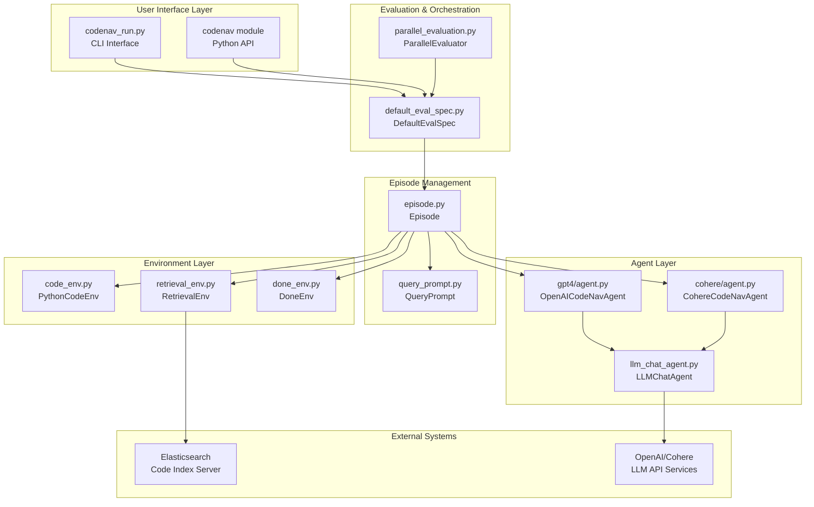
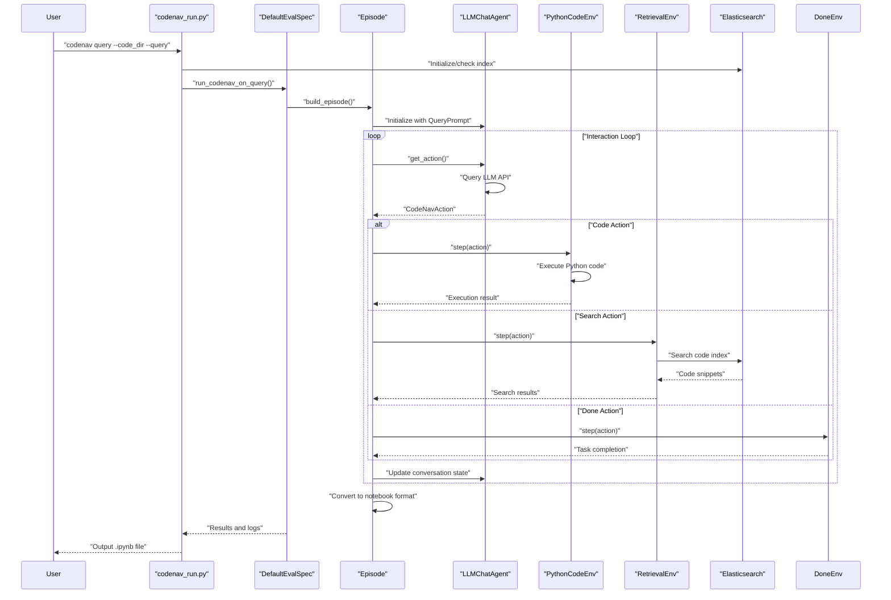
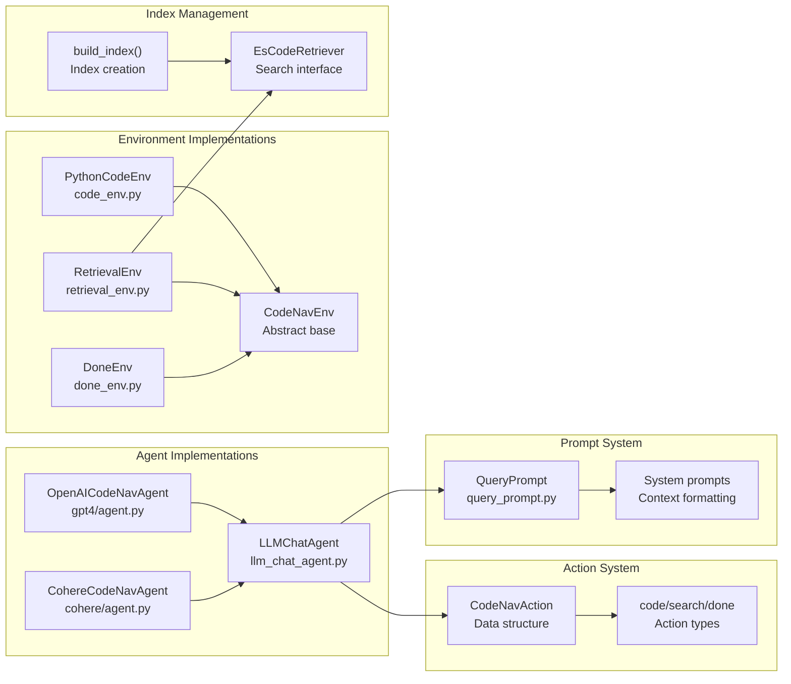
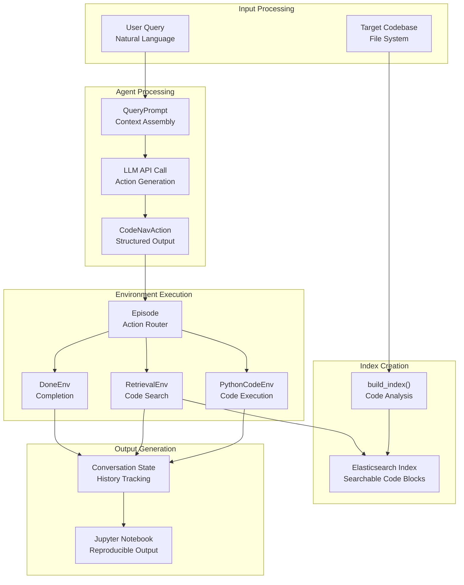

<!-- source: DeepWiki mcp.deepwiki.com · repo allenai/codenav · page 1 Overview · fetched 2026-10-26 -->

# Overview

Relevant source files

The following files were used as context for generating this wiki page:

- [README.md](README.md)

## Purpose and Scope

This document provides a comprehensive overview of CodeNav, an LLM-powered code navigation system that enables users to interact with and leverage unfamiliar codebases through natural language queries. This page covers the system's architecture, core components, and high-level workflow.

For specific usage instructions, see [Getting Started](#2). For detailed component documentation, see [Core Architecture](#3). For evaluation and experimentation capabilities, see [Evaluation Framework](#4).

## What is CodeNav?

CodeNav is an LLM agent system that automatically navigates and leverages previously unseen code repositories to solve user queries. Unlike traditional tool-use LLM agents that require manual registration of tools, CodeNav automatically indexes code repositories, searches for relevant code snippets, imports them, and uses them to iteratively generate solutions with execution feedback.

The system operates through three main interaction patterns:
- **Code execution**: Running Python code in a controlled environment
- **Code retrieval**: Searching indexed codebases for relevant snippets
- **Task completion**: Signaling when a query has been resolved

**Sources:** [README.md:14-14]()

## System Architecture Overview

CodeNav follows a layered architecture with clear separation between user interfaces, orchestration logic, agent implementations, and execution environments.

**Sources:** [README.md:24-36](), diagrams from system analysis

## Core Workflow

The following sequence illustrates how a user query flows through the system from CLI invocation to final output generation:

**Sources:** [README.md:31-36](), system architecture diagrams

## Key Components and Code Entities

The following diagram maps the main conceptual components to their concrete implementations in the codebase:

**Sources:** File structure analysis, component relationships from diagrams

## Data Flow Architecture

CodeNav processes user queries through a structured data flow that transforms natural language into executable actions:

| **Stage** | **Input** | **Component** | **Output** |
|-----------|-----------|---------------|------------|
| **Query Processing** | Natural language query | `QueryPrompt` | Formatted system prompt |
| **Action Generation** | System prompt + conversation | `LLMChatAgent` | `CodeNavAction` object |
| **Environment Routing** | `CodeNavAction` | `Episode` | Environment-specific execution |
| **Code Execution** | Python code string | `PythonCodeEnv` | Execution results/errors |
| **Code Retrieval** | Search query | `RetrievalEnv` → `EsCodeRetriever` | Relevant code snippets |
| **Task Completion** | Done signal | `DoneEnv` | Episode termination |
| **Output Generation** | Interaction history | `Episode` | Jupyter notebook |

The system maintains state through the `Episode` class, which orchestrates the conversation between agents and environments while logging all interactions for later analysis and reproduction.

**Sources:** [README.md:44-87](), workflow analysis from system diagrams

---

