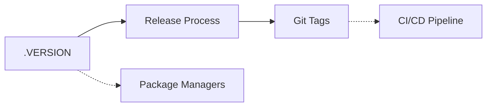
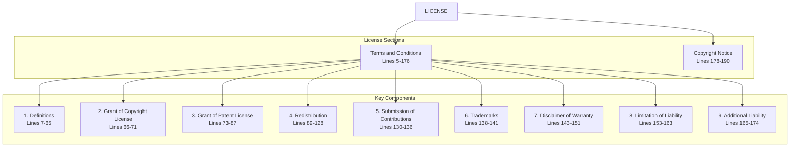
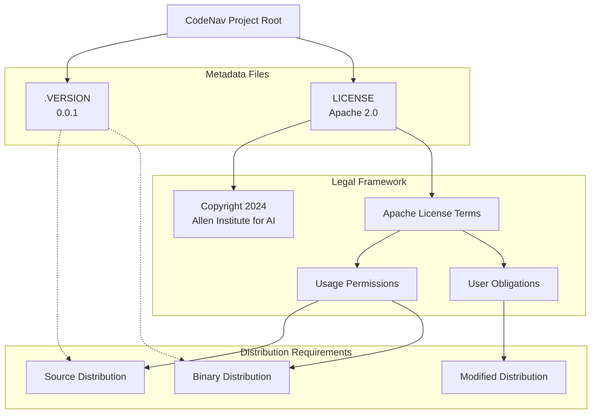

<!-- source: DeepWiki mcp.deepwiki.com · repo allenai/codenav · page 10 Project Metadata · fetched 2026-10-26 -->

# Project Metadata

<details>
<summary>Relevant source files</summary>

The following files were used as context for generating this wiki page:

- [.VERSION](.VERSION)
- [LICENSE](LICENSE)

</details>


This document covers the project metadata for CodeNav, including version information, licensing terms, and copyright details. This metadata defines the legal and versioning framework under which the CodeNav system operates.

For information about project configuration and system constants, see [Configuration and Constants](#7). For development and contribution guidelines, see [Development and Contributing](#9).

## Version Information

The CodeNav project uses semantic versioning to track releases and development progress. The current version is maintained in the project's version file.

### Current Version

| Component | Version | Location |
|-----------|---------|----------|
| CodeNav | 0.0.1 | [.VERSION:1]() |

The version information indicates that CodeNav is currently in early development (version 0.0.1), suggesting this is a pre-release or initial development version of the system.

### Version Management



**Sources:** [.VERSION:1]()

## License Information

CodeNav is licensed under the Apache License, Version 2.0, which is a permissive open-source license that allows for both commercial and non-commercial use with specific terms and conditions.

### License Summary

| Aspect | Details |
|--------|---------|
| License Type | Apache License 2.0 |
| License Date | January 2004 |
| Copyright Holder | Allen Institute for AI |
| Copyright Year | 2024 |

### Key License Provisions

The Apache License 2.0 provides the following key permissions and requirements:

**Permissions:**
- Commercial use
- Distribution
- Modification
- Patent use
- Private use

**Conditions:**
- License and copyright notice inclusion
- State changes when modifying the work

**Limitations:**
- No trademark use
- No warranty
- No liability

### License File Structure



**Sources:** [LICENSE:1-191]()

## Copyright and Attribution

### Copyright Information

The CodeNav project is copyrighted by the Allen Institute for AI as of 2024. This copyright covers all original work within the project, including source code, documentation, and associated materials.

**Copyright Notice:**
```
Copyright 2024 Allen Institute for AI
```

### Attribution Requirements

When using or redistributing CodeNav, the following attribution requirements must be met according to the Apache License 2.0:

1. **License Inclusion**: Include a copy of the Apache License 2.0
2. **Copyright Notice**: Retain the copyright notice for Allen Institute for AI
3. **Modification Notice**: If modifying the code, clearly state the changes made
4. **NOTICE File**: If present, include attribution notices from any NOTICE file

### Project Metadata Hierarchy



**Sources:** [LICENSE:178-190](), [.VERSION:1]()

## Compliance and Usage Guidelines

### For End Users

When using CodeNav in your projects:

1. Include the license file ([LICENSE]()) in your distribution
2. Retain copyright notices
3. No additional restrictions beyond those in the Apache License 2.0

### For Contributors

When contributing to CodeNav:

1. Contributions are submitted under the same Apache License 2.0 terms
2. No additional copyright assignment required
3. Follow the contribution guidelines outlined in [Development and Contributing](#9)

### For Redistributors

When redistributing CodeNav or derivative works:

1. Include the original license and copyright notices
2. Clearly mark any modifications made
3. Do not use Allen Institute for AI trademarks without permission
4. Provide appropriate attribution

**Sources:** [LICENSE:130-136](), [LICENSE:89-128]()