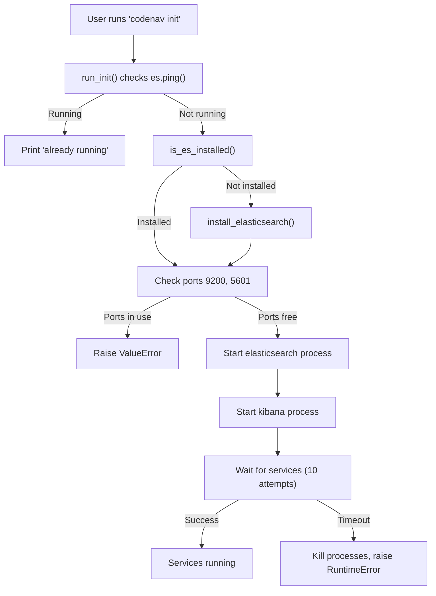
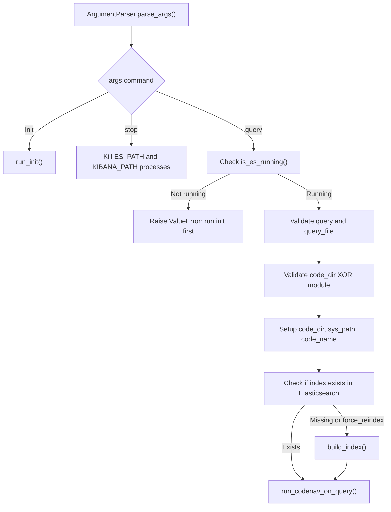
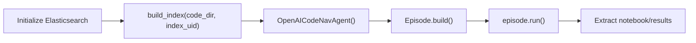
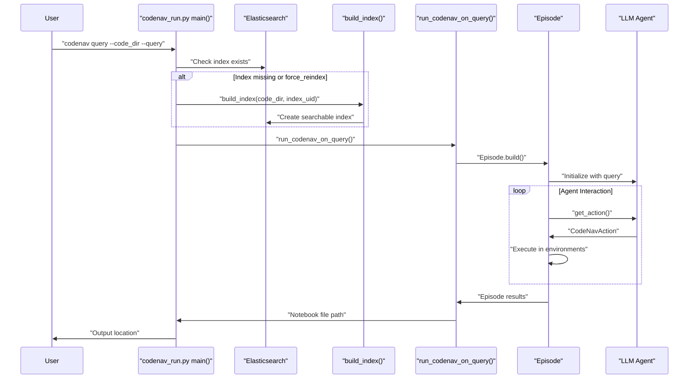

<!-- source: DeepWiki mcp.deepwiki.com · repo allenai/codenav · page 2 Getting Started · fetched 2026-10-26 -->

# Getting Started

<details>
<summary>Relevant source files</summary>

The following files were used as context for generating this wiki page:

- [README.md](README.md)
- [codenav/codenav_run.py](codenav/codenav_run.py)

</details>


This document provides installation instructions and basic usage examples for CodeNav, covering both command-line interface and Python library usage. For detailed information about the core architecture and system components, see [Core Architecture](#3). For advanced evaluation workflows, see [Evaluation Framework](#4).

## Installation

CodeNav can be installed directly from the GitHub repository:

```bash
pip install git+https://github.com/allenai/codenav
```

After installation, CodeNav provides both a command-line interface and a Python library for programmatic access.

Sources: [README.md:20-22]()

## Prerequisites: Elasticsearch Setup

CodeNav requires Elasticsearch for code indexing and retrieval. The system automatically manages Elasticsearch installation and startup through the CLI.

### Initialize Elasticsearch

Before using CodeNav, you must start the Elasticsearch service:

```bash
codenav init
```

This command performs the following operations via the `run_init()` function:
- Downloads and installs Elasticsearch if not present
- Starts Elasticsearch server on port 9200
- Starts Kibana dashboard on port 5601
- Validates that both services are running correctly

### Stop Elasticsearch

When finished with CodeNav, stop the Elasticsearch services:

```bash
codenav stop
```

This command terminates all processes associated with `ES_PATH` and `KIBANA_PATH`.

**Elasticsearch Management Workflow**


Sources: [codenav/codenav_run.py:40-107](), [codenav/codenav_run.py:179-183]()

## Command-Line Interface

The CLI is implemented in `codenav_run.py` and provides three main commands accessed through the `main()` function.

### Basic Query Command

```bash
codenav query \
  --code_dir /path/to/codebase \
  --playground_dir /working/directory \
  --query "Your query here"
```

### CLI Command Arguments

| Argument | Type | Description |
|----------|------|-------------|
| `--code_dir` | str | Path to codebase for indexing (mutually exclusive with `--module`) |
| `--module` | str | Installed Python module to use (mutually exclusive with `--code_dir`) |
| `--playground_dir` | str | Working directory for agent execution |
| `--query` | str | Query string for the agent to solve |
| `--query_file` | str | Path to file containing query text |
| `--max_steps` | int | Maximum interaction rounds (default: 20) |
| `--force_reindex` | bool | Force recreation of Elasticsearch index |
| `--force_subdir` | str | Index only specified subdirectory |
| `--repo_description_path` | str | Path to repository description file |

### CLI Command Processing Flow

**CLI Argument Processing and Execution**


Sources: [codenav/codenav_run.py:109-252]()

## Python Library Usage

CodeNav can be used programmatically by importing the `codenav` module. The system provides several example scripts demonstrating different usage patterns.

### Core Example Scripts

The `codenav_examples` directory contains demonstrations of key functionality:

| Script | Purpose | Key Classes/Functions |
|--------|---------|----------------------|
| `create_index.py` | Index creation and search | `build_index()`, `RetrievalEnv` |
| `create_episode.py` | Agent instantiation and execution | `OpenAICodeNavAgent`, `Episode` |
| `create_code_env.py` | Code execution environment | `PythonCodeEnv` |
| `create_prompt.py` | Custom prompt creation | Prompt system classes |
| `parallel_evaluation.py` | Multi-process evaluation | `EvalSpec` abstraction |

### Basic Programmatic Usage Pattern

The typical programmatic workflow follows this sequence:

1. Initialize Elasticsearch (same as CLI: `python -m codenav.codenav_run init`)
2. Create index for target codebase
3. Instantiate agent and environments
4. Execute episode with query
5. Process results

**Programmatic Usage Flow**


### Integration with Core Functions

The library usage ultimately calls the same core function as the CLI:

- CLI calls `run_codenav_on_query()` from `default_eval_spec.py`
- Library usage can directly call `run_codenav_on_query()` or build components manually
- Both approaches use the same underlying `Episode`, agent, and environment classes

Sources: [README.md:107-121](), [codenav/codenav_run.py:12]()

## Basic System Workflow

The following diagram shows how user inputs flow through the system components:

**End-to-End CodeNav Execution Flow**


This workflow demonstrates how the CLI command `codenav query` triggers the creation of an Elasticsearch index (if needed), then executes the core evaluation logic through `run_codenav_on_query()`, which orchestrates the agent-environment interaction loop.

Sources: [codenav/codenav_run.py:227-248](), [codenav/default_eval_spec.py:12]()

## Important Considerations

### Index Management
- CodeNav indexes each codebase exactly once
- Use `--force_reindex` flag when codebase changes
- Monitor indexed content via Kibana at `http://localhost:5601/`

### Security Warning
CodeNav can execute arbitrary code and is not suitable for security-sensitive environments. Always run in sandboxed environments where data loss or security breaches are not a concern.

Sources: [README.md:123-136]()

---

